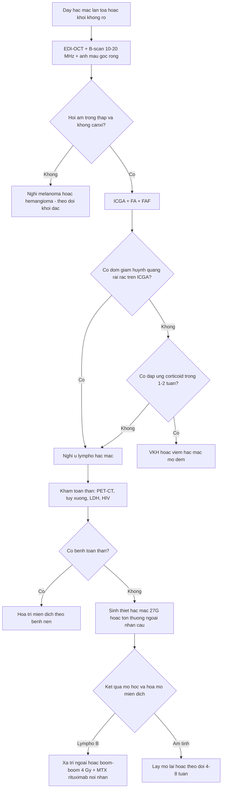
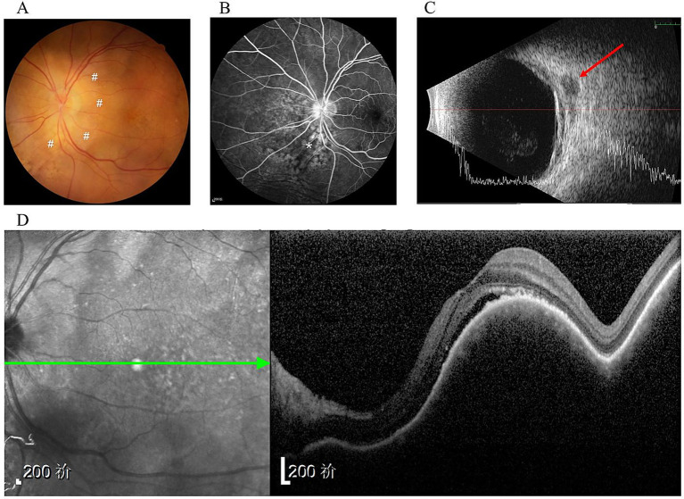
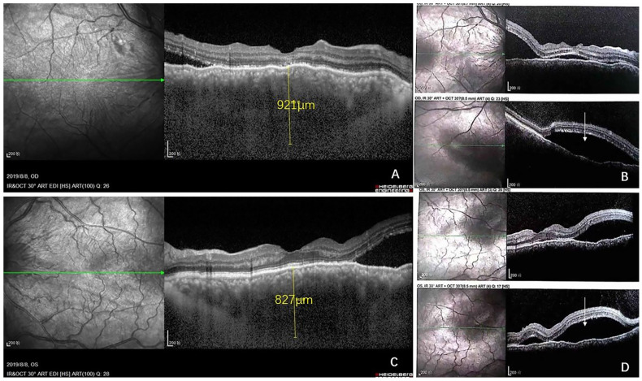
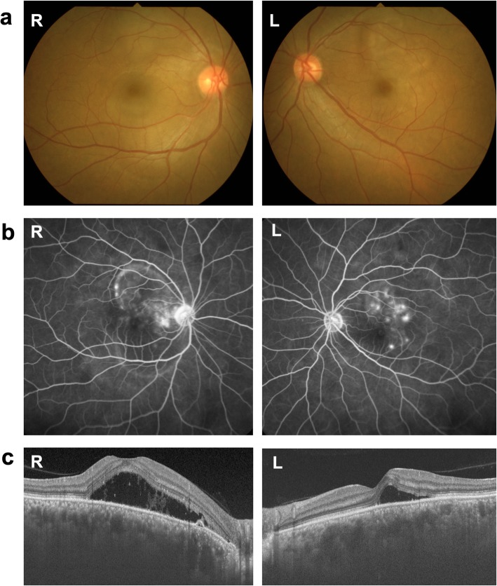

# 493 — U lympho nguyên phát của hắc mạc: dày hắc mạc kín đáo, trễ chẩn đoán tới 2 năm, phân biệt melanoma / di căn / hemangioma / VKH / Primary choroidal lymphoma

**Tags:** `pattern:day-hac-mac` `pattern:khoi-noi-nhan-cau` `pattern:bong-thanh-dich` `vung:hac-mac` `vung:hoang-diem` `score:IL-10-IL-6` `protocol:EDI-OCT` `protocol:FA-ICGA` `protocol:sinh-thiet-hac-mac`
**Mức chắc chắn (certainty):** tổng hợp y văn (literature synthesis) — review hình ảnh mở CC BY 4.0 (Clin Exp Ophthalmol 2026, Mayo Clinic) + 4 ca nguyên văn CC BY 4.0 (Front Med 2025, Curr Oncol 2022, BMC Ophthalmol 2020, J Med Case Rep 2022); số liệu lấy nguyên từ bài gốc, tên tác giả đối chiếu PMCID.

> **Bài này trả lời 4 câu hỏi khi gặp một "khối/dày hắc mạc không rõ":** (1) **Dấu hiệu nào khiến nghĩ lympho chứ không phải melanoma?** (2) **Đo bằng gì — EDI-OCT hay siêu âm?** (3) **Lấy mô ở đâu, có nguy hiểm không?** (4) **Điều trị và theo dõi ra sao?**
> Nối tiếp [491 – PVRL theo dõi tái phát](../491-pvrl-theo-doi-tai-phat/lesson.md) (u lympho **dịch kính–võng mạc**) và [492 – Sinh thiết hắc mạc/dịch kính](../492-sinh-thiet-hac-vong-mac-dich-kinh/lesson.md) (kỹ thuật lấy mô). Bài này tập trung vào **thể hắc mạc**, nơi **không có tổn thương dịch kính/dưới RPE điển hình**.

## 1. Tổng quan bệnh học – cơ chế hình ảnh

### 1.1 Vì sao u lympho hắc mạc "tàng hình" — mô bệnh học giải thích mọi dấu hiệu

- **Tế bào lympho ác tính xâm nhập lớp mô đệm hắc mạc theo dạng thấm (permeative), không tạo khối đẩy:** hắc mạc **dày lên nhưng bề mặt võng mạc phía trên còn nguyên** ở giai đoạn đầu (khác melanoma **đẩy** võng mạc thành vòm). Đây là lý do bệnh nhân **chỉ mờ nhẹ, kéo dài nhiều tháng** → **trễ chẩn đoán tới 2 năm**.
- **Vì sao B-scan thấy "rỗng âm" (hypoechoic/acoustic hollow):** mô u là **tế bào đồng nhất, ít collagen, không canxi** → ít mặt phân cách phản xạ → **hồi âm thấp**; **melanoma** có **hồi âm trong cao** (tế bào gai, sắc tố, mạch) và **hemangioma** hồi âm **cao** do các vách mạch. Đây là **chốt siêu âm** quan trọng nhất.
- **Vì sao OCT thấy "mặt biển động" (seasick):** xâm nhập **dạng nốt/dải không đều** dưới hắc mạc → bề mặt trong hắc mạc **nhấp nhô**; mức nhấp nhô **tương quan với độ dày u** (calm 1,7 mm → undulating 4,1 mm). Thêm **dịch dưới võng mạc** do rối loạn chức năng RPE/bơm hắc mạc.
- **Vì sao ICGA là modality ưu tiên:** ICGA dùng **hồng ngoại 790–805 nm** xuyên qua RPE, thấy tuần hoàn hắc mạc; u lympho tạo **đốm giảm huỳnh quang (hypofluorescent)** do **che lấp (masking)** các mao mạch hắc mạc — **100% mắt trong các loạt ca** có đốm giảm huỳnh quang nhỏ, rải rác. **FA** chỉ cho thấy **rò điểm (pinpoint leakage)** → **bắt chước VKH**.
- **Vì sao có thể lan ra ngoài củng mạc:** tế bào lympho đi theo **ống củng mạc (emissarial canal)** của mạch thần kinh → **khối epibulbar hình lưỡi liềm/hạt đậu** phía sau nhãn cầu — dấu hiệu **rất gợi ý** nhưng **cũng gặp ở melanoma lan ngoài củng mạc**.
- **Sinh học:** đa số **u lympho hắc mạc nguyên phát là lympho B mức thấp (marginal zone/EMZL)**, tuổi muộn, tiến triển **chậm**; thể **thứ phát** (từ DLBCL toàn thân) tiến triển **nhanh**, tiên lượng theo bệnh nền.

### 1.2 Ngưỡng định lượng nằm lòng (bắt buộc nhớ)

| Chỉ số | Con số | Nguồn |
|---|---|---|
| Tỷ lệ mắc u lympho nội nhãn (Mỹ, 1995–2018) | **0,245 ca/triệu dân/năm** | Clin Exp Ophthalmol 2026 (PMC12863966) |
| Trễ chẩn đoán | **tới 2 năm** | *cùng nguồn* |
| Thâm nhiễm hắc mạc vàng–trắng trên ảnh màu | **100%** mắt; dạng **rời rạc 91,2%**, dạng **mảng 5,9%** | loạt 34 mắt (21 bệnh nhân) |
| Dày hắc mạc lan tỏa / nếp gấp hắc mạc | **47,1%** / **11,8%** | *cùng nguồn* |
| Vị trí tổn thương | **trước xích đạo 67,6%**, hậu cực 52,9%, dọc xích đạo 44,1% | *cùng nguồn* |
| EDI-OCT: khu trú **một ổ / nhiều ổ / lan tỏa** | **21% / 29% / 50%** | loạt 14 mắt |
| Độ dày u trên siêu âm: bề mặt **phẳng** so với **nhấp nhô** | **1,7 mm** so với **4,1 mm** | *cùng nguồn* |
| FAF: dạng **leopard spot** / lan tỏa / **bình thường** | **30% / 11% / 59%** | loạt 17 mắt |
| Đốm giảm huỳnh quang trên ICGA | **100%** mắt | loạt 34 mắt |
| Siêu âm phát hiện lan ngoài củng mạc | **~76%** mắt (lưỡi liềm 86,4%; nốt 45,5%) | loạt 29 mắt |
| Siêu âm **đo dày quá** so với EDI-OCT | **+66%** | *cùng nguồn* |
| Tỷ lệ IL-10/IL-6 trong dịch kính | **> 1** gợi ý lympho (ca dưới đây = **0** vì tổn thương **thể hắc mạc**, dịch kính không tiếp xúc u) | Curr Oncol 2022 |
| Xạ trị toàn nhãn: sống còn 2 năm | **94%** | Curr Oncol 2022 (trích) |
| EBRT: thoái triển u dài hạn / thị lực ổn định–tốt hơn | **96% / 76%** (theo dõi trung bình 6 năm) | *cùng nguồn* |
| Liều "boom-boom" siêu thấp | **4 Gy / 2 phân liều / 2 ngày** + MTX + rituximab nội nhãn | J Med Case Rep 2022 (PMC9035257) |

## 2. Mẫu hình + chẩn đoán phân biệt theo vị trí (gamut)

**Câu hỏi lọc:** *"Dày hắc mạc **lan tỏa** (không phải khối vòm rõ), **hồi âm thấp** trên B-scan, **đốm giảm huỳnh quang** trên ICGA, **không canxi** — và bệnh nhân **lớn tuổi, mờ mắt kéo dài**?"* → nghĩ **lympho hắc mạc** trước cả melanoma.

- **Hậu cực / hoàng điểm (posterior pole):**
  - **U lympho hắc mạc:** dày lan tỏa, **bề mặt nhấp nhô**, **dịch dưới võng mạc**, thâm nhiễm vàng–trắng **dưới võng mạc**.
  - **Melanoma hắc mạc thể lan tỏa:** khối **vòm**, **hồi âm trong cao**, sắc tố, **vỡ sắc tố/Drusen cam**, thường **một mắt**.
  - **Hemangioma hắc mạc:** **hồi âm cao**, màu **đỏ cam**, trên OCT **dày hắc mạc + "lỗ châm" (pachyvessels)**.
  - **Di căn hắc mạc:** nhiều ổ, **màu kem**, tiền sử ung thư, thường **hai mắt**.
- **Trước xích đạo / chu biên (peripheral):**
  - **U lympho hắc mạc** hay ở **trước xích đạo (67,6%)**, có thể lan **epibulbar** qua ống củng mạc.
- **Toàn bộ hắc mạc (diffuse):**
  - **Bệnh VKH (Vogt–Koyanagi–Harada):** **hai mắt**, dày hắc mạc + SRD + **viêm dịch kính**, đáp ứng **corticoid**; trên ICGA đốm giảm huỳnh quang **mất dần khi viêm lắng**.
  - **Tràn dịch hắc mạc (choroidal effusion):** do **hạ nhãn áp, thuốc, phẫu thuật** — hồi âm **trống**, không có thâm nhiễm tế bào, **thay đổi theo tư thế**.
  - **Viêm hắc mạc mô đệm (stromal choroiditis):** dày hắc mạc, **đáp ứng corticoid**, không có khối ngoài củng mạc.

- **Điểm cần nhớ từ hình trên:** **"salmon patch"** ở kết mạc (A) là **dấu hiệu lan ra ngoài nhãn cầu** — gặp ở u lympho nhưng **cũng gặp ở lymphoma kết mạc**; khi có **mảng hồng–cam + dày hắc mạc**, phải **sinh thiết cả hai vị trí** (ở ca này sinh thiết kết mạc cho chẩn đoán).

## 3. Bảng so sánh phân biệt (ma trận đối chiếu)

| Thực thể | Hình ảnh điển hình | Chốt vào (rule-in) | Chốt loại (rule-out) | Gợi ý xác nhận |
|---|---|---|---|---|
| **U lympho hắc mạc (nguyên phát)** | Dày hắc mạc **lan tỏa/dạng nốt**, bề mặt **nhấp nhô (seasick)**, **hồi âm thấp**, đốm **giảm huỳnh quang trên ICGA**, FAF thường **bình thường** | **Dày hắc mạc lan tỏa + hồi âm thấp + đốm giảm huỳnh quang ICGA + không canxi**, ở người **> 60 tuổi mờ mắt kéo dài** | **Có canxi hóa thô, hồi âm trong cao, khối vòm rõ → không phải lympho** | **EDI-OCT + B-scan + ICGA**; sinh thiết hắc mạc/kết mạc; **IL-10/IL-6**; PET-CT + tủy xương |
| **Melanoma hắc mạc** | Khối **vòm**, sắc tố, **hồi âm trong cao**, Drusen cam, **không có đốm giảm huỳnh quang kiểu rải rác** | **Hồi âm trong cao + sắc tố + khối vòm + một mắt** | **Dày lan tỏa phẳng, hồi âm thấp → ít khả năng melanoma** | Siêu âm 10–20 MHz; FNAB nếu cần; theo dõi tăng kích thước |
| **Hemangioma hắc mạc** | Màu **đỏ cam**, **hồi âm cao**, dày hắc mạc + mạch hắc mạc lớn (pachyvessels) | **Hồi âm cao + màu đỏ cam + không lan ngoài củng mạc** | **Hồi âm thấp, thâm nhiễm vàng–trắng → không phải hemangioma** | EDI-OCT (pachyvessels), ICGA |
| **Di căn hắc mạc** | Nhiều ổ **màu kem**, **hai mắt**, tiền sử ung thư | **Nhiều ổ hai mắt + tiền sử ung thư nguyên phát** | **Một ổ đơn độc không tiền sử → vẫn phải loại lympho** | PET-CT, sinh thiết nếu cần |
| **VKH** | **Hai mắt** dày hắc mạc + SRD + **viêm dịch kính**, đốm giảm huỳnh quang **mất khi điều trị** | **Đáp ứng nhanh với corticoid + hai mắt + viêm dịch kính** | **Không đáp ứng corticoid, hắc mạc vẫn dày, có khối ngoài củng mạc → không phải VKH** | Theo dõi độ dày hắc mạc sau corticoid 1–2 tuần |
| **Tràn dịch hắc mạc** | Hồi âm **trống**, thay đổi theo tư thế, bong hắc mạc | **Liên quan hạ nhãn áp/phẫu thuật + hồi âm trống** | **Có thâm nhiễm tế bào, dày không đổi theo tư thế → không phải tràn dịch** | B-scan, đo nhãn áp |

## 4. Protocol chụp + quy trình chẩn đoán

### 4.1 Bộ ảnh tối thiểu (làm trong 1 buổi)

1. **Ảnh màu đáy mắt góc rộng** (hoặc 7 trường) — ghi vị trí, dạng **rời rạc/mảng/lan tỏa**.
2. **EDI-OCT (enhanced depth imaging)** — đo **độ dày hắc mạc theo µm**, mô tả **khu trú** và **bề mặt** (phẳng / gợn nhỏ / **nhấp nhô "seasick"**), **độ sâu xâm nhập** (chỉ sâu vs nông + sâu).
3. **B-scan siêu âm 10–20 MHz** — **hồi âm trong** (chốt phân biệt), **lan ngoài củng mạc**, **không canxi**. **Không dùng siêu âm để đo độ dày** (đo quá **+66%** so với EDI-OCT).
4. **ICGA** (ưu tiên hơn FA ở thể hắc mạc) + **FA** nếu cần đánh giá rò/RPE.
5. **FAF** — dạng **leopard spot** chỉ có **30%**; **FAF bình thường (59%) không loại trừ**.
6. **MRI hốc mắt** (T1/T2 ± gadolinium) khi nghi **lan ngoài củng mạc/hốc mắt** hoặc cần phân biệt khối hốc mắt.
7. **Toàn thân:** **PET-CT, CT ngực–bụng–chậu, tủy xương, LDH, β2-microglobulin, sIL-2R, HIV** — vì **đa số u lympho hắc mạc là thứ phát**; thể nguyên phát chỉ chẩn đoán **sau khi loại trừ** bệnh toàn thân.

### 4.2 Lấy mô — chỉ khi ảnh không đủ chốt

- **Sinh thiết hắc mạc qua pars plana 27 G** (kim nhỏ ít biến chứng, **không giảm giá trị chẩn đoán** so với kim lớn) hoặc **sinh thiết chorioretinal**; **FNAB xuyên dịch kính** là cách phổ biến nhưng **mẫu nhỏ, dễ artifact**.
- **Ưu tiên sinh thiết tổn thương ngoài nhãn cầu dễ tiếp cận** (kết mạc, hốc mắt) nếu có — như ca "salmon patch" ở trên.
- **Xét nghiệm mô:** H&E + **hóa mô miễn dịch CD20, CD79a, BCL2, CD3, Ki-67, MUM1, c-myc** + **PCR clonality (IgH)**.
- **Dịch kính/khoang dưới võng mạc:** **IL-10/IL-6 > 1** gợi ý lympho (nhưng **thể hắc mạc đơn thuần có thể âm**, ca dưới đây = 0).

### 4.3 Điều trị (không có chuẩn hóa — chọn theo thể và toàn trạng)

| Tình huống | Lựa chọn | Ghi chú |
|---|---|---|
| **U lympho hắc mạc khu trú, không bệnh toàn thân** | **Xạ trị ngoài (EBRT)** hoặc **xạ trị siêu thấp liều "boom-boom" 4 Gy/2 phân liều** | EBRT: sống còn 2 năm **94%**, thoái triển **96%**, thị lực ổn định/tốt hơn **76%** |
| **Có bệnh toàn thân (DLBCL, PCNSL)** | **Hóa trị/liệu pháp miễn dịch toàn thân** (R-CHOP, HD-MTX, rituximab) | Tổn thương mắt **thoái triển nhanh** khi điều trị đúng bệnh nền |
| **Tái phát/khu trú dai dẳng** | Xạ trị bổ sung (median **36 Gy**) ± **MTX + rituximab nội nhãn** | Theo dõi **độ dày hắc mạc** làm thước đo đáp ứng |
| **Mắt mù, đau, glaucom tân mạch** | **Bỏ nhãn cầu** (như ca 86 tuổi dưới đây) | Khi không còn chức năng và đau không kiểm soát |

### 4.4 Sơ đồ quyết định

## 5. Biến thể bình thường và cạm bẫy

- **"FAF bình thường nên loại lympho":** **59%** mắt u lympho hắc mạc có **FAF bình thường** — **không bao giờ** dùng FAF bình thường để loại trừ.
- **Đo độ dày bằng siêu âm:** siêu âm **đo quá +66%** so với EDI-OCT (khó xác định ranh giới hắc mạc–củng mạc, hiệu chỉnh máy) → **theo dõi đáp ứng bằng EDI-OCT**, dùng siêu âm để đánh giá **hồi âm và lan ngoài củng mạc**.
- **Thử corticoid như "test VKH":** u lympho hắc mạc **giả viêm** (pseudo-inflammatory) và **không đáp ứng corticoid** — nhưng **corticoid có thể làm giảm triệu chứng tạm thời** rồi bệnh tiếp tục; **dùng corticoid dài ngày có thể che lấp lymphoma** và làm chậm chẩn đoán. Nếu nghi, **theo dõi độ dày hắc mạc sau 1–2 tuần** thay vì điều trị mù.
- **Hai mắt + SRD = VKH?** Ca BMC Ophthalmol 2020: **hai mắt SRD + dày hắc mạc**, **corticoid không cải thiện**, sau đó xác định **DLBCL CD5+**; điểm khác biệt: **hắc mạc vẫn dày và tưới máu hắc mạc giảm kéo dài** trên LSFG, trong khi VKH **hồi phục tưới máu song song với giảm độ dày**.
- **Bất tương xứng OCT–ICGA:** ở lympho, **OCT thấy tổn thương rộng hơn ICGA**; ở các bệnh khác trong gamut (u hắc mạc, viêm mô đệm) **hai modality khớp nhau** — đây là **dấu hiệu tinh tế nhưng hữu ích**.
- **Xâm nhập "chỉ lớp sâu" → trễ chẩn đoán lâu hơn:** thể sâu đơn thuần có **thời gian trễ dài hơn**; đừng yên tâm vì "chỉ dày nhẹ".
- **Nhầm với tràn dịch hắc mạc sau phẫu thuật:** tràn dịch **hồi âm trống**, **thay đổi theo tư thế**, không có thâm nhiễm tế bào.
- **Bỏ sót lan ngoài củng mạc:** siêu âm phát hiện **~76%** — nếu **không thấy** trên siêu âm nhưng lâm sàng nghi, **MRI hốc mắt** là bước tiếp theo.
- **Không sinh thiết vì "sợ mù":** sinh thiết **27 G** cho **mẫu đủ** và ít biến chứng; **không có chẩn đoán mô học thì không có hóa trị/xạ trị đúng** — ca 86 tuổi chỉ được chẩn đoán **sau khi bỏ nhãn cầu** vì trễ 2 năm.

## 6. Tự lượng giá — Blind Quiz

**Ca 1 — Nam 86 tuổi, mờ mắt trái **2 năm** tăng dần. Đáy mắt: thâm nhiễm vàng–trắng dưới võng mạc hậu cực. Ảnh dưới đây gồm ảnh màu, FA, siêu âm và OCT.**

- Hỏi: (1) Ba dấu hiệu trên siêu âm/OCT gợi ý gì? (2) Chẩn đoán phân biệt chính? (3) Bước tiếp theo để chẩn đoán?

<b>Bấm để hiện đáp án (findings + chẩn đoán)</b>

- **Findings:** (A) **thâm nhiễm vàng–trắng dưới võng mạc** hậu cực (dấu #); (B) **FA** dạng **hyperfluorescence lốm đốm** (*) — không đặc hiệu; (C) **siêu âm: dày hắc mạc lan tỏa + khối giảm hồi âm sau nhãn cầu** (mũi tên) = **lan ngoài củng mạc**; (D) **EDI-OCT: bề mặt hắc mạc nhấp nhô "seasick" + dịch dưới võng mạc**, hắc mạc dày.
- **Chẩn đoán:** **u lympho vùng rìa (EMZL) nguyên phát của hắc mạc, lan ngoài củng mạc + tổn thương tủy xương** — xác định bằng **mô học sau bỏ nhãn cầu** (nhãn cầu mù, glaucom tân mạch đau không kiểm soát); PET-CT **không thấy ổ khác** → **nguyên phát**.
- **Vì sao trễ:** bệnh nhân chỉ **mờ dần 2 năm**, không đau, không viêm → **bỏ qua**; **không có tổn thương dịch kính** nên không nghĩ u lympho nội nhãn.
- **Bài học:** **khối hắc mạc + dày lan tỏa + hồi âm thấp + lan ngoài củng mạc** phải **sinh thiết sớm**, không chờ mù.
- **Nguồn ảnh:** Zhao L et al., *Front Med (Lausanne)* 2025 (PMC12597990), CC BY 4.0 — Fig. 1.

**Ca 2 — Nam 56 tuổi, mờ mắt hai bên. EDI-OCT dưới đây (A, C) kèm mặt cắt qua hố trung tâm (B, D).**

- Hỏi: (1) Đọc độ dày hắc mạc hai mắt. (2) Dịch nằm ở đâu? (3) Vì sao IL-10/IL-6 trong dịch kính có thể **âm tính** ở thể này?

<b>Bấm để hiện đáp án</b>

- **Findings:** (A) mắt phải **hắc mạc 921 µm**; (C) mắt trái **hắc mạc 827 µm** trên thước đo của ảnh (bài gốc ghi **882 µm** — chênh lệch do vị trí đặt thước, cần đọc cả hai); (B, D) **dịch dưới võng mạc (subfoveal fluid)** hai mắt, bề mặt hắc mạc **nhấp nhô**.
- **Chẩn đoán:** **u lympho hắc mạc** (ở ca gốc là **thể thứ phát** của **DLBCL** — chẩn đoán nhờ **sinh thiết hạch nách**, không phải sinh thiết mắt); hắc mạc bình thường **~250–350 µm** ở người lớn → **921 µm = dày gấp ~2,5–3 lần**.
- **Vì sao IL-10/IL-6 âm:** tổn thương **khu trú ở hắc mạc**, **dịch kính không tiếp xúc trực tiếp** với u → cytokine **không khuếch tán đủ** vào dịch kính; **IL-10/IL-6 > 1** có giá trị nhất ở **u lympho dịch kính–võng mạc**, không phải thể hắc mạc.
- **Nguồn ảnh:** Yang M et al., *Curr Oncol* 2022 (PMC9689627), CC BY 4.0 — Fig. 2.

**Ca 3 — Nữ 62 tuổi, mờ mắt hai bên 3 tháng, được chẩn đoán "VKH" và điều trị corticoid liều cao nhưng **không cải thiện**. Ảnh dưới đây: đáy mắt, FA và EDI-OCT lúc nhập viện.**

- Hỏi: (1) Dấu hiệu nào **không khớp** VKH? (2) Cần làm gì tiếp theo? (3) Điều gì xảy ra với hắc mạc khi điều trị đúng bệnh?

<b>Bấm để hiện đáp án</b>

- **Findings:** (a) đáy mắt: **bong thanh dịch hai bên + phù đĩa thị**; (b) FA: **rò điểm (pinpoint leakage) + pooling** — **giống VKH**; (c) EDI-OCT: **dịch dưới võng mạc + dày hắc mạc** hai mắt.
- **Không khớp VKH:** **không đáp ứng corticoid**; về sau **hắc mạc vẫn dày** trong khi **tưới máu hắc mạc giảm kéo dài** (LSFG) — VKH thì **tưới máu hồi phục song song với giảm độ dày**. Đây là **u lympho hắc mạc giả viêm** thứ phát **DLBCL CD5+**, chẩn đoán bằng **sinh thiết tủy xương**.
- **Bước tiếp theo:** **không tăng corticoid mù**; làm **B-scan (hồi âm thấp), ICGA (đốm giảm huỳnh quang), PET-CT, tủy xương**; **sinh thiết** nếu cần.
- **Khi điều trị đúng (hóa trị R-CHOP/HD-MTX):** **SRD và dày hắc mạc thoái triển nhanh**, thị lực hồi phục; **tưới máu hắc mạc có thể không hồi phục hoàn toàn** — dấu hiệu tổn thương vi mạch do u.
- **Nguồn ảnh:** Fukutsu K et al., *BMC Ophthalmol* 2020 (PMC7065374), CC BY 4.0 — Fig. 1.

## Bài liên quan chéo
- [491 – PVRL: theo dõi và tái phát](../491-pvrl-theo-doi-tai-phat/lesson.md)
- [492 – Sinh thiết hắc mạc & dịch kính: kỹ thuật, IL-10/IL-6](../492-sinh-thiet-hac-vong-mac-dich-kinh/lesson.md)
- [448 – U hắc mạc: melanoma vs nevus vs di căn](../448-u-hac-mac/lesson.md)
- [462 – U lympho nội nhãn (PVRL) vs viêm màng bồ đào giả danh](../462-u-lympho-noi-nhan-PVRL/lesson.md)
- [473 – U lympho T/NK nội nhãn & u lympho THỨ PHÁT ở mắt](../473-u-lympho-T-NK-va-u-lympho-thu-phat-o-mat/lesson.md)
- [475 – Viêm nội nhãn nội sinh do vi khuẩn](../475-viem-noi-nhan-noi-sinh-vi-khuan/lesson.md)
- [400 – Tổng quan Mắt & thị giác](../400-tong-quan-mat-thi-giac/lesson.md)

## Ảnh
- `images/493_lympho-hac-mac_Multimodal_PMC12597990.jpg` — Zhao L et al., *Front Med (Lausanne)* 2025 (PMC12597990), **CC BY 4.0**.
- `images/493_lympho-hac-mac_OCT_PMC9689627.jpg` — Yang M et al., *Curr Oncol* 2022 (PMC9689627), **CC BY 4.0**.
- `images/493_lympho-hac-mac_EDI-OCT_PMC7065374.jpg` — Fukutsu K et al., *BMC Ophthalmol* 2020 (PMC7065374), **CC BY 4.0**.
- `images/493_lympho-hac-mac_Fundus_PMC9035257.jpg` — Mahdizad Z et al., *J Med Case Rep* 2022 (PMC9035257), **CC BY 4.0**.
- Nguồn + giấy phép từng ảnh: [`images/CREDITS.md`](images/CREDITS.md).

> Không dùng để chẩn đoán độc lập khi chưa có người hướng dẫn.
