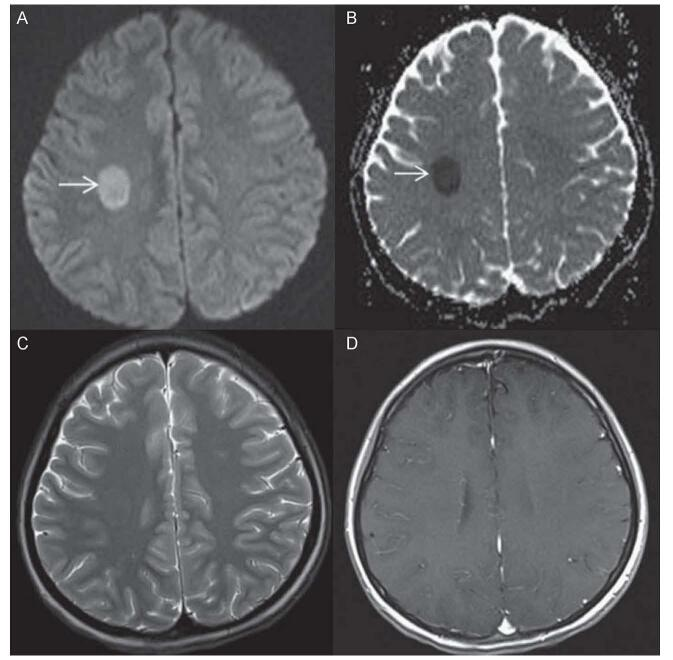
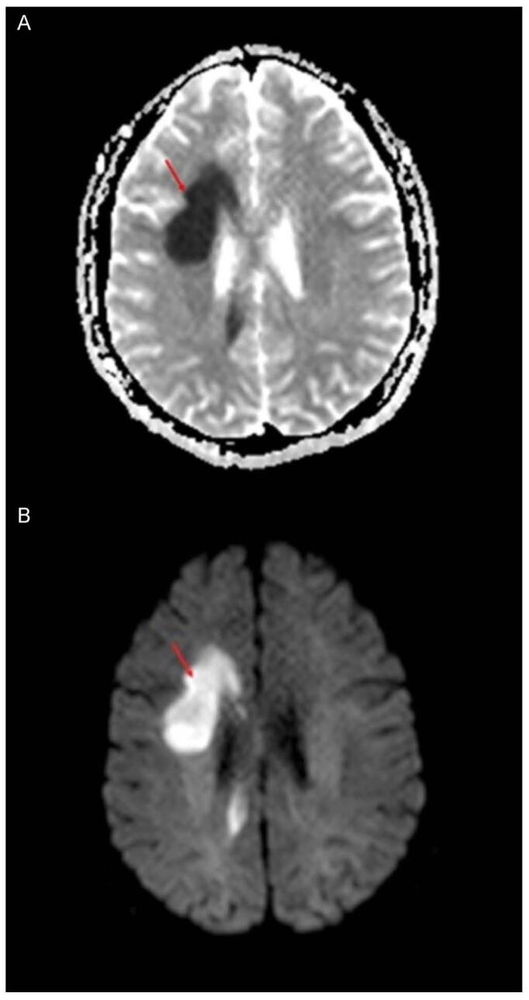
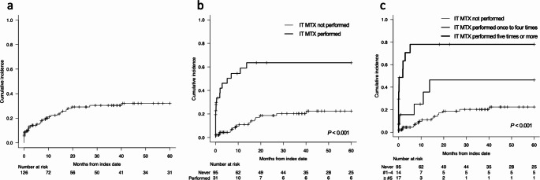
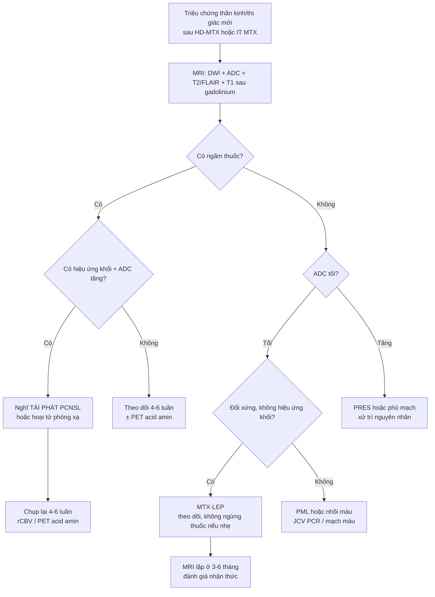
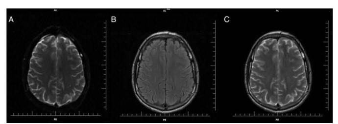

# 494 — Độc thần kinh của methotrexate (MTX leukoencephalopathy) sau điều trị u lympho nội nhãn/PCNSL: phân biệt với tái phát u / *Methotrexate-induced leukoencephalopathy*

**Tags:** `pattern:ton-thuong-chat-trang` `pattern:han-che-khuech-tan` `pattern:doi-xung` `vung:chat-trang` `score:CTCAE` `protocol:MRI-DWI` `protocol:MRI-tang-ngam`
**Mức chắc chắn (certainty):** tổng hợp y văn (literature synthesis) — 1 loạt hồi cứu 126 bệnh nhân u lympho hệ thần kinh trung ương (Ann Hematol 2025, PMC11971226), 1 tổng quan hình ảnh–cơ chế (Ann Med Surg 2025, PMC11981439) và số liệu của nghiên cứu ALL nhi khoa được tổng quan này trích lại (Bhojwani 2014). Số liệu lấy nguyên từ bài gốc; tên tác giả đối chiếu Europe PMC theo PMCID.

> **Bài này trả lời 4 câu hỏi khi bệnh nhân đã điều trị u lympho nội nhãn/PCNSL rồi xuất hiện triệu chứng thần kinh – thị giác:**
> (1) **Tổn thương chất trắng này là độc tính thuốc hay tái phát u?** (2) **Vì sao DWI sáng mà T2 lại bình thường, và vì sao KHÔNG ngấm thuốc?** (3) **Bao lâu thì xuất hiện, ai có nguy cơ, có phải ngừng methotrexate không?** (4) **Theo dõi bằng gì và bao lâu?**
> Nối [491 – PVRL: theo dõi & tái phát](../491-pvrl-theo-doi-tai-phat/lesson.md), [462 – U lympho nội nhãn (PVRL)](../462-u-lympho-noi-nhan-PVRL/lesson.md), [493 – U lympho hắc mạc](../493-u-lympho-nguyen-phat-hac-mac/lesson.md) và [242 – PACNS: duy trì & theo dõi](../242-pacns-duy-tri-theo-doi/lesson.md).

## 1. Tổng quan bệnh học – cơ chế hình ảnh

### 1.1 Vì sao methotrexate làm tổn thương chất trắng mà không phá hàng rào máu não

- **Cơ chế phân tử:** MTX là **kháng folate** — ức chế **dihydrofolate reductase (DHFR)**, làm giảm tetrahydrofolate → giảm tổng hợp nucleotide và **giảm chu trình methyl hóa** (methylation) của myelin. Hậu quả được đề xuất gồm: **giảm folate mạn trong não, tăng homocysteine (tác động lên thụ thể NMDA), tăng acid amin kích thích, rối loạn chuyển hoá biopterin và tích luỹ adenosine** (Ann Med Surg 2025, PMC11981439). Cơ chế **chưa được chứng minh dứt khoát** — bài tổng quan ghi rõ "còn tranh luận".
- **Mô bệnh học:** **hủy myelin (demyelination), myelin nhạt màu, không bào hoá myelin (myelin vacuolation), axonal spheroids, xâm nhập đại thực bào, và hoại tử** (cùng nguồn). Đây là tổn thương **nội bào/myelin**, không phải ổ nhồi máu.
- **Vì sao DWI sáng – ADC tối:** phù **nội myelin (intramyelinic edema)** làm nước bị giữ trong khoang nội bào → **giảm khuếch tán thật** (ADC thấp), khác với phù mạch (vasogenic) của u/hoại tử phóng xạ (ADC **tăng**). Đây là **chốt phân biệt cơ học** quan trọng nhất.
- **Vì sao T2/FLAIR có thể BÌNH THƯỜNG ở giai đoạn sớm:** lượng nước tăng thêm ít và khu trú; T2 chỉ đổi khi có phù tự do đủ lớn → **DWI dương tính trước T2** (ca minh hoạ dưới đây: DWI sáng, ADC tối, **T2 bình thường**).
- **Vì sao KHÔNG ngấm thuốc:** hàng rào máu não **còn nguyên** — tổn thương nằm trong nhu mô, không phải khối viêm có tăng tính thấm mạch. Tương ứng: T1 sau gadolinium **không thấy tổn thương** (cùng ca minh hoạ).
- **Vì sao tổn thương lại đối xứng, quanh não thất:** chất trắng sâu và **vành tia/quanh não thất** là nơi myelin dày, mật độ sợi cao, ít mạch nuôi dưỡng dự phòng → nhạy với độc chất chuyển hoá hơn vỏ não.
- **Hai kiểu hình cần phân biệt (điểm y văn KHÔNG thống nhất — xem mục 3):**
  - **Thể cấp/bán cấp sau truyền (acute/subacute MTX-LEP):** khởi phát **giờ–ngày** sau liều, **DWI sáng/ADC tối**, **T2 bình thường**, **không ngấm**; triệu chứng **hồi phục** (Salkade & Lim 2012, dẫn qua PMC11981439).
  - **Thể muộn sau điều trị (treatment-related LE):** **T2/FLAIR tăng tín hiệu đối xứng hai bên, KHÔNG ngấm gadolinium**, thường **không triệu chứng**, xuất hiện **trung vị 3 tháng** sau hoá trị (định nghĩa của Ann Hematol 2025, PMC11971226).
  - Vì hai định nghĩa khác nhau, một bệnh nhân có thể **DWI dương/T2 âm** ở tuần đầu và **T2 dương/DWI hết** ở tháng thứ 2–3 — **cùng một quá trình, hai thời điểm**.

### 1.2 Ngưỡng định lượng nằm lòng (bắt buộc nhớ)

| Chỉ số | Con số | Nguồn |
|---|---|---|
| Ngưỡng gọi là **liều cao (HD-MTX)** | **≥ 500 mg/m²** IV; có phác đồ tới **33.000 mg/m²**/tuần | Ann Med Surg 2025 (PMC11981439) |
| Thời gian từ MTX đến triệu chứng (bảng ca ALL) | **5 giờ – 4 tuần**; thể "stroke-like" **5–48 giờ** | *cùng nguồn* (bảng của Bhojwani 2014) |
| Tổn thương chất trắng trên MRI ở trẻ ALL **không triệu chứng** | **73/355 = 20,6%**; tồn tại lúc chụp lại **74%** | *cùng nguồn* |
| Ở trẻ ALL **có triệu chứng** | **100%** có tổn thương chất trắng; tồn tại **58%** | *cùng nguồn* |
| Tái dùng HD-MTX sau biến cố thần kinh | **12/13 ca không tái phát** triệu chứng | *cùng nguồn* |
| **tLE ở 126 bệnh nhân u lympho hệ TKTW** (R-MPV ± IT MTX, WBRT thích ứng) | **33 ca**; **trung vị 3,0 tháng**; tích luỹ **15,1% (6 tháng) – 29,2% (2 năm) – 32,0% (5 năm)** | Ann Hematol 2025 (PMC11971226) |
| Yếu tố nguy cơ độc lập duy nhất | **IT MTX: HR 4,50 (KTC 95%: 1,84–10,99), P < 0,001** | *cùng nguồn* |
| Tích luỹ 5 năm: **có** so với **không** IT MTX | **63,5%** so với **22,4%** | *cùng nguồn* |
| Có biểu hiện nhận thức đáng kể trên lâm sàng | **8/33** (phần lớn **không triệu chứng**) | *cùng nguồn* |
| Hình ảnh còn tồn tại ở lần MRI cuối | **33/33 (100%)** | *cùng nguồn* |
| Ảnh hưởng sống còn | EFS **HR 1,07 (0,50–2,27)**; OS **không khác biệt** | *cùng nguồn* |
| WBRT **45 Gy** + HD-MTX so với không WBRT | độc tính thần kinh lâm sàng **26%** so với **1/22 ca** | *cùng nguồn* (trích dẫn) |
| Tỷ lệ **MTX/LV giải độc ở 42 giờ** cao | **tăng nguy cơ** leukoencephalopathy | Ann Med Surg 2025 (PMC11981439) |
| Đa hình gen liên quan | **GSTP1, MTHFR, SHMT1** | *cùng nguồn* |

*(A) **DWI**: ổ tăng tín hiệu khu trú ở **trung tâm bán bầu dục phải** (mũi tên). (B) **ADC**: ổ **giảm tín hiệu** tương ứng → **hạn chế khuếch tán thật**, không phải "T2 shine-through". (C) **T2W**: **không thấy bất thường** ở cùng vùng. (D) **T1 sau gadolinium**: **không ngấm**. Bốn hình này là toàn bộ lập luận của mục 1. Nguồn: Ann Med Surg 2025 (PMC11981439), Fig 2, **CC BY 4.0**; hình trong bài tổng quan được chú thích là chỉnh từ Salkade & Lim 2012.*

## 2. Mẫu hình + chẩn đoán phân biệt theo vị trí & tính đối xứng (Gamut)

**Câu hỏi lọc:** *"Sau HD-MTX/IT MTX, bệnh nhân sa sút nhận thức hoặc yếu nửa người nhẹ; MRI có ổ **hạn chế khuếch tán** ở chất trắng sâu, **không ngấm**, **không hiệu ứng khối**?"* → **MTX-LEP**, không phải tái phát.

- **Chất trắng sâu đối xứng (trung tâm bán bầu dục, vành tia, quanh não thất):**
  - **MTX-LEP** (bài này): DWI sáng/ADC tối sớm; T2/FLAIR tăng đối xứng muộn; **không ngấm**.
  - **Hoại tử phóng xạ** (nếu có xạ trị): ngấm **vòng/vỏ**, phù **mạch** (ADC **tăng**), thường **6–24 tháng** sau xạ — nối [240](../240-hannover-schwannoma-tien-dinh-srs-vs-mo-cpa/lesson.md) (SRS) và mục 3.
  - **PRES** (nếu tăng huyết áp/thuốc): **phù mạch** vùng chẩm–đỉnh, ADC **tăng**, hồi phục khi xử lý nguyên nhân — nối [219](../219-pres-rcvs/lesson.md).
- **Tổn thương chất trắng KHÔNG đối xứng:**
  - **PML** (JCV, sau rituximab/ghép): **không ngấm**, **không hiệu ứng khối**, DWI sáng **ở bờ** lan dần; thường **dưới vỏ – uốn não**, không đối xứng.
  - **Tái phát PCNSL:** **khối ngấm đồng nhất**, phù, hiệu ứng khối, ngấm mạnh ở thì muộn; **ADC không giảm** (thường tăng do mật độ tế bào cao nhưng không "phù nội myelin").
  - **Nhồi máu não:** theo **một vùng cấp máu**, có **hiệu ứng khối**, ADC tối theo thời gian; khởi phát **đột ngột tối đa ngay**.
- **Thể vành thể chai (splenium):** MTX-LEP, **MERS (mild encephalitis with reversible splenial lesion)**, co giật, cai thuốc — cùng "DWI sáng, không ngấm, hồi phục".
- **Hình ảnh bình thường trên T2 nhưng bệnh nhân có triệu chứng:** luôn là lý do **bắt buộc chụp DWI** — đây là bài học của ca minh hoạ (mục 1).
- **Bối cảnh mắt:** bệnh nhân **PVRL** thường được **MTX nội nhãn** + **HD-MTX toàn thân**; mờ mắt/yếu thị trường mới **không mặc định là tái phát dịch kính–võng mạc** — phải loại **tổn thương thần kinh thị/đường thị giác do độc tính** bằng MRI có DWI. Nối [491](../491-pvrl-theo-doi-tai-phat/lesson.md).

## 3. Bảng so sánh phân biệt (ma trận đối chiếu)

| Thực thể (entity) | Hình ảnh điển hình | Chốt vào (rule-in) | Chốt loại (rule-out) | Gợi ý xác nhận |
|---|---|---|---|---|
| **MTX-LEP (bài này)** | Chất trắng sâu **đối xứng**, DWI sáng/ADC tối sớm, T2/FLAIR tăng muộn, **không ngấm**, **không hiệu ứng khối** | **Tiền sử HD-MTX/IT MTX trong 4 tuần–3 tháng + ADC TỐI + không ngấm** | Có ngấm đồng nhất/ngấm vòng, có hiệu ứng khối, ADC tăng → không phải LEP đơn thuần | Theo dõi 2–6 tuần: tổn thương **không to thêm**, triệu chứng **hồi phục** |
| **Tái phát PCNSL** | **Khối ngấm đồng nhất**, phù xung quanh, hiệu ứng khối, bờ không đều | **Ngấm rõ + hiệu ứng khối + tăng kích thước khi chụp lại** | Không ngấm, đối xứng, không hiệu ứng khối → nghĩ LEP | Chụp lại **4–6 tuần**; PET acid amin nếu còn nghi; sinh thiết chỉ khi thật cần |
| **Hoại tử phóng xạ** | **Ngấm vòng**, phù **mạch (ADC tăng)**, xuất hiện **6–24 tháng** sau xạ | **ADC TĂNG + ngấm vòng + trong trường xạ** | ADC tối, không ngấm → LEP | DSC-MRI (rCBV thấp), PET acid amin |
| **PML** | Chất trắng **dưới vỏ/uốn não**, **không đối xứng**, **không ngấm**, **không hiệu ứng khối**, DWI sáng ở **bờ** | **Không ngấm + lan dần + bối cảnh ức chế miễn dịch (rituximab/ghép/HIV)** | Đối xứng + trong não thất → LEP | **JCV PCR** trong dịch não tuỷ; theo dõi IRIS |
| **PRES** | Phù **mạch** vùng chẩm–đỉnh, **ADC tăng**, có thể xuất huyết nhỏ | **Tăng huyết áp/thuốc + ADC TĂNG + hồi phục** | ADC tối → không phải PRES | Kiểm soát huyết áp, chụp lại 1–2 tuần |
| **Nhồi máu não** | Theo **một vùng cấp máu**, có hiệu ứng khối, ADC tối | **Khởi phát đột ngột, tối đa ngay, theo vùng mạch** | Đối xứng hai bán cầu, nhiều ổ rời → LEP | MRA/CTA; siêu âm tim nếu trẻ |
| **MERS / tổn thương vành thể chai** | **Splenium** DWI sáng, hình "viên đạn", không ngấm | **Sau co giật/nhiễm trùng, hồi phục hoàn toàn** | Lan rộng ra ngoài thể chai + tiền sử MTX → LEP | MRI lặp lại sau 2–4 tuần |

*Ca khác: tổn thương **quanh não thất/vành tia** — (A) **ADC giảm tín hiệu mạnh** (mũi tên đỏ), (B) **DWI tăng tín hiệu** tương ứng. Cùng quy luật với hình mục 1 nhưng ở vị trí sâu hơn, sát não thất; không thấy hiệu ứng khối. Nguồn: Ann Med Surg 2025 (PMC11981439), Fig 5, **CC BY 4.0**; hình được chú thích là chỉnh từ ca của Oarbeascoa (2019) (ca độc tính quanh bồn Ommaya).*

### Ba câu hỏi đọc phim theo thứ tự (thay cho "đọc theo cảm giác")

1. **Có ngấm thuốc không?** Không ngấm → **loại** tái phát PCNSL và hoại tử phóng xạ (hai bệnh cảnh cần can thiệp ngay).
2. **ADC tối hay tăng?** **Tối** = phù nội bào/nội myelin (LEP, nhồi máu); **tăng** = phù mạch (u, hoại tử phóng xạ, PRES).
3. **Đối xứng và có hiệu ứng khối không?** **Đối xứng + không hiệu ứng khối** → LEP. Bất đối xứng + lan bờ → PML.

## 4. Protocol + phân độ + lịch theo dõi

### 4.1 Protocol MRI (tối thiểu, ở mọi lần chụp sau điều trị)

- **DWI + bản đồ ADC** (b=1000; đo ADC vùng tổn thương **và** vùng đối xứng lành để so sánh — không chỉ "nhìn sáng/tối").
- **T2W + FLAIR** (tìm tổn thương đối xứng muộn), **T1W sau gadolinium** (loại tái phát/hoại tử phóng xạ).
- **Lát ≤ 5 mm**, mặt phẳng ngang + FLAIR coronal nếu nghi tổn thương vành thể chai.
- Thêm **DSC-MRI (rCBV)** hoặc **PET acid amin** khi còn phân biệt với tái phát; **không** dùng corticoid trước khi chụp nếu có thể (làm mất dấu ngấm của u).
- **Đo:** số ổ, vị trí (trung tâm bán bầu dục/vành tia/quanh não thất/thể chai), **ADC trung bình (×10⁻³ mm²/s)**, mức lan, có/không ngấm, có/không hiệu ứng khối.

### 4.2 Phân độ và ngưỡng xử trí

| Bậc | Tiêu chuẩn | Xử trí |
|---|---|---|
| **Phân độ hình ảnh 0–3** (Bhojwani 2014, dẫn qua PMC11981439) | Mức lan tổn thương chất trắng trên MRI (0 = không có → 3 = lan rộng/nhiều vùng) | Dùng để **so sánh giữa các lần chụp**, không dùng một mình để quyết định |
| **CTCAE v5.0** (dùng trong PMC11971226) | Phân độ độc tính thần kinh lâm sàng | Quyết định **giảm/ngừng** liều và **báo cáo biến cố** |
| Không triệu chứng, tổn thương **nhỏ, không lan** | Thường gặp (**20,6%** trẻ ALL không triệu chứng; **phần lớn** tLE ở người lớn **không triệu chứng**) | **Tiếp tục phác đồ + theo dõi MRI**, không ngừng thuốc |
| Triệu chứng **nhẹ – trung bình** (chậm chạp, yếu nhẹ, nói khó) | Đa số **hồi phục trong ngày–tuần** (ca minh hoạ hồi phục trong **3 ngày**) | Hỗ trợ; **cân nhắc tái dùng MTX** — **12/13 ca tái dùng không tái phát** |
| Triệu chứng **nặng** (co giật, hôn mê, liệt rõ) | Hiếm | Ngừng HD-MTX/IT MTX, xử trí theo CTCAE, cân nhắc **acid folinic (leucovorin)** đủ liều và **aminophylline** (đã dùng trong một số ca) |
| **Nhiều lần IT MTX (≥ 5)** | **Tích luỹ 5 năm 63,5%** | Cân nhắc **giảm số lần IT MTX** — đây là yếu tố nguy cơ **duy nhất** điều chỉnh được |

### 4.3 Lịch theo dõi (dựa trên động học 3 tháng)

- **Kết thúc hoá trị cảm ứng (R-MPV) hoặc lần IT MTX cuối:** MRI **có DWI** — mốc nền.
- **3 tháng** (trung vị xuất hiện tLE = **3,0 tháng**): MRI lặp lại → bắt **phần lớn** biến cố.
- **6 tháng** (tích luỹ **15,1%**), **2 năm** (**29,2%**), **5 năm** (**32,0%**).
- Bất kỳ **triệu chứng thần kinh/thị giác mới** → MRI **ngay**, không chờ lịch.
- Lưu ý tiên lượng: **EFS/OS không khác** giữa có và không tLE (HR 1,07) → **không được vì "sợ độc tính" mà bỏ liều chữa bệnh**, nhưng **phải theo dõi nhận thức** vì 8/33 ca có suy giảm đáng kể.

*(a) Tích luỹ toàn bộ: **15,1%** (6 tháng) → **29,2%** (2 năm) → **32,0%** (5 năm). (b, c) Chia theo **số lần IT MTX trong R-MPV**: nhóm **không** IT MTX **22,4%** so với nhóm **có** IT MTX **63,5%** tích luỹ 5 năm. Đây là lý do phải **đếm số lần IT MTX** trong hồ sơ. Nguồn: Ann Hematol 2025 (PMC11971226), Fig 1, **CC BY 4.0**.*

> Phân độ **CTCAE v5.0** và phân độ hình ảnh **0–3** là hai thang khác nhau; bài này trình bày cả hai vì nguồn dùng khác nhau — **không** cộng gộp thành một điểm số.

## 5. Biến thể bình thường & cạm bẫy

- **"T2 bình thường nên không có gì"** — sai và nguy hiểm: ở thể cấp, **DWI là chuỗi xung duy nhất dương tính**. Thiếu DWI = bỏ sót.
- **T2 shine-through:** ổ sáng trên DWI nhưng **ADC cũng sáng** không phải hạn chế khuếch tán (có thể là phù mạch, u). **Luôn xem ADC**, không chỉ DWI.
- **Tổn thương chất trắng có sẵn trước điều trị:** định nghĩa của PMC11971226 **loại trừ** tổn thương đã có trước điều trị (coi là thay đổi theo tuổi) — nên **phải có MRI nền trước điều trị** để so; không có nền thì dễ quy oan cho thuốc.
- **Hiệu ứng thể tích (partial volume) ở sát não thất:** ổ nhỏ ở vành tia dễ bị "mất" trên lát 5 mm → chụp **lát mỏng ≤ 3 mm** ở vùng nghi ngờ.
- **Corticoid làm mất dấu ngấm của u** → một khối tái phát có thể "trông giống không ngấm"; nếu bệnh nhân đang dùng corticoid liều cao, **giảm giá trị của tiêu chí "không ngấm"**.
- **Satisfaction of search:** thấy ổ LEP rồi dừng, không tìm **khối ngấm** ở nơi khác — LEP và tái phát **có thể cùng tồn tại**.
- **Suy giảm nhận thức bị quy cho "tuổi" hoặc "trầm cảm":** 8/33 ca trong loạt có suy giảm đáng kể, phần lớn **không than phiền** → cần **test nhận thức** định kỳ, không chỉ hỏi bệnh nhân.

## 6. Tự lượng giá — Blind Quiz

**Ca 1 — Nữ 15 tuổi, ALL, sau liều HD-MTX + IT MTX lần 3 có yếu nửa người trái nhẹ và liệt dây VII trung ương. MRI T2/FLAIR "bình thường". Hỏi: có tổn thương không? Nếu nghi ngờ thì chụp gì, và tiên lượng ra sao?**

<b>Bấm để hiện đáp án</b>

- **T2/FLAIR bình thường KHÔNG loại trừ độc tính methotrexate** — ở thể cấp, tổn thương là **phù nội myelin** nên chỉ **DWI/ADC** dương tính.
- Việc phải làm: **chụp DWI + ADC ngay** (xem hình mục 1: DWI sáng, ADC tối, T2 âm, T1+Gd không ngấm).
- Tiên lượng: trong bảng ca ALL, **12/13 bệnh nhân tái dùng HD-MTX không tái phát** triệu chứng; ca minh hoạ trong bài tổng quan **hồi phục gần hoàn toàn trong 3 ngày**, DWI bình thường lại, theo dõi **2 năm không di chứng**.
- *Phản biện:* đây là **ca minh hoạ đơn lẻ** trong bài tổng quan, không phải tỷ lệ quần thể; tỷ lệ tái phát triệu chứng khi tái dùng lấy từ bảng 14 ca của Bhojwani 2014.
- Nguồn: Ann Med Surg 2025 (PMC11981439), Fig 6, CC BY 4.0 (chú thích gốc: chỉnh từ ca của Valle (2016)).

**Ca 2 — Nam 64 tuổi, PCNSL đã đạt lui bệnh hoàn toàn sau R-MPV; tháng thứ 4 xuất hiện chậm chạp và giảm trí nhớ. MRI: tăng tín hiệu T2/FLAIR đối xứng quanh não thất hai bên, **không ngấm** gadolinium, không hiệu ứng khối. Trả lời 3 câu: chẩn đoán? có phải tái phát? có ngừng điều trị?**

<b>Bấm để hiện đáp án</b>

- **Treatment-related leukoencephalopathy (MTX-LEP)** — đúng định nghĩa của Ann Hematol 2025 (PMC11971226): tăng tín hiệu T2/FLAIR **đối xứng hai bên, không ngấm gadolinium**, không hiệu ứng khối, xuất hiện sau điều trị mà không có dấu hiệu tái phát.
- **Không phải tái phát**: tái phát PCNSL là **khối ngấm đồng nhất** có hiệu ứng khối. Thời điểm **tháng thứ 4** trùng **trung vị 3,0 tháng** của loạt 126 ca; tích luỹ **29,2% ở 2 năm**, **63,5% ở nhóm có IT MTX**.
- **Không ngừng thuốc vì hình ảnh đơn thuần**: phần lớn **không triệu chứng**; EFS/OS **không khác biệt** (HR 1,07). Việc cần làm là **đánh giá nhận thức có công cụ**, chụp lại **3–6 tháng**, và **đếm số lần IT MTX** cho các đợt sau (yếu tố nguy cơ duy nhất điều chỉnh được, HR 4,50).
- Nguồn: Ann Hematol 2025 (PMC11971226).

## Bài liên quan chéo
- [200 – Tổng quan hệ Thần kinh](../200-tong-quan-he-than-kinh/lesson.md)
- [213 – U não: tiếp cận khối ngấm thuốc](../213-u-nao/lesson.md)
- [215 – Mất myelin & bệnh chất trắng](../215-mat-myelin/lesson.md)
- [219 – PRES & RCVS](../219-pres-rcvs/lesson.md)
- [240 – SRS u dây thần kinh VIII & hoại tử phóng xạ](../240-hannover-schwannoma-tien-dinh-srs-vs-mo-cpa/lesson.md)
- [242 – PACNS: duy trì & theo dõi](../242-pacns-duy-tri-theo-doi/lesson.md)
- [462 – U lympho nội nhãn (PVRL)](../462-u-lympho-noi-nhan-PVRL/lesson.md)
- [491 – PVRL: theo dõi & tái phát](../491-pvrl-theo-doi-tai-phat/lesson.md)
- [492 – Sinh thiết hắc mạc/dịch kính](../492-sinh-thiet-hac-vong-mac-dich-kinh/lesson.md)

> Không dùng để chẩn đoán độc lập khi chưa có người hướng dẫn.
