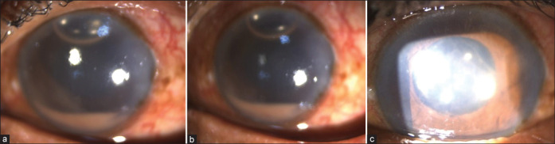
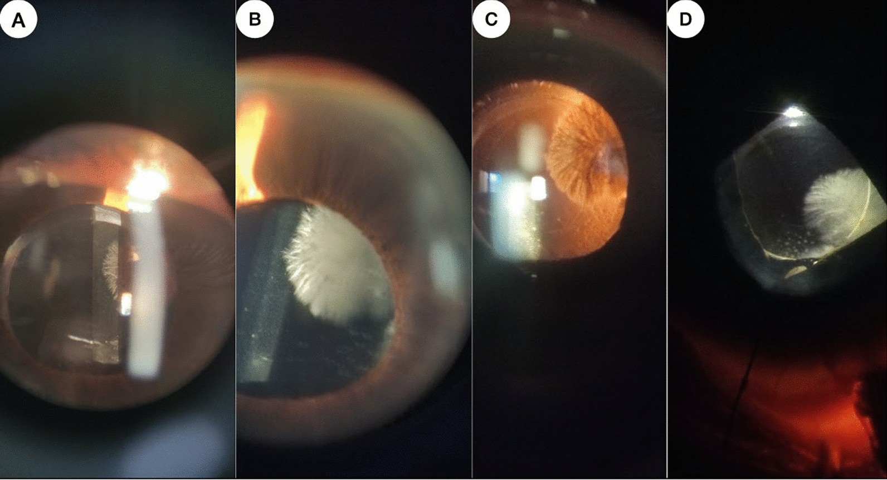
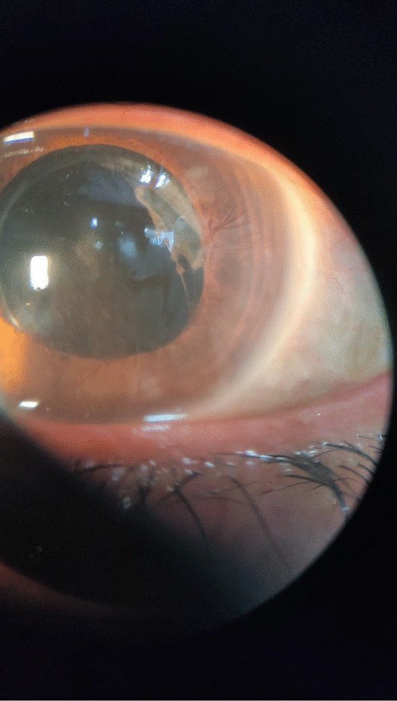
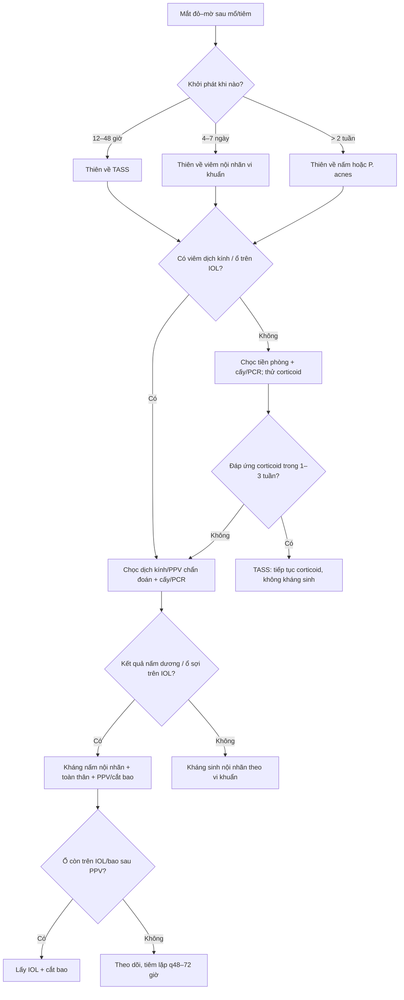

# 495 — Viêm nội nhãn do nấm NGOẠI SINH sau mổ/tiêm vs TASS: giữ hay bỏ IOL / *Exogenous fungal endophthalmitis vs TASS — when to explant the IOL*

**Tags:** `pattern:viem-noi-nhan` `pattern:ngoai-sinh` `pattern:mu-tien-phong` `pattern:manh-fibrin` `vung:tien-phong` `vung:dich-kinh` `vung:the-thuy-tinh` `score:TASS-vs-IE` `protocol:PPV` `protocol:cay-dich-kinh` `protocol:PCT` `protocol:cat-IOL`
**Mức chắc chắn (certainty):** tổng hợp y văn (literature synthesis) — tổng quan TASS 2024 (Indian J Ophthalmol, PMC10841787), loạt 29 mắt nấm sau đục thủy tinh thể (Clin Ophthalmol 2024, PMC11546139), so sánh 55 mắt có/không lấy IOL (Graefes Arch Clin Exp Ophthalmol 2026, PMC13342018), ca *Aspergillus* hai mắt có nấm mọc trên IOL (J Med Case Rep 2025, PMC12225101), ca *Scopulariopsis* phải bỏ mắt (Med Mycol Case Rep 2026, PMC13187959) và ổ dịch *Fusarium* 156 ca (Emerg Infect Dis 2022, PMC9622257). Số liệu lấy nguyên từ bài gốc; tên tác giả đối chiếu Europe PMC theo PMCID.

> **Bài này trả lời 4 câu hỏi khi một mắt đỏ–mờ sau đục thủy tinh thể hoặc sau tiêm nội nhãn:**
> (1) **Đây là TASS (vô khuẩn, do độc chất) hay viêm nội nhãn nhiễm trùng?** (2) **Vì sao thời điểm khởi phát lại là chốt số một?** (3) **Khi nào phải bỏ IOL/bao thể thủy tinh, khi nào giữ?** (4) **Corticoid hay kháng nấm trước — và vì sao chọn sai thứ tự có thể mất mắt?**
> Nối [474 – Kháng nấm nội nhãn: chọn thuốc theo loài](../474-khang-nam-noi-nhan-chon-thuoc-theo-loai/lesson.md), [463 – Viêm nội nhãn do nấm nội sinh](../463-viem-noi-nhan-noi-sinh-nam/lesson.md), [475 – Viêm nội nhãn nội sinh do vi khuẩn](../475-viem-noi-nhan-noi-sinh-vi-khuan/lesson.md), [481 – Biến chứng sau tiêm nội dịch kính](../481-bien-chung-noi-nhan-lieu-phap-gene-tiem-noi-dich-kinh/lesson.md) và [460 – Can thiệp mắt](../460-can-thiep-mat/lesson.md).

## 1. Tổng quan bệnh học – cơ chế hình ảnh

### 1.1 Hai bệnh cảnh, hai cơ chế — và vì sao thời điểm khởi phát là chốt

- **TASS (toxic anterior segment syndrome — hội chứng tiền phòng do độc chất):** phản ứng **viêm vô khuẩn, giới hạn ở tiền phòng**, sau một ca mổ **trơn tru**. Tác nhân là **độc chất xâm nhập trong mổ**, không phải vi sinh: tồn dư **chất đánh bóng IOL**, **endotoxin vi khuẩn** trong dung dịch/ống dụng cụ, **viscoelastic**, **kháng sinh/preservative trong dung dịch tiền phòng**, nước rửa dụng cụ nhiễm bẩn. Vì là **độc chất tác động trực tiếp lên nội mô giác mạc**, triệu chứng xuất hiện **12–48 giờ** sau mổ (bảng tổng quan: *within the first 12–48 h*).
- **Cơ chế phù giác mạc "limbus-to-limbus":** bơm Na⁺/K⁺-ATPase của nội mô giác mạc bị độc chất làm hỏng → mất chức năng **bơm nước ra khỏi giác mạc** → nước tích trong nhu mô **toàn chu vi**, không theo một phân vùng mạch máu như viêm. Đây là lý do TASS có **phù giác mạc lan toàn bộ từ rìa này sang rìa kia**, khác viêm nội nhãn nhiễm trùng thường phù/đục **khu trú hoặc kèm mủ tiền phòng rõ**.
- **Mủ tiền phòng trong TASS là vô khuẩn:** fibrin + bạch cầu trung tính tập trung do hóa ứng động, **cấy luôn âm**. Vì vậy **kháng sinh không thay đổi diễn tiến**, còn **corticoid làm bệnh thoái lui trong 1–3 tuần** — đây là "test điều trị" có giá trị phân biệt.
- **Nấm ngoại sinh (exogenous fungal endophthalmitis):** nấm **xâm nhập trong lúc mổ/tiêm** (dung dịch, IOL, viscoelastic, không khí mổ, đầu kim). Nấm mốc (*Aspergillus*, *Fusarium*) và nấm men (*Candida*, *Cladosporium*) **phát triển chậm**, nên triệu chứng thường **sau 2 tuần đến 7 tháng**, trung bình **52,1 ngày** (khoảng 3–210 ngày) trong loạt 29 mắt. Vì **chậm**, bệnh nhân thường được chẩn đoán nhầm là "viêm màng bồ đào" hoặc "TASS muộn".
- **Vì sao nấm bám vào IOL/bao thể thủy tinh:** IOL là **bề mặt nhân tạo kỵ nước, không có mạch máu**; bao thể thủy tinh là khoang kín. Nấm bám → tiết **biofilm** → kháng thuốc tại chỗ và **không có thuốc nào thấm tới đủ nồng độ**. Trên lâm sàng thấy **sợi nấm mọc thành chùm/tia từ IOL hoặc bao sau** — dấu hiệu gần như đặc hiệu của **ổ nấm cố định**, và là lý do **phải lấy IOL/bao** nếu ổ vẫn còn sau khi đã làm sạch dịch kính.
- **Cơ chế hình ảnh – TẠI SAO đọc được trên slit lamp/AS-OCT:** sợi nấm và biofilm **phản quang mạnh**, thấy rõ nhất khi **retroillumination** (ánh sáng ngược qua đồng tử) thành **hình nan hoa/chùm lông**; AS-OCT/UBM thấy **mảng dày, bờ không đều trên bề mặt IOL/bao sau**, khác **đục bao thể thủy tinh (capsular opacification)** là mảng đều, mỏng, không có "lông".

### 1.2 Ngưỡng định lượng nằm lòng (bắt buộc nhớ)

| Chỉ số | Con số | Nguồn |
|---|---|---|
| Tần suất TASS sau đục thủy tinh thể | **0,22%** (60/26.408 ca; một loạt lớn khác cũng 0,22%) | Indian J Ophthalmol 2024 (PMC10841787) |
| Khởi phát TASS điển hình | **12–48 giờ** sau mổ | *cùng nguồn* |
| Khởi phát viêm nội nhãn nhiễm trùng điển hình | **4–7 ngày** sau mổ | *cùng nguồn* |
| TASS muộn (delayed-onset) | có loạt **trung bình 38 ngày**; có ca **42–137 ngày** | *cùng nguồn* |
| TASS cần can thiệp phẫu thuật | **29,3%** (43/147 mắt): rửa tiền phòng, cắt dịch kính, lấy IOL | *cùng nguồn* |
| Tần suất nấm ngoại sinh sau đục thủy tinh thể | **0,002–0,005%** | Clin Ophthalmol 2024 (PMC11546139) |
| Thời gian từ mổ đến triệu chứng (nấm) | trung bình **52,1 ngày** (SD 59,9; **3–210 ngày**) | *cùng nguồn* |
| Cấy dương tính trong loạt 29 mắt nấm | **4/29 = 13,8%** (*Aspergillus* 2, *Cladosporium* 2) | *cùng nguồn* |
| Kết cục cuối loạt 29 mắt nấm | võng mạc áp **77,8%**; đục giác mạc **17,2%**; bong võng mạc **14,8%**; **múc nhãn cầu 10,3%**; teo nhãn **3,4%** | *cùng nguồn* |
| PPV so với điều trị bảo tồn (29 mắt) | thành công chức năng **50%** so với **43,5%**; thành công giải phẫu **83,3%** so với **69,6%**; số lần điều trị thêm **0,5** so với **1,48** | *cùng nguồn* |
| Lấy IOL so với giữ IOL (55 mắt, 12 tháng) | **không khác** về thị lực, thời gian nằm viện, biến chứng; tái phát **4/23** so với **3/32** (p = 0,639) | Graefes Arch Clin Exp Ophthalmol 2026 (PMC13342018) |
| Ổ dịch *Fusarium oxysporum* sau đục thủy tinh thể | **156 ca** (Hàn Quốc, 2020) | Emerg Infect Dis 2022 (PMC9622257) |
| Ca *Scopulariopsis* kháng azole | viêm nội nhãn mạn **3 tháng** sau mổ; PPV + micafungin + amphotericin B nội nhãn vẫn **teo nhãn, phải bỏ mắt** | Med Mycol Case Rep 2026 (PMC13187959) |

*(a) Ngày 1: phù giác mạc **từ rìa này sang rìa kia** + mủ tiền phòng. (b) Ngày 3: phù giảm, mủ giảm. (c) Ngày 8: giác mạc trong, tiền phòng sạch. **Đây là TASS, không phải nhiễm trùng** — cấy âm và đáp ứng với corticoid. Nguồn: Indian J Ophthalmol 2024 (PMC10841787), Fig 1, **CC BY-NC-SA 4.0**; giữ nguyên bản.*

## 2. Mẫu hình + chẩn đoán phân biệt theo mốc thời gian (Gamut)

**Câu hỏi lọc:** *"Mắt đỏ–mờ sau mổ/tiêm; **khi nào bắt đầu**, **có tổn thương dịch kính không**, và **có ổ cố định trên IOL/bao không**?"* Ba câu này định vị được gần như toàn bộ gamut.

| Mốc khởi phát | Gamut chính | Dấu hiệu phân biệt then chốt |
|---|---|---|
| **0–3 ngày** | **TASS**, phản ứng viêm sau mổ thông thường, **máu tiền phòng**, bong màng Descemet, tăng nhãn áp cấp | TASS: **không đau/đau nhẹ**, phù giác mạc **toàn chu vi**, mủ vô khuẩn, **dịch kính trong** |
| **4–7 ngày** | **Viêm nội nhãn vi khuẩn** sau mổ, TASS muộn, bong võng mạc | Nhiễm trùng: **đau tăng**, mủ tiền phòng + **viêm dịch kính**, cấy dương; TASS: không viêm dịch kính |
| **1–4 tuần** | **Nấm ngoại sinh** (khởi đầu), *P. acnes*, tồn dư vỏ thể thủy tinh, viêm do IOL | Nấm: **tiến triển chậm, dai dẳng**, mảng trắng bông trên bao/IOL, **corticoid chỉ đỡ tạm** |
| **1–6 tháng** | **Nấm ngoại sinh (đa số)**, *P. acnes* (mảng trắng bao trước), viêm màng bồ đào do thể thủy tinh, u lympho masquerade | Nấm: **sợi/tia mọc trên IOL** hoặc bao sau; *P. acnes*: **mảng trắng khu trú bao trước**, dịch kính thường trong |

- **Theo vị trí — tiền phòng đơn thuần hay có dịch kính:** TASS **gần như luôn chỉ ở tiền phòng**, dịch kính trong. Viêm nội nhãn nhiễm trùng **có viêm dịch kính** (tế bào, đục) và có thể lan võng mạc. Nấm ngoại sinh giai đoạn sớm có thể **chỉ là mảng trên bao/IOL**, sau đó mới vào dịch kính.
- **Mnemonic TASS:** **T**oxic, **A**nterior only, **S**terile, **S**wift (12–48 giờ).
- **Mnemonic nấm ngoại sinh:** **F**ilament/biofilm trên IOL, **U**nilateral thường gặp, **N**o pain sớm, **G**radual (tuần–tháng), **A**vascular nidus, **L**ate và dai dẳng.

## 3. Bảng so sánh phân biệt (ma trận đối chiếu)

| Thực thể (entity) | Hình ảnh điển hình (slit lamp/AS-OCT/B-scan) | Chốt vào (rule-in) | Chốt loại (rule-out) | Gợi ý xác nhận |
|---|---|---|---|---|
| **TASS** | Phù giác mạc **limbus-to-limbus**, mủ tiền phòng vô khuẩn, **dịch kính trong**, đồng tử giãn cứng | **Khởi phát 12–48 giờ + không đau + phù toàn chu vi + cấy âm + đáp ứng corticoid trong 1–3 tuần** | Viêm dịch kính rõ, mảng/sợi trên IOL, đau tăng → không phải TASS | Loại trừ nhiễm trùng bằng cấy/PCR; theo dõi đáp ứng corticoid |
| **Nấm ngoại sinh** | **Sợi/tia nấm trên IOL hoặc bao sau**, mảng trắng bông, viêm dịch kính muộn, có thể mủ tiền phòng | **Khởi phát > 2 tuần + ổ cố định trên IOL/bao + retroillumination thấy "nan hoa" + cấy/PCR nấm** | Chỉ phù giác mạc toàn chu vi, không ổ trên IOL, đáp ứng nhanh corticoid → nghĩ TASS | Cấy Sabouraud + PCR ITS; AS-OCT/UBM; **nuôi cấy 4 tuần** |
| **Viêm nội nhãn vi khuẩn** | Mủ tiền phòng + **viêm dịch kính**, đau, phù mi, giảm thị lực nhanh | **Đau + viêm dịch kính + khởi phát 4–7 ngày + cấy dương** | Không đau, dịch kính trong, phù toàn chu vi → TASS | Chọc dịch kính trước kháng sinh; Gram/cấy |
| ***P. acnes*** | **Mảng trắng khu trú bao trước**, viêm tiền phòng nhẹ tái diễn, dịch kính trong | **Mảng trắng bao trước + viêm nhẹ tái phát sau mổ + cấy kỵ khí** | Viêm dịch kính, sợi nấm, phù toàn chu vi → loại | Cấy kỵ khí 14 ngày; PCR 16S |
| **Tồn dư vỏ thể thủy tinh** | Mảng trắng đục sau IOL, **không có "lông/tia"**, không viêm | **Tiền sử mổ + mảng đục đều + không viêm** | Sợi/tia + viêm dịch kính → nghĩ nấm | Soi kỹ retroillumination; theo dõi |
| **Viêm do IOL/độc chất IOL** | Phù nhẹ, tế bào tiền phòng, không mủ, không viêm dịch kính | **Sau đổi IOL + cấy âm + corticoid đáp ứng** | Có mủ/ổ trên IOL → loại | Loại trừ nhiễm trùng; hội chẩn |

*(A, B) Sợi nấm mọc thành chùm/tia trên **bề mặt IOL/bao thể thủy tinh** mắt trái, to và dày lên trong vài ngày. (C) Retroillumination: tổn thương **phản quang như nan hoa**. (D) Trong mổ, trước khi **lấy IOL**. Đây là hình ảnh gần như đặc hiệu của **nấm ngoại sinh có ổ cố định**, không phải TASS. Nguồn: J Med Case Rep 2025 (PMC12225101), Fig 1, **CC BY-NC-ND 4.0**; giữ nguyên bản, không crop/ghép.*

### Đọc ảnh: vì sao "sợi nấm trên IOL" đổi hoàn toàn quyết định

- **TASS** là **bề mặt** (nội mô giác mạc) — điều trị bằng **giảm độc chất + corticoid**, không cần lấy IOL.
- **Nấm ngoại sinh** có **ổ cố định** (IOL/bao) — kháng nấm toàn thân và nội nhãn **không diệt được biofilm**; nếu chỉ tiêm mà không lấy ổ, bệnh **tái phát sau khi ngừng thuốc**. Ca minh hoạ dưới đây cho thấy **cắt bao sau + tiêm** vẫn còn nấm, buộc phải **lấy IOL**.

*Sau **cắt bao sau (posterior capsulectomy)** vài ngày, sợi nấm **vẫn tiếp tục mọc trên IOL** — bằng chứng rằng IOL là **nidus** không thể khử bằng thuốc. Nguồn: J Med Case Rep 2025 (PMC12225101), Fig 2, **CC BY-NC-ND 4.0**; giữ nguyên bản.*

## 4. Protocol chụp/đánh giá + phân độ & quyết định

### 4.1 Đánh giá ban đầu (làm trước khi tiêm bất cứ thứ gì)

- **Slit lamp** đủ 6 phần: mi–kết mạc, giác mạc (phù **có lan toàn chu vi?**), tiền phòng (tế bào, flare, fibrin, mủ), đồng tử (dính sau, giãn cứng), **IOL + bao trước/sau** (retroillumination tìm sợi/tia), **dịch kính** (tế bào, đục), đáy mắt nếu thấy.
- **Nhãn áp:** TASS có thể **tăng** do viêm/dính; tăng nhãn áp không loại trừ TASS.
- **B-scan** khi không thấy đáy mắt: tìm **đục dịch kính, màng, bong võng mạc**. B-scan **bình thường không loại trừ** nấm giai đoạn sớm.
- **AS-OCT/UBM:** đo **độ dày mảng trên IOL/bao**, phát hiện ổ nấm **dưới bao** mà slit lamp khó thấy.

### 4.2 Chọc hút & xét nghiệm (chốt phân biệt)

- **Chọc hút tiền phòng (AC tap): 0,1–0,2 mL** — làm **trước** khi tiêm kháng sinh/corticoid.
- **Chọc hút dịch kính (vitreous tap): 0,2–0,5 mL** hoặc **PPV chẩn đoán** lấy mẫu nguyên chất. Gửi **tế bào học, Gram, cấy thường, cấy nấm (Sabouraud 28°C và 37°C, giữ 4 tuần), cấy kỵ khí, PCR 16S/ITS**.
- **PCR panfungal (ITS) và PCR vi khuẩn (16S)** có giá trị khi cấy âm — trong loạt 29 mắt, **chỉ 13,8% cấy dương**, nên **cấy âm không loại trừ nấm**.
- **Không trì hoãn điều trị chờ kết quả** khi đã có mủ tiền phòng + viêm dịch kính.

### 4.3 Điều trị theo hướng chẩn đoán

| Tình huống | Điều trị | Theo dõi |
|---|---|---|
| **TASS** | **Corticoid tại chỗ mạnh** (prednisolone acetate 1% hoặc dexamethasone 0,1% mỗi 1–2 giờ, giảm liều chậm 1–3 tuần) + **cycloplegic**, kiểm soát nhãn áp. **Không kháng sinh** | Soi lại **vài giờ/lần** trong những ngày đầu; nếu không đỡ → rửa tiền phòng; **29,3%** cần can thiệp |
| **Nấm ngoại sinh** | **Voriconazole nội nhãn 100 µg/0,1 mL** ± **amphotericin B 5 µg/0,1 mL**; **voriconazole toàn thân 6 mg/kg q12h (nạp) → 4 mg/kg q12h**; **PPV + cắt bao** lấy mẫu và làm sạch ổ; **lấy IOL** nếu ổ còn trên IOL/bao | Tiêm lặp **q48–72 giờ** đến khi hết viêm; cấy/PCR lại nếu không đỡ |
| **Viêm nội nhãn vi khuẩn** | **Vancomycin 1 mg + ceftazidime 2,25 mg/0,1 mL** nội nhãn; PPV nếu thị lực **LP hoặc kém hơn** (theo EVS) hoặc không đỡ sau 48 giờ | Đáp ứng 48–72 giờ; cấy lại nếu xấu đi |
| **Nghi nấm nhưng chưa chắc** | **Không tiêm corticoid đơn thuần**; khởi trị kháng nấm nếu có ổ trên IOL/bao hoặc viêm dịch kính dai dẳng | Theo dõi sát 24–48 giờ; tránh "che" bằng corticoid |

### 4.4 Vì sao "lấy IOL" không phải luôn luôn — và khi nào thì phải lấy

- **Bằng chứng không ủng hộ lấy IOL thường quy:** 55 mắt viêm nội nhãn được PPV, **23 mắt lấy IOL** so với **32 mắt giữ IOL** — **không khác** thị lực cuối, thời gian nằm viện, biến chứng; tái phát **4/23** so với **3/32** (p = 0,639). Kết luận: **giữ IOL là lựa chọn an toàn ở ca chọn lọc**.
- **Nhưng khác với nấm có ổ cố định:** IOL/bao là **bề mặt không mạch máu + biofilm**; ca *Aspergillus* hai mắt cho thấy **cắt bao sau + tiêm vẫn tái phát** và phải **lấy IOL**. Với nấm, **lấy IOL/bao là kiểm soát nguồn**, không phải "phẫu thuật thêm".
- **Quy tắc thực hành:** (1) nấm đã xác định + **ổ trên IOL/bao còn sau PPV/cắt bao** → **lấy IOL**; (2) nấm không có ổ trên IOL, chỉ ở dịch kính/võng mạc → **PPV + kháng nấm** trước, cân nhắc lấy IOL nếu tái phát; (3) vi khuẩn/TASS → **không lấy IOL thường quy**.

## 5. Biến thể bình thường và cạm bẫy

- **TASS muộn:** có thể xuất hiện **38 ngày** (trung bình một loạt) hoặc **42–137 ngày** — **không** vì thế mà mặc định là nấm. Chốt vẫn là **phù toàn chu vi, không viêm dịch kính, cấy âm, đáp ứng corticoid**.
- **Nấm cấy âm:** **86,2%** ca trong loạt 29 mắt không cấy được nấm → **cấy âm không loại trừ**. Phải dựa vào **ổ trên IOL/bao + PCR + diễn tiến**.
- **Corticoid "che" nấm:** liều corticoid tại chỗ làm viêm **giảm tạm 1–2 tuần** rồi bùng lại mạnh hơn. Nếu **đỡ rồi tái phát sau giảm liều**, phải nghĩ nấm và **chọc lại**.
- **B-scan sớm bình thường:** không loại trừ nấm thể bao/IOL; **AS-OCT/UBM** nhạy hơn.
- **Đục bao thể thủy tinh thông thường** (capsular opacification) là mảng **đều, mỏng, không "lông"**; nấm có **tia/sợi, phản quang mạnh khi retroillumination**, và **tiến triển nhanh vài ngày**.
- **Viêm nội nhãn sau tiêm nội nhãn:** thường **cùng ngày–3 ngày**, phần lớn vi khuẩn; nấm sau tiêm **hiếm và muộn hơn**. Đừng gộp chung phác đồ.
- **Không tiêm corticoid nội nhãn đơn thuần** khi chưa loại trừ nhiễm trùng — có thể làm nấm/vi khuẩn bùng phát.
- **Ổ dịch:** khi nhiều ca cùng lúc, **giữ dung dịch/IOL/lô thuốc** để điều tra; ổ dịch *Fusarium* 156 ca cho thấy nguồn chung có thể lây hàng loạt.

## 6. Tự lượng giá — Blind Quiz

**Ca 1 — Ngày 1 sau đục thủy tinh thể, mắt đỏ, nhìn mờ, KHÔNG đau. Đồng tử giãn cứng, giác mạc đục đều từ rìa này sang rìa kia, có mủ tiền phòng. Dịch kính trong.**

- Câu hỏi: Dấu hiệu nào **chốt vào TASS**? Ba chẩn đoán phân biệt? Bước tiếp theo **không** nên làm là gì?

<b>Bấm để hiện đáp án (findings + chẩn đoán)</b>

- **Findings:** phù giác mạc **limbus-to-limbus**, mủ tiền phòng, **dịch kính trong**, không đau, khởi phát **12–48 giờ**.
- **Chẩn đoán:** **TASS** — độc chất gây hỏng bơm nội mô → phù toàn chu vi; mủ vô khuẩn.
- **Phân biệt:** viêm nội nhãn vi khuẩn (đau + viêm dịch kính + 4–7 ngày), nấm ngoại sinh (muộn + ổ trên IOL), tồn dư vỏ.
- **Không nên:** tiêm kháng sinh nội nhãn theo phác đồ nhiễm trùng khi chưa có bằng chứng — TASS **không đáp ứng kháng sinh**; điều trị là **corticoid + theo dõi sát**. (Ảnh a–c cho thấy đáp ứng trong 8 ngày.)
- Nguồn ảnh: Indian J Ophthalmol 2024 (PMC10841787), Fig 1, CC BY-NC-SA 4.0.

**Ca 2 — 4 tháng sau đục thủy tinh thể, nhìn mờ nhẹ, không đau. Trên IOL/bao sau có chùm sợi trắng mọc thành tia, rõ khi chiếu ngược sáng.**

- Câu hỏi: Đây là TASS muộn hay nấm? Vì sao vị trí tổn thương quyết định việc **lấy IOL**?

<b>Bấm để hiện đáp án (findings + chẩn đoán)</b>

- **Findings:** sợi/tia trắng trên **IOL và bao thể thủy tinh**, phản quang mạnh khi retroillumination; khởi phát **muộn** (tháng), không đau.
- **Chẩn đoán:** **viêm nội nhãn do nấm ngoại sinh** (ca gốc: *Aspergillus* hai mắt, bệnh nhân CLL). Nấm bám IOL → biofilm → thuốc không tới.
- **Vì sao lấy IOL:** IOL/bao là **bề mặt không mạch máu**; cắt bao + tiêm vẫn tái phát (hình dưới), nên **lấy IOL** là kiểm soát nguồn.
- Nguồn ảnh: J Med Case Rep 2025 (PMC12225101), Fig 1, CC BY-NC-ND 4.0.

**Ca 3 — Sau cắt bao sau và tiêm kháng nấm vài ngày, sợi nấm vẫn tiếp tục mọc trên IOL. Bước tiếp theo?**

- Câu hỏi: Vì sao cắt bao sau **không đủ**? Khi nào quyết định lấy IOL? Cần theo dõi gì sau đó?

<b>Bấm để hiện đáp án (findings + chẩn đoán)</b>

- **Findings:** sợi nấm **vẫn mọc trên IOL** sau capsulectomy — ổ còn nguyên.
- **Quyết định:** **lấy IOL + cắt bao** (trong ca gốc kèm silicone oil), tiếp tục kháng nấm; nếu vẫn tiến triển → cân nhắc bỏ mắt (ca *Scopulariopsis* kháng azole đã phải múc nhãn cầu).
- **Theo dõi:** slit lamp + B-scan mỗi 1–2 tuần đến khi hết viêm; cấy/PCR lại nếu tái phát; cảnh báo bệnh nhân nguy cơ **bong võng mạc, teo nhãn**.
- Nguồn ảnh: J Med Case Rep 2025 (PMC12225101), Fig 2, CC BY-NC-ND 4.0.

## Bài liên quan chéo
- [474 – Kháng nấm nội nhãn: chọn thuốc theo loài & kháng sinh đồ](../474-khang-nam-noi-nhan-chon-thuoc-theo-loai/lesson.md)
- [463 – Viêm nội nhãn do nấm nội sinh](../463-viem-noi-nhan-noi-sinh-nam/lesson.md)
- [475 – Viêm nội nhãn nội sinh do vi khuẩn](../475-viem-noi-nhan-noi-sinh-vi-khuan/lesson.md)
- [481 – Biến chứng sau tiêm nội dịch kính](../481-bien-chung-noi-nhan-lieu-phap-gene-tiem-noi-dich-kinh/lesson.md)
- [460 – Can thiệp mắt](../460-can-thiep-mat/lesson.md)

> Không dùng để chẩn đoán độc lập khi chưa có người hướng dẫn.
