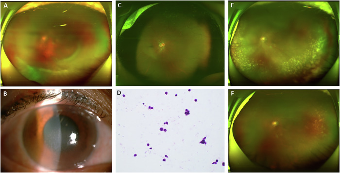
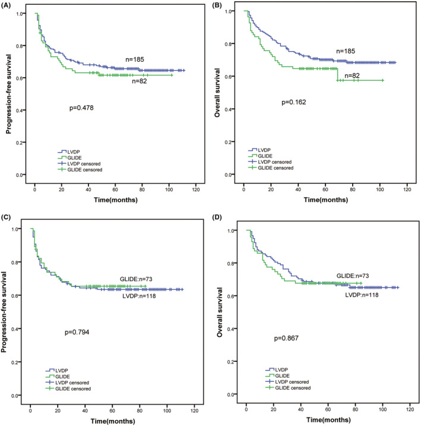
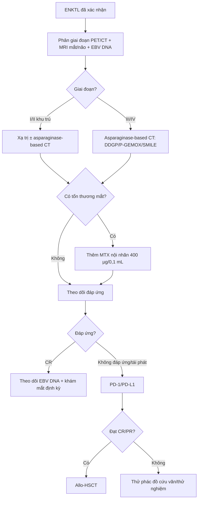
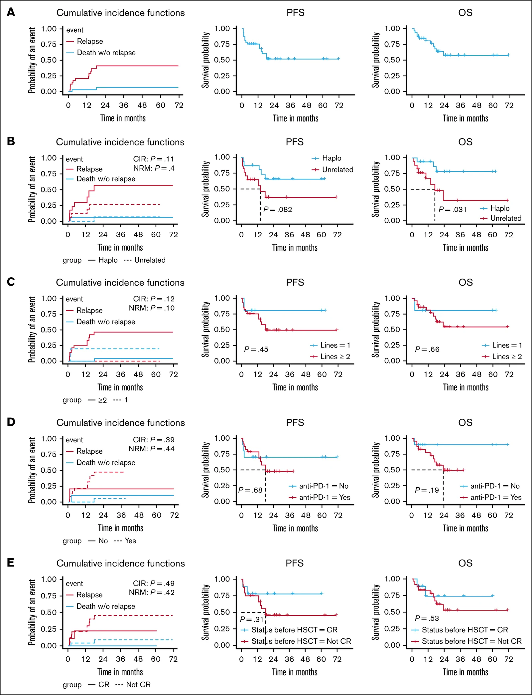

# 496 — Điều trị & theo dõi duy trì u lympho T/NK nội nhãn: asparaginase, ghép tế bào gốc, EBV DNA / *Treatment of intraocular extranodal NK/T-cell lymphoma*

**Tags:** `pattern:viem-dich-kinh` `pattern:thamnhiem-mach` `vung:dich-kinh` `vung:vong-mac` `vung:hac-mac` `score:PINK-E` `score:Lugano-Deauville` `protocol:PET-CT` `protocol:MRI-hoc-mat` `protocol:tiem-noi-nhan` `protocol:ghep-te-bao-goc`
**Mức chắc chắn (certainty):** tổng hợp y văn (literature synthesis) — tổng quan điều trị ENKTL (Front Immunol 2023, PMC9941192), so sánh LVDP/GLIDE 267 bệnh nhân (Cancer Med 2023, PMC10166983), pegaspargase + xạ đồng thời so với P-GEMOX + xạ tuần tự (Oncol Res 2025, PMC11964867), mSMILE nhi khoa (Transl Pediatr 2024, PMC11320010), allo-HSCT trong ENKTL kháng trị/tái phát (Blood Adv 2026, PMC13682369), MTX nội nhãn cho u lympho dịch kính–võng mạc (J Clin Med 2026, PMC13607433), loạt ENKTL có biểu hiện mắt (Eye 2025, PMC12669774), EBV DNA huyết tương (Ann Med 2025, PMC11926898) và viêm tụy do asparaginase (Front Oncol 2026, PMC13661464). Số liệu lấy nguyên từ bài gốc; tên tác giả đối chiếu Europe PMC theo PMCID.

> **Bài này trả lời 4 câu hỏi khi đã chẩn đoán u lympho T/NK nội nhãn:**
> (1) **Vì sao phác đồ phải chứa asparaginase, và vì sao CHOP thất bại?** (2) **Chọn DDGP, SMILE, P-GEMOX hay phác đồ + xạ — dựa trên gì?** (3) **Khi nào ghép tế bào gốc, tự thân hay đồng loài?** (4) **Theo dõi bằng EBV DNA và khám mắt như thế nào để không bỏ sót tái phát?**
> Nối [473 – U lympho T/NK & u lympho thứ phát ở mắt](../473-u-lympho-T-NK-va-u-lympho-thu-phat-o-mat/lesson.md), [462 – U lympho nội nhãn (PVRL)](../462-u-lympho-noi-nhan-PVRL/lesson.md), [491 – PVRL: theo dõi & tái phát](../491-pvrl-theo-doi-tai-phat/lesson.md), [494 – Độc thần kinh methotrexate](../494-doc-than-kinh-methotrexate/lesson.md) và [474 – Kháng nấm nội nhãn](../474-khang-nam-noi-nhan-chon-thuoc-theo-loai/lesson.md).

## 1. Tổng quan bệnh học – cơ chế hình ảnh – cơ chế chọn thuốc

### 1.1 Vì sao asparaginase là "game changer" — và vì sao CHOP không cứu được

- **Tế bào ENKTL thiếu asparagine synthetase (ASNS):** tế bào ác tính **không tự tổng hợp được asparagine** từ aspartate, nên phụ thuộc hoàn toàn vào **asparagine ngoại bào**. **L-asparaginase (L-Asp)** thủy phân asparagine trong huyết tương → tế bào u **chết vì thiếu asparagine**, trong khi tế bào lành còn con đường ASNS để bù.
- **Vì sao phác đồ anthracycline (CHOP) thất bại:** ENKTL **đề kháng đa thuốc**, kể cả thuốc không phụ thuộc P-glycoprotein; tỷ lệ **CR của phác đồ anthracycline chỉ khoảng 30%**. Đây là lý do **không được dùng CHOP làm nền** cho ENKTL.
- **Vì sao dạng thuốc và khoảng cách liều quan trọng:** **L-Asp tự nhiên có t½ ≈ 1,25 ngày**; **pegaspargase (PEG-Asp) có t½ ≈ 5,73 ngày**. Nếu dùng L-Asp cách **3 tuần**, asparagine huyết tương **hồi phục giữa hai đợt** → tế bào u "sống lại". Vì vậy **PEG-Asp được ưu tiên** và phải dùng **đủ dày**; đây là lý do sinh học khiến **DDGP (PEG-Asp) thắng SMILE (L-Asp cách 3 tuần)** trong thử nghiệm ngẫu nhiên.
- **Vì sao mắt là "sanctuary" — phải tiêm nội nhãn:** hàng rào máu–võng mạc và hàng rào máu–dịch kính hạn chế thuốc từ máu vào dịch kính. ENKTL nội nhãn có thể **đáp ứng hệ thống nhưng vẫn còn tế bào u trong dịch kính**; do đó **phác đồ toàn thân + MTX nội nhãn** là trục, không thay thế nhau.
- **Cơ chế hình ảnh (TẠI SAO thấy đục dịch kính + mảng vàng dọc mạch):** tế bào lympho T/NK ác tính **xâm nhập quanh mạch võng mạc** và **dịch kính** → phản ứng viêm + tế bào u lơ lửng → **đục dịch kính dạng tế bào**, **mảng vàng–trắng men theo mạch** ("perivascular infiltrates"), có thể kèm **bong dịch dưới võng mạc**. Trên **OCT**: tăng phản hồi dưới RPE/hắc mạc; trên **B-scan**: đục dịch kính, dày hắc mạc. **Không có vôi hóa** (khác retinoblastoma) và **không có khối đặc lớn** như melanoma.
- **Bẫy cytokine:** IL-10/IL-6 **> 1** là gợi ý u lympho **B** (PVRL); trong u lympho **T/NK**, **71% ca đã công bố có IL-10/IL-6 < 1** — **không dùng tỷ lệ này để loại trừ ENKTL**.

### 1.2 Ngưỡng định lượng nằm lòng (bắt buộc nhớ)

| Chỉ số | Con số | Nguồn |
|---|---|---|
| ENKTL giai đoạn I/II — sống còn 5 năm | **> 80%** (tăng từ < 50% đầu thế kỷ 20) | Front Immunol 2023 (PMC9941192) |
| ENKTL giai đoạn III/IV — sống còn trung vị | **> 3 năm** (trước đây < 1 năm) | *cùng nguồn* |
| CR với phác đồ anthracycline | **~30%** | *cùng nguồn* |
| **DDGP so với SMILE** (thử nghiệm ngẫu nhiên, 80 bệnh nhân) | PFS 3 năm **56,6%** so với **41,8%** (p = 0,004); OS 5 năm **74,3%** so với **51,7%** (p = 0,02); tử vong do độc tính **2,5%** so với **17,5%** | *cùng nguồn* |
| **LVDP so với GLIDE** (267 bệnh nhân) | ORR **83,5%**, CR **62,2%** toàn nhóm; 5 năm PFS **64,3%**, OS **68,5%**; hai phác đồ **không khác** (PFS p = 0,478; OS p = 0,162); **LVDP ít độc hơn** | Cancer Med 2023 (PMC10166983) |
| **Pegaspargase + xạ đồng thời so với P-GEMOX + xạ tuần tự** (52 bệnh nhân sau PSM) | ORR **100%** so với **88,5%**; CR **100%** so với **76,9%**; OS 3 năm **92,3%** cả hai; PFS 3 năm **92,3%** so với **80,8%** | Oncol Res 2025 (PMC11964867) |
| Độc tính huyết học của pegaspargase + xạ | giảm fibrinogen độ 3 **3 ca**; APTT kéo dài độ 4 **1 ca**; **không có viêm tụy**, không tử vong do điều trị | *cùng nguồn* |
| **mSMILE ở trẻ** (8 bệnh nhân) | CR **62,5%**, ORR **87,5%**; OS 3 năm **87,5%**, EFS **75%**; **không** viêm tụy/chảy máu dị ứng; độ 3–4 ngoài huyết học ở **3 bệnh nhân** (ALT, viêm miệng) | Transl Pediatr 2024 (PMC11320010) |
| **MTX nội nhãn 400 µg/0,1 mL** cho VRL (17 bệnh nhân) | số mũi trung vị **16** (12–25); lui bệnh hoàn toàn tại mắt **82,4%**, trung vị **6 tháng**; tái phát **17,6%**; thị lực **1,22 → 0,74 logMAR**; **keratopathy 41,2%**, tăng nhãn áp thoáng qua **17,6%** | J Clin Med 2026 (PMC13607433) |
| ENKTL có biểu hiện mắt (107 bệnh nhân) | **12/107 = 11,2%**; 8 phần phụ/4 trong nhãn; khoảng cách chẩn đoán → mắt **18,1 ± 20,8 tháng**; **9 tái phát/6 tử vong (50%)**; 7 mắt của 6 người sống: **2 đạt 20/25, 4 < HM** | Eye 2025 (PMC12669774) |
| **EBV DNA huyết tương lúc chẩn đoán** (NK/TCL) | **< 3.255 copies/mL**: PFS 5 năm **64,2%** so với **16,7%**; OS **64,4%** so với **20,8%** (p < 0,001) | Ann Med 2025 (PMC11926898) |
| **Allo-HSCT ở ENKTL kháng trị/tái phát** (34 bệnh nhân) | OS 1 năm **80,9%**, 2 năm **57,6%**; PFS 2 năm **52,1%**; CIR 2 năm **40,8%**; TRM 2 năm **7,04%**; CR/PR trước ghép tốt hơn | Blood Adv 2026 (PMC13682369) |
| Viêm tụy do L-asparaginase | **3,9%** ở 7.640 trẻ ALL; **5,9%** (7/119) ở nhóm ALL người lớn trong loạt lymphoma; **21,1%** viêm tụy do lymphoma là thể nặng; **2/3** ca thử dùng lại thuốc dung nạp được | Front Oncol 2026 (PMC13661464) |

*(A, C, E) Đáy mắt: **đục dịch kính** + thâm nhiễm vàng–trắng men theo mạch, có thể kèm xuất tiết. (B) Đèn khe: tế bào tiền phòng/dịch kính. (D) Tế bào học dịch kính: lympho rải rác, không atypia rõ — **dễ âm giả**. (F) Sau điều trị. Đây là hình ảnh **u lympho T/NK nội nhãn**, không phải viêm màng bồ đào vô căn. Nguồn: Eye 2025 (PMC12669774), Fig 2, **CC BY 4.0**.*

## 2. Mẫu hình + chẩn đoán phân biệt theo giai đoạn & vị trí (Gamut)

**Câu hỏi lọc:** *"ENKTL đã xác nhận; bệnh đang ở đâu (mũi–họng, hạch, mắt, CNS) và đã điều trị gì?"* — vị trí quyết định **phác đồ nền**, mắt quyết định **thêm MTX nội nhãn**.

- **Giai đoạn I/II (khu trú mũi–họng):** **xạ trị là bắt buộc**; kết hợp **asparaginase-based CT** ở ca nguy cơ cao. Pegaspargase + xạ đồng thời cho **CR 100%** trong loạt 26 bệnh nhân sau PSM, nhưng độc tính huyết học cần theo dõi.
- **Giai đoạn III/IV:** **asparaginase-based CT** (DDGP/P-GEMOX/SMILE) là nền; **PD-1/PD-L1** cho kháng trị; **HSCT** cho ca đạt đáp ứng và nguy cơ cao.
- **Có tổn thương mắt:** **điều trị hệ thống theo giai đoạn + MTX nội nhãn 400 µg**; tổn thương **phần phụ/hốc mắt** có thể cần **xạ trị tại chỗ**; **không chỉ tiêm mắt** vì bệnh hệ thống quyết định sống còn (50% tử vong khi có biểu hiện mắt).
- **Có tổn thương CNS:** **HD-MTX** và phác đồ thấm CNS; **allo-HSCT** cân nhắc ở ca trẻ/đáp ứng.
- **Tái phát/kháng trị:** **PD-1 inhibitor** (sintilimab ORR **75%**, CR **21,4%**, OS 2 năm **78,6%**; sugemalimab CR **37,2%**, OS 2 năm **54,6%**) → **allo-HSCT** nếu đạt CR/PR.
- **Gamut chẩn đoán phân biệt tại mắt:** **ENKTL** vs **PVRL (B-cell)** vs **viêm màng bồ đào** vs **viêm võng mạc–màng mạch do CMV** vs **melanoma thể lan tỏa** vs **di căn**. Chốt: **tiền sử mũi–họng + EBV DNA + sinh thiết/sinh thiết dịch kính + IL-10/IL-6 (chỉ dùng cho B-cell)**.

## 3. Bảng so sánh phân biệt (ma trận đối chiếu điều trị)

| Phác đồ / chiến lược | Chỉ định chính | Số liệu chốt | Chốt vào (rule-in) | Chốt loại (rule-out) | Theo dõi |
|---|---|---|---|---|---|
| **DDGP** (dexamethasone, cisplatin, gemcitabine, PEG-Asp) | ENKTL mới, đặc biệt giai đoạn III/IV | PFS 3 năm **56,6%**, OS 5 năm **74,3%** | Cần **PEG-Asp**, dung nạp tốt hơn SMILE | Suy thận nặng (cisplatin), viêm tụy hoạt động | Fibrinogen, APTT, lipase, creatinin |
| **SMILE** (dexamethasone, MTX, ifosfamide, etoposide, L-Asp) | ENKTL tiến xa; phác đồ kinh điển | OS 5 năm **51,7%**; tử vong độc tính **17,5%** | Trung tâm có kinh nghiệm L-Asp và chăm sóc độc tính | Không có khả năng theo dõi độc tính/truyền máu | Fibrinogen, APTT, chức năng gan/thận, huyết học |
| **P-GEMOX** (PEG-Asp, gemcitabine, oxaliplatin) | ENKTL tiến xa / kháng trị; ít độc hơn | ORR tương đương SVILE; PFS 3 năm **65,7%** ở giai đoạn tiến xa (so sánh SVILE/P-GEMOX, dẫn qua PMC9941192) | Cần phác đồ **không anthracycline**, ngoại trú | Suy gan nặng, thận nặng | Công thức máu, men gan, fibrinogen |
| **Pegaspargase + xạ đồng thời** | Giai đoạn I/II | ORR **100%**, CR **100%**, OS/PFS 3 năm **92,3%** | Bệnh khu trú, có thể xạ | Bệnh lan tỏa ngoài trường xạ | APTT, fibrinogen, độc tính da/niêm |
| **mSMILE (nhi)** | Trẻ em/thanh thiếu niên | CR **62,5%**, OS 3 năm **87,5%** | Trẻ đủ điều kiện hóa trị tích cực | Suy gan/thận nặng, nhiễm trùng chưa kiểm soát | Như SMILE + growth |
| **PD-1/PD-L1** | Kháng trị/tái phát sau asparaginase | Sintilimab ORR **75%**, CR **21,4%**, OS 2 năm **78,6%** | Đã thất bại ≥ 1 phác đồ asparaginase | Bệnh tự miễn hoạt động, ghép đang dùng ức chế miễn dịch | Độc tính miễn dịch (giáp, gan, phổi) |
| **Allo-HSCT** | ENKTL kháng trị/tái phát, nguy cơ cao, đạt CR/PR | OS 2 năm **57,6%**, PFS **52,1%**, TRM **7,04%** | **CR/PR trước ghép**; có người hiến | Không đạt đáp ứng, nhiễm trùng hoạt động, suy tạng | EBV DNA sau ghép, GVHD, HLH |
| **Auto-HSCT** | Giai đoạn tiến xa **lần lui bệnh đầu** (chọn lọc) | Không cải thiện sống còn rõ so với hóa trị đơn thuần | Đạt CR1, nguy cơ cao | Bệnh kháng trị | Như ghép tự thân |

*(A, B) Trước ghép cặp: PFS/OS của LVDP so với GLIDE. (C, D) Sau ghép cặp (PSM): **không khác biệt** (PFS p = 0,794; OS p = 0,867). Thông điệp: **không có "phác đồ tốt nhất" duy nhất** — chọn theo **độc tính, khả năng dung nạp, nguồn lực**; asparaginase mới là thành phần quyết định. Nguồn: Cancer Med 2023 (PMC10166983), Fig 3, **CC BY 4.0**.*

### Đọc ảnh: vì sao "không khác biệt" lại là thông tin điều trị

- Nếu hai phác đồ cho **cùng PFS/OS**, tiêu chí chọn chuyển sang **độc tính**: DDGP **ít tử vong do độc tính hơn SMILE** (2,5% so với 17,5%); LVDP **ít độc hơn GLIDE**. Với bệnh nhân lớn tuổi/suy tạng, **P-GEMOX** hoặc **phác đồ pegaspargase nhẹ** hợp lý hơn.
- **Không hy sinh asparaginase:** phác đồ "nhẹ" nhưng **bỏ asparaginase** (ví dụ CHOP) làm CR rơi về **~30%** — không phải lựa chọn.

## 4. Protocol đánh giá + phân giai đoạn + theo dõi

### 4.1 Trước điều trị (bắt buộc)

- **Chẩn đoán mô học:** sinh thiết mũi–họng/hạch; **EBER, CD3ε, CD56, TIA-1, granzyme B**; nếu chỉ có tổn thương mắt → **sinh thiết dịch kính/hắc mạc** (bài 492) và **IL-10/IL-6** (nhớ: T/NK thường < 1).
- **Phân giai đoạn:** **PET/CT toàn thân**, **MRI hốc mắt + não**, **sinh thiết tủy xương**, **EBV DNA huyết tương**, **khám mắt đầy đủ** (slit lamp, đáy mắt, OCT, B-scan), **dịch não tủy** nếu có triệu chứng/nguy cơ CNS.
- **Đánh giá nguy cơ:** **PINK-E** (tuổi > 60, giai đoạn III/IV, ENKTL ngoài mũi, hạch, EBV DNA dương) — dùng để chọn **theo dõi sát/ghép**.

### 4.2 Chọn phác đồ (theo giai đoạn)

### 4.3 Theo dõi đáp ứng & duy trì

- **Hệ thống:** **Lugano 2014** trên PET/CT (thang **Deauville 5 điểm**); **EBV DNA huyết tương** lúc chẩn đoán, lúc kết thúc điều trị và trong theo dõi — **dương tính lúc lui bệnh/theo dõi** gắn với PFS/OS xấu hơn.
- **Tại mắt:** **lui bệnh hoàn toàn tại mắt** = **hết viêm dịch kính trên lâm sàng + không còn tổn thương võng mạc/dưới RPE hoạt động**; theo dõi **OCT, B-scan, đáy mắt** mỗi **1–3 tháng** trong năm đầu (chưa có lịch chuẩn hóa — ghi rõ "chưa rõ" nếu đơn vị chưa có protocol).
- **MTX nội nhãn:** **400 µg/0,1 mL**, lặp theo đáp ứng; trong loạt VRL, **trung vị 16 mũi** (12–25), **82,4%** lui bệnh tại mắt, trung vị **6 tháng**; **keratopathy 41,2%** — khám giác mạc mỗi lần tiêm.
- **Sau allo-HSCT:** **EBV DNA** và **GVHD/HLH**; **EBV tái hoạt sau ghép** và **tiền sử CAEBV** làm tiên lượng xấu (OS 1 năm chỉ **58,3%** ở nhóm CAEBV).

### 4.4 Theo dõi độc tính asparaginase (bắt buộc trước mỗi đợt)

- **Đông máu:** **fibrinogen, PT/APTT, ATIII** — giảm fibrinogen/ATIII là độc tính thường gặp; trong loạt P+CCRT có **3 ca giảm fibrinogen độ 3** và **1 ca APTT độ 4**, xử trí bằng bù yếu tố.
- **Viêm tụy:** **amylase/lipase** trước đợt; đau bụng + lipase tăng → **ngừng asparaginase**; tỷ lệ **3,9%** ở trẻ ALL, **5,9%** ở ALL người lớn trong loạt lymphoma; **21,1%** viêm tụy do lymphoma là nặng; **2/3** ca dùng lại được sau thể nhẹ.
- **Gan:** ALT/AST, bilirubin; **đường huyết** (PEG-Asp gây tăng glucose), **ammonia** nếu lơ mơ.
- **Dị ứng:** phản ứng truyền; **PEG-Asp ít dị ứng hơn L-Asp**.

## 5. Biến thể bình thường và cạm bẫy

- **Dùng CHOP vì "nhẹ hơn":** CR chỉ **~30%** — sai lầm phổ biến nhất; asparaginase **không thể thay bằng anthracycline**.
- **IL-10/IL-6 < 1 rồi loại trừ u lympho:** **71%** u lympho T nội nhãn có tỷ lệ < 1 — **không** dùng để loại trừ ENKTL.
- **Corticoid làm "sạch" tạm thời:** u lympho masquerade đáp ứng corticoid rồi bùng lại; **sinh thiết trước corticoid** nếu có thể.
- **Đục dịch kính tế bào học âm:** tế bào lympho trong dịch kính **dễ thoái hóa**, tế bào học **âm giả** cao; cần **flow cytometry, IL-10/IL-6, PCR IgH/TCR** và **sinh thiết hắc mạc** khi cần.
- **EBV DNA âm không loại trừ:** một số ca ENKTL có EBV DNA thấp/âm; **chẩn đoán vẫn dựa mô học + EBER**.
- **Viêm tụy "im lặng":** có thể chỉ đau bụng nhẹ; **không bỏ qua lipase** trước đợt.
- **Lui bệnh tại mắt ≠ lui bệnh hệ thống:** mắt có thể sạch nhưng bệnh mũi–họng/CNS tiến triển; **đánh giá toàn thân mỗi lần khám mắt**.
- **Ghép khi chưa đạt CR/PR:** allo-HSCT ở bệnh đang hoạt động cho kết quả kém; **đạt CR/PR trước ghép** là yếu tố tiên lượng.
- **Phụ nữ có thai:** asparaginase/hóa trị gây độc thai — **không áp dụng phác đồ chuẩn mà không có hội chẩn sản–huyết**.

## 6. Tự lượng giá — Blind Quiz

**Ca 1 — Nam 47 tuổi, nhìn mờ mắt trái 3 tuần, từng bị "viêm mũi dai dẳng". Đáy mắt: đục dịch kính, mảng vàng–trắng men theo mạch, không vôi hóa.**

- Câu hỏi: Ba chẩn đoán phân biệt? Xét nghiệm nào **chốt**? Điều trị **chỉ tiêm mắt** có đủ không?

<b>Bấm để hiện đáp án (findings + chẩn đoán)</b>

- **Findings:** viêm dịch kính tế bào + thâm nhiễm vàng–trắng **dọc mạch**, không vôi hóa, không khối đặc lớn.
- **Chẩn đoán:** **u lympho T/NK nội nhãn** (thường thứ phát từ ENKTL mũi–họng). Phân biệt: PVRL tế bào B, viêm màng bồ đào, CMV retinitis, melanoma lan tỏa.
- **Chốt:** sinh thiết mũi–họng/hạch + **EBER/CD56**; sinh thiết dịch kính/hắc mạc + **flow cytometry**; **EBV DNA huyết tương**; PET/CT.
- **Không đủ nếu chỉ tiêm mắt:** phải **điều trị hệ thống asparaginase-based** ± xạ; MTX nội nhãn chỉ là kiểm soát ổ mắt. Khi có biểu hiện mắt, **50% tử vong** trong loạt 107 ca.
- Nguồn ảnh: Eye 2025 (PMC12669774), Fig 2, CC BY 4.0.

**Ca 2 — Hai phác đồ đều chứa asparaginase; PFS/OS 5 năm gần như trùng nhau. Chọn phác đồ nào cho bệnh nhân 72 tuổi, suy thận nhẹ?**

- Câu hỏi: Đọc 4 panel (A–D) và cho biết kết luận? Tiêu chí nào quyết định lựa chọn?

<b>Bấm để hiện đáp án</b>

- **Findings:** trước và sau ghép cặp, **PFS/OS không khác** giữa LVDP và GLIDE; 5 năm PFS **64,3%**, OS **68,5%** toàn nhóm.
- **Kết luận:** **không có phác đồ vượt trội**; chọn theo **độc tính và dung nạp**. Ở người 72 tuổi/suy thận, tránh **cisplatin** (DDGP) và cân nhắc **P-GEMOX** hoặc giảm liều; theo dõi creatinin, fibrinogen, lipase.
- **Không chọn CHOP:** CR chỉ ~30%.
- Nguồn ảnh: Cancer Med 2023 (PMC10166983), Fig 3, CC BY 4.0.

**Ca 3 — ENKTL giai đoạn IV tái phát sau 2 phác đồ asparaginase; đạt CR sau PD-1. Bước tiếp theo?**

- Câu hỏi: Có nên ghép? Tự thân hay đồng loài? Yếu tố nào làm tiên lượng xấu sau ghép?

<b>Bấm để hiện đáp án</b>

- **Findings:** 34 bệnh nhân R/R được allo-HSCT: OS 2 năm **57,6%**, PFS **52,1%**, TRM **7,04%**, CIR **40,8%**; **CR/PR trước ghép** tốt hơn; **CAEBV** và **EBV tái hoạt sau ghép** xấu hơn.
- **Quyết định:** **allo-HSCT** (có hiệu ứng GVL) khi đạt CR/PR; auto-HSCT hợp hơn cho **giai đoạn tiến xa lần lui bệnh đầu**, không phải R/R.
- **Theo dõi:** EBV DNA sau ghép, GVHD, HLH; đây là dữ liệu hồi cứu một trung tâm → cần thận trọng khi áp dụng.
- Nguồn ảnh: Blood Adv 2026 (PMC13682369), Fig 2, **CC BY-NC-ND 4.0**; giữ nguyên bản.

## Bài liên quan chéo
- [473 – U lympho T/NK & u lympho thứ phát ở mắt](../473-u-lympho-T-NK-va-u-lympho-thu-phat-o-mat/lesson.md)
- [462 – U lympho nội nhãn (PVRL)](../462-u-lympho-noi-nhan-PVRL/lesson.md)
- [491 – PVRL: theo dõi & tái phát](../491-pvrl-theo-doi-tai-phat/lesson.md)
- [494 – Độc thần kinh methotrexate](../494-doc-than-kinh-methotrexate/lesson.md)
- [474 – Kháng nấm nội nhãn: chọn thuốc theo loài](../474-khang-nam-noi-nhan-chon-thuoc-theo-loai/lesson.md)

> Không dùng để chẩn đoán độc lập khi chưa có người hướng dẫn.
