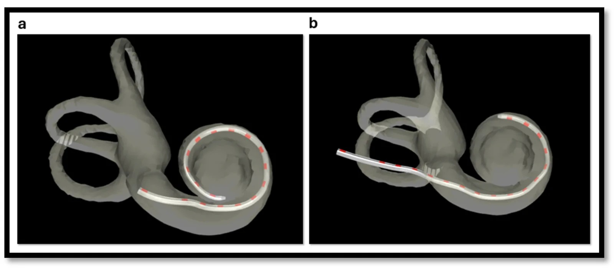
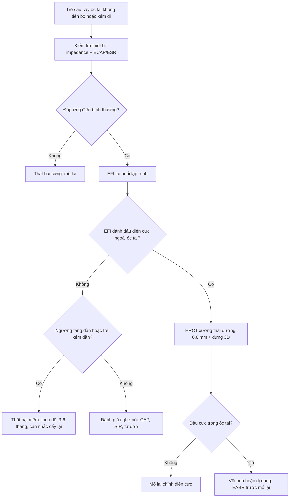
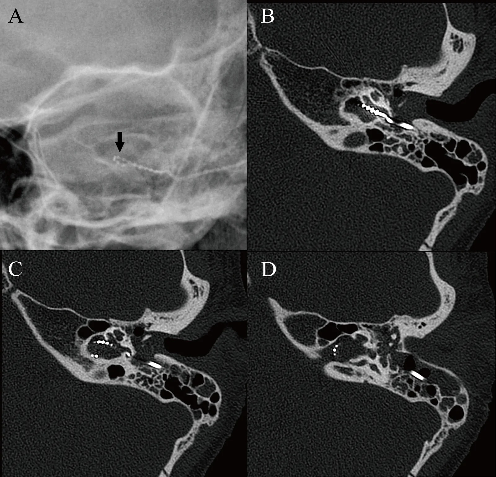
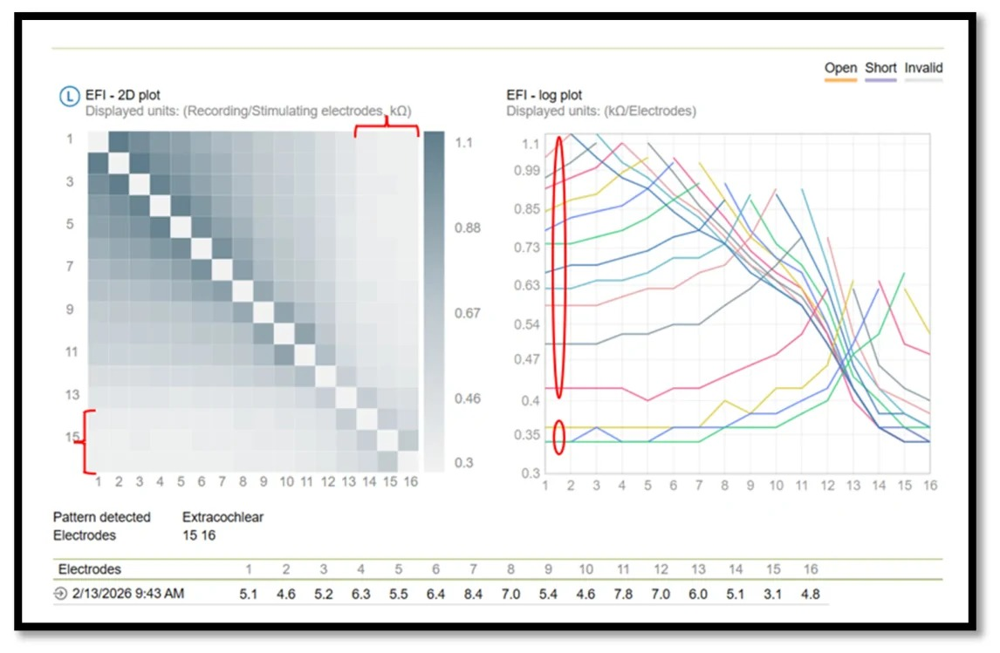
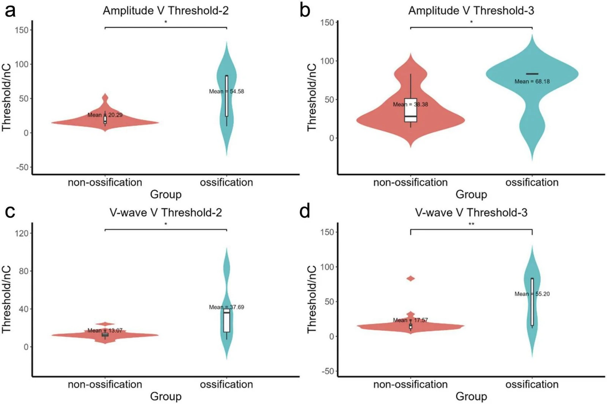

# 497 — Theo dõi sau cấy ốc tai ở trẻ: điện cực ngoài ốc tai, vôi hóa, thất bại thiết bị — đọc gì trên CT/EFI/EABR / Paediatric cochlear implant follow-up

**Tags:** `pattern:dien-cuc-ngoai-oc-tai` `pattern:di-tru-dien-cuc` `pattern:voi-hoa-oc-tai` `pattern:that-bai-thiet-bi` `vung:oc-tai` `vung:xuong-thai-duong` `score:Gibson` `score:CAP-SIR` `protocol:HRCT-xuong-thai-duong` `protocol:X-quang-so-ngoai` `protocol:EFI` `protocol:EABR`
**Mức chắc chắn (certainty):** tổng hợp y văn (literature synthesis) — nhóm tự biên từ: phân tích gộp 100 bản ghi/81 nghiên cứu/**42.167 bệnh nhân** về biến chứng cấy ốc tai (CC BY 4.0, PMC13509191), tổng quan hệ thống biến chứng ở nước thu nhập thấp–trung bình (CC BY 4.0, PMC13655758), thuật toán EFI phát hiện điện cực ngoài ốc tai (CC BY 4.0, PMC13510263), EABR ở 40 ca cấy lại có/không vôi hóa ốc tai (CC BY 4.0, PMC13643545), ca IP-III với X-quang âm tính giả – HRCT dương tính (CC BY-NC 4.0, PMC13583504), đoàn hệ cấy lại 1.465 ca (CC BY 4.0, PMC8347537), tổng quan viêm màng não sau cấy ốc tai 27.358 bệnh nhân (CC BY 4.0, PMC9994524).

> **Vì sao bài này quan trọng:** bài **478 (ANSD)** dạy *chỉ định và kết quả ban đầu* của cấy ốc tai; bài này là **"chuyện sau cấy"** — nơi quyết định trẻ có nghe được suốt đời hay mất cơ hội. Ba con số định khung: **13,7%** có biến chứng (5,2% nặng), **11,7%** phải cấy lại, và **3,94%** thiết bị có **điện cực nằm NGOÀI ốc tai** — nhóm này **vẫn "kích thích được"** nên test chức năng thường **không báo lỗi**, chỉ **hình ảnh/EFI** mới thấy (PMC13509191, PMC8347537, PMC13510263).

## 1. Tổng quan bệnh học – cơ chế hình ảnh – vì sao phải theo dõi bằng 3 lớp bằng chứng

- **"Thất bại" sau cấy ốc tai không phải một bệnh mà là 4 cơ chế khác nhau, cần 3 công cụ khác nhau:**
  1. **Thất bại thiết bị (device failure):** **cứng (hard)** = không truyền được điện (mạch/điện cực đứt), **mềm (soft)** = thiết bị còn "chạy" nhưng **hiệu năng giảm dần** (impedance bất thường, ngưỡng tăng, trẻ bỏ dùng). Chiếm **45,4% (mềm) + 23,8% (cứng) = 69,2%** các ca cấy lại; **2,8%** toàn bộ người cấy (PMC8347537, PMC13509191).
  2. **Điện cực ngoài ốc tai (extracochlear electrodes, EE) / di trú:** điện cực nằm **ngoài vòng ốc tai** (chèn không hết, trượt khi đóng vỏ, chấn thương, hoặc **dị dạng**) → **tần số gán sai vùng**, **kích thích ngoài ốc tai** (co giật mặt, chóng mặt), **giảm hiệu năng**. Phát hiện bằng **CT dựng hình 3D** hoặc **Electric Field Imaging (EFI)**.
  3. **Vôi hóa–xơ hóa ốc tai (cochlear ossification):** hậu **viêm màng não**, viêm tai giữa tái diễn; làm **hẹp lòng ốc tai**, chèn không hết, **ngưỡng kích thích tăng**, kết quả nghe–nói kém hơn.
  4. **Biến chứng nhiễm trùng/vỏ:** viêm màng não (**0,74%** — 202/27.358, xuất hiện **1 ngày – 72 tháng** sau cấy), nhiễm vết mổ (**2,3%**), viêm tai giữa, cholesteatoma, di lệch magnet.
- **TẠI SAO hình ảnh lại khó — 3 lý do vật lý:**
  - **X-quang sọ thẳng/nghiêng là hình chiếu 2D:** điện cực ốc tai là **dải kim loại cuộn**; khi cuộn **trong ốc tai bình thường** hay **cuộn trong bể ốc tai/dịch não tủy** đều cho **hình xoắn giống nhau** trên phim. Trong ca **IP-III** (mất trụ ốc tai, thông với ống tai trong), phim X-quang trong mổ **không thấy bất thường**, chỉ **HRCT** cho thấy **đầu điện cực nằm trong ống tai trong** (PMC13583504) — **âm tính giả nguy hiểm**.
  - **CT xương thái dương bị nhiễu kim loại (metal artifact):** điện cực bằng platinum → **vệt sáng/tối** che lòng ốc tai. Cần **lát mỏng 0,6–0,75 mm, thuật toán xương, FOV nhỏ**, và **dựng hình 3D** để đếm điện cực; đây là cách Hình 1 (PMC13510263) phân biệt **chèn đủ** vs **3 điện cực ngoài**.
  - **EFI không đo hình mà đo dòng điện:** EFI ghi **trở kháng chéo (cross-impedance, kΩ)** giữa từng cặp điện cực; điện cực **trong ốc tai** có **giảm dần đều** theo khoảng cách (môi trường dẫn điện đồng nhất), còn **điện cực ngoài** nằm trong **mô mềm/xương** → **trở kháng thấp hơn rõ và mất liên tục**. Nhờ vậy EFI phát hiện EE **mà không cần chụp**.
- **Con số nằm lòng:**
  - **Biến chứng chung 13,7%** (nặng **5,2%**, nhẹ **7,8%**); **thất bại thiết bị 2,8%**; **nhiễm vết mổ nông 2,3%**; **chóng mặt/choáng 12,4%**; đường **MPTA 5,4%** thấp hơn **SMA 7,8%**; **giảm theo thời đại 8,9% (1991–2010) → 4,1% (2011–2025)**; nguy cơ tăng: **tuổi cấy lớn, dị dạng tai trong, viêm tai giữa mạn, mổ tai trước đó, thời gian mổ dài** (PMC13509191).
  - **Quốc gia thu nhập trung bình thấp vs cao hơn:** biến chứng gộp **8,83% vs 5,08%**; ở nhóm thu nhập trung bình thấp **tổn thương dây VII** chiếm ưu thế, nhóm cao hơn **chóng mặt + thất bại thiết bị** (PMC13655758).
  - **Cấy lại 11,7% (172/1.465)**: **mềm 45,4%**, **cứng 23,8%**, **y tế 14%**, **chấn thương 8,1%**, **phẫu thuật 6,4%**, không kết luận 2,3%; **78% là trẻ em**; **70% cấy lại trong 10 năm đầu**; thành công **98,8%**; nghe–nói **không đổi hoặc tốt hơn 85%**, **kém đi 15%** (PMC8347537).
  - **EE:** trong 226 người cấy có **xác nhận bằng hình ảnh**, có **6 ca EE**; thuật toán EFI đạt **độ nhạy và độ đặc hiệu 100%**; ở nhóm **không có hình ảnh**, EFI đánh dấu **3,94%** thiết bị có EE — **dải điện cực thành bên (lateral wall) gặp EE nhiều hơn dải cong sẵn (pre-curved)** (PMC13510263).
  - **Vôi hóa ốc tai:** EABR **kích thích được 100%** ở nhóm không vôi hóa vs **80%** ở nhóm vôi hóa; **ngưỡng sóng V cao hơn** (13,07 vs 37,69 nC ở ngưỡng 2; 17,57 vs 55,20 nC ở ngưỡng 3); **điểm Gibson điện cực giữa** dự báo **nhận từ đơn âm tiết**, **R² = 0,406, p = 0,0007** (PMC13643545).
  - **Viêm màng não:** **202/27.358 = 0,74%**; **62** ca có **viêm tai giữa** trước đó, **47** ca có **dị dạng giải phẫu**; **24** ca phải **mổ lại**; chỉ **19** ca hồi phục hoàn toàn (PMC9994524) → **tiêm phòng là can thiệp rẻ nhất trong cả bài**.

## 2. Mẫu hình + chẩn đoán phân biệt theo kiểu "trẻ không tiến bộ" (Gamut)

- **Trẻ nghe tốt rồi kém dần (mất dần hiệu năng):** **thất bại mềm** (impedance/ngưỡng trôi), **di trú điện cực** (đầu cực ra khỏi ốc tai), **xơ hóa tiến triển**, **magnet di lệch** sau chấn thương/MRI.
- **Trẻ chưa bao giờ đạt mốc nghe:** **EE/đầu cực ngoài ốc tai** (đặc biệt **dị dạng IP-III, Mondini**), **vôi hóa ốc tai** (hậu viêm màng não), **bất thường dây VIII** (giảm sản), **ANSD không phù hợp** (bài 478), **lập trình chưa tối ưu**.
- **Trẻ có triệu chứng "kích thích ngoài ốc tai":** **co giật mặt** (dây VII bị kích thích), **chóng mặt/nystagmus** (kích thích tiền đình), **đau** — nghĩ **EE/điện cực trong ống tai trong** hoặc **vôi hóa làm dòng điện lan**.
- **Trẻ sốt + sưng sau tai/đỏ vỏ:** **nhiễm vết mổ**, **áp-xe dưới vỏ**, **viêm tai giữa**; nếu **cứng gáy/sốt cao** → **viêm màng não** (0,74%), cần **chọc dò + kháng sinh ngay**, không chờ CT.
- **Gamut theo vị trí đầu cực (dùng khi có CT):** **trong ốc tai (đủ)** / **bể ốc tai (vestibule)** / **ống tai trong (IAC)** / **xoang tĩnh mạch, ống bán khuyên, hố sọ** — vị trí quyết định **mổ lại ngay hay theo dõi**.
- **Mnemonic "DIME":** **D**evice failure, **I**nsertion problem (EE/migration), **M**eningitis/ossification, **E**lectrode–nerve mismatch (hypoplasia/ANSD).

## 3. Bảng so sánh phân biệt (ma trận đối chiếu)

| Thực thể (entity) | Hình ảnh / test điển hình | Chốt vào (rule-in) | Chốt loại (rule-out) | Gợi ý xác nhận |
|---|---|---|---|---|
| **Thất bại cứng (hard failure)** | Không có đáp ứng điện ở **mọi** điện cực; CT bình thường | **Mất đáp ứng toàn bộ** + không kích thích được | Còn đáp ứng một phần → không phải cứng | Đo impedance + integrity test; **không cần CT** nếu đã mất đáp ứng |
| **Thất bại mềm (soft failure)** | Impedance **trôi bất thường**, ngưỡng tăng dần, trẻ bỏ dùng; **CT thường bình thường** | **Hiệu năng giảm tiến triển** + test chức năng bất thường | **CT/EFI bình thường không loại trừ** | Theo dõi 3–6 tháng, so ngưỡng cũ; cấy lại khi mất tiến bộ |
| **EE / di trú điện cực** | **CT 3D**: đầu cực ngoài vòng ốc tai; **EFI**: nhóm điện cực **trở kháng chéo thấp, mất liên tục** | **Đầu cực ngoài ốc tai trên CT** hoặc **EFI đánh dấu EE** | EFI giảm dần đều + CT đủ vòng → loại | EFI (không cần hình ảnh) + HRCT khi cần quyết định mổ |
| **Vôi hóa ốc tai** | **HRCT**: dày/xơ lấp **vòng đáy**, mất khoang dịch; **EABR** ngưỡng cao, kích thích được 80% | **Vôi hóa vòng đáy trên CT** + **ngưỡng EABR cao** | CT bình thường + EABR ngưỡng thấp → loại | HRCT 0,6 mm + EABR trong mổ; MRI T2 3D khi cần xác định dây VIII |
| **Viêm màng não sau cấy** | Không có dấu hiệu hình ảnh đặc hiệu sớm; **CT/MRI** khi có biến chứng | **Sốt + cứng gáy + đau đầu** ở trẻ có CI (1 ngày–72 tháng sau mổ) | Chỉ sưng tại chỗ, không sốt → nghĩ nhiễm vỏ | **Chọc dò dịch não tủy + cấy** (không chờ hình ảnh); **không trì hoãn kháng sinh** |
| **Magnet di lệch** | **X-quang/CT**: magnet lệch trục, mất đối xứng; sau MRI/chấn thương | **Magnet lệch + mất dính da đầu** | Magnet đúng trục + da phẳng → loại | X-quang 2 bình diện; thay magnet |

*Hai ca dựng hình từ CT hậu phẫu (hệ Oto-pilot): (a) chèn đủ trong ốc tai; (b) ba điện cực nằm ngoài vòng ốc tai. Nguồn: Ashiri M et al., Audiol Res 2026 (PMC13510263) Fig. 1, CC BY 4.0.*

## 4. Protocol theo dõi + hệ điểm + quyết định

- **Lịch theo dõi tối thiểu (trẻ):** **bật máy 3–4 tuần** sau mổ; **1, 3, 6, 12 tháng** trong năm đầu; sau đó **6–12 tháng/lần** đến khi ổn định, rồi **hằng năm** — vì **70% ca cấy lại xảy ra trong 10 năm đầu** và **15%** trẻ **kém đi** sau cấy lại (PMC8347537).
- **Bộ test mỗi lần khám (3 lớp):**
  1. **Điện–thiết bị:** **impedance** từng điện cực, **ECAP/ESR (electrically evoked compound action potential / evoked stapedial reflex)**, kiểm tra **integrity**; **ngưỡng tăng dần** hoặc **impedance trôi** = cờ đỏ.
  2. **Hình ảnh:** **không chụp thường quy**. Chỉ định: **không tiến bộ sau 3–6 tháng**, **co giật mặt/chóng mặt**, **chấn thương đầu**, **nghi dị dạng**, **trước mổ lại**. Ưu tiên **HRCT xương thái dương 0,6–0,75 mm + dựng 3D**; **X-quang sọ chỉ để kiểm tra thô, KHÔNG đủ loại trừ** (ca IP-III: X-quang âm tính, HRCT thấy đầu cực trong ống tai trong — PMC13583504).
  3. **Điện sinh lý thần kinh:** **EABR** khi nghi **vôi hóa/dị dạng** hoặc **trước mổ lại** — **kích thích được 100% vs 80%**, **ngưỡng sóng V 13,07 vs 37,69 nC**, **Gibson điện cực giữa dự báo nhận từ (R² = 0,406)** (PMC13643545). EABR **hướng dẫn cochleostomy** khi vòng đáy xơ.
- **EFI (Electric Field Imaging) — "X-quang điện học":** đo **trở kháng chéo** giữa các cặp điện cực; **giảm đều** theo khoảng cách = môi trường trong ốc tai; **nhóm thấp bất thường** = **EE**. Trong 226 ca có imaging, EFI **Se = Sp = 100%**; ở nhóm không imaging, **3,94%** bị đánh dấu EE (PMC13510263). **Ưu điểm:** làm **ngay tại buổi lập trình**, không tia xạ — phù hợp trẻ nhỏ; **hạn chế:** không cho biết **vị trí giải phẫu**, nên **vẫn cần HRCT** khi cân nhắc mổ lại.
- **Phòng bệnh — can thiệp rẻ nhất:** **tiêm phòng phế cầu + Hib** trước/đúng lịch; **điều trị viêm tai giữa triệt để** (62/202 ca viêm màng não có viêm tai giữa trước đó); **tư vấn tránh chấn thương đầu**; **MRI phải theo giới hạn của từng thiết bị** (băng cố định đầu, tháo magnet khi quy định) — **magnet di lệch** là biến chứng của chính MRI.
- **Quyết định mổ lại:** mổ lại khi **(1)** mất đáp ứng/không dùng được, **(2)** **EE có triệu chứng** hoặc **không tiến bộ nghe–nói**, **(3)** **nhiễm vỏ/áp-xe** không đáp ứng kháng sinh, **(4)** **magnet di lệch**. Thành công **98,8%**, nhưng **15% kém đi** → **tư vấn trước mổ** rằng cấy lại **không bảo đảm tốt hơn**.

## 5. Biến thể bình thường và cạm bẫy

- **Cạm bẫy 1 — tin X-quang sọ "không thấy bất thường":** phim 2D **không phân biệt** cuộn trong ốc tai với cuộn trong **ống tai trong/bể ốc tai**; ca IP-III đã bị **bỏ qua** cho đến khi HRCT (PMC13583504). **Quy tắc:** X-quang **chỉ sàng lọc**, **không dùng để loại trừ** ở trẻ có dị dạng.
- **Cạm bẫy 2 — CT bình thường = thiết bị tốt:** **thất bại mềm** có **CT bình thường** và **EFI bình thường**; chẩn đoán dựa trên **xu hướng ngưỡng/impedance theo thời gian**, không dựa một lần đo.
- **Cạm bẫy 3 — EFI bất thường = phải mổ:** EFI có thể bị nhiễu do **mô xơ quanh điện cực** hoặc **dải điện cực thành bên** (vốn gặp EE nhiều hơn); **quyết định mổ cần HRCT + lâm sàng**, không dựa EFI đơn thuần.
- **Cạm bẫy 4 — vôi hóa ốc tai "không thấy" trên CT sớm:** giai đoạn đầu là **xơ (fibrosis)** — **không cản quang**, CT **có thể bình thường**; khi đã **vôi hóa** mới thấy dày vòng đáy. **MRI T2 3D** giúp thấy mất tín hiệu dịch ốc tai **trước** khi vôi hóa.
- **Cạm bẫy 5 — coi "trẻ không hợp tác" là nguyên nhân:** trước khi kết luận tâm lý, **phải loại trừ EE, thất bại mềm, vôi hóa**; trong loạt 226 ca, **6 ca EE** được xác nhận **bằng hình ảnh** nhưng nhiều ca **chỉ có EFI** mới phát hiện.
- **Cạm bẫy 6 — bỏ qua tiêm phòng:** **0,74%** viêm màng não, xuất hiện **tới 72 tháng** sau cấy, **24/202 phải mổ lại**, chỉ **19** hồi phục hoàn toàn — đây là biến chứng **phòng được**.
- **Cạm bẫy 7 — nhiễu kim loại trên CT làm "mất" vòng ốc tai:** dùng **lát 0,6 mm, FOV nhỏ, thuật toán xương**, đọc **2 bình diện trực giao** và **dựng 3D**; đừng kết luận "chèn đủ" chỉ vì không thấy đầu cực.

## 6. Tự lượng giá — Blind Quiz

**Ca 1 — Bé trai cuối tuổi nhi đồng, điếc sâu hai bên, dị dạng IP-III. Trong mổ X-quang sọ: điện cực cuộn, không gãy, không gập. Bé không đạt mốc nghe sau 6 tháng:**

- Câu hỏi: X-quang có loại trừ được đặt sai vị trí không? HRCT cho thấy gì? Vì sao IP-III dễ sai?

<b>Bấm để hiện đáp án (findings + chẩn đoán)</b>

- (A) X-quang sọ trong mổ: **điện cực cuộn, hơi dẹt, KHÔNG thấy gập/gãy/lệch** → **âm tính giả**.
- (B–D) HRCT: điện cực đi **qua thành bên vòng đáy** nhưng **đầu cực nằm trong ỐNG TAI TRONG** — ngoài ốc tai.
- Vì sao IP-III: **mất trụ ốc tai + thông ốc tai với ống tai trong** (đột biến *POU3F4*) → điện cực **trượt vào IAC** mà **vẫn giữ hình xoắn** trên phim 2D.
- Kết luận: **X-quang không loại trừ**; cần **HRCT trong mổ** ở mọi ca dị dạng để xác nhận vị trí trước khi đóng vết mổ.
- Nguồn ảnh: Zhao Z et al., BMJ Case Rep 2026 (PMC13583504) Fig. 1, **CC BY-NC 4.0** — nguyên bản.

**Ca 2 — Trẻ 4 tuổi, cha mẹ nói "vẫn nghe nhưng kém hơn trước". Impedance bình thường. EFI:**

- Câu hỏi: Đọc 2 đồ thị này thế nào? Kết luận gì? Bước tiếp theo?

<b>Bấm để hiện đáp án</b>

- Heat map: vùng **xám đậm** = trở kháng chéo **cao** (điện cực trong ốc tai); **vùng nhạt** ở **điện cực 15–16** = trở kháng **thấp bất thường**.
- Đường cong: **hai nhóm tách biệt** — nhóm trong ốc tai giảm dần đều, nhóm **điện cực đáy** thấp và **gần như phẳng**; phần mềm ghi **"Pattern detected: Extracochlear, electrodes 15–16"**.
- Kết luận: **điện cực ngoài ốc tai (EE)** — giải thích **kém đi dù impedance bình thường** (EE vẫn dẫn điện).
- Bước tiếp: **HRCT 0,6 mm + dựng 3D** xác định vị trí; nếu đầu cực ngoài ốc tai + không tiến bộ → **mổ lại chỉnh**; nếu chỉ 1–2 điện cực và trẻ vẫn tiến bộ → **tắt điện cực đó trong map** và theo dõi.
- Nguồn ảnh: Ashiri M et al., Audiol Res 2026 (PMC13510263) Fig. 3, **CC BY 4.0**.

**Ca 3 — Hai trẻ cấy lại: một có vôi hóa ốc tai sau viêm màng não, một không. EABR trong mổ:**

- Câu hỏi: Nhóm nào có ngưỡng cao hơn? Điều đó nói gì về tiên lượng và về kỹ thuật mổ?

<b>Bấm để hiện đáp án</b>

- Ngưỡng **cao hơn ở nhóm vôi hóa**: **37,69 vs 13,07 nC** (ngưỡng 2, p < 0,05) và **55,20 vs 17,57 nC** (ngưỡng 3, p < 0,01) → cần **dòng điện lớn hơn** để đạt cùng đáp ứng.
- **Tỷ lệ kích thích được:** **100%** (không vôi hóa) vs **80%** (vôi hóa) — 20% còn lại **không có đáp ứng** dù đã đặt điện cực.
- Tiên lượng: **điểm Gibson điện cực giữa** dự báo **nhận từ đơn âm tiết** (R² = 0,406) — dùng để **tư vấn kỳ vọng** trước mổ lại.
- Kỹ thuật: EABR **hướng dẫn vị trí cochleostomy** (chọn chỗ còn lòng ốc tai), và **giải thích vì sao trẻ vôi hóa cần map khác**.
- Nguồn ảnh: Jin Y et al., Front Neurosci 2026 (PMC13643545) Fig. 3, **CC BY 4.0**.

## Bài liên quan chéo
- [400 – Tổng quan Mắt & thị giác](../400-tong-quan-mat-thi-giac/lesson.md)
- [437 – Teo thị kèm điếc: DOA+/OPA1 & WFS1](../437-teo-thi-kem-diec/lesson.md)
- [478 – Điếc tiếp âm (ANSD) ở trẻ](../478-diec-tiep-am-ansd-tre/lesson.md)
- [479 – Tư vấn di truyền & xử lý VUS trong teo thị/điếc](../479-tu-van-di-truyen-vus-opa1-wfs1/lesson.md)
- [743 – Chảy máu cam nặng/tái diễn ở trẻ](../743-chay-mau-cam-nang-o-tre/lesson.md)

> Không dùng để chẩn đoán độc lập khi chưa có người hướng dẫn.
