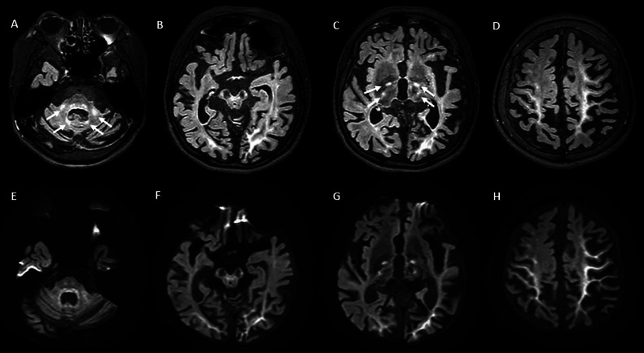
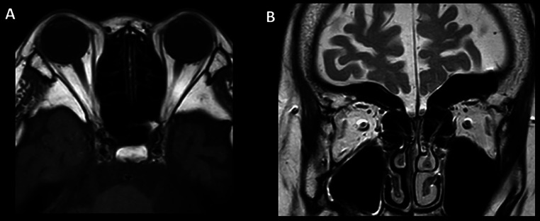
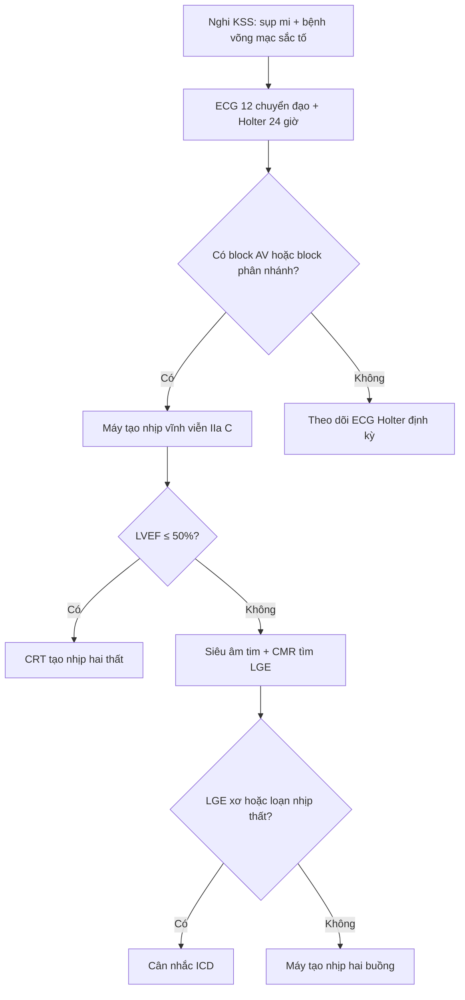
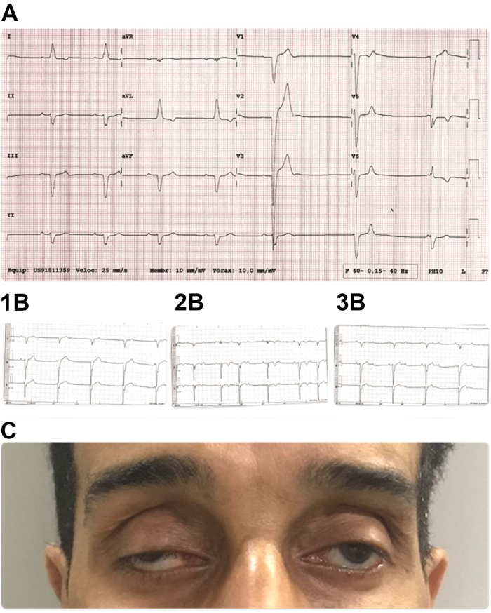
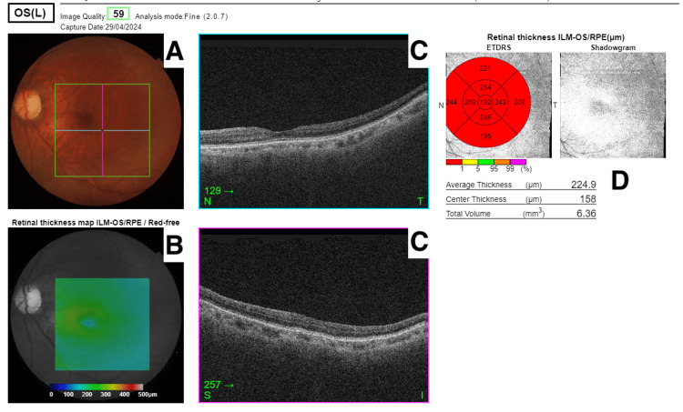

# 498 — Hội chứng Kearns–Sayre & CPEO: block dẫn truyền tim, hình ảnh não–hốc mắt / Kearns–Sayre syndrome and CPEO: cardiac conduction block, brain and orbital imaging

**Tags:** `pattern:sup-mi` `pattern:liet-nhan-cau` `pattern:benh-ty-the` `vung:mat` `vung:ho-nao` `vung:nao` `score:heteroplasmy` `score:ESC-2021` `protocol:MRI-nao-hoc-mat` `protocol:ECG-Holter` `protocol:OCT-hoang-diem` `anatomy:co-van-nhan`
**Mức chắc chắn (certainty):** tổng hợp y văn (literature synthesis) — số liệu từ ca KSS theo dõi MRI 10 năm (PMC11937629), ca KSS rối loạn dẫn truyền tiến triển (PMC13420563), bình luận về thời điểm đặt thiết bị (PMC13420555), ca CPEO đơn thuần (PMC11709421), tổng quan bệnh lý ty thể mắt (PMC13410010), thư trao đổi về tiêu chuẩn chẩn đoán/di truyền (PMC12220018) và ca KSS block AV độ III (PMC11924816).

## 1. Tổng quan bệnh học – cơ chế hình ảnh

### 1.1. Phổ bệnh: CPEO là "đầu", KSS là "đuôi" nguy hiểm

- **CPEO (chronic progressive external ophthalmoplegia)** và **KSS (Kearns–Sayre syndrome)** cùng do đột biến **ADN ty thể (mtDNA)** và nằm trên **một phổ liên tục**: CPEO chỉ có sụp mi + liệt nhãn cầu; KSS là thể **đa hệ** (PMC11937629, PMC11709421).
- **Tiêu chuẩn KSS:** khởi phát **trước 20 tuổi** + **bệnh võng mạc sắc tố (pigmentary retinopathy)** + **liệt nhãn cầu ngoài (external ophthalmoplegia)**; chẩn đoán cần thêm **ít nhất 1** trong: **block dẫn truyền tim**, **thất điều tiểu não**, **protein dịch não tủy ≥ 100 mg/dL (1 g/L)**, **lùn**, **rối loạn nội tiết**, **suy giảm nhận thức** (PMC11937629, PMC13410010).
- **TẠI SAO tim là cơ quan quyết định sống còn:** hệ dẫn truyền tim là mô **sau giảm phân (post-mitotic)**, tiêu thụ năng lượng cao, ít khả năng bù trừ; ATP giảm → **block dưới nút (infra-Hisian)** tiến triển **âm thầm và không đều**, có thể từ block nhẹ → **block AV hoàn toàn/ngừng tim** trong vài tháng (PMC13420555, PMC13420563).
- **TẠI SAO mắt là "cửa sổ" chẩn đoán:** cơ vận nhãn (extraocular muscles — EOM) có **mật độ ty thể cao nhất** trong các cơ, hoạt động liên tục → teo sớm và rõ; trên MRI hốc mắt, **teo EOM lan tỏa** là dấu hiệu myopathic kinh điển của CPEO/KSS (PMC13410010, PMC11937629).
- **TẠI SAO chất trắng "sáng" trên T2/FLAIR và "sáng" trên DWI:** thiếu năng lượng ty thể → **phù độc tế bào (cytotoxic edema)** và tổn thương bao myelin ở chất trắng dưới vỏ; nước nội bào làm **giảm khuếch tán (restricted diffusion)** → DWI sáng, ADC tối; T2/FLAIR sáng do tăng nước tự do trong mô. Vị trí ưa thích: **sợi U (U-fibers) dưới vỏ, thể cầu nhạt (globus pallidus), đồi thị, thân não, cuống tiểu não giữa (middle cerebellar peduncles)** (PMC11937629).
- **TẠI SAO bệnh võng mạc sắc tố nhìn "muối tiêu":** tổn thương **biểu mô sắc tố võng mạc (RPE)** từng đám → tăng/giảm sắc tố rải rác, có thể **rất kín đáo**; OCT có thể chỉ thấy mỏng lớp RPE/ngoài võng mạc hoặc **bình thường** ở CPEO (PMC11709421, PMC13410010).

### 1.2. Ngưỡng định lượng phải nhớ

- **Dịch tễ KSS:** **1–3/100.000** người; khởi phát điển hình **< 20 tuổi** (PMC13420555).
- **Di truyền:** CPEO **tới 60%** do **mất đoạn lớn mtDNA 1,3–9,1 kb**; **~15%** do đột biến điểm (ví dụ **m.3243A>G**); **~1/3** ca có tính gia đình (PMC11709421). KSS do mất đoạn đơn lẻ: **~4%** di truyền theo dòng mẹ, còn lại **lẻ tẻ** (PMC12220018).
- **Tiêu chuẩn DNT:** **protein ≥ 100 mg/dL** là một tiêu chuẩn phụ (PMC11937629); lactate/pyruvate DNT thường tăng (ca KSS: tăng cả hai) (PMC11937629).
- **Điện tim trong ca KSS 45 tuổi:** **PR 200 ms**, **QRS 130 ms**, nhịp thoát **40 lần/phút**, **110 khoảng ngừng**, dài nhất **3,6 giây**, có **Mobitz I, Mobitz II và block 2:1**; siêu âm tim **LVEF 62%**, CMR **không LGE** (PMC13420563).
- **Ngưỡng đặt máy theo ESC 2021:** đặt máy tạo nhịp vĩnh viễn **Class IIa, LoE C** khi KSS có **PR kéo dài, bất kỳ mức block AV, hoặc block phân nhánh/bó**; **Class IIb, LoE C** cho đặt máy **dự phòng** dù chưa có rối loạn dẫn truyền (PMC13420563).
- **Chọn máy:** block AV + **LVEF ≤ 50%** → **tạo nhịp hai thất/CRT** tốt hơn tạo nhịp thất phải (BLOCK-HF) (PMC13420555); **ICD** khi có rối loạn chức năng thất, **LGE/xơ cơ tim**, hoặc **loạn nhịp thất** (PMC13420555, PMC13420563).
- **Tiến triển hình ảnh:** MRI lúc **10 tuổi** chỉ teo nhẹ + FLAIR sáng **cuống não sau và nhân đuôi trái**, **không hạn chế khuếch tán**; lúc **20 tuổi** teo nặng đại não–tiểu não–thân não + FLAIR sáng **sợi U, thể cầu nhạt, đồi thị, thân não, cuống tiểu não giữa** và **hạn chế khuếch tán** ở các vùng này (PMC11937629).

## 2. Mẫu hình + chẩn đoán phân biệt theo vị trí (gamut)

### 2.1. Mẫu hình "sụp mi hai bên + liệt nhãn cầu, KHÔNG đau, KHÔNG lác đôi"

- **Mẫu hình đúng bệnh (myopathic):** sụp mi **hai bên, đối xứng, tiến triển chậm nhiều năm**, hạn chế vận nhãn **mọi hướng**, **không lác đôi** (vì hai mắt cùng yếu), **đồng tử bình thường**, không đau, không lồi mắt. Đây là chữ ký của **CPEO/KSS** (PMC11709421).
- **Vì sao không lác đôi:** liệt **đối xứng hai mắt** → hai ảnh võng mạc vẫn tương ứng; lác đôi xuất hiện khi **bất đối xứng** (như trong CPEO muộn có exotropia nhưng bệnh nhân vẫn không kêu lác đôi) (PMC11709421).
- **Gamut theo vị trí tổn thương:**
  1. **Cơ vận nhãn (myopathic):** CPEO, KSS, **OPMD** (oculopharyngeal muscular dystrophy), **OPDM** (oculopharyngodistal myopathy), loạn dưỡng cơ myotonic, bệnh ty thể khác (MELAS/MIDD).
  2. **Khớp thần kinh cơ (NMJ):** **nhược cơ (myasthenia gravis)** — sụp mi **dao động trong ngày**, mỏi khi nhìn lâu, **không teo cơ trên MRI**.
  3. **Hốc mắt:** **bệnh mắt Graves (TED)** — lồi mắt, co mi, **thân cơ to nhưng chừa gân**, hạn chế vận nhãn không đối xứng; **viêm cơ hốc mắt** — đau, phù, ngấm cơ **cả gân**; **u hốc mắt** — lồi mắt, khối.
  4. **Thân não/nhân dây thần kinh:** nhồi máu/u thân não, **Miller Fisher**, xơ cứng rải rác — thường kèm dấu hiệu thần kinh khác, khởi phát **cấp/tối cấp**.
  5. **Bẩm sinh/cơ học:** hội chứng co thắt bao cơ bẩm sinh, sụp mi bẩm sinh, **bệnh cơ mắt do tuyến giáp**.

### 2.2. Mẫu hình "sụp mi + bệnh võng mạc sắc tố" → nghĩ KSS trước tiên

- **Bộ ba KSS:** sụp mi/liệt nhãn cầu + **bệnh võng mạc sắc tố muối tiêu** + **khởi phát < 20 tuổi**, kèm **block dẫn truyền tim** (thường gặp nhất trong các tiêu chuẩn phụ).
- **Mẹo nhớ "MITO":** **M**yopathy (EOM teo, không đau) – **I**nfra-Hisian block (tim) – **T**innitus/điếc tiếp nhận – **O**cular pigmentary retinopathy + **O**nsets before 20.

## 3. Bảng so sánh phân biệt (ma trận đối chiếu)

| Thực thể (entity) | Hình ảnh/lâm sàng điển hình | Chốt vào (rule-in) | Chốt loại (rule-out) | Gợi ý xác nhận |
|---|---|---|---|---|
| **KSS** | Sụp mi + liệt nhãn cầu **đối xứng**; **bệnh võng mạc sắc tố**; MRI não: FLAIR sáng **sợi U/thể cầu nhạt/đồi thị/cuống tiểu não giữa**, DWI hạn chế khuếch tán; **teo EOM** | **Khởi phát < 20 tuổi + bệnh võng mạc sắc tố + ≥ 1 tiêu chuẩn phụ (block tim, thất điều, protein DNT ≥ 100 mg/dL, lùn, nội tiết, nhận thức)** | Không có bệnh võng mạc sắc tố, khởi phát muộn, không tiêu chuẩn phụ → **không gọi KSS** (vẫn có thể CPEO) | ECG + Holter, protein DNT, MRI não/hốc mắt, mtDNA (mất đoạn lớn), sinh thiết cơ (RRF/COX) |
| **CPEO đơn thuần** | Sụp mi **hai bên tiến triển nhiều năm**, liệt nhãn cầu, **không lác đôi**, đồng tử bình thường; **teo EOM lan tỏa** trên MRI; **OCT/fundus không có sắc tố** | **Tiến triển chậm, không đau, không bệnh võng mạc sắc tố, không block tim** | Có bệnh võng mạc sắc tố/block tim → **chuyển sang KSS** | Fundus + OCT + ERG; ECG/Holter; mtDNA; MRI hốc mắt |
| **OPMD/OPDM** | Liệt nhãn cầu + **nuốt khó** (OPMD) hoặc yếu cơ xa (OPDM); MRI có thể **teo EOM**; OPDM có **DWI sáng sợi U** | **Nuốt khó + yếu cơ tứ chi/xa + tiền sử gia đình** | Không nuốt khó, không yếu cơ ngoài mắt → nghĩ CPEO | Gene (PABPN1 cho OPMD; NOTCH2NLC cho OPDM), EMG |
| **Nhược cơ (MG)** | Sụp mi **dao động**, mỏi khi nhìn lâu, **không teo EOM**, có thể yếu cơ khác; **không có tổn thương chất trắng** | **Dao động + hết sau nghỉ + kháng thể AChR/MuSK** | Teo EOM trên MRI + tiến triển cố định nhiều năm → loại trừ MG | Kháng thể AChR/MuSK, EMG lặp kích thích, ice-pack test |
| **Bệnh mắt Graves (TED)** | Lồi mắt, co mi, **thân cơ to, chừa gân**, hạn chế vận nhãn không đối xứng | **Lồi mắt + co mi + thân cơ to chừa gân trên CT/MRI** | Thân cơ teo, không lồi mắt, không co mi → loại trừ TED | TSH/TRAb, CT/MRI hốc mắt |
| **Viêm cơ hốc mắt** | **Đau**, phù mi, hạn chế vận nhãn **cấp**, cơ **ngấm cản quang cả gân** | **Đau cấp + ngấm cả thân và gân cơ** | Đau mạn tính không có, teo cơ đối xứng → loại trừ | MRI hốc mắt có cản quang; đáp ứng corticoid |
| **Tổn thương thân não/nhân** | Khởi phát **cấp**, lác đôi, dấu hiệu thần kinh khu trú, hình ảnh nhồi máu/u trên MRI | **Khởi phát cấp + tổn thương khu trú trên DWI** | Tiến triển chậm đối xứng nhiều năm → loại trừ | MRI sọ cấp, mạch máu |

*MRI lúc 20 tuổi: (A–D) 3D FLAIR sáng ở **cuống tiểu não giữa, vùng cạnh giun, thân não, thể cầu nhạt, đồi thị, bao trong và chất trắng dưới vỏ (gồm sợi U)**; (E–H) DWI tương ứng **hạn chế khuếch tán**. Nguồn: Matsukawa M và cộng sự, Radiol Case Rep 2025, PMC11937629, CC BY-NC-ND 4.0.*

*MRI hốc mắt cùng ca: (A) T1 axial — **teo nặng cơ trực trong và trực ngoài hai bên** (mũi tên); (B) T2 coronal — **teo rõ toàn bộ các cơ vận nhãn hai bên**. Teo cơ lan tỏa, đối xứng, không dày thân cơ và không có khối là chữ ký của bệnh cơ ty thể (khác TED/viêm cơ). Nguồn: Matsukawa M và cộng sự, Radiol Case Rep 2025, PMC11937629, CC BY-NC-ND 4.0.*

### 3.1. Dấu hiệu "chốt" khi đọc MRI não KSS

1. **Phân bố:** **sợi U dưới vỏ** + **thể cầu nhạt** + **đồi thị** + **thân não** + **cuống tiểu não giữa** — đối xứng, không theo lãnh thổ mạch.
2. **DWI/ADC:** sáng DWI + tối ADC = **hạn chế khuếch tán thật**, không phải hiệu ứng T2 shine-through; dấu hiệu này **có thể xuất hiện muộn** (10 tuổi: không có; 20 tuổi: có) (PMC11937629).
3. **Tiến triển:** so sánh **hai thời điểm** là chìa khóa — teo não/thân não/tiểu não tăng rõ sau 10 năm.

## 4. Protocol chụp + phân tầng điều trị

### 4.1. Mắt – hốc mắt

- **Khám:** thị lực, **MRD1** (độ mở mi), vận nhãn 9 hướng, **đồng tử**, soi đáy mắt, **OCT hoàng điểm + RNFL**, **ERG/VEP** (VEP chậm/biên độ giảm khi có tổn thương thị), thị trường.
- **OCT/fundus mục đích:** tìm **bệnh võng mạc sắc tố** (KSS) hoặc **loạn dưỡng hoàng điểm**; ở CPEO đơn thuần OCT có thể **chỉ thấy thay đổi do cận thị, không có sắc tố** (PMC11709421).
- **MRI hốc mắt:** T1 + T2 **lát mỏng 2–3 mm**, coronal + axial; đánh giá **độ dày từng cơ vận nhãn** (teo lan tỏa = myopathic); **không cần cản quang** nếu chỉ tìm teo cơ, nhưng cần khi nghi viêm/u.
- **Sinh thiết cơ + di truyền:** sinh thiết cơ tìm **ragged-red fibers/COX âm** và **mất đoạn mtDNA** — lưu ý sinh thiết cơ **không đặc hiệu** cho KSS, chỉ giúp lấy mô và xác định đột biến (PMC12220018); xét nghiệm **mtDNA toàn bộ** (mất đoạn lớn, đột biến điểm, **heteroplasmy**).

### 4.2. Não

- **MRI sọ 1,5–3 T:** axial **T2/FLAIR** 3 mm, **DWI/ADC**, T1; cân nhắc MRS (lactate) nếu có; **không bắt buộc cản quang** (ca KSS 20 tuổi chưa từng chụp cản quang) (PMC11937629).
- **Thời điểm:** chụp **lúc chẩn đoán** và **lặp lại khi có triệu chứng mới**; **MRI bình thường ở trẻ không loại trừ KSS** — ca minh chứng có MRI 10 tuổi gần như bình thường, 20 tuổi tổn thương lan rộng (PMC11937629).

### 4.3. Tim — phần quyết định sống còn

- **ECG 12 chuyển đạo + Holter 24 giờ** ngay khi nghi KSS, kể cả khi không có triệu chứng tim; **siêu âm tim** (LVEF, buồng thất) và **CMR** (LGE, xơ cơ tim) khi có điều kiện (PMC13420555, PMC13420563).
- **Ngưỡng can thiệp (ESC 2021):**
  - **PR kéo dài, bất kỳ block AV, block phân nhánh/bó** → **máy tạo nhịp vĩnh viễn** (IIa, C).
  - **Chưa có rối loạn dẫn truyền** nhưng KSS → **có thể đặt dự phòng** (IIb, C).
  - **LVEF ≤ 50% + block AV** → **CRT/tạo nhịp hai thất** (BLOCK-HF).
  - **Rối loạn chức năng thất, LGE/xơ, loạn nhịp thất** → **ICD** thay vì chỉ máy tạo nhịp.
- **Theo dõi:** chưa có khoảng thời gian tối ưu được chứng minh trong các nguồn đã đọc — thực hành hợp lý là **ECG + Holter định kỳ** và **hỏi triệu chứng ngất/khó thở khi gắng sức** mỗi lần khám; ghi rõ "chưa rõ khoảng tối ưu" thay vì bịa con số.

### 4.4. Điều trị mắt

- **Sụp mi:** phẫu thuật **treo mi vào cơ trán (brow suspension)** với sling silicone là lựa chọn khi cơ nâng mi yếu; **mổ đục thủy tinh thể trước** nếu có chỉ định, vì sụp mi có thể **nặng hơn sau mổ** (PMC11709421).
- **Cảnh báo:** treo mi làm **mất cơ chế bảo vệ giác mạc** khi ngủ → khô mắt, hở mi; cần khám giác mạc và dùng thuốc bôi trơn (PMC11709421).

## 5. Biến thể bình thường và cạm bẫy

- **MRI não bình thường ở trẻ có KSS:** tổn thương chất trắng **có thể chưa xuất hiện**; đừng loại trừ bệnh vì MRI 10 tuổi sạch (PMC11937629).
- **Hạn chế khuếch tán sợi U KHÔNG đặc hiệu cho KSS:** còn gặp trong **NIID, FXTAS, OPML, OPDM** (phổ FNOP) — phải dựa vào bệnh võng mạc sắc tố, tim, DNT và mtDNA (PMC11937629).
- **"Không có bệnh võng mạc sắc tố" ≠ không bệnh ty thể:** CPEO đơn thuần có thể không có sắc tố; ngược lại KSS có thể sắc tố **rất kín đáo**, cần OCT/ERG và theo dõi (PMC11709421, PMC13410010).
- **ECG bình thường giữa các cơn:** block AV ở KSS **tiến triển từng đợt**; Holter 24 giờ có thể bỏ sót cơn ngắn — đừng yên tâm chỉ vì ECG một lần bình thường (PMC13420555).
- **Khó thở khi gắng sức bị quy cho "yếu cơ ty thể":** ca 45 tuổi bị chẩn đoán trễ vì triệu chứng tim bị gán cho bệnh cơ; **nhịp chậm + mệt** ở KSS phải loại trừ block AV trước (PMC13420555).
- **Áp tiêu chuẩn máy tạo nhịp của người không bệnh cơ:** KSS tiến triển **nhanh và không đoán trước**, block **dưới nút**; chờ đủ tiêu chuẩn "kinh điển" có thể bỏ lỡ (PMC13420563).
- **Sinh thiết cơ "âm tính" không loại trừ:** mất đoạn mtDNA có thể **không phát hiện trong máu**, cần mô cơ; sinh thiết cơ không phải tiêu chuẩn vàng chẩn đoán KSS (PMC12220018).

## 6. Tự lượng giá — Blind Quiz

**Ca 1 — Nam 45 tuổi, sụp mi + liệt nhãn cầu 20 năm, bệnh võng mạc sắc tố, khó thở khi gắng sức. Nhìn ECG/Holter, mô tả trước.**

- Gợi ý: mạch 40 lần/phút, không ngất; siêu âm tim LVEF 62%.
- Câu hỏi: nhịp gì? Có mấy loại rối loạn dẫn truyền? Nên đặt máy gì và vì sao **không** chờ?

<b>Bấm để hiện đáp án (findings + chẩn đoán)</b>

- **Findings:** nhịp xoang chậm, **nhịp thoát bộ nối/thất 40 lần/phút**, **PR 200 ms**, **QRS 130 ms**, block phân nhánh trái; Holter có **110 khoảng ngừng (dài nhất 3,6 giây)**, **Mobitz I, Mobitz II và block 2:1**.
- **Chẩn đoán:** **KSS có bệnh dẫn truyền đa tầng** — đặt **máy tạo nhịp hai buồng** (ESC 2021 IIa C); chờ block hoàn toàn là nguy hiểm vì bệnh tiến triển không đoán trước.
- **Vì sao không ICD ngay:** chưa có rối loạn chức năng thất/LGE/loạn nhịp thất; nếu có → cân nhắc ICD.
- Nguồn: Amaro T và cộng sự, JACC Case Rep 2026, PMC13420563, CC BY-NC-ND 4.0.

**Ca 2 — Nam 20 tuổi, KSS đã xác định, MRI não lần này. Mô tả phân bố tổn thương và nghĩa của DWI.**

- Câu hỏi: 3 vùng tổn thương chính? DWI sáng nói gì? Cần phân biệt với nhóm bệnh nào?

<b>Bấm để hiện đáp án (findings + chẩn đoán)</b>

- **Findings:** FLAIR sáng **sợi U dưới vỏ, thể cầu nhạt, đồi thị, bao trong, thân não, cuống tiểu não giữa, vùng cạnh giun**; DWI **sáng tương ứng** = hạn chế khuếch tán; teo đại não–thân não–tiểu não nặng.
- **Ý nghĩa:** phù độc tế bào/loạn dưỡng chất trắng do thiếu năng lượng ty thể; không theo lãnh thổ mạch.
- **Phân biệt:** **NIID, FXTAS, OPML, OPDM** (phổ FNOP) — cùng kiểu DWI sợi U; khác nhờ bệnh võng mạc sắc tố, block tim, DNT và mtDNA.
- Nguồn: Matsukawa M và cộng sự, Radiol Case Rep 2025, PMC11937629, CC BY-NC-ND 4.0.

**Ca 3 — Nữ 61 tuổi, sụp mi hai bên 36 năm, không lác đôi, đồng tử bình thường. Ảnh OCT/fundus bên dưới.**

- Câu hỏi: có bằng chứng KSS không? Cần làm gì thêm để phân biệt CPEO với KSS? Vì sao **không** kết luận KSS chỉ vì sụp mi lâu năm?

<b>Bấm để hiện đáp án (findings + chẩn đoán)</b>

- **Findings:** OCT/fundus **không có bệnh võng mạc sắc tố**, chỉ thay đổi cận thị; độ dày võng mạc trung bình 224,9 µm, trung tâm 158 µm.
- **Chẩn đoán:** **CPEO đơn thuần** — khởi phát muộn (sau 20 tuổi), không sắc tố, không block tim, không thất điều.
- **Cần làm:** **ECG + Holter**, protein DNT, MRI não/hốc mắt (teo EOM), mtDNA; nếu xuất hiện sắc tố/block tim → đổi nhãn thành KSS.
- Nguồn: Seemongal-Dass RV và cộng sự, Cureus 2025, PMC11709421, CC BY 4.0.

## Bài liên quan chéo
- [477 – Bệnh ty thể có biểu hiện thị giác & tai](../477-benh-ty-the-thi-giac-tai/lesson.md)
- [479 – Tư vấn di truyền & xử lý biến thể VUS (OPA1/WFS1)](../479-tu-van-di-truyen-vus-opa1-wfs1/lesson.md)
- [439 – Teo thị di truyền: DOA/OPA1 & Wolfram](../439-teo-thi-di-truyen/lesson.md)
- [820 – MRI tim: LGE xuyên thành vs giữa/dưới thượng tâm mạc](../820-cardiac-mri-lge-mapping/lesson.md)

> Không dùng để chẩn đoán độc lập khi chưa có người hướng dẫn.
