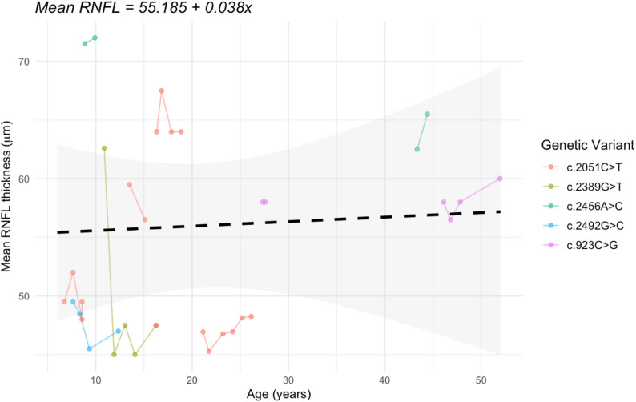
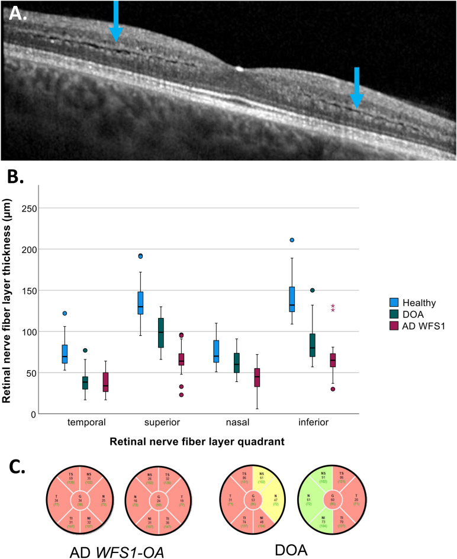
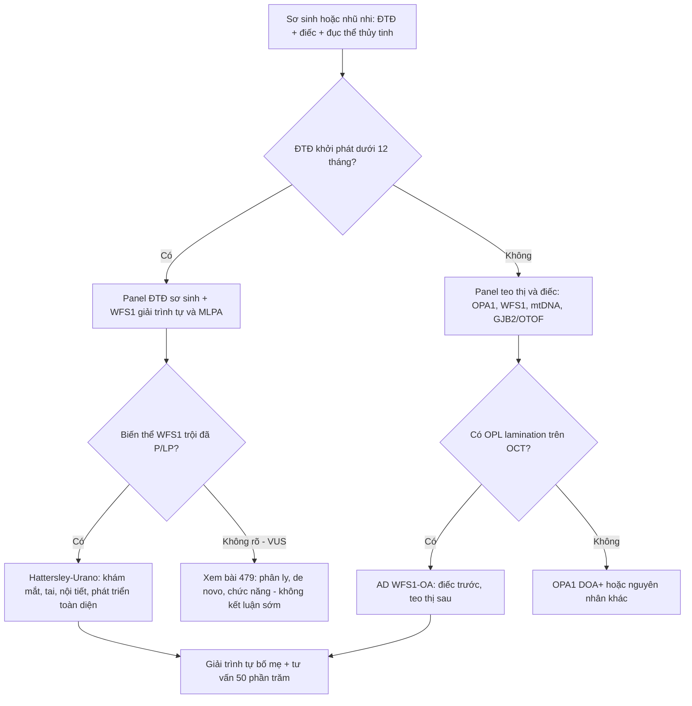
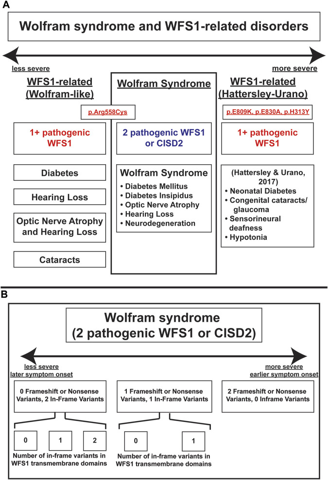

# 499 — Hội chứng Hattersley–Urano & phổ WFS1 trội / Hattersley–Urano syndrome and the autosomal dominant WFS1 spectrum

**Tags:** `pattern:teo-thi` `pattern:diec-thi-giac` `pattern:dai-thao-duong-so-sinh` `pattern:duc-the-thuy-tinh` `vung:than-kinh-thi` `vung:tai-trong` `vung:tuy` `protocol:OCT-RNFL-GCL` `protocol:audiometry-ABR` `protocol:NGS-WFS1` `score:logMAR`
**Mức chắc chắn (certainty):** tổng hợp y văn (literature synthesis) — nhóm tự biên từ các bài mở 2017–2026: tự nhiên học 15 bệnh nhân WFS1 trội (Orphanet J Rare Dis 2026, CC BY 4.0, PMC13224583), 22 bệnh nhân WFS1 trội so với OPA1 (Sci Rep 2024, CC BY-NC-ND 4.0, PMC11450207), 5 ca Hattersley–Urano (Diabetes 2017, PMC5482085 — **chỉ đọc phần tóm tắt**, bản toàn văn không mở trong lần tra này) và phổ phân độ Wolfram/WFS1 (Front Genet 2023, CC BY 4.0, PMC10321297).

> **Vì sao bài này quan trọng:** bài **437** đã dạy nhận diện "teo thị + điếc" và bài **479** dạy xử lý biến thể VUS. Nhưng có một nhóm **hoàn toàn khác về mức nặng**: trẻ **đái tháo đường sơ sinh + điếc bẩm sinh + đục thể thủy tinh bẩm sinh** — **Hội chứng Hattersley–Urano** do **một** biến thể WFS1 trội. Bỏ sót nghĩa là gọi trẻ là "ĐTĐ týp 1", bỏ đục thể thủy tinh, bỏ điếc, và **không tầm soát gia đình** dù **50%** nguy cơ cho mỗi con.

## 1. Tổng quan — một gen, hai mức nặng: vì sao Hattersley–Urano khác hẳn Wolfram lặn

- **WFS1 (4p16.1)** mã hóa **wolframin**, protein màng lưới nội chất (ER) 8 exon, điều hòa **canxi ER**, **đáp ứng stress ER (ATF6)** và **vận chuyển ATP1B1** ra màng tế bào. Tế bào beta, ốc tai và thể thủy tinh đều **sống dựa vào cân bằng ER** — nên cùng một gen, ba cơ quan cùng hỏng.
- **Vì sao lặn = Wolfram kinh điển:** hai biến thể **mất chức năng (LOF)** → mất hoàn toàn wolframin → hỏng dần theo tuổi. Tuổi khởi phát trung vị trong một tổng hợp lớn: **ĐTĐ 6,0 tuổi — teo thị 11,0 — đái tháo nhạt 13,0 — điếc 14,0** (PMC10321297).
- **Vì sao trội = phổ từ nhẹ đến rất nặng:** biến thể **missense** nằm ở **domain lòng ER** (6/7 biến thể trong PMC13224583) tạo protein gấp sai → **stress ER trội**. Mức độ phụ thuộc **vị trí và kiểu biến thể**, không phụ thuộc "trội thì nhẹ":
  - **Thể thường gặp — teo thị + điếc (AD WFS1-OA):** điếc **trước**, teo thị **sau**. 15 bệnh nhân: **điếc 2,0 tuổi (IQR 1,0–2,5)**, **teo thị 10 tuổi (IQR 7,0–17,5)**; **15/15 dùng máy trợ thính**, **8/15 cấy ốc tai hai bên**; trễ từ chẩn đoán điếc đến đeo máy trợ thính **2,2 năm** (PMC13224583).
  - **Thể nặng — Hattersley–Urano:** **ĐTĐ sơ sinh/nhũ nhi + điếc tiếp âm bẩm sinh + đục thể thủy tinh bẩm sinh + giảm trương lực + chậm phát triển** (PMC10321297; De Franco 2017). 5 ca: ĐTĐ **< 12 tháng (5/5, 2 ca < 6 tháng)**, điếc **ngay sau sinh (5/5)**, **đục TTT 4/5**, **giảm trương lực 4/5**, **4/5 de novo**; 5 ca được tìm thấy trong **311 trẻ ĐTĐ khởi phát < 1 tuổi (1,6%)** đã loại trừ nguyên nhân đã biết.
- **Hai điểm định lượng quyết định thái độ theo dõi:**
  - **Teo thị của WFS1 trội KHÔNG tiến triển nhanh:** BCVA trung bình chỉ giảm **0,052 logMAR/năm (p = 0,159)** và RNFL **0,038 µm/năm (p = 0,829)** — tức **ổn định** trong nhiều năm (PMC13224583). Đừng mặc định "teo thị di truyền = mù dần nhanh"; đây cũng là điểm khác với **LHON** (mất thị lực cấp trong vài tuần–vài tháng).
  - **Dấu hiệu OCT đặc trưng:** **phân lớp lớp rối ngoài (outer plexiform layer — OPL lamination)** gặp **6/8 (75%)** ca có OCT (PMC13224583) và **không có ở DOA/OPA1** (PMC11450207). Đây là "chốt vào" rẻ tiền nhất trên máy OCT thường.
- **Đái tháo đường trong thể teo thị + điếc:** **2/15 (13%)** (PMC13224583) và **7/22 (32%)** (PMC11450207) — tức **không phải cứ WFS1 trội là có ĐTĐ**, nhưng phải **tầm soát định kỳ** vì có thể xuất hiện muộn.

*RNFL trung bình theo tuổi (11 bệnh nhân): đường đứt nét **55,185 + 0,038 × tuổi** — độ dốc **0,038 µm/năm (p = 0,829)**, tức **không mất RNFL đáng kể theo thời gian** trong cohort này. Nguồn: Roberts JP et al., Orphanet J Rare Dis 2026, Fig. 3 (PMC13224583), CC BY 4.0.*

## 2. Mẫu hình + gamut theo kiểu hình (Gamut)

- **Kiểu hình 1 — ĐTĐ sơ sinh/nhũ nhi + điếc + đục TTT:** nghĩ **Hattersley–Urano (WFS1 trội nặng)** trước tiên; sau đó **Wolfram lặn**, **kênh KATP (KCNJ11/ABCC8)**, **nhiễm trùng bẩm sinh (rubella/CMV)**.
- **Kiểu hình 2 — điếc tần số thấp/điếc tiếp âm ở trẻ + teo thị ở tuổi học đường:** **AD WFS1-OA** là hàng đầu; phân biệt **OPA1 DOA+**, **điếc di truyền không hội chứng (GJB2/OTOF)**, **bệnh ty thể m.3243A>G**.
- **Kiểu hình 3 — đục thể thủy tinh sớm đơn độc:** WFS1 trội là nguyên nhân **hiếm nhưng có thật**; hỏi thêm điếc/ĐTĐ trong gia đình.
- **Kiểu hình 4 — ĐTĐ + điếc ở người trưởng thành:** **m.3243A>G (MIDD)** và **Alström (ALMS1)** cạnh tranh với WFS1; đừng mặc định WFS1.
- Gợi nhớ phổ WFS1 bằng **4 chữ cái hỏng dần: H-O-D-W** — **H**earing (điếc) → **O**ptic atrophy → **D**iabetes → **W**ater (đái tháo nhạt, chủ yếu thể lặn). Thứ tự này phản ánh **thời điểm thường gặp**, không phải **mức nặng**.

## 3. Bảng so sánh phân biệt (ma trận đối chiếu)

| Thực thể (entity) | Hình ảnh / lâm sàng điển hình | Chốt vào (rule-in) | Chốt loại (rule-out) | Gợi ý xác nhận |
|---|---|---|---|---|
| **Hattersley–Urano (WFS1 trội nặng)** | ĐTĐ **< 12 tháng** + điếc tiếp âm **bẩm sinh** + **đục TTT bẩm sinh** + giảm trương lực/chậm phát triển | **Tam chứng sơ sinh + một biến thể WFS1 missense trội (p.Glu809Lys, p.Glu830Ala, p.His313Tyr)** | **Không có ĐTĐ sơ sinh + đục TTT muộn** → thể AD WFS1 thường; **đái tháo nhạt rõ** → nghĩ Wolfram lặn | Giải trình tự WFS1 + MLPA (mất đoạn); giải trình tự bố mẹ (de novo **4/5**) |
| **Wolfram lặn (WFS1/CISD2)** | ĐTĐ **6,0 tuổi** → teo thị **11,0** → đái tháo nhạt **13,0** → điếc **14,0**; teo não, rối loạn tâm thần | **2 biến thể LOF + đái tháo nhạt + teo thị + điếc** | **Chỉ 1 biến thể + không đái tháo nhạt** → không phải thể lặn | WFS1 hai alen; osmolality niệu; MRI não |
| **AD WFS1-OA (teo thị + điếc)** | Điếc **2 tuổi**, teo thị **10 tuổi**; **OPL lamination** trên OCT; RNFL mỏng **lan tỏa**; rối loạn sắc giác **đỏ–lục** | **OPL lamination (6/8) + điếc trước teo thị + tiền sử gia đình trội** | **OPL bình thường + sắc giác xanh–vàng + RNFL chỉ thái dương** → OPA1 | OCT RNFL/GCL; audiogram; WFS1 |
| **OPA1 DOA+** | Teo thị khởi phát **thập niên 1**, RNFL **thái dương**, sắc giác **xanh–vàng**; 20% có điếc/ataxia/myopathy | **RNFL thái dương + sắc giác xanh–vàng + missense GTPase** | **OPL lamination + sắc giác đỏ–lục** → WFS1 | OPA1 + MLPA; ERG/VEP |
| **m.3243A>G (MIDD)** | ĐTĐ + điếc ở **người lớn**, **loạn dưỡng hoàng điểm** dạng hạt, tầm vóc thấp, mẹ bị tương tự | **Tiền sử mẹ + loạn dưỡng hoàng điểm + lactate cao** | **ĐTĐ sơ sinh + đục TTT bẩm sinh** → không phải MIDD | mtDNA; lactate; đáy mắt |
| **ĐTĐ sơ sinh do kênh KATP (KCNJ11/ABCC8)** | ĐTĐ **< 6 tháng**, không điếc, không đục TTT; có thể đáp ứng **sulfonylurea** | **ĐTĐ đơn độc + đột biến kênh KATP** | **Điếc bẩm sinh + đục TTT** → WFS1 | Panel ĐTĐ sơ sinh |
| **Nhiễm trùng bẩm sinh (rubella/CMV)** | Đục TTT + điếc + chậm phát triển; **không ĐTĐ sơ sinh**; CMV có vôi hóa quanh não thất | **IgM/PCR dương + vôi hóa não/thính lực** | **ĐTĐ khởi phát < 12 tháng** → không giải thích được bằng rubella/CMV | Rubella IgM; CMV PCR nước tiểu/máu |
| **Alström (ALMS1)** | ĐTĐ + điếc + **loạn dưỡng võng mạc** (không phải teo thị đơn thuần) + béo phì, cơ tim | **Béo phì + loạn dưỡng võng mạc + ĐTĐ** | **Teo thị đĩa đơn thuần + OPL lamination** → WFS1 | ALMS1; OCT/ERG |

*A–E: OCT hoàng điểm của 5 bệnh nhân WFS1 trội. **Mũi tên vàng = phân lớp OPL (OPL lamination)** — dấu hiệu đặc trưng, gặp **6/8** ca có OCT. Ca E (bệnh nhân 13) không có phân lớp rõ. Nguồn: Roberts JP et al., Orphanet J Rare Dis 2026, Fig. 4 (PMC13224583), CC BY 4.0.*

*A: **phân lớp OPL** (mũi tên xanh) ở WFS1 trội. B: RNFL theo 4 vùng — **WFS1 mỏng lan tỏa**, OPA1/DOA mỏng **thái dương** là chính. C: bản đồ GCIPL — WFS1 mất **lan tỏa**, DOA mất **thái dương**. Nguồn: de Muijnck C et al., Sci Rep 2024, Fig. 2 (PMC11450207), CC BY-NC-ND 4.0 — **nguyên bản, không crop/ghép**.*

## 4. Protocol — từ tam chứng sơ sinh đến lịch theo dõi

**Bước 1 — nhận diện sớm (sơ sinh/nhũ nhi):**
- **ĐTĐ < 6 tháng** → xét nghiệm gen là **bước đầu**, không chờ tự kháng thể: **KCNJ11, ABCC8, INS, WFS1, GCK** (panel ĐTĐ sơ sinh).
- **Điếc bẩm sinh** → **ABR/ASSR + OAE**; nếu **ABR mất sóng nhưng có sóng vi âm ốc tai (CM)** → **điếc tiếp âm (ANSD)** — gặp ở WFS1 và OPA1.
- **Đục thể thủy tinh bẩm sinh** → soi đáy mắt giãn đồng tử, **siêu âm B** nếu không thấy đáy mắt, **OCT cầm tay** khi hợp tác được.
- **Ba dấu hiệu cùng lúc = chỉ định WFS1 ngay**, kèm **giải trình tự + MLPA/mất đoạn** và **giải trình tự bố mẹ** (de novo 4/5 nhưng 1/5 di truyền → bố mẹ cũng phải khám).

**Bước 2 — đo cái đo được (định lượng):**
- **Mắt:** BCVA **logMAR** (trẻ nhỏ dùng Teller/preferential looking), OCT **RNFL + GCL** theo máy và chuẩn tuổi, **OPL lamination**, sắc giác (**Lanthony D-15**), thị trường khi ≥ 6–7 tuổi.
- **Tai:** audiogram/ABR ngưỡng, **phân biệt ANSD**, đánh giá **máy trợ thính** (trễ trung vị **2,2 năm** trong PMC13224583 — đây là chỉ số chất lượng, không phải chỉ số y khoa).
- **Nội tiết:** HbA1c mỗi **3 tháng**; C-peptide; **tự kháng thể GAD/IA2/ZnT8 âm** mới phù hợp WFS1; **osmolality máu/niệu + thể tích nước tiểu 24 giờ** tìm đái tháo nhạt (thể trội thường **không** có).
- **Thần kinh–phát triển:** Bayley-III/Griffiths; MRI não nếu giảm trương lực, chậm phát triển, co giật.

**Bước 3 — lịch theo dõi (thực hành, chưa có guideline riêng cho Hattersley–Urano):**
- **Mắt:** khám + OCT **mỗi 6–12 tháng** ở trẻ, **mỗi 1–2 năm** khi ổn định; sau **mổ đục TTT** phải theo dõi **glaucoma** (Hattersley–Urano có glaucoma trong phổ bệnh).
- **Tai:** **mỗi 6–12 tháng** đến khi ổn định; đánh giá **cấy ốc tai** sớm nếu ANSD nặng (8/15 ca trong PMC13224583 đã cấy hai bên).
- **Nội tiết:** HbA1c **3 tháng/lần**; tầm soát đái tháo nhạt **mỗi năm** hoặc khi khát/tiểu nhiều.
- **Gia đình:** bố mẹ/anh chị em **audiogram + đáy mắt/OCT + HbA1c/OGTT**; tư vấn **50%** cho mỗi con, **biểu hiện có thể rất khác nhau trong cùng gia đình**.

## 5. Biến thể bình thường và cạm bẫy

- **Cạm bẫy 1 — "ĐTĐ ở trẻ = týp 1".** ĐTĐ **< 6 tháng** gần như **không bao giờ** là týp 1 tự miễn; tự kháng thể âm + điếc + đục TTT là **tam chứng phải xét nghiệm gen**. Gọi sai làm mất cơ hội chẩn đoán **kênh KATP** (đáp ứng sulfonylurea) và bỏ tầm soát gia đình.
- **Cạm bẫy 2 — "Trội thì nhẹ".** Đúng với **đa số**, sai với **Hattersley–Urano**. Mức nặng do **loại/vị trí biến thể**, không do kiểu di truyền.
- **Cạm bẫy 3 — bỏ điếc vì trẻ "vẫn nghe được".** Điếc **2 tuổi** đứng trước teo thị **10 tuổi** tới 8 năm; không đo ABR/audiogram là bỏ sót **giai đoạn vàng** của máy trợ thính/ốc tai.
- **Cạm bẫy 4 — gọi OPL lamination là "artifact" hoặc "bệnh võng mạc tuổi già".** Ở trẻ/người trẻ có teo thị + điếc, **phân lớp OPL** là dấu hiệu **gợi ý WFS1** và **không có ở OPA1** (PMC11450207). Ngược lại, **không có OPL lamination không loại trừ** (2/8 ca không rõ).
- **Cạm bẫy 5 — loại WFS1 vì không có đái tháo nhạt.** Thể **trội** thường **không** có đái tháo nhạt; chỉ thể **lặn** mới có trong 4 triệu chứng lõi.
- **Cạm bẫy 6 — hứa "mắt sẽ ổn định mãi".** BCVA/RNFL **ổn định trong cohort 15 ca** (p = 0,159 và 0,829), nhưng đó là **trung bình**; vẫn có ca nặng và vẫn phải theo dõi.
- **Cạm bẫy 7 — dùng VUS để chẩn đoán Hattersley–Urano.** Cần **biến thể P/LP + kiểu hình**; VUS xử lý theo **bài 479** (phân ly, de novo, chức năng), không dùng để tiên lượng nặng.
- **Cạm bẫy 8 — sau mổ đục TTT không theo dõi nhãn áp.** Mắt đã mổ thể thủy tinh ở trẻ **dễ glaucoma**; Hattersley–Urano có glaucoma trong phổ bệnh — đo nhãn áp mỗi lần khám.

*Trục mức nặng: **WFS1-related (Wolfram-like)** → **Wolfram lặn** → **WFS1-related (Hattersley–Urano)** với các biến thể **p.Glu809Lys, p.Glu830Ala, p.His313Tyr** và **ĐTĐ sơ sinh + đục TTT/glaucoma + điếc tiếp âm + giảm trương lực**. Nguồn: Lee EM et al., Front Genet 2023, Fig. 4 (PMC10321297), CC BY 4.0.*

## 6. Tự lượng giá — Blind Quiz

**Ca 1 — Sơ sinh 3 tuần: ĐTĐ khởi phát ngày thứ 18, sàng lọc thính lực thất bại hai tai, đục thể thủy tinh hai bên. Không ai trong nhà bị gì.**

- Hỏi: 3 chẩn đoán hàng đầu? Xét nghiệm nào chốt? Câu hỏi nào phải hỏi bố mẹ ngay?

<b>Bấm để hiện đáp án (findings + chẩn đoán)</b>

- **Hàng đầu: Hattersley–Urano (WFS1 trội nặng)**; Wolfram lặn (khởi phát muộn hơn, thường không đục TTT bẩm sinh); ĐTĐ sơ sinh do **kênh KATP** (không điếc/không đục TTT).
- **Chốt:** **WFS1 giải trình tự + MLPA** (mất đoạn) → tìm **p.Glu809Lys/p.Glu830Ala/p.His313Tyr** hoặc biến thể missense domain lòng ER; **giải trình tự bố mẹ** (de novo **4/5**, nhưng vẫn có 1/5 di truyền).
- Hỏi ngay: mẹ có ĐTĐ thai kỳ? bố/mẹ có điếc hoặc teo thị? vì **50%** nguy cơ cho con nếu bố/mẹ mang.
- Việc phải làm trong 48 giờ: **ABR/ASSR** (phân biệt ANSD), **soi đáy mắt + OCT cầm tay**, **HbA1c/C-peptide**, **osmolality** tìm đái tháo nhạt.
- Nguồn số liệu: De Franco 2017 (PMC5482085) — 5/5 ĐTĐ < 12 tháng, 5/5 điếc sau sinh, 4/5 đục TTT, 4/5 giảm trương lực, 4/5 de novo.

**Ca 2 — Bé 8 tuổi đeo máy trợ thính từ 2 tuổi, khám mắt định kỳ phát hiện teo thị hai bên. Không ĐTĐ, không khát nhiều. Mẹ và bà ngoại "mắt kém từ nhỏ".**

- Hỏi: chẩn đoán? Dấu hiệu OCT nào giúp phân biệt với OPA1? Có cần tầm soát ĐTĐ không, bao lâu một lần?

<b>Bấm để hiện đáp án (findings + chẩn đoán)</b>

- **AD WFS1-OA (teo thị + điếc)**: điếc **2 tuổi** trước teo thị **10 tuổi**, tiền sử **trội** bên mẹ — đúng tự nhiên học (PMC13224583).
- **OPL lamination** (mũi tên vàng) **gặp 6/8 ca** WFS1 và **không có ở OPA1** (PMC11450207); thêm **sắc giác đỏ–lục** (WFS1) vs **xanh–vàng** (OPA1) và RNFL mỏng **lan tỏa** vs **thái dương**.
- **Có, vẫn phải tầm soát ĐTĐ**: **2/15 (13%)** trong PMC13224583 và **7/22 (32%)** trong PMC11450207 — HbA1c/OGTT **mỗi năm**, khám tai **6–12 tháng**, OCT **1–2 năm**.
- Tư vấn: bệnh **ổn định nhiều năm** (BCVA giảm 0,052 logMAR/năm, p = 0,159; RNFL 0,038 µm/năm, p = 0,829) nhưng **50%** cho con.

**Ca 3 — Nam 32 tuổi: ĐTĐ 10 năm, điếc 5 năm, mắt mờ dần; không đục TTT bẩm sinh. Mẹ cũng ĐTĐ + điếc, đáy mắt có "đốm vàng quanh hoàng điểm".**

- Hỏi: 3 chẩn đoán? Dấu hiệu nào **loại** WFS1? Xét nghiệm đầu tay?

<b>Bấm để hiện đáp án (findings + chẩn đoán)</b>

- **m.3243A>G (MIDD)** — ĐTĐ + điếc + **loạn dưỡng hoàng điểm** dạng hạt, **di truyền mẹ**; cạnh tranh: **Alström (ALMS1)** (béo phì + loạn dưỡng võng mạc) và **WFS1 trội** (teo thị đĩa, không loạn dưỡng hoàng điểm).
- **Loại WFS1**: **không có teo thị đĩa đơn thuần**, **không đục TTT sơ sinh**, có **loạn dưỡng hoàng điểm**; **đái tháo nhạt** cũng không điển hình thể trội.
- Xét nghiệm: **mtDNA m.3243A>G** (máu ± niêm mạc má/nước tiểu vì dị nhiễm), **lactate**, **đáy mắt + OCT/FAF**, **audiogram**; nếu âm → **ALMS1** và **WFS1**.
- Điểm thực hành: **không dùng "ĐTĐ + điếc" để mặc định WFS1** — kiểu hình đáy mắt quyết định hướng.

## Bài liên quan chéo
- [437 – Teo thị kèm điếc: DOA+/OPA1 & WFS1 trội](../437-teo-thi-kem-diec/lesson.md) (nhận diện, OCT, audiometry)
- [479 – Tư vấn di truyền & xử lý VUS OPA1/WFS1](../479-tu-van-di-truyen-vus-opa1-wfs1/lesson.md) (ACMG/AMP, phân ly, tiền sản)
- [439 – Teo thị di truyền: DOA/OPA1 & Wolfram](../439-teo-thi-di-truyen/lesson.md)
- [440 – Theo dõi & điều trị teo thị di truyền](../440-theo-doi-dieu-tri-teo-thi-di-truyen/lesson.md)
- [478 – Điếc tiếp âm (ANSD) ở trẻ](../478-diec-tiep-am-ansd-tre/lesson.md) (ABR/CM, cấy ốc tai)
- [477 – Bệnh ty thể có biểu hiện thị giác & tai](../477-benh-ty-the-thi-giac-tai/lesson.md)
- [1627 – Người mang OPA1 không triệu chứng](../1627-nguoi-mang-opa1-khong-trieu-chung/lesson.md)
- [400 – Tổng quan Mắt & thị giác](../400-tong-quan-mat-thi-giac/lesson.md)

## Ảnh
- `499_hattersley-urano_OCT-OPL_PMC13224583-Fig4-CCBY.jpg` — Roberts JP et al., Orphanet J Rare Dis 2026, Fig. 4 (PMC13224583), CC BY 4.0.
- `499_hattersley-urano_OCT-RNFL_PMC13224583-Fig3-CCBY.jpg` — Roberts JP et al., Orphanet J Rare Dis 2026, Fig. 3 (PMC13224583), CC BY 4.0.
- `499_hattersley-urano_OCT-WFS1-vs-DOA_PMC11450207-Fig2-CCBYNCND.jpg` — de Muijnck C et al., Sci Rep 2024, Fig. 2 (PMC11450207), CC BY-NC-ND 4.0 (nguyên bản).
- `499_hattersley-urano_SCHEMA-PHAN-DO_PMC10321297-Fig4-CCBY.jpg` — Lee EM et al., Front Genet 2023, Fig. 4 (PMC10321297), CC BY 4.0.
- Chi tiết giấy phép từng ảnh trong `images/CREDITS.md`. Không tải ảnh từ EyeWiki/AuntMinnie (chỉ dẫn link).

> Không dùng để chẩn đoán độc lập khi chưa có người hướng dẫn.
