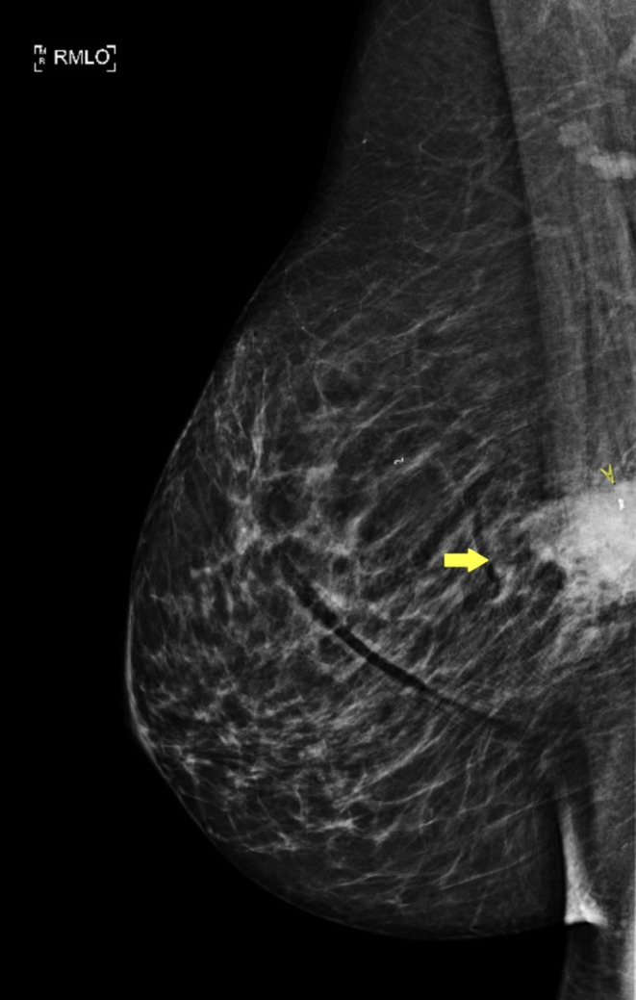
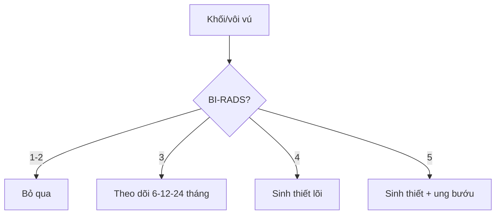

# 510 — Vú & BI-RADS: nhũ ảnh, siêu âm & MRI / Breast BI-RADS

**Tags:** `pattern:khoi-vu` `pattern:vi-voi-hoa` `vung:vu` `score:BI-RADS` `protocol:MRI-vu`
**Mức chắc chắn (certainty):** tổng hợp y văn (literature synthesis) — nhóm tự biên từ y văn mở, chưa gắn ca nguyên văn đơn lẻ.

## 1. Tổng quan — hình dạng + bờ + vôi + động học quyết định % ác

- Tân mạch ung thư rò rỉ + shunt động-tĩnh mạch — TẠI SAO ngấm nhanh 1–2 phút rồi thoát sớm (**Type III washout giảm > 10%** / Type II plateau), còn xơ/nang ngấm chậm tăng dần (Type I persistent).
- Ngưỡng ACR BI-RADS: 1–2 (0% ác), 3 (> 0–≤ 2%, theo dõi 6–12–24 tháng, KHÔNG sinh thiết), 4A (> 2–10%) / 4B (> 10–50%) / 4C (> 50–< 95%, sinh thiết lõi), 5 (≥ 95%, sinh thiết + chuẩn bị điều trị), 6 (đã biết K).
- Vôi lành: bỏng ngô > 2–3 mm (fibroadenoma), tách trà (teacup) phim nghiêng, sữa canxi; vôi ác: đa hình mịn/phân nhánh theo ống tuyến.

## 2. Gamut khối/vôi vú (Gamut)

- **Bầu dục ngang + bờ đều + song song da:** BI-RADS 3 — theo dõi (fibroadenoma/nang).
- **Trục đứng + gai + bóng lưng + vôi phân nhánh + Type III:** BI-RADS 5 — sinh thiết + ung bướu.
- **Bất đối xứng khu trú + co kéo:** BI-RADS 4 — sinh thiết (kể cả desmoid/fibromatosis giả K!).
- **Bỏng ngô/teacup/sữa canxi:** BI-RADS 2 — bỏ qua.

## 3. Bảng so sánh phân biệt (ma trận đối chiếu)

| Thực thể (entity) | Hình ảnh điển hình | Chốt vào (rule-in) | Chốt loại (rule-out) | Gợi ý xác nhận |
|---|---|---|---|---|
| BI-RADS 3 | **Bầu dục ngang + bờ đều + đồng nhất** | **≤ 2% + ổn định 2 năm → xuống 2** | Trục đứng/gai → 4–5 | Theo dõi 6–12–24 tháng |
| BI-RADS 4 | **Bất đối xứng + bờ che lấp + vôi nhóm** | **4A/4B/4C + sinh thiết lõi** | Bỏng ngô/teacup → 2 | Core biopsy + kẹp đánh dấu |
| BI-RADS 5 | **Trục đứng + gai + vôi phân nhánh + Type III** | **≥ 95% + chuẩn bị mổ/hóa** | Bầu dục đều → 3 | Sinh thiết + MRI lan rộng |
| Giả K (desmoid) | **Gai + xâm lấn cơ + β-catenin (+)** | **β-catenin + CK (−)** | CK (+) → metaplastic | Mô bệnh + theo dõi (tái phát!) |

*Nốt 13 mm sát cơ ngực, bờ không đều. Nguồn: Fiore et al., Clin Case Rep 2026 Fig. 1, CC BY 4.0.*

## 4. Protocol vú

- **Nhũ ảnh 2D/3D + siêu âm + MRI DCE (Type I/II/III)** khi BI-RADS 0/4/5; sinh thiết lõi dưới siêu âm/stereo + kẹp.

## 5. Cạm bẫy

- **Desmoid/fibromatosis gai giả K** (ca trên!) — β-catenin (+) + CK (−) mới phân biệt metaplastic.
- **BI-RADS 3 sinh thiết oan** — ≤ 2% là theo dõi, trừ lo âu/nguy cơ cao có bàn bạc.
- **Vú đặc che tổn thương** — siêu âm + MRI bổ sung khi đặc + nguy cơ cao.

## 6. Tự lượng giá — Blind Quiz

**Ca 1 — Nữ 42 tuổi sờ thấy u cứng ít di động. Đọc nhũ ảnh.**

- Hỏi: mô tả tổn thương? BI-RADS mấy? Bước tiếp?

<b>Bấm để hiện đáp án</b>

- Dấu hiệu (findings): bất đối xứng nốt 13 mm sát cơ ngực, bờ không đều (mũi tên).
- Chẩn đoán (diagnosis): **BI-RADS 4, sinh thiết lõi** — mô bệnh desmoid/fibromatosis (β-catenin +, CK −), lành nhưng xâm lấn + tái phát (khác K).
- Nguồn: Fiore et al., Fig. 1, CC BY 4.0.

**Ca 2 — Khối bầu dục ngang 15 mm bờ đều, 30 tuổi:** BI-RADS mấy? Sinh thiết không? *(Bảng mục 3.)*

<b>Bấm để hiện đáp án</b>

- **BI-RADS 3:** theo dõi 6–12–24 tháng, không sinh thiết (ổn định 2 năm → BI-RADS 2).

## Bài liên quan chéo
- [500 – Tổng quan Vú & SPK](../500-tong-quan-vu-san-phu-khoa/lesson.md)
- [512 – Vôi hóa & túi ngực (dự kiến viết sau)]
- [375 – U phần mềm](../375-u-phan-mem/lesson.md) (desmoid ngoài vú)

> Không dùng để chẩn đoán độc lập khi chưa có người hướng dẫn.
