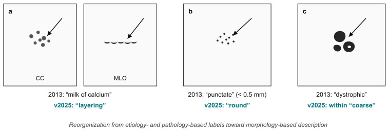
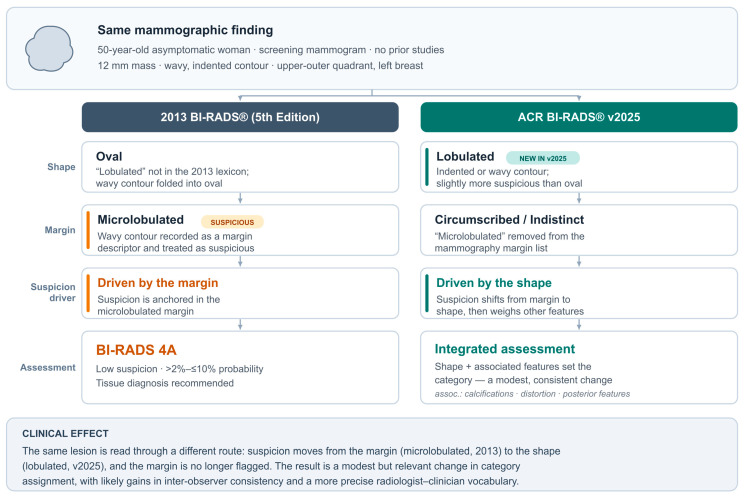
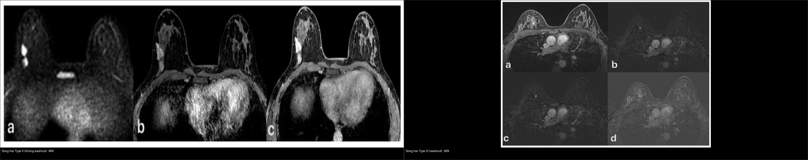
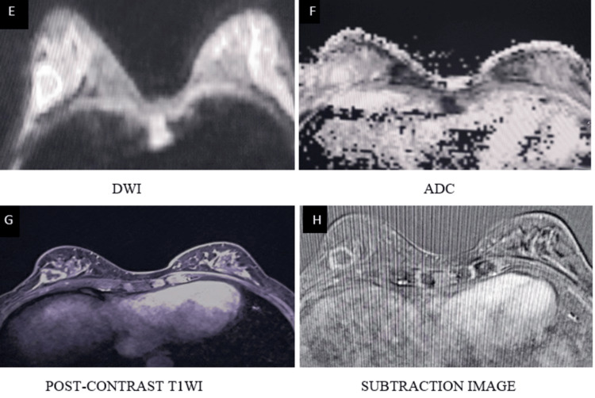
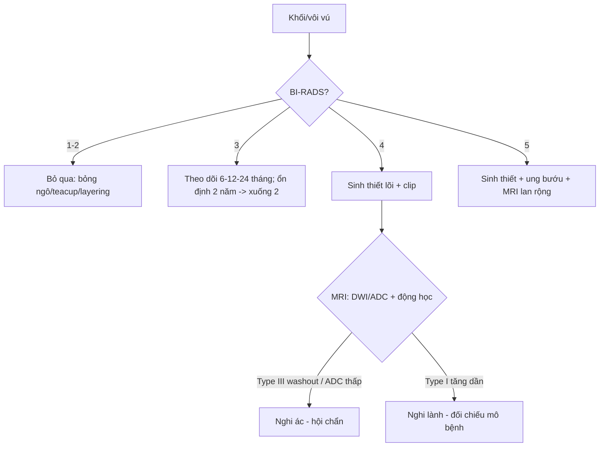
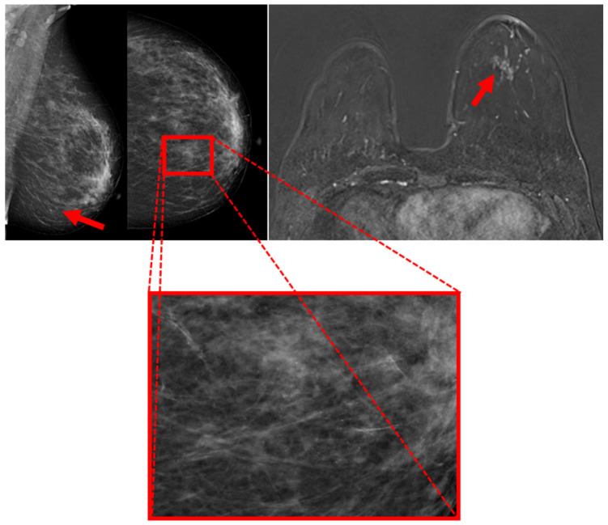

# 510 — Vú & BI-RADS: nhũ ảnh, siêu âm & MRI / Breast BI-RADS

**Tags:** `pattern:khoi-vu` `pattern:vi-voi-hoa` `vung:vu` `score:BI-RADS` `protocol:MRI-vu`
**Mức chắc chắn (certainty):** tổng hợp y văn (literature synthesis) — nhóm tự biên từ y văn mở (Europe PMC/PMC: *Diagnostics* 2026, *Tomography* 2026, *Medical Sciences* 2025, *Cureus* 2026, *Clin Case Rep* 2026) + các ca minh họa có giấy phép CC BY.

## 1. Tổng quan — hình dạng + bờ + vôi + động học quyết định % ác

- **TẠI SAO tín hiệu/đậm độ nói lên bản chất:** tân mạch ung thư **rò rỉ + shunt động–tĩnh mạch** → ngấm thuốc **nhanh (đỉnh 1–2 phút) rồi thoát sớm** = **Type III washout** (giảm **> 10%** sau đỉnh) / Type II plateau (ổn định), còn mô **xơ/nang lành** ngấm **chậm–tăng dần** = **Type I persistent**. Vì tế bào ác đặc, màng tế bào dày → **DWI sáng, ADC thấp (giới hạn khuếch tán)**; mô mỡ/xơ/hoại tử có ADC cao.
- **Ngưỡng ACR BI-RADS (v2025, nguy cơ ác kèm theo):** 1–2 (**0%**), 3 (**> 0–≤ 2%**, theo dõi 6–12–24 tháng, **KHÔNG** sinh thiết), 4A (**> 2–10%**) / 4B (**> 10–50%**) / 4C (**> 50–< 95%**, sinh thiết lõi), 5 (**≥ 95%**, sinh thiết + chuẩn bị điều trị), 6 (đã biết K, đánh giá đáp ứng).
- **Cập nhật v2025 (Kaplan & Aydemir 2026) — đọc đúng từ vựng:** bỏ **"microlobulated"**, thêm hình dạng **"lobulated"**; **"punctate" gộp vào "round"**; **"dystrophic" xếp trong "coarse"**; **"milk of calcium" đổi thành "layering"** (đặc trưng nằm lớp khi chụp nghiêng). Điểm mấu chốt: **ánh xạ từ mô học/nguyên nhân sang MÔ TẢ HÌNH THÁI**; với khối "lobulated", **độ nghi ngờ được tổng hợp từ hình dạng + đặc trưng kèm theo (vôi hóa, biến dạng cấu trúc, đặc trưng sau khối) chứ không chỉ từ bờ**.
- **Vôi lành:** bỏng ngô (popcorn) **> 2–3 mm** (fibroadenoma thoái hóa), "tách trà" (teacup) trên phim nghiêng, sữa canxi (layering, nằm lớp ở tư thế đứng), vôi hóa mạch máu hình ống. **Vôi ác: đa hình (pleomorphic) mịn + phân nhánh theo ống tuyến (branching), phân bố theo ống/tuyến**.

## 2. Gamut khối/vôi vú (Gamut)

- **Bầu dục ngang + bờ đều + song song da (orientation parallel):** BI-RADS 3 — theo dõi (fibroadenoma/nang).
- **Trục đứng (không song song) + gai (spiculated) + bóng lưng (posterior shadowing) + vôi phân nhánh + Type III:** BI-RADS 5 — sinh thiết + điều trị ung bướu.
- **Bất đối xứng khu trú + co kéo:** BI-RADS 4 — sinh thiết (kể cả desmoid/fibromatosis giả K!).
- **Bỏng ngô/teacup/layering/sữa canxi:** BI-RADS 2 — bỏ qua.
- **Vôi hóa nhóm nhỏ (clustered) đơn độc:** vùng xám — phân độ theo **đa hình + phân bố (đường ống/tuyến)** → BI-RADS 4.

## 3. Bảng so sánh phân biệt (ma trận đối chiếu)

| Thực thể (entity) | Hình ảnh điển hình | Chốt vào (rule-in) | Chốt loại (rule-out) | Gợi ý xác nhận |
|---|---|---|---|---|
| BI-RADS 3 | **Bầu dục ngang + bờ đều + đồng nhất** | **≤ 2% + ổn định 2 năm → xuống 2** | Trục đứng/gai → 4–5 | Theo dõi 6–12–24 tháng |
| BI-RADS 4 | **Bất đối xứng + bờ che lấp + vôi nhóm** | **4A/4B/4C + sinh thiết lõi** | Bỏng ngô/teacup → 2 | Core biopsy + kẹp đánh dấu |
| BI-RADS 5 | **Trục đứng + gai + vôi phân nhánh + Type III** | **≥ 95% + chuẩn bị mổ/hóa** | Bầu dục đều → 3 | Sinh thiết + MRI lan rộng |
| Giả K (desmoid) | **Gai + xâm lấn cơ + β-catenin (+)** | **β-catenin + CK (−)** | CK (+) → metaplastic | Mô bệnh + theo dõi (tái phát!) |

*Nốt 13 mm sát cơ ngực, **bờ không đều** → **BI-RADS 4**, sinh thiết lõi; mô bệnh hóa ra **desmoid/fibromatosis** (lành nhưng xâm lấn + tái phát). Nguồn: Fiore et al., Clin Case Rep 2026 Fig. 1, CC BY 4.0.*

*Ba kiểu vôi hóa phân biệt lành/ác: (a) **sữa canxi "layering"** (nằm lớp ở phim nghiêng — lành, BI-RADS 2); (b) **"punctate" gộp vào "round"**; (c) **"dystrophic" xếp trong "coarse"**. Nguồn: Kaplan E & Aydemir AB, Diagnostics 2026 Fig. 1, CC BY 4.0.*

*Cùng một khối 12 mm bờ lượn sóng: theo **2013** xếp **BI-RADS 4A** (do "microlobulated" là bờ nghi ngờ); theo **v2025**, hình dạng gọi là **"lobulated"** và độ nghi ngờ tổng hợp từ hình dạng + đặc trưng kèm theo. Đây là lý do phải dùng đúng từ vựng phiên bản. Nguồn: Kaplan E & Aydemir AB, Diagnostics 2026 Fig. 2, CC BY 4.0.*

### Động học ngấm (kinetics) — "chốt" bằng đường cong

*Trái: **Type II plateau** (ngấm rồi giữ, không thoát) — ca này hóa ra **DCIS độ thấp**. Phải: **Type III washout** (ngấm nhanh rồi thoát) — ca này là **DCIS độ cao**. Cạm bẫy: **động học KHÔNG đồng nghĩa mô học** — Type II vẫn có thể là ác. Nguồn: Urraro F et al., Medical Sciences 2025 Fig. 2 & 4, CC BY 4.0 (ảnh ghép letterbox).*

- **Type I (tăng dần):** lành (xơ, nang, fibroadenoma). **Type II (plateau):** nghi ngờ. **Type III (washout, giảm > 10%):** nghi ác mạnh.
- **DWI/ADC:** mô ác đặc → **DWI sáng + ADC thấp**; đọc kèm T2/T1FS và DCE, không thay thế động học.

*Bộ ảnh MRI đa tham số (T1WI, T2WI, DWI, ADC) — DWI/ADC giúp tách mô đặc giới hạn khuếch tán (nghi ác) khỏi nang/mỡ. Nguồn: B K et al., Cureus 2026 Fig. 4, CC BY 4.0.*

## 4. Protocol vú + BI-RADS v2025

- **Nhũ ảnh 2D/3D (DBT) là chuẩn nền**; thêm **siêu âm có mục tiêu** khi vú đặc / tổn thương chỉ thấy trên 1 bình diện; **MRI DCE** khi BI-RADS 0/4/5, vú đặc, nguy cơ cao hoặc đánh giá lan rộng (xem `514`). Sinh thiết **lõi (core) dưới siêu âm/stereotactic** + **kẹp đánh dấu (clip)**.
- **Đọc khối theo v2025:** hình dạng (**oval / round / lobulated / irregular**) → bờ (**circumscribed / indistinct / spiculated**) → đậm độ → đặc trưng kèm theo (vôi hóa, biến dạng cấu trúc, đặc trưng sau khối, mạch máu liên quan) → **tổng hợp xếp BI-RADS**, không chỉ dựa bờ.
- **Vôi hóa:** mô tả theo **hình thái (round/punctate, coarse, fine pleomorphic, fine linear/branching)** + **phân bố (diffuse, grouped/clustered, linear, segmental)**; dùng **"layering"** thay "milk of calcium".
- **Động học MRI:** vẽ đường cong % tăng tín hiệu theo thời gian cho từng ROI; **Type III** = nghi ác; **Type II** = theo dõi/sinh thiết tùy bối cảnh; **Type I** = lành.
- **Định lượng minh họa (Urraro 2025, 75 ca DCIS):** **Type II** gặp ở **DCIS độ thấp**, **Type III** ở **DCIS độ cao**; **MRI ước lượng kích thước tương quan vừa với mô bệnh (Pearson r = 0,62, p < 0,001)** và nghiêng **đo quá (overestimate)**; dùng OC **không** phải yếu tố dự báo washout (p không ý nghĩa).

## 5. Biến thể bình thường và cạm bẫy

- **Desmoid/fibromatosis gai giả K** (ca dưới!) — **β-catenin (+)** + **CK (−)** mới phân biệt metaplastic carcinoma; tổn thương lành nhưng **xâm lấn cơ** và **hay tái phát** → theo dõi.
- **BI-RADS 3 sinh thiết oan** — nguy cơ ác **≤ 2%** là theo dõi, trừ khi lo âu/nhiều yếu tố nguy cơ có bàn bạc.
- **Vú đặc (ACR C/D) che tổn thương** — âm tính trên nhũ ảnh **không loại trừ**; bổ sung siêu âm + MRI khi đặc + nguy cơ cao.
- **Cạm bẫy từ vựng v2025:** dùng lẫn nhãn **"microlobulated"/"punctate"/"milk of calcium"** (đã bỏ/gộp) làm sai độ nghi ngờ; ghi rõ phiên bản khi mô tả.
- **Cạm bẫy động học:** **Type II vẫn có thể là ác** (DCIS độ thấp) và **Type III cũng gặp ở tổn thương lành** → không đọc động học tách rời hình thái + DWI.

## 6. Tự lượng giá — Blind Quiz

**Ca 1 — Nữ 42 tuổi sờ thấy u cứng ít di động. Đọc nhũ ảnh.**

- Hỏi: mô tả tổn thương? BI-RADS mấy? Bước tiếp?

<b>Bấm để hiện đáp án (findings + chẩn đoán)</b>

- Dấu hiệu (findings): bất đối xứng nốt **13 mm** sát cơ ngực, **bờ không đều** (mũi tên).
- Chẩn đoán (diagnosis): **BI-RADS 4, sinh thiết lõi** — mô bệnh **desmoid/fibromatosis** (β-catenin +, CK −), lành nhưng xâm lấn + tái phát (khác K).
- Nguồn: Fiore et al., Clin Case Rep 2026 Fig. 1, CC BY 4.0.

**Ca 2 — Nữ 50 tuổi tầm soát, khối 12 mm bờ lượn sóng ở phần tư trên–ngoài vú trái. Đọc nhũ ảnh.**

- Hỏi: khối "bờ lượn sóng" được gọi tên thế nào theo v2025? Vì sao xếp hạng có thể đổi so với 2013?

<b>Bấm để hiện đáp án (findings + chẩn đoán)</b>

- Dấu hiệu (findings): khối **12 mm**, **bờ lượn sóng**, không có phim cũ.
- Chẩn đoán (diagnosis): theo **2013** → ghi "oval + microlobulated" → **BI-RADS 4A**; theo **v2025** → hình dạng **"lobulated"** (hơi nghi hơn oval) + tổng hợp đặc trưng kèm theo → **xếp hạng có thể đổi**. Đây là lý do phải dùng đúng từ vựng phiên bản.
- Nguồn: Kaplan E & Aydemir AB, Diagnostics 2026 Fig. 2, CC BY 4.0.

**Ca 3 — Đọc đường cong động học MRI.**

- Hỏi: bên nào là washout? Đường cong nào nghi ác hơn? Vì sao không được chốt lành/ác chỉ bằng động học?

<b>Bấm để hiện đáp án (findings + chẩn đoán)</b>

- Dấu hiệu (findings): **trái = Type II** (plateau, không thoát), **phải = Type III** (ngấm nhanh rồi **thoát**).
- Chẩn đoán (diagnosis): **Type III nghi ác hơn**; nhưng ở bộ ca này **cả hai đều là DCIS** (trái = độ thấp, phải = độ cao) → **động học không đồng nghĩa mô học**; luôn đọc kèm hình thái + DWI/ADC.
- Nguồn: Urraro F et al., Medical Sciences 2025 Fig. 2 & 4, CC BY 4.0 (ảnh ghép letterbox).

**Ca 4 — Nữ có nhũ ảnh vôi hóa nhóm; DCE-MRI tương ứng. Đọc ảnh.**

- Hỏi: vôi hóa nhóm ở vùng mũi tên đỏ — BI-RADS mấy? DCE-MRI bổ sung được gì?

<b>Bấm để hiện đáp án (findings + chẩn đoán)</b>

- Dấu hiệu (findings): vùng **vi vôi hóa nghi ngờ** trên MLO/CC (mũi tên đỏ) + **vùng tương ứng trên DCE-MRI** (ô đỏ).
- Chẩn đoán (diagnosis): vôi hóa nghi ngờ → **BI-RADS 4–5** (sinh thiết định vị bằng stereotactic/vôi hóa); **DCE-MRI giúp định vị vùng nghi và sàng lọc hai bên** trước sinh thiết. Vôi hóa đa hình mịn/phân nhánh = nghi ác.
- Nguồn: Ünal S & Açıkgözoğlu E, Tomography 2026 Fig. 1, CC BY 4.0.

**Ca 5 — Vôi hóa "sữa canxi": đọc 2 tư thế CC và MLO.**

- Hỏi: dấu hiệu nào khẳng định "sữa canxi" lành? Vì sao phải chụp nghiêng?

<b>Bấm để hiện đáp án (findings + chẩn đoán)</b>

- Dấu hiệu (findings): vôi hóa **nằm lớp (layering) ở tư thế đứng (MLO)**, đáy ổ nang; trên CC có thể trông như đốm mờ.
- Chẩn đoán (diagnosis): **sữa canxi (milk of calcium → v2025 gọi "layering")** = **BI-RADS 2**, lành, bỏ qua — chốt nhờ **tính nằm lớp theo trọng lực** khi đổi tư thế.
- Nguồn: Kaplan E & Aydemir AB, Diagnostics 2026 Fig. 1, CC BY 4.0.

## Bài liên quan chéo
- [500 – Tổng quan Vú & SPK](../500-tong-quan-vu-san-phu-khoa/lesson.md)
- [512 – Vi vôi hóa, biến dạng cấu trúc & túi ngực](../512-vi-voi-hoa-tui-nguc-bien-dang/lesson.md) *(đã có)*
- [514 – Ung thư vú: giai đoạn TNM & MRI lan rộng](../514-ung-thu-vu-TNM-MRI-lan-rong/lesson.md) *(đã có)*
- [516 – Hình ảnh vú sau điều trị: hoại tử mỡ, sẹo vs tái phát & BIA-ALCL](../516-hinh-anh-vu-sau-dieu-tri/lesson.md)
- [375 – U phần mềm](../375-u-phan-mem/lesson.md) (desmoid ngoài vú)

## Ảnh
- `510_mammo-BIRADS4_CCR-Fiore-CCBY40.jpg`, `510_voi-hoa-lexicon_MAMMO_PMC13361901.jpg`, `510_khoi-lobulated-lexicon_MAMMO_PMC13361901.jpg`, `510_dong-hoc-TypeII_MRI_PMC12641647.jpg`, `510_dong-hoc-TypeIII_MRI_PMC12641647.jpg`, `510_DWI-ADC_MRI_PMC13222465.jpg`, `510_voi-hoa-BIRADS45_MAMMO-MRI_PMC13306530.jpg`, `composite_dong-hoc-TypeII-vs-TypeIII.jpg`. Nguồn + giấy phép từng ảnh trong `images/CREDITS.md`.

> Không dùng để chẩn đoán độc lập khi chưa có người hướng dẫn.
