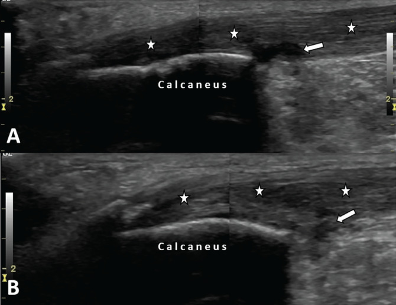
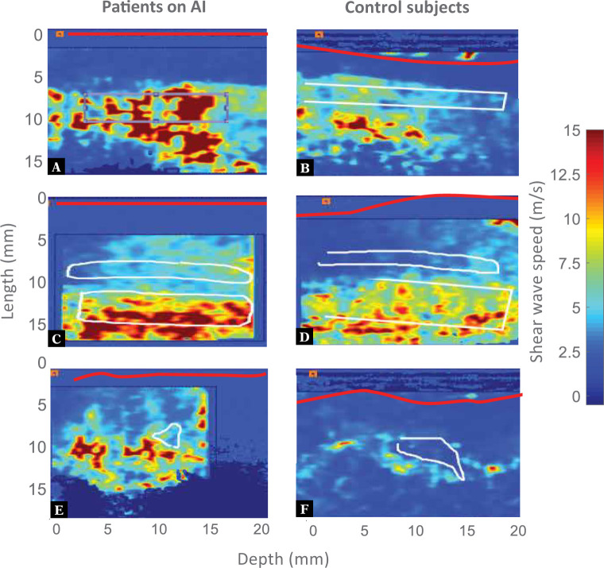
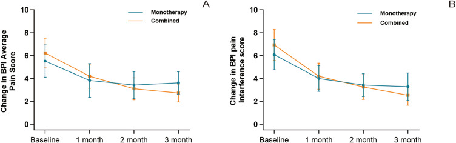
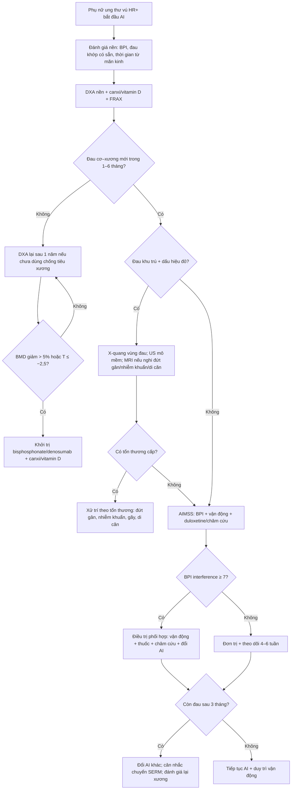
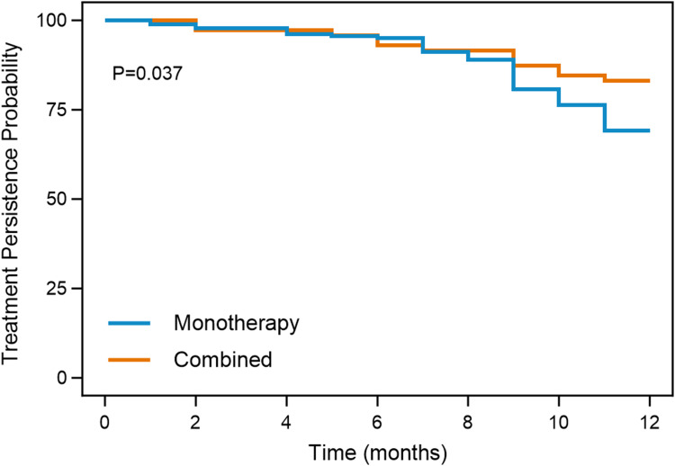

# 511 — Đau cơ–khớp do thuốc ức chế aromatase (AIMSS) & sức khỏe xương / Aromatase inhibitor-associated musculoskeletal symptoms

**Tags:** `pattern:dau-khop-doi-xung` `pattern:viem-bao-gan-co` `vung:co-xuong` `vung:vu` `score:BPI` `score:FRAX` `protocol:DXA` `protocol:sieu-am-co-xuong` `incidentaloma:mat-xuong`
**Mức chắc chắn (certainty):** tổng hợp y văn (literature synthesis) — nhóm tự biên từ 4 bài mở toàn văn (Rheumatol Adv Pract 2024, PMC11003819; Int J Womens Health 2026, PMC13221566; Eur J Breast Health 2025, PMC12180086; J Ultrasound 2021, PMC8008134) + 2 bài về xương (Clin Transl Oncol 2026, PMC13401549; Front Med 2025, PMC12702863) + 1 nghiên cứu can thiệp xương (BMC Musculoskelet Disord 2025, PMC12613706). Số liệu giữ theo từng cohort.

## 1. Tổng quan — AIMSS là gì, vì sao đau, và vì sao nó là chuyện của BÁC SĨ HÌNH ẢNH

- **Định nghĩa:** **AIMSS** (aromatase inhibitor-associated musculoskeletal symptoms) là nhóm **đau khớp, cứng khớp buổi sáng, đau cơ, hạn chế vận động, viêm bao gân/ống cổ tay, viêm gân** xuất hiện hoặc nặng lên **sau khi bắt đầu thuốc ức chế aromatase (AI: anastrozole, letrozole, exemestane)** ở phụ nữ ung thư vú có thụ thể hormone dương tính. **AIA** (AI-induced arthralgia) là tên gọi hẹp hơn, chỉ phần đau khớp.
- **Ngưỡng định lượng (bắt buộc nhớ):**
  - **Tần suất:** **20–50%** người dùng AI (review 2026); **trung bình 39,1%** khi gộp 23 nghiên cứu (20.652 bệnh nhân); một số cohort tới **68–74%**. Đau khớp là **lý do số 1** để ngừng AI, với **tỷ lệ ngừng tới 32,4%**.
  - **Thời điểm khởi phát:** trung bình **4,5 tháng** sau khi bắt đầu AI; **75%** trong **3 tháng**; đa số trong **6 tháng** đầu.
  - **Kiểu khớp:** **ít khớp (oligoarticular, < 5 khớp)** ở 4/5 nghiên cứu; thứ tự hay gặp: **bàn tay/cổ tay > gối > lưng > háng > cổ chân/bàn chân > vai/khuỷu/cổ**.
  - **Yếu tố nguy cơ có HR/aHR (đọc để tiên lượng ai sẽ đau):** tuổi **> 75 vs < 45: aHR 3,18** (95% CI 2,65–3,81); **rối loạn cảm xúc aHR 1,32**; **rối loạn lipid aHR 1,18**; **tăng huyết áp aHR 1,11**; **letrozole vs tamoxifen aHR 1,27**; **xạ trị trước đó aHR 1,16**; **opioid trước đó aHR 1,37**; **NSAID/paracetamol trước đó aHR 1,32**.
  - **Yếu tố nguy cơ không có HR nhưng lặp lại nhiều nghiên cứu:** **< 5 năm từ lần kinh cuối** (so với > 10 năm, p = 0,002), **béo phì**, **đau khớp có sẵn**, **bệnh khớp viêm/viêm xương khớp có sẵn**, **hoá trị bổ trợ trước đó**, **loãng xương/thiếu xương** (p < 0,001).
- **TẠI SAO đau (cơ chế — giải thích bằng sinh lý, không liệt kê):**
  - AI ức chế enzym aromatase → **estrogen giảm mạnh** ở mô ngoại vi. Estrogen có tác dụng **chống viêm nhẹ và giảm ngưỡng đau**; khi mất đột ngột, **cytokine viêm tăng trong tế bào sụn**, **ngưỡng đau hạ** → đau và cứng.
  - **Mất xương nhanh** do thiếu estrogen **cũng là một phần của AIMSS** (không chỉ là "tác dụng phụ riêng"): người có AIMSS có **thiếu xương/loãng xương nhiều hơn có ý nghĩa** (p < 0,001, 316 ca). Vì vậy **đau khớp + mất xương phải được xử lý cùng một quy trình**.
  - **Thay đổi collagen gân:** estrogen **tăng tổng hợp collagen** và **giảm độ cứng gân**; thiếu estrogen → **gân cứng hơn, dễ viêm** → đây là cơ sở cho **viêm gân/viêm bao gân** và cho **siêu âm đàn hồi (SWE) thấy gân cứng hơn**.
  - **Vì sao người mới mãn kinh đau hơn:** yếu tố quyết định là **tốc độ giảm estrogen** (dao động nhanh), không phải nồng độ tuyệt đối → giải thích vì sao **< 5 năm sau mãn kinh** có tần suất cao hơn.
- **Vì sao bác sĩ hình ảnh phải biết:**
  - **Phần lớn AIMSS KHÔNG có tổn thương trên X-quang** → **X-quang bình thường không loại trừ**; siêu âm mô mềm là phương thức đầu tay khi có đau khu trú.
  - **Siêu âm có thể thấy bất thường dù bệnh nhân chỉ "đau khớp"**: viêm bao gân, tăng dịch bao gân, tăng tưới máu, **gân cứng hơn trên SWE**.
  - **Cùng một bệnh nhân vừa có nguy cơ ung thư tái phát, vừa có nguy cơ gãy xương** → mọi đau xương khu trú phải loại trừ **di căn** và **gãy xẹp đốt sống**, không được mặc định là AIMSS.

## 2. Mẫu hình (pattern) + chẩn đoán phân biệt theo vị trí & thời gian (Gamut)

- **Khuôn 1 — Đau ĐỐI XỨNG hai bàn tay/cổ tay, cứng buổi sáng 15–60 phút, khởi phát 1–6 tháng sau AI.** Gamut: **AIMSS** vs **viêm khớp dạng thấp (RA)** vs **thoái hóa khớp (OA)** vs **hội chứng ống cổ tay (CTS)**. Chốt: **đối xứng + không sưng nóng đỏ + không phá xương trên X-quang + liên quan thời điểm thuốc** → AIMSS; **sưng mềm, đau nhiều đêm, RF/anti-CCP dương** → RA.
- **Khuôn 2 — Đau/ngứa ran 3 ngón rưỡi đầu, đau về đêm, teo mô cái.** Gamut: **CTS do AI** vs CTS vô căn vs bệnh lý rễ C6. Chốt: **thời điểm sau AI + đáp ứng với nẹp/tiêm**; **CTS do AI có thể là lý do ngừng thuốc tới 67%** (báo trong nghiên cứu mô bệnh).
- **Khuôn 3 — Đau gân Achilles/gân bánh chè hai bên, đau khi đi lại.** Gamut: **viêm gân do AI** vs viêm gân vôi hóa vs bệnh lý enthesitis (spondyloarthritis). Chốt: **US: gân dày, giảm âm, có dịch bao gân**; **không có viêm khớp cùng chậu/xương cùng trên MRI** → loại bệnh lý viêm hệ thống.
- **Khuôn 4 — Đau lưng/đau xương khu trú, có tiền sử AI lâu năm.** Gamut: **gãy xẹp đốt sống do mất xương** vs **di căn xương** vs cơ học. Chốt: **MRI: phù tủy dạng dải, không phá cuống** → xẹp lành tính; **phá cuống/mô mềm** → di căn.
- **Khuôn 5 — Một khớp sưng nóng đỏ, sốt.** Gamut: **nhiễm khuẩn khớp** vs **gout/pseudogout** vs **bùng phát AIMSS**. Chốt: **một khớp + sốt + dịch khớp đục** → **chọc hút + cấy**, không được gọi là AIMSS.
- **Khuôn 6 — Đau cơ lan tỏa, yếu gần, không đau khớp.** Gamut: **đau cơ do AI** vs **bệnh cơ do statin** vs **polymyalgia rheumatica (PMR)** vs **suy giáp**. Chốt: **CK, TSH, tốc độ máu lắng/CRP**; PMR đáp ứng nhanh với prednisolone liều thấp.
- **Gợi nhớ "J-O-I-N-T":** **J**oint symmetry (đối xứng) — **O**nset 1–6 tháng sau AI (khởi phát theo thuốc) — **I**nflammation absent (không sưng nóng đỏ) — **N**ormal X-ray (X-quang bình thường) — **T**endon/CTS involvement (kèm gân/ống cổ tay).

## 3. Bảng so sánh phân biệt (ma trận đối chiếu)

| Thực thể (entity) | Hình ảnh điển hình | Chốt vào (rule-in) | Chốt loại (rule-out) | Gợi ý xác nhận |
|---|---|---|---|---|
| **AIMSS (đau khớp do AI)** | X-quang **bình thường**; US: **viêm bao gân, tăng dịch bao gân, tăng tưới máu**; SWE: **gân cứng hơn** (vận tốc sóng cao hơn) | **Đối xứng + khởi phát 1–6 tháng sau AI + X-quang bình thường + không sưng nóng đỏ** | **Sưng mềm nhiều khớp, phá xương, RF/anti-CCP dương** → RA | US + SWE; chẩn đoán loại trừ; đáp ứng khi đổi AI |
| **RA (viêm khớp dạng thấp)** | X-quang: **hẹp khe, bào mòn bờ, thưa xương cạnh khớp**; US: **pannus + Doppler dương** | **Sưng mềm đối xứng > 6 tuần + RF/anti-CCP + phá xương** | **Không sưng, X-quang bình thường, theo thuốc** → AIMSS | RF, anti-CCP, CRP; X-quang bàn tay |
| **CTS do AI** | US: **dây thần kinh giữa dày, giảm âm, mất phân biệt bó**, tăng dịch bao gân gấp | **Dị cảm 3,5 ngón + đau đêm + sau AI** | **Teo mô cái + dẫn truyền thần kinh nặng** → CTS muộn, cần mổ | US + điện cơ; nẹp/tiêm; **67% có thể phải ngừng AI** |
| **Viêm gân/viêm bao gân do AI** | US: **gân dày, giảm âm, mất cấu trúc bó**, dịch bao gân, **Doppler có thể âm** | **Đau điểm bám + gân dày + dịch bao gân + sau AI** | **Gân đứt hoàn toàn (mất liên tục)** → cấp cứu chỉnh hình | US động + SWE; MRI nếu nghi đứt |
| **Gãy xẹp đốt sống do AI (AIBL)** | X-quang: **xẹp hình nêm/đĩa**; MRI: **phù tủy dạng dải, bờ không phá cuống** | **Đau lưng cấp + xẹp + DXA T ≤ −2,5 hoặc FRAX cao** | **Phá cuống, mô mềm, nhiều tầng** → di căn | MRI cột sống; DXA; so phim cũ |
| **Di căn xương** | **Tiêu xương/xơ xương khu trú**, phá cuống, mô mềm, nhiều ổ | **Tiền sử ung thư + phá cuống + nhiều ổ** | **Xẹp dạng dải, không phá cuống, đối xứng** → lành tính | MRI/CT; PET-CT; sinh thiết nếu cần |
| **Mất xương do AI (AIBL) — không triệu chứng** | DXA: **BMD giảm nhanh**; **> 4%/năm** ở cột sống hoặc háng = "mất xương nhanh" | **DXA giảm > 4%/năm** hoặc **> 5% so với nền** → can thiệp | **BMD ổn định, T ≥ −1,0** → theo dõi | DXA 1 năm sau bắt đầu AI (ESMO); 2 năm/lần (ASCO) |

*Siêu âm dọc gân Achilles phải (A) và trái (B): gân **dày, giảm âm** (dấu sao), **dịch bao gân sau gót** (mũi tên), không thấy tăng tưới máu trên Doppler. Bệnh nhân 60 tuổi dùng letrozole 2,5 mg/ngày, đau hai cổ chân gần 1 năm. Nguồn: Eur J Breast Health 2025 (PMC12180086), CC BY-NC-ND 4.0 — giữ nguyên bản.*

### Tiểu mục dấu hiệu — 3 điểm đọc siêu âm hay bị bỏ
- **Dịch bao gân là dấu hiệu sớm nhất**, có thể có **trước khi gân dày rõ**; đo bằng mm ở vị trí dày nhất, so bên đối diện.
- **Doppler âm không loại trừ viêm gân do AI:** trong ca minh họa, **không có tín hiệu Doppler** nhưng gân vẫn dày, giảm âm và đau khi ấn đầu dò (sono-palpation dương). Đừng đợi Doppler dương mới chẩn đoán.
- **SWE (siêu âm đàn hồi sóng biến dạng) là dấu hiệu CHỨC NĂNG, không phải hình thái:** ở 6 bệnh nhân AIMSS so với 7 chứng, **gân duỗi ngón 1 cứng hơn** (p = 0,001), **ngăn duỗi 4** (p = 0,014), **khớp bàn–ngón 3** (p = 0,002), gộp ngăn duỗi trục dài (p = 0,044) và trục ngắn (p = 0,035). Đây là bằng chứng **cơ chế gân cứng do thiếu estrogen**, chưa đủ để thành xét nghiệm lâm sàng thường quy.

*Bản đồ SWE ngăn duỗi cổ tay: **đỏ = gân cứng (vận tốc sóng cao)**, xanh = mềm. Cột trái = bệnh nhân dùng AI; cột phải = chứng. Gân người dùng AI **cứng hơn rõ rệt**. Nguồn: J Ultrasound 2021 (PMC8008134), CC BY-NC-ND 4.0 — giữ nguyên bản.*

## 4. Protocol — hình ảnh, điều trị theo bậc & sức khỏe xương

### 4.1. Khi nào chụp gì (đau cơ–xương ở người dùng AI)
- **Bước 1 — X-quang vùng đau** nếu đau khu trú + có chỉ định loại trừ gãy/thoái hóa. **X-quang bình thường KHÔNG loại trừ AIMSS.**
- **Bước 2 — Siêu âm mô mềm (đầu dò thẳng ≥ 12 MHz)** cho: cổ tay/bàn tay (gân gấp, gân duỗi, dây thần kinh giữa), gân Achilles, gân bánh chè, điểm bám gân. Ghi: **độ dày gân (mm), dịch bao gân (mm), Doppler, so bên đối diện**.
- **Bước 3 — SWE** (nếu có): đo **vận tốc sóng (m/s)** ở gân duỗi ngón 1 và dây thần kinh giữa; so với bên đối diện và với người không dùng AI. **Chưa có ngưỡng tuyệt đối được chuẩn hóa → ghi "chưa rõ", không bịa số.**
- **Bước 4 — MRI** chỉ khi: nghi **đứt gân**, nghi **nhiễm khuẩn khớp/xương**, nghi **di căn/gãy xẹp đốt sống**, hoặc đau không giải thích được sau US.
- **Bước 5 — DXA** (xem 4.3) — **không được bỏ**, vì AIMSS và mất xương đi cùng nhau.

### 4.2. Điều trị AIMSS — bậc thang có số
1. **Giáo dục + đánh giá bằng thang điểm:** dùng **BPI (Brief Pain Inventory)** — ghi **điểm đau trung bình** và **điểm ảnh hưởng chức năng (interference)**; **BPI interference ≥ 7 = nặng**, là ngưỡng để chọn **điều trị phối hợp**.
2. **Vận động có hướng dẫn:** yoga, thái cực quyền, tập kháng lực; **≥ 2 buổi/tuần, kéo dài 12–24 tháng** để có lợi ích trên xương; tránh nhảy/nén mạnh nếu đã có gãy xẹp hoặc BMD rất thấp.
3. **Duloxetine:** 30 mg/ngày × 1 tuần → **60 mg/ngày** (RCT 299 ca: giảm điểm đau trung bình, p = 0,0002).
4. **Châm cứu:** 12 buổi/6 tuần → giảm **BPI worst pain** so với châm giả (p < 0,001) và duy trì tới **52 tuần**.
5. **Đổi AI:** **67%** cải thiện khi đổi sang AI khác (42 ca); **83%** cải thiện khi đổi sang **SERM** (90 ca) — nhưng AI có hiệu quả ung thư tốt hơn tamoxifen, nên **đổi AI trước, đổi sang tamoxifen sau**.
6. **Corticoid liều thấp ngắn ngày:** prednisolone **5 mg/ngày × 1 tuần** — giảm đau ngay ở **67%**, còn **63% ở 1 tháng**, **52% ở 2 tháng** (29 ca, không đối chứng).
7. **Điều trị phối hợp ở người đau nặng:** cohort 253 ca (2026): **68/253 (26,9%)** có biến cố gián đoạn điều trị; **phối hợp vs đơn trị: HR 0,528** (95% CI 0,283–0,986); ở nhóm **BPI interference ≥ 7**, phối hợp giảm nguy cơ mạnh (**HR 0,125**, 95% CI 0,042–0,378); ở nhóm < 7 **không khác biệt** (HR 0,731, p = 0,454). Điểm đau trung bình sau 3 tháng: **2,75 vs 3,63** (p < 0,001).
   - **Phản biện:** đây là **hồi cứu một trung tâm**, nhóm phối hợp **đau nặng hơn lúc đầu** (BPI 6,23 vs 5,52) → kết quả có thể bị **confounding by indication**; đọc như **tín hiệu**, không phải bằng chứng RCT.

*(A) Điểm đau trung bình và (B) điểm ảnh hưởng chức năng theo tháng sau chẩn đoán AIMSS: nhóm **phối hợp** (đường cong giảm sâu hơn) đạt **2,75 vs 3,63** ở tháng 3 (p < 0,001) dù **xuất phát điểm cao hơn**. Nguồn: Int J Womens Health 2026 (PMC13221566), CC BY-NC 4.0 — giữ nguyên bản.*

### 4.3. Sức khỏe xương — phần KHÔNG được tách khỏi AIMSS
- **Ai cần DXA:** **mọi phụ nữ bắt đầu AI**; người ≥ 65 tuổi; người trẻ có yếu tố nguy cơ/gãy xương do chấn thương nhẹ. **Thực tế chỉ < 20%** phụ nữ ung thư vú hậu mãn kinh được DXA → đây là khoảng trống lớn.
- **Lịch DXA:** **1 năm sau khi bắt đầu AI** nếu chưa dùng thuốc chống tiêu xương (ESMO); nếu đã dùng bisphosphonate/denosumab → **2 năm/lần** (ASCO). **Giảm > 5% BMD so với nền** → đánh giá lại và **khởi trị/tăng bậc**.
- **Ngưỡng T-score (DXA cột sống L1–L4, toàn bộ háng, cổ xương đùi):** bình thường **≥ −1,0**; thiếu xương **−1,0 đến −2,5**; loãng xương **≤ −2,5**.
- **FRAX:** dùng kèm BMD, nhưng **không có mô hình riêng cho bệnh nhân ung thư**; một nghiên cứu registry cho thấy FRAX dự báo gãy **tương đương** ở người dùng AI và không dùng AI → **đừng coi FRAX thấp là "an toàn tuyệt đối"**, nhất là người trẻ mới mãn kinh.
- **Nguy cơ gãy:** gộp 5 RCT (20.531 bệnh nhân), **OR 1,40 (95% CI 1,25–1,57)** cho nhóm điều trị nội tiết so với chứng; **I² = 29%**. Lưu ý phản biện: phân nhóm can thiệp **gộp AI và SERM**, nên **không dùng OR này để nói riêng AI**; và tỷ lệ loãng xương gộp **OR 0,35 (0,04–3,00)** với **I² = 97%** → **không diễn giải được**.
- **Thuốc:** bisphosphonate uống (alendronate **70 mg/tuần**) hoặc **denosumab 60 mg tiêm dưới da mỗi 6 tháng**; cohort 121 ca loãng xương do AI: denosumab **giảm gãy xẹp đốt sống nhiều hơn** và **tăng BMD nhiều hơn** alendronate (p < 0,05). **Bắt buộc bổ sung canxi + vitamin D** khi dùng thuốc chống tiêu xương (nguy cơ hạ canxi máu).
- **Theo dõi biến chứng:** **hoại tử xương hàm (MRONJ)** — khám răng miệng trước, trì hoãn nhổ răng **5–6 tuần** sau liều denosumab; **gãy xương đùi không điển hình** khi dùng lâu năm.

## 5. Biến thể bình thường & cạm bẫy

- **X-quang và siêu âm bình thường KHÔNG loại trừ AIMSS.** Chẩn đoán là **loại trừ + bối cảnh thuốc**; đừng trả lời "không có gì" rồi dừng.
- **Đừng gán mọi đau khớp cho AI.** Ba thứ phải loại trừ trước: **RA khởi phát muộn** (sưng mềm, RF/anti-CCP), **di căn xương** (đau khu trú, phá cuống), **nhiễm khuẩn khớp** (một khớp, sốt).
- **Doppler âm không loại trừ viêm gân** — ca minh họa có gân dày, giảm âm, dịch bao gân nhưng **không có Doppler**.
- **SWE chưa có ngưỡng chuẩn** — dùng để **so bên đối diện/nhóm chứng**, không dùng để "chẩn đoán AIMSS" một mình.
- **Đau lưng ở người dùng AI lâu năm:** phải **MRI trước khi kết luận cơ học**, vì **gãy xẹp do mất xương** và **di căn** đều có thể biểu hiện giống nhau trên X-quang.
- **FRAX thấp không đồng nghĩa không mất xương:** FRAX dự báo gãy tương đương ở người dùng AI, nhưng **không được thiết kế cho người trẻ mới mãn kinh** đang mất xương nhanh.
- **Đừng ngừng AI ngay khi bệnh nhân đau:** ngừng AI làm **tăng nguy cơ tái phát**; trình tự đúng là **kiểm soát triệu chứng → đổi AI → chỉ đổi sang SERM khi cần**.
- **MRONJ:** trước khi tiêm denosumab/bisphosphonate phải **khám răng miệng**; nếu cần nhổ răng, làm **5–6 tuần sau liều cuối** và **không trì hoãn liều kế quá 4 tuần** so với lịch.

## 6. Tự lượng giá — Blind Quiz

**Ca 1 — Nữ 60 tuổi, ung thư vú đã mổ 3 năm, dùng letrozole 2,5 mg/ngày, đau hai cổ chân gần 1 năm, không đáp ứng NSAID. Nhìn hình, mô tả trước.**

- Hỏi: bất thường ở đâu? Có cần Doppler dương mới chẩn đoán không? Chẩn đoán và xử trí?

<b>Bấm để hiện đáp án</b>

- **Viêm gân Achilles hai bên do AI**: gân **dày, giảm âm, mất cấu trúc bó** (dấu sao), **dịch bao gân sau gót** (mũi tên), **sono-palpation dương**, **Doppler âm**.
- **Không cần Doppler dương**: đây là điểm cạm bẫy — viêm gân do AI thường **không tăng tưới máu**.
- Xử trí trong ca nguồn: **tiêm corticosteroid + thuốc tê dưới hướng dẫn siêu âm vào bao gân sau gót hai bên**; sau 2 tuần đau giảm rõ dù hình thái gân **không đổi** → **triệu chứng và hình ảnh không song hành**.
- Nguồn: Eur J Breast Health 2025 (PMC12180086), CC BY-NC-ND 4.0.

**Ca 2 — Nữ 58 tuổi dùng anastrozole 4 tháng, đau cổ tay phải, nghi viêm bao gân. Siêu âm đàn hồi dưới đây nói gì?**

<b>Bấm để hiện đáp án</b>

- **Gân ở người dùng AI cứng hơn** (màu đỏ = vận tốc sóng cao) so với chứng; khác biệt có ý nghĩa ở **ngăn duỗi 1** (p = 0,001), **ngăn duỗi 4** (p = 0,014), **khớp bàn–ngón 3** (p = 0,002).
- Ý nghĩa: **thiếu estrogen → giảm tổng hợp collagen, tăng độ cứng gân** → giải thích vì sao đau và vì sao dễ viêm gân.
- **Chưa dùng SWE để chẩn đoán thường quy**: cỡ mẫu nhỏ (6 vs 7), chưa có ngưỡng chuẩn.
- Nguồn: J Ultrasound 2021 (PMC8008134), CC BY-NC-ND 4.0.

**Ca 3 — Nữ 63 tuổi, AIMSS nặng (BPI interference 8), đang dùng AI. Nhìn biểu đồ dưới đây: chiến lược nào giữ được điều trị?**

<b>Bấm để hiện đáp án</b>

- **Điều trị phối hợp** (vận động + thuốc + châm cứu/đổi AI) giữ được điều trị tốt hơn **đơn trị** (log-rank p = 0,037; HR 0,528).
- Ở nhóm **BPI interference ≥ 7**, lợi ích rõ nhất: **HR 0,125** (0,042–0,378); ở nhóm < 7 **không khác biệt** → **chọn phối hợp theo mức ảnh hưởng chức năng**, không phải cho tất cả.
- **Phản biện:** hồi cứu, nhóm phối hợp đau nặng hơn lúc đầu → có confounding; nhưng xu hướng phù hợp sinh lý và các can thiệp thành phần đều có RCT riêng.
- Nguồn: Int J Womens Health 2026 (PMC13221566), CC BY-NC 4.0.

## Bài liên quan chéo
- [500 – Tổng quan Vú & Sản Phụ khoa](../500-tong-quan-vu-san-phu-khoa/lesson.md)
- [515 – Đáp ứng vú sau hóa trị tân bổ trợ](../515-dap-ung-vu-sau-hoa-tri-tan-bo-tro/lesson.md) (bối cảnh điều trị nội tiết)
- [522 – Theo dõi sau điều trị ung thư vú & tái phát muộn](../522-theo-doi-sau-dieu-tri-ung-thu-vu/lesson.md) (đau xương sau điều trị: AIMSS vs di căn)
- [594 – Hóa dự phòng ung thư vú](../594-hoa-du-phong-ung-thu-vu/lesson.md) (AI dự phòng — cùng nhóm tác dụng phụ)
- [178 – Di căn xương RCC: chèn ép tủy & gãy xương bệnh lý](../178-di-can-xuong-RCC-bien-chung-co-hoc/lesson.md) (phân biệt đau xương do thuốc vs di căn/gãy bệnh lý)
- [330 – U xương theo Lodwick & don't-touch](../330-tiep-can-u-xuong-va-dont-touch/lesson.md) (vùng chuyển tiếp khi có tiêu xương)

> Không dùng để chẩn đoán độc lập khi chưa có người hướng dẫn.
