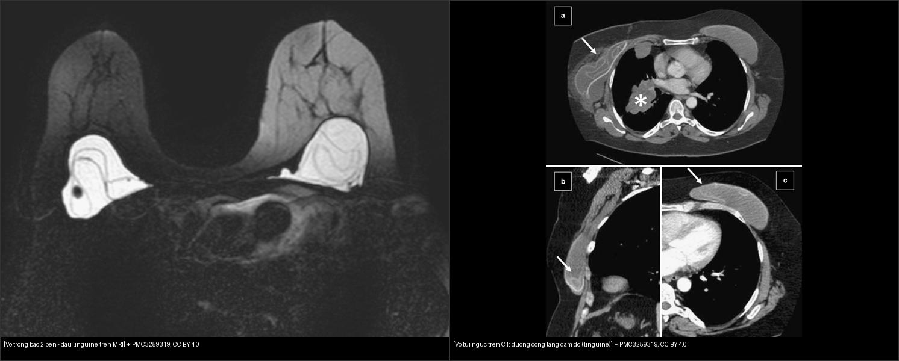
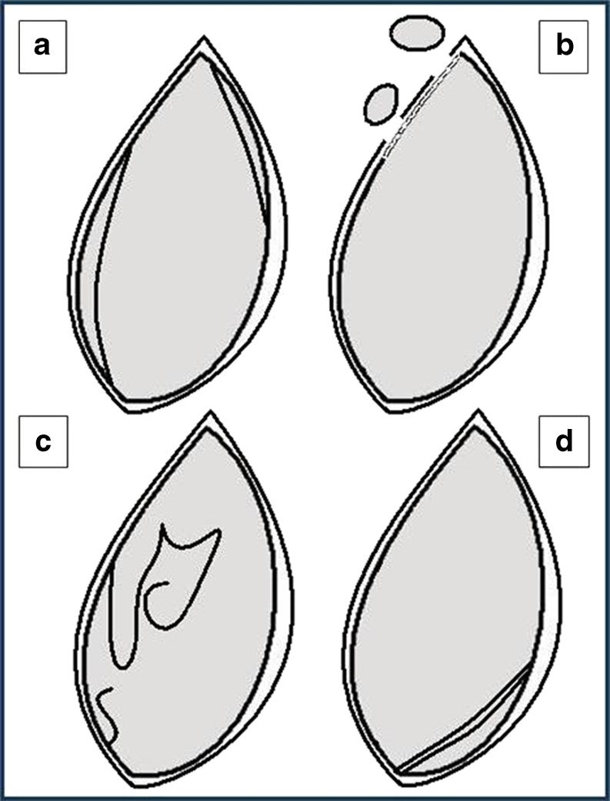
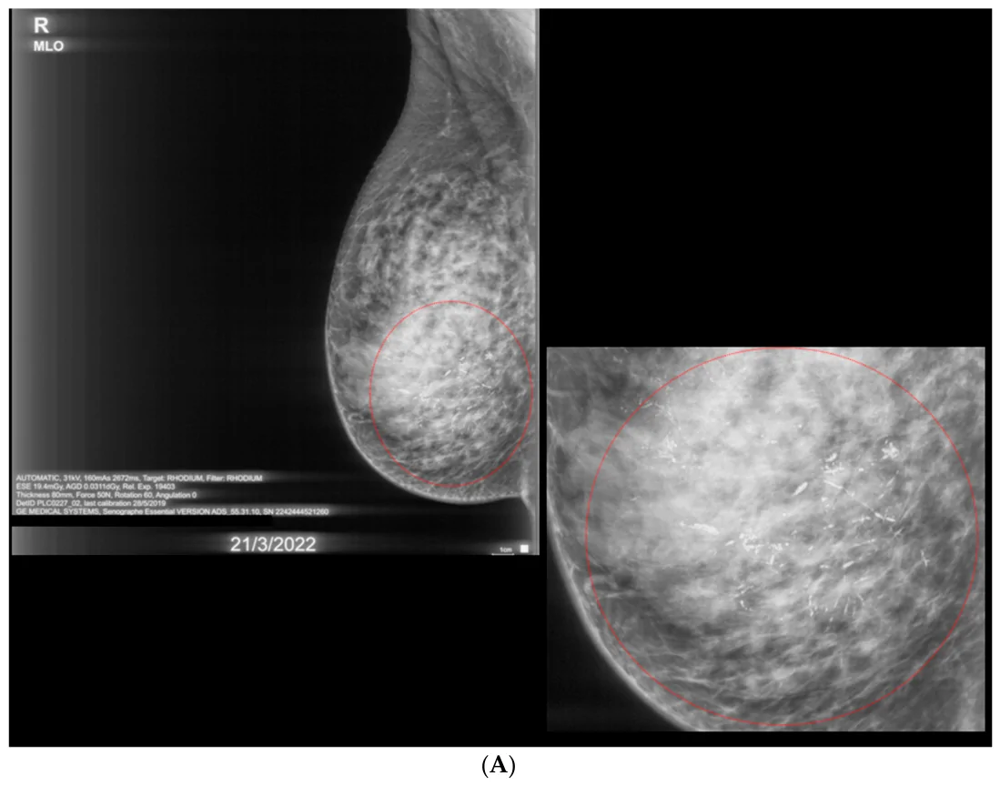
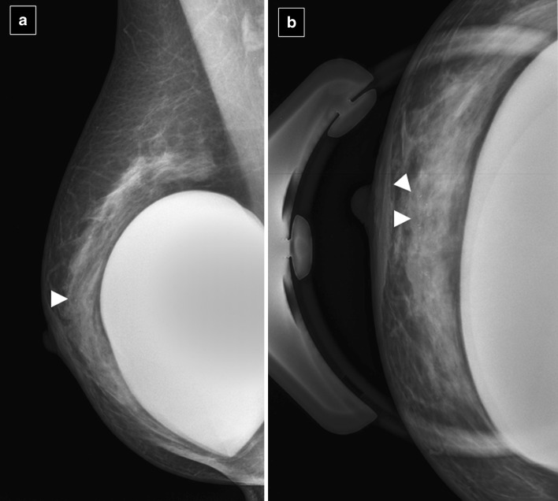
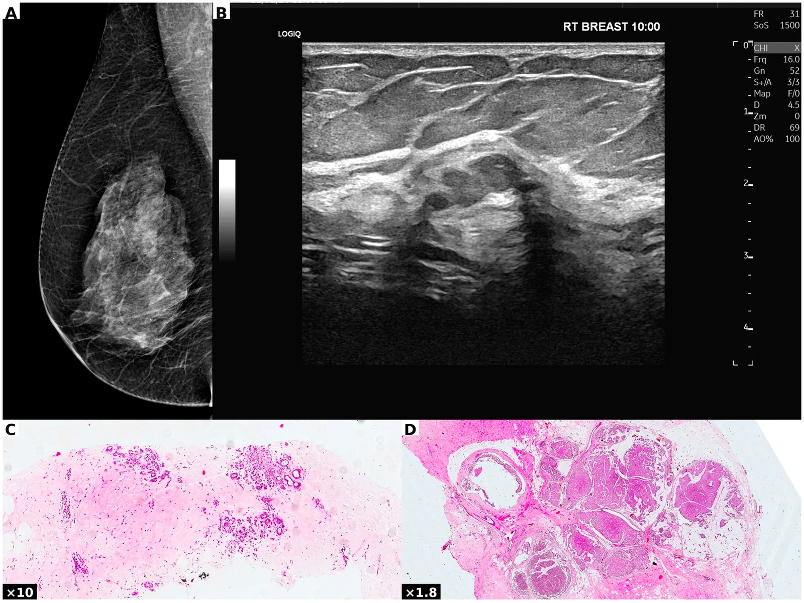

# 512 — Vú: vi vôi hóa, biến dạng cấu trúc & đánh giá túi ngực (implant) / Breast microcalcifications, architectural distortion & implant imaging

**Tags:** `pattern:vi-voi-hoa` `pattern:bien-dang-cau-truc` `pattern:tui-nguc` `vung:vu` `score:BI-RADS` `protocol:MRI-vu`
**Mức chắc chắn (certainty):** tổng hợp y văn (literature synthesis) — nhóm tự biên từ tổng quan có bản quyền mở (Insights Imaging 2011, Diagnostics 2026) + số liệu BI-RADS, chưa gắn một ca nguyên văn đơn lẻ.

## 1. Tổng quan — TẠI SAO hình thái vôi/co kéo nói lên mô bệnh

- **Vi vôi hóa (microcalcifications)** là canxi lắng trong lòng ống tuyến/nhu mô; vì canxi **hấp thụ tia X mạnh hơn mô mềm** → sáng đặc trưng trên nhũ ảnh, thường là **dấu hiệu duy nhất của DCIS (ung thư biểu mô ống tại chỗ)** — không sờ thấy, không thấy trên siêu âm.
- **Hình thái phản ánh cơ chế:** vôi do **hoại tử tế bào trong lòng ống** (DCIS) kết thành hạt nhỏ, không đều, men theo ống → **đa hình mịn (fine pleomorphic) / mảnh–phân nhánh (fine linear branching)**; vôi trong mô xơ lành hoặc dịch đặc → **thô đều/tròn đều, bỏng ngô**.
- **Ngưỡng định lượng (ACR BI-RADS 5th ed.):** xếp loại theo **hình thái + phân bố** — vôi lành (BI-RADS 2): da, mạch máu, thô đều, tròn đều, bỏng ngô, que dài, sữa canxi, **tách trà (teacup)**, thay đổi sau mổ, tách rời, vôi trong túi ngực. Vôi nghi ngờ: **vô định hình (amorphous)** ~ PPV 20% (4B), **thô không đều** ~ 10–20% (4B), **đa hình mịn / mảnh–phân nhánh** PPV cao ~ 60–95% (4C–5). Phân bố **nhóm (grouped = ≥ 5 hạt trong 1 cm)**, **tuyến tính (linear)** và **phân thùy (segmental)** làm tăng nghi ngờ (phân thùy = theo một ống–thùy tuyến → gợi DCIS).
- **Biến dạng cấu trúc (architectural distortion — AD):** vùng nhu mô **méo, co kéo, spicule, không có khối trung tâm đặc**. Cơ chế: tổ chức xơ co kéo nhu mô → **phản ứng desmoplastic của ung thư ống xâm lấn (đặc biệt ung thư tiểu thùy ILC)** hoặc **sẹo xơ hướng tâm (radial scar / complex sclerosing lesion — tổn thương nguy cơ B3)**. Trong một nghiên cứu hiện đại về sclerosing adenosis (Diagnostics 2026, n = 19 nhũ ảnh): AD là bất thường nhũ ảnh **hay gặp nhất 9/19 = 47,4%**; khi mổ, **28,6% nâng cấp lên B3 và 14,3% nâng cấp lên ác tính** → **AD phải coi là ác tính cho tới khi chứng minh ngược lại**.
- **Túi ngực (breast implant):** **MRI là chuẩn** đánh giá vỏ túi — **độ nhạy 80–90%, độ đặc hiệu 90–97%**; **nhũ ảnh kém (Se 25–30%, tối đa 68%)** vì không thấy được vỏ túi nằm sau gel. **TẠI SAO MRI hiệu quả:** gel silicone không có proton nên tín hiệu thấp trên T1/T2 thường, nhưng **chuỗi chọn lọc silicone (silicone-excited, nén nước)** làm **gel sáng rắng**, khi đó **vỏ túi gấp nếp (tối) nổi rõ trên nền gel sáng** → nhận diện vỡ trong bao.

## 2. Mẫu hình + chẩn đoán phân biệt theo hình thái/giải phẫu (Gamut)

- **Theo hình thái vôi:** lành (da, bỏng ngô, tách trà, sữa canxi, que dài, mạch máu) vs nghi ngờ (vô định hình, thô không đều, đa hình mịn, mảnh–phân nhánh).
- **Theo loại tổn thương phần mềm:** biến dạng cấu trúc (đơn thuần hay kèm khối), bất đối xứng khu trú, khối (đã học ở bài 510).
- **Theo tình trạng túi ngực:** vỡ **trong bao (intracapsular)** vs **ngoài bao (extracapsular)**; vỏ xơ phình (capsular contracture); xoay túi; viêm; **lymphoma tế bào T liên quan túi (BIA-ALCL)**.
- Gợi nhớ tiếp cận **"hình thái → phân bố → bối cảnh"**: một hạt vôi nhìn riêng vô nghĩa; **cụm + hình thái + phân bố + so phim cũ** mới quyết định.

## 3. Bảng so sánh phân biệt (ma trận đối chiếu)

| Thực thể (entity) | Hình ảnh điển hình | Chốt vào (rule-in) | Chốt loại (rule-out) | Gợi ý xác nhận |
|---|---|---|---|---|
| Vôi lành (fibroadenoma, mạch máu, da) | **Bỏng ngô/thô đều, tách trà, que dài, sữa canxi**, bờ đều | **Bờ đều + có que/trà + ổn định nhiều năm** | Hạt nhỏ đa hình trong cụm → nghi | So phim cũ; không sinh thiết |
| Vôi nghi ngờ (DCIS/ung thư) | **Đa hình mịn / mảnh–phân nhánh**, phân bố **nhóm–tuyến tính–phân thùy** | **≥ 5 hạt/1 cm + đa hình hoặc phân nhánh** | Thô đều/tròn đều → lành | Nhũ ảnh phóng đại + sinh thiết kim hút chân không (VAB) dưới định vị |
| Biến dạng cấu trúc (AD) | **Co kéo, spicule, không khối trung tâm** | **AD trên ≥ 2 bình diện** (đặc biệt ILC) | Có khối trung tâm → xếp theo khối | DBT + sinh thiết; **AD thường nâng cấp B3/ác** |
| Sẹo xơ hướng tâm (radial scar/CSL) | **AD dạng sao (spicules radiate)** — giống ILC | **Chẩn đoán loại trừ sau mổ** (B3, cần bàn) | Lõi xơ trung tâm trên mô bệnh → lành | Mô bệnh + hội chẩn (tái phát!) |
| Vỡ túi trong bao (intracapsular) | MRI: **linguine sign, dấu giọt lệ, keyhole, đường dưới vỏ, railroad track** | **Ảnh vỏ gấp nếp trong gel (linguine) trên chuỗi silicone** | Không có ảnh vỏ trong gel → túi nguyên | MRI chọn lọc silicone; US "stepladder", CT đường cong tăng đậm độ |
| Vỡ túi ngoài bao (extracapsular) | **Siliconoma/khoi gel tự do ngoài vỏ**, hạch chứa silicone | **Gel ngoài vỏ xơ (ra nhu mô/hạch)** | Gel khu trú trong vỏ → trong bao | US **"snowstorm sign"**; MRI/CT khảo sát lan gel |
| BIA-ALCL (lymphoma túi) | **Dịch muộn quanh túi (> 1 năm) + khối/khối phần mềm**, kèm co kéo | **Dịch quanh túi muộn + khối** trên MRI/US | Dịch cấp sau mổ → huyết thanh bình thường | Hút dịch + hóa mô/miễn dịch (CD30+) |


*Trái: MRI chuỗi silicone — **vỏ túi gấp nếp (linguine) trong gel sáng** ở cả hai túi bị vỡ. Phải: CT ngực — túi ngực **mất hình dạng + đường cong tăng đậm độ (linguine)** là dấu vỡ trên CT. Nguồn: Insights Imaging 2011 (PMC3259319), CC BY 4.0. Ảnh ghép letterbox.*


*Sơ đồ kinh điển: (a) **đường dưới vỏ (subcapsular line)**; (b) **siliconoma/gel tự do** (vỡ ngoài bao); (c) **linguine sign** — vỏ gấp nếp lượn sóng trong gel; (d) **railroad track sign** — hai đường song song tạo viền đôi dưới vỏ. Nguồn: Insights Imaging 2011 (PMC3259319), CC BY 4.0.*

## 4. Protocol chụp + quy trình BI-RADS

- **Nhũ ảnh (CC + MLO) ± DBT (tomosynthesis)** là đầu tay; khi có vi vôi hóa → **ảnh phóng đại (magnification) ± nén khu trú** để đọc rõ hình thái. Siêu âm bổ trợ khối/khe nhưng **kém với vi vôi hóa**.
- **Với túi ngực:** **MRI (1,5T) có coil vú**, các chuỗi khóa — **axial T2W**, **sagittal**, **chuỗi chọn lọc silicone (silicone-excited, nén nước)** và **chuỗi nén silicone (water-suppressed)**; **không cần cản quang cho mục đích khảo sát vỏ**. Siêu âm có thể xác định **snowstorm** (gel tự do); CT chỉ dùng khi tình cờ thấy.
- **Quy trình xử trí (khung BI-RADS):** vôi lành → **BI-RADS 2, không làm gì**; vôi nghi ngờ/nhóm–phân thùy → **BI-RADS 4/5, sinh thiết** (ưu tiên **VAB** để lấy trọn cụm vôi đủ mô bệnh); biến dạng cấu trúc → **BI-RADS 4/5, sinh thiết ± mổ** (AD dễ nâng cấp).

```mermaid
flowchart TD
  A[Vi voi hoa tren nhu anh] --> B{Hinh thai: bo ngô / tron deu / que dai}
  B -->|Co| C[Lanh - BI-RADS 2 - theo doi]
  B -->|Khong| D{Da hinh min hoac manh phan nhanh}
  D -->|Co| E[BI-RADS 4C hoac 5 - sinh thiet VAB]
  D -->|Khong, vo dinh hinh hoac tho khong deu| F[BI-RADS 4B - sinh thiet]
  E --> G{Phan bo nhom/tuyen tinh/phan thuy}
  F --> G
  G -->|Phan thuy| H[Nghi DCIS - uu tien VAB lay tron}
  A2[Bien dang cau truc] --> I[Xac nhan >= 2 binh dien]
  I --> J[Sinh thiet - AD de nang cap B3/ac]
  A3[Tui nguc nghi vo] --> K[MRI chon loc silicon]
  K -->|Vo gap nep trong gel| L[Vo trong bao - linguine]
  K -->|Gel ngoai vo| M[Vo ngoai bao - siliconoma/snowstorm]
```

## 5. Biến thể bình thường và cạm bẫy

- **Vôi trong da (dermal)** — nằm nông, thường tròn, có **tâm sáng** bên trong → **không sinh thiết**.
- **Vôi sau mổ/xạ trị** hoặc sẹo xơ lành — so phim cũ là chốt; đừng chọc oan.
- **Biến dạng cấu trúc chỉ thấy ở một bình diện** có thể là chồng lấp nhu mô bình thường → **xác nhận lại trên ≥ 2 bình diện/DBT** trước khi kết luận.
- **Túi ngực:** gấp nếp hướng tâm bình thường ở túi mới/bề mặt xung quanh có thể giả "keyhole"; **"gel bleed" (thấm gel)** khác vỡ (gel ngoài vỏ xơ mới là vỡ ngoài bao). **Không sinh thiết/chọc xuyên qua túi** khi chưa có kế hoạch mổ.
- **Satisfaction of search:** đã thấy một cụm vôi rõ rồi bỏ qua biến dạng cấu trúc ở vùng khác cùng vú đối diện.

## 6. Tự lượng giá — Blind Quiz

**Ca 1 — Nhũ ảnh MLO: cụm vôi lớn dần trong nhiều năm. Lành hay ác? Vì sao?**



- Hỏi: hình thái và phân bố vôi? Sinh thiết lõi âm tính có loại trừ DCIS không? Xử trí đúng?

<details><summary><b>Bấm để hiện đáp án (findings + chẩn đoán)</b></summary>

- Dấu hiệu (findings): **cụm vi vôi hóa đa hình, phân bố theo vùng/phân thùy, lan rộng dần theo thời gian** (vòng đỏ là ảnh phóng đại).
- Chẩn đoán (diagnosis): **DCIS độ cao (high-grade) pTis pN0** — 12 năm vôi tiến triển dù sinh thiết lõi nhiều lần âm tính (bỏ sót do lấy mẫu). **Bài học:** vôi nghi ngờ + tiến triển → cần **VAB lấy trọn cụm** (không phải sinh thiết lõi đơn thuần), cân nhắc mổ.
- Nguồn ảnh: Diagnostics 2026 (PMC13564617) Fig. 4A, CC BY 4.0.
</details>

**Ca 2 — Bệnh nhân có túi ngực, nhũ ảnh MLO thấy một cụm sáng nhỏ bờ không đều. Đánh giá thế nào?**



- Hỏi: vôi lành hay nghi? túi ngực có che lấp tổn thương không? Bước tiếp theo?

<details><summary><b>Bấm để hiện đáp án (findings + chẩn đoán)</b></summary>

- Dấu hiệu (findings): cụm **vi vôi hóa nghi ngờ (đa hình)** trong nhu mô vú, trên ảnh phóng đại rõ hơn; túi ngực silicone nằm sau.
- Chẩn đoán (diagnosis): **vi vôi hóa nghi ác tính** → chỉ định **sinh thiết (VAB/kẹp định vị)**, kể cả khi có túi ngực (túi nằm dưới tuyến không ngăn sinh thiết tuyến).
- **Bài học:** nhũ ảnh vẫn phát hiện được vôi trong vú đặt túi; **không được bỏ qua** vì sợ túi che.
- Nguồn ảnh: Insights Imaging 2011 (PMC3259319) Fig. 26, CC BY 4.0.
</details>

**Ca 3 — Nhũ ảnh + siêu âm: vùng méo nhu mô không có khối rõ. Chẩn đoán phân biệt và xử trí?**



- Hỏi: dấu hiệu chính trên nhũ ảnh (A)? Siêu âm (B) cho thấy gì? Sinh thiết lõi lành (C) có an tâm?

<details><summary><b>Bấm để hiện đáp án (findings + chẩn đoán)</b></summary>

- Dấu hiệu (findings): (A) nhũ ảnh MLO — **biến dạng cấu trúc (AD) vùng trên**, thấy rõ trên DBT; (B) siêu âm — khối **oval, phân thùy, hồi âm kém 15 × 6 mm**, song song da (BI-RADS 4); (C/D) mô bệnh — ban đầu **sclerosing adenosis lành**, nhưng mổ xác định **ung thư biểu mô nhầy xâm lấn (mucinous carcinoma) pT1a** (dạng mô học hiếm, hình ảnh "hiền").
- Chẩn đoán (diagnosis): **AD + khối giả lành nhưng thực chất là ung thư nhầy** → **mổ khi bất tương hợp X-quang–mô bệnh (radiologic–pathologic discordance)**. Số liệu liên quan: AD khi mổ có thể **nâng cấp B3 28,6% / ác 14,3%**.
- Nguồn ảnh: Diagnostics 2026 (PMC13511688) Fig. 2, CC BY 4.0.
</details>

**Ca 4 — Hai nhũ ảnh/MRI của túi ngực: dấu nào chốt đã vỡ?**


<details><summary><b>Bấm để hiện đáp án (findings + chẩn đoán)</b></summary>

- Trái (MRI chuỗi silicone): **vỏ túi gấp nếp (linguine) trong gel sáng** ở cả hai túi → **vỡ trong bao hai bên**.
- Phải (CT): túi **mất hình dạng + đường cong tăng đậm độ** = dấu vỡ (linguine) trên CT.
- Chốt: **MRI độ nhạy 80–90%, độ đặc hiệu 90–97%** cho vỡ túi; nhũ ảnh chỉ 25–30%. Phân biệt **trong bao** (vỏ còn, linguine) vs **ngoài bao** (gel ra nhu mô/hạch, "snowstorm" trên US).
- Nguồn ảnh: Insights Imaging 2011 (PMC3259319), CC BY 4.0.
</details>

## Bài liên quan chéo
- [500 – Tổng quan Vú & Sản Phụ khoa](../500-tong-quan-vu-san-phu-khoa/lesson.md)
- [510 – Vú & BI-RADS: nhũ ảnh, siêu âm & MRI](../510-vu-BIRADS-nhu-anh-sieu-am-MRI/lesson.md) (khối vú, động học DCE, xếp loại BI-RADS)
- [516 – Hình ảnh vú sau điều trị: hoại tử mỡ, sẹo vs tái phát & BIA-ALCL](../516-hinh-anh-vu-sau-dieu-tri/lesson.md) (đọc vú đã mổ/xạ/tái tạo/túi ngực)
- [530 – Phần phụ O-RADS](../530-buong-trung-ORADS-sieu-am-MRI/lesson.md) (hệ thống RADS phụ khoa)
- [448 – U hắc mạc](../448-u-hac-mac/lesson.md) (nguyên lý MRI theo bản chất mô — melanin/silicone)

## Ảnh
- `512_vi-voi-hoa-DCIS_Mammo_PMC13564617-Fig4a-CCBY.webp` — Diagnostics 2026 (PMC13564617), CC BY 4.0.
- `512_bien-dang-cau-truc_Mammo-US_PMC13511688-Fig2-CCBY.webp` — Diagnostics 2026 (PMC13511688), CC BY 4.0.
- `512_linguine_MRI_PMC3259319-Fig6-CCBY.jpg`, `512_linguine-CT-CT_PMC3259319-Fig23-CCBY.jpg`, `512_vo-tui-nguc-dau-hieu_MRI_PMC3259319-Fig15-CCBY.jpg`, `512_vi-voi-hoa-tui-nguc_Mammo_PMC3259319-Fig26-CCBY.jpg` — Insights Imaging 2011 (PMC3259319), CC BY 4.0.
- `composite_tui-nguc-MRI-vs-CT.jpg` — ảnh ghép letterbox từ ảnh trên.
- Chi tiết giấy phép từng ảnh trong `images/CREDITS.md`. AuntMinnie: chỉ dẫn link, không tải.

> Không dùng để chẩn đoán độc lập khi chưa có người hướng dẫn.
