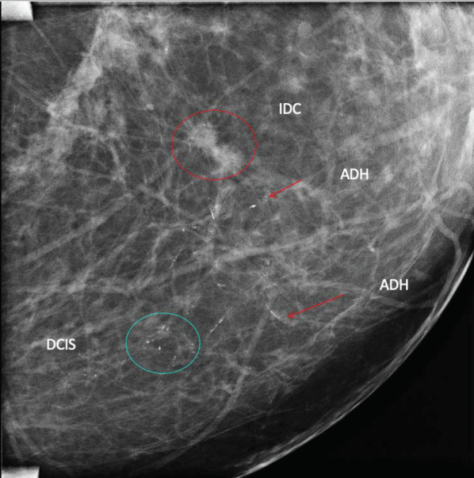
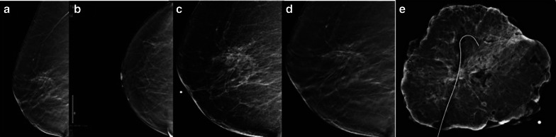
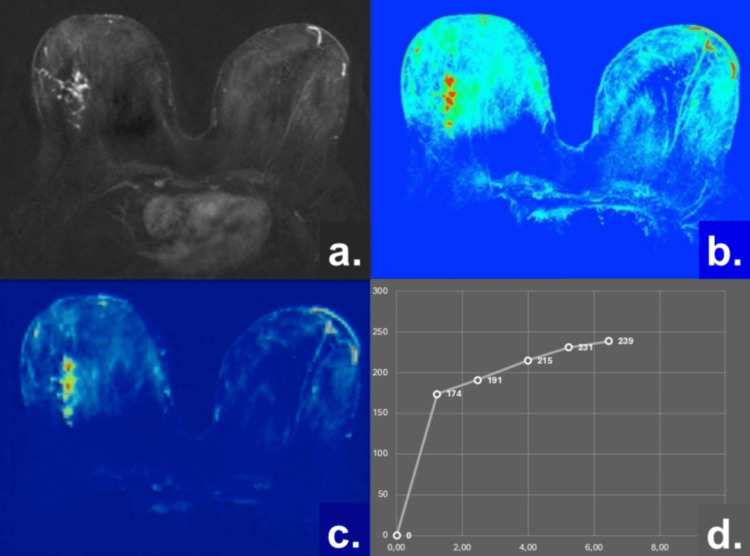
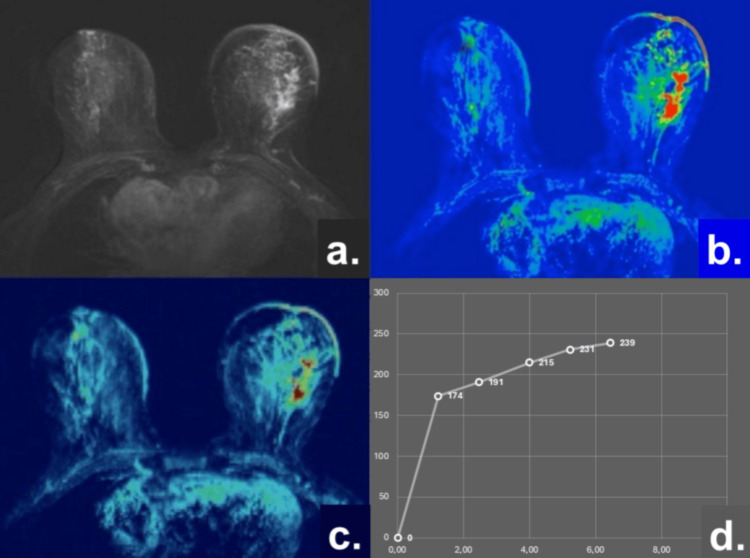
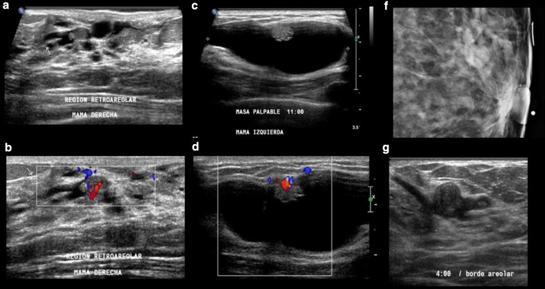
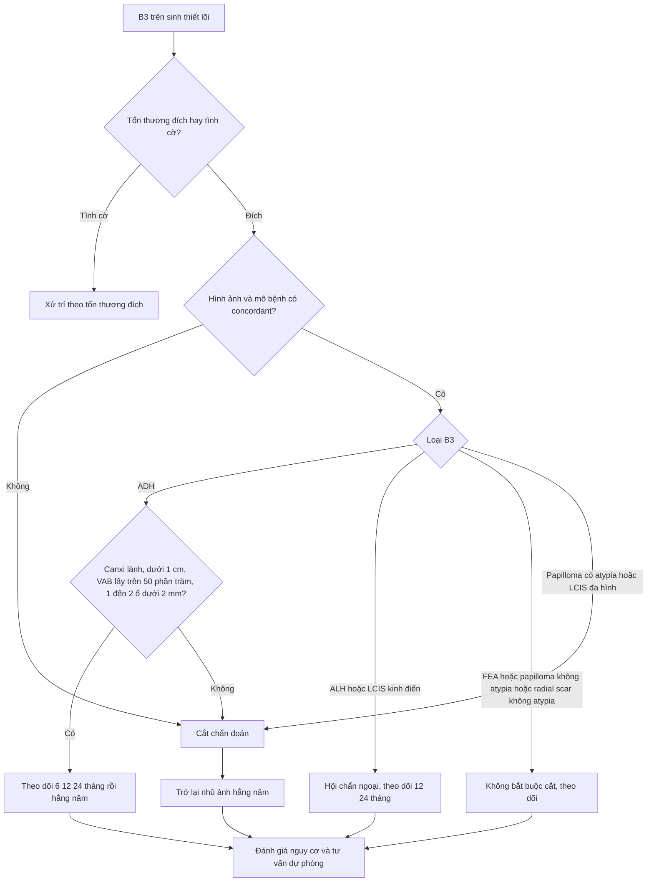
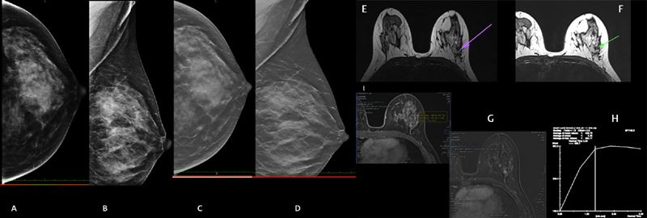

# 513 — Tổn thương vú nguy cơ cao (B3): ADH, ALH, LCIS, FEA, papilloma & radial scar — nâng bậc ác tính, khi nào cắt chẩn đoán / High-risk breast lesions

**Tags:** `pattern:b3` `pattern:vi-voi-hoa` `vung:vu` `score:BI-RADS` `protocol:sinh-thiet-VAB` `incidentaloma:b3`
**Mức chắc chắn (certainty):** tổng hợp y văn (literature synthesis) — số liệu lấy từ khuyến cáo Ontario Health (Cancer Care Ontario) 2026, các đoàn hệ B3 và ca nguyên văn có ảnh; chưa có thử nghiệm ngẫu nhiên riêng cho từng tổn thương.

## 1. Tổng quan bệnh học – cơ chế hình ảnh

- **B3 = tổn thương tiềm năng ác tính chưa xác định (lesion of uncertain malignant potential).** Trên mảnh sinh thiết lõi (core needle biopsy — CNB) thấy tổn thương này, nhưng **mảnh cắt trọn có thể chứa ung thư tại chỗ (DCIS) hoặc ung thư xâm lấn** mà kim chưa chạm tới. Vì vậy câu hỏi lâm sàng không phải "tổn thương là gì" mà là **"nguy cơ nâng bậc (upgrade) bao nhiêu %, có buộc cắt chẩn đoán (surgical excision) hay theo dõi được?"**
- **Ranh giới ADH ↔ DCIS độ thấp là ranh giới SỐ LƯỢNG, không phải tế bào học:** cùng một dòng tế bào tăng sinh đơn dạng; gọi **ADH** khi mới lấp một phần ống, **≤ 2 khoang có màng đáy (membrane-bound spaces)** hoặc **< 3 mm**; gọi **DCIS** khi lấp **≥ 2 khoang hoàn toàn** hoặc **≥ 3 mm**. Chính ngưỡng này giải thích tại sao **sai số lấy mẫu** lại thành "nâng bậc": ống bên cạnh đã là DCIS nhưng kim 14G chỉ lấy trúng đoạn ADH.
- **TẠI SAO ảnh hưởng của kim sinh thiết lớn đến vậy:** CNB 14G lấy vài chục mg mô; **sinh thiết hút chân không (vacuum-assisted biopsy — VAB) 11G** lấy được gấp nhiều lần, lấy trọn ổ vi vôi hóa → giảm nâng bậc và giảm "không còn tổn thương để cắt". Đây là lý do kỹ thuật, không phải sở thích. Số liệu cụ thể (340 ca tăng sinh có atypia, Hàn Quốc 2000–2022): nâng bậc **37,6%**; **CNB 45,2% vs VAB 20,0%** (p < 0,001).
- **TẠI SAO vi vôi hóa là dấu hiệu chính trên nhũ ảnh:** tế bào tăng sinh trong ống thoái hóa, hoại tử và lắng **hydroxyapatit canxi** → tổn thương cản quang cao, nhũ ảnh (mammography/DBT) nhạy nhất; nhưng canxi **không cho biết đã xâm lấn hay chưa**.
- **TẠI SAO MRI không giải quyết được câu hỏi nâng bậc:** cả ADH và DCIS đều gây **tăng ngấm không khối (non-mass enhancement — NME)** do tăng tính thấm mao mạch. Trong một đoàn hệ 2026 so sánh trực tiếp, **ADC 1,35 vs 1,25 × 10⁻³ mm²/s**, **PEI 590,4 vs 688,4**, đường cong **TIC type 1 ở cả hai** — **không khác biệt có ý nghĩa** ở mọi thông số. Kết luận thực hành: **MRI sáng/tối không loại trừ được DCIS ẩn**; mô bệnh học là chốt.
- **Nguy cơ ung thư về sau (khác với nâng bậc):** ALH và LCIS thể kinh điển là **tiền thân không bắt buộc (non-obligate precursor)** + dấu hiệu nguy cơ: **~1–1,5% mỗi năm cho CẢ HAI bên vú**. ADH cũng là **dấu hiệu nguy cơ ung thư về sau** (không chỉ là tổn thương tại chỗ). Vì vậy hai quyết định song song: **cắt chẩn đoán (tìm ung thư đã có)** và **dự phòng nội tiết + theo dõi suốt đời (ngăn ung thư về sau)** — bài 594.

## 2. Mẫu hình + chẩn đoán phân biệt theo vị trí (Gamut)

**Theo mẫu hình hình ảnh (pattern) → gamut B3:**

- **Vi vôi hóa đơn thuần:** ADH (canxi ống, đa hình nhẹ), **FEA/tăng sinh ống trụ có atypia (flat epithelial atypia — FEA)**, LCIS (canxi vô định hình rải rác), DCIS độ thấp (bị bỏ sót).
- **Khối/nốt trong ống tuyến:** **papilloma trong ống** (trung tâm, đơn độc, tiết dịch núm vú) vs **papilloma ngoại vi** (nhiều ổ, tình cờ) vs **papilloma có atypia** (nguy cơ cao nhất trong nhóm này).
- **Biến dạng cấu trúc (architectural distortion):** **sẹo xơ/tổn thương xơ cứng phức tạp (radial scar / complex sclerosing lesion — RS/CSS)** — trung tâm xơ hóa, tua xòe, có thể kèm ADH.
- **Nang chứa nhầy:** **tổn thương dạng nang nhầy (mucocele-like lesion — MLL)** — nhầy vỡ vào mô đệm, có/không atypia.
- **Tăng sinh mô đệm:** **tổn thương biểu mô–mô đệm tăng tế bào mô đệm** (fibroepithelial lesion with cellular stroma) — phổ từ fibroadenoma → phyllodes.
- **Không thấy gì trên nhũ ảnh, chỉ thấy trên MRI:** NME đơn ổ — ADH/LCIS/FEA là gamut thường gặp, nhưng **luôn phải loại DCIS**.

**Theo vị trí (location) — nơi tổn thương nằm quyết định kỹ thuật lấy mẫu:**

- **Trung tâm/retroareolar:** papilloma ống lớn, tiết dịch; dễ lấy bằng siêu âm, nhưng khó thấy canxi trên nhũ ảnh.
- **Ngoại vi/1/4 trên ngoài:** ADH, FEA, RS — vùng mô tuyến dày, nhũ ảnh + DBT là chính.
- **Sát thành ngực/thành ngực trước:** RS/CSS hay gây biến dạng cấu trúc; MRI giúp phân biệt với co kéo do sẹo mổ.
- **Vú đã xạ trị/mổ:** B3 "mới" có thể chỉ là mô xơ – cần so phim cũ trước khi sinh thiết (bài 516).

**Gợi nhớ nhanh nhóm B3 hay gặp — "A-F-L-P-R-M":** **A**DH, **F**EA, **L**CIS/ALH, **P**apilloma, **R**adial scar, **M**ucocele-like.

## 3. Bảng so sánh phân biệt (ma trận đối chiếu)

| Thực thể (entity) | Hình ảnh điển hình | Chốt vào (rule-in) | Chốt loại (rule-out) | Gợi ý xác nhận |
|---|---|---|---|---|
| **ADH** | Canxi ống nhóm, đa hình nhẹ; có thể chỉ là "canxi lành" cạnh một khối khác | **Canxi nhóm trong ống + tăng sinh đơn dạng lấp một phần ống (≤ 2 khoang, < 3 mm)** | **≥ 2 khoang lấp hoàn toàn hoặc ≥ 3 mm = DCIS, không còn là ADH** | VAB 11G + X-quang mảnh cắt; cắt chẩn đoán nếu còn canxi sau sinh thiết |
| **ALH / LCIS thể kinh điển** | Thường **không có khối**; canxi vô định hình rải rác; MRI có thể NME | **Tăng sinh tiểu thùy đơn dạng, mất E-cadherin; không phá màng đáy** | **Hoại tử + canxi dày đặc + khối = nghi DCIS/LCIS đa hình (pleomorphic), xử trí như DCIS** | Sinh thiết lõi + IHC E-cadherin; nếu concordant, **không bắt buộc cắt** |
| **FEA (tăng sinh ống trụ có atypia)** | Canxi tròn nhỏ trong ống giãn, "canxi sữa"; hay đi kèm ADH/LCIS | **Lớp tế bào trụ đơn dạng phủ ống giãn, có atypia nhân** | **Không có atypia = thay đổi ống trụ (columnar cell change) — B2, không phải B3** | VAB; nếu đã lấy trọn ổ canxi + concordant → theo dõi |
| **Papilloma CÓ atypia** | Khối trong ống giãn, có cuống mạch (fibrovascular stem), Doppler thấy mạch trong cuống | **Nhú có cuống + tăng sinh tế bào có atypia trong mảnh** | **Atypia nằm ở mô tuyến lân cận chứ không trong nhú → xử trí theo tổn thương lân cận** | **Cắt chẩn đoán bắt buộc** (nâng bậc tới 56,5%) |
| **Papilloma KHÔNG atypia** | Ống giãn + khối đồng hồi âm trong lòng, cuống mạch rõ | **Nhú đơn độc, không atypia, hình ảnh–mô bệnh phù hợp** | **Nhiều ổ + tiết dịch máu + canxi trong nhú → nghi ác, phải cắt** | Theo dõi 12–24 tháng nếu concordant; cắt nếu to lên |
| **Radial scar / CSS** | Biến dạng cấu trúc tua xòe, trung tâm sáng; DBT thấy rõ hơn 2D | **Tua xơ hướng tâm + tăng sinh ống trong trung tâm, không atypia** | **Atypia trong RS → nâng bậc tới 35% → cắt**; **bờ cứng, tua dày không đều → nghi ung thư xâm lấn** | Cắt chẩn đoán khi có atypia/không concordant; VAB + clip |
| **Mucocele-like lesion** | Canxi nhóm + nang nhầy nhỏ; có thể chỉ là cụm canxi | **Nhầy trong ống + mô đệm, có/không atypia** | **Có atypia (ADH) → nâng bậc tới 31% → cắt** | VAB; cắt nếu có atypia hoặc không concordant |

*Nhũ ảnh nghiêng khuếch đại: vòng đỏ = khối đặc tua gai (IDC); mũi tên đỏ = canxi ống của ADH; vòng xanh = cụm canxi đa hình của DCIS. Đây là lý do "ADH trên sinh thiết" vẫn có thể kèm ung thư ở nơi khác trong vú. Nguồn: Catanzariti F et al., Insights into Imaging 2021 (PMC8155169), CC BY 4.0.*

### Ba dấu hiệu cần đọc đúng trên ảnh
- **Canxi "đa hình" (pleomorphic) không đồng nghĩa DCIS:** ADH cũng tạo canxi đa hình nhẹ; hình thái canxi **không phân định** ADH/DCIS — chỉ số lượng khoang và kích thước tổn thương trên mô bệnh mới phân định.
- **Papilloma: tìm cuống mạch.** Khối trong ống giãn + **cuống mạch có tín hiệu Doppler** là dấu hiệu của nhú thật; khối đặc không cuống, bờ không đều → nghi ung thư nhú.
- **Radial scar: đọc trên DBT, không chỉ 2D.** Biến dạng cấu trúc bị che ở vú dày; DBT làm rõ tua xơ hướng tâm — nếu chỉ thấy "co kéo" trên 2D mà DBT bình thường, hãy nghĩ sẹo mổ/giả ảnh.

*ADH không chỉ là canxi: (a, b) nhũ ảnh MLO/CC và (c, d) DBT + ép khu trú cho thấy biến dạng cấu trúc 1/4 trên ngoài, 1/3 sau; (e) mảnh cắt trọn — mô bệnh xác nhận ADH kèm thay đổi/tăng sinh ống trụ. Nguồn: Catanzariti F et al., Insights into Imaging 2021 (PMC8155169), CC BY 4.0.*

*ADH: (a) ảnh trừ T1 sau tiêm — tăng ngấm không khối (NME); (b) bản đồ ADC 1,35 × 10⁻³ mm²/s; (c) PEI 590,4; (d) đường cong TIC type 1 (tăng ngấm bền). Nguồn: Mihajlovic MN et al., Cureus 2026 (PMC12811792), CC BY 4.0.*

*DCIS: (a) NME; (b) ADC 1,25 × 10⁻³ mm²/s; (c) PEI 688,4; (d) TIC type 1. So với ảnh ADH ở trên: khác biệt KHÔNG có ý nghĩa thống kê — MRI không dùng để loại DCIS. Nguồn: Mihajlovic MN et al., Cureus 2026 (PMC12811792), CC BY 4.0.*

*Siêu âm: ống giãn chứa khối đồng hồi âm trong lòng, có cuống mạch (fibrovascular stem) và tín hiệu Doppler trong cuống (a, b); thể nang–đặc (c, d). Nguồn: Catanzariti F et al., Insights into Imaging 2021 (PMC8155169), CC BY 4.0.*

## 4. Protocol + hệ phân độ & lưu đồ xử trí

- **Bước 1 — Đọc lại chỉ định:** tổn thương B3 phải là **tổn thương đích (target lesion)** đã thấy trên hình ảnh. Nếu B3 nằm **ngoài vùng đích** (incidental), xử trí theo tổn thương đích, không theo B3.
- **Bước 2 — Lấy mẫu:** ưu tiên **VAB 11G** (đặc biệt với canxi); CNB 14G chỉ chấp nhận khi VAB không khả thi. **Đặt clip** tại vị trí sinh thiết (bài 517) — bắt buộc khi canxi có thể bị lấy hết, để còn đường dẫn cho cắt chẩn đoán.
- **Bước 3 — Xác nhận canxi:** **X-quang mảnh cắt (specimen radiography)** phải thấy canxi trong mảnh; nếu không thấy → nguy cơ lấy mẫu sai vị trí, phải kiểm tra lại clip/ảnh.
- **Bước 4 — Hội chẩn hình ảnh–mô bệnh (concordance):** B3 chỉ được coi là "phù hợp" khi hình thái canxi/khối khớp với mô bệnh. **Không concordant = cắt chẩn đoán, bất kể loại B3.**
- **Bước 5 — Quyết định (số liệu nâng bậc tại lần cắt, theo Ontario Health 2026):**

| Tổn thương B3 | Nâng bậc tới ung thư tại lần cắt | Xử trí chuẩn |
|---|---|---|
| **ADH** | **7–52,9%** | **Cắt chẩn đoán**; có thể theo dõi chọn lọc nếu canxi lành, tổn thương **< 1 cm**, VAB lấy **> 50%** tổn thương, chỉ **1–2 ổ ADH < 2 mm**, không kèm B3 khác |
| **ALH** | **1,7–36%** (concordant: nâng bậc 0–4%) | **Hội chẩn ngoại**, thường **không cắt** nếu concordant; theo dõi 12–24 tháng rồi hằng năm |
| **LCIS thể kinh điển** | **1,7–36%** (concordant: 0–4%) | Như ALH; cắt nếu LCIS lan rộng (**> 4 đơn vị ống tận**) hoặc kèm B3 khác |
| **LCIS thể đa hình / hoa mỹ (pleomorphic/florid)** | Cao, xử trí **như DCIS** | **Cắt + đánh giá bờ**, cân nhắc xạ trị |
| **FEA** | **0–18,3%** | **Không bắt buộc cắt** nếu concordant + đã lấy trọn canxi; theo dõi |
| **Papilloma có atypia** | **18,7–56,5%** | **Cắt chẩn đoán bắt buộc** |
| **Papilloma không atypia** | **0–14,3%** | **Không bắt buộc cắt** nếu concordant; theo dõi 12–24 tháng |
| **Radial scar/CSS có atypia** | **tới 35%** | **Cắt chẩn đoán** |
| **Radial scar/CSS không atypia** | **0–25%** | Hội chẩn; không bắt buộc cắt nếu concordant |
| **Mucocele-like có atypia** | **tới 31%** | **Cắt chẩn đoán** |
| **Mucocele-like không atypia** | **0–17%** | Không bắt buộc cắt nếu concordant |

- **Yếu tố dự báo nâng bậc (phân tích đa biến, 340 ca):** **atypia đa ổ (multifocal) OR 25,61** — nâng bậc tới **84,4%**; **BI-RADS 4C–5 OR 11,02**; **CNB 45,2% vs VAB 20,0%**. Nghĩa là: nhiều ổ atypia + hình ảnh rất nghi = cắt chẩn đoán, đừng theo dõi.

- **Bước 6 — Sau cắt chẩn đoán:** trở lại **nhũ ảnh hằng năm**; nếu không cắt → **theo dõi 6, 12, 24 tháng** bằng đúng phương thức ban đầu (nhũ ảnh/DBT hoặc MRI), sau đó hằng năm.
- **Bước 7 — Dự phòng:** đánh giá nguy cơ (Tyrer–Cuzick/IBIS), tư vấn **hóa dự phòng** (tamoxifen/raloxifene/ức chế aromatase) và **MRI tầm soát** khi nguy cơ đủ cao (bài 524, 594).

## 5. Biến thể bình thường và cạm bẫy

- **Thay đổi ống trụ KHÔNG atypia (columnar cell change) = B2, không phải B3.** Đừng đẩy bệnh nhân vào vòng cắt chẩn đoán chỉ vì chữ "columnar"; chỉ theo dõi 12 tháng rồi về tầm soát thường quy.
- **Sclerosing adenosis** (thường gặp, có thể xếp B3 ở một số hệ thống) có nguy cơ nâng bậc rất thấp; hình ảnh giống ung thư (biến dạng cấu trúc, canxi) — chốt bằng concordance, không bằng hình thái.
- **Canxi bị lấy hết sau VAB:** nhũ ảnh sau sinh thiết "sạch" **không có nghĩa là hết bệnh**; nếu quyết định cắt, phải dựa vào **clip + ảnh X-quang mảnh cắt**, không dựa vào canxi còn lại.
- **Canxi lành cạnh khối ác:** "canxi lành" không loại trừ ung thư ở nơi khác; đọc toàn bộ vú, so sánh hai bên, không dừng ở tổn thương đích (satisfaction of search).
- **Di lệch clip (clip migration):** clip có thể di chuyển vài mm đến vài cm sau sinh thiết/trước mổ → dùng thêm marker da/ROLL hoặc wire dưới hướng dẫn siêu âm, đối chiếu 2 bình diện (bài 517).
- **LCIS "kinh điển" vs "đa hình":** chỉ một chữ trong kết luận mô bệnh đổi hoàn toàn đường đi (theo dõi vs cắt + bờ). Luôn đọc kỹ mô bệnh, hỏi lại nếu chỉ ghi "LCIS".
- **MRI sau sinh thiết:** tụ máu/huyết thanh sau VAB tạo NME giả — chụp MRI **trước** sinh thiết hoặc chờ ≥ 2–4 tuần, tránh chẩn đoán "lan rộng" sai.

## 6. Tự lượng giá — Blind Quiz

**Ca 1 — Nữ 52 tuổi, nhũ ảnh tầm soát thấy cụm canxi nhóm ở 1/4 trên ngoài. Sinh thiết VAB 11G: ADH, canxi đã lấy gần hết, còn 1 ổ ADH 1,5 mm trên 1 mảnh.**

- Câu hỏi: Nâng bậc dự kiến bao nhiêu? Có yếu tố nào cho phép theo dõi thay vì cắt? Cần làm gì ngay sau sinh thiết?

<b>Bấm để hiện đáp án</b>

- **Nâng bậc của ADH: 7–52,9%** — không thể loại trừ DCIS bằng hình ảnh (MRI ADH và DCIS chồng lấp: ADC 1,35 vs 1,25; PEI 590 vs 688).
- **Có thể theo dõi chọn lọc** khi hội đủ: canxi lành, tổn thương **< 1 cm**, VAB lấy **> 50%**, chỉ **1–2 ổ ADH < 2 mm**, không kèm B3 khác — ca này **gần đủ** nhưng phải có **concordance** và bệnh nhân chấp nhận; nếu không → **cắt chẩn đoán có clip dẫn đường**.
- Ngay sau sinh thiết: **X-quang mảnh cắt xác nhận canxi**, đặt clip, và **so phim cũ**; nếu cắt, dùng clip + specimen radiography.
- Nguồn ảnh: Catanzariti F et al., Insights into Imaging 2021 (PMC8155169), CC BY 4.0.

**Ca 2 — Nữ 48 tuổi, tiết dịch núm vú một bên. Siêu âm: ống giãn chứa khối trong lòng có cuống mạch.**

- Câu hỏi: Dấu hiệu nào xác định đây là nhú thật? Khi nào bắt buộc cắt?

<b>Bấm để hiện đáp án</b>

- **Khối đồng hồi âm trong ống giãn + cuống mạch có tín hiệu Doppler** = papilloma; thể nang–đặc (ảnh c, d) vẫn có thể lành.
- **Bắt buộc cắt khi có atypia** (nâng bậc **18,7–56,5%**) hoặc khi hình ảnh không concordant, nhiều ổ, canxi trong nhú, chảy máu.
- **Không atypia + concordant**: theo dõi 12–24 tháng (nâng bậc 0–14,3%).
- Nguồn ảnh: Catanzariti F et al., Insights into Imaging 2021 (PMC8155169), CC BY 4.0.

**Ca 3 — Nữ 51 tuổi, canxi vô định hình nhóm + bất đối xứng, BI-RADS 4C. Sinh thiết: LCIS thể kinh điển, không thấy thành phần khác.**

- Câu hỏi: Có buộc cắt không? Điều gì đổi quyết định? Tư vấn nguy cơ về sau thế nào?

<b>Bấm để hiện đáp án</b>

- **LCIS kinh điển, concordant → thường KHÔNG cắt** (nâng bậc 0–4% khi concordant; 1,7–36% chung).
- **Đổi quyết định sang cắt** nếu: LCIS lan rộng **> 4 đơn vị ống tận**, kèm ADH/B3 khác, hoặc là **LCIS đa hình/hoa mỹ** (xử trí như DCIS: cắt + bờ ± xạ).
- Tư vấn: **nguy cơ ~1–1,5%/năm cho cả hai bên vú** → nhũ ảnh hằng năm, đánh giá nguy cơ và bàn **hóa dự phòng** (bài 594).
- Nguồn ảnh: Hande PC et al., Indian J Radiol Imaging 2021 (PMC8590558), CC BY-NC-ND 4.0 (giữ nguyên bản).

## Bài liên quan chéo
- [500 – Tổng quan Vú & Sản phụ khoa](../500-tong-quan-vu-san-phu-khoa/lesson.md)
- [510 – Vú & BI-RADS](../510-vu-BIRADS-nhu-anh-sieu-am-MRI/lesson.md) (phân độ và từ điển hình ảnh)
- [512 – Vi vôi hóa, túi ngực, biến dạng cấu trúc](../512-vi-voi-hoa-tui-nguc-bien-dang/lesson.md)
- [517 – Sinh thiết định vị & quản lý clip](../517-sinh-thiet-dinh-vi-vu-va-quan-ly-clip/lesson.md)
- [522 – Theo dõi sau điều trị ung thư vú](../522-theo-doi-sau-dieu-tri-ung-thu-vu/lesson.md)
- [524 – Sàng lọc & quản lý nguy cơ cao](../524-sang-loc-va-quan-ly-nguy-co-cao-ung-thu-vu/lesson.md)
- [594 – Hóa dự phòng ung thư vú](../594-hoa-du-phong-ung-thu-vu/lesson.md)
- [1602 – Hemangioma & tổn thương mạch lành tính của vú](../1602-hemangioma-ton-thuong-mach-lanh-vu/lesson.md)

> Không dùng để chẩn đoán độc lập khi chưa có người hướng dẫn.
