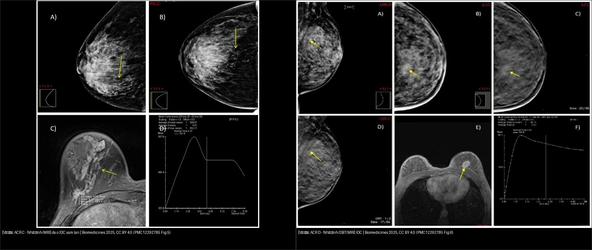
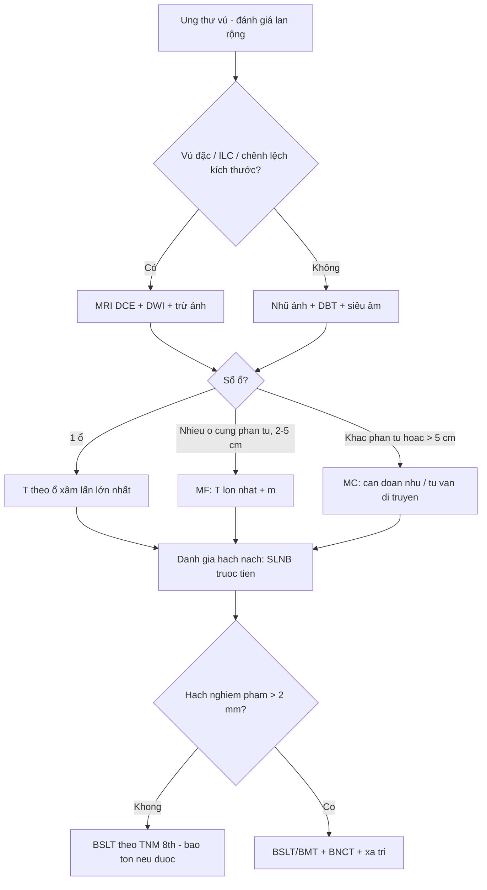
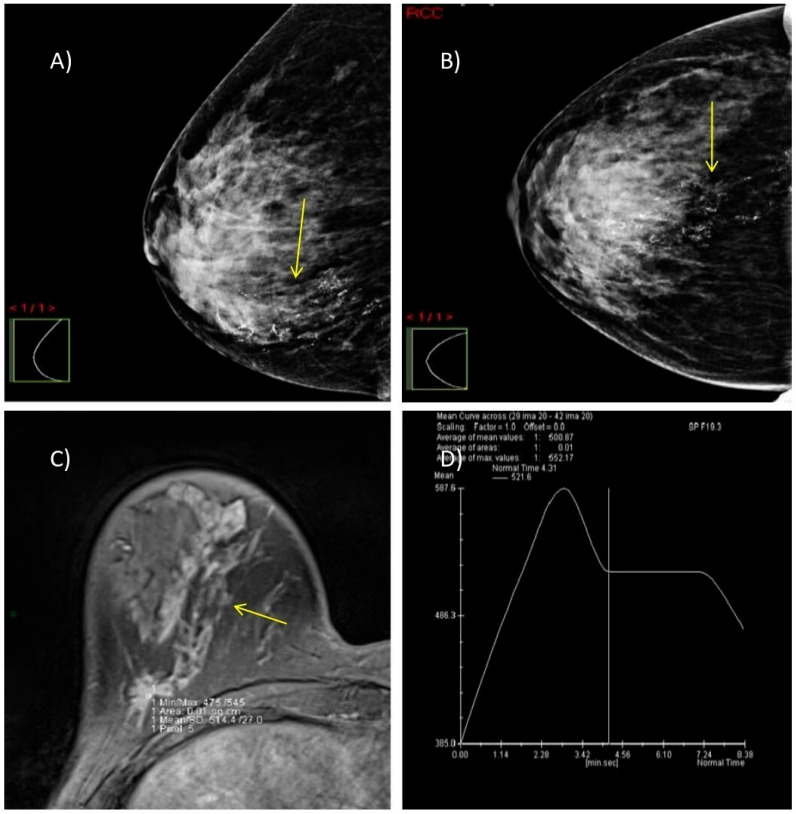
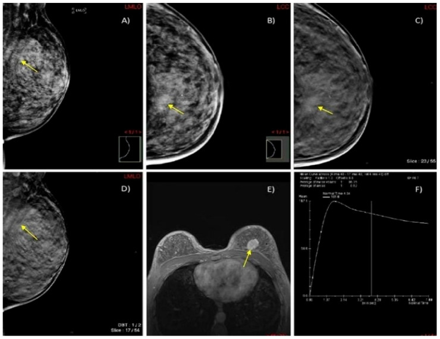
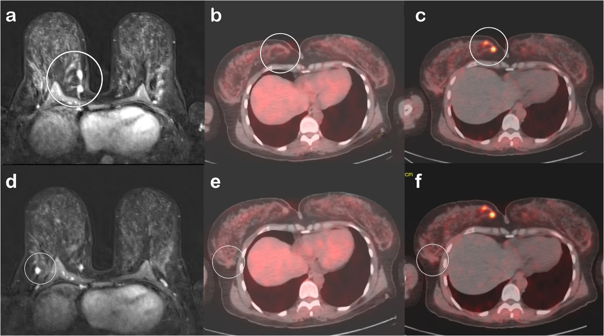
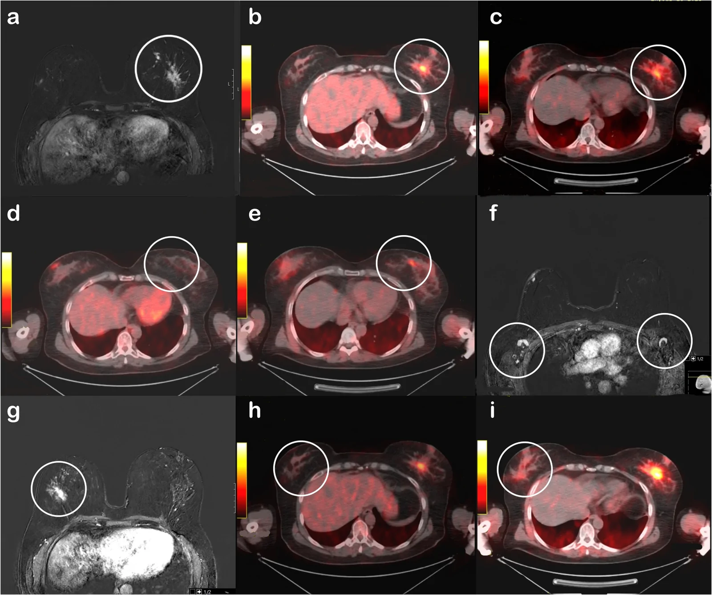
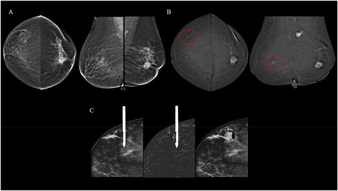
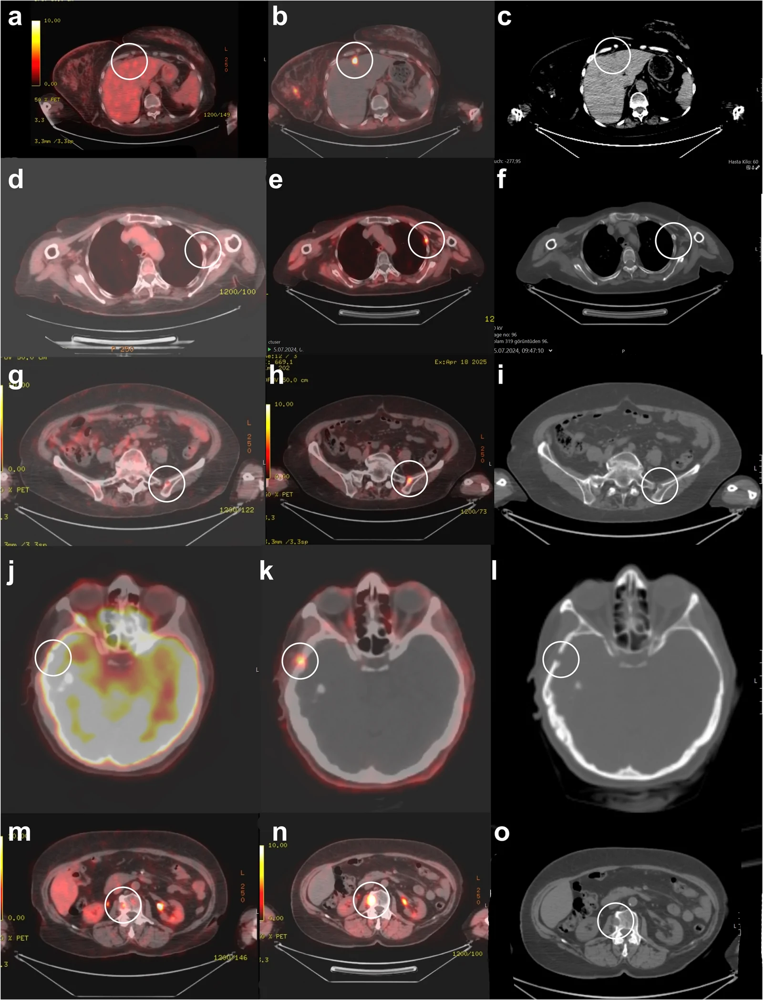

# 514 — Ung thư vú: giai đoạn TNM & MRI đánh giá lan rộng, đa ổ–đa trung tâm / Breast cancer staging & MRI extent

**Tags:** `pattern:khoi-vu` `pattern:da-o-vu` `vung:vu` `score:TNM` `protocol:MRI-vu`
**Mức chắc chắn (certainty):** tổng hợp y văn (literature synthesis) — nhóm tự biên từ y văn mở (tổng quan đa ổ/đa trung tâm, ca MRI/DBT/CEM, PET) + bảng TNM 8th, chưa gắn một ca nguyên văn đơn lẻ.

## 1. Tổng quan bệnh học – cơ chế hình ảnh

- **Vì sao phải phân giai đoạn:** giai đoạn TNM quyết định **bảo tồn (breast-conserving surgery — BCS) hay đoạn nhũ (mastectomy)**, xạ trị hố vú, và **hóa trị tân bổ trợ (neoadjuvant)**. Ung thư vú **không lan theo phần tư** mà theo **dòng bạch mạch/sinh học** → TNM hiện đại lấy **sinh học + hạch** làm trọng tâm, phần tư chỉ còn ý nghĩa cho **kế hoạch mổ**.
- **Đa ổ (multifocal — MF) vs đa trung tâm (multicentric — MC):**
  - **MF** = ≥ 2 ổ **trong cùng một phần tư (same quadrant)**, cách nhau **2–5 cm**.
  - **MC** = các ổ ở **phần tư khác nhau** hoặc **cách > 5 cm**, đôi khi khác thùy tuyến.
  - Lưu ý: hai khái niệm này là **mô tả để mổ** — **T vẫn lấy theo ổ xâm lấn lớn nhất và thêm hậu tố “(m)”** (multifocal), **không cộng dồn** kích thước (AJCC/UICC 8th).
- **Dịch tễ (định lượng):** MF/MC gặp **~10–24%** tất cả ung thư vú, cao hơn khi dùng **MRI hoặc cắt toàn bộ tuyến đếm tổn thương**; gắn với **thể tiểu thùy (ILC), tuổi trẻ, hạch dương tính nhiều hơn** — **nạo hạch dương ~55–60%** ở MF/MC so với **~45%** ở unifocal; ổ chính trung bình **3,68 cm** (MF) so với **3,21 cm** (unifocal).
- **TẠI SAO MRI phát hiện thêm ổ:** u thể ngấm tân mạch rò rỉ → **ngấm nhanh thì động mạch rồi thoát sớm** (đường cong **Type III washout** / Type II plateau), trong khi **mô tuyến lành ngấm chậm tăng dần** (Type I). Vì nhũ ảnh/DBT **nhìn suy giảm thể tích (2D chồng)**, u nhỏ trong tuyến **đặc (dense — ACR C/D)** dễ bị “nuốt” → **MRI đa mặt phẳng + động học** lộ thêm ổ. **Số liệu:** MRI phát hiện ổ ẩn thêm **~10–30%** bệnh nhân; **~10–20%** (MF) và **~5–10%** (MC) tổng ca.
- **TẠI SAO nang/hoại tử làm tín hiệu khác nhau:** u nghèo đệm + mật độ tế bào cao → **DWI sáng, ADC thấp (< 1,0 × 10⁻³ mm²/s)**; u nhầy/nang → T2 rất sáng, ngấm viền, **không** washout.
- **AJCC/UICC 8th — ngưỡng T (u xâm lấn, đo ổ lớn nhất):** **Tis** (DCIS) → **T1mi ≤ 1 mm** → **T1a > 1–5 mm** → **T1b > 5–10 mm** → **T1c > 10–20 mm** → **T2 > 20–50 mm** → **T3 > 50 mm** → **T4** (T4a thành ngực, T4b da loét/nốt vệ tinh/phù, T4c cả hai, T4d thể viêm).
- **AJCC/UICC 8th — ngưỡng N (hạch):** **pN0(i+)** chỉ tế bào đơn lẻ ITC **≤ 0,2 mm / < 200 tế bào**; **pN1mi** vi di căn **> 0,2–2,0 mm / 200–2.000 tế bào**; **pN1** 1–3 hạch nách (± hạch vú trong là hạch gác); **pN2** 4–9 hạch nách hoặc hạch vú trong lâm sàng dương nhưng không hạch nách; **pN3** ≥ 10 hạch nách / hạch dưới đòn / hạch vú trong lâm sàng dương kèm ≥ 1 hạch nách / hạch thượng đòn cùng bên.
- **M:** M0 = chưa di căn xa; **M1** = di căn xa (xương, gan, phổi, não). **TẠI SAO PET có vai trò:** tế bào u tăng đường phân (Warburg) → **¹⁸F-FDG** tập trung; PET toàn thân tìm di căn xa + hạch trung thất/thượng đòn ở bệnh nhân giai đoạn tiến xa.

## 2. Mẫu hình + chẩn đoán phân biệt theo vị trí (Gamut)

- **Khối đơn độc (unifocal)** → ác xâm lấn (IDC/ILC), lành (bướu sợi tuyến, nang) — đã học ở `510`.
- **Nhiều ổ cùng phần tư (MF)** → **ung thư biểu mô một ổ có vệ tinh (satellite)**, vs. **nhiều bướu sợi tuyến**, vs. **sẹo–u tuyến xơ (complex sclerosing lesion)**.
- **Nhiều ổ khác phần tư / hai bên (MC, hai bên)** → **ung thư tiểu thùy (ILC)** rất ưu thế, vs. **di căn vú thể tiểu thùy**, vs. **di căn buồng trứng (Krukenberg) đối xứng hai bên** — trong ung thư vú hai bên luôn nghĩ **ILC + di truyền (BRCA/CDH1)**.
- **Tổn thương không tạo khối (non-mass enhancement — NME)** → **DCIS lan theo ống**, vs. viêm, vs. thay đổi hormone — thường **đổi giai đoạn âm thầm**, đòi hỏi **sinh thiết định vị bằng MRI/CEM**.
- **Gợi nhớ tiếp cận 3 tầng vú:** **T** = kích thước ổ lớn nhất (+ vệ tinh, thành ngực/da) → **N** = hạch nách/mạch vú trong/thượng đòn → **M** = xương/gan/phổi/não.

## 3. Bảng so sánh phân biệt (ma trận đối chiếu)

| Thực thể (entity) | Hình ảnh điển hình | Chốt vào (rule-in) | Chốt loại (rule-out) | Gợi ý xác nhận |
|---|---|---|---|---|
| Unifocal ác (IDC) | Ổ đơn độc trục đứng, bờ gai, DWI sáng, washout | **1 ổ + bờ gai + Type III** | Nhiều ổ tách biệt (≥ 2 ổ) → MF/MC | Sinh thiết lõi + MRI nếu mổ bảo tồn |
| Đa ổ cùng phần tư (MF) | **≥ 2 ổ tách biệt trong 1 phần tư, cách 2–5 cm**, cùng chuỗi ngấm | **2 ổ cùng phần tư + cùng động học ác** | Khoảng cách > 5 cm / khác phần tư → MC | MRI + sinh thiết từng ổ; **T theo ổ lớn nhất + “(m)”** |
| Đa trung tâm (MC, thường ILC) | Nhiều ổ **khác phần tư**, có thể hai bên, NME lan; DWI sáng | **Khác phần tư + ILC + hay hai bên** | Ổ đơn độc → xếp theo ổ đó | **Sinh thiết hai bên + tư vấn di truyền (CDH1/BRCA)**; cân nhắc đoạn nhũ hai bên |
| DCIS (vôi hóa/NME) | Vi vôi hóa phân nhánh **hoặc** NME phân thùy, không khối | **NME phân thùy/đường + vôi phân nhánh** | Khối đặc ngấm washout → xâm lấn | Sinh thiết **định vị MRI/CEM** (nhũ ảnh/US mù) |
| Tổn thương hàng xóm lành (fibroadenoma, nang) | Bầu dục ngang, bờ đều, **Type I** tăng dần | **Bờ đều + Type I + ổn định** | Gai + washout → ác | So phim cũ; theo dõi (`510`) |

*Trái: **vú đặc ACR C** — nhũ ảnh (A,B) chỉ thấy cụm vi vôi hóa phân thùy, MRI (C) lộ khối ngấm lan từ núm đến trước cơ ngực + đường cong Type III washout (D) → đa ổ. Phải: **vú đặc ACR D**, nhũ ảnh chỉ là biến dạng cấu trúc mờ, DBT mới rõ bờ gai, MRI thấy tổn thương lan rộng. Nguồn: Biomedicines 2025 (PMC12292785), CC BY 4.0. Ảnh ghép letterbox.*

## 4. Protocol chụp + phân giai đoạn TNM (AJCC/UICC 8th)

- **Nhũ ảnh 2D + DBT (tomosynthesis)** là đầu tay; **vú đặc ACR C/D** hoặc nghi **ILC** → bổ sung **siêu âm + MRI**.
- **MRI vú có cản quang (DCE-MRI):** T2W fat-sat + T1W động (trước/1–2–6 phút) + **trừ ảnh (subtraction)** + **DWI/ADC**; đọc **đường cong động học Type I/II/III** và **MIP (maximum intensity projection)** tìm ổ vệ tinh. **Chỉ định MRI trước mổ:** vú đặc, ILC, chênh lệch kích thước lâm sàng–nhũ ảnh, tính BCS, sàng lọc **vú đối diện** ở nguy cơ cao.
- **CEM (contrast-enhanced mammography)** là lựa chọn thay thế khi **không MRI được** (chống chỉ định/claustrophobia) — độ nhạy tương đương cho tổn thương ngấm; **sinh thiết định vị bằng CEM** cho tổn thương chỉ thấy trên CEM.
- **¹⁸F-FDG PET/CT:** không dùng thường quy cho T1–T2N0; cân nhắc **giai đoạn tiến xa (IIIA–IIIC), thể viêm, tái phát, nghi di căn**, và **PET xương**; lưu ý **PET bỏ sót u nhỏ/hạch nhỏ/thể tiểu thùy (FDG-avidity thấp)**.
- **Đo kích thước:** lấy **ổ xâm lấn lớn nhất**, thêm **“(m)”** khi đa ổ; đối chiếu **nhũ ảnh ↔ siêu âm ↔ MRI ↔ mô bệnh** vì **MRI có thể “thổi phồng/thu nhỏ” kích thước** so với mô bệnh.

## 5. Biến thể bình thường và cạm bẫy

- **MRI “phát hiện quá mức” (overdiagnosis):** nhiều ổ “nghi” trên MRI lại là **thay đổi lành tính, xơ–tuyến, viêm** → tăng tỷ lệ **đoạn nhũ oan**. Mỗi ổ mới **bắt buộc sinh thiết xác nhận** trước khi đổi kế hoạch mổ.
- **Sai số kích thước:** MRI **dưới/trên ước** kích thước so với mô bệnh (nhất là **DCIS thành phần** khi u xâm lấn) → nguy cơ **rìa dương**. Luôn đối chiếu mô bệnh sau mổ để hiệu chỉnh giai đoạn **p**.
- **Vú đặc ACR D:** nhũ ảnh **có thể âm tính giả hoàn toàn** với u nhỏ — **không** loại trừ ung thư chỉ bằng nhũ ảnh (xem ca phải của composite).
- **ILC dễ sót:** mô tiểu thùy **desmoplastic** không tạo khối đặc, ngấm mờ, hay **di căn màng não/phúc mạc/buồng trứng** → khi có **đa ổ/hai bên** luôn nghĩ **ILC + tư vấn di truyền**.
- **Thành phần “(m)” hay bị đánh sai:** gắn **T sai giữa ổ lớn nhất và tổng**; nhớ **T = ổ xâm lấn lớn nhất** (cộng thêm hậu tố **(m)**), **không** cộng tất cả các ổ.
- **NME sau phẫu thuật/xạ trị/hormone** có thể chỉ là thay đổi lành → đối chiếu lâm sàng và phim cũ.
- **Sister Mary Joseph / nốt rốn** hoặc hạch thượng đòn có thể là dấu hiệu đầu tiên của bệnh tiến xa — đừng bỏ sót khi “chỉ” đọc tuyến vú.

## 6. Tự lượng giá — Blind Quiz

**Ca 1 — Nữ 47 tuổi, vú đặc ACR C, nhũ ảnh chỉ thấy cụm vi vôi hóa. Đọc chuỗi ảnh A–D.**

- Gợi ý lâm sàng (clinical context): vú đặc, tổn thương không sờ rõ.
- Câu hỏi: Mô tả dấu hiệu chính? Nhũ ảnh đã đủ chẩn đoán chưa? MRI bổ sung gì? Đường cong (D) nói gì?

<b>Bấm để hiện đáp án (findings + chẩn đoán)</b>

- Dấu hiệu (findings): (A,B) **vi vôi hóa phân thùy (segmental)** ở đường nối các phần tư dưới (mũi tên vàng); (C) MRI T1 fat-sat sau tiêm: **khối ngấm lan rộng từ núm đến khoang trước cơ ngực**; (D) **đường cong Type III “washout”**.
- Chẩn đoán (diagnosis): **ung thư biểu mô ống xâm lấn đa ổ (multifocal IDC) grade 2** — vì vôi hóa phân thùy gợi DCIS/xâm lấn theo ống, và đường cong washout khẳng định tân mạch ác. MRI **lộ mức lan thực** mà nhũ ảnh trong vú đặc bỏ sót.
- Nguồn ảnh: Biomedicines 2025 (PMC12292785) Fig. 5, CC BY 4.0.

**Ca 2 — Nữ 45 tuổi, vú cực đặc ACR D, nhũ ảnh MLO/CC mờ. DBT và MRI giúp gì?**

- Hỏi: Vì sao nhũ ảnh 2D hụt? Dấu hiệu nào trên DBT/MRI chốt ác tính?

<b>Bấm để hiện đáp án (findings + chẩn đoán)</b>

- Dấu hiệu (findings): (A,B) nhũ ảnh chỉ là **biến dạng cấu trúc mờ** phần tư trên trong trái; (C,D) **DBT** làm rõ **khối bờ gai (spiculate mass)**; (E) MRI thấy **tổn thương ngấm lan khoang trước cơ ngực**; (F) **Type III washout**.
- Chẩn đoán (diagnosis): **IDC vú trái** — vì DBT tách lớp mô đặc → lộ bờ gai; MRI xác định mức lan trước khi mổ.
- Nguồn ảnh: Biomedicines 2025 (PMC12292785) Fig. 6, CC BY 4.0.

**Ca 3 — Nữ 42 tuổi IDC đã sinh thiết. MRI thấy THÊM hai ổ. Đa ổ hay đa trung tâm? Điều trị gì?**

- Hỏi: Ổ nào là “đa ổ”, ổ nào là “đa trung tâm”? PET nào dương?

<b>Bấm để hiện đáp án (findings + chẩn đoán)</b>

- Dấu hiệu (findings): (a) MRI **hai ổ ngấm cạnh nhau 10 mm và 8 mm** ở phần tư dưới trong → **đa ổ (primary + additional focus)**; (d) MRI **ổ ngấm 8 mm phần tư dưới ngoài** → **đa trung tâm (multicentric)**. (b,e) **¹⁸F-FDG PET không bắt** cả hai; (c) **⁶⁸Ga-FAPI PET bắt mạnh** ổ đa ổ (SUVmax 10), (f) ổ đa trung tâm không bắt.
- Chẩn đoán (diagnosis): **IDC đa ổ + đa trung tâm**; **mô bệnh sau mổ giống hệt về sinh học** (ER 85%, PR 95%, HER2 âm). Vì lan rộng hai phần tư → **đoạn nhũ tiết kiệm da (skin-sparing mastectomy)**; nhớ **T theo ổ lớn nhất + (m)**, không cộng kích thước.
- Phản biện: ca không điển hình ở chỗ **FDG bỏ sót hoàn toàn**, còn **FAPI nhạy hơn** — nhưng **FAPI hiện chưa phải chuẩn lâm sàng**; chốt vẫn là **mô bệnh học**.
- Nguồn ảnh: Eur J Nucl Med Mol Imaging 2026 (PMC13526084) Fig. 5, CC BY 4.0.

**Ca 4 — Nữ 50 tuổi tiền mãn kinh, sinh thiết ILC vú trái. MRI hãy mô tả trước khi xem đáp án.**

- Hỏi: Vì sao ILC hay “lan ngầm”? MRI giúp gì so với PET? Có cần soi vú đối diện không?

<b>Bấm để hiện đáp án (findings + chẩn đoán)</b>

- Dấu hiệu (findings): (a) MRI: **khối chính 35 × 20 mm phần tư ngoài-giữa trái + nhiều ổ vệ tinh nhỏ phía trong**; (g) **NME 30 × 10 mm vú phải**; hạch nách hai bên vỏ dày nhẹ nhưng **không bắt FDG/FAPI**.
- Chẩn đoán (diagnosis): **ILC hai bên (trái 40 mm, phải 35 mm)** — mô bệnh xác nhận; MRI phát hiện **nhiều ổ vệ tinh hơn cả hai PET** (a). Vì ILC **đa ổ + hai bên** → **đoạn nhũ tiết kiệm da hai bên**; cân nhắc **tư vấn di truyền (CDH1/BRCA)**.
- Nguồn ảnh: Eur J Nucl Med Mol Imaging 2026 (PMC13526084) Fig. 7, CC BY 4.0.

**Ca 5 — CEM trước mổ: ổ chính vú trái, CEM còn thấy tổn thương ở VÚ PHẢI. Bước tiếp theo?**

- Hỏi: Siêu âm và DBT “không thấy” tổn thương đối diện thì làm gì?

<b>Bấm để hiện đáp án (findings + chẩn đoán)</b>

- Dấu hiệu (findings): (A) LE thấy ổ chính vú trái; (B) ảnh tái hợp (recombined) thấy **NME nghi ngờ phần tư trên ngoài vú phải** (vòng đỏ) nhưng **không tương ứng trên siêu âm “second-look” hay DBT**; (C) **sinh thiết định vị bằng CEM**.
- Chẩn đoán (diagnosis): **DCIS vú phải (tổn thương chỉ thấy trên CEM)** — vì vậy khi siêu âm/DBT âm tính mà nghi ngờ vẫn phải **sinh thiết định vị theo phương thức đã phát hiện (MRI/CEM)**.
- Nguồn ảnh: Insights into Imaging 2026 (PMC13315364) Fig. 5, CC BY 4.0.

**Ca 6 — PET: ổ vú không bắt FDG nhưng FAPI bắt; còn “những ổ khác” ở gan/xương/sọ. Đây là gì?**

- Hỏi: Các ổ này xếp **M mấy**? Vì sao FDG có thể âm tính?

<b>Bấm để hiện đáp án (findings + chẩn đoán)</b>

- Dấu hiệu (findings): (b) **nốt dưới bao gan ~ 8 mm** (SUVmax 14,7, FAPI) xác nhận sinh thiết; (e) **xương sườn** (SUVmax 9,6); (i) **xương chậu**; (l) **xương sọ** (lytic); (n) **thân đốt L3** (SUVmax 15,7). Ở các ổ này **¹⁸F-FDG bắt rất nhạt hoặc không bắt**.
- Chẩn đoán (diagnosis): **di căn xa (M1)** — vì vậy xếp **giai đoạn IV**; các ca đều **luminal A** với **FDG-avidity thấp** nên FDG dễ âm tính giả, **FAPI nhạy hơn** (nhưng chưa phải chuẩn lâm sàng).
- Nguồn ảnh: Eur J Nucl Med Mol Imaging 2026 (PMC13526084) Fig. 8, CC BY 4.0.

## Bài liên quan chéo
- [500 – Tổng quan Vú & Sản phụ khoa](../500-tong-quan-vu-san-phu-khoa/lesson.md)
- [510 – Vú & BI-RADS: nhũ ảnh, siêu âm & MRI](../510-vu-BIRADS-nhu-anh-sieu-am-MRI/lesson.md)
- [512 – Vi vôi hóa, biến dạng cấu trúc & túi ngực](../512-vi-voi-hoa-tui-nguc-bien-dang/lesson.md)
- [525 – Ung thư nội mạc & cổ tử cung: FIGO trên MRI](../525-ung-thu-noi-mac-co-tu-cung-FIGO-MRI/lesson.md)
- [535 – Ung thư buồng trứng, phúc mạc & u Krukenberg](../535-ung-thu-buong-trung-phuc-mac-krukenberg/lesson.md) (di căn hai bên phân biệt vú thể tiểu thùy)
- [022 – Khối phổi & TNM](../022-khoi-phoi-TNM/lesson.md) (so sánh hệ TNM)

## Ảnh
- `514_multifocal-IDC_Mammo-MRI_PMC12292785-Fig5.jpg`, `514_vi-dai-o_Mammo-DBT-MRI_PMC12292785-Fig6.jpg`, `514_multifocal-multicentric_MRI-PET_PMC13526084-Fig5.webp`, `514_ILC-satellite_MRI-PET_PMC13526084-Fig7.webp`, `514_di-can-xa_PET-CT_PMC13526084-Fig8.webp`, `514_CEM-staging_PMC13315364-Fig5.jpg`, `composite_vu-dac-DM-vs-MRI.jpg`. Nguồn + giấy phép từng ảnh trong `images/CREDITS.md`.

> Không dùng để chẩn đoán độc lập khi chưa có người hướng dẫn.
