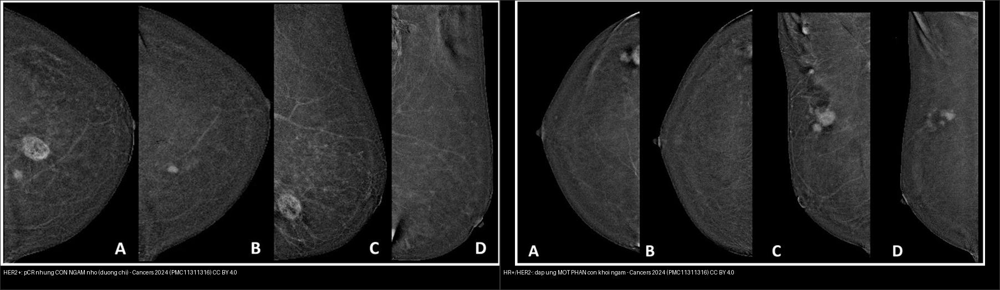
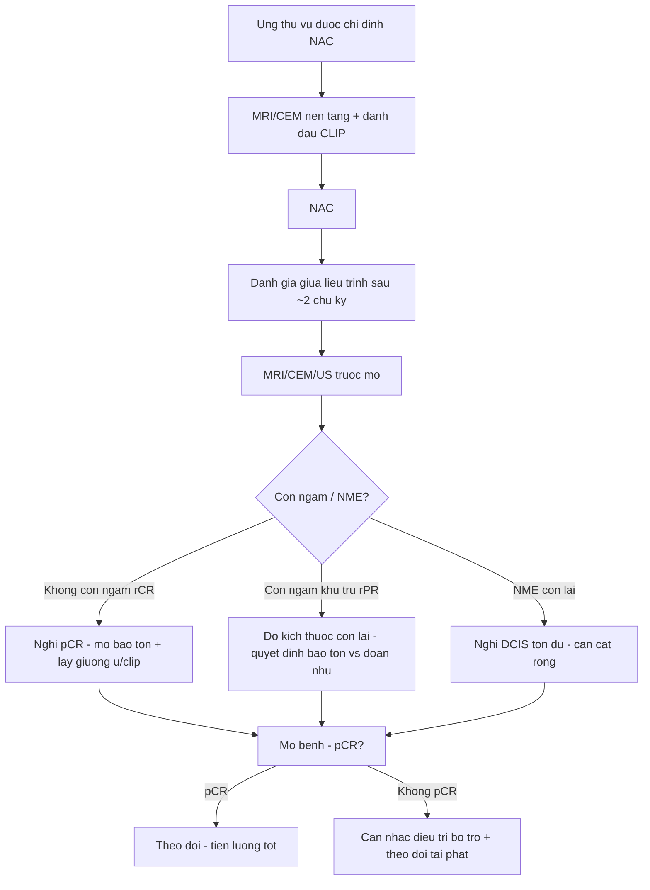
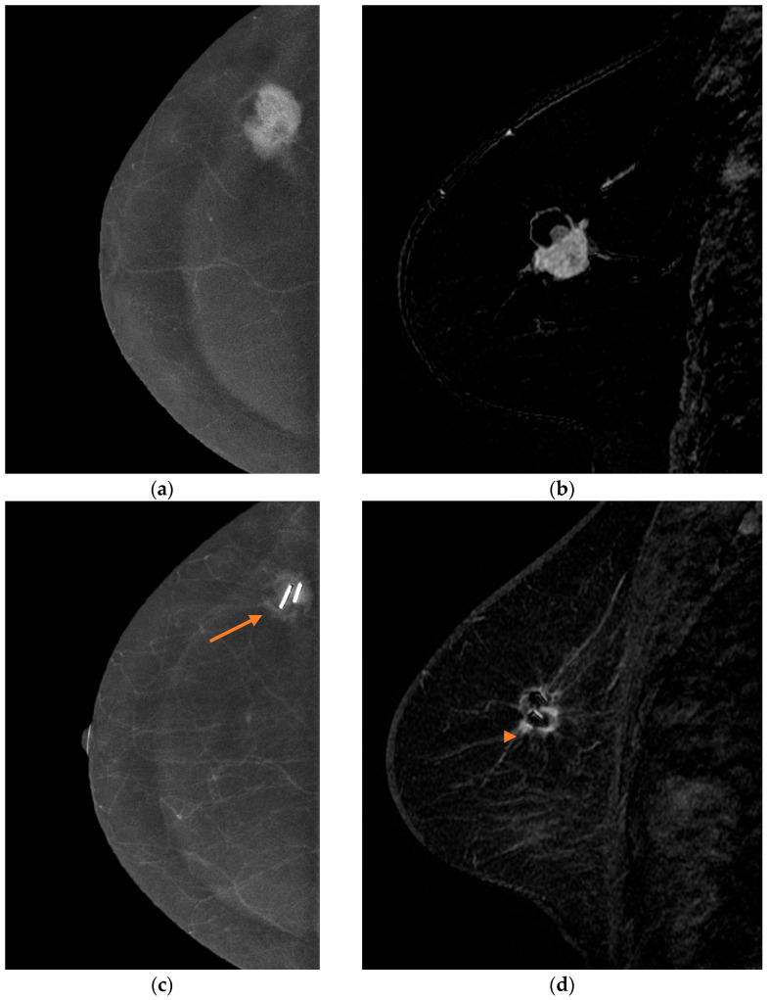
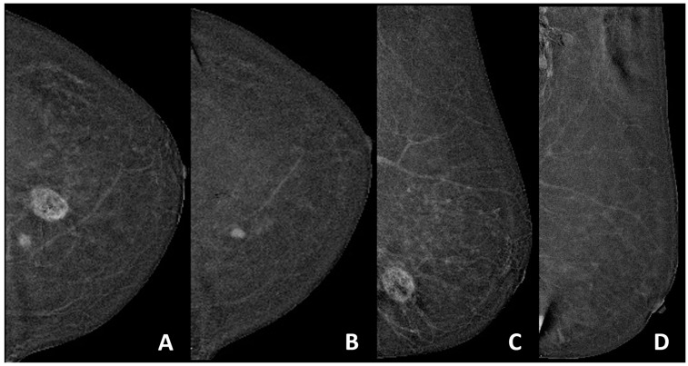
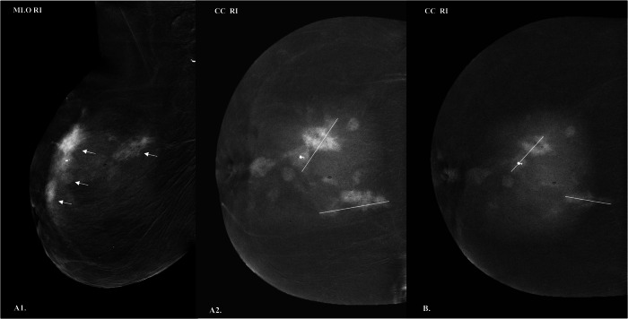
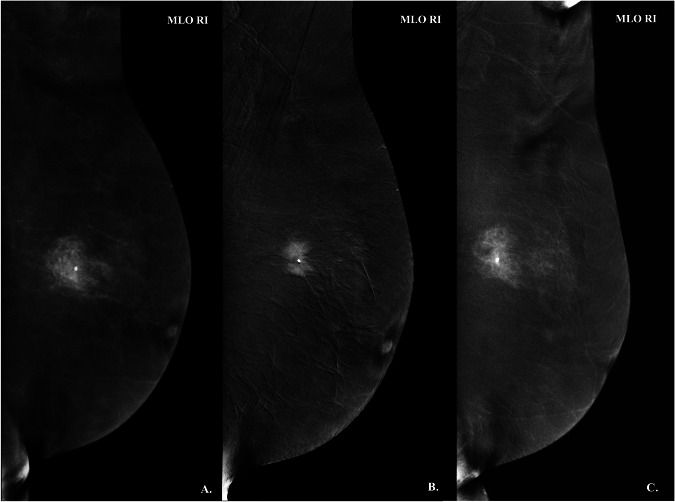
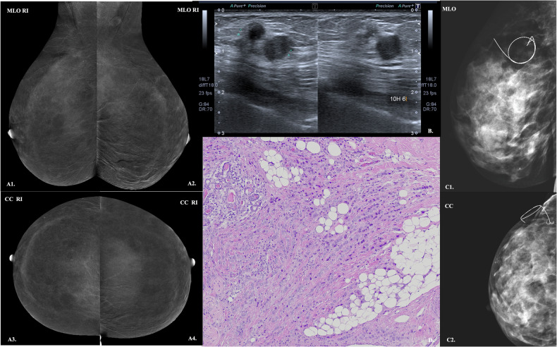
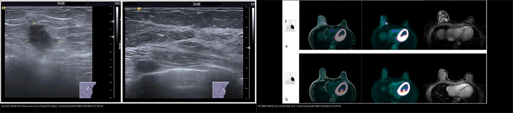

# 515 — Đánh giá đáp ứng vú sau hóa trị tân bổ trợ: MRI/CEM/siêu âm, pCR & phân loại đáp ứng (rCR/rPR) / Breast response assessment after neoadjuvant therapy

**Tags:** `pattern:vu-sau-hoa-tri` `pattern:dap-ung-pCR` `vung:vu` `score:RECIST` `protocol:MRI-vu` `protocol:CEM` `protocol:US-vu`
**Mức chắc chắn (certainty):** tổng hợp y văn (literature synthesis) — tự biên từ y văn mở (bài giáo dục CEM theo dõi NAT, so sánh CEM–MRI tiến cứu, meta-phân tích CEM, so sánh siêu âm–PET/MRI) kèm **ca nguyên văn** minh họa (ảnh CEM/MRI trước–sau, ca âm tính giả CEM); số liệu lấy trực tiếp từ bài gốc.

## 1. Tổng quan bệnh học – cơ chế hình ảnh

- **Vì sao phải đánh giá đáp ứng:** hóa trị tân bổ trợ (neoadjuvant chemotherapy/therapy — NAC/NAT) nhằm **giảm giai đoạn (downstaging)** để mổ bảo tồn thay vì đoạn nhũ, và cho biết **sinh học u**. Sau NAC, **đáp ứng mô bệnh hoàn toàn (pathological complete response — pCR)** định nghĩa là **không còn ung thư xâm lấn trong vú và hạch (ypT0/is ypN0)** — gắn với sống còn tốt hơn. Tỷ lệ pCR khác nhau rõ theo phân tử: **36,8%** trong một loạt 174 ca (Vidali 2024), trong đó **57,1% số ca pCR là thể ba âm (TNBC)**; loạt tiến cứu 74 ca có pCR **31,1%** (Acar 2026).
- **TẠI SAO hình ảnh không "nhìn thấy" hết bệnh:** pCR **không đồng nghĩa ảnh bình thường**. Sau điều trị có thể còn **xơ hóa, viêm, mô hoại tử, phản ứng quanh clip** gây **ngấm thuốc giả** (dương tính giả), trong khi **DCIS tồn dư, ổ tiểu thùy (ILC), ổ vi thể nhỏ** lại **ngấm rất ít hoặc không ngấm** → **âm tính giả**. Vì vậy "đáp ứng hình ảnh hoàn toàn" (rCR) **không thay thế mô bệnh**.
- **Vật lý từng phương thức:**
  - **MRI động có cản quang (DCE-MRI):** u ác tân mạch rò rỉ → **ngấm nhanh thì động mạch rồi thoát sớm** (đường cong **Type III washout** / Type II plateau); **DWI/ADC** phản ánh **mật độ tế bào** (u sống ADC thấp; xơ/hoại tử ADC cao). MRI được coi là **tiêu chuẩn tham chiếu (gold standard)** cho đáp ứng — nhưng **bỏ sót DCIS/ILC**.
  - **Nhũ ảnh cản quang (contrast-enhanced mammography — CEM):** dùng **iod cản quang** + **hai mức năng lượng (dual-energy)**; iod có **K-edge 33,2 keV** → **hiệu ứng quang điện** làm tăng tương phản trong mô tuyến đặc, lọc bỏ mô tuyến. Ảnh **tái hợp (recombined)** hiển thị ngấm thuốc; rẻ, nhanh, hợp nơi không có MRI.
  - **Siêu âm (US):** đo kích thước và **định vị clip**, nhưng **phụ thuộc người làm** và **bỏ sót tổn thương không tạo khối**; sau NAC **clip-only** có thể là dấu hiệu duy nhất còn lại.
  - **PET/MRI (¹⁸F-FDG):** phản ánh **chuyển hóa glucose (Warburg)**; hữu ích khi nghi di căn, nhưng **không vượt trội** MRI cho đáp ứng vú.
- **Định lượng đối chiếu (số thật):**
  - **CEM — meta 15 nghiên cứu/793 bệnh nhân** (Galati 2026, La Radiologia Medica): **Se 74%** (KTC 66–81), **Sp 82%** (67–91), **sROC AUC 0,83** (0,67–0,92), **DOR 9,30** (4,15–20,83), I² 72,3% → "tương đương MRI".
  - **CEM vs MRI tiến cứu** (Acar 2026, n = 74): CEM ước kích thước còn lại trong **±1 cm mô bệnh 84,7%** so với **MRI 76,4%**; **CEM Se 91,3%** cho pCR (cao hơn MRI, **p = 0,24**), **MRI Sp cao hơn**.
  - **CEM theo phân tử** (Vidali 2024, n = 174): chung **Se 66,2%/Sp 75,2%/PPV 61,4%/NPV 78,8%**; **HR+/HER2−** Sp **80,9%**/NPV **91,7%** cao nhất; **TNBC** Se **70%**/PPV **73,7%** cao nhất.
  - **US vs PET/MRI** (Di Micco 2026, n = 143): **US Se 59%/Sp 62%** so với **PET/MRI Se 62%/Sp 67%** — **không khác biệt** (p = 0,93/0,94); US **Se 73% ở TN** nhưng chỉ **50% ở HER2+**.

## 2. Mẫu hình + chẩn đoán phân biệt theo vị trí (Gamut)

- **Không còn ngấm (rCR — radiologic complete response):** **rCR thật (pCR)** vs **còn DCIS/ILC không ngấm (âm tính giả)** vs **xơ hóa/hoại tử** — hình ảnh giống nhau, chỉ mô bệnh chốt.
- **Còn ngấm khu trú (rPR — radiologic partial response):** **u sống còn** vs **phản ứng quanh clip/dị vật** vs **viêm–xơ ngấm muộn** vs **thay đổi mô tuyến nền (BPE)**.
- **Khối còn lại "đặc" mà không ngấm:** **mô xơ–sẹo (không u sống)** — dễ bị đọc là "u còn" trên siêu âm/nhũ ảnh.
- **Tổn thương không tạo khối (NME) còn lại:** **DCIS tồn dư** rất hay gặp — MRI/CEM nhạy hơn nhưng **không loại trừ được**.
- **Đáp ứng theo phân tử (định hướng đọc):** **TNBC/HER2+** đáp ứng mạnh, hay **rCR** (nhưng vẫn có thể còn ổ nhỏ); **HR+/HER2−** hay **đáp ứng một phần**, còn mô ngấm (Hình: `composite_pCR-vs-dap-ung-mot-phan`).
- **Gợi nhớ tiếp cận 4 câu hỏi:** **(1) Còn ngấm không?** → **(2) Kích thước còn lại bao nhiêu?** → **(3) Còn NME/DCIS không?** → **(4) Hạch nách đáp ứng ra sao?**

## 3. Bảng so sánh phân biệt (ma trận đối chiếu)

| Thực thể (entity) | Hình ảnh điển hình | Chốt vào (rule-in) | Chốt loại (rule-out) | Gợi ý xác nhận |
|---|---|---|---|---|
| pCR (đáp ứng hoàn toàn mô bệnh) | **Không còn ngấm**, có thể chỉ thấy **clip/dấu vôi hóa** | **Không ngấm + không khối trên CEM/MRI** | Còn NME/ngấm khu trú → nghĩ còn bệnh | **Mô bệnh sau mổ là chốt**; lấy clip + giường u |
| U tồn dư xâm lấn | Khối còn **ngấm washout**, DWI sáng/ADC thấp | **Ngấm + ADC thấp + kích thước > 1 cm** | Ngấm mờ, ADC cao, ổn định → nghi xơ/viêm | Sinh thiết/đánh dấu lại; đo theo ổ ngấm lớn nhất |
| DCIS tồn dư | **NME phân thùy** còn lại; **có thể không ngấm** trên MRI | **NME phân thùy còn lại trên CEM/MRI** | Không thấy NME **không** loại trừ DCIS | Cắt rộng/kiểm tra bờ; **âm tính giả MRI hay gặp** |
| Xơ–viêm sau điều trị | Khối "đặc" không ngấm hoặc ngấm mờ muộn, ổn định | **Không ngấm / ADC cao / ổn định theo thời gian** | Ngấm mạnh washout + to lên → nghi u sống | Đối chiếu phim trước–sau; mô bệnh |
| Phản ứng quanh clip | Ngấm **dạng vòng quanh clip**, nhỏ | **Ngấm quanh đúng vị trí clip, không tạo khối** | Ngấm lan/dày NME → nghĩ bệnh còn | So ảnh baseline; mô bệnh (bẫy dương tính giả) |
| Hạch nách đáp ứng | Hạch nhỏ lại, mất ngấm; có thể còn clip | **Hạch về bình thường ± clip** | Hạch còn ngấm/vỏ dày → còn bệnh | **TAD/mô bệnh hạch clip** (bài 589) |

*Trái: **HER2+ đạt pCR** nhưng CEM sau NAT vẫn thấy **ổ ngấm nhỏ** (đường chỉ) — **dương tính giả do phản ứng quanh clip**, mô bệnh xác nhận hết bệnh. Phải: **HR+/HER2− đáp ứng MỘT PHẦN**, còn khối ngấm rõ trên CEM trước–sau. Nguồn: Cancers 2024 (PMC11311316), CC BY 4.0. Ảnh ghép letterbox.*

## 4. Protocol chụp + hệ phân độ/điểm chuẩn hóa

- **Thời điểm:** chụp **nền tảng (baseline)** trước NAC → **giữa liệu trình (interim, sau ~2 chu kỳ)** → **trước mổ (trong ~2 tuần)**. **Cùng một phương thức, cùng kỹ thuật** để so sánh.
- **MRI (DCE-MRI):** T2W fat-sat + **T1W động nhiều thì (trước/1–2–6 phút)** + **trừ ảnh (subtraction)** + **DWI/ADC** + **MIP**; đo ổ ngấm lớn nhất, ghi kích thước và đường cong động học. **Có thể rút gọn (abbreviated)** để giảm thời gian/thể tích đọc (Chen 2026, n = 359: protocol rút gọn vẫn dự báo đáp ứng sau 2 chu kỳ).
- **CEM:** tiêm **iod 1,5 mL/kg (350–370 mg I/mL)**, chụp **2 mức năng lượng** trong cửa sổ ~10 phút, dựng **ảnh tái hợp (recombined)**; đọc **trước–sau NAC** (Hình `515_CEM-va-MRI-truoc-sau`). **Chống chỉ định** như cản quang iod (dị ứng, suy thận).
- **Siêu âm:** đo kích thước + **xác nhận clip**; nhớ **clip-only** là dấu hiệu thường gặp của đáp ứng hoàn toàn trên US.
- **Hệ phân độ/điểm:**
  - **pCR:** **ypT0/is ypN0** — không còn xâm lấn ở vú và hạch.
  - **RECIST 1.1 (đáp ứng trên hình ảnh):** **đáp ứng hoàn toàn (CR)** = mất mọi tổn thương đích; **đáp ứng một phần (PR)** = giảm ≥ 30% tổng đường kính; **bệnh tiến triển (PD)** = tăng ≥ 20% **và** ≥ +5 mm so nadir; còn lại là **bệnh ổn định (SD)**.
  - **Phân loại đáp ứng hình–bệnh (radiologic–pathologic):** **rCR** (hết ngấm) vs **rPR** (còn ngấm) — đối chiếu **pCR/không pCR**; **không đồng nhất là quy luật**, không phải ngoại lệ.

- **Bảng ngưỡng xử trí nhanh:**

| Tình huống | Ngưỡng / tiêu chuẩn | Xử trí |
|---|---|---|
| Không còn ngấm | rCR | Nghi pCR; mổ bảo tồn nếu đủ điều kiện |
| Còn ngấm > 1 cm | PR theo RECIST | Đo lại, cân nhắc kế hoạch mổ rộng |
| NME còn lại | Nghi DCIS | Cắt rộng/kiểm tra bờ |
| Ngấm quanh clip nhỏ | Nghi phản ứng | Không chốt dương tính — mô bệnh |
| CEM so với MRI | Se 74%/Sp 82% (meta) | CEM thay thế khi không MRI được |

## 5. Biến thể bình thường và cạm bẫy

- **Âm tính giả của MRI/CEM:** **DCIS tồn dư** và **ILC** ngấm rất ít → "hết ngấm" vẫn có thể còn bệnh; **CEM có thể âm tính giả** (Hình `515_CEM-am-tinh-gia`).
- **Dương tính giả:** **phản ứng quanh clip, xơ–viêm, BPE** tạo ngấm mờ sau NAT — **ca HER2+ đạt pCR vẫn còn ổ ngấm nhỏ** là ví dụ kinh điển.
- **BPE thay đổi theo hormone/HRT/tamoxifen** → đọc ngấm nền cẩn thận, tránh gọi là bệnh.
- **Đo kích thước sai:** mô xơ "đặc" không ngấm trên US/nhũ ảnh bị đo là u còn → **đo theo ổ ngấm** trên MRI/CEM, không theo bờ xơ.
- **Thời điểm chụp:** chụp **quá sớm** (trong/ngay sau chu kỳ) → ngấm viêm; chụp **quá muộn** sát mổ → không kịp đổi kế hoạch.
- **Hạch nách:** đáp ứng hạch **không song hành** đáp ứng vú; luôn **đánh giá lại nách** (bài 589).
- **Clip/dấu vôi hóa:** vôi hóa **không mất** dù pCR — đừng nhầm vôi còn lại là bệnh; **X-quang bệnh phẩm** xác nhận.

## 6. Tự lượng giá — Blind Quiz

**Ca 1 — Nữ 56 tuổi IDC vú, CEM và MRI trước–sau NAC. Mô tả đáp ứng trước khi xem đáp án.**

- Gợi ý lâm sàng (clinical context): ung thư biểu mô ống xâm lấn, đã NAC, đánh giá trước mổ.
- Câu hỏi: (a,b) cho thấy gì? (c,d) còn tổn thương không? Hai phương thức có đồng thuận?

<b>Bấm để hiện đáp án (findings + chẩn đoán)</b>

- Dấu hiệu (findings): (a) CEM tái hợp trước điều trị: **khối ngấm rõ**; (b) MRI trước: khối ngấm tương ứng; (c) CEM sau: **clip** (mũi tên) + **còn ngấm nhỏ**; (d) MRI sau: **còn ổ ngấm khu trú** quanh clip.
- Chẩn đoán (diagnosis): **đáp ứng một phần (rPR)** — còn mô ngấm sau NAC; CEM và MRI **đồng thuận**, cho thấy CEM có thể thay MRI. Còn ngấm → cần mô bệnh để loại u sống.
- Nguồn ảnh: Diagnostics 2026 (PMC12938973) Fig. 1, CC BY 4.0.

**Ca 2 — Nữ trẻ HER2+, CEM sau NAT: còn một ổ ngấm nhỏ. Đây có phải bệnh còn? Hãy nghĩ trước khi mở đáp án.**

- Hỏi: Ổ ngấm nhỏ còn lại nghĩa là gì? Vì sao dễ chẩn đoán nhầm?

<b>Bấm để hiện đáp án (findings + chẩn đoán)</b>

- Dấu hiệu (findings): (A,C) trước NAT: khối ngấm; (B,D) sau NAT: **còn một ổ ngấm nhỏ** ở phần tư trong-giữa (đường chỉ).
- Chẩn đoán (diagnosis): **pCR (đáp ứng hoàn toàn mô bệnh)** dù **CEM còn ngấm** — ổ ngấm là **phản ứng quanh clip/xơ hóa**, không phải u sống. **Cạm bẫy dương tính giả**: ngấm mờ nhỏ sau NAT **không** đồng nghĩa còn bệnh; chốt bằng mô bệnh.
- Nguồn ảnh: Cancers 2024 (PMC11311316) Fig. 1, CC BY 4.0.

**Ca 3 — Nữ 66 tuổi, CEM theo dõi NAT. Đọc ảnh và nói vì sao CEM hữu ích ở vú đặc.**

- Hỏi: Dấu hiệu chính? CEM giải quyết được hạn chế nào của nhũ ảnh thường?

<b>Bấm để hiện đáp án (findings + chẩn đoán)</b>

- Dấu hiệu (findings): ảnh CEM tái hợp **trước và sau NAT** cho thấy mức ngấm và kích thước tổn thương thay đổi; iod tăng tương phản trong mô tuyến đặc.
- Chẩn đoán (diagnosis): **theo dõi đáp ứng NAT bằng CEM** — hiệu ứng quang điện của iod (**K-edge 33,2 keV**) làm nổi mạch u trong vú đặc, nơi nhũ ảnh thường bị "nuốt". CEM **tương đương MRI** (meta: Se 74%/Sp 82%).
- Nguồn ảnh: Insights into Imaging 2026 (PMC13373129) Fig. 6, CC BY 4.0.

- Nguồn ảnh bổ sung: Insights into Imaging 2026 (PMC13373129) Fig. 10, CC BY 4.0.

**Ca 4 — Nữ 47 tuổi có khối vú; CEM đọc là không còn bệnh nhưng mổ bệnh lại còn ung thư. Vì sao?**

- Hỏi: Loại tổn thương nào hay gây **âm tính giả** trên CEM/MRI sau NAT?

<b>Bấm để hiện đáp án (findings + chẩn đoán)</b>

- Dấu hiệu (findings): hình minh họa **ca âm tính giả** của CEM kèm siêu âm và mô bệnh — CEM không bộc lộ hết bệnh mà mô bệnh xác nhận còn ung thư.
- Chẩn đoán (diagnosis): **âm tính giả của CEM** — hay gặp với **DCIS tồn dư/ILC (ngấm ít)**. Bài học: **"hết ngấm" không loại trừ bệnh còn**; luôn đối chiếu US + mô bệnh.
- Nguồn ảnh: Insights into Imaging 2026 (PMC13373129) Fig. 5, CC BY 4.0.

**Ca 5 — Nữ 43 tuổi TNBC, siêu âm và PET/MRI trước–sau PST. Phương thức nào chốt được đáp ứng?**

- Hỏi: So sánh hai phương thức; vì sao không thể kết luận pCR chỉ bằng hình ảnh?

<b>Bấm để hiện đáp án (findings + chẩn đoán)</b>

- Dấu hiệu (findings): (US) khối **trước** PST → **chỉ còn clip** sau PST; (PET/MRI) ổ ngấm/FDG mạnh **trước** → giảm nhiều **sau** NAC.
- Chẩn đoán (diagnosis): **đáp ứng tốt (rCR gợi ý pCR)** — nhưng **US Se 59%/Sp 62%** và **PET/MRI Se 62%/Sp 67%** (không khác biệt, p = 0,93/0,94) → **không đủ để chốt pCR**. TNBC đáp ứng mạnh nên hay gặp rCR, nhưng vẫn phải mô bệnh.
- Nguồn ảnh: Frontiers in Oncology 2026 (PMC13322937) Fig. 3 & 4, CC BY 4.0.

## Bài liên quan chéo
- [500 – Tổng quan Vú & Sản phụ khoa](../500-tong-quan-vu-san-phu-khoa/lesson.md)
- [514 – Ung thư vú: giai đoạn TNM & MRI đánh giá lan rộng](../514-ung-thu-vu-TNM-MRI-lan-rong/lesson.md)
- [516 – Hình ảnh vú sau điều trị: sẹo vs tái phát, hoại tử mỡ & BIA-ALCL](../516-hinh-anh-vu-sau-dieu-tri/lesson.md)
- [517 – Sinh thiết định vị vú & quản lý clip/kẹp](../517-sinh-thiet-dinh-vi-vu-va-quan-ly-clip/lesson.md)
- [589 – Sinh thiết hạch gác nách & TAD sau hóa trị tân bổ trợ](../589-sinh-thiet-hach-gac-nach-targeted-axillary-dissection/lesson.md)
- [522 – Theo dõi sau điều trị ung thư vú](../522-theo-doi-sau-dieu-tri-ung-thu-vu/lesson.md)

## Ảnh
- `515_CEM-va-MRI-truoc-sau_PMC12938973-Fig1.jpg`, `515_CEM-pCR-con-ngam_PMC11311316-Fig1.jpg`, `515_CEM-dap-ung-mot-phan_PMC11311316-Fig2.jpg`, `515_CEM-am-tinh-gia_PMC13373129-Fig5.jpg`, `515_CEM-theo-doi-NAT_PMC13373129-Fig6.jpg`, `515_CEM-TN-dap-ung_PMC13373129-Fig10.jpg`, `515_US-truoc-sau_PMC13322937-Fig4.jpg`, `515_PET-MRI-truoc-sau_PMC13322937-Fig3.jpg`, `composite_pCR-vs-dap-ung-mot-phan.jpg`, `composite_US-vs-PET-MRI-truoc-sau.jpg`. Nguồn + giấy phép từng ảnh trong `images/CREDITS.md`.

> Không dùng để chẩn đoán độc lập khi chưa có người hướng dẫn.
