# 516 — Hình ảnh vú sau điều trị: tái tạo, hoại tử mỡ, sẹo vs tái phát & BIA-ALCL / The treated breast

**Tags:** `pattern:vu-sau-dieu-tri` `pattern:hoai-tu-mo` `pattern:u-tai-phat` `vung:vu` `score:BI-RADS` `protocol:sieu-am-vu` `protocol:MRI-vu` `incidentaloma:BIA-ALCL`
**Mức chắc chắn (certainty):** tổng hợp y văn (literature synthesis) — nhóm tự biên từ y văn mở (Europe PMC/PMC: *Insights Imaging* 2026, *Life* 2026, *J Surg Case Rep* 2026, *ANZ J Surg* 2026, *Cureus* 2026) + các ca minh họa có giấy phép CC BY; có 1 ca nguyên văn (BIA-ALCL) đọc trực tiếp từ bài gốc.

## 1. Tổng quan — vì sao "đọc vú đã can thiệp" khó + cơ chế hình ảnh

- **Bối cảnh:** sau phẫu thuật bảo tồn (breast-conserving therapy — BCT: cắt khối u + xạ trị), cắt toàn bộ tuyến (mastectomy) có/không tái tạo, ghép mỡ tự thân (autologous fat transfer — AFT) và đặt túi ngực (implant), mô vú bị thay đổi giải phẫu + xơ hóa + mất dấu mốc → **cùng một khối có thể là sẹo lành, hoại tử mỡ, huyết thanh tụ hay tái phát** trên cùng một phim. Câu hỏi trung tâm của mọi lần đọc: **tổn thương này ỔN ĐỊNH theo thời gian hay đang TIẾN TRIỂN?**
- **Cơ chế hoại tử mỡ (fat necrosis — phản ứng vô khuẩn, "xà phòng hóa"):** chấn thương/phẫu thuật/xạ làm chết tế bào mỡ → giải phóng **acid béo tự do** → gắn **calci** tạo **xà phòng hóa (saponification)** + viêm mạn với đại thực bào (histiocyte) → 3 giai đoạn tiến triển: **cấp (viêm) → trung gian → mạn (xơ + vôi hóa + nang dầu)**. Chính chuỗi này sinh ra **nang dầu (oil cyst)** và **vôi hóa vỏ mỏng "vỏ trứng" (eggshell)**.
  - **TẠI SAO trên X-quang:** mỡ **giảm đậm độ tia X** → nang dầu **trong sáng (radiolucent)**; acid béo xà phòng hóa lắng calci → **vôi hóa thô/vỏ** nằm trong vùng sáng mỡ.
  - **TẠI SAO trên MRI:** nang dầu là lipid → **T1W rất sáng, T2W sáng**, và **tối đi khi fat-sat (T1FS/T2FS)** vì mỡ bị ức chế; lõi hoại tử mỡ **KHÔNG ngấm thuốc** (không còn mạch), chỉ **ngấm viền không đều** ở giai đoạn viêm (mô hạt). Đây là chốt vật lý phân biệt với tái phát (mô u sống → ngấm, thường ngấm nhanh–thoát sớm **Type III washout**).
  - **TẠI SAO trên siêu âm:** nang dầu **trong âm (anechoic), bờ đều, không mạch**; mô hoại tử viêm **tăng/hỗn hợp hồi âm (heterogeneous), bờ có thể không đều** → dễ nhầm khối đặc — đây là cạm bẫy số 1.
- **Ngưỡng định lượng (bắt buộc):** tổng quan 17 nghiên cứu (Smeins 2026): hoại tử mỡ gặp **12,5–23,6% sau tái tạo vạt (flap)** so với **7,3–82,9% sau AFT (n = 5)**; thời điểm chụp **1–240 tháng** sau mổ. Vôi hóa có thể xuất hiện **sớm ~11 tháng sau AFT**, nang dầu rõ **từ năm thứ 2**, vôi hóa lan tỏa **sau 2 năm**. MRI vạt TRAM: tổn thương **không ngấm lõi + ngấm viền không đều**, trung bình **153 ngày (32–510 ngày)** sau mổ.
  - **Vị trí là đầu mối:** sau **vạt** hoại tử mỡ hay ở **rìa ngoại vi vạt**; sau **AFT** phân bố **lan tỏa**. Vạt nào còn **tín hiệu mỡ (T1 sáng)** là vạt sống.
- **Xạ trị (post-radiotherapy):** tiến triển theo thời gian — **cấp (≤ vài tháng): phù nề, dày da, tăng đậm độ, dày vách** (thành phần viêm/mạch máu, KHÔNG phải u); **mạn (sau 6–12 tháng): xơ hóa, hoại tử mỡ, biến dạng cấu trúc (architectural distortion), co kéo da**. **Độ đặc hiệu của MRI GIẢM trong 6–12 tháng đầu sau xạ** vì ngấm thuốc do viêm/xạ → phải so chuỗi thời gian.
- **Túi ngực & BIA-ALCL:** BIA-ALCL (breast implant-associated anaplastic large cell lymphoma) là **u lympho T CD30+, ALK âm**, gắn chặt **túi bề mặt nhám (textured)**; **thể điển hình = huyết thanh tụ MUỘN (late seroma, > 1 năm sau đặt túi)**. Đây là **ung thư nhưng TIÊN LƯỢNG RẤT TỐT** nếu khu trú và **cắt bỏ toàn bộ bao + túi (en-bloc capsulectomy)** → tránh gọi nhầm "huyết thanh tụ lành", nhưng cũng tránh hóa trị oan khi đã cắt hết.

## 2. Mẫu hình + chẩn đoán phân biệt theo bối cảnh can thiệp (Gamut)

- **Khuôn 1 — Nốt/khối trong vú ĐÃ MỔ cũ.** "Bộ ba giả u" hay gặp: **hoại tử mỡ** (nang dầu/vôi hóa vỏ), **sẹo xơ co kéo (surgical scar)**, **huyết thanh tụ tồn dư (seroma)**. Tất cả **phải so phim cũ**: sẹo lành **ổn định nhiều năm**; tái phát **mọc lên**.
- **Khuôn 2 — Vôi hóa trong vú đã mổ/xạ.** **Vôi hóa hoại tử mỡ** thô, vỏ mỏng ("vỏ trứng"), quanh vùng sáng mỡ = lành (BI-RADS 2). **Vôi hóa đa hình/phân nhánh (pleomorphic, branching) + dày lên** = nghi tái phát/DCIS (**BI-RADS 4–5**), không kể tiền sử.
- **Khuôn 3 — Vú tái tạo tự thân (vạt TRAM/DIEP, AFT).** **Hoại tử mỡ** (không ngấm lõi, ngấm viền; rìa vạt sau vạt, lan tỏa sau AFT) vs **tái phát tại vạt** (mô đặc ngấm, DWI sáng, ADC thấp). AFT còn có **nang dầu nhiều ổ lan tỏa** đặc trưng.
- **Khuôn 4 — Vú có túi ngực.** **Dịch quanh túi (peri-implant fluid)**: **huyết thanh tụ lành** (sớm nhất thời gian đầu, mỏng) vs **huyết thanh tụ MUỘN > 1 năm** (đỏ cờ → **BIA-ALCL**, lấy dịch tế bào học) vs **tụ máu muộn** vs **nhiễm trùng**. Kèm **dày bao không đều/khối trong bao**.
- **Khuôn 5 — Vú đã xạ trị, có khối trong "biến dạng cấu trúc".** Xơ/xạ tạo **biến dạng cấu trúc dày đặc**; tìm **tăng kích thước theo thời gian**, **ngấm thuốc mới**, **vôi hóa đa hình mới** = tái phát. **Biến dạng cấu trúc đơn thuần, ổn định, không ngấm mới = lành.**
- **Gợi nhớ "SURGERY":** **S**eroma, **U**nhealed scar/xơ co kéo, **R**ecurrence (tái phát), **G**raft fat necrosis (hoại tử mỡ ghép/vạt), **E**dema–Erythema (phù da do xạ), **R**upture/implant complication (vỡ/bao/túi), **Y**ield to old films (luôn so phim cũ).

## 3. Bảng so sánh phân biệt (ma trận đối chiếu)

| Thực thể (entity) | Hình ảnh điển hình (MG/US/MRI) | Chốt vào (rule-in) | Chốt loại (rule-out) | Gợi ý xác nhận |
|---|---|---|---|---|
| **Hoại tử mỡ (fat necrosis)** | MG: nang dầu trong sáng + vôi hóa vỏ "vỏ trứng"; US: hỗn hợp hồi âm/nang, **không mạch**; MRI: **lõi không ngấm + ngấm viền không đều**, T1FS tối | **Nang dầu trong sáng + vôi hóa vỏ mỏng + lõi không ngấm thuốc** | Ngấm thuốc lõi nhanh–thoát + DWI sáng → loại hoại tử mỡ | So phim cũ; nếu đủ tiêu chuẩn điển hình → chỉ theo dõi |
| **Sẹo xơ co kéo (surgical scar)** | Biến dạng cấu trúc gai nhọn tại vết mổ, vôi hóa thô, có **kẹp phẫu thuật** | **ỔN ĐỊNH trên ≥ 2 lần chụp ở các hướng giống nhau** | **Mọc lên/thay đổi** → nghi tái phát | Đối chiếu phim cũ (chìa khóa) |
| **Huyết thanh tụ (seroma)** | US: dịch trong, bờ đều, dưới da/buồng mổ; MRI: T2 sáng, **không ngấm** (trừ vỏ mỏng) | **Không ngấm + co nhỏ dần theo thời gian** | Thành dày/ngấm + nội dung lơ lửng tăng → thay đổi khác | Theo dõi; chọc nếu nghi |
| **Tái phát tại vú đã mổ/xạ (local recurrence)** | Khối/mô đặc mới, **tăng kích thước**, vôi hóa **đa hình/phân nhánh mới**, **NME tại sẹo**, DWI sáng/ADC thấp | **TIẾN TRIỂN sau giai đoạn ổn định + ngấm thuốc mới** | Ổn định nhiều năm + không ngấm mới → không phải tái phát | Sinh thiết có định hướng (US/MRI/stereotactic) |
| **Tái phát ngụy trang hoại tử mỡ (ca Cureus)** | Khối tại sẹo, sinh thiết lần 1 ra **hoại tử mỡ/xơ**; sau **TO LÊN** | **Sinh thiết lành rồi vẫn TO LÊN → phải sinh thiết LẠI** | Không dùng 1 kết quả lành để dừng khi khối tiến triển | Sinh thiết lại + PET-CT khi có gợi ý |
| **Biến đổi sau xạ (post-RT change)** | Dày da, phù, tăng đậm độ; mạn: xơ + biến dạng cấu trúc + co kéo | **Tiến triển cấp → thoái triển dần; đối xứng theo vùng chiếu xạ** | **Ổn định KHÔNG loại xạ; nhưng mới/tiến triển = nghi** | So phim + tính bối cảnh xạ (thời điểm) |
| **BIA-ALCL (late peri-implant effusion)** | MRI: dịch quanh túi + **dày bao không đều hai bên**; US: dịch hỗn hợp có cặn, **không mạch** | **Dịch quanh túi MUỘN (> 1 năm) + dày bao không đều; tế bào học dịch dương** | Dịch trong, mỏng, sớm sau mổ + tự thoái triển → lành | **Chọc dịch tế bào học (CD30+/ALK−)**; PET-CT phân giai đoạn; en-bloc capsulectomy |
| **Huyết thanh tụ lành quanh túi (benign seroma)** | Dịch quanh túi mỏng, sớm, bờ đều, không dày bao | **Sớm sau mổ + giảm dần + dịch trong** | Thành bao không đều/dày lên muộn → nghi BIA-ALCL | Theo dõi; chọc nếu muộn |

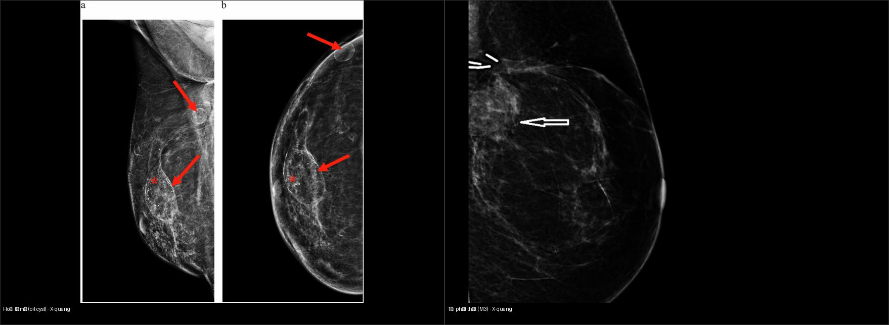
*Trái: **hoại tử mỡ** — nang dầu trong sáng + vôi hóa vỏ mỏng tại vị trí phẫu thuật (Smeins 2026, Fig. 6). Phải: **tái phát thật** — đám đậm độ tại sẹo được xếp **M3**, về sau sinh thiết xác nhận ung thư tái phát (Srivastava 2026, Fig. 2). Cả hai **cùng nhìn "ở vị trí sẹo"** — chỉ tiến triển theo thời gian mới tách được. Ảnh ghép letterbox, CC BY 4.0.*

### Dấu hiệu "chốt" phân biệt hoại tử mỡ vs tái phát
- **Hoại tử mỡ** luôn có **thành phần mỡ**: trên MRI xuất hiện **một phần tín hiệu mỡ (T1 sáng, tối khi fat-sat)** và **lõi không ngấm**; thường **ổn định/giảm dần**.
- **Tái phát** là **mô sống**: MRI **ngấm nhanh–thoát (Type III)**, **DWI sáng/ADC thấp**, và **mọc lên theo thời gian**; vôi hóa **đa hình/phân nhánh mới**.
- Khi hoại tử mỡ bị xếp **BI-RADS 4** (bờ không đều, ngấm viền), **vị trí + kiểu ngấm trên MRI** giúp tách khỏi tái phát (Smeins 2026, tổng quan từ Kang 2016).

## 4. Protocol chụp + BI-RADS + theo dõi + lưu đồ

- **Nhũ ảnh (mammography) là chuẩn nền theo dõi** sau BCT: đánh giá lặp lại được biến dạng cấu trúc + vôi hóa; **luôn so phim cũ** (cùng hướng CC/MLO). Giai đoạn đầu sau xạ, phim **hạn chế độ đặc hiệu** vì phù/tăng đậm độ/dày da phản ánh viêm — không đặc hiệu u.
- **Siêu âm có mục tiêu (targeted US):** cho khối sờ thấy / bất thường nhũ ảnh. **Luôn bật Doppler**: hoại tử mỡ/dịch quanh túi **không mạch**; mô u **có mạch** (nhưng vẫn chồng lấp).
- **MRI vú:** chỉ định khi nhũ ảnh + siêu âm không kết luận, vú đặc, hoặc nghi lan rộng. Bộ chuỗi bắt buộc: **T2W ± fat-sat, T1W, DWI/ADC, DCE có trừ nền** → đọc **động học ngấm (kinetics)**: Type I tăng dần (lành), **Type III washout (nghi ác)**. **Lưu ý: 6–12 tháng đầu sau xạ, độ đặc hiệu MRI giảm** do ngấm do viêm/xạ.
- **Theo dõi tái phát (BCT):** nhũ ảnh định kỳ (**~6 tháng/lần trong 2–3 năm đầu, rồi hằng năm**); **tái phát đỉnh quanh 2–3 năm** nhưng có thể muộn. **Chỉ báo quan trọng nhất của tái phát = TIẾN TRIỂN khoảng cách sau một giai đoạn ỔN ĐỊNH** (Gigli 2026).
- **Túi ngực:** **US là công cụ đầu tay** khi có triệu chứng (sưng/đau). **Dịch quanh túi MUỘN > 1 năm** → **chọc hút + tế bào học/flow cytometry (CD30, ALK)** và định lượng; **không** xử trí như huyết thanh tụ lành. **PET-CT** để phân giai đoạn (thường âm nếu khu trú).
- **BI-RADS sau điều trị:** hoại tử mỡ điển hình (nang dầu/vôi hóa vỏ ổn định) → **BI-RADS 2**; bờ không đều/nghi ngờ nhưng chưa chắc → **BI-RADS 3–4** (theo dõi ngắn / sinh thiết); tổn thương mới ngấm thuốc/tiến triển → **BI-RADS 4–5**.

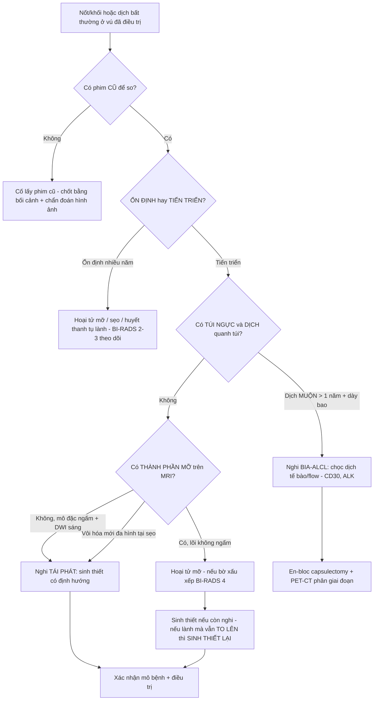

## 5. Biến thể bình thường và cạm bẫy

- **Cạm bẫy "sinh thiết lành nhưng khối TO LÊN":** ca Cureus — lần đầu sinh thiết ra **hoại tử mỡ/xơ (histiocyte CD68+)**; khối vẫn **tăng kích thước** → **sinh thiết lại** ra ung thư biểu mô **ba âm (triple-negative)** đã di căn. **KHÔNG dùng 1 kết quả lành để dừng theo dõi khi khối tiến triển** (đúng Cauchy của cảnh giác ung thư).
- **Cạm bẫy hoại tử mỡ giả u:** giai đoạn viêm, hoại tử mỡ **ngấm viền không đều + bờ gai** → BI-RADS 4 và dễ sinh thiết oan. Tìm **thành phần mỡ + lõi không ngấm** để tránh overcall.
- **Cạm bẫy vôi hóa ghép mỡ:** AFT có thể tạo **vôi hóa tụ đám (clustered), dạng vô định hình (amorphous)** **không kèm nang** → **giả DCIS**. Đối chiếu vị trí ghép + diễn tiến.
- **Cạm bẫy xạ trị — ngấm thuốc do xạ:** trong **6–12 tháng đầu sau xạ**, MRI có thể **ngấm nền do viêm** → dễ gọi nhầm tái phát; cần **so chuỗi thời gian** và ưu tiên **tính ổn định** (Gigli 2026).
- **Cạm bẫy dịch quanh túi:** lần chọc hút đầu có thể bị đọc là **"dịch viêm"** → điều trị kháng sinh **vô ích**: ca JSCR chọc hút ngoài cơ sở đọc "inflammatory exudate" nhưng tế bào học sau đó là **u lympho**. Dịch quanh túi **muộn, tái diễn** → luôn gửi tế bào học + marker (CD30, ALK).
- **Cạm bẫy "PET dương sau cắt u lympho":** sau en-bloc capsulectomy, **PET-CT có thể còn hoạt tính do phản ứng dị vật (foreign body giant cell reaction)** — phải **sinh thiết xác nhận**, không vội kết luận bệnh còn (chính ca BIA-ALCL).
- **Thỏa mãn tìm kiếm (satisfaction of search):** khi đã thấy hoại tử mỡ ở vạt/vú ghép mỡ, **vẫn phải quét toàn vú + hạch** vì tái phát có thể nằm cạnh vùng hoại tử mỡ.

## 6. Tự lượng giá — Blind Quiz

**Ca 1 — BN 67 tuổi, sau cắt toàn bộ tuyến vì DCIS + tái tạo vạt DIEP; 8 tháng sau tái tạo nổi khối đau ở phần tư dưới–ngoài vú trái. Đọc MRI.**

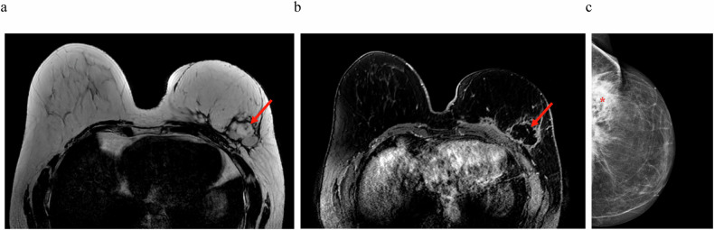

- Gợi ý: khối 4,2 cm trong vạt, có vùng mô quanh ngấm nhẹ.
- Hỏi: đây là hoại tử mỡ hay tái phát? Dấu hiệu MRI nào chốt?

<b>Bấm để hiện đáp án (findings + chẩn đoán)</b>

- Dấu hiệu (findings): MRI cho thấy **khối dạng thùy đường kính 4,2 cm**, gồm các ổ **không ngấm thuốc** ở trung tâm (nang dầu/hoại tử) **với viền ngấm nhẹ không đều** bao quanh.
- Chẩn đoán (diagnosis): **hoại tử mỡ sau vạt DIEP** — lõi không ngấm (mô mỡ hoại tử, không mạch) + viền ngấm do viêm/mô hạt; vị trí ở **rìa vạt** đúng kiểu sau tái tạo vạt.
- Nguồn ảnh: Smeins NNPM et al., Insights into Imaging 2026, Fig. 3, CC BY 4.0.

**Ca 2 — BN 61 tuổi sau cắt toàn bộ tuyến trái vì DCIS + tái tạo AFT; 21 tháng sau buổi AFT thứ 4 nổi khối sờ thấy. Đọc X-quang.**

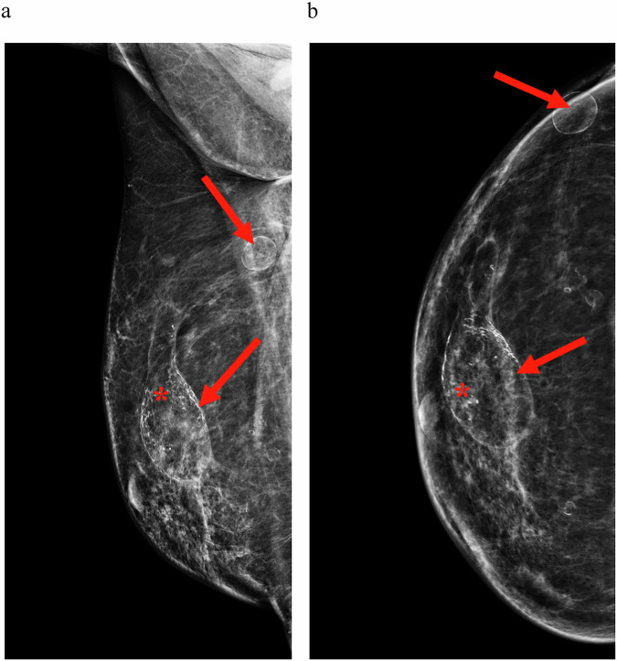

- Hỏi: nhiều ổ "trong sáng" có vỏ mỏng rải rác gợi ý gì? Vì sao AFT hay tạo hình này, và BI-RADS nên xếp thế nào?

<b>Bấm để hiện đáp án (findings + chẩn đoán)</b>

- Dấu hiệu (findings): **nhiều nang dầu (oil cyst) trong sáng, vỏ mỏng** rải rác trong vú phải tái tạo AFT.
- Chẩn đoán (diagnosis): **hoại tử mỡ lan tỏa sau AFT** — mỡ bị xà phòng hóa tạo nang dầu; sau AFT phân bố **lan tỏa** (khác sau vạt hay ở rìa). Điển hình này = **BI-RADS 2**, theo dõi.
- Nguồn ảnh: Smeins NNPM et al., Insights into Imaging 2026, Fig. 6, CC BY 4.0.

**Ca 3 — BN 70 tuổi sau cắt phần tư (quadrantectomy) vú phải vì ung thư 15 năm trước. Đọc X-quang tại vị trí phẫu thuật.**

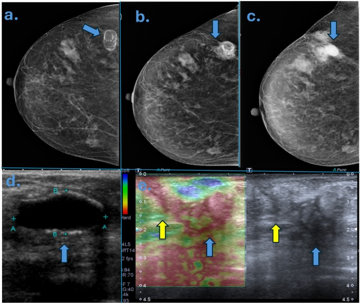

- Hỏi: vôi hóa ở vị trí sẹo sau 15 năm — lành hay đáng ngờ? Dấu hiệu nào cho biết "vôi hóa hoại tử mỡ"?

<b>Bấm để hiện đáp án (findings + chẩn đoán)</b>

- Dấu hiệu (findings): **vôi hóa hoại tử mỡ điển hình** tại vị trí phẫu thuật — vôi hóa thô/vỏ mỏng nằm trong vùng sáng mỡ, ổn định.
- Chẩn đoán (diagnosis): **hoại tử mỡ vôi hóa mạn tính (calcium saponification)** — chuỗi mạn của hoại tử mỡ; ổn định sau nhiều năm = lành. Đây là "bộ mặt lành" của hoại tử mỡ.
- Nguồn ảnh: Fleury EFC, ANZ Journal of Surgery 2026, Fig. 4, CC BY 4.0.

**Ca 4 — BN 56 tuổi, 6 tháng sau xạ trị. Đọc X-quang.**

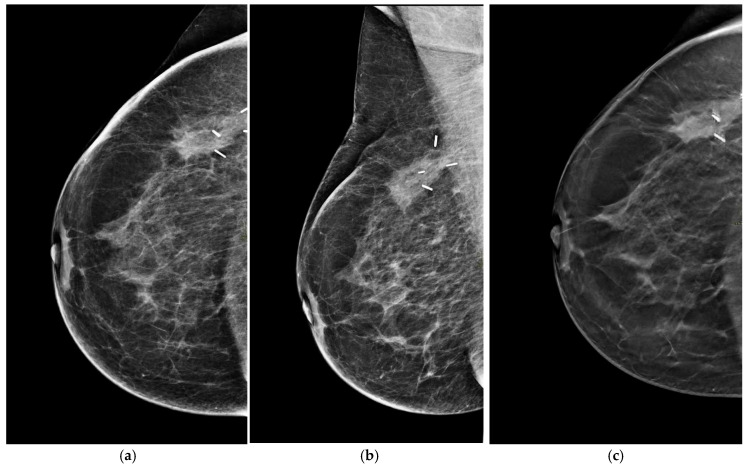

- Hỏi: dày da + tăng đậm độ quanh kẹp phẫu thuật 6 tháng sau xạ gợi ý gì? Có phải tái phát?

<b>Bấm để hiện đáp án (findings + chẩn đoán)</b>

- Dấu hiệu (findings): **dày da, phù vú, tăng đậm độ quanh kẹp phẫu thuật** (tương ứng dịch trên siêu âm).
- Chẩn đoán (diagnosis): **biến đổi cấp sau xạ trị** — viêm/mạch máu, KHÔNG phải tái phát; phần lớn thoái triển dần theo thời gian.
- Nguồn ảnh: Gigli S et al., Life (Basel) 2026, Fig. 1, CC BY 4.0.

**Ca 5 — BN 58 tuổi, 1 năm sau mổ + xạ. Đọc X-quang vùng vú.**

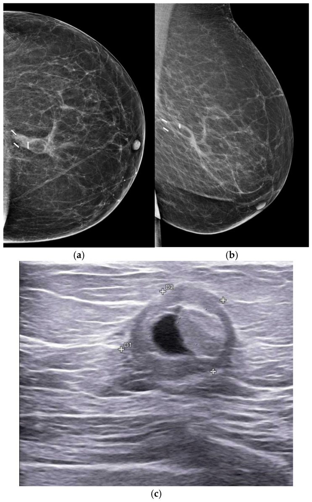

- Hỏi: vùng trong sáng với vôi hóa vỏ mỏng ngoại vi 1 năm sau mổ + xạ là gì? Siêu âm tương ứng?

<b>Bấm để hiện đáp án (findings + chẩn đoán)</b>

- Dấu hiệu (findings): **vùng trong sáng (mỡ) với vôi hóa loạn dưỡng vỏ mỏng ngoại vi**; siêu âm tương ứng **nang mỡ hoại tử (liponecrotic cyst) bờ rõ, có echo nội bộ**.
- Chẩn đoán (diagnosis): **hoại tử mỡ sau xạ trị** — hóa lỏng mỡ hoại tử, tạo nang dầu có vôi hóa vỏ; điển hình, theo dõi.
- Nguồn ảnh: Gigli S et al., Life (Basel) 2026, Fig. 4, CC BY 4.0.

**Ca 6 — BN 64 tuổi sau mổ bảo tồn + xạ 6 năm. Đọc X-quang và MRI.**

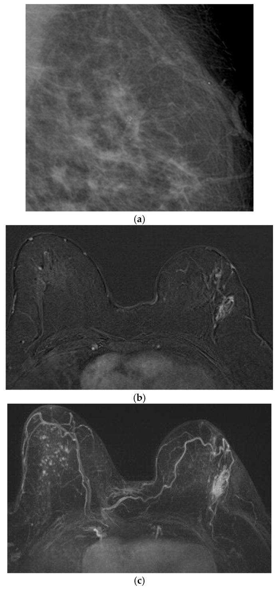

- Hỏi: đám đông đặc mới kèm vôi hóa đa hình tại sẹo, MRI có NME 2 cm — nghĩ gì? Vì sao đây không phải "biến đổi xạ đơn thuần"?

<b>Bấm để hiện đáp án (findings + chẩn đoán)</b>

- Dấu hiệu (findings): **đám đông đặc nhu mô MỚI + vôi hóa đa hình (pleomorphic)** tại vị trí sẹo; MRI sau tiêm + MIP cho **NME (non-mass enhancement) 2 cm** ngay tại sẹo.
- Chẩn đoán (diagnosis): **tái phát bệnh (disease recurrence)** — tổn thương **MỚI** và **ngấm thuốc** nhiều năm sau điều trị; khác biến đổi xạ vì xạ thường **ổn định/thoái triển** chứ không mọc mới. Cần sinh thiết định hướng.
- Nguồn ảnh: Gigli S et al., Life (Basel) 2026, Fig. 6, CC BY 4.0.

**Ca 7 — BN 51 tuổi, sưng vú phải 6 tháng, 20 năm sau đặt túi + 3 năm sau chỉnh túi. Đọc MRI.**

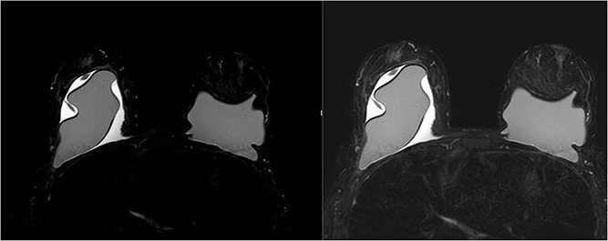

- Hỏi: dịch quanh túi hai bên + dày bao không đều ở người đặt túi **lâu năm** gợi ý gì? Bước tiếp theo?

<b>Bấm để hiện đáp án (findings + chẩn đoán)</b>

- Dấu hiệu (findings): MRI cho thấy **túi ngực hai bên với dịch quanh túi (peri-implant fluid), bên phải trội hơn, chèn ép túi phải + dày bao sau không đều HAI bên**; không khối nhu mô nghi ngờ, không hạch.
- Chẩn đoán (diagnosis): **nghi BIA-ALCL biểu hiện bằng huyết thanh tụ quanh túi MUỘN** — bước tiếp theo là **chọc dịch tế bào học + flow cytometry (CD30+, ALK−)**, PET-CT phân giai đoạn, rồi **en-bloc capsulectomy**.
- Nguồn ảnh: J Surg Case Rep 2026 (PMC13668424), Fig. 1, CC BY 4.0.

**Ca 8 — Cùng bệnh nhân trên: đọc siêu âm quanh túi.**

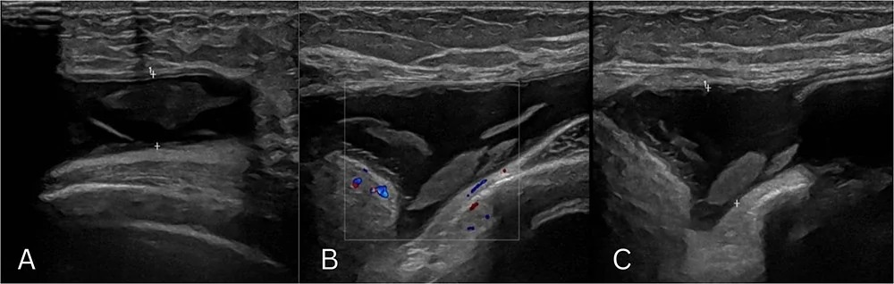

- Hỏi: dịch quanh túi "phức hợp" có cặn mà **không có mạch** trên Doppler — vì sao vẫn phải chọc? Cạm bẫy lâm sàng ở đây là gì?

<b>Bấm để hiện đáp án (findings + chẩn đoán)</b>

- Dấu hiệu (findings): **dịch quanh túi phức hợp, có cặn hồi âm, sâu tới ~1,7 cm**, **không có mạch nội bộ** trên Doppler.
- Chẩn đoán (diagnosis): **BIA-ALCL** — dịch không mạch KHÔNG loại trừ u lympho (tế bào ung thư trôi trong dịch); lần chọc hút đầu từng bị đọc là "dịch viêm" → kháng sinh vô ích. **Chọc hút gửi tế bào học** là chìa khóa (bệnh nhân này lấy 20 mL dịch đục).
- Nguồn ảnh: J Surg Case Rep 2026 (PMC13668424), Fig. 2, CC BY 4.0.

**Ca 9 — BN ung thư vú ba âm đã điều trị; khối tại sẹo, sinh thiết lần 1 ra hoại tử mỡ, nhưng khối vẫn TO LÊN. Đọc siêu âm lặp lại.**

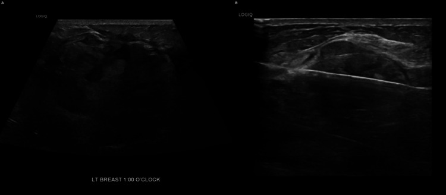

- Hỏi: sinh thiết lần 1 lành mà khối vẫn to lên — xử trí đúng? Cạm bẫy "ngụy trang hoại tử mỡ" là gì?

<b>Bấm để hiện đáp án (findings + chẩn đoán)</b>

- Dấu hiệu (findings): siêu âm lặp lại cho **tổn thương hỗn hợp hồi âm, tăng kích thước vừa phải**; sinh thiết lại cho thấy **tế bào sáng nhân không điển hình, chất nhiễm sắc vón** → ung thư biểu mô (CK7−, ER/PR−, GATA-3+ = **ba âm**); PET-CT có ổ ngấm ở xương + khối vú + nốt màng phổi.
- Chẩn đoán (diagnosis): **tái phát ung thư biểu mô ba âm NGỤY TRANG hoại tử mỡ** — sinh thiết lần 1 chỉ trúng vùng hoại tử mỡ/xơ; **quy tắc: tổn thương lành về mô học mà vẫn TIẾN TRIỂN thì phải sinh thiết LẠI**.
- Nguồn ảnh: Srivastava D et al., Cureus 2026, Fig. 6, CC BY 4.0.

**Ca 10 — Ảnh ghép: bên nào là hoại tử mỡ lành, bên nào là tái phát thật?**

- Hỏi: chỉ nhìn 1 lần chụp, dấu hiệu nào giúp tách hai bên? Vì sao vẫn phải so phim cũ?

<b>Bấm để hiện đáp án (findings + chẩn đoán)</b>

- **Trái = hoại tử mỡ:** **nang dầu trong sáng + vôi hóa vỏ mỏng** (thành phần mỡ rõ) → lành.
- **Phải = tái phát thật:** **đám đậm độ tại sẹo (M3)**, không có thành phần mỡ/vôi hóa vỏ điển hình → về sau sinh thiết xác nhận ung thư tái phát.
- Chốt: **luôn so phim cũ + tìm thành phần mỡ/lõi không ngấm** — hình ảnh một thời điểm có thể trùng nhau, **diễn tiến theo thời gian** mới chốt.
- Nguồn: ghép letterbox từ Smeins 2026 Fig. 6 + Srivastava 2026 Fig. 2, CC BY 4.0.

## Bài liên quan chéo
- [500 – Tổng quan Vú & Sản phụ khoa](../500-tong-quan-vu-san-phu-khoa/lesson.md)
- [510 – BI-RADS: nhũ ảnh, siêu âm & MRI vú](../510-vu-BIRADS-nhu-anh-sieu-am-MRI/lesson.md)
- [512 – Vi vôi hóa, biến dạng cấu trúc & túi ngực](../512-vi-voi-hoa-tui-nguc-bien-dang/lesson.md)
- [514 – Ung thư vú: giai đoạn TNM & MRI đánh giá lan rộng](../514-ung-thu-vu-TNM-MRI-lan-rong/lesson.md)

## Ảnh
- `516_hoai-tu-mo_DIEP_MRI_PMC13287354.jpg`, `516_oil-cyst_MAMMO_PMC13287354.jpg`, `516_hoai-tu-mo-voi_MAMMO_PMC13327598.jpg`, `516_phu-da-sau-RT_MAMMO_PMC13117635.jpg`, `516_hoai-tu-mo-sau-RT_MAMMO_PMC13117635.jpg`, `516_gia-tai-phat_NME_MRI_PMC13117635.jpg`, `516_BIA-ALCL_MRI_PMC13668424.jpg`, `516_BIA-ALCL_US_PMC13668424.jpg`, `516_tai-phat-that_MAMMO_PMC13481054.jpg`, `516_tai-phat-that_US_PMC13481054.jpg`, `composite_oil-cyst-vs-tai-phat.jpg`. Nguồn + giấy phép từng ảnh trong `images/CREDITS.md`.

> Không dùng để chẩn đoán độc lập khi chưa có người hướng dẫn.
