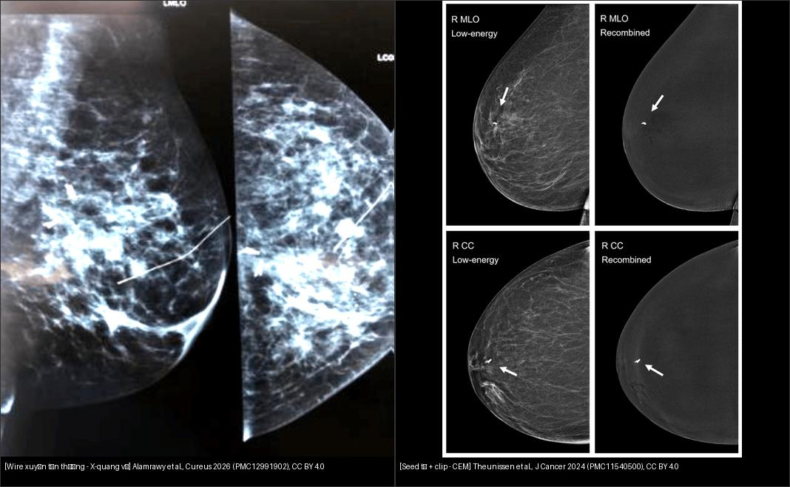
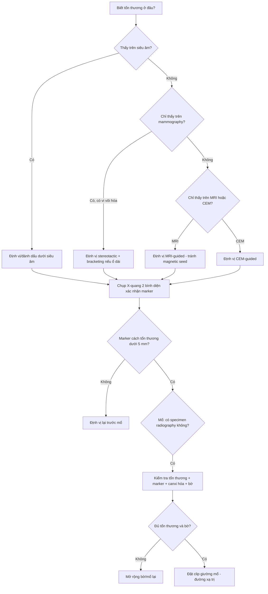
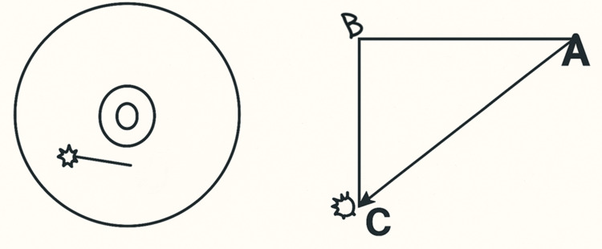
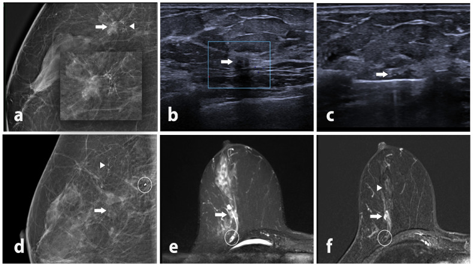
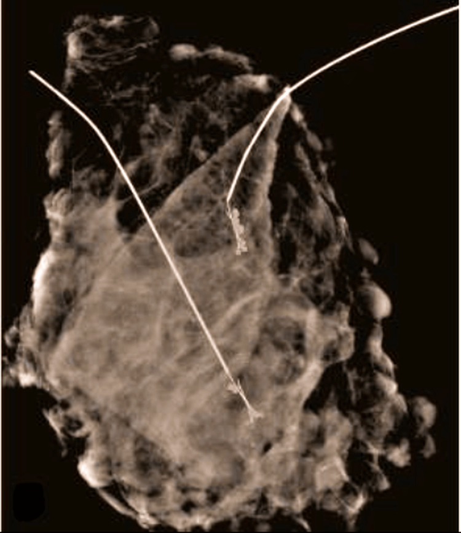
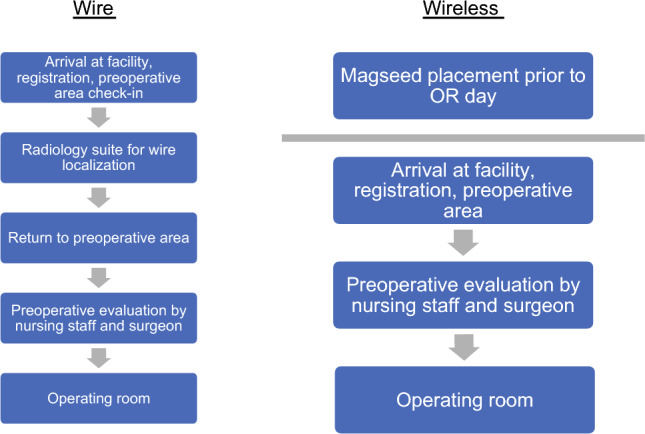

# 517 — Sinh thiết định vị vú & quản lý clip/kẹp (Breast localization biopsy & clip management)

**Tags:** `pattern:ton-thuong-khong-so-thay` `pattern:vi-voi-hoa` `vung:vu` `score:BI-RADS` `protocol:din-vi-vu` `protocol:sinh-thiet-vu` `incidentaloma:clip-di-lech`
**Mức chắc chắn (certainty):** tổng hợp y văn (literature synthesis) — gom nhiều nghiên cứu mở (Cureus, Diagnostics, J Cancer, Ann Surg Oncol, Int J Breast Cancer), chưa gắn một ca nguyên văn duy nhất.

> Bài này trả lời câu hỏi của **bác sĩ CĐHA**, không phải kỹ thuật mổ: (1) chọn cách định vị nào cho tổn thương "vô hình"; (2) clip/kẹp nằm có đúng chỗ không; (3) khi nào clip đi lạc, mất clip, và phải làm gì. Bài 510 lo BI-RADS (đọc tổn thương), 514 lo TNM, 516 lo vú sau điều trị; **517 lo khâu nối giữa hình ảnh và dao mổ**.

## 1. Tổng quan bệnh học – cơ chế hình ảnh

- **Vì sao phải "định vị" (localization):** sàng lọc mammography (X-quang vú) phát hiện rất nhiều tổn thương **không sờ thấy** — nốt nhỏ, vi vôi hóa (microcalcification), biến dạng cấu trúc, hoặc bóng tổn thương mất hẳn sau hóa trị tân bổ trợ (neoadjuvant chemotherapy, NAC). Phẫu thuật viên không thể mở ngực tìm mò, nên cần một **vật đánh dấu (marker)** nằm đúng tổn thương làm đích cho dao mổ.
- **Chuỗi thao tác chuẩn:** sinh thiết (core needle / vacuum-assisted) → **đặt clip/kẹp** tại ổ sinh thiết → chụp X-quang 2 bình diện xác nhận vị trí clip → nếu còn tổn thương: định vị (wire/seed) trước mổ → **X-quang bệnh phẩm (specimen radiography)** xác nhận lấy đủ tổn thương + clip → mô bệnh học bờ.
- **Định nghĩa có số:**
  - **Clip migration** (di trú clip) = clip di chuyển khỏi vị trí đặt; nghiên cứu dùng ngưỡng **≥ 5 mm** là "di trú có ý nghĩa lâm sàng". Trong 153 ca sinh thiết vú: **11,76% (18/153)** di trú ≥ 5 mm; **vacuum-assisted biopsy (VAB) 24% (12 ca) vs core needle 5,8% (6 ca)**, p = 0,00265 (Jaszewski & Tejero 2025).
  - **Clip dislocation** (trượt khỏi ổ tổn thương) theo 4 loại clip (n = 350, theo dõi ≥ 3 tháng): **UltraClip 14% · TUMARK Professional 20% · TUMARK Vision 9% · HydroMARK (hydrogel) 38%**; tỉ lệ di trú tương ứng **26% · 18% · 10% · 25%** (Swoboda et al. 2026).
  - **Risk factor cho trượt clip (Swoboda 2026):** mô mỡ quanh chiếm ưu thế (p = 0,046), shear wave velocity quanh tổn thương thấp (p = 0,054), bờ tổn thương nhẵn (p = 0,041), strain elastography mềm (p = 0,001), **khoảng cách clip–bề mặt tổn thương ngắn (p = 0,002)**, và dùng clip hydrogel HydroMARK (p = 0,032). Nói cách khác: **vú nhiều mỡ, tổn thương mềm, nhẵn, clip đặt nông → dễ trượt**.
- **TẠI SAO thấy trên từng phương thức (vật lý, không học vẹt):**
  - **X-quang/mammography:** clip titanium/zirconium có **hệ số suy giảm tia X rất cao** (Z lớn) → đậm đặc, sáng rõ; đây là phương thức chuẩn để xác nhận và đo khoảng cách di trú (mm).
  - **Siêu âm:** thấy clip nhờ **mặt phản xạ + bóng lưng/bóng khí** (clip hydrogel có bọt khí); độ hiện phụ thuộc kích thước, hình dạng và mô quanh. Clip 3D nitinol (Tumark Vision) sinh ra để **tăng khả năng thấy trên siêu âm sau NAC: phát hiện 91,1% (324 BN, 19 trung tâm)**; khi clip không thấy trên siêu âm, phải chuyển sang định vị dây dưới nhắm mục tiêu (Reinisch et al. 2026).
  - **MRI:** **magnetic seed (hạt từ) gây artifact nhạy cảm từ (susceptibility artifact) lớn** — trong thực nghiệm phantom, CEM hoàn toàn không bị artifact nhưng MRI bị "nổ" tín hiệu quanh seed (Theunissen et al. 2024). Vì vậy **không dùng magnetic seed nếu còn cần MRI theo dõi tổn thương**, hoặc phải chấp nhận che lấp.
  - **I-125 seed phóng xạ:** hạt titanium dài **4,5 mm**, chu kỳ bán rã **59,5 ngày**, liều tối ưu ~**2,8 MBq** (Miodownik; dẫn trong Rodríguez-Villena et al. 2026). Ưu điểm: **tương thích MRI (khác magnetic seed) và dao điện (khác SAVI Scout)**, đặt được trước NAC nhờ bán rã dài, **nguy cơ di trú < 1%**; nhược điểm: **không đặt vào tổn thương nang/xuất huyết vì dễ di trú/mất**, phải thu hồi hạt và kiểm soát phóng xạ.
  - **Wire (dây định vị):** kim loại đậm đặc tia X, sáng trên mammo; nhờ tính đàn hồi nên khi mở ngực có thể **gãy/di chuyển** (dù trong một chuỗi 46 ca không gặp ca nào gãy hay mất wire — Alamrawy et al. 2026).
- **Neo bờ tổn thương trước NAC (để không "mất" giường u khi u tan hết):** RCT 40 BN so **clip kim loại + wire vs hình xăm (tattoo)** cho thấy nhóm clip có **tỉ lệ mổ lại 35% vs 15%** (p = 0,273), **3/20 ca (15%) clip di trú**, **6 ca (15%) tụ máu/bầm tím** và 5 ca đau — tất cả biến chứng đều thuộc nhóm clip; nhóm tattoo không biến chứng (Kut et al. 2025). → Tattoo là lựa chọn thay thế rẻ tiền, nhưng clip vẫn chuẩn để **đo khoảng cách và định vị trên hình ảnh**.

## 2. Mẫu hình + chẩn đoán phân biệt theo bối cảnh (gamut)

- **Tổn thương chỉ thấy trên siêu âm** (nốt đặc, hạch nghi ngờ) → định vị dưới siêu âm (wire/seed/clip).
- **Tổn thương chỉ thấy trên mammography** (vi vôi hóa, biến dạng cấu trúc): định vị dưới nhắm mục tiêu (stereotactic) — **bracketing** (2 vật đánh dấu bọc 2 đầu ổ vôi hóa) khi ổ dài/nhiều ổ.
- **Tổn thương chỉ thấy trên MRI** (non-mass enhancement — NME) hoặc chỉ thấy trên **CEM** (chụp cản quang tuyến vú): định vị **dưới MRI/CEM**; sinh thiết CEM-guided ngày càng phổ biến (Kang et al. 2026 — dẫn ở `sources.md`).
- **Giường u sau NAC:** clip + tattoo/skin mark; nếu clip không thấy trên siêu âm → wire stereotactic; khi đạt đáp ứng hoàn toàn (pCR) vẫn phải **lấy trọn giường u + clip**.
- **Hạch nách có clip (clip trong hạch di căn trước NAC):** đánh dấu "hạch được nhắm" (targeted axillary dissection) bằng clip/seed — khác hẳn clip nhu mô; X-quang bệnh phẩm xác nhận đã lấy đúng hạch.
- **Phân biệt "clip bình thường" vs bất thường:** clip nằm trong tổn thương/giường mổ là **chủ đích**; clip ở ngoài da, trong hạch nách, hoặc **lệch xa tổn thương > 5 mm** là bất thường cần xử lý. Đừng nhầm **clip đi lạc** với mảnh kim loại, mảnh sinh thiết, hay canxi hóa mạch máu.

## 3. Bảng so sánh phân biệt (ma trận đối chiếu) — các phương pháp định vị & marker

| Thực thể / phương pháp | Hình ảnh điển hình | Chốt vào (rule-in) | Chốt loại (rule-out) | Gợi ý xác nhận |
|---|---|---|---|---|
| **Wire (dây định vị)** | Dây kim loại sáng trên mammo, đầu móc cắm vào ổ tổn thương; **bracketing = 2 dây bọc 2 bờ ổ vi vôi hóa** | **Đầu móc nằm trong/xuyên tổn thương trên 2 bình diện + sơ đồ trục giao (orthogonal map) đo khoảng cách A–B–C** | Đầu móc lạc khỏi tổn thương, dây gãy/di chuyển, hoặc đầu móc không còn trong mẫu bệnh phẩm | Mammo 2 bình diện sau đặt; X-quang bệnh phẩm (wire còn nguyên tại chỗ) |
| **I-125 seed (hạt phóng xạ)** | Hạt nhỏ 4,5 mm, sáng trên mammo, **di động/đo được trên 2 bình diện** | **Hạt nằm cách tổn thương ≤ 1 cm trên ≥ 2 bình diện; thu hồi được trong bệnh phẩm (X-quang + đếm gamma)** | Hạt không thấy trong mẫu, hoặc lệch khỏi giường u; đặt trong nang/xuất huyết (nguy cơ di trú) | X-quang bệnh phẩm + máy đếm gamma; **bán rã 59,5 ngày, liều ~2,8 MBq** |
| **Magnetic seed (hạt từ)** | Sáng trên mammo, thấy trên siêu âm; **artifact nhạy cảm từ lớn trên MRI** | Seed nằm trong tổn thương; xác nhận trên 2 bình diện; CEM không artifact | MRI bị che lấp bởi artifact → **không dùng nếu còn theo dõi bằng MRI**; seed lệch > 1–2 cm | Mammo 2 bình diện + CEM (không artifact); phantom chứng minh MRI bị artifact |
| **Clip sau sinh thiết (không dây)** | Điểm kim loại nhỏ, sáng trên mammo; có thể có quầng/khí quanh ổ sinh thiết | **Clip trong hoặc áp sát tổn thương (< 5 mm) trên mammo sau thủ thuật** | **Lệch ≥ 5 mm = di trú có ý nghĩa** — phải định vị lại; clip trong hạch nách/ngoài da | So sánh mammo ngay sau sinh thiết với mammo trước; đo khoảng cách (mm) |
| **Bracketing (2 marker bọc ổ tổn thương)** | 2 wire/seed ở 2 đầu ổ vi vôi hóa/dài, khối vi vôi hóa nằm giữa | **Hai marker bao trọn ổ tổn thương; khoảng cách giữa 2 marker bao phủ toàn bộ ổ** | Chỉ 1 marker cho ổ kéo dài/nhiều ổ; marker đặt vào vùng lành | X-quang 2 bình diện + specimen radiograph kiểm tra ổ vôi hóa nằm trọn giữa 2 marker |
| **Tattoo/da (skin mark)** | Sắc tố carbon trên da, **không đậm tia X** (không cản quang) | Dấu da thẳng chiếu lên tổn thương; thấy rõ khi mổ | Không thấy trên hình ảnh (chỉ là mốc lâm sàng); da có nếp gấp làm lệch hình chiếu | Đối chiếu lâm sàng + wire/seed nếu tổn thương sâu |
| **Không đánh dấu (no marker)** | Ổ sinh thiết cũ, khí/quầng máu mờ dần | Chỉ dùng khi tổn thương còn sờ thấy hoặc đã cắt trọn | **Tổn thương không sờ thấy mà không có marker = không thể mổ đúng đích** | Bắt buộc đặt marker ở mọi sinh thiết tổn thương sẽ mổ bảo tồn hoặc có NAC |

*Trái: X-quang vú sau đặt wire — dây xuyên qua tổn thương (Alamrawy et al., Cureus 2026, PMC12991902, CC BY 4.0). Phải: CEM sau đặt magnetic seed — seed (mũi tên) cạnh clip nhỏ cũ (Theunissen et al., J Cancer 2024, PMC11540500, CC BY 4.0). Ảnh ghép letterbox giữ nguyên tỷ lệ.*

## 4. Protocol chụp/định vị + hệ phân độ & quy trình

- **Trước hết: tìm bằng phương thức nào thấy tổn thương.** Nguyên tắc "**thấy ở đâu, định vị ở đó**": siêu âm → định vị dưới siêu âm; chỉ mammo → stereotactic; chỉ MRI → MRI-guided; chỉ CEM → CEM-guided.
- **Thời điểm:** wire thường đặt **1 ngày trước mổ** (Alamrawy 2026); I-125 seed/magnetic seed có thể đặt sớm hơn (seed I-125 nhờ bán rã 59,5 ngày nên dùng được cả trước NAC); I-125 ưu tiên cho tổn thương **sâu > 10 cm** hoặc mô đặc chắc; **tránh nang/xuất huyết**.
- **Protocol MRI tuyến vú khi định vị/MRI-guided:** T1W trước-tiêm ± fat-sat, T2W, DWI/ADC, **DCE (động học ngấm)**; nếu dùng magnetic seed phải cân nhắc artifact.
- **Bước không được bỏ:** (1) chụp X-quang 2 bình diện **xác nhận vị trí marker**; (2) đo khoảng cách marker–tổn thương (mm); (3) **specimen radiography** có cả clip + canxi hóa + wire/seed; (4) margin shave/frozen nếu lấy bờ; (5) đặt clip mới đánh dấu **giường mổ** (titanium) trước khi đóng để định hướng xạ trị.
- **Hệ phân độ liên quan:** tổn thương đích phân loại theo **BI-RADS (phiên bản 5)** của bài 510; **Fleischner không áp dụng** (đây là vú). Riêng **clip migration** định nghĩa theo ngưỡng số học **≥ 5 mm**; **clip dislocation** = không còn tương quan với tổn thương.
- **Ngưỡng xử trí (hành động):**
  - Clip/tổn thương di trú **≥ 5 mm** hoặc không còn tương quan tổn thương → **định vị lại** trước mổ.
  - Clip **không thấy trên siêu âm** trước mổ sau NAC → chuyển **wire stereotactic** (thêm bức xạ, thêm khó chịu cho bệnh nhân).
  - Clip **âm trên X-quang bệnh phẩm** → chụp lại/ tìm thêm mô, cân nhắc mở rộng lấy bờ.

## 5. Biến thể bình thường và cạm bẫy

- **Ca "giả bệnh" hay gặp:** clip nằm ở **hạch nách** bị đọc nhầm là canxi hóa/hạch vôi; clip trượt ra **mô mỡ trước cơ ngực (prepectoral)** bị tưởng là "mất clip" (thực ra di trú 23 mm — minh họa ở quiz). Luôn **so với mammo ngay sau sinh thiết**, không kết luận một mình.
- **Khí/quầng máu quanh ổ sinh thiết** sau VAB có thể giả áp-xe hoặc che clip; chụp lại sau vài ngày–vài tuần.
- **Clip hydrogel HydroMARK** trượt nhiều nhất (38%) và có thể tự tiêu/đổi hình; đừng dựa vào nó để "chắc chắn còn clip".
- **Magnetic seed + MRI = artifact lớn**: đọc nhầm vùng tối quanh seed là "lan rộng" hoặc bỏ sót tổn thương cạnh đó; nếu cần MRI, cân nhắc I-125 seed thay thế.
- **Wire gãy/di chuyển**: dù hiếm (0/46 trong chuỗi trên), vẫn phải kiểm tra **wire còn nguyên trong specimen radiograph**.
- **I-125 seed có thể di trú/mất khi đặt trong nang hoặc ổ xuất huyết**, hoặc bong trong lúc chụp specimen/mổ — cần **quy trình đa chuyên khoa (điện quang – phẫu thuật – y học hạt nhân – giải phẫu bệnh)**; trong chuỗi 146 hạt không mất hạt nào (Rodríguez-Villena 2026).
- **Cạm bẫy "thỏa mãn tìm kiếm" (satisfaction of search):** thấy clip đúng chỗ rồi bỏ qua ổ **vi vôi hóa còn sót** ngoài vùng bracketing — phải đối chiếu từng ổ trên specimen radiograph.
- **Bao giờ cũng hỏi:** clip có nằm trong mẫu không? canxi hóa mục tiêu có trong mẫu không? marker có nằm giữa 2 bờ không? Nếu "không" → chưa xong.

## 6. Tự lượng giá — Blind Quiz

**Ca 1 — Sơ đồ trục giao để làm gì?**

- Gợi ý lâm sàng: tổn thương vú không sờ thấy, được đặt wire 1 ngày trước mổ.
- Câu hỏi: Hình vẽ mô tả gì? Ba điểm A, B, C ứng với gì? Vì sao khoảng cách này quan trọng với phẫu thuật viên?

<b>Bấm để hiện đáp án (findings + chẩn đoán)</b>

- Dấu hiệu: A = điểm vào da của wire; B = điểm trên da thẳng chiếu lên tổn thương; C = tổn thương (đầu móc wire). Khoảng cách đo trên hình minh họa: A–C = 3,19 cm, C–B = 1,92 cm, A–B = 2,62 cm; hướng 7 giờ.
- Chẩn đoán/ý nghĩa: **sơ đồ trục giao (orthogonal map)** giúp phẫu thuật viên biết đi từ da vào sâu bao xa, theo hướng nào, để **rạch da trên tổn thương** thay vì trên điểm vào wire → bờ đủ rộng, giảm mổ lại.
- Nguồn ảnh: Alamrawy AM et al., *Cureus* 2026, Fig. 1 (PMC12991902), CC BY 4.0.

**Ca 2 — Clip nằm ở đâu, có đúng chỗ không?**

- Gợi ý lâm sàng: nữ 53 tuổi, tổn thương 6 × 4 mm ở vị trí 9 giờ, sinh thiết dưới siêu âm và đặt clip hydrogel; chụp MRI phân giai đoạn sáu ngày sau.
- Câu hỏi: Mô tả tổn thương và clip trên các panel. Clip có nằm đúng ổ sinh thiết không? Con số nào chốt sự di trú?

<b>Bấm để hiện đáp án (findings + chẩn đoán)</b>

- Dấu hiệu: (a) mammo lúp vú: khối gai + canxi hóa dạng đường mảnh phân nhánh; (b) siêu âm: tổn thương giảm âm 6 × 4 mm; (c) sinh thiết bán tự động + đặt marker HydroMARK; (d) mammo ngay sau sinh thiết: **clip đã ở vị trí trước cơ ngực (prepectoral)** (vòng tròn), tách khỏi tổn thương; (e,f) MRI xác nhận clip trước cơ ngực, **cách tổn thương còn lại 23 mm**, kèm NME phân đoạn.
- Chẩn đoán: **clip dislocation (trượt clip) — lệch 23 mm**, vượt ngưỡng có ý nghĩa (≥ 5 mm) → phải định vị lại trước mổ. Mô bệnh: ung thư biểu mô xâm lấn thể không đặc hiệu.
- Cơ chế 1 câu: clip đặt nông trong mô mỡ, tổn thương nhỏ/bờ nhẵn → clip "trồi" theo đường sinh thiết ra trước cơ ngực.
- Nguồn ảnh: Swoboda M et al., *Diagnostics (Basel)* 2026, Fig. 3 (PMC13298152), CC BY 4.0.

**Ca 3 — Hai cách "chỉ đường" khác nhau ở đâu?**

- Gợi ý lâm sàng: hai bệnh nhân khác nhau, đều có tổn thương vú không sờ thấy trước mổ.
- Câu hỏi: Nhận diện hai vật đánh dấu. Vì sao phương pháp bên phải **không nên** dùng khi bệnh nhân còn cần MRI theo dõi?

<b>Bấm để hiện đáp án (findings + chẩn đoán)</b>

- Dấu hiệu: trái = **wire kim loại xuyên tổn thương** trên X-quang; phải = **magnetic seed** (mũi tên) trên CEM, cạnh một clip nhỏ đã đặt trước đó; cả hai bình diện MLO/CC đều thấy seed, không artifact.
- Chẩn đoán/lý giải: wire đậm tia X; magnetic seed thấy tốt trên siêu âm/mammo/CEM nhưng **gây artifact nhạy cảm từ lớn trên MRI** (chứng minh trên phantom), nên nếu còn cần MRI → chọn **I-125 seed** (tương thích MRI).
- Nguồn ảnh: Alamrawy AM et al., *Cureus* 2026, Fig. 3 (PMC12991902) + Theunissen JEM et al., *J Cancer* 2024, Fig. 3 (PMC11540500), CC BY 4.0.

**Ca 4 — X-quang bệnh phẩm: đã lấy đủ chưa?**

- Gợi ý lâm sàng: ổ vi vôi hóa phân đoạn dài; dùng 2 wire bọc hai bờ, mổ bảo tồn.
- Câu hỏi: Hai wire đóng vai trò gì? Trên X-quang bệnh phẩm cần kiểm tra những gì để chắc "đã lấy đủ"?

<b>Bấm để hiện đáp án (findings + chẩn đoán)</b>

- Dấu hiệu: 2 wire kim loại (bracketing) cắm 2 đầu; giữa là **đám vi vôi hóa** mục tiêu; mẫu bệnh phẩm chứa trọn vùng canxi hóa và cả 2 đầu móc wire.
- Chẩn đoán/ý nghĩa: **bracketing** dùng khi ổ tổn thương dài/nhiều ổ; specimen radiograph phải xác nhận **toàn bộ canxi hóa + cả hai đầu móc + bờ rộng** nằm trong mẫu; thiếu canxi hóa ở rìa → cần lấy thêm.
- Nguồn ảnh: Alamrawy AM et al., *Cureus* 2026, Fig. 4 (PMC12991902), CC BY 4.0.

**Ca 5 — Sơ đồ quy trình: khi nào chọn wire, khi nào wireless?**

- Gợi ý lâm sàng: tổn thương không sờ thấy cần mổ bảo tồn, cân nhắc bracketing.
- Câu hỏi: Lưu đồ phân biệt hai nhánh nào? Điểm khác biệt cốt lõi giữa hai kỹ thuật là gì?

<b>Bấm để hiện đáp án (findings + chẩn đoán)</b>

- Dấu hiệu: sơ đồ quy trình so **bracketed localization bằng wire** và **bracketed localization không dây (wireless: seed/clip)** cho mổ bảo tồn.
- Chẩn đoán/ý nghĩa: cùng mục tiêu bọc 2 bờ tổn thương; khác ở **vật đánh dấu** (dây kim loại vs seed/hạt) và **logistics** (wire thường đặt cùng ngày mổ, seed có thể đặt sớm; seed tránh được bất tiện và giảm nguy cơ dịch chuyển dây).
- Nguồn ảnh: Galloway OW et al., *Ann Surg Oncol* 2026, Fig. 1 (PMC13452878), CC BY 4.0.

## Bài liên quan chéo
- [510 – Vú BI-RADS: nhũ ảnh, siêu âm, MRI](../510-vu-BIRADS-nhu-anh-sieu-am-MRI/lesson.md)
- [512 – Vi vôi hóa, biến dạng cấu trúc, túi ngực](../512-vi-voi-hoa-tui-nguc-bien-dang/lesson.md)
- [514 – Ung thư vú: TNM & MRI đánh giá lan rộng](../514-ung-thu-vu-TNM-MRI-lan-rong/lesson.md)
- [516 – Hình ảnh vú sau điều trị: tái tạo, hoại tử mỡ, sẹo vs tái phát & BIA-ALCL](../516-hinh-anh-vu-sau-dieu-tri/lesson.md)
- [572 – Hạch trong ung thư phụ khoa: SLN, hạch chậu–cạnh ĐMC & PET-CT](../572-hach-ung-thu-phu-khoa-SLN-PET/lesson.md)

## Ảnh
- Nguồn + giấy phép từng ảnh: `images/CREDITS.md`. Ảnh CC BY 4.0 giữ nguyên bản; ảnh ghép letterbox không crop/kéo giãn.
- Không tải ảnh paywall/không giấy phép rõ — chỉ dẫn link trong `sources.md` (vd Eur J Surg Oncol 2025 về di trú clip sau VAB).

> Không dùng để chẩn đoán độc lập khi chưa có người hướng dẫn.
