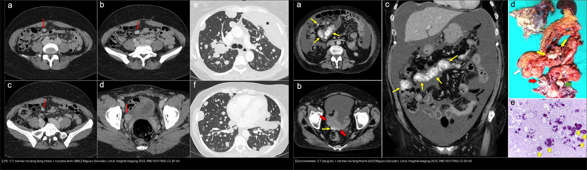
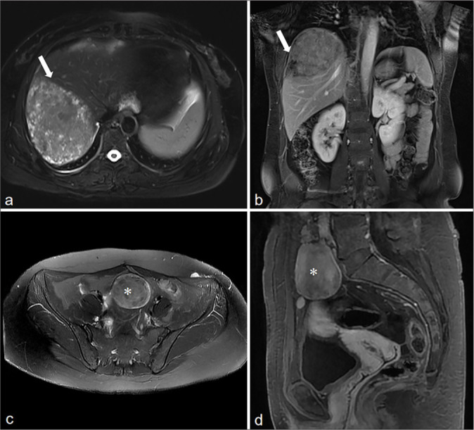
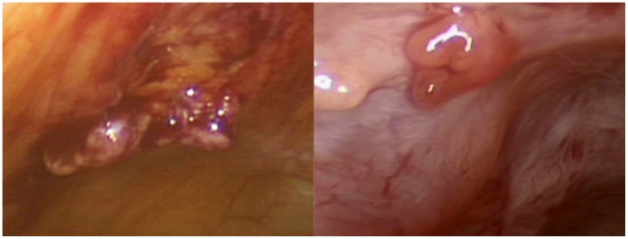
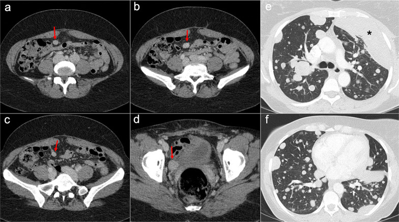

# 518 — Morcellation & leiomyomatosis peritonealis disseminata (LPD) / Cắt nhỏ u xơ & u cơ trơn lan tỏa phúc mạc

**Tags:** `pattern:gieo-rac-phuc-mac` `pattern:khoi-co-tu-cung` `vung:phuc-mac` `protocol:morcellation` `incidentaloma:not-phuc-mac`
**Mức chắc chắn (certainty):** tổng hợp y văn (literature synthesis) — nhóm tự biên từ các case series/logistics CC BY và CC BY-NC-SA (PLoS One 2012; Medicine 2020; Insights Imaging 2023; J Clin Imaging Sci 2025); gồm ca nguyên văn có hình.

## 1. Tổng quan bệnh học – cơ chế hình ảnh

- **Morcellation (cắt nhỏ u qua nội soi) là gì và vì sao nguy hiểm:** u xơ được cắt thành mảnh nhỏ để lấy ra qua lỗ trocar. Nếu khối "tưởng là u xơ" **thực ra là sarcoma/STUMP/u xơ không điển hình**, các mảnh cơ trơn **gieo rắc khắp phúc mạc** → mọc thành nốt rải rác, tiên lượng xấu hơn nhiều so với cắt nguyên khối.
- **Bằng chứng định lượng — mổ cắt nhỏ (Seidman 2012, Brigham & Women's, 1091 lượt power morcellation 2005–2010):**
  - **1,2%** có chẩn đoán bất ngờ (u xơ biến thể / u cơ trơn không điển hình / ác tính) — gồm 1 ESS, 1 u xơ tế bào, 6 u xơ không điển hình, 3 STUMP, 1 LMS.
  - **Tần suất sarcoma bất ngờ = 0,09%** — **gấp 9 lần** con số thường được tư vấn trước mổ.
  - Ở các ca theo dõi lại: **gieo rắc phúc mạc gặp 64,3%** các u ác/không điển hình.
  - Hệ quả: **FDA 2014** khuyến cáo **không dùng power morcellation** ở phụ nữ **≥ 50 tuổi hoặc tiền/hậu mãn kinh** (nhóm nguy cơ sarcoma cao hơn) → chuyển sang **morcellation trong túi (in-bag)** hoặc mổ hở/lấy nguyên khối.
- **LPD (leiomyomatosis peritonealis disseminata):** nốt cơ trơn **lành tính** rải rác phúc mạc, tiểu khung và mạc nối — thường ở **nữ tiền mãn kinh**, **liên quan chặt với morcellation/myomectomy trước đó** (He 2025: **7/10 ca có tiền sử mổ u xơ**; Yang 2020: 3 ca mổ nội soi cắt u xơ cách 3, 8, 14 năm). Cơ chế: tế bào cơ trơn bị gieo rắc + **phụ thuộc hormone (progesterone receptor +)** → nốt to lên khi nội tiết mạnh.
- **TẠI SAO hình ảnh giống u xơ (và vì sao dễ nhầm ung thư):** nốt LPD bản chất là **cơ trơn lành** → **tín hiệu và kiểu ngấm GIỐNG u xơ/cơ tử cung** (T2 tối, ngấm đồng nhất không hoại tử). Nhưng vì nằm **rải rác nhiều ổ** ở phúc mạc/mạc nối, dễ bị gọi nhầm **"carcinomatosis phúc mạc" (di căn)** — vốn **khác hẳn về tín hiệu, dịch báng và tiên lượng**.
- **Ngưỡng định lượng bắt buộc:**
  - LPD: **số tổn thương ≥ 2, đa ổ**, hầu hết **tròn/hơi tròn, bờ rõ nhẵn**, **không xâm lấn nhu mô tạng kế cận**, kích thước **~1,5–16,8 cm** (He 2025, n=10); vị trí hay gặp: **tiểu khung 6/10, thành bụng 6/10, mạc nối 5/10**, thành ruột 3/10.
  - **Dịch trong tiểu khung lượng ít** (7/10) — **không có báng lượng lớn / bánh mạc nối**. Đây là mấu chốt tách khỏi carcinomatosis.
  - Nốt phổi lành tính kèm theo (BML — benign metastasizing leiomyoma) có **bờ rõ, đối xứng hai bên**, giả ung thư (Miguez González 2023).
- **Chẩn đoán xác định = MÔ BỆNH HỌC** (sinh thiết nốt), không dựa hình ảnh đơn thuần.

## 2. Mẫu hình + chẩn đoán phân biệt theo vị trí (gamut)

- **Mẫu hình "nốt đặc đa ổ phúc mạc ở nữ tiền mãn kinh có tiền sử mổ u xơ":** nghĩ **LPD / leiomyomatosis** trước carcinomatosis.
- **Ba câu hỏi gỡ rối:** **(1) có báng lượng lớn + bánh mạc nối không? (2) tín hiệu/ngấm có giống cơ–u xơ không? (3) tiền sử morcellation/myomectomy?**
- **Theo vị trí:**
  - **Mạc nối / mạc treo:** LPD → nốt tròn rõ bờ; carcinomatosis → **bánh mạc nối (omental cake) + thâm nhiễm mỡ dạng sợi**.
  - **Mặt gan–lách:** LPD → nốt gọn; carcinomatosis/PMP → **"khía" (scalloping)** mặt tạng (xem bài 539).
  - **Thành bụng (dưới rốn/vết trocar):** nốt cơ trơn cấy ở **vết mổ cũ** — gợi ý morcellation trước đó.
  - **Tiểu khung (túi cùng trực tràng–tử cung):** nốt LPD bờ rõ, không xâm lấn trực tràng.
- **Gamut chính:** LPD/leiomyomatosis rải rác · **parasitic leiomyoma** (u xơ "kí sinh" mất liên hệ tử cung) · **benign metastasizing leiomyoma (BML)** (nốt phổi lành) · **disseminated peritoneal leiomyomatosis sau morcellation** · carcinomatosis phúc mạc (buồng trứng/dạ dày/đại tràng) · peritoneal sarcomatosis · lymphoma phúc mạc · lao phúc mạc · u trung biểu mô (mesothelioma) · viêm mô mỡ mạc treo.

## 3. Bảng so sánh phân biệt (ma trận đối chiếu)

| Thực thể (entity) | Hình ảnh điển hình | Chốt vào (rule-in) | Chốt loại (rule-out) | Gợi ý xác nhận |
|---|---|---|---|---|
| LPD / leiomyomatosis rải rác | Nốt đặc **tròn, bờ rõ nhẵn**, **tín hiệu + ngấm GIỐNG u xơ/cơ tử cung**, không xâm lấn tạng | **Tiền sử morcellation/myomectomy + nốt giống u xơ + báng ÍT** | **Báng lớn + bánh mạc nối + "khía"** → carcinomatosis | Sinh thiết nốt (mô bệnh học = cơ trơn lành; PR+) |
| Parasitic leiomyoma | Nốt cơ trơn **mất liên hệ với tử cung**, bờ rõ | **Nốt cơ trơn "rời" tử cung + tín hiệu u xơ** | Nốt thâm nhiễm bờ không rõ → nghĩ ác | So phim cũ; mô bệnh |
| BML (nốt phổi lành) | **Nốt phổi hai bên, bờ rõ**, kèm nốt phúc mạc | **Nốt phổi đối xứng + tiền sử u xơ + nốt phúc mạc** | Nốt phổi bờ gai/đơn độc → di căn thật | Sinh thiết nốt phổi/màng phổi |
| Carcinomatosis phúc mạc | **Báng lượng lớn**, bánh mạc nối, nốt confluent, "khía" mặt gan–lách | **Báng lớn + bánh mạc nối + nốt xâm lấn** | Nốt rời rạc giống u xơ + báng ít → LPD | CT/MRI + CA-125; mô bệnh |
| Peritoneal sarcomatosis | Nốt mạch hóa, đa ổ, bờ không rõ | **Nốt ngấm mạnh + bối cảnh sarcoma/LMS** | Nốt đồng nhất ngấm như cơ → LPD | Mô bệnh; so với LMS nguyên phát |
| Lao phúc mạc | Thành phúc mạc dày, hạch hoại tử, **báng tỷ trọng cao** | **Báng + dày phúc mạc lan tỏa + hạch vôi/hoại tử** | Nốt đặc giống cơ → LPD | PCR/ADA dịch; sinh thiết |
| Lymphoma phúc mạc | Bánh mạc nối/hạch lớn, ngấm đồng nhất | **Hạch to + thâm nhiễm mạc nối không hoại tử** | Nốt nhỏ rời giống u xơ → LPD | Sinh thiết hạch/mô mỡ |


*Trái: LPD — nốt mạc nối mạc treo **ngấm đồng nhất như cơ** + nốt phổi bờ rõ (BML) ở ca có tiền sử cắt tử cung vì u xơ. Phải: carcinomatosis phúc mạc (K buồng trứng thanh dịch độ cao) — **báng lượng lớn + bánh mạc nối + hạch/mạc nối confluent + vôi hóa dạng thể cát**. Nguồn: Miguez González J et al., Insights into Imaging 2023 (PMC10317950), CC BY 4.0. Ảnh ghép letterbox, giữ nguyên tỷ lệ.*

### Dấu hiệu chốt then chốt
- **"Nốt giống u xơ nhưng rải rác khắp phúc mạc"** + **báng ít** = LPD, KHÔNG phải carcinomatosis.
- **Tiền sử morcellation/myomectomy** là manh mối vàng (He 2025: 7/10; Yang 2020: cả 3 ca).
- **Nốt ở vết trocar/thành bụng** dưới rốn → nghĩ cấy cơ trơn sau cắt nhỏ.

## 4. Protocol chụp + hệ phân độ/điểm chuẩn hóa

- **Khi nào chụp:** nữ có tiền sử mổ u xơ/morcellation, sau đó **đau bụng/khoi nốt/tình cờ trên CT** → **CT bụng–chậu có cản quang thì cổng (portal)** là bước đầu; **MRI (T2W + T1W fat-sat + DWI + DCE)** khi cần phân biệt tín hiệu và lên kế hoạch mổ.
- **Đặc điểm cần báo cáo:** **số nốt (≥ 2), vị trí (tiểu khung/thành bụng/mạc nối/mạc treo), kích thước, bờ, tín hiệu so với cơ tử cung, kiểu ngấm, lượng dịch, có bánh mạc nối/khía mặt tạng không**.
- **Trước mọi morcellation (tầm soát sarcoma):** nếu khối không điển hình (T2/DWI sáng, ADC ≤ 0,9, lớn nhanh, mãn kinh) → **KHÔNG cắt nhỏ** (xem bài 526); nếu vẫn cắt nhỏ → **dùng túi (in-bag)**.
- **Xử trí LPD (không phải RADS, mà là nguyên tắc):**
  - **Sinh thiết xác nhận lành** trước khi điều trị lớn.
  - **Không triệu chứng + đã xác nhận lành:** theo dõi có thể chấp nhận.
  - **Có triệu chứng/không chắc chắn:** phẫu thuật (với người không còn nhu cầu sinh sản: cắt tử cung + phần phụ + giảm khối).
  - **Muốn bảo tồn sinh sản:** bóc nốt + **đồng vận GnRH / nội tiết** (LPD phụ thuộc hormone) — nhưng tái phát có thể gặp, cần theo dõi.

```mermaid
flowchart TD
  A[Not dac da o phuc mac o nu co tien su mo u xo] --> B{Co bang luong lon + banh mac noi + khia mat tang?}
  B -->|Co| C[Nghi carcinomatosis/PMP -> CA-125, sinh thiet, PET]
  B -->|Khong, bang it + not giong u xo| D[LPD / parasitic leiomyoma (nghi nhat)]
  D --> E{Sinh thiet not co tron lanh tinh?}
  E -->|Co| F{Co trieu chung?}
  E -->|Khong| C
  F -->|Khong| G[Theo doi dinh ky]
  F -->|Co + khong can sinh san| H[Cat tu cung + phan phu + giam khoi]
  F -->|Co + muon sinh san| I[Boc not + dong van GnRH, theo doi tai phat]
  A -.-> J{Truoc morcellation khoi khong dien hinh?}
  J -->|Co ADC <= 0,9 / T2-DWI sang| K[CAM morcellation -> mo nguyen khoi]
  J -->|Khong chac| L[Morcellation trong tui in-bag]
```

## 5. Biến thể bình thường và cạm bẫy

- **LPD bị gọi nhầm "di căn phúc mạc" → điều trị ung thư oan:** phân biệt bằng **báng ít + nốt tín hiệu/ngấm giống cơ + tiền sử morcellation**; xác nhận bằng **mô bệnh học**.
- **U xơ "kí sinh" (parasitic leiomyoma) đơn độc** sau morcellation có thể bị nhầm **khối ác mạc treo** — cùng cứu bằng bờ rõ + tín hiệu u xơ.
- **BML (nốt phổi lành)** dễ bị gọi di căn phổi → **bờ rõ, hai bên, kèm nốt phúc mạc cùng bản chất** là gợi ý.
- **Không gọi "u xơ tái phát" rồi mổ lại không cần thiết** khi thực ra là LPD lan tỏa — cần CT/MRI toàn bụng + mô bệnh trước.
- **Cạm bẫy mặt cắt (pitfall):** trên CT ngang, nốt mạc nối nhỏ dễ bỏ sót do trượt lát — đọc cả thì cổng + đa bình diện; phân biệt **dịch màng phổi vs cổ trướng** bằng dấu crus lệch (xem ghi chú hệ Bụng).

## 6. Tự lượng giá — Blind Quiz ngay trên trang tĩnh

**Ca 1 — Nữ 54 tuổi, tiền sử mổ nội soi u xơ > 10 năm, phát hiện nốt gan + nốt bụng–chậu. Nhìn MRI, mô tả trước.**



- Gợi ý lâm sàng (clinical context): 54 tuổi, tiền sử laparoscopic myoma resection.
- Câu hỏi: Nốt gan và nốt bụng–chậu có đặc điểm gì chung? Gợi ý chẩn đoán lành hay ác?

<details><summary><b>Bấm để hiện đáp án (findings + chẩn đoán)</b></summary>

- Dấu hiệu (findings): khối **tăng tín hiệu nhẹ trên T2W ở gan** bờ nhẵn (mũi tên), ngấm **không đồng nhất**; các khối mô mềm ở bụng và tiểu khung (*) có **cùng tín hiệu và cùng kiểu ngấm** như tổn thương gan.
- Chẩn đoán (diagnosis): **LPD (leiomyomatosis peritonealis disseminata)** sau morcellation — các nốt cùng bản chất cơ trơn lành, tín hiệu/ngấm giống u xơ. Xác nhận bằng mô bệnh; tìm nốt phổi BML kèm.
- Nguồn ảnh: He X et al., J Clin Imaging Sci 2025, PMC11801444, Fig. 1, **CC BY-NC-SA 4.0 (nguyên bản, không crop/ghép)**.
</details>

**Ca 2 — Ảnh ghép: nốt rải rác phúc mạc ở hai bệnh nhân. Bên nào LPD, bên nào carcinomatosis?**


- Gợi ý lâm sàng: một ca tiền sử cắt tử cung vì u xơ; một ca K buồng trứng thanh dịch độ cao.
- Câu hỏi: Dấu hiệu nào phân biệt? Điều gì quyết định hướng xử trí?

<details><summary><b>Bấm để hiện đáp án (findings + chẩn đoán)</b></summary>

- Trái: **LPD** — nốt mạc nối/mạc treo **ngấm đồng nhất như cơ**, **báng ít**, kèm **nốt phổi bờ rõ (BML)**; tiền sử u xơ/cắt tử cung.
- Phải: **carcinomatosis phúc mạc** — **báng lượng lớn + bánh mạc nối + nốt confluent + vôi hóa dạng thể cát**; khối phần phụ nguyên phát.
- Chốt: **báng lớn + bánh mạc nối + xâm lấn** = ác; **báng ít + nốt giống u xơ + tiền sử morcellation** = LPD (sinh thiết trước khi điều trị).
- Nguồn: Miguez González J et al., Insights into Imaging 2023 (PMC10317950), CC BY 4.0.
</details>

**Ca 3 — Nốt cơ trơn rải rác nhìn thấy trong mổ sau khi cắt nhỏ u. Ý nghĩa lâm sàng?**



- Gợi ý: mổ nội soi cắt u, hình ảnh nội soi thấy nhiều nốt trên mặt phúc mạc.
- Câu hỏi: Cơ chế nào tạo ra các nốt này? Hậu quả nếu u "tưởng lành" thực ra là sarcoma?

<details><summary><b>Bấm để hiện đáp án (findings + chẩn đoán)</b></summary>

- Dấu hiệu (findings): nhiều **nốt trên bề mặt phúc mạc** (ảnh trong mổ) sau power morcellation.
- Chẩn đoán/lý giải (diagnosis): **gieo rắc mô u do cắt nhỏ** — nếu u bất ngờ là **sarcoma/STUMP**, mảnh gieo rắc tạo nốt phúc mạc (Seidman 2012: gieo rắc **64,3%** các ca theo dõi; sarcoma bất ngờ **0,09%**, gấp **9 lần** tư vấn). Bài học: **không cắt nhỏ khối không điển hình** (FDA 2014: tránh ở **≥ 50 tuổi/tiền–hậu mãn kinh**); nếu buộc phải làm → **in-bag**.
- Nguồn ảnh: Seidman MA et al., PLoS One 2012, PMC3506532, Fig. 4, CC BY.
</details>

**Ca 4 — Sau morcellation nhiều năm, nốt phúc mạc + nốt phổi hai bên bờ rõ. Có phải di căn?**



- Gợi ý: 51 tuổi, tiền sử u xơ + đã cắt tử cung; chụp ngực tình cờ thấy nốt phổi nhiều ổ.
- Câu hỏi: Nốt phổi giống di căn ung thư không? Bằng gì để xác định bản chất?

<details><summary><b>Bấm để hiện đáp án (findings + chẩn đoán)</b></summary>

- Dấu hiệu (findings): nốt đặc mạc treo/rốn mạc treo **ngấm đồng nhất** (mũi tên đỏ, a–d) + **nốt phổi/màng phổi hai bên bờ rõ** (e, f) — trông như ác tính nhưng **lành**.
- Chẩn đoán (diagnosis): **LPD kèm benign metastasizing leiomyoma (BML)** — chẩn đoán xác định bằng **sinh thiết khối màng phổi (thùy lưỡi)** (dấu hoa thị đen). Chốt: nốt phổi **hai bên, bờ rõ + tiền sử u xơ** = BML lành, không phải di căn.
- Nguồn ảnh: Miguez González J et al., Insights into Imaging 2023, PMC10317950, Fig. 28, CC BY 4.0.
</details>

## Bài liên quan chéo
- [500 – Tổng quan Hệ Vú & Sản Phụ khoa](../500-tong-quan-vu-san-phu-khoa/lesson.md)
- [520 – U xơ cơ tử cung (FIGO 0–8), adenomyosis & nội mạc](../520-tu-cung-u-xo-FIGO-adenomyosis-noi-mac/lesson.md)
- [526 – Sarcoma tử cung & carcinosarcoma vs u xơ](../526-sarcoma-tu-cung-vs-u-xo/lesson.md)
- [527 – U mô đệm nội mạc tử cung (ESN/LG-ESS/HG-ESS/UUS)](../527-u-mo-dem-noi-mac-tu-cung/lesson.md)
- [535 – Ung thư buồng trứng, phúc mạc & u Krukenberg](../535-ung-thu-buong-trung-phuc-mac-krukenberg/lesson.md)
- [539 – Pseudomyxoma peritonei & u nhầy ruột thừa](../539-pseudomyxoma-peritonei/lesson.md)

## Ảnh
- 5 ảnh gốc (4 CC BY/BY, 1 CC BY-NC-SA) + 1 ảnh ghép CC BY 4.0. Nguồn + giấy phép từng ảnh trong `images/CREDITS.md`.

> Không dùng để chẩn đoán độc lập khi chưa có người hướng dẫn.
