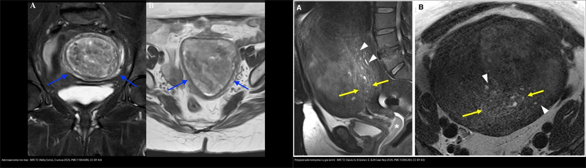
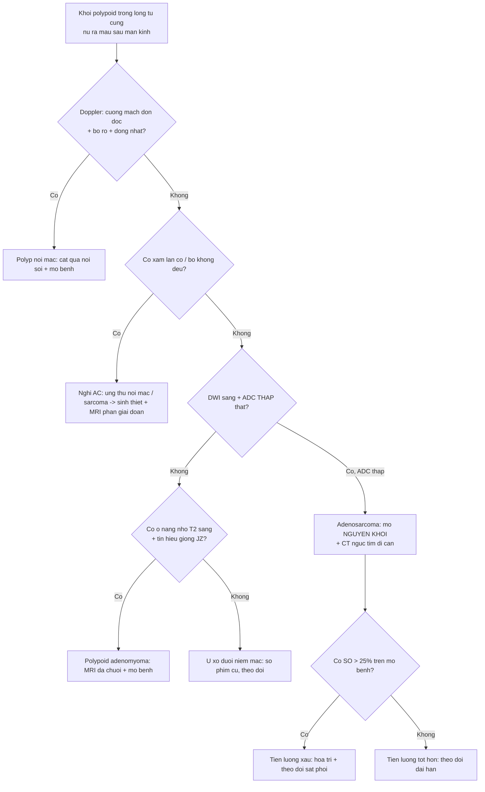
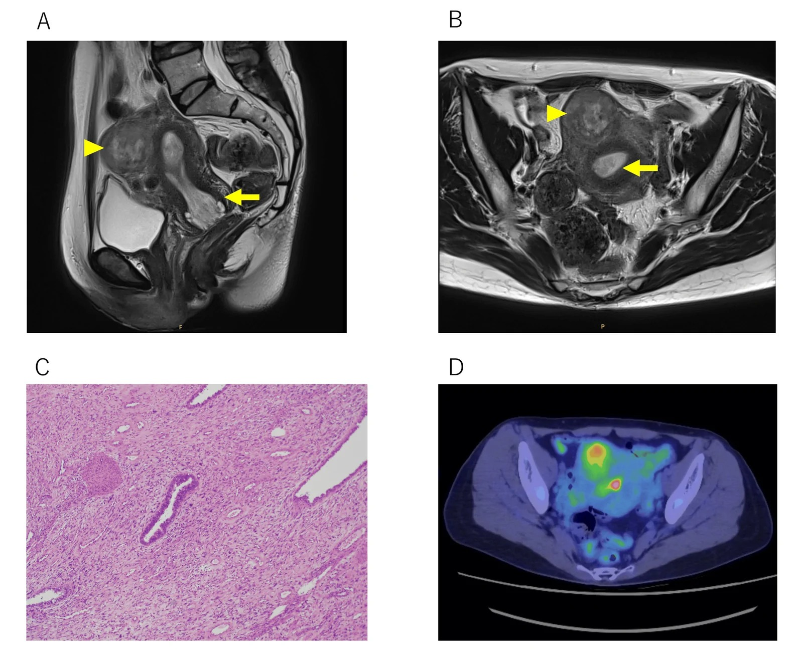
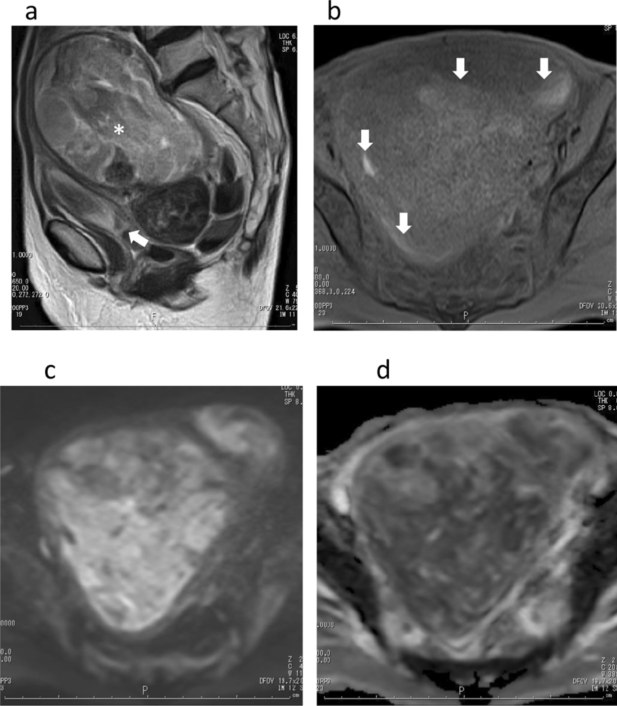
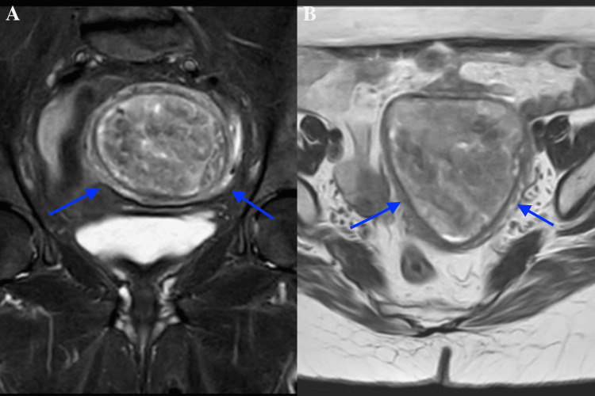
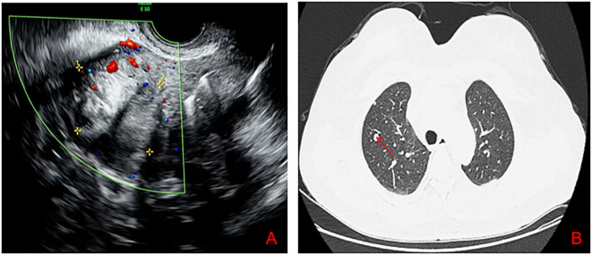

# 519 — Adenosarcoma tử cung & polyp nội mạc: "khối trong lòng tử cung" giả polyp / Uterine adenosarcoma & the great polyp mimic

**Tags:** `pattern:khoi-long-tu-cung` `pattern:u-gia-polyp` `vung:tu-cung` `score:ADC` `protocol:MRI-tieu-khung` `protocol:sieu-am-dau-do`
**Mức chắc chắn (certainty):** tổng hợp y văn (literature synthesis) — nhóm tự biên từ nhiều ca nguyên văn có hình CC BY/BY 4.0 (BMC Womens Health 2021; Cureus 2025/2026; Front Oncol 2026; Front Med 2026; BJR Case Rep 2026) + nghiên cứu đoàn hệ SARCUT; số liệu đối chiếu từng bài gốc, không gắn một ca đơn lẻ duy nhất.

## 1. Tổng quan bệnh học – cơ chế hình ảnh

- **Vấn đề lâm sàng:** adenosarcoma tử cung (uterine adenosarcoma, Müllerian adenosarcoma) là **u hỗn hợp biểu mô–trung mô** điển hình nhất của "khối trong lòng tử cung giả polyp". Bệnh nhân thường ra máu sau mãn kinh; siêu âm/MRI chỉ thấy **một khối polypoid trong buồng tử cung** — đọc nhầm thành **polyp nội mạc lành** và **cắt polyp qua nội soi** là sai lầm kinh điển. Ca nguyên văn Cureus 2026 (PMC13577044) chính xác như vậy: bệnh nhân 47 tuổi, MRI có **khối polypoid 5,5 cm** bám thân tử cung, ban đầu chẩn đoán "polyp nội mạc" → sinh thiết cắt polyp ra **adenosarcoma có sarcoma phát triển vượt (sarcomatous overgrowth, SO)**.
- **Bệnh học:** adenosarcoma = **biểu mô lành/không atypia** + **mô đệm ác tính** (thường sarcoma thoi độ thấp). Đây là **mắt xích giữa adenofibroma lành → adenosarcoma → carcinosarcoma** (nơi cả biểu mô LẪN mô đệm đều ác). Chiếm **~5–10% sarcoma tử cung**, **~0,2% u tử cung** / ~1% ung thư phụ khoa; hay gặp ở **tuổi 50–60 (bệnh nhân mãn kinh)**, nhưng vẫn có ở người trẻ.
- **"Sarcoma phát triển vượt" (sarcomatous overgrowth, SO):** khi **> 25% thể tích u là sarcoma độ cao thuần** (không còn biểu mô) → hành vi hung hãn, tái phát sớm, tiên lượng xấu. Các yếu tố tiên lượng xấu khác: **xâm lấn cơ sâu, xâm lấn khoang mạch, atypia mô đệm, tuổi cao, giai đoạn II–III**.
- **TẠI SAO hình ảnh trông như vậy (vật lý + mô bệnh):**
  - **Mô đệm sarcoma thoi dày đặc tế bào** → "nhốt" nước nội bào → **DWI sáng + ADC thấp** (hạn chế khuếch tán THẬT). Đây là điểm khác căn bản với polyp nội mạc (ít tế bào → ADC cao).
  - **Thành phần hai pha + tuyến giãn nang** → trên T2W khối **tăng tín hiệu không đồng nhất + các ổ nang nhỏ T2 rất sáng** ("tiny cysts"); ca BMC 2021 mô tả đúng như vậy.
  - **Hoại tử/xuất huyết** (khối lớn vượt cấp máu) → ổ T1 sáng (methemoglobin) + ngấm thuốc không đồng nhất; ca Cureus 2025 đại thể có **hoại tử/xuất huyết trong khối 6 cm**.
  - **Khối mọc đầy buồng tử cung, giãn lòng, lan xuống ống cổ tử cung** — hình thái "lòng tử cung căng to do khối" rất gợi ý; ca BMC 2021 khối tới **241 × 114 × 88 mm** làm tử cung to 250 × 126 × 99 mm, **KHÔNG xâm lấn cơ**.
- **Ngưỡng định lượng bắt buộc:**
  - **SO = > 25%** thể tích u là sarcoma độ cao (tiêu chuẩn Clement–Scully).
  - **Kích thước:** polyp nội mạc trung bình **1,4–2,5 cm** so với adenosarcoma trung bình **~6,5 cm** (BMC 2021); nhưng **u lớn (> 10 cm) KHÔNG đồng nghĩa có SO** — nhiều adenosarcoma không SO cũng rất lớn.
  - **Sống còn:** sống toàn bộ 5 năm giai đoạn I **60–80%**; sống đặc hiệu bệnh 5 năm **48–79%**. Đoàn hệ **SARCUT (Mancari 2024, n = 32):** DFS 5 năm **85,3%**, OS 5 năm **89,5%**; **tuổi HR 1,09/năm** (KTC 1,03–1,15; p = 0,004), **giai đoạn FIGO II–III HR 17,75** (KTC 2,87–109,93; p = 0,002); tái phát sớm (< 12 tháng) gắn **u > 30 mm + giai đoạn tiến xa**.
  - **Di căn:** phổi là nơi hay gặp nhất — trong chuỗi 110 ca Nhật (Tate) **75% tái phát xa là ở phổi**; ca Front Oncol 2026 có di căn phổi sau 8 tháng hóa trị.
  - **Nguy cơ ác tính của polyp nội mạc nói chung:** 0,5–5%. Trong 2.588 bệnh nhân cắt polyp (Kiestrzyn 2026): ung thư nội mạc **0,62%**, tăng sinh có atypia **1,35%**, tăng sinh không atypia **13,91%**, polyp lành **84,12%** — nghĩa là **đại đa số polyp là lành**, nhưng vẫn phải có ngưỡng nghi.

## 2. Mẫu hình + chẩn đoán phân biệt theo vị trí (gamut)

- **Ba câu hỏi gỡ rối mọi "khối polypoid trong lòng tử cung" (nữ quanh/peri-menopausal ra máu):**
  1. **Bối cảnh:** ra máu sau mãn kinh, khối **to nhanh/tái phát sau đã cắt polyp**, đẩy qua ống cổ tử cung?
  2. **Xâm lấn cơ hay bờ đẩy?** (bờ đẩy + cuống = lành; xâm lấn/thâm nhiễm = nghi ác)
  3. **DWI sáng có hạn chế THẬT (ADC thấp) không?** (adenosarcoma/sarcoma = ADC thấp; polyp/adenomyoma = ADC không thấp).
- **Gamut theo bản chất (từ lành → ác):**
  - **Lành, trong lòng tử cung:** polyp nội mạc (kể cả polyp **khổng lồ 4–12 cm** vẫn phần lớn lành), **polypoid adenomyoma (UPA — adenomyosis dạng khu trú)**, u xơ dưới niêm mạc (FIGO 0–2), adenofibroma.
  - **Tiền ung thư / ung thư biểu mô:** tăng sinh nội mạc (có/không atypia), **ung thư nội mạc thể polypoid**.
  - **Sarcoma / hỗn hợp:** **adenosarcoma** (biểu mô lành + mô đệm ác), **carcinosarcoma** (cả hai ác), ESS, LMS, UUS, **di căn** (vú, dạ dày, đại tràng).
- **Đặc trưng từng thực thể:**
  - *Polyp nội mạc:* khối bầu dục bờ rõ, **đồng nhất**, T2 **iso/giảm nhẹ** so với nội mạc, **một cuống mạch nuôi (pedicle artery)** trên Doppler; SIS = khuyết khuyết rõ; **ADC không thấp**.
  - *Polypoid adenomyoma (UPA):* khối trong buồng tử cung, **nhiều ổ nang nhỏ T2 sáng + tín hiệu GIỐNG vùng chuyển tiếp (junctional zone)**; nền tử cung có adenomyosis ("venetian blind" trên siêu âm).
  - *Adenosarcoma:* khối **lớn, không đồng nhất, đầy buồng + lan ống cổ**, **nang nhỏ T2 sáng**, **DWI sáng/ADC thấp**, có thể xâm lấn cơ; hay ra máu sau mãn kinh; **tái phát sau cắt "polyp"**.
  - *Carcinosarcoma / ung thư nội mạc polypoid:* khối nội mạc **xâm lấn cơ**, bờ không đều; ung thư nội mạc thường xâm lấn < hoặc ≥ 50% cơ; carcinosarcoma hình ảnh chồng lấp adenosarcoma → **mô bệnh học** phân biệt.

## 3. Bảng so sánh phân biệt (ma trận đối chiếu)

| Thực thể (entity) | Hình ảnh điển hình | Chốt vào (rule-in) | Chốt loại (rule-out) | Gợi ý xác nhận |
|---|---|---|---|---|
| **Adenosarcoma** | Khối polypoid **lớn (~6,5 cm)**, đầy buồng + lan ống cổ, T2 không đồng nhất + **nang nhỏ T2 sáng**, ngấm không đồng nhất, DWI sáng | **Khối lớn không đồng nhất + nang nhỏ + DWI hạn chế thật (ADC thấp)** ở nữ ra máu sau mãn kinh | Khối nhỏ, đồng nhất, ADC không thấp, có cuống mạch đơn độc → polyp | Sinh thiết/cắt polyp qua nội soi + **mô bệnh** (không thể chốt chỉ bằng hình ảnh) |
| **Polyp nội mạc** | Bầu dục bờ rõ, **đồng nhất**, T2 iso/giảm nhẹ so với nội mạc, **cuống mạch đơn độc** (pedicle artery) | **Cuống mạch đơn độc + bờ rõ + đồng nhất + ADC không thấp** | Khối lớn không đồng nhất + DWI hạn chế thật → nghi adenosarcoma | SIS/hysteroscopy; mô bệnh |
| **Polypoid adenomyoma (UPA)** | Khối trong buồng, **nhiều ổ nang nhỏ T2 sáng** + tín hiệu **giống junctional zone**; nền adenomyosis | **Tín hiệu JZ + nang nhỏ + nền adenomyosis** | Bờ thâm nhiễm + ADC rất thấp → nghi adenosarcoma | MRI đa chuỗi + mô bệnh (hay bị gọi nhầm) |
| **U xơ dưới niêm mạc (FIGO 0–2)** | Khối đặc T2 **tối** đồng nhất, vỏ giả, **không xâm lấn**, ngấm kiểu u xơ | **T2 tối + vỏ giả + không hạn chế khuếch tán** | T2 sáng không đồng nhất + nang nhỏ → nghĩ adenosarcoma | MRI; so phim cũ |
| **Ung thư nội mạc polypoid** | Khối nội mạc bờ không đều, **xâm lấn cơ**, DWI hạn chế, ngấm kém hơn cơ | **Xâm lấn cơ + bờ không đều + DWI hạn chế** | Bờ đẩy rõ, không xâm lấn → nghĩ lành | Sinh thiết nội mạc (pipelle) + MRI phân giai đoạn |
| **Carcinosarcoma** | Khối lớn hỗn hợp, hoại tử/xuất huyết, xâm lấn cơ, có thể sa qua cổ tử cung | **Hình ảnh chồng lấp adenosarcoma + hoại tử/xuất huyết rộng** | Không tách được bằng hình ảnh → **cần mô bệnh** | Mô bệnh (cả biểu mô LẪN mô đệm ác) |

*Trái: **adenosarcoma nội mạc** — khối trong buồng tử cung bờ rõ nhưng không đồng nhất, bờ không đều (mũi tên), xâm lấn/thâm nhiễm; ADC thấp. Phải: **polypoid adenomyoma (u giả lành)** — tử cung to, cơ không đồng nhất, khối trong buồng có **nhiều ổ nang nhỏ T2 sáng** (mũi tên đầu) + **dải tín hiệu giống vùng chuyển tiếp** (mũi tên). Nguồn: Rafiq S et al., Cureus 2025 (PMC11964285) + Davis AJ & Gomez E, BJR Case Rep 2026 (PMC13395283), CC BY 4.0. Ảnh ghép letterbox, giữ nguyên tỷ lệ.*

### Dấu hiệu chốt then chốt
- **DWI hạn chế THẬT (ADC thấp) là ranh giới chính:** adenosarcoma có mô đệm dày đặc → ADC thấp; ca BMC 2021 đo **ADC 1,26 ×10⁻³ mm²/s** (ca 1) và **0,88 ×10⁻³ mm²/s** (ca 2). Polyp nội mạc ít tế bào → ADC cao hơn.
- **"Nang nhỏ T2 sáng" trong khối** (tuyến giãn) là dấu cộng thêm — gặp ở adenosarcoma LẪN polypoid adenomyoma, nên **không dùng một mình**.
- **Bối cảnh "cắt polyp rồi tái phát" / ra máu sau mãn kinh + khối to** phải luôn nghĩ adenosarcoma cho tới khi có mô bệnh.

## 4. Protocol chụp + hệ phân độ/điểm chuẩn hóa

- **Siêu âm đầu tay (TVUS) + Doppler màu:** khối trong buồng; **một cuống mạch đơn độc** gợi ý polyp; mạch hóa nhiều/hỗn loạn gợi ý u. Ca Front Oncol 2026: TVUS thấy nốt trong cơ + **khối đặc–nang ở phần phụ trái 65 × 46 mm**, ban đầu chẩn đoán nhầm "u quái + u xơ".
- **MRI tiểu khung (chuẩn vàng đánh giá bản chất + xâm lấn):**
  - **T2W ≥ 2 bình diện (sagittal + axial, ± coronal), KHÔNG xóa mỡ:** hình thái khối, nang nhỏ, vùng chuyển tiếp, xâm lấn cơ.
  - **T1W (± fat-sat):** ổ T1 sáng = xuất huyết.
  - **DWI b = 800–1.000 + ADC:** hạn chế khuếch tán thật; đo ADC tại **vùng u còn sống, hạn chế nhất**.
  - **T1W + Gd động học (DCE, fat-sat):** ngấm không đồng nhất, hoại tử, xâm lấn cơ.
- **Nội soi buồng tử cung + sinh thiết/cắt trọn tổn thương:** **tiêu chuẩn vàng** — vì hình ảnh không phân biệt được adenosarcoma với polyp/adenomyoma. **Cắt trọn qua nội soi** (không sinh thiết nhỏ) để không bỏ sót SO.
- **PET/CT:** đánh giá di căn xa (ca Cureus 2026: FDG bắt ở cả tổn thương nội mạc LẪN khối trong cơ; không di căn xa). Phổi là nơi di căn hay gặp nhất → **CT ngực** trong theo dõi.
- **Phân giai đoạn & yếu tố tiên lượng:** adenosarcoma xếp giai đoạn theo **hệ FIGO cho sarcoma tử cung**; **SO > 25%**, **xâm lấn cơ sâu**, **xâm lấn mạch**, kích thước lớn và tuổi cao là các yếu tố xấu. Điều trị chuẩn = **cắt tử cung toàn phần ± cắt hai phần phụ**; bảo tồn sinh sản chỉ ở ca chọn lọc, chưa chuẩn hóa.

## 5. Biến thể bình thường và cạm bẫy

- **"To" không đồng nghĩa "ác":** polyp nội mạc **khổng lồ 4,0–12,0 cm** ở nữ mãn kinh vẫn **phần lớn lành** (11/15 ca lành, có giãn nang — Wang 2026). Vì vậy **kích thước một mình không chốt**; phải dựa vào DWI/ADC, bờ, xâm lấn và mô bệnh.
- **Sinh thiết "ra polyp lành" KHÔNG loại trừ adenosarcoma:** ca Cureus 2025 sinh thiết nội mạc ban đầu ra **polyp lành**, MRI sau đó mới lộ khối bờ không đều; ca Cureus 2026 cắt "polyp" qua nội soi mới ra adenosarcoma. **Khi hình ảnh nghi, phải cắt trọn tổn thương + xem kỹ mô bệnh.**
- **Polypoid adenomyoma (UPA) là "kẻ giả danh" hai chiều:** vừa giống polyp nội mạc, vừa **giống adenosarcoma** (Front Oncol/adenosarcoma trong cổ tử cung, UPA trong buồng tử cung) — dấu **tín hiệu giống junctional zone + nền adenomyosis** giúp nghiêng về UPA.
- **SO không đổi hình ảnh trên các chuỗi thường:** BMC 2021 nhấn mạnh **T2/T1/ngấm của adenosarcoma có SO không khác adenosarcoma không SO**; chỉ **DWI hạn chế** mới gợi ý SO — nên **đừng kỳ vọng phân biệt SO bằng T2**.
- **Cạm bẫy đo ADC:** vùng hoại tử/xuất huyết cho ADC thấp **giả** → chỉ đo tại mô đặc còn sống.
- **Satisfaction of search:** khi thấy "polyp" hoặc "u xơ" trong buồng tử cung, **phải quét toàn bộ cơ tử cung** tìm ổ xâm lấn/thành phần đặc bất thường (ca Cureus 2026 có thêm **khối trong cơ** ở thành trước).
- **Di căn ngoài tử cung:** adenosarcoma có thể xuất phát ngoài tử cung (buồng trứng, phần phụ, cổ tử cung, thậm chí **thận** — Diagnostics 2026) và di căn **phổi** — luôn đọc phim ngực khi đã chẩn đoán.

## 6. Tự lượng giá — Blind Quiz ngay trên trang tĩnh

**Ca 1 — Nữ 47 tuổi, ra máu tử cung bất thường; MRI có khối polypoid 5,5 cm trong buồng tử cung. Nhìn phim, mô tả trước.**

- Gợi ý lâm sàng (clinical context): nữ 47 tuổi, rối loạn kinh/ra máu bất thường, khối trong buồng tử cung.
- Câu hỏi: Trên T2 (A/B) khối có đặc điểm gì? Ngoài khối trong buồng còn thấy gì? Vì sao **không được chốt "polyp nội mạc"**?

<b>Bấm để hiện đáp án (findings + chẩn đoán)</b>

- Dấu hiệu (findings): (A) T2 sagittal — khối polypoid trong buồng tử cung **tăng tín hiệu không đồng nhất, có ổ nang nhỏ** (mũi tên đầu), kèm **khối trong cơ thành trước** (mũi tên vàng); (B) T2 axial — khối trong buồng (mũi tên đầu) + khối trong cơ (mũi tên); (D) PET/CT — FDG bắt ở cả hai tổn thương.
- Chẩn đoán (diagnosis): **adenosarcoma tử cung có sarcoma phát triển vượt (SO)** — ban đầu bị chẩn đoán "polyp nội mạc", cắt polyp qua nội soi mới ra chẩn đoán. Xử trí: cắt tử cung toàn phần + hai phần phụ; hóa trị bổ trợ (doxorubicin + ifosfamide). **Bài học: khối to, không đồng nhất, có khối kèm trong cơ → không chốt polyp.**
- Nguồn ảnh: Suzuki N et al., Cureus 2026, PMC13577044, Fig. 1, CC BY 4.0.

**Ca 2 — Nữ 76 tuổi, ra máu sau mãn kinh; khối đầy buồng tử cung lan xuống ống cổ. Nhìn DWI/ADC, mô tả trước.**

- Gợi ý lâm sàng: nữ 76 tuổi, ra máu sau mãn kinh, bụng trướng.
- Câu hỏi: T2 (a) khối có gì? Ngấm thuốc (b) ra sao? DWI (c) và ADC (d) nói lên điều gì về mô học?

<b>Bấm để hiện đáp án (findings + chẩn đoán)</b>

- Dấu hiệu (findings): (a) T2 — khối **tăng tín hiệu không đồng nhất** đầy buồng tử cung, có **ổ nang nhỏ T2 rất sáng** (dấu hoa thị), lan xuống ống cổ (mũi tên); (b) sau tiêm — **ngấm không đồng nhất + nang/hoại tử** (mũi tên); (c) **DWI sáng**; (d) **ADC tối (1,26 ×10⁻³ mm²/s)** = hạn chế khuếch tán THẬT.
- Chẩn đoán (diagnosis): **adenosarcoma có SO** — DWI hạn chế phản ánh mô đệm sarcoma dày đặc tế bào; SO > 25% không đổi hình ảnh T2/ngấm mà chỉ **gợi ý qua DWI**. Tiên lượng xấu: ca này tái phát **sarcomatosis phúc mạc sau 6 tháng** và tử vong.
- Nguồn ảnh: Nakai G et al., BMC Womens Health 2021, PMC8680034, Fig. 1, CC BY 4.0.

**Ca 3 — Nữ 52 tuổi, mãn kinh 2 năm, ra máu âm đạo 4 tháng; sinh thiết nội mạc ra "polyp lành". MRI dưới đây.**

- Gợi ý lâm sàng: nữ 52 tuổi, mãn kinh 2 năm, ra máu 4 tháng; sinh thiết ban đầu "polyp lành".
- Câu hỏi: Bờ khối và tính chất xâm lấn? Có nên tin kết quả sinh thiết "lành" để dừng lại không?

<b>Bấm để hiện đáp án (findings + chẩn đoán)</b>

- Dấu hiệu (findings): (A) T2 coronal fat-sat — **khối lớn bờ rõ nhưng KHÔNG đồng nhất, bờ không đều/thâm nhiễm** (mũi tên); (B) T2 axial — khối chiếm buồng tử cung với **tính chất xâm lấn** (mũi tên). Đại thể: khối **6 cm có hoại tử/xuất huyết**.
- Chẩn đoán (diagnosis): **adenosarcoma nội mạc** (biểu mô lành + mô đệm ác; ER/PR dương ở mô đệm). **Sinh thiết "polyp lành" KHÔNG loại trừ adenosarcoma** — hình ảnh nghi ác buộc phải cắt trọn tổn thương + mô bệnh. Xử trí: cắt tử cung toàn phần + hai phần phụ + hóa trị bổ trợ, theo dõi sát.
- Nguồn ảnh: Rafiq S et al., Cureus 2025, PMC11964285, Fig. 1, CC BY 4.0.

**Ca 4 — Nữ 56 tuổi, mãn kinh, đau hông trái; siêu âm thấy khối đặc–nang phần phụ, CT ngực sau 8 tháng hóa trị.**

- Gợi ý lâm sàng: nữ 56 tuổi, mãn kinh 2 năm, đau hông trái; ban đầu chẩn đoán nhầm "u quái + u xơ".
- Câu hỏi: (A) Siêu âm Doppler cho thấy gì? (B) CT ngực có gì? Điều này nói gì về hành vi của adenosarcoma có SO?

<b>Bấm để hiện đáp án (findings + chẩn đoán)</b>

- Dấu hiệu (findings): (A) TVUS Doppler — nốt giảm âm trong cơ + **khối đặc–nang mạch hóa ở phần phụ trái (65 × 46 mm)**; (B) CT ngực cửa sổ phổi — **nốt di căn phổi hai bên** (mũi tên đỏ).
- Chẩn đoán (diagnosis): **adenosarcoma tử cung có SO + di căn phổi**. SO + xâm lấn cơ là **yếu tố tiên lượng xấu**; phổi là nơi di căn hay gặp nhất (75% tái phát xa ở phổi). **Phải chụp CT ngực khi đã chẩn đoán.**
- Nguồn ảnh: Qi X et al., Front Oncol 2026, PMC13441759, Fig. 1, CC BY 4.0.

**Ca 5 — Ảnh ghép: hai khối trong lòng tử cung trên MRI T2. Bên nào là adenosarcoma, bên nào là "u giả" lành?**

- Gợi ý lâm sàng: một ca ra máu sau mãn kinh với khối không đồng nhất; một ca thiếu máu nặng do rong kinh với nền adenomyosis.
- Câu hỏi: Dấu hiệu phân biệt? Vì sao vẫn phải có mô bệnh?

<b>Bấm để hiện đáp án (findings + chẩn đoán)</b>

- Trái: **adenosarcoma** — khối trong buồng **bờ không đều, không đồng nhất**, thâm nhiễm; DWI sáng/ADC thấp; nguy cơ SO > 25% → tiên lượng xấu.
- Phải: **polypoid adenomyoma (lành)** — tử cung to, cơ không đồng nhất, khối trong buồng có **nhiều ổ nang nhỏ T2 sáng + tín hiệu giống vùng chuyển tiếp**; nền adenomyosis. Lành nhưng **dễ bị gọi nhầm adenosarcoma**.
- Chốt: **hình ảnh nghiêng về bên nào vẫn phải có mô bệnh** để phân định — adenosarcoma (biểu mô lành + mô đệm ác) vs UPA (lành).
- Nguồn: Rafiq S et al. (PMC11964285, CC BY 4.0) + Davis AJ & Gomez E (PMC13395283, CC BY 4.0).

## Bài liên quan chéo
- [500 – Tổng quan Hệ Vú & Sản Phụ khoa](../500-tong-quan-vu-san-phu-khoa/lesson.md)
- [520 – U xơ cơ tử cung (FIGO 0–8), adenomyosis & nội mạc](../520-tu-cung-u-xo-FIGO-adenomyosis-noi-mac/lesson.md)
- [525 – Ung thư nội mạc & cổ tử cung: FIGO trên MRI](../525-ung-thu-noi-mac-co-tu-cung-FIGO-MRI/lesson.md)
- [526 – Sarcoma tử cung & carcinosarcoma vs u xơ](../526-sarcoma-tu-cung-vs-u-xo/lesson.md)
- [527 – U mô đệm nội mạc tử cung: ESN/LG-ESS/HG-ESS/UUS](../527-u-mo-dem-noi-mac-tu-cung/lesson.md)
- [518 – Morcellation & leiomyomatosis peritonealis disseminata (LPD)](../518-morcellation-LPD/lesson.md)
- [571 – Sẩy thai tái diễn: tiếp cận hình ảnh tử cung](../571-say-thai-tai-dien-tiep-can-hinh-anh/lesson.md)

## Ảnh
- 6 ảnh (CC BY 4.0 ×5 + CC BY ×1) + 1 ảnh ghép (CC BY 4.0 kế thừa). Nguồn + giấy phép từng ảnh trong `images/CREDITS.md`.

> Không dùng để chẩn đoán độc lập khi chưa có người hướng dẫn.
