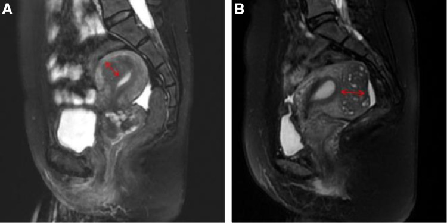
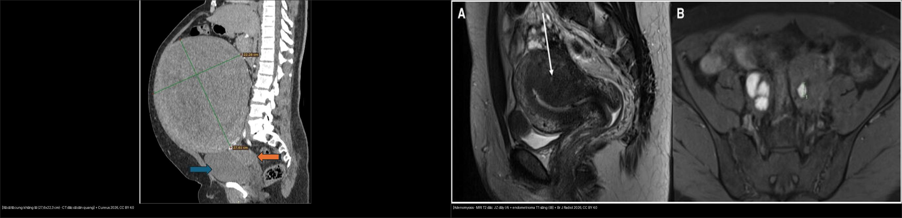
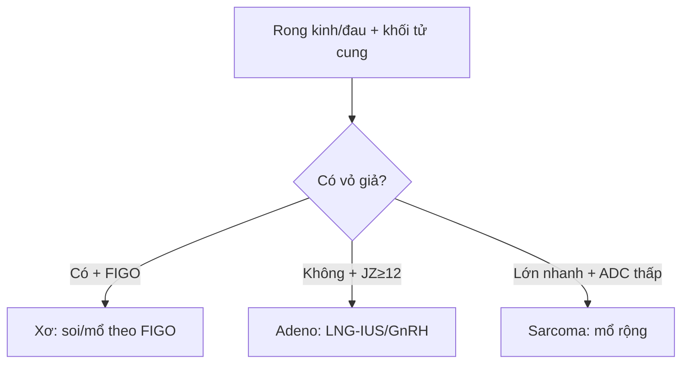
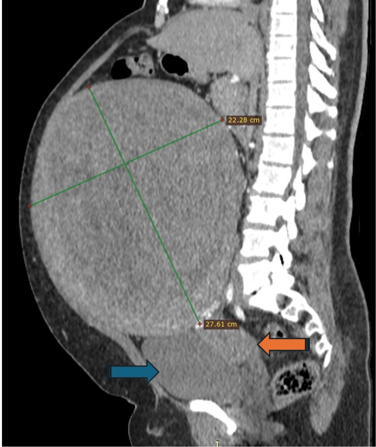

# 520 — Tử cung: xơ FIGO 0–8, adenomyosis & nội mạc / Fibroids vs adenomyosis

**Tags:** `pattern:khoi-tu-cung` `vung:tu-cung` `score:FIGO`
**Mức chắc chắn (certainty):** tổng hợp y văn (literature synthesis) — nhóm tự biên từ y văn mở, chưa gắn ca nguyên văn đơn lẻ.

## 1. Tổng quan — có vỏ hay không + JZ bao nhiêu mm + nội mạc bao nhiêu mm

- U xơ (leiomyoma): u cơ đơn dòng có **vỏ giả (pseudocapsule)** + mạch bao quanh (bridging vessel) — TẠI SAO bờ rõ + đẩy lệch JZ: u đẩy mô lành ra ngoài tạo vỏ.
- Adenomyosis: tuyến nội mạc lạc vào cơ + cơ phì đại — TẠI SAO **JZ ≥ 12 mm + nang T2 2–5 mm + mạch xuyên**: tuyến lạc + cơ phản ứng lan tỏa, không vỏ (≤ 8 mm bình thường, 8–12 mm vùng xám). Phân biệt **nội (internal — JZ dày ≥ 12 mm và tỷ lệ JZ/cơ cùng bên > 40%)** vs **ngoại (external — ổ ngoài JZ)**.
- Nội mạc mãn kinh chảy máu: **≤ 4 mm loại trừ K (> 99%)**, ≥ 5 mm sinh thiết — TẠI SAO: nội mạc teo không thể giấu K dày.
- **Phân loại FIGO 0–8 u xơ (quyết định ngả đường mổ):** **0** có cuống trong buồng; **1** trong cơ < 50% thể tích nằm trong buồng; **2** trong cơ ≥ 50% trong buồng (**0–2 = soi buồng, độ 2 đôi khi hai thì**); **3** tiếp giáp nội mạc nhưng 100% trong cơ; **4** trong cơ hoàn toàn; **5** dưới thanh mạc **≥ 50%** trong cơ; **6** dưới thanh mạc **< 50%** trong cơ (**3–6 = nội soi ổ bụng/cắt u**); **7** dưới thanh mạc có cuống; **8** ở nơi khác (cổ tử cung, ký sinh, dây chằng rộng — **7–8 = nội soi ổ bụng**). **Loại 2–5 dùng chung ký hiệu ghép** (vd 2-5).

## 2. Gamut khối/dày tử cung (Gamut)

- **Bờ rõ + vỏ giả + mạch bao + T2 tối:** xơ (FIGO 0–8 quyết định soi buồng/mổ bụng).
- **Không vỏ + JZ ≥ 12 mm + nang T2 + mưa rào:** adenomyosis — LNG-IUS/GnRH (khó bóc!).
- **Lớn nhanh + T2/DWI không đều + ADC thấp:** sarcoma — mổ rộng (không bào nhỏ!).
- **Mãn kinh + chảy máu + ≥ 5 mm:** sinh thiết nội mạc (polyp có cuống mạch đơn độc).

## 3. Bảng so sánh phân biệt (ma trận đối chiếu)

| Thực thể (entity) | Hình ảnh điển hình | Chốt vào (rule-in) | Chốt loại (rule-out) | Gợi ý xác nhận |
|---|---|---|---|---|
| U xơ FIGO | **Bờ rõ + vỏ giả + mạch bao + T2 tối + FIGO 0–8** | **Vỏ + bridging vessel + đẩy JZ** | Không vỏ + JZ dày → adeno | FIGO 0–2 soi buồng; 5–7 mổ bụng |
| Adenomyosis | **JZ ≥ 12 mm + nang 2–5 mm + xuyên mạch + mưa rào** | **JZ + nang + không vỏ** | Vỏ giả + mạch bao → xơ | LNG-IUS/GnRH; khó bóc |
| Sarcoma | **Lớn nhanh + T2/DWI không đều + ADC thấp + hoại tử** | **Tăng trưởng nhanh + không đều** | Bờ rõ + T2 tối đều → xơ | Mổ rộng nguyên khối |
| Dày nội mạc | **Mãn kinh + chảy máu + ≥ 5 mm; polyp cuống mạch** | **≥ 5 mm + chảy máu = sinh thiết** | ≤ 4 mm → loại trừ (> 99%) | Soi buồng + nạo sinh thiết |

*(A) xơ bờ rõ + vỏ giả; (B) adeno JZ dày + nang; (C) đồng tồn tại 30–50%. Nguồn: Pecorella et al., Diagnostics 2026 Fig. 1, CC BY 4.0.*

*Cột A — **xơ trong cơ (intramural fibroid):** TVUS khối giảm âm bờ rõ + bóng bờ + mạch ngoại vi; MRI **khối bờ rõ + T2 tối + vỏ giả + ngấm mạch ngoại vi, JZ thường còn**. Cột B — **adenomyosis lan tỏa:** TVUS cơ dày không đối xứng + nang cơ + bóng hình quạt; MRI **JZ > 12 mm + nang cơ (T2/T1 sáng) + cơ đồng nhất kém, bờ không rõ**. Cột C — **đồng tồn tại cả hai (30–50%).** Nguồn: Diagnostics 2026 (PMC13605732), CC BY 4.0.*

*(A) **Adenomyosis nội (internal):** JZ dày ≥ 12 mm và **tỷ lệ JZ/cơ cùng bên > 40%** (mũi tên đỏ). (B) **Adenomyosis ngoại (external):** ổ lạc nội mạc ngoài JZ. Nguồn: Medicine 2026 (PMC13313630), CC BY 4.0.*

*Trái: **xơ dưới thanh mạc khổng lồ 27,6 × 22,3 cm** (CT dọc có cản quang — khối bờ rõ, đẩy lệch tạng). Phải: **adenomyosis** (MRI T2 dọc — JZ dày lan tỏa, không có vỏ/khối khu trú). Nguồn: Cureus 2026 (PMC13263843) + Br J Radiol 2026 (PMC13070643), CC BY 4.0. Ảnh ghép letterbox.*

## 4. Protocol tử cung

- **TVUS (MUSA) + MRI T2 (JZ mm) + Doppler** khi rong kinh/đau; soi buồng + sinh thiết khi nội mạc ≥ 5 mm mãn kinh chảy máu.

## 5. Cạm bẫy

- **Đồng tồn tại xơ + adeno 30–50%** mổ xơ xong vẫn đau — MRI JZ trước mọi mổ xơ.
- **Bào nhỏ sarcoma tưởng xơ** gieo khắp ổ bụng — lớn nhanh + ADC thấp là mổ nguyên khối.
- **Adenomyoma khu trú giả xơ** — không vỏ + nang + xuyên mạch mới là adeno.

## 6. Tự lượng giá — Blind Quiz

**Ca 1 — Rong kinh + tử cung to. Đọc bảng so sánh TVUS/MRI: cột nào là xơ, cột nào là adeno, dấu chốt mỗi bên?**

- Gợi ý lâm sàng: nữ 40 tuổi, rong kinh + đau bụng kinh, tử cung to.
- Câu hỏi: Ba cột A/B/C là gì? Dấu MRI nào chốt mỗi cột?

<b>Bấm để hiện đáp án (findings + chẩn đoán)</b>

- Dấu hiệu (findings): (A) khối bờ rõ + vỏ giả + T2 tối + ngấm mạch ngoại vi, JZ còn = **xơ trong cơ**; (B) JZ > 12 mm + nang cơ + bờ không rõ = **adenomyosis lan tỏa**; (C) cả hai cùng lúc = **đồng tồn tại (30–50%)**.
- Chẩn đoán (diagnosis): **phân biệt xơ vs adenomyosis bằng vỏ giả + JZ mm** — đồng tồn tại cao nên đừng bỏ sót bên còn lại.
- Nguồn ảnh: Diagnostics 2026 (PMC13605732), CC BY 4.0.

**Ca 2 — MRI T2 dọc: JZ dày đến đâu thì gọi adenomyosis nội?**

- Câu hỏi: Đo JZ bằng ngưỡng nào? Tỷ lệ JZ/cơ cùng bên bao nhiêu thì dương?

<b>Bấm để hiện đáp án (findings + chẩn đoán)</b>

- Dấu hiệu: (A) **adenomyosis nội** — JZ dày tối đa **≥ 12 mm** và **tỷ lệ JZ/cơ cùng bên > 40%** (mũi tên đỏ); (B) **adenomyosis ngoại** — ổ lạc ngoài JZ.
- Chẩn đoán: ngưỡng **JZ ≥ 12 mm** (≤ 8 mm bình thường; 8–12 mm vùng xám) **+ nang cơ T2/T1 sáng + không vỏ**.
- Nguồn ảnh: Medicine 2026 (PMC13313630), CC BY 4.0.

**Ca 3 — Khối bụng khổng lồ ở nữ, CT dọc có cản quang.**

- Câu hỏi: Bờ khối ra sao (so với adenomyosis)? Đo kích thước? Thuộc nhóm FIGO nào?

<b>Bấm để hiện đáp án (findings + chẩn đoán)</b>

- Dấu hiệu: **khối bờ RÕ, đồng nhất, có vỏ** phát từ thân tử cung, đo **27,6 × 22,3 cm** (mũi tên xanh = bàng quang, cam = tử cung) — **xơ dưới thanh mạc khổng lồ**.
- Chẩn đoán: khác adenomyosis ở **bờ rõ + có vỏ + không lan tỏa JZ**; FIGO 6/7 (dưới thanh mạc) → **nội soi ổ bụng/cắt u** (không bào nhỏ nếu nghi sarcoma).
- Đối chiếu composite:  — trái: khối **bờ rõ có vỏ** (xơ); phải: **JZ dày lan tỏa không vỏ** (adenomyosis).
- Nguồn ảnh: Cureus 2026 (PMC13263843) + Br J Radiol 2026 (PMC13070643), CC BY 4.0.

**Ca 4 — Mãn kinh + ra máu + nội mạc 8 mm: theo dõi hay sinh thiết?** *(Bảng mục 3.)*

<b>Bấm để hiện đáp án (findings + chẩn đoán)</b>

- **Sinh thiết bắt buộc:** ≥ 5 mm + chảy máu (≤ 4 mm mới loại trừ > 99%); soi buồng + nạo sinh thiết.

## Bài liên quan chéo
- [500 – Tổng quan Vú & SPK](../500-tong-quan-vu-san-phu-khoa/lesson.md)
- [525 – K nội/cổ tử cung (dự kiến viết sau)]
- [540 – DIE](../540-lac-noi-mac-tu-cung-sau-DIE-MRI/lesson.md) (adeno + DIE)

> Không dùng để chẩn đoán độc lập khi chưa có người hướng dẫn.
