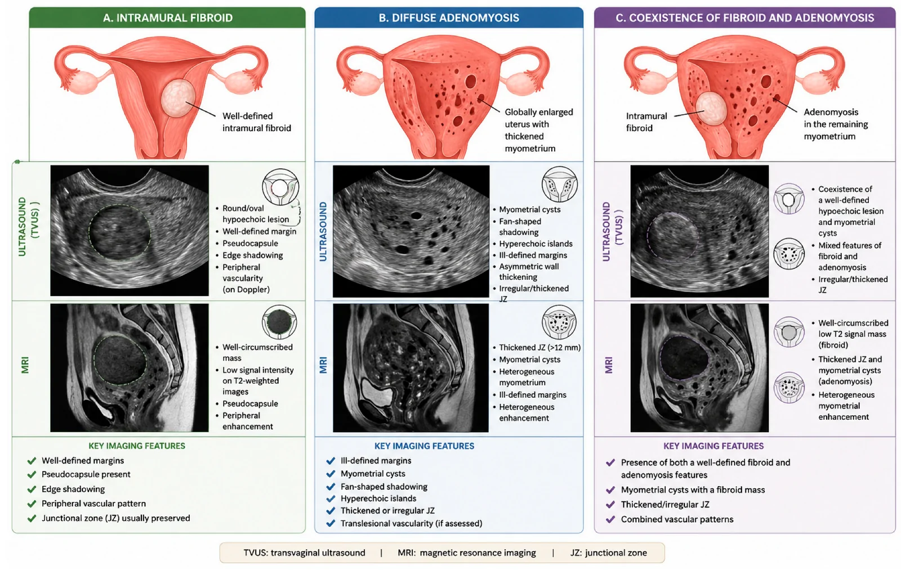
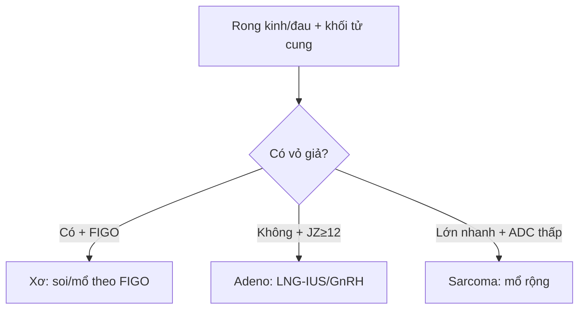

# 520 — Tử cung: xơ FIGO 0–8, adenomyosis & nội mạc / Fibroids vs adenomyosis

**Tags:** `pattern:khoi-tu-cung` `vung:tu-cung` `score:FIGO`
**Mức chắc chắn (certainty):** tổng hợp y văn (literature synthesis) — nhóm tự biên từ y văn mở, chưa gắn ca nguyên văn đơn lẻ.

## 1. Tổng quan — có vỏ hay không + JZ bao nhiêu mm + nội mạc bao nhiêu mm

- U xơ (leiomyoma): u cơ đơn dòng có **vỏ giả (pseudocapsule)** + mạch bao quanh (bridging vessel) — TẠI SAO bờ rõ + đẩy lệch JZ: u đẩy mô lành ra ngoài tạo vỏ.
- Adenomyosis: tuyến nội mạc lạc vào cơ + cơ phì đại — TẠI SAO **JZ ≥ 12 mm + nang T2 2–5 mm + mạch xuyên**: tuyến lạc + cơ phản ứng lan tỏa, không vỏ (≤ 8 mm bình thường, 8–12 mm vùng xám).
- Nội mạc mãn kinh chảy máu: **≤ 4 mm loại trừ K (> 99%)**, ≥ 5 mm sinh thiết — TẠI SAO: nội mạc teo không thể giấu K dày.

## 2. Gamut khối/dày tử cung (Gamut)

- **Bờ rõ + vỏ giả + mạch bao + T2 tối:** xơ (FIGO 0–8 quyết định soi buồng/mổ bụng).
- **Không vỏ + JZ ≥ 12 mm + nang T2 + mưa rào:** adenomyosis — LNG-IUS/GnRH (khó bóc!).
- **Lớn nhanh + T2/DWI không đều + ADC thấp:** sarcoma — mổ rộng (không bào nhỏ!).
- **Mãn kinh + chảy máu + ≥ 5 mm:** sinh thiết nội mạc (polyp có cuống mạch đơn độc).

## 3. Bảng so sánh phân biệt (ma trận đối chiếu)

| Thực thể (entity) | Hình ảnh điển hình | Chốt vào (rule-in) | Chốt loại (rule-out) | Gợi ý xác nhận |
|---|---|---|---|---|
| U xơ FIGO | **Bờ rõ + vỏ giả + mạch bao + T2 tối + FIGO 0–8** | **Vỏ + bridging vessel + đẩy JZ** | Không vỏ + JZ dày → adeno | FIGO 0–2 soi buồng; 5–7 mổ bụng |
| Adenomyosis | **JZ ≥ 12 mm + nang 2–5 mm + xuyên mạch + mưa rào** | **JZ + nang + không vỏ** | Vỏ giả + mạch bao → xơ | LNG-IUS/GnRH; khó bóc |
| Sarcoma | **Lớn nhanh + T2/DWI không đều + ADC thấp + hoại tử** | **Tăng trưởng nhanh + không đều** | Bờ rõ + T2 tối đều → xơ | Mổ rộng nguyên khối |
| Dày nội mạc | **Mãn kinh + chảy máu + ≥ 5 mm; polyp cuống mạch** | **≥ 5 mm + chảy máu = sinh thiết** | ≤ 4 mm → loại trừ (> 99%) | Soi buồng + nạo sinh thiết |

*(A) xơ bờ rõ + vỏ giả; (B) adeno JZ dày + nang; (C) đồng tồn tại 30–50%. Nguồn: Pecorella et al., Diagnostics 2026 Fig. 1, CC BY 4.0.*

## 4. Protocol tử cung

- **TVUS (MUSA) + MRI T2 (JZ mm) + Doppler** khi rong kinh/đau; soi buồng + sinh thiết khi nội mạc ≥ 5 mm mãn kinh chảy máu.

## 5. Cạm bẫy

- **Đồng tồn tại xơ + adeno 30–50%** mổ xơ xong vẫn đau — MRI JZ trước mọi mổ xơ.
- **Bào nhỏ sarcoma tưởng xơ** gieo khắp ổ bụng — lớn nhanh + ADC thấp là mổ nguyên khối.
- **Adenomyoma khu trú giả xơ** — không vỏ + nang + xuyên mạch mới là adeno.

## 6. Tự lượng giá — Blind Quiz

**Ca 1 — Rong kinh + tử cung to. Đọc bảng so sánh TVUS/MRI.**

- Hỏi: cột nào là xơ? Cột nào là adeno? Dấu MRI chốt mỗi bên?

<b>Bấm để hiện đáp án</b>

- Dấu hiệu (findings): (A) khối bờ rõ + vỏ giả + T2 tối = xơ; (B) JZ > 12 mm + nang + không vỏ = adeno; (C) cả 2 cùng lúc.
- Chẩn đoán (diagnosis): **phân biệt xơ vs adenomyosis bằng vỏ giả + JZ mm** (đồng tồn tại 30–50% — đừng bỏ sót bên còn lại).
- Nguồn: Pecorella et al., Fig. 1, CC BY 4.0.

**Ca 2 — Mãn kinh + ra máu + nội mạc 8 mm:** theo dõi hay sinh thiết? *(Bảng mục 3.)*

<b>Bấm để hiện đáp án</b>

- **Sinh thiết bắt buộc:** ≥ 5 mm + chảy máu (≤ 4 mm mới loại trừ > 99%).

## Bài liên quan chéo
- [500 – Tổng quan Vú & SPK](../500-tong-quan-vu-san-phu-khoa/lesson.md)
- [525 – K nội/cổ tử cung (dự kiến viết sau)]
- [540 – DIE](../540-lac-noi-mac-tu-cung-sau-DIE-MRI/lesson.md) (adeno + DIE)

> Không dùng để chẩn đoán độc lập khi chưa có người hướng dẫn.
