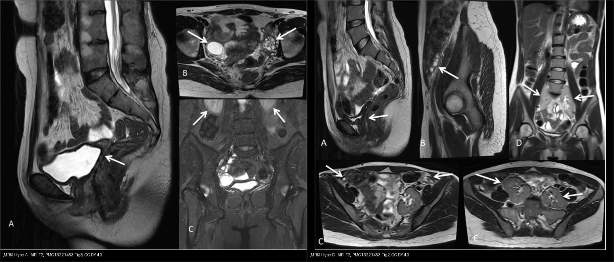
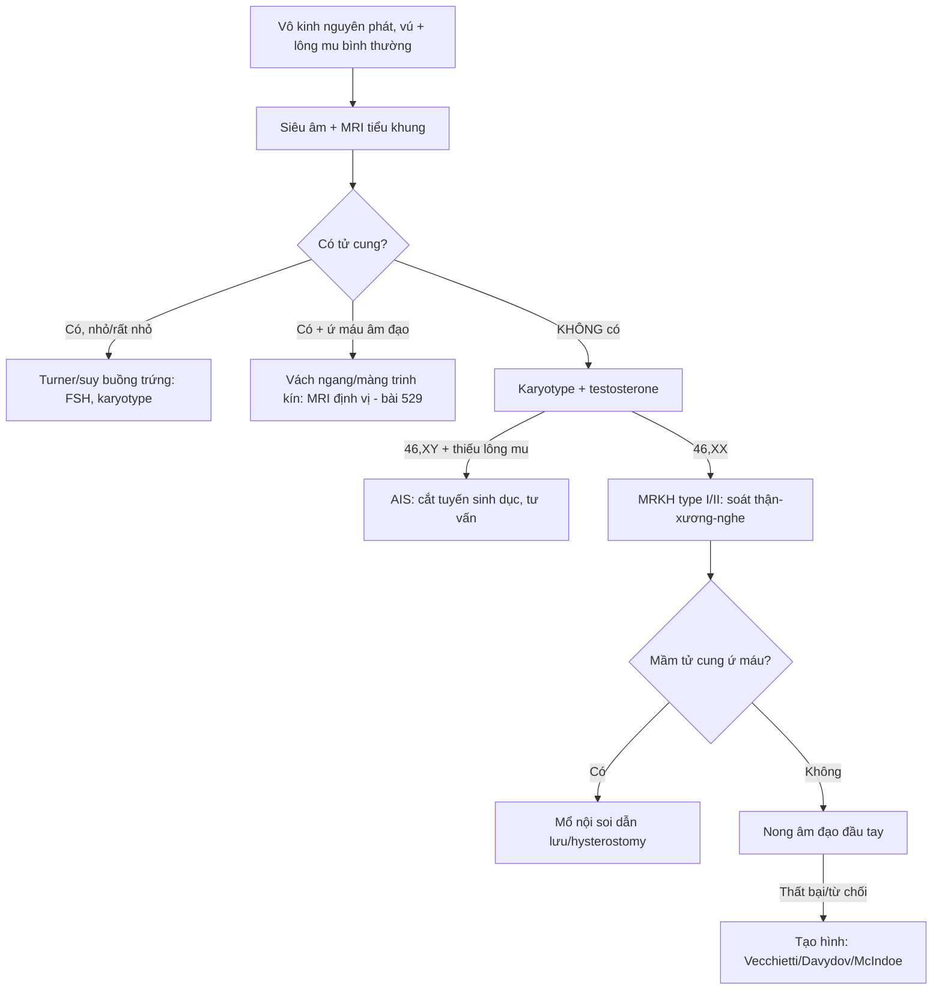
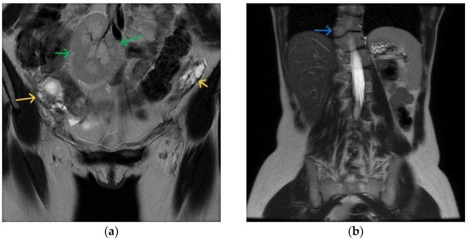
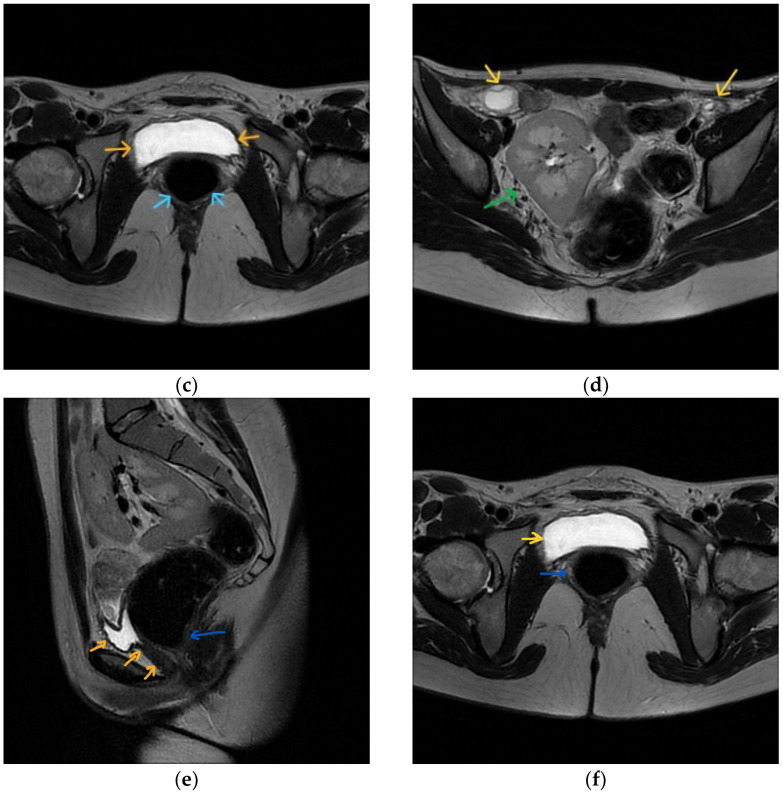
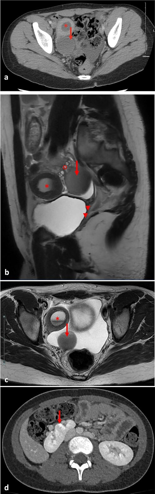
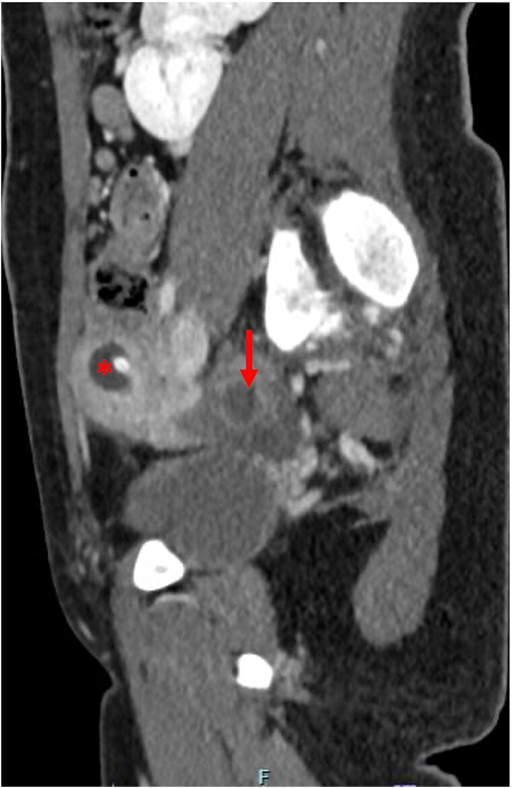
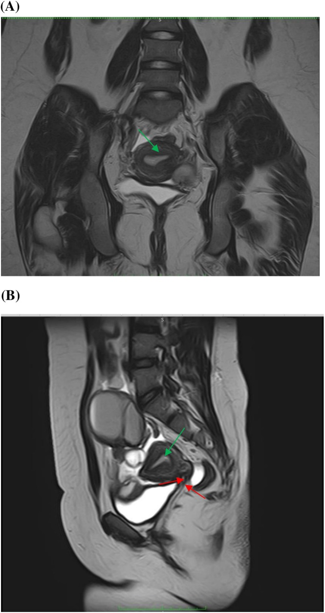
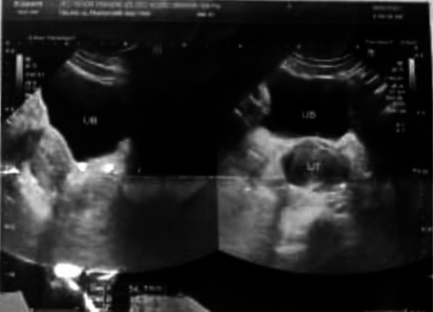
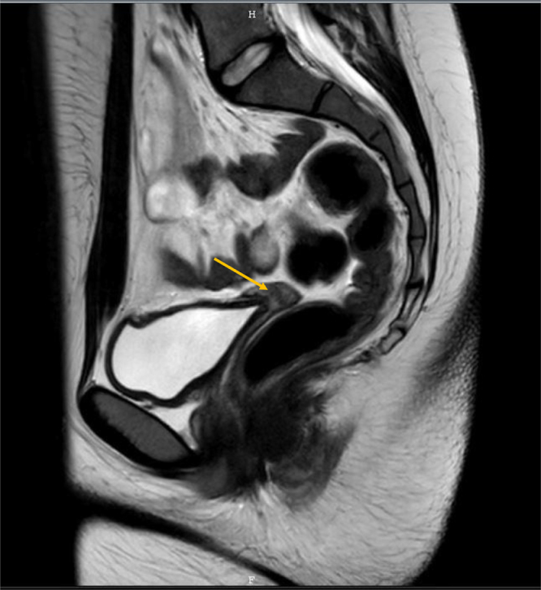
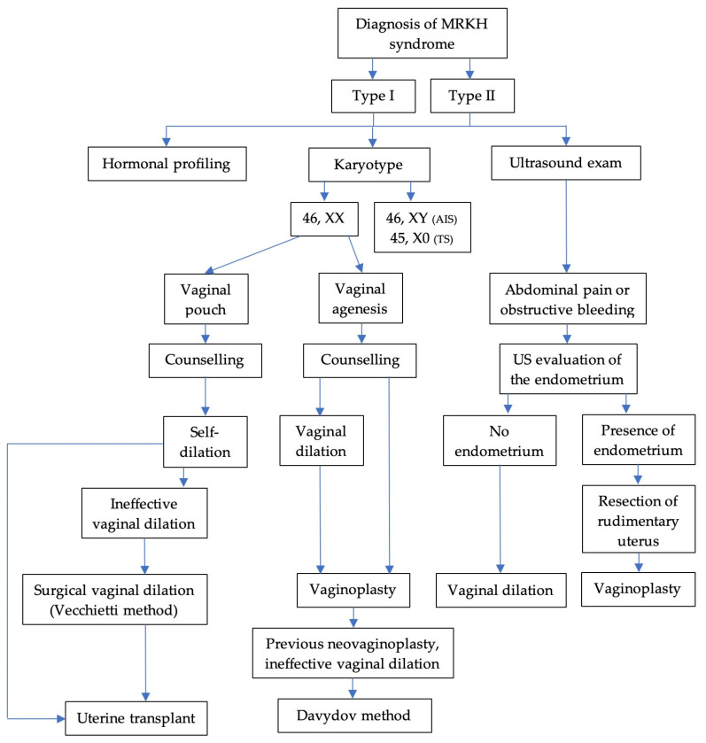

# 521 — Hội chứng Mayer–Rokitansky–Küster–Hauser (MRKH): bất sản tử cung–âm đạo & tạo hình âm đạo / MRKH syndrome & vaginoplasty

**Tags:** `pattern:bat-san-muller` `pattern:am-dao-bat-san` `pattern:vo-kinh-nguyen-phat` `vung:tu-cung` `vung:am-dao` `score:MRKH-type` `protocol:MRI-tieu-khung`
**Mức chắc chắn (certainty):** tổng hợp y văn (literature synthesis) — tổng quan + ca nguyên văn CC BY (Schiau *Diagnostics* 2026; Trivedi *Cureus* 2026; Mahajan *J Surg Case Rep* 2025; Irshad *Clin Case Rep* 2026; Varlas *J Clin Med* 2025; Begum *Indian J Plast Surg* 2025).

## 1. Tổng quan — mất ống Müller, giữ nguyên buồng trứng

- **MRKH (Mayer–Rokitansky–Küster–Hauser)** là nhóm dị dạng ống cận trung thận (paramesonephric/Müllerian): **bất sản tử cung + 2/3 trên âm đạo**, trên người **karyotype 46,XX, buồng trứng và nội tiết bình thường**, hình thể nữ bình thường. **1/4.000–5.000 trẻ gái sơ sinh**; chiếm **~16% các ca vô kinh nguyên phát** (đứng thứ 2 sau suy buồng trứng).
- **Bệnh học phôi thai (TẠI SAO hình ảnh như vậy):** ống Müller hình thành ống dẫn trứng–tử cung–cổ tử cung–**2/3 trên âm đạo** (tuần 8–12). Khi bất sản, các dẫn xuất này thiếu → **tử cung/cổ/2/3 trên âm đạo không có**; **1/3 dưới âm đạo** sinh từ xoang niệu sinh dục (ngoại bì) vẫn còn → **túi cùng âm đạo ngắn, cụt, sâu 2–7 cm**. Vì tuyến sinh dục nguyên thủy (buồng trứng) sinh từ **trung mô nguyên thủy**, **buồng trứng thường còn và hoạt động bình thường** (bất thường buồng trứng chỉ **5–10%**).
- **TẠI SAO MRI là chìa khóa:** MRI T2W phân biệt rõ **cơ tử cung (tín hiệu trung gian)**, **nội mạc (sáng)**, **buồng trứng (sáng T2 do nang noãn)** và tìm **mầm tử cung thô sơ (rudimentary uterine buds)**, trong khi siêu âm ở trẻ vị thành niên chưa trưởng thành dễ bỏ sót. MRI cũng một mạch phát hiện **bất thường kèm theo** (thận, cột sống) và loại trừ ổ ứ máu.
- **Phân loại & đi kèm (số liệu Schiau 2026):**
  - **Type I = A (thể đơn độc):** chỉ bất sản tử cung–âm đạo.
  - **Type II = B (thể có hội chứng / MURCS):** kèm dị tật ngoài sinh dục — **thận 30–40%** (bất sản một thận là hay gặp nhất, ~một nửa), **xương 10–12%** (trong MURCS 30–40%, vẹo cột sống ~20%, Klippel–Feil), **nghe 10–25%**, **tim < 5%**.
  - Hội chứng **MURCS** = **MU**llerian aplasia + **R**enal + **C**ervicothoracic **S**omite (thể nặng nhất).
- **~3% MRKH có tử cung CÒN CHỨC NĂNG nhưng tắc nghẽn** → **ứ máu tử cung (hematometra) + ứ máu vòi trứng (hematosalpinx)** → đau bụng chu kỳ ở tuổi vị thành niên (Mahajan 2025, ca 12 tuổi). Đây là **cấp cứu/đau mạn** cần giải quyết.
- **Điểm phải loại trừ trước tiên:** **hội chứng không nhạy cảm androgen hoàn toàn (complete androgen insensitivity — CAIS/AIS)** — karyotype **46,XY**, có tinh hoàn (thường trong bẹn), **thiếu lông mu**, testosterone cao; lâm sàng + xét nghiệm karyotype/testosterone là chốt (MRI một mình gần giống).

## 2. Mẫu hình + chẩn đoán phân biệt (Gamut)

- **Hình thái cửa vào: "vô kinh nguyên phát + tuyến vú phát triển bình thường + lông mu bình thường".** Nếu vú phát triển → estrogen có → không phải suy buồng trứng/Turner kinh điển; nếu lông mu bình thường → không phải AIS. Tổ hợp này thu hẹp mạnh về **nhóm tắc nghẽn/bất sản Müller**.
- **Gamut theo hình ảnh (MRI tiểu khung):**
  - **Không có tử cung + buồng trứng bình thường:** MRKH type I (thận bình thường) vs MRKH type II (thận/tử cung kèm dị tật).
  - **Thấy mầm tử cung + ứ dịch/ứ máu:** MRKH thể có tử cung chức năng tắc nghẽn; hoặc **bất sản cổ tử cung (cervical agenesis)** / vách ngang âm đạo (bài [529](../529-co-tu-cung-am-dao-bam-sinh-tac-nghen/lesson.md)).
  - **Bên trong bẹn có tuyến sinh dục + 46,XY:** AIS.
  - **Tử cung rất nhỏ + FSH/Cao + vú kém phát triển:** suy buồng trứng/Turner (45,X) — không phải MRKH.
- **Gợi nhớ "KVAA":** **K**hông có tử cung — **V**agina ngắn cụt — **A**nh hưởng thận/xương — **A**ndrogen (soát karyotype). Luôn trả lời đủ 4 câu.

## 3. Bảng so sánh phân biệt (ma trận đối chiếu)

| Thực thể (entity) | Hình ảnh điển hình (US/MRI) | Chốt vào (rule-in) | Chốt loại (rule-out) | Gợi ý xác nhận |
|---|---|---|---|---|
| MRKH type I (A) | Tử cung/cổ/2/3 trên âm đạo **không có**; buồng trứng bình thường có nang noãn; **thận hai bên bình thường** | **Không tử cung + buồng trứng bình thường + 46,XX** | Thấy tuyến sinh dục bẹn + 46,XY → AIS | MRI T2 3 mặt phẳng + karyotype |
| MRKH type II (B/MURCS) | Như trên **+ dị tật thận** (bất sản một thận, thận lạc chỗ/móng ngựa) ± xương/nghe | **Không tử cung + bất thường thận/cột sống** | Thận hai bên bình thường + không dị tật → type I | MRI + siêu âm/MRI thận + X-quang/nghe |
| Thể có tử cung tắc nghẽn | Mầm tử cung **ứ máu (hematometra)** + ứ vòi trứng; đau chu kỳ | **Mầm tử cung ngấm — ứ dịch T2 sáng + túi máu** | Không thấy mầm tử cung → thể đơn thuần | MRI; mổ nội soi dẫn lưu |
| CAIS / AIS | Không tử cung; **tinh hoàn** (bẹn) — mô tuyến sinh dục; âm đạo ngắn cụt | **Karyotype 46,XY + thiếu lông mu + testosterone cao** | 46,XX + lông mu bình thường → MRKH | Karyotype + testosterone; tư vấn cắt tuyến sinh dục |
| Turner / suy buồng trứng | Tử cung **rất nhỏ nhưng CÓ**, buồng trứng dạng dải (streak); vú kém phát triển | **Tử cung còn + FSH cao + karyotype 45,X/46,XX** | Tử cung không có → MRKH | FSH/estradiol + karyotype |
| Vách ngang âm đạo / màng trinh kín | Ứ máu âm đạo (hematocolpos) **phía trên** vách; **tử cung CÓ** | **Tử cung có + ứ máu âm đạo** | Không tử cung → MRKH | MRI xác định vị trí vách (bài 529) |

*Trái: **type A** — MRI T2 xoay dọc: không có tử cung/cổ/2/3 trên âm đạo (mũi tên), buồng trứng bình thường, **thận hai bên bình thường**. Phải: **type B** — cùng hình thái bất sản **nhưng kèm thận lạc chỗ hai bên** (mũi tên). Nguồn: Trivedi VS et al., Cureus 2026, PMC13221453 Fig. 2 & 3, CC BY 4.0. Ảnh ghép letterbox, giữ nguyên tỷ lệ.*

### Hai cách gọi tên (tránh nhầm)
- **Type I/II** (kinh điển) = **type A/B** (cách gọi nhiều bài hình ảnh dùng): **A = đơn độc** (isolated uterovaginal agenesis); **B = kèm dị tật** (hay gặp nhất là thận). Bản chất giống nhau; type II/B gộp cả **MURCS**.
- **"Typical vs atypical"** cũng tương ứng: typical = chỉ bất sản Müller; atypical = có dị tật cơ-quan ngoài.

## 4. Protocol chụp + phân độ & xử trí

- **Chẩn đoán hình ảnh (thứ tự):**
  1. **Siêu âm tiểu khung** (bụng hoặc đầu dò 3D qua âm đạo khi đã đủ tuổi): xác nhận không tử cung, tìm buồng trứng, đánh giá thận.
  2. **MRI tiểu khung (chuẩn vàng):** T2 **3 mặt phẳng** (tìm mầm tử cung, đo túi âm đạo cụt), T1 ± **T2 fat-sat** (máu cũ/ứ máu), có thể DWI. Ghi rõ: có/không mầm tử cung, chiều dài túi âm đạo, buồng trứng, vị trí thận.
  3. **Loại trừ AIS:** **karyotype + testosterone** (bắt buộc trước kết luận MRKH ở người chưa có kết quả).
  4. **Tầm soát kèm theo:** siêu âm/MRI thận (± đường niệu), X-quang/nghe (cột sống–thính lực), tim nếu nghi.
- **Phân độ:** dùng **type I (A) vs type II (B)/MURCS** như mục 3; ghi kèm bản đồ dị tật (thận/xương/nghe/tim) để tư vấn.
- **Xử trí — tạo hình âm đạo (vaginoplasty):**
  - **Bước 1: nong âm đạo không mổ (dilation / Frank):** **điều trị đầu tay**, hiệu quả cao, ít biến chứng. Tỷ lệ thành công **74–95%** (một số nghiên cứu **64%**); dùng nong tăng dần kích thước ngoài giờ giao hợp.
  - **Bước 2: phẫu thuật** khi thất bại/từ chối nong:
    - **Vecchietti** (nếu còn **túi âm đạo**): kéo căng bằng nút căng dần (theo ACOG, lựa chọn thứ 2 sau nong).
    - **Davydov** (nếu **bất sản âm đạo**): tạo vòm âm đạo bằng **mảnh phúc mạc**; loại nội soi hay dùng nhất. Series **n = 83**: dài **8,2 ± 0,8 cm** lúc 6 tháng, thành công chức năng **95,3%** lúc 12 tháng (thang FSFI).
    - **McIndoe** (ghép da): phổ biến nhất nhưng cần nong suốt đời, dễ co kéo/khô. Series Begum **n = 7**: **2/14,3%** biến chứng (co kéo mảnh ghép, mất một phần mảnh ghép); dài **6–10 cm** (trung bình 8 cm).
    - **Varlas 2025** (Davydov cải tiến + treo vòm âm đạo vào xương cùng, n = 3): dài **14,66 cm** lúc ra viện → **~11,3 cm** sau 5 năm, **không hẹp**, không mô hạt.
  - **Tiêu chuẩn "âm đạo mới thành công":** **dài ≥ 7 cm** (nhiều tác giả ≥ 6 cm), đủ rộng cho **2 ngón tay**, giao hợp không đau, hài lòng.
  - **So sánh nong vs mổ (Kang, n = 133):** chiều dài **nong 6,5 ± 2,04 cm** vs **mổ 8,1 ± 1,59 cm**; **điểm FSFI tương đương** trừ điểm cực khoái cao hơn ở nhóm nong.
  - **Nong là bắt buộc sau mọi phẫu thuật** để giữ dài, chống hẹp âm đạo.
- **Sinh sản:** buồng trứng còn chức năng → **trứng khỏe**; **ghép tử cung** đã có **ca sinh sống đầu tiên 2014 (Gothenburg)**; mang thai hộ là lựa chọn khác. Cần **tư vấn tâm lý** (ảnh hưởng sâu sắc bản sắc/giới tính).

## 5. Biến thể bình thường & cạm bẫy

- **Không được gọi AIS là MRKH:** nếu chưa có **karyotype + testosterone**, không kết luận MRKH. MRI giống nhau (không tử cung) nhưng **AIS có tinh hoàn** và **46,XY** — hướng xử trí hoàn toàn khác (nguy cơ u tuyến sinh dục, phải cắt tinh hoàn).
- **Nhầm "túi mầm" với buồng trứng:** vẫn phải **chứng minh buồng trứng bình thường** (nang noãn, T2 sáng) — nếu mô tả mơ hồ dễ bỏ sót u/hoại tử buồng trứng.
- **Bỏ sót bất thường thận (30–40%)**: luôn chụp/đọc kèm **thận hai bên** — thận lạc chỗ (pelvic/ectopic kidney) có thể bị nhầm thành khối phần phụ.
- **Thể có tử cung chức năng ứ máu (~3%)**: đau bụng chu kỳ ở trẻ vị thành niên — **không được xem nhẹ**; ứ máu kéo dài gây lạc nội mạc, dính, hiếm muộn nặng hơn.
- **Tử cung thô sơ nhỏ** trong MRKH vs **tử cung giảm sản do suy sinh dục**: kiểm tra **FSH/estradiol** và phát triển vú — tránh gọi MRKH khi chưa loại trừ nội tiết.
- **Siêu âm ở trẻ chưa trưởng thành dễ âm tính giả** (không thấy tuyến sinh dục) → MRI khi nghi ngờ; **tránh thăm khám âm đạo ở trẻ chưa dậy thì**.

## 6. Tự lượng giá — Blind Quiz

**Ca 1 — Nữ 19 tuổi vô kinh nguyên phát, vú và lông mu bình thường. Đọc MRI xoay dọc + trục trước khi mở đáp án.**

- Hỏi: có tử cung không? Buồng trứng còn không? Bất thường nào kèm theo? Cần xét nghiệm gì trước khi kết luận?

<b>Bấm để hiện đáp án (findings + chẩn đoán)</b>

- Dấu hiệu (findings): **không có tử cung–cổ–2/3 trên âm đạo**; **buồng trứng bình thường** (mũi tên vàng); **thận lạc chỗ** (mũi tên xanh lá), **bán đốt sống** (mũi tên xanh đậm), bàng quang (cam), trực tràng (xanh nhạt). Bản đồ chi tiết:

- Chẩn đoán (diagnosis): **MRKH type II (MURCS)** — bất sản Müller + **thận lạc chỗ + bán đốt sống**. Trước khi kết luận cần **karyotype + testosterone** (loại trừ AIS) và tầm soát thận–cột sống–thính lực.
- Nguồn: Schiau C et al., Diagnostics (Basel) 2026, PMC12785829 Fig. 1, CC BY 4.0.

**Ca 2 — Cùng nhóm bệnh, hai thể. Bên nào là type A, bên nào là type B? Nhãn giấu trong đáp án.**

<b>Bấm để hiện đáp án (findings + chẩn đoán)</b>

- **Trái = type A**: không tinh hoàn, buồng trứng bình thường, **thận hai bên bình thường**.
- **Phải = type B**: cùng bất sản tử cung–âm đạo **nhưng kèm thận lạc chỗ hai bên** (mũi tên).
- Chốt: **type A = đơn độc; type B = có dị tật kèm (thường thận)** — giống cách gọi type I/II.
- Nguồn: Trivedi VS et al., Cureus 2026, PMC13221453 Fig. 2 & 3, CC BY 4.0.

**Ca 3 — Bé gái 12 tuổi đau bụng dưới hạ vị từng đợt chu kỳ, được chẩn đoán MRKH. Đọc CT + MRI để tìm nguyên nhân đau.**

- Hỏi: có mầm tử cung không? Mũi tên ( * ) và mũi tên chỉ gì? Vì sao đau chu kỳ?

<b>Bấm để hiện đáp án (findings + chẩn đoán)</b>

- Dấu hiệu (findings): (a) CT trục — **sừng tử cung phải ứ máu (hematometra, *)** + **cấu trúc dạng nang phần phụ phải: ứ máu vòi trứng (hematosalpinx, mũi tên)**; (b) MRI xoay dọc cạnh dọc — sừng tử cung ứ máu + ứ vòi trứng, buồng trứng phải bình thường (o), cổ tử cung thoái triển.
- Chẩn đoán (diagnosis): **MRKH có tử cung CÒN CHỨC NĂNG bị tắc nghẽn → ứ máu tử cung + ứ máu vòi trứng** — nguyên nhân đau bụng chu kỳ. Đây là thể ~3% cần **mổ nội soi dẫn lưu** (hysterostomy) chứ không chỉ nong âm đạo.
- Nguồn: Mahajan UV et al., J Surg Case Rep 2025, PMC12503158 Fig. 1, CC BY 4.0.

**Ca 4 — Bệnh nhân Ca 3 sau dẫn lưu. Đọc CT kiểm tra 2 tuần sau.**

<b>Bấm để hiện đáp án (findings + chẩn đoán)</b>

- Dấu hiệu (findings): **hết ứ máu tử cung (*)** và **ứ vòi trứng giảm rõ** so với trước mổ.
- Chẩn đoán (diagnosis): **thành công sau dẫn lưu nội soi** — hình ảnh theo dõi sau can thiệp; triệu chứng đau hết hoàn toàn.
- Nguồn: Mahajan UV et al., J Surg Case Rep 2025, PMC12503158 Fig. 3, CC BY 4.0.

**Ca 5 — Bé gái 16 tuổi vô kinh nguyên phát, siêu âm bụng thấy túi dịch trong tiểu khung. Đọc siêu âm, rồi MRI.**

- Hỏi: túi dịch là gì? Có nên gọi "nang buồng trứng" không? Cần phân biệt với gì trên MRI?

<b>Bấm để hiện đáp án (findings + chẩn đoán)</b>

- Dấu hiệu (findings): siêu âm trục + dọc — **buồng tử cung giãn, chứa dịch giảm âm đồng nhất = ứ máu tử cung (hematometra)**; bàng quang (UB) phía trước; **không thấy ống cổ tử cung và âm đạo** (gợi ý bất sản cổ–âm đạo). Đối chiếu MRI:

- Dấu hiệu trên MRI: (A) T2 vành, (B) T2 dọc — **cổ tử cung thoái triển (cervical hypoplasia) + bất sản âm đạo (mũi tên đỏ)** + **buồng tử cung giãn (mũi tên xanh)**.
- Chẩn đoán (diagnosis): **tắc nghẽn đường ra (ứ máu tử cung) do bất sản cổ tử cung/âm đạo** — cần phân biệt với nang buồng trứng và **xác định vì sao đau vô kinh**; phẫu thuật tạo đường ra/staged.
- Nguồn: Irshad S et al., Clin Case Rep 2026, PMC12920063 Fig. 1 & 2, CC BY 4.0.

**Ca 6 — Bệnh nhân MRKH 18 tuổi, đau chậu mạn, hai sừng tử cung thô sơ. Đọc MRI.**

<b>Bấm để hiện đáp án (findings + chẩn đoán)</b>

- Dấu hiệu (findings): MRI — **bất sản âm đạo và cổ tử cung, hai sừng tử cung thô sơ hai bên, buồng trứng hai bên bình thường**; karyotype 46,XX.
- Chẩn đoán (diagnosis): **MRKH**; lựa chọn **cắt hai sừng tử cung thô sơ bằng robot (khi đau chậu mạn)**. Ảnh **CC BY-NC-ND giữ nguyên bản** (không ghép/crop).
- Nguồn: Csorba R et al., Int J Surg Case Rep 2026, PMC13456869 Fig. 1, CC BY-NC-ND 4.0.

**Ca 7 — Sơ đồ xử trí: đọc và tự trả lời trước khi mở.**

<b>Bấm để hiện đáp án (findings + chẩn đoán)</b>

- Nội dung: **cây quyết định điều trị MRKH** — phân nhánh với **AIS (hội chứng không nhạy cảm androgen)** và **TS (Turner)**; cơ sở chọn nong hay phẫu thuật tùy có túi âm đạo hay không.
- Chốt: **loại trừ AIS/Turner bằng karyotype–nội tiết trước**, rồi mới quyết định nong (đầu tay) vs Vecchietti/Davydov/McIndoe.
- Nguồn: Varlas VN et al., J Clin Med 2025, PMC11856762 Fig. 3, CC BY 4.0.

## Bài liên quan chéo
- [520 – Tử cung: xơ FIGO, adenomyosis & nội mạc](../520-tu-cung-u-xo-FIGO-adenomyosis-noi-mac/lesson.md)
- [528 – Dị dạng tử cung bẩm sinh (ESHRE/ESGE & ASRM)](../528-di-dang-tu-cung-bam-sinh-ESHRE-ESGE/lesson.md)
- [529 – Cổ tử cung & âm đạo bẩm sinh: dị dạng tắc nghẽn (C0–C4/V0–V4)](../529-co-tu-cung-am-dao-bam-sinh-tac-nghen/lesson.md)
- [525 – Ung thư nội mạc/cổ tử cung FIGO MRI](../525-ung-thu-noi-mac-co-tu-cung-FIGO-MRI/lesson.md)
- [536 – U mầm & u mô đệm–dây sinh dục buồng trứng](../536-u-mam-u-mo-dem-buong-trung/lesson.md) (tuyến sinh dục bất thường)
- [571 – Sẩy thai tái diễn: tiếp cận hình ảnh tử cung](../571-say-thai-tai-dien-tiep-can-hinh-anh/lesson.md)
- [500 – Tổng quan Vú & Sản Phụ khoa](../500-tong-quan-vu-san-phu-khoa/lesson.md)

> Không dùng để chẩn đoán độc lập khi chưa có người hướng dẫn.
