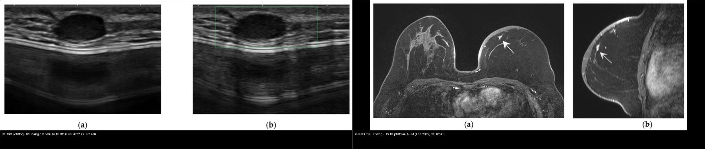
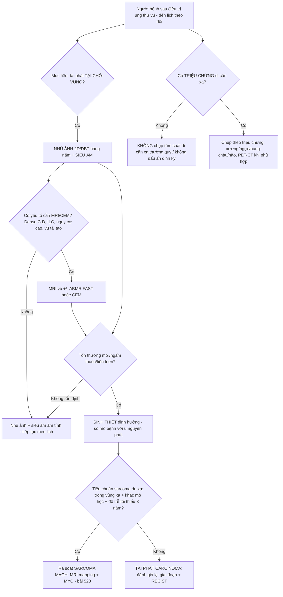
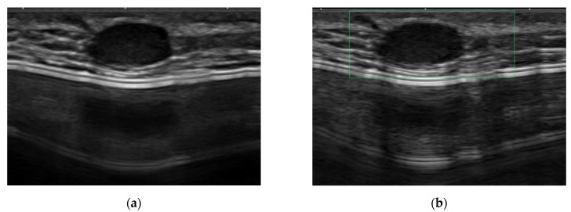
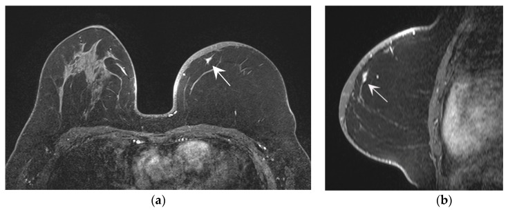
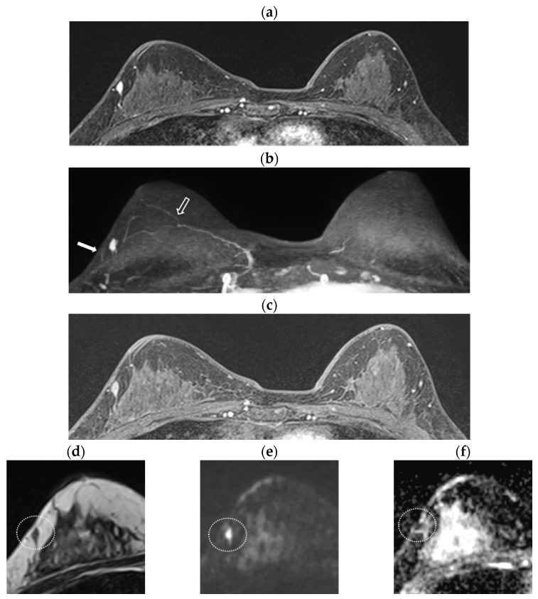
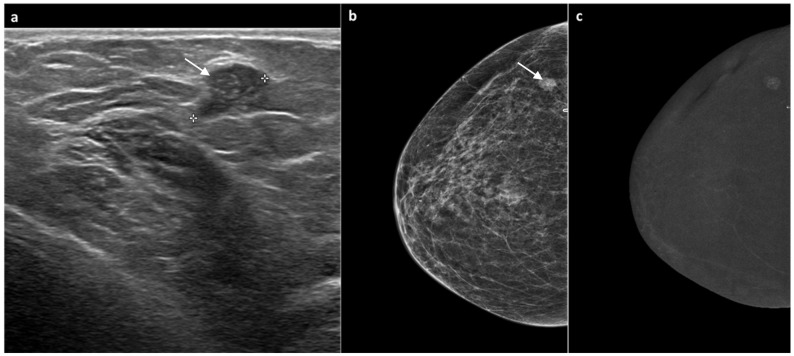
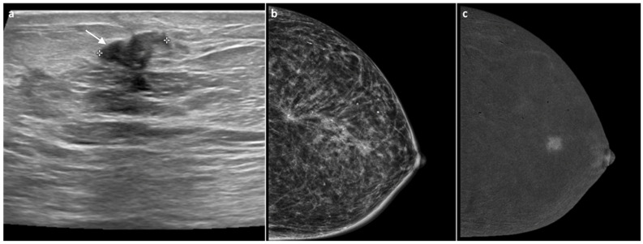
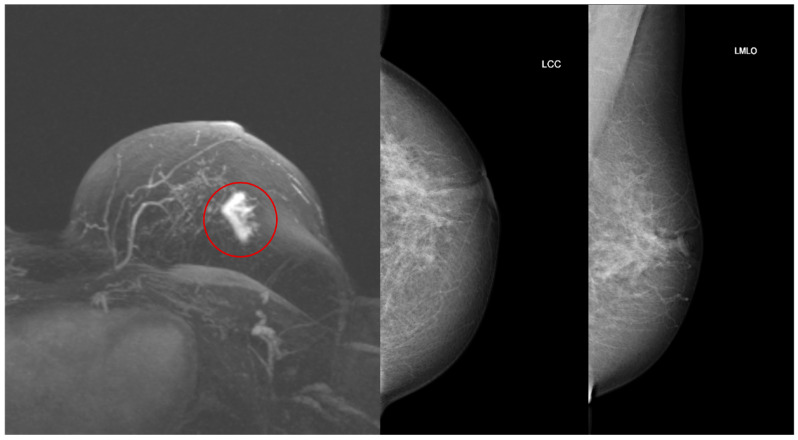
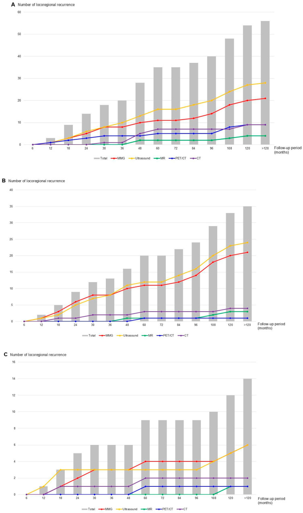
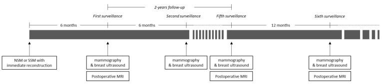

# 522 — Theo dõi sau điều trị ung thư vú: nhũ ảnh/DBT, siêu âm, MRI & CEM — ngưỡng nghi tái phát / Breast cancer post-treatment surveillance

**Tags:** `pattern:theo-doi-tai-phat` `pattern:u-tai-phat` `pattern:u-moi-doi-ben` `vung:vu` `score:BI-RADS` `score:RECIST` `protocol:nhu-anh` `protocol:MRI-vu` `protocol:CEM`
**Mức chắc chắn (certainty):** tổng hợp y văn (literature synthesis) — nhóm tự biên từ y văn mở (Europe PMC/PMC: *J Cancer Res Clin Oncol* 2024, *Diagnostics* 2022 & 2026, *Journal of Imaging* 2025, *Cancers* 2025 & 2026, *Ann Surg Oncol* 2024, *Insights into Imaging* 2026, *Asian Pac J Cancer Prev* 2026); ảnh minh họa đều CC BY/BY-NC.

## 1. Tổng quan — "chuyện sau điều trị" + cơ chế hình ảnh

- **Bối cảnh:** sau phẫu thuật bảo tồn (breast-conserving surgery — BCS) + xạ trị, hoặc cắt toàn bộ tuyến (mastectomy) có/không tái tạo, người bệnh bước vào **một chương mới của hình ảnh học**: mô vú mất dấu mốc + xơ hóa + phù nề xạ → **sẹo lành, hoại tử mỡ, biến dạng cấu trúc và tái phát có thể trông na ná nhau** trên cùng một phim. Đây là phần nối tiếp trực tiếp của bài [516 – Hình ảnh vú sau điều trị](../516-hinh-anh-vu-sau-dieu-tri/lesson.md).
- **Phải tách hai câu hỏi hoàn toàn khác nhau** (khác nhau về giá trị và cách chụp):
  1. **Tái phát tại chỗ–vùng (locoregional recurrence)** = **chữa khỏi được** nếu bắt sớm → **đây là lý do của mọi lần chụp theo dõi**. Gồm: tái phát trong vú đã mổ, thành ngực/da, hạch vùng (nách, trên đòn, hạch vú trong) và **ung thư vú MỚI ở bên đối diện** (không phải "di căn").
  2. **Di căn xa (distant metastasis)** = **chụp tầm soát thường quy KHÔNG kéo dài sống còn** → **không chụp định kỳ cho người không triệu chứng**.
- **TẠI SAO hình ảnh học tách được lành/ác (cơ chế vật lý):**
  - **Tái phát/ung thư mới = mô u còn sống** → tạo **tân mạch (angiogenesis)** → trên **CEM (contrast-enhanced mammography)** và **MRI DCE** ngấm thuốc **mạnh, nhanh–thoát sớm (washout)**; mật độ tế bào cao → **DWI sáng, ADC thấp**. Vì vậy **ngấm thuốc = chốt của mô sống**.
  - **Sẹo xơ/hoại tử mỡ = mô chết + xơ** → **không có mạch** → **không ngấm thuốc** (ngoài viền viêm mô hạt thoáng qua); thành phần mỡ giữ **tín hiệu T1 cao, mất khi fat-sat**. (Chi tiết vật lý ở bài 516.)
  - **Ngưỡng định lượng bắt buộc:**
    - Nguy cơ **tái phát tại chỗ–vùng + ung thư vú đối bên tích lũy tới ~20% trong 20 năm** đầu (PMC11021243).
    - **Độ nhạy phát hiện tái phát: MRI 97,9% ≫ siêu âm 67,8% ≈ nhũ ảnh 66,3%** (1499 bệnh nhân, 176 ca tái phát, PMC11021243).
    - **Nhũ ảnh** gộp (meta 8 nghiên cứu): **Se 81% (95% CI 0,63–0,91), Sp 71% (0,31–0,93), Acc 76%**, giảm **tử vong OR 0,50 (95% CI 0,27–0,92)** so với không chụp (PMC13499620).
    - **CEM** khi nhũ ảnh/siêu âm nghi ngờ: **Se 90,9%, Sp 86,2%, Acc 88,7%; κ = 0,76** (62 tổn thương, 88,2% tổn thương ngấm là ác, 89,3% không ngấm là lành, PMC12734039).
    - **MRI rút gọn (abbreviated breast MRI — ABMR) "FAST"**: **Se 81%, Sp 88,1–90,5%** — thêm chuỗi xung không cải thiện có ý nghĩa (p > 0,05) (PMC13114410).
    - **Nhũ ảnh lúc 6 tháng sau mổ phát hiện 0 ca tái phát** (95% CI 0–0,38%); **mọi ca tái phát trong năm đầu đều do siêu âm phát hiện** (961 bệnh nhân, tuân thủ 98,2%, PMC12784814) → **nên bắt đầu nhũ ảnh ở 12 tháng**, không bắt buộc mốc 6 tháng.
    - **Chụp di căn xa dày (high-intensity)**: phát hiện di căn sớm hơn nhưng **KHÔNG cải thiện sống còn đặc hiệu ung thư vú** (HR 3,13 thô → mất ý nghĩa sau hiệu chỉnh, PMC11413078).

## 2. Mẫu hình (pattern) + chẩn đoán phân biệt theo bối cảnh (Gamut)

- **Khuôn 1 — Vú đã mổ BCT + xạ, có bất thường tại sẹo.** Gamut: **tái phát trong vú (in-breast recurrence)** vs **sẹo xơ/biến dạng cấu trúc** vs **hoại tử mỡ (nang dầu/vôi hóa vỏ)** vs **biến đổi xạ cấp** vs **u mới nguyên phát**. Chốt: **tiến triển sau giai đoạn ổn định + ngấm thuốc mới + DWI sáng/ADC thấp** (bài 516).
- **Khuôn 2 — Vú đã cắt toàn bộ tuyến + tái tạo (NSM/SSM).** Gamut: tái phát trong vạt/da vs sẹo vs huyết thanh tụ vs **sarcoma mạch do xạ (RAAS)** — [bài 523](../523-sarcoma-mach-do-xa-vu/lesson.md). Vì vú tái tạo **không còn tuyến để nhũ ảnh**, đây là nơi **MRI theo dõi tỏa sáng**: **Se 95,2% vs siêu âm 38,1%** cho tổn thương trong vạt (trừ tái phát da) (PMC9497711).
- **Khuôn 3 — Bên vú ĐỐI DIỆN.** Gamut: **ung thư vú mới nguyên phát đối bên** (nguy cơ tăng theo thời gian, cần chụp chuẩn) vs di căn chéo hiếm. Trong 35 ca tái phát trong vú: **60% ở bên đối diện, 40% cùng bên**, và **bên đối diện hầu như luôn phát hiện bằng CẢ nhũ ảnh + siêu âm** (chỉ 9,5% phát hiện đơn độc 1 phương tiện) (PMC12784814).
- **Khuôn 4 — Hạch vùng.** Gamut: tái phát hạch nách/trên đòn/hạch vú trong vs hạch phản ứng hậu phẫu/hậu xạ vs hạch siêu âm giả sau tiêm filler. **Định hướng siêu âm + chọc kim**; PET/CT không thay thế mô bệnh.
- **Khuôn 5 — Người bệnh có triệu chứng (đau xương, khó thở, đau đầu, sụt cân).** Đây là cửa vào của **chụp di căn xa** (xương/ngực/bụng–chậu/não). **Không chụp dàn trải khi không triệu chứng** (PMC11413078).
- **Khuôn 6 — Theo dõi ung thư vú thể tiểu thùy (ILC).** ILC tiến triển mờ, dễ âm tính giả trên nhũ ảnh → **MRI có giá trị gia tăng phát hiện u mới sau mổ** (PMC12985115).
- **Gợi nhớ "SURVEIL":** **S**car/fat necrosis (ổn định), **U**nseen on MG (vú tái tạo → MRI), **R**ecurrence (ngấm + tiến triển), **V**iolaceous skin (RAAS, bài 523), **E**ffusion (seroma vs BIA-ALCL, bài 516), **I**psilateral vs contralateral, **L**obular → MRI.

## 3. Bảng so sánh phân biệt (ma trận đối chiếu)

| Thực thể (entity) | Hình ảnh điển hình (nhũ ảnh / siêu âm / MRI-CEM theo thì) | Chốt vào (rule-in) | Chốt loại (rule-out) | Gợi ý xác nhận |
|---|---|---|---|---|
| **Tái phát trong vú (in-breast recurrence)** | Khối đặc mới/tăng dần, vôi hóa đa hình phân nhánh mới, NME tại sẹo; siêu âm: khối giảm hồi âm có mạch; MRI: ngấm nhanh–thoát (Type III) + DWI sáng/ADC thấp | **TIẾN TRIỂN sau giai đoạn ỔN ĐỊNH + ngấm thuốc mới + DWI sáng** | Ổn định ≥ 2 lần chụp nhiều năm + không ngấm mới → loại tái phát | Sinh thiết định hướng (siêu âm/MRI/CEM) |
| **Sẹo xơ / biến dạng cấu trúc** | Biến dạng gai tại vết mổ, vôi hóa thô, kẹp phẫu thuật; MRI không ngấm (hoặc ngấm mỏng, ổn định) | **ỔN ĐỊNH trên các phim trước + không ngấm mới** | Tăng kích thước/ngấm mới → không còn là sẹo | So phim cũ + MRI/CEM |
| **Hoại tử mỡ (fat necrosis)** | Nang dầu trong sáng + vôi hóa vỏ "vỏ trứng"; MRI: **lõi không ngấm + viền ngấm không đều**, có thành phần mỡ (T1FS tối) | **Thành phần MỠ + lõi KHÔNG ngấm** | Ngấm lõi nhanh–thoát + DWI sáng → không phải hoại tử mỡ | So phim cũ (nếu điển hình → BI-RADS 2) |
| **Tái phát vú TÁI TẠO (sau NSM/SSM)** | Siêu âm khó thấy tổn thương trong vạt (Se 38,1%); MRI Se 95,2%, nhất là nốt < 1 cm không triệu chứng | **MRI phát hiện nốt nhỏ trong vạt/trước cơ ngực** | Siêu âm âm KHÔNG loại trừ (Se chỉ 38,1%) | MRI ≤ 2 năm đầu + sinh thiết MRI |
| **Ung thư vú MỚI đối bên** | Nhũ ảnh ± siêu âm thấy khối/vôi hóa mới bên đối diện; thường phát hiện 2 phương tiện phối hợp | **Tổn thương MỚI ở bên đối diện (khác vị trí & mô học)** | Cùng vị trí + cùng mô học → tái phát cùng bên | Nhũ ảnh hàng năm + mô bệnh so sánh |
| **Sarcoma mạch do xạ (RAAS)** | Vết tím/bầm dai dẳng tại vùng xạ + dày da; MRI NME/dày da ngấm; US khối giảm âm có mạch ngoại vi | **Da tím–bầm KHÔNG tan + muộn sau xạ + MYC dương** | Tụ máu tan dần + tiền sử chấn thương → không phải RAAS | Sinh thiết sâu + MYC IHC/FISH (bài 523) |
| **Di căn xa ở người KHÔNG triệu chứng** | — (chụp dàn trải không cải thiện sống còn) | Chỉ khi **có triệu chứng/bất thường sinh hóa** | **Không có triệu chứng + không chỉ điểm → không chụp** | Chụp theo triệu chứng; RECIST 1.1 khi đã có bệnh (bài 577) |

*Trái: tái phát **có triệu chứng** — nốt giảm hồi âm tròn, nhẵn tại sẹo, **giả dạng nang biểu bì** (dễ bị bỏ qua). Phải: tái phát **không triệu chứng** — tổn thương nhỏ phát hiện trên MRI (kèm siêu âm). **Cùng một bệnh cảnh "vú đã mổ" — chỉ mô bệnh mới chốt.** Ảnh ghép letterbox, CC BY 4.0 (Lee J et al., Diagnostics 2022).*

### Dấu hiệu "chốt" phân biệt tái phát vs thay đổi hậu phẫu
- **Mô sống ngấm thuốc:** CEM (tái tổ hợp) ngấm = mô sinh mạch; **88,2% tổn thương ngấm là ác**, **89,3% không ngấm là lành** (PMC12734039). Đây là cơ sở để CEM thay MRI khi MRI không sẵn có/chống chỉ định.
- **Thời điểm:** tổn thương **sớm ≤ 6 tháng** thường là hậu phẫu lành; **mới xuất hiện sau một giai đoạn ổn định** mới đáng lo.
- **Vú tái tạo:** **siêu âm âm KHÔNG loại trừ** (Se 38,1%) — đừng yên tâm vì "siêu âm bình thường".

## 4. Protocol theo dõi + ngưỡng xử trí + lưu đồ

- **Lịch theo dõi tại chỗ–vùng (chuẩn thực hành):**
  - **Nhũ ảnh 2D/DBT hàng năm** vú đã mổ (+ bên còn lại), khởi đầu **12 tháng sau mổ** (mốc 6 tháng ít giá trị gia tăng: 0 ca phát hiện ở 961 bệnh nhân, PMC12784814) — trừ khi có chỉ định riêng.
  - **Bổ sung siêu âm** (vú đặc, khối sờ thấy) — đặc biệt **năm đầu** và **vú tái tạo**.
  - **MRI** khi: vú đặc ACR C/D, **thể tiểu thùy (ILC)**, ca nguy cơ cao/HBOC, hoặc vú tái tạo (Se 95,2% vs siêu âm 38,1%, PMC9497711); có thể dùng **ABMR "FAST"** (Se 81%).
  - **CEM** khi nhũ ảnh/siêu âm nghi ngờ mà MRI không sẵn có: **Se 90,9%/Sp 86,2%** (PMC12734039).
- **Khám lâm sàng:** đều đặn 3–6 tháng trong 3 năm đầu, rồi 6–12 tháng tới 5 năm, sau đó hàng năm (kèm tự khám).
- **KHÔNG chụp tầm soát di căn xa thường quy ở người không triệu chứng** (xương/ngực/bụng–chậu/PET toàn thân), **không xét nghiệm dấu ấn CA 15-3/CA 27.29 định kỳ** — chụp dày phát hiện sớm hơn nhưng **không cải thiện sống còn** (PMC11413078). Chỉ chụp **khi có triệu chứng** (đau xương, khó thở, đau đầu, bất thường men gan).
- **Khi đã có bệnh di căn:** theo dõi bằng **RECIST 1.1 (PD = tăng ≥ 20% VÀ ≥ +5 mm so nadir)** — chi tiết ở bài [577 – Theo dõi tái phát ung thư phụ khoa](../577-theo-doi-tai-phat-ung-thu-phu-khoa/lesson.md).
- **Nguy cơ cá nhân hóa:** điểm **IBIS BC-LTR** thay đổi theo thời gian (giảm trung bình 23% → 19% sau 10 năm; **44% đổi nhóm nguy cơ**, 36% xuống thấp hơn, 8% lên cao hơn) → **đánh giá lại định kỳ** để điều chỉnh lịch chụp (PMC13391461).

## 5. Biến thể bình thường và cạm bẫy

- **Cạm bẫy "siêu âm bình thường" ở vú tái tạo:** siêu âm chỉ có **Se 38,1%** cho tái phát trong vạt (vs MRI 95,2%) → **yên tâm sai** (PMC9497711). Ở vú tái tạo, **MRI là chuẩn**.
- **Cạm bẫy "mọi thứ hậu phẫu đều là tái phát":** phù nề/dày da trong **6–12 tháng đầu sau xạ** là viêm, không phải u; hoại tử mỡ có thể ngấm viền và xếp BI-RADS 4 → **tìm thành phần mỡ + lõi không ngấm** (bài 516).
- **Cạm bẫy "chỉ nhìn bên đã mổ":** **60% tái phát trong vú là ở bên ĐỐI DIỆN** (PMC12784814) → luôn chụp **cả hai bên**, kể cả bên lành.
- **Cạm bẫy mốc 6 tháng:** làm nhũ ảnh 6 tháng khi sẹo chưa lành/vú còn phù → **dương tính giả tăng** mà **không thêm giá trị** (0 ca phát hiện, PMC12784814); ưu tiên siêu âm trong năm đầu.
- **Cạm bẫy CEM/dương tính giả:** mô gặp xạ/hậu phẫu có thể **ngấm nền** (viêm tân mạch lành) → kết hợp hình thái + động học, không chỉ "có ngấm = ác".
- **Cạm bẫy chụp nhiều không lợi:** chụp di căn dày **không cải thiện sống còn** (PMC11413078) mà tăng báo động giả, phơi nhiễm bức xạ và chi phí — **không thay thế bằng "chụp nhiều cho chắc"**.
- **Thỏa mãn tìm kiếm (satisfaction of search):** khi đã thấy một tổn thương "chắc là sẹo", **vẫn quét toàn bộ cả hai vú + nách**.

## 6. Tự lượng giá — Blind Quiz

**Ca 1 — Nữ 27 tuổi, sau cắt tuyến bảo tồn da + tái tạo túi silicone; sờ thấy nốt nhỏ vùng sẹo. Đọc siêu âm.**

- Gợi ý: nốt tròn, giảm hồi âm, bờ nhẵn, giống "nang biểu bì".
- Hỏi: hình dạng "hiền lành" này có loại trừ tái phát được không? Dấu hiệu nào buộc sinh thiết?

<b>Bấm để hiện đáp án (findings + chẩn đoán)</b>

- Dấu hiệu (findings): nốt **giảm hồi âm, bờ rõ, dạng oval** tại vùng mổ — bề ngoài **giả dạng nang biểu bì lành**.
- Chẩn đoán (diagnosis): **tái phát ung thư vú CÓ triệu chứng** — bờ "đẹp" không loại trừ ung thư trong vú đã mổ. Chốt: **hình thái một thời điểm không đủ**, phải **sinh thiết** (và so mô học với u cũ).
- Nguồn ảnh: Lee J, Kang BJ, Park GE, Kim SH, Diagnostics 2022, Fig. 4a, CC BY 4.0.

**Ca 2 — Nữ 42 tuổi, sau cắt núm-tuyến (NSM) + tái tạo vạt DIEP; theo dõi định kỳ, KHÔNG triệu chứng. Đọc siêu âm.**

- Hỏi: nếu chỉ dựa vào siêu âm, ta có bỏ sót không? Vì sao vú tái tạo cần MRI?

<b>Bấm để hiện đáp án (findings + chẩn đoán)</b>

- Dấu hiệu (findings): tổn thương nhỏ trong vạt tái tạo, khó đặc trưng trên siêu âm.
- Chẩn đoán (diagnosis): **tái phát KHÔNG triệu chứng trong vú tái tạo** — nghiên cứu cho thấy **MRI phát hiện 95,2%** ca tái phát trong vạt còn **siêu âm chỉ 38,1%**, nhất là nốt **< 1 cm không triệu chứng**, trung vị **21,7 tháng** sau mổ → **MRI trong 2 năm đầu**.
- Nguồn ảnh: Lee J, Kang BJ, Park GE, Kim SH, Diagnostics 2022, Fig. 5a, CC BY 4.0.

**Ca 3 — Ảnh ghép: bên nào là tái phát "có triệu chứng", bên nào "không triệu chứng"?**

- Hỏi: hai ảnh siêu âm này khác nhau ở điểm nào về ý nghĩa lâm sàng?

<b>Bấm để hiện đáp án (findings + chẩn đoán)</b>

- **Trái = có triệu chứng:** nốt **giả nang biểu bì** tại sẹo, thường phát hiện muộn vì dễ bỏ qua.
- **Phải = không triệu chứng:** tổn thương nhỏ phát hiện qua tầm soát (siêu âm/MRI), giai đoạn sớm hơn.
- Chốt: **tái phát không triệu chứng có khoảng tái phát trung bình dài hơn (21,7 tháng)** → tầm soát hình ảnh có giá trị; **luôn sinh thiết** dù bề ngoài "hiền".
- Nguồn: ghép letterbox từ Lee J et al., Diagnostics 2022, Fig. 4a + 5a, CC BY 4.0.

**Ca 4 — Nữ có tiền sử ung thư vú, theo dõi bằng MRI. Đọc MRI.**

- Gợi ý: (a) T1 trước tiêm, (b) T1 sau tiêm, (c) ảnh trừ, (d–f) T1/DWI/ADC.
- Hỏi: dấu hiệu nào chốt đây là mô u sống? Vì sao "(b) trừ nền" quan trọng?

<b>Bấm để hiện đáp án (findings + chẩn đoán)</b>

- Dấu hiệu (findings): ổ **ngấm thuốc sau tiêm** (mũi tên) rõ trên ảnh trừ, kèm **DWI sáng và ADC tối** tương ứng.
- Chẩn đoán (diagnosis): **tái phát trong vú cùng bên (ipsilateral recurrence)** — mô u sống tân mạch → ngấm; mật độ tế bào cao → **hạn chế khuếch tán (ADC thấp)**. ABMR "FAST" (T1 trước tiêm + T1 thì sớm + MIP trừ) đủ để phát hiện (Se 81%).
- Nguồn ảnh: Mun HS, Kim SH, Kang BJ, Park GE, Diagnostics 2026, Fig. 2, CC BY 4.0.

**Ca 5 — Nữ 60 tuổi, 6 năm sau mổ bảo tồn vì DCIS; nhũ ảnh theo dõi thấy nốt bờ rõ, siêu âm có nốt. Đọc CEM.**

- Gợi ý: (a) siêu âm, (b) CEM tái tổ hợp thì sớm, (c) CEM thì muộn.
- Hỏi: nốt "bờ rõ" trên nhũ ảnh — CEM giúp gì? Nếu CEM không ngấm thì sao?

<b>Bấm để hiện đáp án (findings + chẩn đoán)</b>

- Dấu hiệu (findings): nốt giảm hồi âm trên siêu âm; trên **CEM tái tổ hợp thì sớm có NGẤM thuốc** (mũi tên) tương ứng, rõ hơn ở thì muộn.
- Chẩn đoán (diagnosis): **tái phát (DCIS tái phát)** — **có ngấm = mô sinh mạch → nghi ác**; trong nghiên cứu, **88,2% tổn thương ngấm là ác, 89,3% không ngấm là lành**, CEM **Se 90,9%/Sp 86,2%**. Nếu không ngấm → hướng theo dõi lành.
- Nguồn ảnh: Ventura C et al., Journal of Imaging 2025, Fig. 3, CC BY 4.0.

**Ca 6 — Nữ 90 tuổi, 10 năm sau điều trị ung thư vú phải; siêu âm thấy nốt ~1,2 cm tại sẹo. Đọc siêu âm.**

- Hỏi: nốt ở sẹo sau 10 năm — nghĩ sẹo hay tái phát? Bước tiếp theo?

<b>Bấm để hiện đáp án (findings + chẩn đoán)</b>

- Dấu hiệu (findings): **nốt giảm hồi âm ~1,2 cm ngay tại sẹo phẫu thuật**.
- Chẩn đoán (diagnosis): **tái phát tại sẹo** — tổn thương mới tại vị trí sẹo nhiều năm sau điều trị cần **đánh giá CEM/sinh thiết**; "nằm ở sẹo" không đồng nghĩa lành.
- Nguồn ảnh: Ventura C et al., Journal of Imaging 2025, Fig. 6, CC BY 4.0.

**Ca 7 — Nữ 45 tuổi, tiền sử ung thư vú, MRI theo dõi thấy bất thường bên phải. Đọc MRI + nhũ ảnh.**

- Gợi ý: MIP MRI (trái) + nhũ ảnh CC/MLO (phải).
- Hỏi: đây là tái phát cùng bên hay tổn thương MỚI? Vì sao MRI có giá trị ở thể tiểu thùy?

<b>Bấm để hiện đáp án (findings + chẩn đoán)</b>

- Dấu hiệu (findings): **tổn thương mới** thấy rõ trên **MIP MRI** (trái) và tương ứng trên nhũ ảnh.
- Chẩn đoán (diagnosis): **u vú mới sau mổ** — nghiên cứu cho thấy u mới **hay gặp hơn ở ung thư thể tiểu thùy (ILC)** và **được MRI phát hiện nhiều hơn nhũ ảnh** → **ILC là chỉ định MRI theo dõi**.
- Nguồn ảnh: Grbanović L, Kovačević L, Smolić A, Prutki M, Cancers 2026, Fig. 2, CC BY 4.0.

**Ca 8 — Biểu đồ: theo thời gian, phương tiện nào phát hiện tái phát tại chỗ–vùng?**

- Hỏi: nhìn 3 biểu đồ (A/B/C) — nhũ ảnh (MMG) và siêu âm (US) bổ trợ nhau thế nào? Trong năm đầu, phương tiện nào phát hiện?

<b>Bấm để hiện đáp án (findings + chẩn đoán)</b>

- Dấu hiệu (findings): **cột xám = tổng; đường = từng phương tiện** (MMG, US, MR, PET/CT, CT). Siêu âm dẫn đầu giai đoạn sớm và **vượt MMG sau ~30–36 tháng**; MMG nhỉnh hơn một chút khoảng 36–48 tháng; **bên đối diện tăng đều** cả 10 năm.
- Chẩn đoán **khái niệm**: **nhũ ảnh + siêu âm bổ trợ nhau** (10,7% chỉ MMG, 21,4% chỉ US, 25% cả hai, 42,9% qua triệu chứng/khác); trong năm đầu, **không ca nào do nhũ ảnh 6 tháng** (0, 95% CI 0–0,38%).
- Nguồn ảnh: Moon JS et al., Cancers 2025, Fig. 1, CC BY 4.0.

**Ca 9 — Sơ đồ: lịch theo dõi sau cắt núm-tuyến/tái tạo của một trung tâm.**

- Hỏi: mốc chụp đầu tiên và khoảng cách? MRI được đặt ở đâu trong lịch?

<b>Bấm để hiện đáp án (findings + chẩn đoán)</b>

- Dấu hiệu (findings): lịch gồm **nhũ ảnh + siêu âm** (6 tháng đầu rồi 12 tháng) và **MRI hậu phẫu (postoperative MRI)**; các mốc chụp dày trong **2 năm đầu**, sau đó thưa dần.
- Chốt: **vú tái tạo cần MRI trong ~2 năm đầu** vì siêu âm bỏ sót nhiều (Se 38,1%).
- Nguồn ảnh: Lee J, Kang BJ, Park GE, Kim SH, Diagnostics 2022, Fig. A1, CC BY 4.0.

## Bài liên quan chéo
- [500 – Tổng quan Hệ Vú & Sản Phụ khoa](../500-tong-quan-vu-san-phu-khoa/lesson.md)
- [510 – BI-RADS: nhũ ảnh, siêu âm & MRI vú](../510-vu-BIRADS-nhu-anh-sieu-am-MRI/lesson.md)
- [514 – Ung thư vú: giai đoạn TNM & MRI đánh giá lan rộng](../514-ung-thu-vu-TNM-MRI-lan-rong/lesson.md)
- [516 – Hình ảnh vú sau điều trị: tái tạo, hoại tử mỡ, sẹo vs tái phát & BIA-ALCL](../516-hinh-anh-vu-sau-dieu-tri/lesson.md)
- [517 – Sinh thiết định vị vú & quản lý clip/kẹp](../517-sinh-thiet-dinh-vi-vu-va-quan-ly-clip/lesson.md)
- [523 – Sarcoma mạch do xạ ở vú](../523-sarcoma-mach-do-xa-vu/lesson.md)
- [577 – Theo dõi & phát hiện tái phát ung thư phụ khoa: RECIST, CA-125, PET/CT](../577-theo-doi-tai-phat-ung-thu-phu-khoa/lesson.md)

## Ảnh
- `images/522_tai-phat-co-trieu-chung_US_PMC9497711.jpg`, `images/522_tai-phat-khong-trieu-chung_US_PMC9497711.jpg`, `images/522_lich-theo-doi-so-do_PMC9497711.jpg`, `images/522_tai-phat-DCIS-CEM_PMC12734039.jpg`, `images/522_tai-phat-tai-seo_US_PMC12734039.jpg`, `images/522_tai-phat-MRI-ABMR_PMC13114410.jpg`, `images/522_u-moi-MRI-MG_PMC12985115.jpg`, `images/522_phat-hien-theo-phuong-tien_PMC12784814.jpg`, `images/composite_tai-phat-co-vs-khong-trieu-chung.jpg`. Nguồn + giấy phép từng ảnh trong `images/CREDITS.md`.

> Không dùng để chẩn đoán độc lập khi chưa có người hướng dẫn.
