# 523 — Sarcoma mạch do xạ ở vú (radiation-associated angiosarcoma) & vết tím–bầm dai dẳng sau xạ / Radiation-associated angiosarcoma of the breast

**Tags:** `pattern:sarcoma-mach` `pattern:vu-sau-dieu-tri` `pattern:u-tai-phat` `pattern:dam-da-sau-xa` `vung:vu` `score:BI-RADS` `protocol:MRI-vu` `protocol:PET-CT` `incidentaloma:sarcoma-do-xa`
**Mức chắc chắn (certainty):** tổng hợp y văn (literature synthesis) — nhóm tự biên từ y văn mở (Europe PMC/PMC: *Radiology Case Reports* 2022, *Surgical Case Reports* 2018 & 2026, *Academic Pathology* 2020, *Therapeutic Advances in Medical Oncology* 2025, *ESMO Open* 2024, *Journal of Personalized Medicine* 2024, *Breast* 2024); có các ca nguyên văn đọc trực tiếp từ bài gốc; ảnh minh họa CC BY/BY-NC-ND (giữ nguyên bản với NC-ND).

## 1. Tổng quan — sarcoma mạch "mọc" trong vùng xạ + cơ chế hình ảnh

- **Định nghĩa:** sarcoma mạch do xạ (radiation-associated angiosarcoma — RAAS; ở vú: RAASB) là **u ác thứ phát nội sinh (iatrogenic)** phát sinh trong **vùng mô đã chiếu xạ** điều trị ung thư vú, sau **độ trễ tối thiểu 3 năm** (tiêu chuẩn **Cahan**; PMC6233252): (1) sarcoma nằm trong vùng xạ cũ, (2) **mô học KHÁC** u vú nguyên phát, (3) **độ trễ ≥ 3 năm**.
- **Đây là "anh em song sinh" ta phải nhớ khi đọc vú đã xạ** (bài [516](../516-hinh-anh-vu-sau-dieu-tri/lesson.md)): cùng là "tổn thương mới vùng xạ" nhưng **khác hoàn toàn** tái phát carcinoma.
- **Sinh bệnh học + TẠI SAO trên hình ảnh:**
  - Bức xạ gây **đứt gãy chuỗi kép DNA** ở tế bào nội mô **bạch mạch/mạch máu** → **bất hoạt p53** + **khuếch đại MYC (8q24)** → **c-MYC quá biểu hiện** thúc đẩy tân mạch. **MYC khuếch đại là "dấu ấn" của angiosarcoma thứ phát** (gần như 100% ca do xạ), khác angiosarcoma nguyên phát (chỉ một số ít) — dùng **MYC IHC/FISH** để phân biệt với **tổn thương mạch không điển hình (atypical vascular lesion — AVL)** lành sau xạ (MYC âm).
  - **Vì sao đa số ca nằm ở DA:** u xuất phát từ nội mô mạch trong **da/trung bì (dermis)** → biểu hiện sớm nhất là **sẩn/mảng tím–xanh, chấm xuất huyết, "như vết bầm"** lan rộng. **Tính chất mạch máu + xuất huyết** giải thích: ngấm thuốc mạnh (mạch), tín hiệu hỗn hợp trên T1/T2 (máu), và **dày da/NME** trên MRI.
  - **TẠI SAO dễ bỏ sót trên nhũ ảnh/siêu âm:** tổn thương khu trú ở **da**, nhu mô vú có thể **bình thường** — Liberman 1992: **nhũ ảnh bình thường ở 33%** ca angiosarcoma vú (trích trong PMC9340125); Chikarmane: **tất cả 16 ca có ngấm ở da** nhưng **chỉ 25% (4/16) có tổn thương trong nhu mô** → **MRI là chìa khóa**, nhũ ảnh không loại trừ.
  - **Ngưỡng định lượng bắt buộc:**
    - **Tần suất:** angiosarcoma **< 1% sarcomas**, nhưng vú chiếm **~20%** các angiosarcoma toàn thân; angiosarcoma vú **~0,04%** u ác vú (PMC13070623); sau BCS **0,005–1,11%**; **~0,1% người được xạ**; **tích lũy 0,9/1000 ca ung thư vú/15 năm** (PMC6233252) và **~30 ca/100.000 người–năm** sau BCS (PMC11837069).
    - **Độ trễ:** trung vị **~6,5 ± 3,08 năm** (PMC11837069), trung bình **7 năm** (PMC13488017), đa số **5–10 năm**, khoảng **12–291 tháng** (PMC11355165).
    - **Liều xạ:** thường **45–60 Gy**; trung vị **59,4 Gy** (PMC13488017), **57,23 ± 8,34 Gy** (PMC11837069).
    - **Tuổi:** lứa **thập niên 6–7**; trung vị **69** (PMC13488017), **66,2 ± 8,32** (PMC11837069), khoảng **37–93**.
    - **Tiên lượng kém:** **5 năm OS 57%, RFS 52%** (PMC11179083); trung vị **OS 41,7 tháng** (1 năm 82,9% / 2 năm 61,7%), **PFS trung vị 9,5 tháng** (PMC13488017); 5 năm OS **10–54%**, LRFS **41–47%** (PMC6233252). **Tái phát tại chỗ 40–90%**; trung vị **6 tháng** tới tái phát (PMC6233252), **7 tháng** trong các ca Nhật (PMC13070623).
    - **Yếu tố tiên lượng:** **thể tích u lớn HR 1,09** và **đã di căn lúc chẩn đoán HR 2,98** → OS xấu hơn (PMC13488017).
    - **Điều trị cải thiện kết cục:** **cắt rộng toàn bộ vùng xạ (radical resection) 5 năm OS 86% vs 46%** (PMC11837069); **hóa trị taxane tân bổ trợ**: đáp ứng bệnh học hoàn toàn **69%**, **3 năm DMFS 100% vs 47,5% (p = 0,005)**, **OS 100% vs 56,1% (p = 0,016)** (PMC11550197); **xạ + hóa trị (tân) bổ trợ → RFS tốt hơn (HR 0,25 và 0,45)** (PMC11179083).

## 2. Mẫu hình (pattern) + chẩn đoán phân biệt theo bối cảnh (Gamut)

- **Khuôn 1 — Da vú đã xạ có vết TÍM/BẦM dai dẳng, lan rộng.** Gamut: **RAAS** vs **viêm da do xạ (radiation dermatitis)** vs **viêm mô tế bào** vs **tụ máu/huyết thanh tụ** vs **tái phát carcinoma dạng viêm (inflammatory)**. Chốt: **không tan theo thời gian + ngày càng lan + có sẩn/nốt** → sinh thiết SÂU.
- **Khuôn 2 — MRI thấy NME/dày da vùng xạ.** Gamut: RAAS (ngấm mạnh, theo da) vs **biến đổi xạ** (phù, ổn định/thoái triển) vs **hoại tử mỡ** vs viêm. Chốt: **ngấm mạnh + dày da lan rộng + tiến triển** nghi RAAS; **NME là kiểu trình bày dễ bỏ sót** (PMC9340125).
- **Khuôn 3 — Khối/đám đặc trong nhu mô vú đã xạ.** Gamut: tái phát carcinoma vs RAAS (chỉ ~25% có tổn thương trong nhu mô) vs hoại tử mỡ vs xơ. Chốt: **mô học + IHC** (RAAS: CD31/CD34/ERG +, AE1/AE3 −, MYC +).
- **Khuôn 4 — Tổn thương mạch da lành tính (AVL).** Gamut: **AVL** (lành, MYC âm) vs RAAS (MYC +) vs hemangioma. Chốt: **MYC IHC/FISH** — đây là cái bẫy giải phẫu bệnh quan trọng nhất.
- **Khuôn 5 — Bệnh nhân đã cắt toàn bộ tuyến, thành ngực có tổn thương mới.** Gamut: tái phát carcinoma thành ngực vs **RAAS thành ngực** vs di căn da (carcinoma dermal lymphatic) vs lưới/ngực tái tạo. Chốt: **sinh thiết + IHC nội mô**.
- **Gợi nhớ "BRUISE":** **B**ruise-like violaceous skin (tím–bầm), **R**adiation field (trong vùng xạ), **U**nresolving (không tan), **I**ncrease in size (lan rộng), **S**arcoma (RAAS), **E**ndothelial IHC + MYC (+).

## 3. Bảng so sánh phân biệt (ma trận đối chiếu)

| Thực thể (entity) | Hình ảnh điển hình (nhũ ảnh / siêu âm / MRI–PET) | Chốt vào (rule-in) | Chốt loại (rule-out) | Gợi ý xác nhận |
|---|---|---|---|---|
| **Sarcoma mạch do xạ (RAAS)** | Vết tím–bầm/sẩn–mảng trong vùng xạ, lan rộng, không tan; MRI: dày da + NME/ngấm mạnh, đôi khi ổ trong nhu mô; PET/CT: ổ tăng chuyển hóa; nhũ ảnh có thể bình thường (**33%**) | **Da tím–bầm KHÔNG tan + tiến triển muộn (≥ 3 năm, trung vị ~7 năm) sau xạ; IHC CD31/CD34/ERG +, AE1/AE3 −, MYC +** | Tụ máu tan dần theo thời gian + tiền sử chấn thương + không sẩn → không phải RAAS | **Sinh thiết SÂU (không chỉ punch bề mặt)** + MYC IHC/FISH |
| **Viêm da do xạ (radiation dermatitis)** | Đỏ–tăng sắc tố **giới hạn đúng trường chiếu xạ**, xuất hiện **sớm** (tuần–tháng), có giai đoạn cấp rồi **thoái triển/xơ mạn** | **Xuất hiện sớm sau xạ + thoái triển + đối xứng theo trường xạ** | **Lan rộng ngoài trường xạ + có nốt/sẩn + tiến triển** → không còn là viêm da xạ | So mốc thời gian + sinh thiết nếu tiến triển |
| **Tổn thương mạch không điển hình (AVL)** | Sẩn/đám mạch da trong vùng xạ, hình thái **giống RAAS** nhưng mô học nhẹ | **Mô học mạch không điển hình + MYC ÂM** | **MYC dương → RAAS** (không phải AVL) | IHC/FISH MYC bắt buộc |
| **Tái phát carcinoma tại da/thành ngực** | Sẩn/nốt/loét da, có thể dạng viêm; **cùng dòng tế bào với u nguyên phát** (ER/PR/HER2, GATA-3 +) | **IHC khớp u vú nguyên phát (cytokeratin/GATA-3 +)** | **CD31/CD34/ERG + + MYC + + cytokeratin −** → RAAS | Mô bệnh + so khớp u cũ |
| **Huyết thanh tụ / tụ máu (seroma/haematoma)** | Dịch khu trú dưới da/thành ngực; MRI T1/T2 tín hiệu dịch/máu; **không ngấm (trừ vỏ)** | **Tín hiệu dịch/máu + không ngấm + co nhỏ dần** | **Ngấm đặc + tăng kích thước + thành nốt** → nghi u | Theo dõi; chọc/chẩn đoán hình ảnh khi nghi |
| **Hoại tử mỡ (fat necrosis)** | Nang dầu + vôi hóa vỏ; MRI **lõi không ngấm + thành phần mỡ** | **Có thành phần mỡ + lõi không ngấm** | Ngấm đặc lõi + DWI sáng → loại hoại tử mỡ | So phim cũ (bài 516) |
| **U máu (hemangioma) lành** | Nốt mạch lành, tín hiệu **T1/T2 sáng như huyết tương**, không lan; MRI "ngấm kiểu mạch" đồng nhất | **Không liên quan vùng xạ điển hình + mô học lành + MYC âm** | **MYC dương + lan da + trong vùng xạ** → RAAS | Mô bệnh |

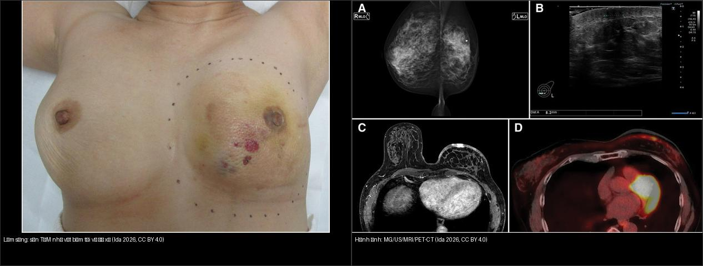
*Trái: **lâm sàng** — sẩn/mảng **tím như vết bầm** kèm nốt đỏ trên da vú đã xạ (dễ bị bỏ qua như "tụ máu/viêm da"). Phải: **hình ảnh đa phương thức** (nhũ ảnh, siêu âm có nốt ~8,2 mm, MRI, PET/CT) của **cùng bệnh nhân** — chẩn đoán RAASB. Ảnh ghép letterbox, CC BY 4.0 (Ida E et al., Surgical Case Reports 2026).*

### Dấu hiệu "chốt" phân biệt RAAS vs lành
- **MYC** là chốt mô bệnh: **khuếch đại/quá biểu hiện MYC gần như luôn gặp ở RAAS**, **âm ở AVL** (PMC11355165, PMC7092646, PMC13070623).

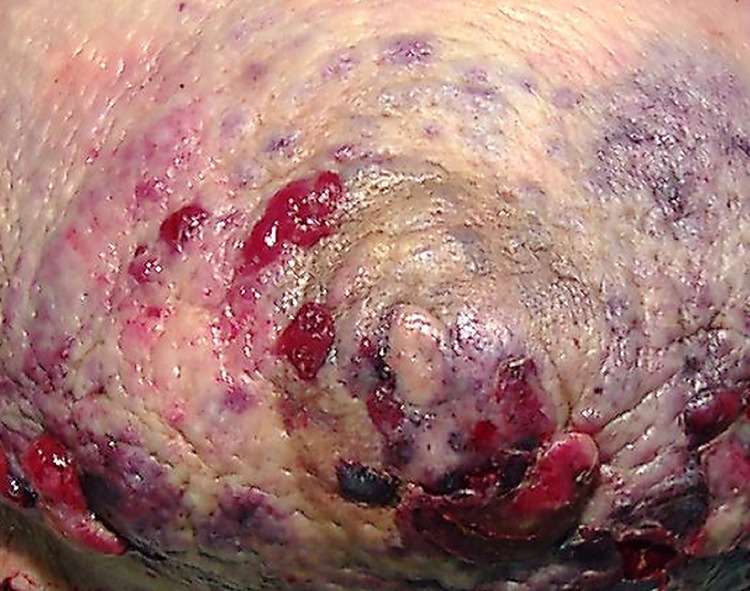
*Lâm sàng: tổn thương da vú đã xạ — **mảng bờ không đều, màu đỏ sẫm–tím (violaceous) kèm loét**; "vẻ ngoài như vết bầm/viêm da" khiến dễ bị trấn an nhầm. Nguồn: Manjee K, Sullivan ME, Academic Pathology 2020, Fig. 1, CC BY-NC-ND 4.0 (giữ nguyên bản).*

- **Hình thái da là "cửa sổ" chẩn đoán:** sẩn/mảng **tím–xanh, chấm xuất huyết, "như vết bầm"/phù nề** dai dẳng ở vùng xạ — mọi trường hợp **không tan** đều phải sinh thiết sâu (gồm cả mô dưới da).
- **MRI:** **ngấm ở da ở mọi ca**, tổn thương nhu mô chỉ **25%** → **nếu chỉ tìm trong nhu mô sẽ bỏ sót**.

## 4. Protocol chẩn đoán – điều trị + lưu đồ

- **Khi nào nghi RAAS:** vết tím–bầm/mảng/sẩn **không tan** trong **trường xạ cũ** của vú/thành ngực, nhất là **thập niên 6–7 tuổi**, **≥ 3 năm (thường 5–10 năm)** sau xạ.
- **Cận lâm sàng:**
  - **MRI vú** (bắt buộc khi nhũ ảnh/siêu âm không kết luận): đánh giá **da, trung bì, nhu mô, thành ngực**; tìm NME/dày da/ổ ngấm — dùng để **vẽ bản đồ (mapping) phạm vi**.
  - **Siêu âm:** khối giảm hồi âm **có mạch ngoại vi**; có thể thấy nốt nhỏ (ví dụ **8,2 mm**).
  - **PET/CT:** ổ tăng chuyển hóa (FDG) — dùng cho **phân giai đoạn** và phát hiện tổn thương đa ổ/di căn, không thay mô bệnh.
  - **Sinh thiết SÂU + mapping biopsy:** vì tổn thương lan da mờ, **sinh thiết bề mặt âm không loại trừ**; lấy nhiều điểm (bài PMC6233252 dùng **mapping biopsy ở 2 cm và 10 cm** từ nốt để xác định ranh giới).
- **Chẩn đoán mô bệnh:** H&E mạch bất thường + **IHC: CD31 (+), CD34 (+), ERG (+), D2-40 có thể âm; AE1/AE3 (−); c-MYC (+), Ki-67 cao** (ca PMC13070623: ERG+/CD31+/CD34+/**D2-40 −/c-myc +/AE1/AE3 −**, Ki-67 ~70%).
- **Nguyên tắc điều trị (số liệu):**
  - **Cắt rộng toàn bộ vùng xạ (radical resection) là nền tảng:** 5 năm OS **86% vs 46%** so với cắt không triệt để (PMC11837069).
  - **Hóa trị taxane tân bổ trợ** (paclitaxel/nab-paclitaxel): đáp ứng bệnh học hoàn toàn **69%**, cải thiện **DMFS và OS** (PMC11550197).
  - **Xạ trị lại (re-irradiation) có chọn lọc** (ví dụ HART) + hóa trị → RFS tốt hơn (HR 0,25–0,45) (PMC11179083).
  - Theo dõi sát: **tái phát tại chỗ 40–90%**, trung vị chỉ **6–7 tháng** → chụp theo dõi dày.

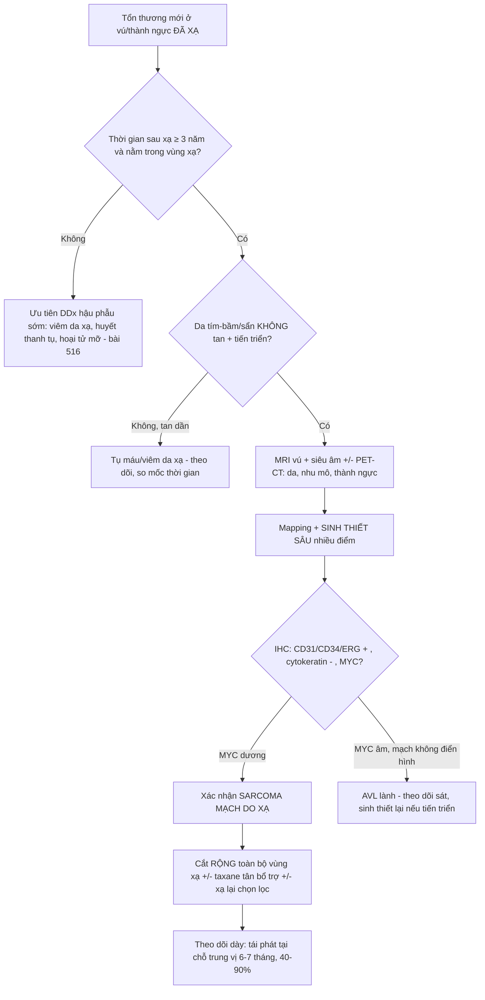

## 5. Biến thể bình thường và cạm bẫy

- **Cạm bẫy "chỉ là vết bầm/viêm da xạ":** biểu hiện kinh điển là **tím–xanh "như vết bầm"** → bệnh nhân và bác sĩ dễ trấn an, **chẩn đoán muộn trong khi u đã lan rộng**; độ trễ 5–10 năm khiến mối liên hệ với xạ bị lãng quên. **Quy tắc: vết bầm ở vùng xạ không tan → sinh thiết.**
- **Cạm bẫy nhũ ảnh bình thường:** **33%** ca angiosarcoma vú có nhũ ảnh bình thường (Liberman 1992) — **nhũ ảnh âm không loại trừ**; phải siêu âm/MRI khi có bất thường da.
- **Cạm bẫy chỉ tìm tổn thương TRONG nhu mô:** **tổn thương trong nhu mô chỉ có ở 25%** ca (Chikarmane) → **đọc kỹ DA** trên MRI (dày da, ngấm da).
- **Cạm bẫy sinh thiết bề mặt:** tổn thương phân bố ở da–trung bì và **lan mờ**, punch bề mặt có thể **âm tính giả** → **sinh thiết sâu + nhiều điểm (mapping)**.
- **Cạm bẫy AVL lành:** **tổn thương mạch không điển hình (AVL)** sau xạ trông như RAAS trên lâm sàng/hình ảnh nhưng **MYC âm và lành** → **luôn làm MYC** khi nghi.
- **Cạm bẫy "biến thể tiểu thùy mao mạch" (capillary lobule variant):** một biến thể RAAS **giả lành** trên H&E (đám mạch mao mạch xếp chặt nhiều tiểu thùy) — nhưng **tất cả đều MYC dương**; dễ bị đọc nhầm u máu lành (PMC10091944).
- **Cạm bẫy "u đã hết sau mổ" — tái phát rất sớm:** **tái phát tại chỗ 40–90%, trung vị ~6–7 tháng** → **theo dõi dày, không nới lỏng cảnh giác** sau cắt.

## 6. Tự lượng giá — Blind Quiz

**Ca 1 — Nữ 63 tuổi, phù nề vú tiến triển 14 năm sau mổ bảo tồn + xạ. Đọc lâm sàng.**

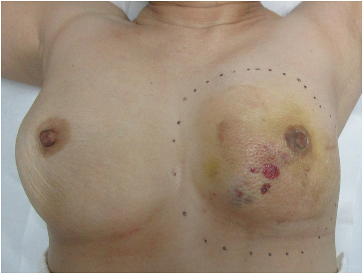

- Gợi ý: da vú (bên trái ảnh) có mảng tím kèm nốt đỏ, đường kẻ chấm là rìa dự kiến phẫu thuật.
- Hỏi: biểu hiện này gợi ý gì? Vì sao dễ bị bỏ qua?

<b>Bấm để hiện đáp án (findings + chẩn đoán)</b>

- Dấu hiệu (findings): **sẩn/mảng TÍM như vết bầm** (purpura) kèm **nốt đỏ** trên da vú đã xạ, **lan rộng, không tan**.
- Chẩn đoán (diagnosis): **sarcoma mạch do xạ ở vú (RAASB)** — biểu hiện kinh điển "vết bầm không tan" ở vùng xạ; bệnh nhân này RAASB xuất hiện **16 năm sau** mổ bảo tồn. Dễ bỏ qua vì giống **tụ máu/viêm da xạ lành**.
- Nguồn ảnh: Ida E et al., Surgical Case Reports 2026, Fig. 1, CC BY 4.0.

**Ca 2 — Cùng bệnh nhân: đọc các hình ảnh đa phương thức.**

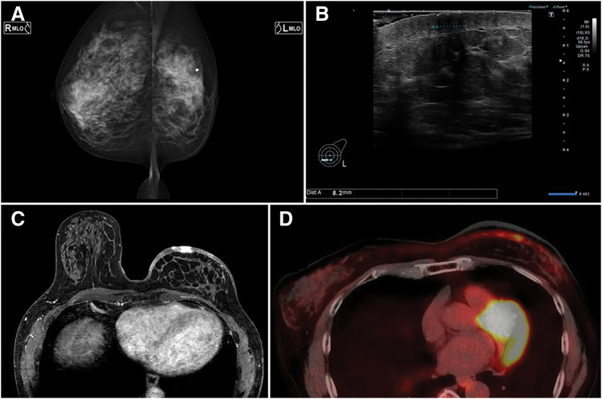

- Gợi ý: (A) nhũ ảnh, (B) siêu âm nốt ~8,2 mm, (C) MRI, (D) PET-CT.
- Hỏi: phương tiện nào phát hiện tổn thương? Vì sao nhũ ảnh có thể bình thường?

<b>Bấm để hiện đáp án (findings + chẩn đoán)</b>

- Dấu hiệu (findings): **siêu âm** thấy nốt giảm hồi âm ~**8,2 mm**; **MRI** có bất thường da/tổ chức; **PET-CT** có ổ tăng chuyển hóa. Nhũ ảnh ít đặc hiệu vì tổn thương ở **da**.
- Chẩn đoán (diagnosis): **RAASB** — tổn thương **khu trú ở da** nên nhũ ảnh/ih mô nhu mô có thể không thấy (nhũ ảnh bình thường tới **33%** ca); **MRI + PET-CT** đánh giá tốt hơn.
- Nguồn ảnh: Ida E et al., Surgical Case Reports 2026, Fig. 2, CC BY 4.0.

**Ca 3 — Ảnh ghép: bên nào là lâm sàng, bên nào là hình ảnh?**

- Hỏi: tại sao cần ghép lâm sàng với hình ảnh để chẩn đoán RAAS?

<b>Bấm để hiện đáp án (findings + chẩn đoán)</b>

- **Trái = lâm sàng:** mảng **tím như vết bầm** + nốt đỏ ở da vú đã xạ — "cửa sổ" gợi ý RAAS.
- **Phải = hình ảnh:** nhũ ảnh + siêu âm (nốt ~8,2 mm) + MRI + PET/CT của **cùng bệnh nhân** — xác nhận tổn thương da và **lập bản đồ phạm vi**.
- Chốt: **lâm sàng mở đường, hình ảnh xác nhận, mô bệnh (MYC) chốt**.
- Nguồn: ghép letterbox từ Ida E et al., Surgical Case Reports 2026, Fig. 1 + Fig. 2, CC BY 4.0.

**Ca 4 — Nữ sau xạ vú phải, MRI thấy bất thường. Đọc MRI (T2 + T1 sau tiêm).**

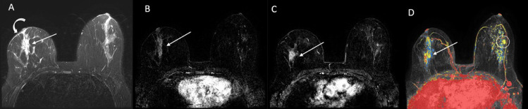

- Gợi ý: (A) T2, (B) T1 tiêm thì sớm, (C) T1 tiêm, (D) bản đồ màu.
- Hỏi: kiểu tổn thương này (NME + dày da) gợi ý gì? Vì sao dễ nhầm tái phát carcinoma?

<b>Bấm để hiện đáp án (findings + chẩn đoán)</b>

- Dấu hiệu (findings): **T2 tăng tín hiệu dạng dải** ở vú phải + **dày da**; sau tiêm có **vùng ngấm (NME)** tương ứng; bản đồ màu nhấn mạnh vùng ngấm.
- Chẩn đoán (diagnosis): **sarcoma mạch do xạ trình bày dạng non-mass enhancement (NME)** — ca này ban đầu được đánh giá như bất thường sau mổ; mô bệnh sau đó là angiosarcoma **8,3 × 5,8 × 4,5 cm** trong da/nhu mô. Chốt: **NME + dày da ở vùng xạ** phải nghĩ RAAS.
- Nguồn ảnh: Gonzalez TV et al., Radiology Case Reports 2022, Fig. 1, CC BY-NC-ND 4.0 (giữ nguyên bản).

**Ca 5 — Cùng bệnh nhân: đọc siêu âm có Doppler.**

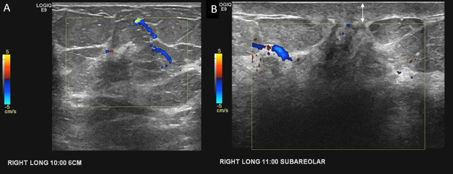

- Hỏi: hai khối giảm hồi âm có **mạch ngoại vi** gợi ý gì? Doppler giúp phân biệt với gì?

<b>Bấm để hiện đáp án (findings + chẩn đoán)</b>

- Dấu hiệu (findings): **hai khối giảm hồi âm** ở vị trí 10 giờ và 11 giờ (quanh núm) với **mạch ngoại vi** trên Doppler.
- Chẩn đoán (diagnosis): **angiosarcoma (RAASB)** — mô u mạch **tăng sinh mạch** nên có mạch ngoại vi; khối đa ổ là đặc trưng. Doppler giúp phân biệt với **nang/dịch không mạch**.
- Nguồn ảnh: Gonzalez TV et al., Radiology Case Reports 2022, Fig. 3, CC BY-NC-ND 4.0 (giữ nguyên bản).

**Ca 6 — Cùng bệnh nhân: đọc PET/CT.**

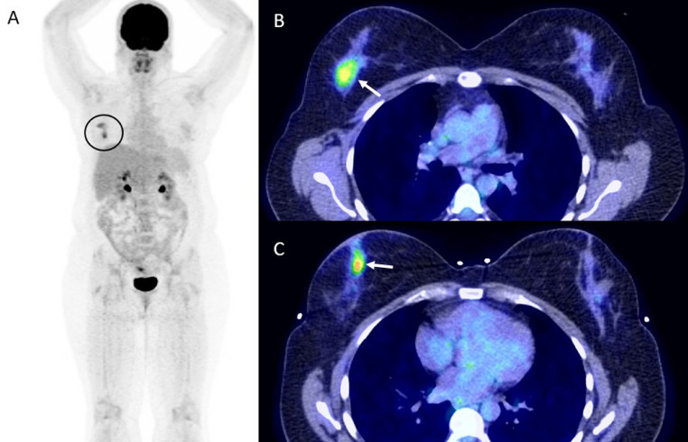

- Hỏi: PET/CT thêm giá trị gì trong RAAS? Có thay thế sinh thiết không?

<b>Bấm để hiện đáp án (findings + chẩn đoán)</b>

- Dấu hiệu (findings): **hai ổ tăng chuyển hóa FDG** ở vú phải trên ảnh MIP và lát hợp nhất PET/CT.
- Chẩn đoán (diagnosis): **angiosarcoma đa ổ** — PET/CT dùng để **phân giai đoạn/phát hiện đa ổ, di căn**, **KHÔNG thay thế mô bệnh**; ở ca này khối chính đã lớn (8,3 cm) trên bệnh phẩm cắt tuyến.
- Nguồn ảnh: Gonzalez TV et al., Radiology Case Reports 2022, Fig. 4, CC BY-NC-ND 4.0 (giữ nguyên bản).

**Ca 7 — Nữ có khối da vú đã xạ. Đọc nhũ ảnh, siêu âm, CT, MRI.**

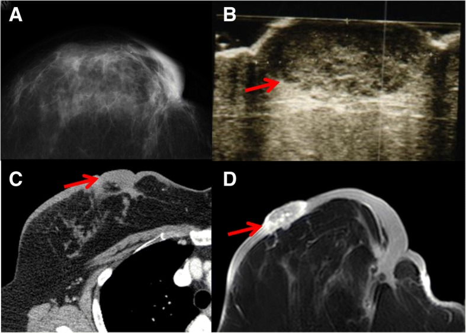

- Gợi ý: mũi tên chỉ tổn thương ở **da** trên cả 4 phương tiện.
- Hỏi: dấu hiệu nào xác định tổn thương ở **da** chứ không phải nhu mô? Bước tiếp theo?

<b>Bấm để hiện đáp án (findings + chẩn đoán)</b>

- Dấu hiệu (findings): **khối dày lên ngay dưới/trong da** (mũi tên) thấy trên cả **nhũ ảnh, siêu âm, CT, MRI** — vị trí **da/trung bì**, không phải khối nhu mô sâu.
- Chẩn đoán (diagnosis): **sarcoma mạch do xạ** — tổn thương **khu trú ở da** là đặc trưng; cần **mapping biopsy** (2 cm và 10 cm) để xác định ranh giới trước khi cắt rộng.
- Nguồn ảnh: Nomoto Y et al., Surgical Case Reports 2018, Fig. 1, CC BY 4.0.

**Ca 8 — Mô bệnh học: đọc IHC.**

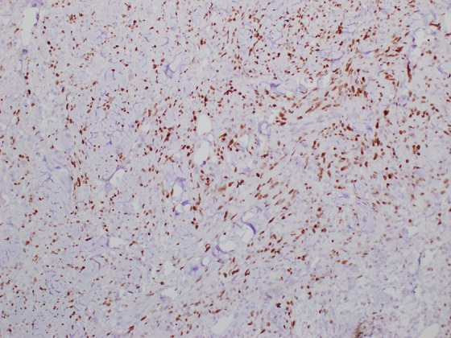

- Hỏi: hình này là gì, và vì sao nó là "chốt" phân biệt RAAS với tổn thương mạch lành (AVL)?

<b>Bấm để hiện đáp án (findings + chẩn đoán)</b>

- Dấu hiệu (findings): **nhuộm MYC dương tính ở NHÂN** (nhân nâu) trong tế bào nội mô u.
- Chẩn đoán (diagnosis): **sarcoma mạch do xạ (MYC quá biểu hiện)** — **MYC khuếch đại/quá biểu hiện gần như luôn gặp ở RAAS** và **âm ở tổn thương mạch không điển hình (AVL)**; đây là dấu ấn phân biệt mấu chốt.
- Nguồn ảnh: Manjee K, Sullivan ME, Academic Pathology 2020, Fig. 7, CC BY-NC-ND 4.0 (giữ nguyên bản).

**Ca 9 — Bệnh phẩm cắt rộng: đối chiếu đại thể và vùng c-Myc (+).**

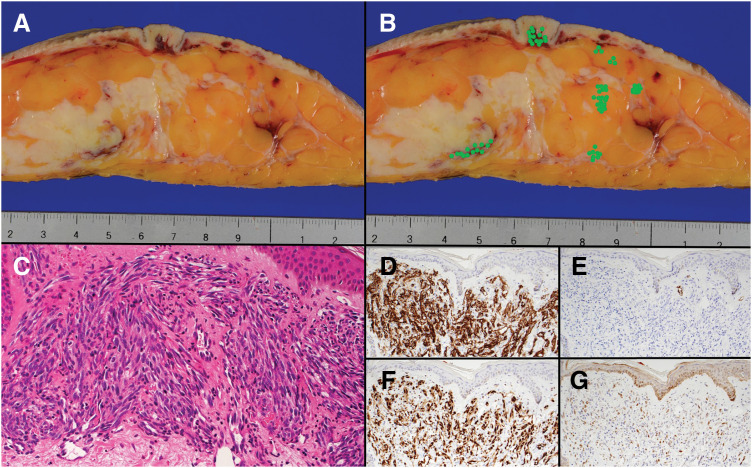

- Hỏi: (A) đại thể, (B) các điểm xanh = vùng c-Myc dương — ý nghĩa của việc **vẽ bản đồ c-Myc** trước/khi mổ?

<b>Bấm để hiện đáp án (findings + chẩn đoán)</b>

- Dấu hiệu (findings): đại thể khối **xâm nhập lan** dưới da; bản đồ đánh dấu **vùng c-Myc dương** cho thấy u **lan rộng hơn** vùng thấy bằng mắt.
- Chẩn đoán (diagnosis): **c-Myc giúp xác định RANH GIỚI u** (u mạch lan mờ dễ dẫn tới **cắt không hết bờ** → tái phát 40–90%); đây là lý do **cắt rộng toàn bộ vùng xạ** cho kết cục tốt hơn (5 năm OS 86% vs 46%).
- Nguồn ảnh: Ida E et al., Surgical Case Reports 2026, Fig. 3, CC BY 4.0.

## Bài liên quan chéo
- [500 – Tổng quan Hệ Vú & Sản Phụ khoa](../500-tong-quan-vu-san-phu-khoa/lesson.md)
- [516 – Hình ảnh vú sau điều trị: tái tạo, hoại tử mỡ, sẹo vs tái phát & BIA-ALCL](../516-hinh-anh-vu-sau-dieu-tri/lesson.md)
- [522 – Theo dõi sau điều trị ung thư vú: nhũ ảnh/DBT, siêu âm, MRI & CEM](../522-theo-doi-sau-dieu-tri-ung-thu-vu/lesson.md)
- [376 – U phần mềm KHÔNG mỡ: schwannoma vs sarcoma myxoid](../376-u-phan-mem-khong-mo/lesson.md)

## Ảnh
- `images/523_sarcoma-mach-vu_lam-sang_PMC13070623.jpg`, `images/523_sarcoma-mach-vu_MG-US-MRI-PET_PMC13070623.jpg`, `images/523_sarcoma-mach-vu_dai-the-cMyc_PMC13070623.jpg`, `images/523_sarcoma-mach-vu_MRI-T2-DCE_PMC9340125.jpg`, `images/523_sarcoma-mach-vu_US-Doppler_PMC9340125.jpg`, `images/523_sarcoma-mach-vu_PET-CT_PMC9340125.jpg`, `images/523_sarcoma-mach-vu_lam-sang_PMC7092646.jpg`, `images/523_sarcoma-mach-vu_MYC-IHC_PMC7092646.jpg`, `images/523_sarcoma-mach-vu_MG-US-CT-MRI_PMC6233252.jpg`, `images/composite_lam-sang-vs-hinh-anh.jpg`. Nguồn + giấy phép từng ảnh trong `images/CREDITS.md`.

> Không dùng để chẩn đoán độc lập khi chưa có người hướng dẫn.
