# 524 — Sàng lọc & quản lý nguy cơ cao ung thư vú (BRCA1/2, PALB2, TP53, xạ ngực tuổi trẻ) / High-risk breast cancer screening & risk management

**Tags:** `pattern:khoi-vu` `vung:vu` `score:BI-RADS` `protocol:MRI-vu` `protocol:nhu-anh-DBT` `protocol:tam-soat-nguy-co-cao` `incidentaloma:ton-thuong-tam-soat`
**Mức chắc chắn (certainty):** tổng hợp y văn (literature synthesis) — nhóm tự biên từ các bài tổng quan/khuyến cáo CC BY 4.0 (EUSOBI/Eur Radiol 2024; Magn Reson Med Sci 2025) + ca nguyên văn có hình (BRCA1/BRCA2, xạ ngực, di căn đối bên); số liệu đối chiếu PMCID gốc.

## 1. Tổng quan bệnh học – cơ chế hình ảnh

- **Vì sao có nhóm "nguy cơ cao":** đột biến dòng mầm (germline mutation) ở gen sửa chữa tái tổ hợp tương đồng (homologous recombination — HR) như **BRCA1/BRCA2, PALB2, TP53, CHEK2, ATM, BARD1, RAD51C/D** làm tế bào tích lũy đột biến → ung thư vú xuất hiện **sớm hơn, đa ổ/hai bên và đối bên nhiều hơn**. Khoảng **5–10%** ung thư vú có nền di truyền; di truyền chiếm **27%** (nghiên cứu sinh đôi) (Ohashi A et al., Magn Reson Med Sci 2025, PMC12536305, CC BY 4.0).
- **Nguy cơ trọn đời (lifetime risk) định lượng — thang phân tầng:**
  - **Nguy cơ cao** (lifetime **> 60%**, RR **7,0–8,0**): **BRCA1, BRCA2, TP53**.
  - **Nguy cơ trung bình–cao** (lifetime **> 30%**, RR **4,0–6,0**): **PALB2, CDH1, STK11**.
  - **Trung bình** (lifetime **≥ 20%**, RR **2,5–3,0**): **CHEK2, ATM, BARD1, NF1, RAD51C/D**; sinh sản tăng sinh không điển hình (atypical epithelial proliferation, gồm LCIS) RR **3,0–10**.
  - **Trung bình thấp**: tiền sử cá nhân ung thư vú RR **2,8**; vú đặc (dense breast) RR **2,3**; tiền sử gia đình RR **2,0** (lifetime **< 15%**).
  - **Trung bình dân số**: lifetime **12–13%**, RR **1,0**; nguy cơ thấp: **< 12%**.
- **Con số gốc:** tích lũy ung thư vú tới 80 tuổi **72%** (KTC 65–79) ở **BRCA1** và **69%** (61–77) ở **BRCA2**; ung thư vú **đối bên trong 20 năm** ước tính **40%** (BRCA1) và **26%** (BRCA2) (PMC12536305). EUSOBI/Eur Radiol 2024 trích dải **50–85%** (BRCA1) và **45–69%** (BRCA2) (Marcon M et al., Eur Radiol 2024, PMC11399176, CC BY 4.0).
- **TẠI SAO hình ảnh học tách theo kiểu đột biến (cơ chế mô bệnh):**
  - **BRCA1 → thể hung tính cao:** chủ yếu **ung thư thể ba âm (triple-negative)**, độ mô học cao; trên MRI thường là **khối bờ rõ, hình bầu dục, ngấm viền (rim-enhancement)** — đặc trưng TNBC; hay ở **vùng sau vú**. Vì **không tạo vi vôi hóa** và mọc nhanh (thời gian sojourn ngắn) → **X-quang dễ âm tính**, dễ sinh **ung thư khoảng (interval cancer)** giữa các lần chụp.
  - **BRCA2 → thể luminal/DCIS:** hay **DCIS + vi vôi hóa** → **X-quang nhìn rõ**; trên MRI hay **khối bờ không đều/gai** hoặc **ngấm không khối (non-mass enhancement — NME)** theo đường ống.
  - **Hệ quả lâm sàng:** simulation cho thấy ở **BRCA1**, X-quang **thêm rất ít** giá trị phát hiện; ở **BRCA2 dưới 40 tuổi**, tới **33,3% (6/18)** ca **chỉ X-quang mới thấy** (gồm 2 DCIS) → **BRCA1 thiên về MRI, BRCA2 vẫn cần X-quang** (PMC12536305).
- **Vì sao MRI "thắng" ở vú đặc (vật lý):** mô xơ–tuyến dày làm suy giảm chùm tia X → **hiệu ứng che lấp (masking)**; MRI/DCE dựa trên **tăng sinh mạch u** nên không phụ thuộc mật độ. Vì vậy hướng dẫn EUSOBI khuyến cáo **MRI cho vú cực đặc**, ưu tiên **2–3 năm/lần** (PMC11399176).
- **Xạ ngực tuổi trẻ (chest radiation):** xạ trị ngực lúc **10–30 tuổi** (điển hình Hodgkin lymphoma) gây **ung thư vú do tia xạ** sau **thời gian tiềm tàng ~8 năm**. Hướng dẫn COG: với người sống sót HL được xạ ngực **≥ 10 Gy** → **chụp X-quang + MRI vú hằng năm, bắt đầu từ tuổi 25 hoặc 8 năm sau xạ, lấy mốc nào muộn hơn** (Wong FL et al., J Clin Oncol 2023, PMC9928841, CC BY-NC-ND). Chính vì vậy nhóm này (và TP53) cần **hạn chế thêm tia xạ** → ưu tiên MRI.
- **Sinh học "cửa sổ vàng" của tầm soát:** ung thư khoảng có tiên lượng xấu hơn — 10 năm sống sót **80,2%** (interval) vs **91,9%** (phát hiện qua tầm soát), P < 0,001; **23,5%** ca trong chương trình 33 năm của Evans là interval cancer (PMC12536305).
- **Bối cảnh tuân thủ:** tầm soát chỉ hiệu quả nếu **làm đều**. Trong đoàn hệ BRCA1/2 ở Newfoundland & Labrador, nhiều người vẫn chụp **ngoài khung khuyến cáo (> 12 tháng)** hoặc chưa hoàn thành (Roebothan A et al., Curr Oncol 2023, PMC10605144, CC BY).

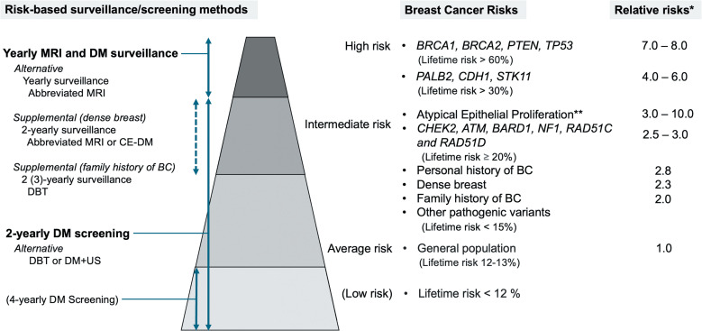
*Tháp 4 tầng: nguy cơ cao (BRCA1/2, TP53, lifetime > 60%, RR 7–8) → trung bình (≥ 20%) → dân số (12–13%, RR 1,0) → thấp (< 12%). Cột phải: phương thức tầm soát tương ứng; chữ đậm = khuyến cáo hiện hành, chữ thường = đang nghiên cứu. Nguồn: Ohashi A et al., Magn Reson Med Sci 2025 (PMC12536305), CC BY 4.0.*

## 2. Mẫu hình + chẩn đoán phân biệt theo bối cảnh (gamut)

- **Mẫu hình gốc:** phụ nữ **mang đột biến/tiền sử xạ ngực** → **tổn thương chỉ thấy trên MRI** trong khi X-quang "bình thường", hoặc ngược lại **chỉ thấy vi vôi hóa trên X-quang** khi MRI chưa rõ.
- **Ba câu hỏi gỡ rối trước khi gọi bệnh lý:**
  1. **Có phải mô nền (BPE) không?** — ngấm nền lan tỏa, đối xứng, đổi theo chu kỳ; chụp **ngày 7–14 vòng kinh**.
  2. **Tổn thương có "khối" hay "ngấm không khối (NME)"?** — NME theo phân bố tuyến ống/vùng → nghĩ lan theo ống (DCIS, ung thư thể tiểu thùy).
  3. **Có mốc cũ để so không?** — ưu tiên **so sánh với MRI lần trước** hơn là đọc đơn độc.
- **Gamut theo kiểu đột biến/nền tảng:**
  - **BRCA1:** ung thư **hoại tử/hung tính**, khối ngấm viền, **không vôi hóa**, dễ interval → DDx với **u xơ–tuyến lành ngấm mạnh, viêm, BPE**.
  - **BRCA2:** **DCIS với vi vôi hóa** + **NME** → DDx với **thay đổi xơ–tuyến, tăng sinh không điển hình, sẹo**.
  - **Xạ ngực cũ:** tổn thương **hai bên, ngoài vùng xạ** → DDx **di căn phổi/hạch**, **hoại tử mỡ sau xạ**, **sarcoma do xạ (mạch máu)**.
  - **Vú đặc:** phát hiện nhờ **MRI/đối chiếu nhiều phương thức** → tránh "bình thường" giả trên X-quang.
- **Chẩn đoán phân biệt với ca "âm tính giả" trên MRI:** **vi vôi hóa DCIS** (MRI có thể âm), **loạn sản xơ**, **thay đổi sau mổ/xạ**.

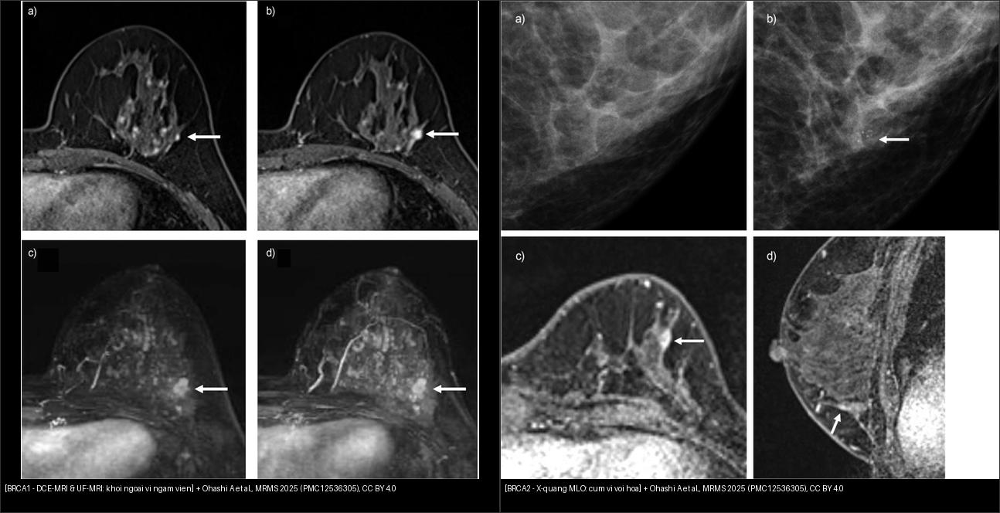
*Trái — **BRCA1**: trên DCE-MRI (a, b, pha 2: khối ngấm viền) và UF DCE-MRI (c, d: thấy rõ ở thì sớm, ít BPE) → khối 8 mm, sau ra ung thư thể ống xâm lấn luminal B. Phải — **BRCA2**: X-quang MLO (a) bình thường 1 năm trước; (b) xuất hiện **cụm vi vôi hóa** góc ngoài–dưới; DCE-MRI (c, d) khối ngấm 5 mm → sinh thiết ra **DCIS**. Ảnh ghép letterbox giữ nguyên tỷ lệ. Nguồn: Ohashi A et al., MRMS 2025 (PMC12536305), CC BY 4.0.*

## 3. Bảng so sánh phân biệt (ma trận đối chiếu)

| Phương thức (entity) | Hình ảnh điển hình | Chốt vào (rule-in) | Chốt loại (rule-out) | Gợi ý xác nhận |
|---|---|---|---|---|
| **DCE-MRI** | Khối ngấm mạnh, ngấm viền (BRCA1/TNBC) hoặc NME theo ống (BRCA2/DCIS); thấy ở thì sớm | **Nốt/NME tăng tín hiệu rõ sau tiêm, thấy rõ ở thì sớm, thay đổi so lần trước** | **BPE lan tỏa đối xứng, giảm sau tiêm theo chu kỳ** → không gọi bệnh lý | So MRI cũ; chụp ngày 7–14 vòng kinh; sinh thiết định vị MRI |
| **Mammography / DBT** | Cụm **vi vôi hóa** (DCIS, BRCA2); khối bờ gai; hiệu ứng che lấp khi vú đặc | **Vi vôi hóa mới/tăng số lượng thành cụm** | **Vú cực đặc + X-quang âm** → chưa loại trừ, cần MRI | Đối chiếu 2 bình diện, DBT lát cắt; so phim cũ |
| **Siêu âm (US)** | Nốt giảm âm bờ không đều, có mạch; dẫn đường sinh thiết | **Nốt đặc giảm âm + tăng mạch Doppler** | **Nang đơn thuần, thay đổi lành** → không theo dõi dài | US đích theo MRI/X-quang; elastography |
| **CEM / CE-DBT** | Tăng tín hiệu sau thuốc cản quang, tương tự MRI về tăng sinh mạch | **Ngấm cản quang trong tổn thương mới** | **Tăng ngấm sinh lý nền** → đối chiếu MRI | Bổ sung khi MRI không sẵn có/quá tải |
| **Abbreviated / UF MRI** | Chỉ chuỗi xung tối giản (FAST ~3 phút) hoặc UF 1 phút | **Se/Sp tương đương MRI đầy đủ** cho khối ngấm rõ | **Thiếu dữ liệu động học/DWI** → bỏ sót tổn thương NME nhỏ | Chọn khi cần giảm tải/giảm chi phí |

- **Bảng đối chiếu kiểu hình BRCA1 vs BRCA2 (chốt vào/loại theo hình ảnh):**

| Đặc điểm | BRCA1 | BRCA2 | Chốt vào (rule-in) | Chốt loại (rule-out) |
|---|---|---|---|---|
| Thể mô học hay gặp | Thể ba âm (TNBC), độ cao | Luminal / DCIS | **TNBC + khối ngấm viền → nghĩ BRCA1** | **DCIS + cụm vi vôi hóa → nghĩ BRCA2** |
| X-quang | Thường **khó thấy** (không vôi hóa) | **Thấy rõ vi vôi hóa** | **Vi vôi hóa cụm mới → BRCA2** | **X-quang âm không loại trừ BRCA1** |
| MRI | Khối bờ rõ, **ngấm viền**, vùng sau | Khối gai hoặc **NME** | **NME theo ống → lan đường ống/DCIS** | **Nốt ngấm viền đơn độc bờ đều → cân nhắc lành** |
| Ung thư đối bên | ~ **40%/20 năm** | ~ **26%/20 năm** | **MRI đối bên bắt buộc** | **Không bỏ qua vú bên kia dù bên kia thấy "bình thường"** |

- **Bảng phân tầng nguy cơ & khuyến cáo (EUSOBI/Eur Radiol 2024 + PMC12536305):**

| Mức nguy cơ | Nguy cơ trọn đời / RR | Khuyến cáo tầm soát | Chốt vào (rule-in) | Chốt loại (rule-out) |
|---|---|---|---|---|
| Cao (BRCA1/2, TP53) | > 60%; RR 7–8 | **MRI hằng năm từ ~25 tuổi**; ± **X-quang từ 35–40 tuổi** | **Đột biến BRCA1/2/TP53 → MRI hằng năm** | Không dùng X-quang đơn độc |
| Trung bình–cao (PALB2, CDH1, STK11) | > 30%; RR 4–6 | **Cân nhắc MRI** + X-quang theo hướng dẫn | **Lifetime ≥ 20% → xét MRI** | Nguy cơ thấp → không MRI thường quy |
| Dân số (vú đặc) | 12–13%; vú đặc RR 2,3 | **X-quang/DBT 40–50 → ~70 tuổi**; vú **cực đặc (D)**: **MRI 2–3 năm/lần** | **BI-RADS mật độ C/D → bổ sung MRI/US** | **Mật độ A/B → không bổ sung** |
| Xạ ngực tuổi trẻ (≥ 10 Gy) | nguy cơ cao theo liều/tuổi xạ | **X-quang + MRI hằng năm, từ tuổi 25 hoặc 8 năm sau xạ (muộn hơn)** | **Tiền sử xạ ngực 10–30 tuổi → vào chương trình MRI** | Không trì hoãn vì "còn trẻ" |

## 4. Protocol chụp + hệ phân độ/điểm chuẩn hóa

- **Protocol MRI vú tầm soát:** máy **≥ 1,5 T** (ưu tiên 3 T), cuộn chuyên dụng vú; **T2W** + **DWI/ADC** (không cản quang) + **T1W fat-sat trước tiêm** + **DCE T1W fat-sat sau tiêm thuốc gadolinium** nhiều thì (thì sớm ~1 phút để bắt động học) + **trừ ảnh (subtraction)** + **MIP**; tư thế chụp hai vú. **Ngày 7–14 vòng kinh** (tiền mãn kinh) để giảm BPE.
- **Protocol rút gọn (abbreviated/FAST):** T1W trước tiêm + T1W sau tiêm đầu tiên + ảnh trừ + MIP → thời gian **~3 phút**; **Se 100%**, Sp **94,3%** (gần bằng protocol đầy đủ 93,9%, P = 0,563). **Ultrafast (UF)** ~**1 phút** lấy động học vài giây: meta 16 nghiên cứu cho **Se 83%, Sp 77%, AUC 0,88** (PMC12536305).
- **X-quang:** DBT (tomosynthesis) ± tổng hợp 2D; **X-quang "một mình" không đủ** ở BRCA1.
- **Hệ phân độ BI-RADS** (dùng cho tầm soát):
  - **BI-RADS 1–2:** âm tính/lành → **tiếp tục tầm soát định kỳ**.
  - **BI-RADS 3:** có thể lành → **theo dõi lại 6 tháng**.
  - **BI-RADS 4–5:** nghi ngờ/ác tính → **sinh thiết xác nhận** (4 chia 4A/4B/4C theo nguy cơ).
- **Ngưỡng hành động then chốt:** tổn thương **mới hoặc to lên** trên MRI so lần trước → nâng BI-RADS; **NME** và **ngấm viền** cần sinh thiết định vị; trong ca BRCA1, khối **8 mm ngấm viền to lên** đã chuyển BI-RADS 4A.
- **Giảm nguy cơ (định lượng):** meta 15 nghiên cứu — **cắt hai phần phụ dự phòng (RRSO): RR 0,55 (0,45–0,68)**; **cắt tuyến vú dự phòng hai bên (RRM): RR 0,11 (0,04–0,32)** nhưng **RRM không giảm tỉ lệ tử vong chung**. Theo dõi MRI: ở BRCA1, **HR tử vong 0,20 (0,10–0,43)**; nguy cơ tử vong tích lũy tới 75 tuổi **5,5%** (có MRI) vs **20,5%** (không MRI) (PMC12536305).

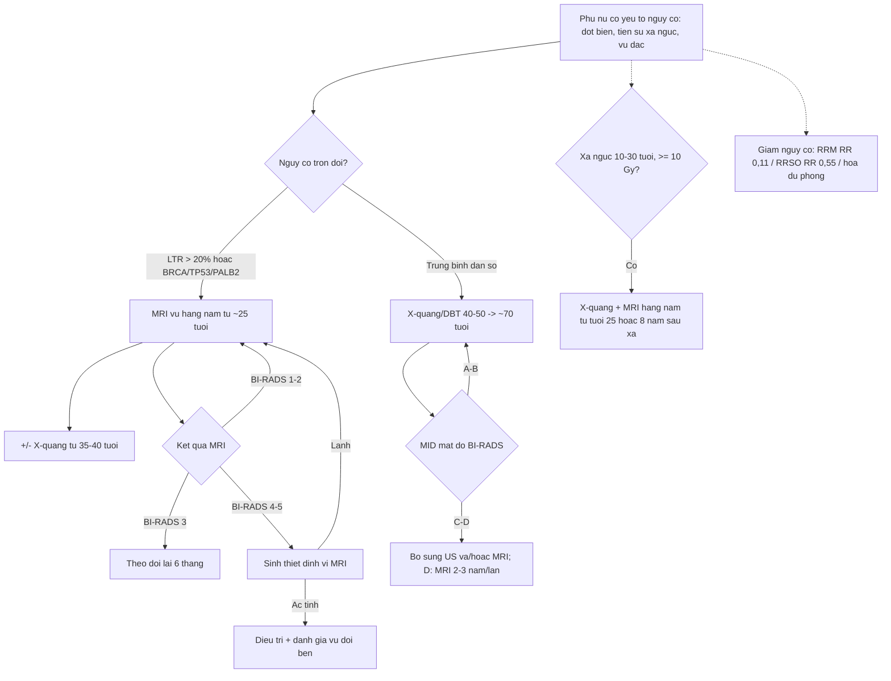

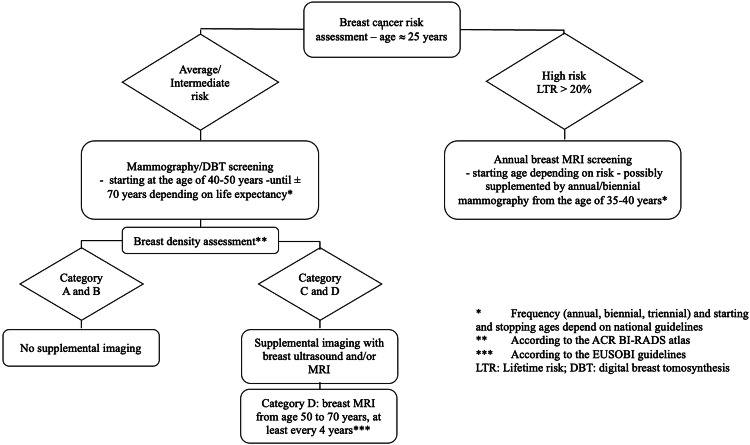
*Đánh giá nguy cơ ở ~25 tuổi. Trung bình/trung bình–cao: X-quang/DBT từ 40–50 đến ~70 tuổi; đánh giá mật độ, C/D thì bổ sung. Nguy cơ cao (lifetime > 20%): MRI hằng năm, tùy hướng dẫn, ± X-quang hằng năm/2 năm từ 35–40 tuổi. Nguồn: Marcon M et al., Eur Radiol 2024 (PMC11399176), CC BY 4.0.*

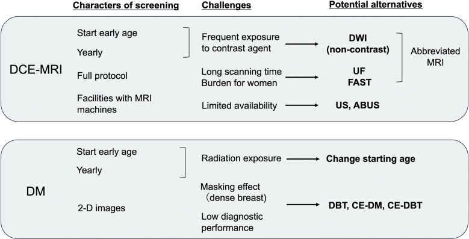
*Trái: DCE-MRI — phơi nhiễm thuốc cản quang hằng năm, thời gian chụp dài, hạn chế máy → **DWI (không cản quang)**, **UF/FAST**, **abbreviated MRI**, **US/ABUS**. Phải: X-quang (DM) — phơi nhiễm tia xạ, che lấp ở vú đặc, hiệu năng chẩn đoán thấp → **đổi tuổi bắt đầu**, **DBT/CE-DM/CE-DBT**. Nguồn: Ohashi A et al., MRMS 2025 (PMC12536305), CC BY 4.0.*

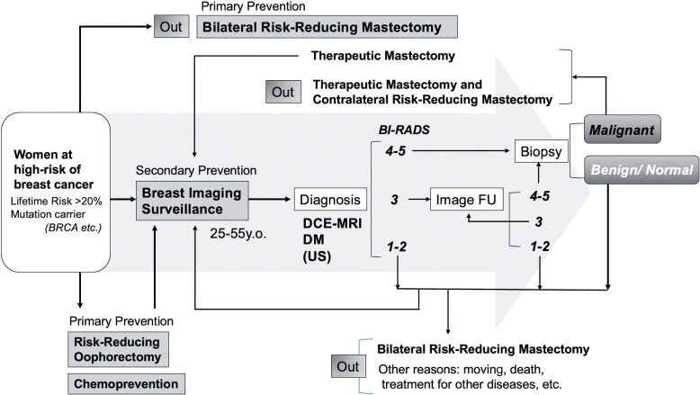
*Dự phòng bậc 1 (cắt tuyến vú dự phòng hai bên, RRSO, hóa dự phòng) + bậc 2 (giám sát hình ảnh: DCE-MRI + DM, 25–55 tuổi) → chẩn đoán → phân loại BI-RADS → sinh thiết → lành/ác. Nguồn: Ohashi A et al., MRMS 2025 (PMC12536305), CC BY 4.0.*

## 5. Biến thể bình thường và cạm bẫy

- **Tăng ngấm mô tuyến nền (background parenchymal enhancement — BPE):** ngấm nền **lan tỏa, đối xứng, theo chu kỳ** (mạnh ở tiền mãn kinh, giảm sau mãn kinh). Tránh: chụp **ngày 7–14 vòng kinh**; dùng **thì sớm/UF** để giảm nhiễu BPE; so lần trước.
- **Vú đặc che lấp (masking):** X-quang có thể **âm tính giả** khi vú cực đặc → đúng ngưỡng **hướng dẫn**: mật độ **C/D** mới bổ sung, **D** cân nhắc MRI **2–3 năm/lần**.
- **Thay đổi sau mổ/xạ:** **hoại tử mỡ, sẹo co kéo, tụ dịch, u hạt vị trí vết mổ** — ngấm viền giả u, dễ nhầm tái phát → **so phim cũ + MRI đa thì**; sinh thiết khi nghi ngờ thật.
- **Vi vôi hóa DCIS có thể "âm tính" trên MRI:** đừng yên tâm khi MRI bình thường mà bỏ qua **cụm vi vôi hóa mới trên X-quang** (đặc biệt BRCA2) — hai phương thức **bù trừ cho nhau**.
- **Bỏ sót vú đối bên:** vì đối bên 20 năm tới **40% (BRCA1)/26% (BRCA2)** — luôn **đọc cả hai vú** và **sinh thiết tổn thương đối bên mới**.
- **Cạm bẫy mặt cắt/hình chiếu:** khác biệt **kích thước vú** trên ảnh có thể chỉ do **tư thế/đè ép** khi chụp, không phải giải phẫu (PMC13565922) → đừng chẩn đoán "teo/thay đổi" vô cớ.
- **Tuân thủ/tâm lý:** nhiều người chụp **ngoài khung > 12 tháng** hoặc bỏ dở; cần **tư vấn chia sẻ quyết định (shared decision-making)** và nhắc lịch chủ động.
- **Không bỏ sót ca "đối bên" nếu chỉ đọc X-quang:** nhớ ngưỡng **X-quang đơn độc không đủ ở BRCA1**.

## 6. Tự lượng giá — Blind Quiz ngay trên trang tĩnh

**Ca 1 — Nữ 52 tuổi mang đột biến BRCA2, đã cắt vú bảo tồn phải 14 năm trước; X-quang hằng năm. Nhìn ảnh, mô tả trước.**

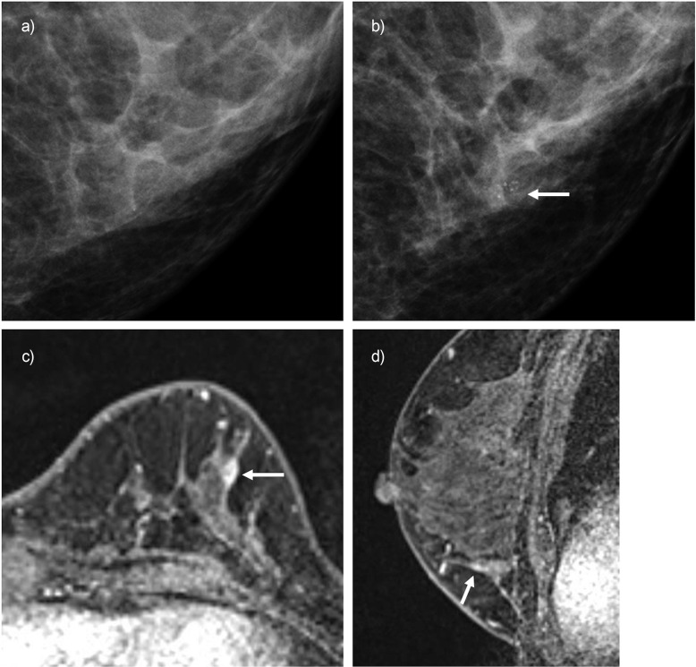

- Gợi ý lâm sàng (clinical context): BRCA2; X-quang 1 năm trước "bình thường".
- Câu hỏi: Dấu hiệu mới trên X-quang là gì? MRI bổ sung thêm gì? Chẩn đoán khả dĩ?

<b>Bấm để hiện đáp án (findings + chẩn đoán)</b>

- Dấu hiệu (findings): X-quang MLO 1 năm trước (a) bình thường; lần này (b) có **cụm vi vôi hóa** mới ở góc ngoài–dưới (mũi tên). DCE-MRI axial (c) và sagittal (d) phát hiện **khối ngấm 5 mm**, BI-RADS **4A**.
- Chẩn đoán (diagnosis): **DCIS** (sinh thiết) — chẩn đoán **22 năm sau ca ung thư đầu tiên**. Vì sao BRCA2 hay lộ **vi vôi hóa/DCIS**: thể luminal–DCIS tạo canxi hóa trong ống → X-quang là "cửa sổ" quan trọng dù MRI cũng dương.
- Nguồn ảnh: Ohashi A et al., Magn Reson Med Sci 2025 (PMC12536305), Fig. 3, CC BY 4.0.

**Ca 2 — Nữ 44 tuổi mang đột biến BRCA1, X-quang "bình thường" nhưng MRI bất thường. Nhìn ảnh, mô tả trước.**

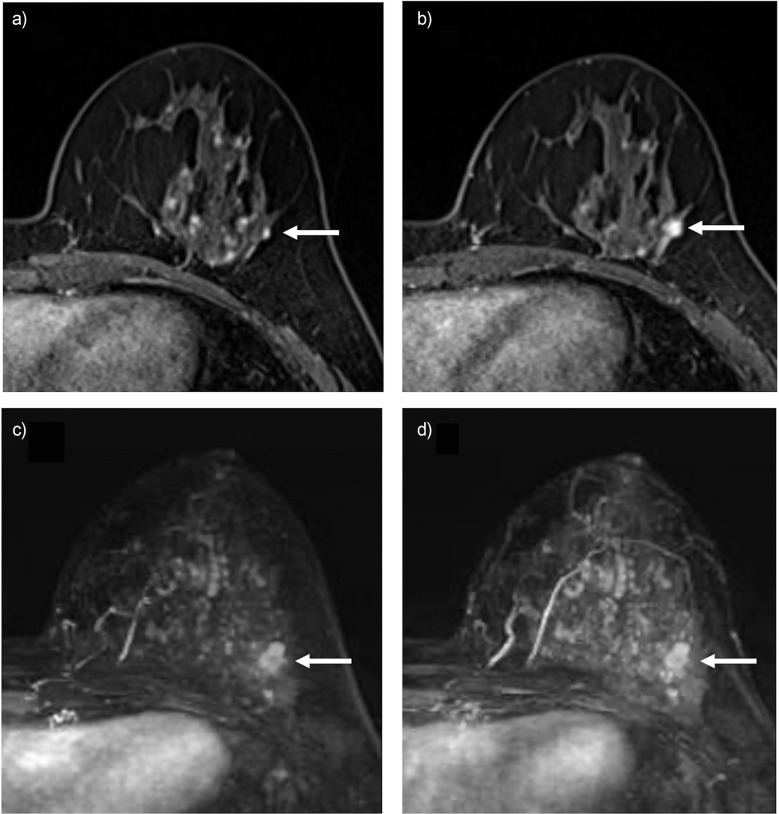

- Gợi ý lâm sàng: BRCA1; X-quang 1 năm trước đọc "bình thường".
- Câu hỏi: Tổn thương nằm ở đâu, kích thước và kiểu ngấm? Vì sao X-quang âm mà bệnh vẫn có? UF giúp gì?

<b>Bấm để hiện đáp án (findings + chẩn đoán)</b>

- Dấu hiệu (findings): DCE-MRI pha 2 (a, b) — **khối ngấm 8 mm ở vùng ngoài–dưới vú trái**, **ngấm viền**, to lên so lần trước → BI-RADS 4A. UF DCE-MRI (c, d) thấy tổn thương **ở thì sớm với ít BPE** giúp định vị rõ.
- Chẩn đoán (diagnosis): **ung thư thể ống xâm lấn typ luminal B** — chẩn đoán **10 năm sau ca ung thư đầu tiên**. Vì sao X-quang âm: BRCA1 thường **không vi vôi hóa** và vú đặc che lấp → cần **MRI**.
- Nguồn ảnh: Ohashi A et al., Magn Reson Med Sci 2025 (PMC12536305), Fig. 5, CC BY 4.0.

**Ca 3 — So sánh bên nào là BRCA1, bên nào là BRCA2?**

- Gợi ý: một người bệnh lộ diện bằng **vi vôi hóa trên X-quang**; một người lộ bằng **khối ngấm viền trên MRI**.
- Câu hỏi: Dấu hiệu nào chỉ đúng kiểu đột biến? Vì sao cần cả hai phương thức?

<b>Bấm để hiện đáp án (findings + chẩn đoán)</b>

- Trái: **BRCA1** — khối **ngấm viền** trên DCE-MRI/UF DCE-MRI, không vi vôi hóa (TNBC-like). Phải: **BRCA2** — **cụm vi vôi hóa** trên X-quang (DCIS), MRI thêm **khối ngấm 5 mm**.
- Chốt (clincher): **ngấm viền + X-quang âm → nghi BRCA1**; **vi vôi hóa cụm mới → nghi BRCA2/DCIS**. Vì hai kiểu hình **bù trừ**, tầm soát phối hợp **MRI + X-quang** mới đủ.
- Nguồn ảnh: ghép Fig. 5 + Fig. 3 của Ohashi A et al., MRMS 2025 (PMC12536305), CC BY 4.0 (ghép letterbox, giữ nguyên tỷ lệ).

**Ca 4 — Nữ 46 tuổi sống sót sau sarcoma Ewing có xạ ngực; X-quang để sàng lọc.**

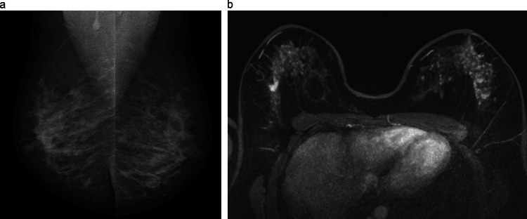

- Gợi ý: đã xạ ngực vì ung thư tuổi trẻ; X-quang (a) đọc là "bình thường".
- Câu hỏi: Vì sao nhóm này phải **tầm soát cả MRI**? Trong ảnh, phương thức nào phát hiện bất thường **hai bên**?

<b>Bấm để hiện đáp án (findings + chẩn đoán)</b>

- Dấu hiệu (findings): X-quang MLO (a) không thấy tổn thương rõ; **CE-MRI** (b) thấy **bất thường hai vú**.
- Chẩn đoán/lý giải: **ung thư vú sau xạ ngực (chest-radiation–associated)**. Ngưỡng: xạ ngực lúc **10–30 tuổi**, tiềm tàng **~8 năm** → COG khuyến cáo **X-quang + MRI hằng năm từ tuổi 25 hoặc 8 năm sau xạ (muộn hơn)** với người xạ ngực **≥ 10 Gy**; **ưu tiên MRI** vì cần **hạn chế tia xạ**.
- Nguồn ảnh: Marcon M et al., Eur Radiol 2024 (PMC11399176), Fig. 4, CC BY 4.0.

**Ca 5 — Nữ 62 tuổi mang đột biến BRCA2, đã cắt vú bảo tồn + xạ phải 10 năm trước. X-quang tầm soát nguy cơ cao và mô hình nguy cơ AI.**

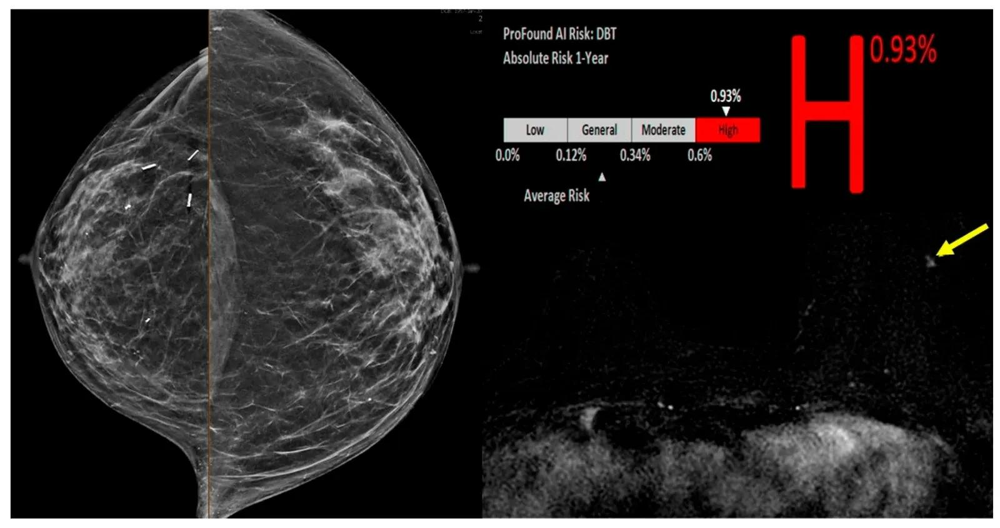

- Gợi ý: tiền sử IDC phải (ER+/PR+) 10 năm; đang tầm soát nguy cơ cao.
- Câu hỏi: X-quang chỉ ra gì đối với vú phải đã cắt bảo tồn? Cần làm gì tiếp cho vú còn lại dù X-quang "chưa thấy u"?

<b>Bấm để hiện đáp án (findings + chẩn đoán)</b>

- Dấu hiệu (findings): X-quang CC (trái ảnh) — vú phải đặc không đồng nhất với **thay đổi do cắt bảo tồn/xạ**, BI-RADS 2; mô hình AI xếp **nguy cơ cao (0,93%)**. **MRI tầm soát 6 tháng sau** thấy **ổ ngấm không khối (NME) khu trú vú trái** (mũi tên vàng) = **BI-RADS 4**.
- Chẩn đoán (diagnosis): **DCIS vú đối bên** (u nguyên phát đối bên mới) — sinh thiết định vị MRI. Bài học: đừng dừng ở "BI-RADS 2" khi nguy cơ cao; **MRI toàn hai vú** là bước quyết định.
- Nguồn ảnh: Ogunlade SB et al., J Clin Med 2026 (PMC13565922), Fig. 2, CC BY.

**Ca 6 — Nữ 67 tuổi mang BRCA2, **17 năm sau** ca ung thư vú phải đã điều trị, MRI thì trước mổ cho bất thường vú phải. Chuyện gì đang xảy ra?**

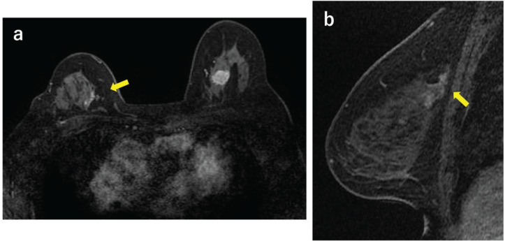

- Gợi ý: tiền sử ung thư vú phải + xạ; theo dõi nguy cơ cao.
- Câu hỏi: Ổ bất thường bên phải là **tổn thương mới/đối bên hay trong vú đã bảo tồn**? Mô tả kiểu ngấm và sinh thiết thế nào?

<b>Bấm để hiện đáp án (findings + chẩn đoán)</b>

- Dấu hiệu (findings): MRI thì trước mổ — **ngấm không khối (NME) dạng nhánh (branching) ở vùng trong–trên vú phải** (a) và vùng tổn thương (b), **BI-RADS 4**.
- Chẩn đoán (diagnosis): **tái phát trong vú đã bảo tồn phải** — sinh thiết định vị MRI ra **ung thư thể ống xâm lấn thể ba âm (TNBC)**; điều trị hóa trị trước mổ rồi **mổ hai bên**. Chốt: **NME dạng nhánh mới trong vú đã xạ/mổ = phải loại trừ tái phát/di chứng ác** bằng sinh thiết định vị.
- Nguồn ảnh: Nagata A et al., Eur J Breast Health 2026 (PMC13011143), Fig. 2, CC BY-NC-ND (nguyên bản, không crop/ghép).

**Ca 7 — Nguy cơ ung thư vú theo trạng thái đột biến. Đọc biểu đồ và nêu ý nghĩa quản lý.**

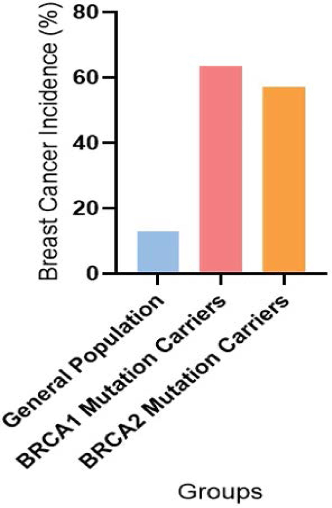

- Gợi ý: ba nhóm dân số, BRCA1 và BRCA2.
- Câu hỏi: Nhóm nào cao nhất? Điều này lý giải vì sao cần **tầm soát MRI từ tuổi ~25** và **cắt hai phần phụ dự phòng** cân nhắc riêng?

<b>Bấm để hiện đáp án</b>

- Dấu hiệu: cột tần suất ung thư vú — dân số chung **~10–12%**, **BRCA1 ~62%**, **BRCA2 ~56%**.
- Chẩn đoán/lý giải: nguy cơ trọn đời rất cao → **MRI hằng năm từ ~25 tuổi**; **RRSO giảm nguy cơ RR 0,55**, **RRM RR 0,11** nhưng không giảm tử vong chung → quyết định **cá thể hóa + tư vấn chia sẻ**.
- Nguồn ảnh: Najafi N et al., J Cancer Sci Clin Ther 2025 (PMC12802875), Fig. 3, CC BY.

**Ca 8 — Tuân thủ tầm soát trong đoàn hệ BRCA1/2.**

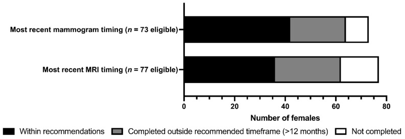

- Gợi ý: biểu đồ cột đen/xám/trắng cho thời điểm chụp gần nhất.
- Câu hỏi: Vì sao **tuân thủ** là mắt xích quyết định hiệu quả của một chương trình tầm soát nguy cơ cao?

<b>Bấm để hiện đáp án</b>

- Dấu hiệu: số người **trong khung khuyến cáo** (đen) < tổng số; nhiều người chụp **ngoài khung > 12 tháng** (xám) hoặc **chưa hoàn thành** (trắng).
- Chẩn đoán/lý giải: hiệu quả tầm soát gắn với **làm đều**; cần **nhắc lịch, tư vấn chia sẻ quyết định**, giảm rào cản xã hội (thu nhập/học vấn liên quan tới tỉ lệ tham gia) — nếu không, **ung thư khoảng** tăng.
- Nguồn ảnh: Roebothan A et al., Curr Oncol 2023 (PMC10605144), Fig. 3, CC BY.

**Ca 9 — Vú rất đặc trên X-quang: có bỏ qua được không?**

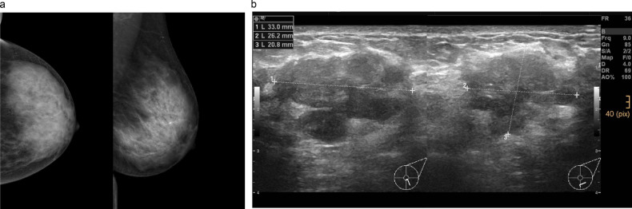

- Gợi ý: phụ nữ 45 tuổi lần đầu tầm soát, mô tuyến rất đặc.
- Câu hỏi: Mật độ ảnh hưởng thế nào tới khả năng phát hiện? Ngưỡng xử trí theo mật độ?

<b>Bấm để hiện đáp án (findings + chẩn đoán)</b>

- Dấu hiệu (findings): **vú cực đặc (BI-RADS mật độ D)** trên CC + MLO — mô xơ–tuyến dày che lấp.
- Chẩn đoán/lý giải: **hiệu ứng che lấp (masking)** → X-quang dễ **âm tính giả**. Ngưỡng: mật độ **C/D** → **bổ sung US và/hoặc MRI**; **mật độ D → MRI 2–3 năm/lần** (EUSOBI, bằng chứng mức I). Mật độ **A/B** → **không bổ sung**.
- Nguồn ảnh: Marcon M et al., Eur Radiol 2024 (PMC11399176), Fig. 2, CC BY 4.0.

## Bài liên quan chéo

- [500 – Tổng quan Hệ Vú & Sản Phụ khoa](../500-tong-quan-vu-san-phu-khoa/lesson.md)
- [510 – Vú BI-RADS (nhũ ảnh, siêu âm, MRI)](../510-vu-BIRADS-nhu-anh-sieu-am-MRI/lesson.md)
- [512 – Vi vôi hóa, biến dạng cấu trúc, túi ngực](../512-vi-voi-hoa-tui-nguc-bien-dang/lesson.md)
- [514 – Ung thư vú: TNM & MRI đánh giá lan rộng](../514-ung-thu-vu-TNM-MRI-lan-rong/lesson.md)
- [517 – Sinh thiết định vị vú & quản lý clip/kẹp](../517-sinh-thiet-dinh-vi-vu-va-quan-ly-clip/lesson.md)
- [199 – Quy trình xét nghiệm gen & tầm soát gia đình (WB-MRI)](../199-quy-trinh-xet-nghiem-gen-tam-soat-gia-dinh/lesson.md)

## Ảnh

- 12 ảnh gốc (CC BY 4.0 ×8, CC BY ×3, CC BY-NC-ND ×1) + 1 ảnh ghép (CC BY 4.0 kế thừa). Nguồn + giấy phép từng ảnh trong `images/CREDITS.md`.
- Ảnh CC BY-NC-ND (Nagata A et al.) giữ **nguyên bản**, không crop/ghép. Ảnh ghép dùng `tools/make_composite.py` (letterbox nền đen, giữ nguyên tỷ lệ).

> Không dùng để chẩn đoán độc lập khi chưa có người hướng dẫn.
