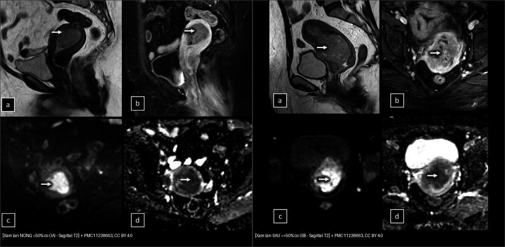
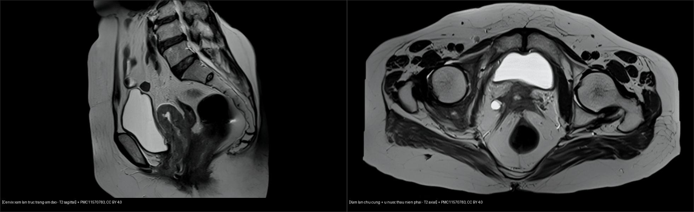
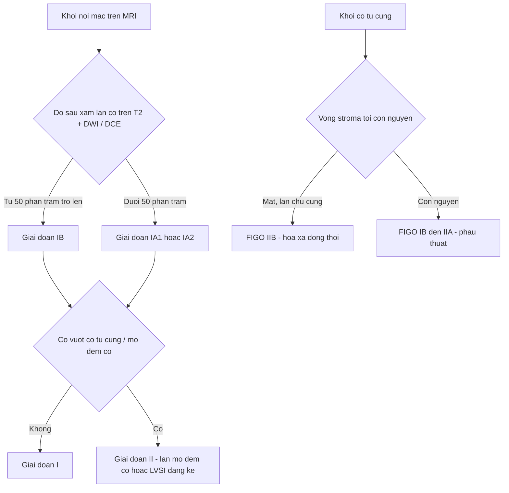
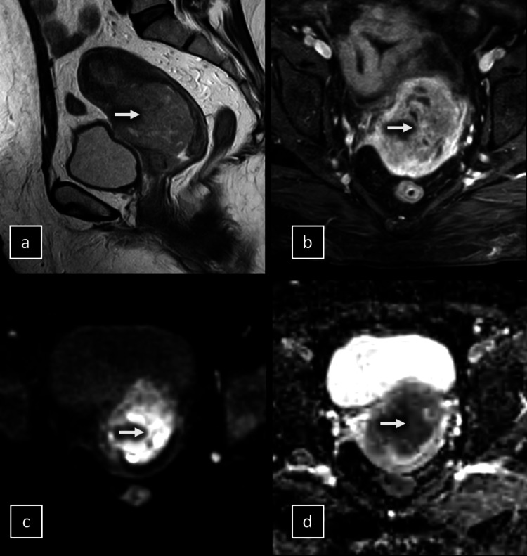
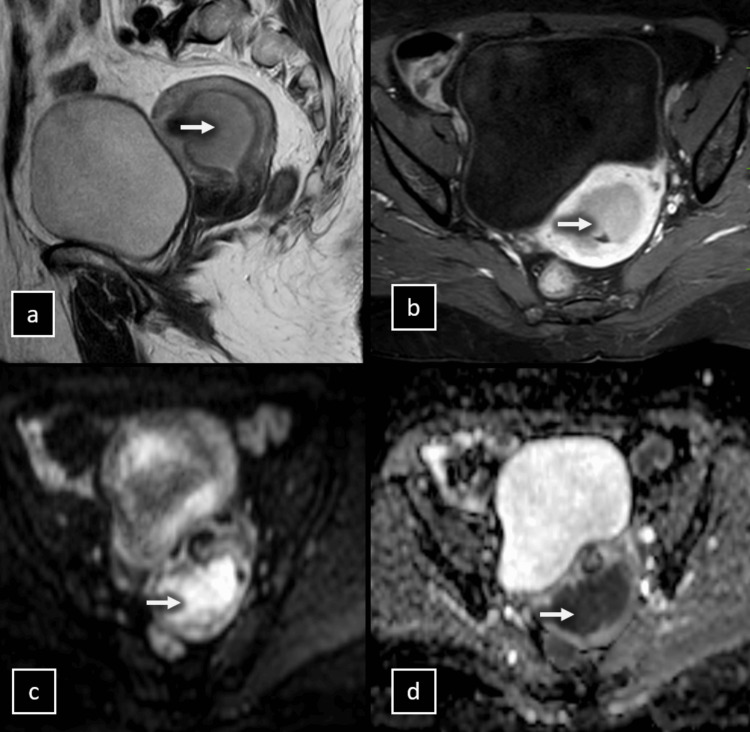
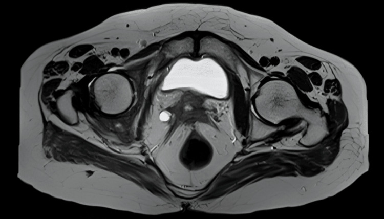

# 525 — Ung thư nội mạc & cổ tử cung: phân giai đoạn FIGO trên MRI / Endometrial & cervical cancer — FIGO staging on MRI

**Tags:** `pattern:u-noi-mac` `pattern:xam-lan-co` `vung:tu-cung` `score:FIGO` `protocol:MRI-tieu-khung`
**Mức chắc chắn (certainty):** tổng hợp y văn (literature synthesis) — nhóm tự biên từ các ca mở CC BY (Cureus 2024/2026) + bảng phân giai đoạn FIGO 2023 và tiêu chuẩn MRI, chưa gắn một ca nguyên văn đơn lẻ.

## 1. Tổng quan — vì sao T2, DWI và DCE đọc được độ sâu xâm lấn cơ

- **Ung thư nội mạc tử cung (endometrial cancer)** là ung thư phụ khoa hay gặp nhất ở nước phát triển; biểu hiện điển hình **ra máu sau mãn kinh (postmenopausal bleeding)**. Yếu tố tiên lượng quan trọng nhất mà MRI phải trả lời là **độ sâu xâm lấn cơ tử cung (myometrial invasion)**, lấy mốc **50% bề dày cơ**; kế đó là **xâm lấn mô đệm cổ tử cung (cervical stromal invasion)**, **hạch (nodal)** và lan ngoài tử cung.
- **TẠI SAO đọc được trên T2W:** cơ tử cung bình thường có 3 lớp trên T2 — nội mạc sáng (giàu nước), **vùng chuyển tiếp (junctional zone) tối** (cơ trơn đặc), lớp cơ ngoài trung gian. U nội mạc là mô đặc, **tín hiệu trung gian/thấp hơn nội mạc** → đôi khi gần bằng cơ, nên T2W đơn thuần dễ đọc sai (xem số dưới).
- **TẠI SAO DWI sáng:** u ác **giàu tế bào** → khoảng ngoại bào chứa nước bị thu hẹp → nước **khuếch tán hạn chế (restricted diffusion)** → **tín hiệu cao trên DWI b = 800–1000 s/mm²** và **giảm trên bản đồ ADC (apparent diffusion coefficient)**. Đây là lý do DWI làm nổi u/đuôi xâm lấn mà T2W bỏ sót.
- **TẠI SAO DCE giúp:** u tân mạch **ngấm ít và chậm hơn cơ lành** → trên thì động mạch (~20–30 giây) và 120 giây, u **giảm tín hiệu (hypointense) tương phản với cơ ngấm mạnh** → vẽ được ranh giới đuôi xâm lấn sâu.
- **Ngưỡng định lượng (số, có nguồn):** so với mô bệnh học sau cắt tử cung, độ chính xác cho **xâm lấn sâu ≥ 50%** là **T2W đơn thuần 64,5%** vs **T2W + DWI 90,3%** vs **T2W + DCE-MRI 90,3%** (n = 31, Cureus 2024); độ nhạy/đặc hiệu/PPV/NPV của T2W + DWI và T2W + DCE đều cao và tương đương **88,9–91,7%** (khác biệt có ý nghĩa thống kê với T2W đơn thuần, p < 0,01). Với ung thư cổ tử cung, **độ nhạy MRI phát hiện xâm lấn chu cung (parametrial) 88,24%**, lan rộng u 81,82%, nhưng **hạch chỉ 56,25%** (n = 45, Cureus 2026) — nghĩa là **MRI rất tốt để loại xâm lấn chu cung, nhưng kém với hạch**.
- **Ngưỡng ADC:** giá trị tuyệt đối thay đổi theo máy/tham số (báo cáo thường ~1,0–1,1 ×10⁻³ mm²/s cho mốc lành–ác) — **chưa đủ chuẩn hóa**, nên đọc DWI **định tính** ("sáng thì nghi") và luôn đối chiếu ROI tránh hoại tử/xuất huyết.

## 2. Mẫu hình + chẩn đoán phân biệt theo vị trí (Gamut)

- **Trong lòng tử cung (nội mạc):** ung thư nội mạc (khối nội mạc DWI sáng, ngấm kém cơ), polyp nội mạc (có cuống mạch đơn độc), tăng sinh nội mạc (dày lan tỏa), sarcoma mô đệm/carcinosarcoma (lớn, hoại tử, không điển hình), di căn (hiếm).
- **Xâm lấn cơ (myometrium):** u xơ cơ (leiomyoma — bờ rõ, T2 tối), lạc nội mạc trong cơ (adenomyosis — JZ ≥ 12 mm, nang nhỏ T2 sáng), sarcoma cơ tử cung; đồng thời là nơi phải **đo độ sâu xâm lấn của u nội mạc**.
- **Cổ tử cung (cervix):** ung thư cổ tử cung (khối T2 trung gian, phá vòng cơ tối), adenocarcinoma cổ, polyp, lạc nội mạc cổ.
- **Chu cung (parametrium):** xâm lấn trực tiếp từ cổ, dính/viêm sau mổ–xạ cũ (giả xâm lấn), lạc nội mạc sâu (nối bài 540).
- Gợi nhớ tiếp cận "**3 câu hỏi**": **(1) u ở đâu? (2) xâm lấn cơ bao nhiêu %? (3) có vượt cổ tử cung/chu cung hoặc xâm lấn mô đệm không?**

## 3. Bảng so sánh phân biệt (ma trận đối chiếu)

| Thực thể (entity) | Hình ảnh điển hình | Chốt vào (rule-in) | Chốt loại (rule-out) | Gợi ý xác nhận |
|---|---|---|---|---|
| Ung thư nội mạc | Khối nội mạc **T2 trung gian + DWI sáng/ADC thấp + ngấm kém cơ** | **DWI sáng + đuôi xâm lấn cơ + ngấm kém thì động mạch** | Bờ đều, có cuống mạch đơn độc, không xâm lấn cơ → polyp/tăng sinh | DCE 120s + DWI để đo độ sâu; mô bệnh sau cắt tử cung |
| Adenomyosis | **JZ ≥ 12 mm**, nang nhỏ T2 sáng trong cơ, lan tỏa | **JZ dày ≥ 12 mm + nang nhỏ + cơ dày không đối xứng** | Khối đặc DWI sáng khu trú → u | T2W + so phim; đừng nhầm là xâm lấn sâu |
| U xơ cơ (leiomyoma) | Khối **T2 tối, bờ rõ, có vỏ**, JZ lệch | **Bờ rõ + T2 tối + vỏ giả** | DWI sáng không đồng nhất + hoại tử → sarcoma (nghi ngờ) | T2W + DCE (tăng không đồng nhất) |
| Polyp nội mạc | Khối nội mạc **có cuống, bờ rõ** | **Cuống mạch đơn độc (pedicle artery)** | Xâm lấn cơ + DWI sáng → ung thư | Siêu âm Doppler + DCE |
| Ung thư cổ tử cung | Khối cổ **phá vòng cơ tối**, lan âm đạo/chu cung | **Mất vòng stroma tối + lan vào chu cung** (Se 88,24%) | Vòng stroma còn nguyên + không lan chu cung → loại xâm lấn | T2W lát mỏng vuông góc trục cổ + DWI |
| Sarcoma mô đệm / carcinosarcoma | Khối lớn, hoại tử, **không điển hình**, DWI sáng mạnh | **Khối nội mạc lớn + hoại tử + lan rộng nhanh** | U nhỏ bờ rõ T2 tối → leiomyoma | Mô bệnh (sinh thiết) |

*Trái: **u nội mạc xâm lấn nông < 50% cơ (giai đoạn IA)** — (a) T2 sagittal khối nội mạc, (b) DCE 120s, (c) DWI b = 1000, (d) ADC. Phải: **xâm lấn sâu ≥ 50% (giai đoạn IB, ca 51 tuổi)** — đuôi u ăn vào nửa ngoài cơ (mũi tên). Nguồn: Cureus 2024 (PMC11238663), CC BY 4.0. Ảnh ghép letterbox.*

*Trái: T2 sagittal — u cổ tử cung lan ra trực tràng và 1/3 trên âm đạo. Phải: T2 axial — **xâm lấn chu cung (parametrial) + xâm lấn niệu quản phải gây ứ nước–niệu quản phải**. Nguồn: Cureus 2024 (PMC11570783), CC BY 4.0. Ảnh ghép letterbox.*

### Đọc DWI/DCE thế nào cho khỏi mắc lừa (cạm bẫy kỹ thuật)
- **T2W đơn thuần chỉ đạt ~64% cho xâm lấn sâu** — nếu chỉ T2, dễ đọc "nông" trong khi mô bệnh là sâu (xem Ca 2). Luôn phối **T2W + DWI** hoặc **T2W + DCE** (đều ~90%).
- **DCE đọc ở 120 giây** (không phải thì quá sớm): u giảm tín hiệu so với cơ ngấm mạnh mới nổi rõ đuôi xâm lấn.
- **ROI DWI phải tránh hoại tử/xuất huyết** (ADC giả tăng) và tránh vùng mạch máu.

## 4. Protocol chụp + hệ phân giai đoạn FIGO

- **MRI tiểu khung (1,5T hoặc 3T, coil khung chậu):** nhịn đói 4–6 giờ, **bàng quang nửa căng**, tiêm **thuốc giảm nhu động (antispasmodic) ± glucagon** để diệt giả ảnh co cơ.
- **Chuỗi xung tối thiểu:** sagittal **T2W** → **T2W axial oblique vuông góc trục thân tử cung** (đo đúng độ sâu xâm lấn) → **DWI b = 0 / 800–1000 s/mm² + ADC** → **DCE fat-sat** (động mạch ~20–30s, 120s, muộn) → ± T1W (khảo sát máu/mỡ, di căn). Với cổ tử cung, dùng lát mỏng (≤ 3 mm) vuông góc trục cổ.
- **FIGO 2023 — ung thư nội mạc tử cung (cập nhật, tích hợp phân loại phân tử: POLEmut / MMRd / NSMP / p53abn):** giai đoạn I giới hạn trong tử cung — **IA1** (giới hạn nội mạc, không xâm lấn cơ) / **IA2** (< 50% cơ) / **IB** (≥ 50% cơ) / **IC** (typ mô học hung hãn, không xâm lấn cơ); giai đoạn II — **IIA** (lan mô đệm cổ, typ không hung hãn) / **IIB** (có **LVSI đáng kể**) / **IIC** (typ hung hãn, có xâm lấn cơ); giai đoạn III chia **IIIA1** (lan buồng trứng–vòi) / **IIIA2** (dưới thanh mạc/thanh mạc) / **IIIB** (âm đạo, chu cung) / **IIIC** (hạch); giai đoạn IV lan bàng quang/trực tràng hoặc di căn xa. **Điểm MRI phải trả lời:** IA1/IA2 vs IB và IIA vs ngoài tử cung.
- **FIGO 2018 — ung thư cổ tử cung:** **IB1** (< 2 cm) / **IB2** (≥ 2–< 4 cm) / **IB3** (≥ 4 cm); **IIA** (2/3 trên âm đạo, chưa chu cung) / **IIB** (xâm lấn chu cung); **IIIA** (1/3 dưới âm đạo) / **IIIB** (thành chậu hoặc ứ nước thận) / **IIIC1** (hạch chậu) / **IIIC2** (hạch cạnh ĐMC); **IVA** (niêm mạc bàng quang/trực tràng) / **IVB** (di căn xa).
- **Ý nghĩa điều trị:** còn khu trú cổ (< IB2/IIA1 và không xâm lấn chu cung) → **phẫu thuật**; **xâm lấn chu cung (IIB) hoặc hạch** → **hóa–xạ đồng thời** (nên **MRI âm tính chu cung có NPV cao, giúp tránh mổ triệt căn oan**).

## 5. Biến thể bình thường và cạm bẫy

- **Sóng co cơ tử cung (uterine contraction wave)** — vùng cơ dày tín hiệu thấp thoáng qua, **có thể mất ở lát chụp khác** → dễ đọc nhầm xâm lấn sâu/adenomyosis; chụp lại và đối chiếu các chuỗi.
- **Cơ mãn kinh mỏng** làm đo tỷ lệ % xâm lấn dễ sai → dùng **đo độ dày cơ còn lại** và DCE để định vị đuôi u.
- **Polyp nội mạc có cuống mạch** dễ bị đọc thành u xâm lấn cơ nếu thấy tăng ngấm — tìm **cuống đơn độc** và bờ nhẵn.
- **Dị vật/hình ảnh giả (IUD, gas, biến dạng DWI)** tạo vệt sáng giả — đọc DWI cùng ADC, không dựa mỗi ảnh raw.
- **Xạ/mổ vùng chậu cũ** gây xơ dính chu cung → **giả xâm lấn chu cung**; so phim cũ và đối chiếu T2/DWI.
- **Satisfaction of search:** thấy u nội mạc rồi bỏ qua khối cơ đồng thời (leiomyoma/sarcoma) hoặc hạch bẹn/chậu.

## 6. Tự lượng giá — Blind Quiz

**Ca 1 — Nữ 51 tuổi ra máu sau mãn kinh, u nội mạc lớn. Xâm lấn cơ nông hay sâu? Vì sao?**

- Hỏi: đuôi u ăn vào bao nhiêu bề dày cơ (mốc 50%)? Chuỗi nào xác nhận? Giai đoạn FIGO 2023 tương ứng?

<b>Bấm để hiện đáp án (findings + chẩn đoán)</b>

- Dấu hiệu (findings): khối nội mạc lớn xâm lấn **> 50% bề dày cơ** (đuôi u ăn ra nửa ngoài cơ, mũi tên); (b) DCE 120s khối giảm tín hiệu so với cơ ngấm mạnh; (c) DWI sáng; (d) ADC thấp — đều khẳng định **xâm lấn sâu**.
- Chẩn đoán (diagnosis): **ung thư nội mạc xâm lấn cơ sâu = giai đoạn IB** (FIGO 2023; mô bệnh sau mổ xác nhận). Vì u giàu tế bào → DWI sáng/ADC thấp và ngấm kém cơ ở thì động mạch.
- Nguồn ảnh: Cureus 2024, PMC11238663 Fig. 3, CC BY 4.0.

**Ca 2 — Nữ 66 tuổi. T2 đọc ban đầu là xâm lấn NÔNG, mô bệnh sau mổ lại là SÂU. Chuỗi nào lộ ra sự thật?**

- Hỏi: (a) T2 và (b) DCE 120s nói gì? (c)/(d) DWI–ADC thay đổi chẩn đoán thế nào? Bài học?

<b>Bấm để hiện đáp án (findings + chẩn đoán)</b>

- Dấu hiệu (findings): (a) T2W và (b) DCE 120s ban đầu bị đọc là **xâm lấn nông**; (c) DWI b = 1000 cho thấy **u lan vào nửa ngoài cơ** (mũi tên), (d) ADC xác nhận **xâm lấn sâu**, mô bệnh sau mổ đúng là **IB**.
- Chẩn đoán (diagnosis): ung thư nội mạc **xâm lấn cơ sâu ≥ 50% (IB)**. **Bài học:** T2W/T2W + DCE đơn lẻ có thể đọc nhầm nông→sâu (T2W chỉ ~64,5% chính xác cho xâm lấn sâu) — **phải phối DWI**.
- Phản biện: ca này T2W gợi ý nông nhưng mô bệnh sâu → cho thấy **không được chốt độ sâu chỉ bằng T2**.
- Nguồn ảnh: Cureus 2024, PMC11238663 Fig. 2, CC BY 4.0.

**Ca 3 — Nữ ra máu âm đạo, khối cổ tử cung. Còn mổ được hay phải hóa–xạ?**

- Hỏi: vòng cơ tối (stroma) còn nguyên không? Có dấu hiệu xâm lấn chu cung? Ảnh hưởng quyết định điều trị?

<b>Bấm để hiện đáp án (findings + chẩn đoán)</b>

- Dấu hiệu (findings): khối cổ tử cung **phá mất vòng stroma tối** và lan vào **chu cung; kèm xâm lấn niệu quản phải → ứ nước–niệu quản phải**.
- Chẩn đoán (diagnosis): **ung thư cổ tử cung giai đoạn FIGO IIB (xâm lấn chu cung)** → **hóa–xạ đồng thời**, không mổ triệt căn. MRI nhạy **88,24%** cho xâm lấn chu cung (nhưng chỉ 56,25% cho hạch — phải đánh giá hạch bằng hình ảnh khác/PET).
- Nguồn ảnh: Cureus 2024, PMC11570783 Fig. 7, CC BY 4.0.

## Bài liên quan chéo
- [500 – Tổng quan Vú & Sản Phụ khoa](../500-tong-quan-vu-san-phu-khoa/lesson.md)
- [520 – Tử cung: u xơ FIGO 0–8, adenomyosis & nội mạc](../520-tu-cung-u-xo-FIGO-adenomyosis-noi-mac/lesson.md) (độ dày JZ ≥ 12 mm, phân loại FIGO u xơ)
- [530 – Phần phụ O-RADS](../530-buong-trung-ORADS-sieu-am-MRI/lesson.md) (khối phần phụ — DDx trên MRI tiểu khung)
- [540 – DIE & PID](../540-lac-noi-mac-tu-cung-sau-DIE-MRI/lesson.md) (lạc nội mạc sâu — DDx chu cung do xơ dính)
- [160 – Bụng cấp GI & ứ nước thận](../160-bung-cap-GI/lesson.md) (hệ quả tắc niệu quản)

## Ảnh
- `525_noi-mac-xam-lan-sau_MRI_PMC11238663-Fig3-CCBY.jpg`, `525_noi-mac-xam-lan-nong_MRI_PMC11238663-Fig1-CCBY.jpg`, `525_noi-mac-pitfall_MRI_PMC11238663-Fig2-CCBY.jpg` — Cureus 2024 (PMC11238663), CC BY 4.0.
- `525_co-tu-cung-tham-nhiem_MRI_PMC11570783-Fig7-CCBY.jpg`, `525_co-tu-cung-sagittal_MRI_PMC11570783-Fig6-CCBY.jpg` — Cureus 2024 (PMC11570783), CC BY 4.0.
- `composite_noi-mac-nong-vs-sau.jpg`, `composite_co-tu-cung-tham-nhiem.jpg` — ảnh ghép letterbox từ các ảnh trên.
- Chi tiết giấy phép từng ảnh trong `images/CREDITS.md`. AuntMinnie: chỉ dẫn link, không tải.

> Không dùng để chẩn đoán độc lập khi chưa có người hướng dẫn.
