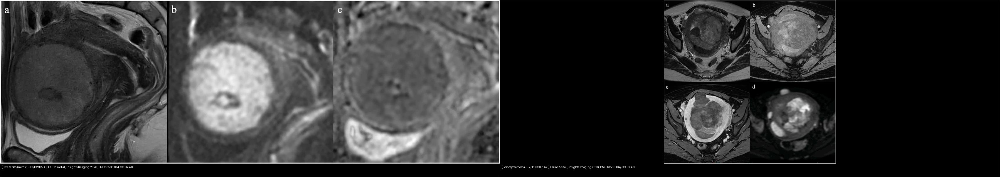
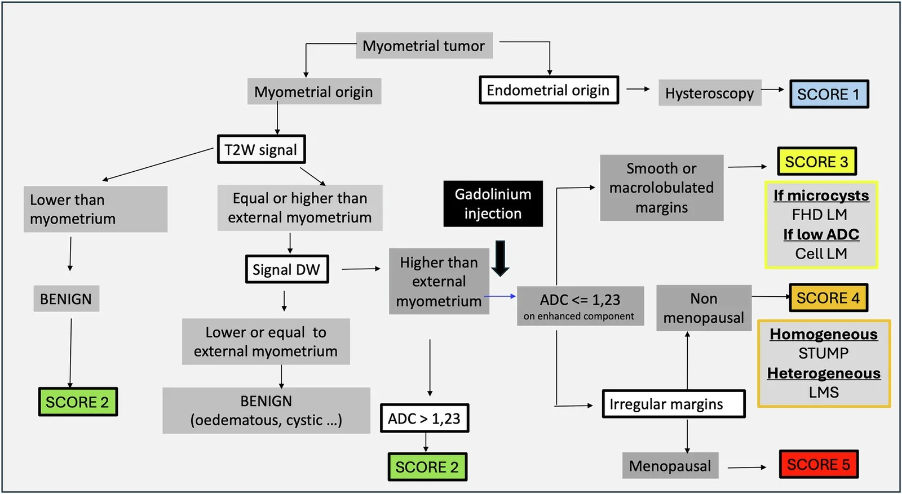
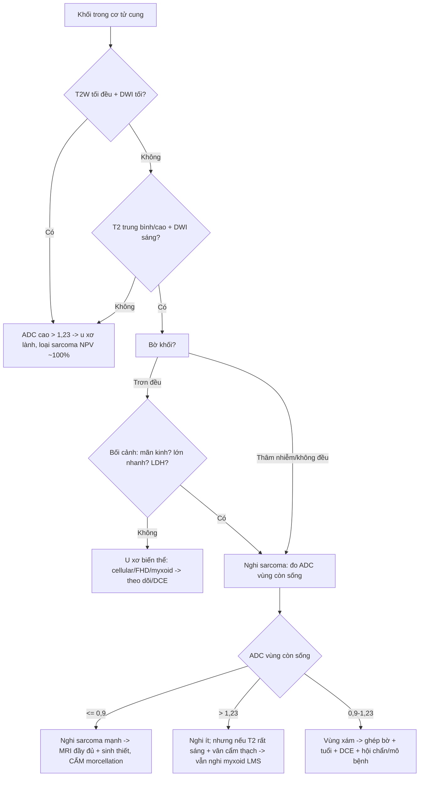
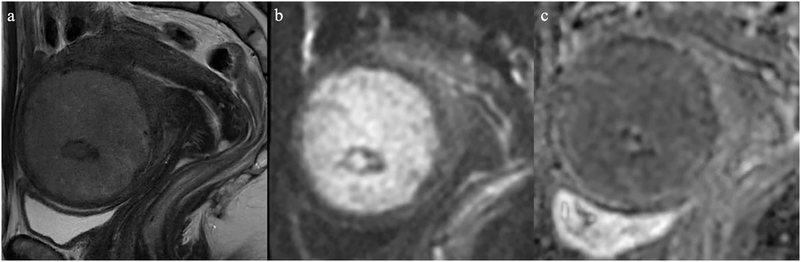
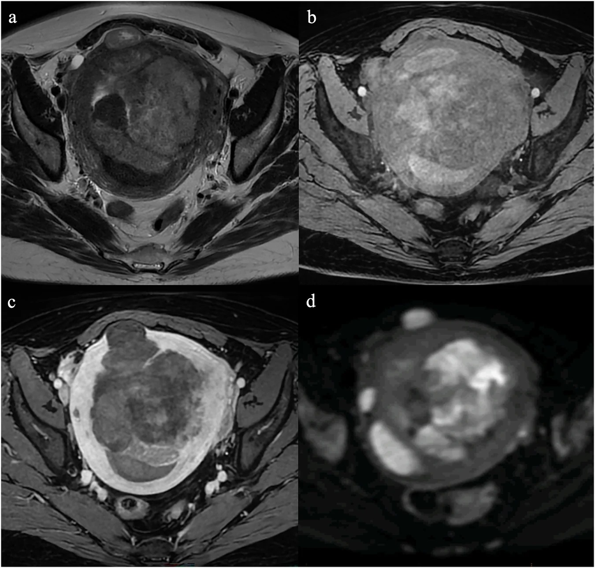
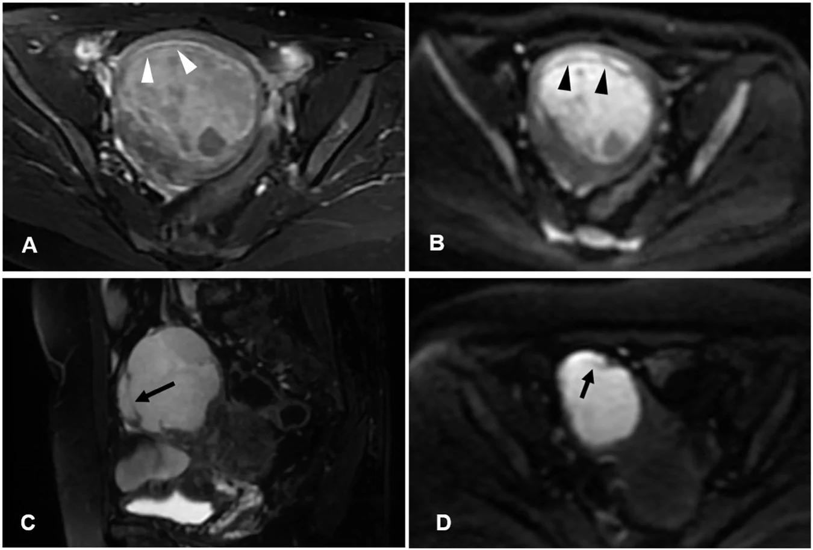
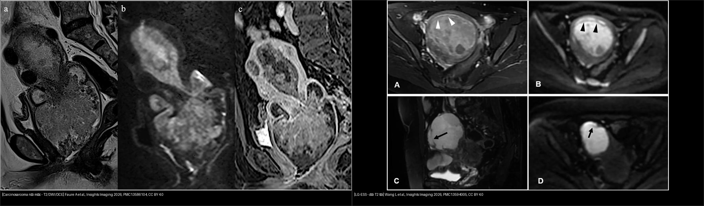
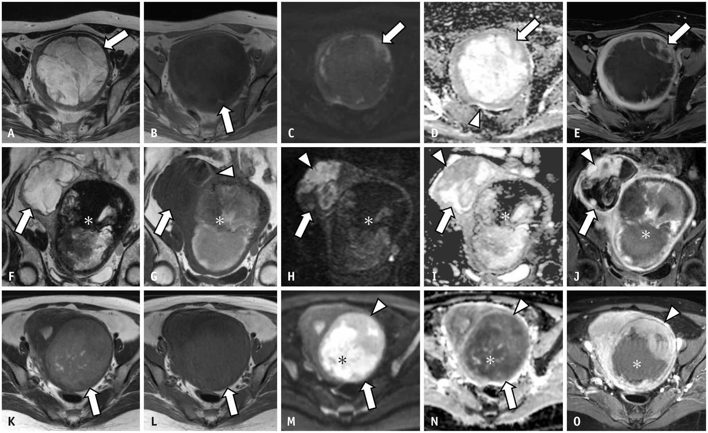

# 526 — Sarcoma tử cung & carcinosarcoma vs u xơ / Uterine sarcoma vs leiomyoma

**Tags:** `pattern:khoi-co-tu-cung` `pattern:xam-lan-co` `vung:tu-cung` `score:ADC` `protocol:MRI-tieu-khung`
**Mức chắc chắn (certainty):** tổng hợp y văn (literature synthesis) — nhóm tự biên từ 2 bài tổng quan/bẫy hình ảnh mở CC BY (Insights into Imaging 2026), 1 nghiên cứu đa trung tâm myxoid LMS CC BY-NC (Korean J Radiol 2026) và 1 nghiên cứu ADC — không gắn ca nguyên văn đơn lẻ.

## 1. Tổng quan bệnh học – cơ chế hình ảnh

- **Vấn đề lâm sàng:** sarcoma tử cung (uterine sarcoma) chỉ chiếm **3–9%** u tử cung, trong đó **leiomyosarcoma (LMS) 41–60%**, rồi sarcoma mô đệm nội mạc (ESS) và adenosarcoma. Carcinosarcoma là u **hỗn hợp biểu mô–trung mô** (chuyển sản), < 1% ung thư tử cung nhưng gánh **~15% tử vong** liên quan. Điểm chết người: đa số khối cơ tử cung là u xơ (leiomyoma) **lành**, nên nếu đọc nhầm sarcoma thành u xơ → **morcellation (cắt nhỏ u qua nội soi) gieo rắc ổ bụng, giảm sống còn**. Ngược lại, gọi oan u xơ biến thể thành sarcoma → cắt tử cung oan. MRI tồn tại chính vì bài toán phân tầng này.
- **TẠI SAO tín hiệu (vật lý MRI + mô bệnh):**
  - **U xơ thường (hyaline leiomyoma):** khối collagen xơ dày đặc, ít nước tự do → **T2W tối**; mật độ tế bào thấp + chất nền xơ hạn chế khuếch tán nước → **DWI tối, ADC cao**. Đây là "chữ ký" lành tính.
  - **Sarcoma:** mật độ tế bào rất cao → nước nội bào bị "nhốt", khuếch tán khó → **DWI sáng + ADC thấp**; u lớn nhanh vượt cấp máu → **hoại tử** (T1 tối, T2 sáng hỗn hợp, ngấm thuốc viền/kém) + **xuất huyết** (T1 có vùng sáng do methemoglobin) + mất vỏ giả, bờ **thâm nhiễm** cơ lành.
  - **Myxoid LMS (cạm bẫy):** chất nền nhầy (myxoid) giữ nước nhiều → **T2 rất sáng + ADC cao** (2,08 ×10⁻³ mm²/s theo Saida 2026), trông "lành" dù vẫn là sarcoma ác (dấu "vân cẩm thạch" *marbled appearance*).
- **Ngưỡng định lượng bắt buộc:**
  - **ADC ≤ 0,9 ×10⁻³ mm²/s** (đo trên phần u **còn sống, hạn chế khuếch tán nhất**, tránh vùng xuất huyết/hoại tử) → **nghi sarcoma**. Rizescu 2026 (cắt lớp ADC, b = 800–1000 s/mm²): sarcoma **0,813** vs u xơ không điển hình **1,050**; **cutoff ≤ 0,892 → Se 100% / Sp 84,6%**, AUC **0,923**.
  - **"Khóa loại" (rule-out) rất mạnh:** T2W tối + DWI tối + **ADC > 1,1–1,23 ×10⁻³ mm²/s** → NPV **~100%** (không phải LMS).
  - **Ngưỡng theo biến thể** (Faure 2026, Bảng 2): cellular / FH-deficient (FHD) / STUMP / LMS đều có ADC **< 1,1**; còn nang (cystic) **> 2**, phù (edematous) **> 1,2**, myxoid **> 2** — vì vậy **ADC một mình KHÔNG đủ**, phải ghép với bờ + bối cảnh.
  - **Yếu tố lâm sàng quyết định mức độ lo ngại:** **mãn kinh** + khối lớn lên nhanh + LDH tăng; tiền sử xạ trị vùng chậu (yếu tố nguy cơ carcinosarcoma sau xạ).
- **Phân loại WHO 2020 (nhóm sarcoma mô đệm):** mảng u mô đệm nội mạc (ESN — lành), LG-ESS (tuổi trung bình **39**, sống 5 năm **91%**), HG-ESS (tuổi trung bình **61**, sống 5 năm **33%**), u sarcoma không biệt hóa (UUS). Nhóm cơ trơn: LMS, STUMP (không chắc ác tính tiềm năng).

## 2. Mẫu hình + chẩn đoán phân biệt theo vị trí (gamut)

- **Khối trong cơ (myometrium) — gamut chính:** u xơ + biến thể (cellular, FHD, myxoid, bizarre) → STUMP → LMS; ESS dạng thâm nhiễm (giả adenomyosis); lạc nội mạc trong cơ (adenomyosis).
- **Khối trong lòng tử cung (endometrial cavity):** polyp nội mạc, ESN, LG-ESS lồi vào lòng, ung thư nội mạc, carcinosarcoma, adenosarcoma.
- **Ba câu hỏi gỡ rối mọi khối cơ tử cung:** **(1) bờ?** (rõ/trơn vs thâm nhiễm/không đều) **(2) T2 tối hay sáng?** **(3) DWI/ADC ra sao?**
- **Đặc trưng từng thực thể:**
  - *U xơ thường:* bờ rõ, T2 tối đều, DWI tối, ADC cao, ngấm kém.
  - *Cellular/FHD leiomyoma (mimic sarcoma):* T2 **trung gian**, DWI **sáng**, ADC **thấp (< 1,1)** — nhưng **bờ trơn đều** và có **dải/chấm T2 tối (speckled, cord-like)** do sợi collagen; FHD hay vi nang T2 sáng + ngấm mạnh, gợi ý hội chứng FH.
  - *Myxoid leiomyoma:* T2 **rất sáng + giả nang**, ngấm kém, ADC **cao (> 2)** — dễ nhầm nang.
  - *LMS:* khối **lớn, bờ không đều/thâm nhiễm**, T2 trung bình–cao **không đồng nhất**, xuất huyết/hoại tử, DWI sáng, ADC thấp.
  - *STUMP:* **không phân biệt được bằng hình ảnh** với LMS lành-không-lành — chẩn đoán mô bệnh (số phân bào, hoại tử u).
  - *LG-ESS:* **"dải T2 tối" trong u** (cơ lành còn sót), dạng **"giun bò" (worm-like)**, T2/DWI sáng, ADC thấp, ngấm mạnh; hay lan theo mạch cạnh tử cung.
  - *HG-ESS:* giống LG-ESS nhưng phá hủy nhiều hơn, ngấm kiểu **"lông vũ" (feather-like)**.
  - *Carcinosarcoma:* khối đặc lớn trong lòng nội mạc, **lan qua lỗ trong cổ tử cung**, T2 **không đồng nhất** (xuất huyết/hoại tử), DWI hạn chế mạnh, ngấm tiến triển; hạch **tới 35%**, di căn xa **> 10%**.
  - *Adenosarcoma:* T2 **sáng do myxoid**, ngấm mạnh, DWI thường **không hạn chế**.

## 3. Bảng so sánh phân biệt (ma trận đối chiếu)

| Thực thể (entity) | Hình ảnh điển hình | Chốt vào (rule-in) | Chốt loại (rule-out) | Gợi ý xác nhận |
|---|---|---|---|---|
| U xơ thường (hyaline leiomyoma) | Bờ rõ, T2 tối đều, DWI tối | **T2 tối + DWI tối + ADC cao** | T2 trung bình/cao + DWI sáng → không phải u xơ thường | MRI cơ bản, không cần sinh thiết |
| U xơ tế bào / FHD (cellular/FH-deficient) | Bờ rõ, T2 trung gian, **dải/chấm T2 tối**, ADC < 1,1 | **Bờ trơn + mảnh ghép collagen (speckled)** | Bờ thâm nhiễm + mất cấu trúc → nghi sarcoma | So phim cũ (u xơ tăng chậm), tư vấn FH (da/cơ/tử cung nhiều u) |
| U xơ myxoid (myxoid leiomyoma) | T2 rất sáng + giả nang, ADC **> 2**, ngấm kém | **Bờ rõ + ngấm kém + không xuất huyết** | Ngấm mạnh, "vân cẩm thạch", mãn kinh → nghi myxoid LMS | Đo ADC vùng đặc, DCE |
| Leiomyosarcoma (LMS) | Khối lớn, bờ không đều, **nhân hoại tử/xuất huyết**, T2 hỗn hợp | **ADC ≤ 0,9 + bờ thâm nhiễm + xuất huyết** | ADC > 1,23 + T2 tối → loại trừ (NPV ~100%) | Sinh thiết/mô bệnh sau cắt; **cấm morcellation khi nghi ngờ** |
| STUMP | Giống LMS hoặc u xơ, không phân biệt được | **Không có dấu hiệu hình ảnh đặc trưng** | Không loại trừ được trên hình ảnh | Chẩn đoán mô bệnh (số phân bào, hoại tử u) |
| LG-ESS | Khối cơ, **dải T2 tối trong u**, "giun bò", T2/DWI sáng | **Dải T2 tối + thâm nhiễm + lan mạch cạnh tử cung** | T2 tối đều + DWI tối → u xơ | Sinh thiết; tìm ổ ngoài tử cung (buồng trứng, mạc treo) |
| HG-ESS | Khối lớn hỗn hợp, phá hủy cơ nhiều, ngấm "lông vũ" | **Ngấm lông vũ + phá hủy cơ rộng** | Bờ rõ + không xâm lấn → ít nghĩ | Mô bệnh + hóa mô miễn dịch |
| Carcinosarcoma | Khối đặc lòng tử cung, **lan qua cổ tử cung**, T2 hỗn hợp | **Khối nội mạc lớn + xuất huyết/hoại tử + hạch** | Tổn thương nhỏ, đồng nhất, khu trú nội mạc → ít nghĩ | Sinh thiết nội mạc; CT ngực/bụng tìm di căn |
| Lạc nội mạc trong cơ (adenomyosis) | Cơ dày, **chấm T2 sáng**, ổ T1 sáng (xuất huyết), DWI **tối** | **Chấm/nang T2 sáng + ổ T1 sáng + DWI tối** | Khối đặc DWI sáng thật → nghi ESS | T2 axial + T1 fat-sat |

*Trái: u xơ tế bào (cellular leiomyoma) — T2 trung gian, DWI sáng, **ADC thấp ~0,9** nhưng bờ trơn đều. Phải: leiomyosarcoma — khối lớn bờ không đều, T2/T1 hỗn hợp do xuất huyết và hoại tử, DWI sáng. Nguồn: Faure A et al., Insights into Imaging 2026 (PMC13586104), CC BY 4.0. Ảnh ghép letterbox, giữ nguyên tỷ lệ.*

### Dấu hiệu chốt then chốt
- **"Dải T2 tối" trong u** (conserved hypointense myometrial bands) = sợi cơ lành bị u ESS thâm nhiễm còn sót lại → chốt ESS hơn là u xơ/adenomyosis (adenomyosis cũng có chấm sáng nhưng **DWI tối**, không phải dải).
- **"Vân cẩm thạch" (marbled appearance)** trong vùng T2 rất sáng = dấu bổ trợ cho **myxoid LMS** — tránh xếp nhầm lành vì ADC cao.
- **Đo ADC đúng chỗ:** vùng u **còn sống, hạn chế khuếch tán nhất**; vùng xuất huyết/hoại tử cũng cho ADC thấp giả → nếu đo sai sẽ dương tính giả nặng thêm.

## 4. Protocol chụp + hệ phân độ/điểm chuẩn hóa

- **Protocol MRI tiểu khung khối cơ tử cung:**
  - **T2W không xóa mỡ, ≥ 2 bình diện (axial + sagittal):** bắt buộc — đây là chuỗi tối ưu đánh giá vùng chuyển tiếp (JZ) và **mặt phân cách u–cơ** (bờ).
  - **T1W (axial/sagittal ± fat-sat):** nhận diện **xuất huyết** (T1 sáng) và **mỡ** (lipoleiomyoma — mất tín hiệu khi fat-sat).
  - **DWI b ≥ 800 s/mm² (dùng 1.000) + bản đồ ADC:** "tính thật" của hạn chế khuếch tán. Cảnh báo **T2 shine-through** ở u myxoid.
  - **T1W + Gd động học (DCE, fat-sat), 0,1–0,2 mmol/kg:** đánh giá hoại tử (khuyết ngấm), đường cong động học, lan mạch.
  - **Không chọc hút/sinh thiết trước MRI** (gây nhiễu xuất huyết); nếu cần mô bệnh thì sau MRI.
- **Hệ điểm khối cơ tử cung (Zlotykamien-Taieb, 2025):** gộp T2 + DWI + ADC + **bờ** thành điểm nguy cơ 1–5. U thường điểm thấp; u xơ tế bào (mimic) thường **điểm 3**; khối mãn kinh nghi ác **điểm 5**. **Bờ (đều vs thâm nhiễm) là yếu tố phân biệt then chốt nhất.**

*Sơ đồ gộp T2 + DWI + ADC + bờ thành điểm nguy cơ cho khối cơ tử cung. Nguồn: Faure A et al., Insights into Imaging 2026 (PMC13586104), CC BY 4.0.*

## 5. Biến thể bình thường và cạm bẫy

- **Myxoid LMS "giả lành":** ADC **cao (> 1,14, trung vị 1,24)** do chất nền nhầy; áp ngưỡng 0,9 sẽ xếp **83%** là "có khả năng lành". Chìa khóa cứu: **T2 rất sáng + "vân cẩm thạch" + bờ** — chấp nhận cutoff myxoid **1,000** (Se 92% / Sp 86% theo Saida 2026) nhưng vẫn không hoàn hảo.
- **U xơ tế bào / FHD (giả ác):** ADC thấp **< 1,1** ở u lành → dương tính giả. Cứu bằng **bờ trơn đều + dải/chấm T2 tối** + bối cảnh (FH: tiền sử da/cơ, nhiều u).
- **Xuất huyết/nhồi máu trong u xơ lành** cũng cho ADC thấp → **đo vùng u tươi**, không đo trong hốc xuất huyết.
- **STUMP:** về hình ảnh **không tách được** khỏi LMS/u xơ — đừng hứa "loại trừ sarcoma" chỉ dựa vào MRI.
- **Adenomyosis ↔ LG-ESS:** u ESS thâm nhiễm cho "giun bò" + T2/DWI sáng; adenomyosis cho chấm T2 sáng + **ổ T1 sáng** + **DWI tối**.
- **T2 shine-through** ở u nhiều nước/my xơ làm DWI "sáng giả" → luôn xem **ADC**, không chỉ nhìn DWI.
- **Độ tin cậy của ADC thấp:** đồng thuận người đọc chỉ **ICC 0,44** → ADC là bằng chứng bổ trợ, không phải phán quyết đơn lẻ.
- **Morcellation:** tuyệt đối tránh khi khối chưa định danh lành (nguy cơ gieo rắc sarcoma).

## 6. Tự lượng giá — Blind Quiz ngay trên trang tĩnh

**Ca 1 — Nữ tiền mãn kinh, khối cơ tử cung tình cờ, không triệu chứng. Nhìn T2/DWI/ADC, mô tả và biện luận.**

- Gợi ý lâm sàng (clinical context): tiền mãn kinh, phát hiện tình cờ, khối trong cơ.
- Câu hỏi: T2 tối hay trung gian? DWI/ADC ra sao? Bờ khối? Có phải sarcoma không?

<b>Bấm để hiện đáp án (findings + chẩn đoán)</b>

- Dấu hiệu (findings): khối trong cơ, **T2 trung gian**, **DWI sáng**, **ADC thấp ~0,9 ×10⁻³ mm²/s**, nhưng **bờ trơn đều** (không thâm nhiễm) → Ghép bờ + bối cảnh (không mãn kinh, không lớn nhanh).
- Chẩn đoán (diagnosis): **u xơ tế bào (cellular leiomyoma) — mimic sarcoma**, xếp **điểm 3** theo Zlotykamien-Taieb. Vì bờ trơn đều + mảnh ghép collagen (dải/chấm T2 tối) chỉ điểm u xơ; ADC thấp ở đây do mật độ tế bào cao lành tính, **không phải sarcoma**.
- Nguồn ảnh: Faure A et al., Insights into Imaging 2026, PMC13586104, Fig. 5, CC BY 4.0.

**Ca 2 — Nữ mãn kinh, khối tử cung lớn lên nhanh, đau. Nhìn ảnh đa chuỗi, chốt chẩn đoán và thái độ xử trí.**

- Gợi ý lâm sàng: mãn kinh, khối lớn, lớn nhanh.
- Câu hỏi: dấu hiệu nào gợi ác tính? Đo ADC ở đâu? Xử trí mổ có gì phải tránh?

<b>Bấm để hiện đáp án (findings + chẩn đoán)</b>

- Dấu hiệu (findings): khối lớn **bờ không đều/thâm nhiễm**, T2 **không đồng nhất**, có **nhân xuất huyết** (T1 sáng) và **hoại tử** (khuyết ngấm thuốc), **DWI sáng**, ADC thấp.
- Chẩn đoán (diagnosis): **leiomyosarcoma (LMS)** — vì bờ thâm nhiễm + hoại tử/xuất huyết + ADC ≤ 0,9 ở vùng u còn sống + bối cảnh mãn kinh. **Đo ADC trong vùng đặc còn sống**, tránh hốc xuất huyết/hoại tử. **Cấm morcellation**; mổ lấy u nguyên khối/cắt tử cung, gửi mô bệnh.
- Nguồn ảnh: Faure A et al., Insights into Imaging 2026, PMC13586104, Fig. 7, CC BY 4.0.

**Ca 3 — Nữ 50 tuổi, khối thâm nhiễm cơ tử cung, T2/DWI sáng, có "dải tối" trong u. Chẩn đoán?**

- Gợi ý lâm sàng: 50 tuổi, khối thâm nhiễm trong cơ, chưa mãn kinh.
- Câu hỏi: dấu hiệu "dải T2 tối trong u" nghĩa là gì? Phân biệt với adenomyosis?

<b>Bấm để hiện đáp án (findings + chẩn đoán)</b>

- Dấu hiệu (findings): khối cơ **thâm nhiễm**, **T2 sáng + DWI sáng**, có **dải T2 tối trong u** (sợi cơ lành bị u thâm nhiễm còn sót).
- Chẩn đoán (diagnosis): **LG-ESS (sarcoma mô đệm nội mạc độ thấp)** — dải T2 tối + dạng "giun bò" + True DWI restriction. Phân biệt adenomyosis: adenomyosis có **chấm/nang T2 sáng + ổ T1 sáng + DWI TỐI**, không có dải T2 tối của ESS.
- Nguồn ảnh: Wang L et al., Insights into Imaging 2026, PMC13594005, Fig. 3, CC BY 4.0.

**Ca 4 — Ảnh ghép: hai khối "trong lòng tử cung" trên T2/DWI. Bệnh nào là carcinosarcoma, bệnh nào là ESS?**

- Gợi ý lâm sàng: một ca khối đặc lớn lòng tử cung lan qua cổ; một ca khối mô đệm thâm nhiễm cơ.
- Câu hỏi: dấu hiệu phân biệt? Hệ quả điều trị?

<b>Bấm để hiện đáp án (findings + chẩn đoán)</b>

- Trái: **carcinosarcoma** — khối đặc lớn trong lòng nội mạc, **lan qua lỗ trong cổ tử cung**, T2 **không đồng nhất do xuất huyết/hoại tử**, DWI hạn chế mạnh; nguy cơ **hạch tới 35%**, di căn **> 10%** → phân giai đoạn hạch + CT ngực/bụng, thường xạ trị-hóa trị.
- Phải: **LG-ESS** — khối **mô đệm thâm nhiễm cơ** với **dải T2 tối trong u**, DWI sáng; tiên lượng tốt hơn nhiều (sống 5 năm **~91%** ở LG-ESS so với carcinosarcoma ác nhanh).
- Nguồn: Faure A (PMC13586104, CC BY 4.0) + Wang L (PMC13594005, CC BY 4.0).

### Cạm bẫy nguy hiểm nhất — myxoid LMS

- Gợi ý: khối cơ tử cung T2 **rất sáng**, nhiều "vân cẩm thạch"; ADC đo được **cao** (1,14–1,24 ×10⁻³ mm/s).
- Câu hỏi: ADC cao có an tâm không?

<b>Bấm để hiện đáp án (findings + chẩn đoán)</b>

- Dấu hiệu (findings): khối T2 rất sáng với **"vân cẩm thạch" (marbled appearance)**, vùng nhầy ngấm thuốc từng phần; ADC **cao hơn ngưỡng 0,9**.
- Chẩn đoán (diagnosis): **myxoid leiomyosarcoma (MLMS)** — chất nền nhầy làm **T2 sáng + ADC cao giả lành**; áp ngưỡng cũ xếp **83%** là "likely benign". Chìa khóa: **T2 rất sáng + vân cẩm thạch + bờ**, hạ ngưỡng myxoid **1,000 ×10⁻³ mm²/s** (Se 92% / Sp 86%).
- Nguồn ảnh: Saida T et al., Korean J Radiol 2026, PMC13537877, Fig. 4, **CC BY-NC 4.0 (nguyên bản, không crop/ghép)**.

## Bài liên quan chéo
- [520 – U xơ cơ tử cung (FIGO 0–8), adenomyosis & dày nội mạc](../520-tu-cung-u-xo-FIGO-adenomyosis-noi-mac/lesson.md)
- [525 – Ung thư nội mạc & cổ tử cung: FIGO trên MRI](../525-ung-thu-noi-mac-co-tu-cung-FIGO-MRI/lesson.md)
- [528 – Dị dạng tử cung bẩm sinh](../528-di-dang-tu-cung-bam-sinh-ESHRE-ESGE/lesson.md)
- [535 – Ung thư buồng trứng, phúc mạc & u Krukenberg](../535-ung-thu-buong-trung-phuc-mac-krukenberg/lesson.md)
- [572 – Hạch trong ung thư phụ khoa: SLN & PET-CT](../572-hach-ung-thu-phu-khoa-SLN-PET/lesson.md)
- [500 – Tổng quan Hệ Vú & Sản Phụ khoa](../500-tong-quan-vu-san-phu-khoa/lesson.md)

## Ảnh
- 8 ảnh CC BY 4.0 / CC BY-NC 4.0 (Insights into Imaging 2026 ×2, Korean J Radiol 2026) + 2 ảnh ghép CC BY 4.0. Nguồn + giấy phép từng ảnh trong `images/CREDITS.md`.

> Không dùng để chẩn đoán độc lập khi chưa có người hướng dẫn.
