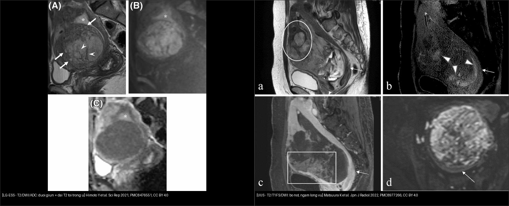
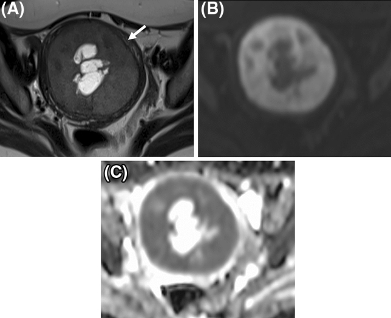
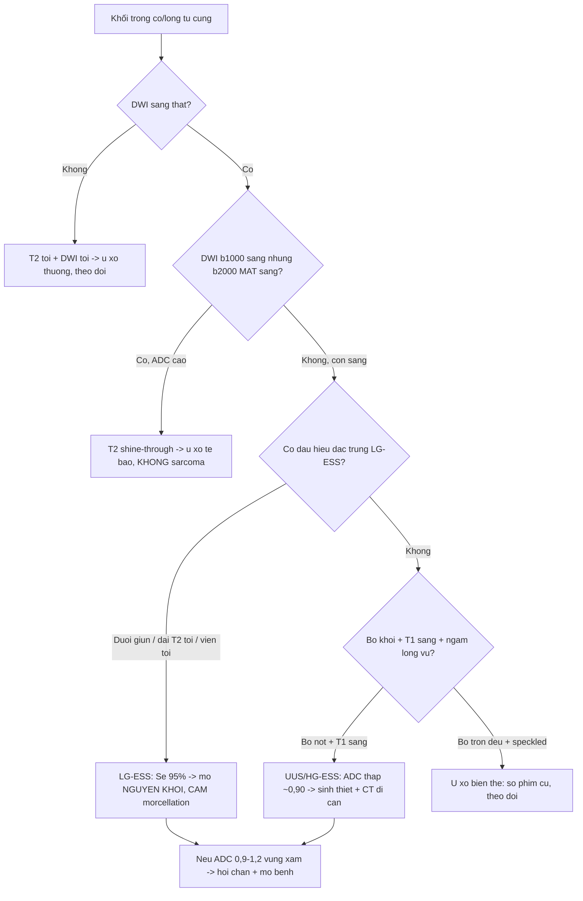
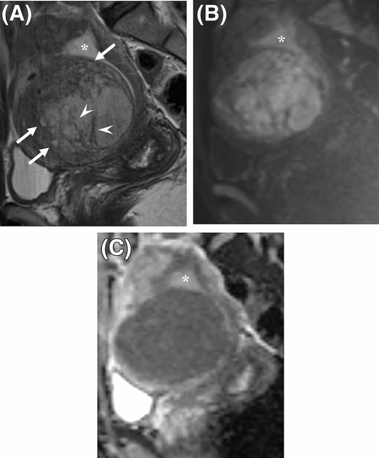
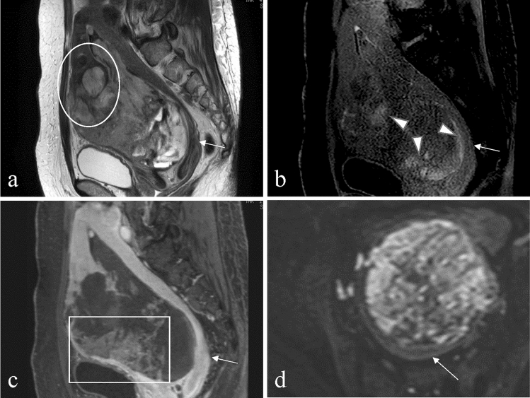
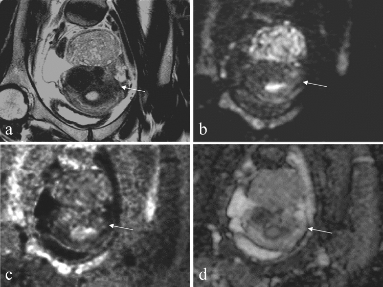

# 527 — U mô đệm nội mạc tử cung: ESN · LG-ESS · HG-ESS · UUS / Endometrial stromal tumours

**Tags:** `pattern:khoi-co-tu-cung` `pattern:xam-lan-co` `vung:tu-cung` `score:ADC` `protocol:MRI-tieu-khung`
**Mức chắc chắn (certainty):** tổng hợp y văn (literature synthesis) — nhóm tự biên từ 2 nghiên cứu chẩn đoán CC BY 4.0 (Sci Rep 2021; Jpn J Radiol 2022), gồm các ca nguyên văn có hình; không gắn một ca đơn lẻ duy nhất.

## 1. Tổng quan bệnh học – cơ chế hình ảnh

- **Vấn đề lâm sàng:** nhóm u mô đệm nội mạc (endometrial stromal tumours) là **u trung mô tử cung hiếm** nhưng cực dễ đọc nhầm: LG-ESS bị gọi "u xơ" (lành) → **morcellation gieo rắc ổ bụng**, tái phát muộn; còn u xơ biến thể bị gọi "sarcoma" → **cắt tử cung oan ở người trẻ**. Phân biệt then chốt nằm ở MRI + bối cảnh.
- **WHO 2020 — 4 thực thể, tiên lượng rất khác nhau:**
  - **U mô đệm nội mạc dạng nốt (ESN):** rất lành, bờ đẩy (pushing) rõ, **KHÔNG xâm lấn cơ**.
  - **LG-ESS (sarcoma mô đệm nội mạc độ thấp):** tuổi trung bình **~39**, hay ở người trẻ; fusion **JAZF1–SUZ12 (hoặc PHF1/EPC1) ~50–60%**; sống 5 năm **~91%** nhưng **tái phát muộn** (nhiều năm).
  - **HG-ESS:** hay **YWHAE–NUTM2A/B** hoặc **BCOR**; tuổi trung bình **~61**, tiên lượng xấu (sống 5 năm **~33%**).
  - **UUS (sarcoma tử cung không biệt hóa):** không có gen đặc trưng, phá hủy cơ ồ ạt, tiên lượng xấu nhất.
- **TẠI SAO tín hiệu (vật lý MRI + mô bệnh):**
  - **LG-ESS:** tế bào mô đệm **dày đặc** → nước nội bào "nhốt" chặt → **DWI sáng + ADC thấp** (Himoto 2021; Matsuura 2022 đo ESS **0,86 ×10⁻³ mm²/s**). Điểm nhấn: u **thâm nhiễm kiểu "đuôi giun" (worm-like nodular extension)** ăn dọc theo cơ, để lại **dải cơ lành còn sót → dải T2 tối trong u** (intra-tumoral low SI bands), và **viền T2 tối quanh u** (low SI rim) do cơ phản ứng; u lớn nhanh vượt cấp máu → **nang/hoại tử**.
  - **UUS:** mật độ rất cao + hoại tử/xuất huyết → **T2 không đồng nhất**, **ổ T1 sáng (methemoglobin)**, ngấm kiểu **"lông vũ" (feather-like enhancement)**, DWI sáng, ADC thấp (Matsuura 2022 đo **0,90 ×10⁻³ mm²/s**).
  - **Cạm bẫy vật lý — T2 shine-through:** u **nhiều nước** (như **u xơ tế bào - cellular leiomyoma**) cho **DWI sáng giả** ở b=1000. Bằng chứng: cellular leiomyoma **ADC 1,65 ×10⁻³ mm²/s**, và DWI "sáng" ở b=1000 **biến mất ở DWI tính toán b=2000 (cDWI₂₀₀₀)** — trong khi sarcoma vẫn hạn chế thật.
- **Ngưỡng định lượng bắt buộc:**
  - **Hệ MRI LG-ESS vs u xơ biến thể hiếm (Himoto 2021, n=25 LG-ESS / 42 u xơ biến thể):** *DWI sáng* **+** một trong ba — **đuôi giun / dải T2 tối trong u / viền T2 tối quanh u** → **AUC 0,86–0,89, Se 95%, Sp 67–69%**.
  - **Dấu hiệu khác biệt có ý nghĩa (cùng nghiên cứu):** **dải T2 tối trong u** (p < 0,001), **nang/hoại tử** (p ≤ 0,02), **vắng "dấu chấm lốm đốm" (speckled appearance)** (p < 0,001), **ADC thấp** (p ≤ 0,02).
  - **Phân biệt u trung mô ác ↔ u xơ T2 sáng (Matsuura 2022, n=32 vs 34):** bộ 3 **ổ T1 sáng + cDWI₂₀₀₀ + dải T2 tối** đạt **độ chính xác 84,8% (56/66)**. Giá trị ADC tham chiếu: ESS/LMS/UUS **0,77–1,03**, cellular leiomyoma **1,65 ×10⁻³ mm²/s**.
  - Khoảng xám: **ADC ~1,0–1,2** → không tự chốt; ghép bờ, thâm nhiễm, "đuôi giun", bối cảnh (tuổi trẻ + chảy máu bất thường) và **cDWI 2000**.

## 2. Mẫu hình + chẩn đoán phân biệt theo vị trí (gamut)

- **Ba câu hỏi gỡ rối mọi khối mô đệm nội mạc:** **(1) xâm lấn cơ hay bờ đẩy? (2) có "đuôi giun"/dải T2 tối/viền tối? (3) DWI sáng có "chết" ở b=2000 không (T2 shine-through)?**
- **Theo vị trí:**
  - **Trong lòng tử cung (endometrial cavity):** polyp nội mạc, ESN, LG-ESS lồi vào lòng, ung thư nội mạc, carcinosarcoma. Khối lồi lòng + nhẵn + cuống mạch đơn độc → nghĩ polyp/ESN.
  - **Trong cơ (myometrium) — gamut khó nhất:** u xơ + biến thể (cellular, myxoid, FHD), adenomyosis, **LG-ESS/HG-ESS thâm nhiễm**, LMS, di căn. **LG-ESS là "kẻ giả danh u xơ"** hay gặp ở người trẻ chảy máu bất thường.
  - **Lan ra ngoài tử cung:** ESS hay lan theo mạch cạnh tử cung, dây chằng rộng, buồng trứng, phúc mạc (thể **giả adenomyosis**).
- **Đặc trưng từng thực thể:**
  - *ESN:* khối tròn bờ **đẩy** rõ, T2 trung gian, không thâm nhiễm, hạn chế khuếch tán nhẹ.
  - *LG-ESS:* **"đuôi giun"** + **dải T2 tối trong u** + **viền T2 tối** + nang/hoại tử; DWI sáng, ADC thấp (0,86); hay **lan mạch cạnh tử cung**.
  - *HG-ESS:* phá hủy cơ nhiều, T2 hỗn hợp, ngấm kiểu **"lông vũ"**, DWI hạn chế mạnh.
  - *UUS:* khối lớn trong lòng/cơ, **bờ nốt**, T1 sáng (xuất huyết), ngấm lông vũ, ADC thấp (0,90).
  - *U xơ tế bào (mimic):* T2 **sáng hơn cơ**, DWI sáng ở b=1000 nhưng **b=2000 không sáng**, **ADC cao (~1,65)**, bờ trơn, có **chấm/dải T2 tối lốm đốm** (speckled) — dấu **vắng mặt ở LG-ESS**.

## 3. Bảng so sánh phân biệt (ma trận đối chiếu)

| Thực thể (entity) | Hình ảnh điển hình | Chốt vào (rule-in) | Chốt loại (rule-out) | Gợi ý xác nhận |
|---|---|---|---|---|
| ESN (u mô đệm dạng nốt) | Khối tròn, bờ **đẩy** rõ, không xâm lấn cơ | **Bờ đẩy + không thâm nhiễm + không "đuôi giun"** | Thâm nhiễm cơ lan tỏa → nghĩ LG-ESS | Mô bệnh sau cắt (chẩn đoán loại trừ) |
| LG-ESS | **"Đuôi giun" + dải T2 tối trong u + viền T2 tối**, nang/hoại tử, DWI sáng | **DWI sáng + (đuôi giun / dải T2 tối / viền tối)**: Se 95% | **cDWI₂₀₀₀ không sáng + ADC > 1,5 + "lốm đốm"** → u xơ tế bào | Hệ MRI 5 bậc (AUC 0,86–0,89); sinh thiết sau MRI |
| HG-ESS | Phá hủy cơ rộng, T2 hỗn hợp, ngấm **"lông vũ"** | **Ngấm lông vũ + phá hủy cơ + DWI hạn chế mạnh** | Bờ rõ, không xâm lấn → ít nghĩ | Mô bệnh + hóa mô miễn dịch (YWHAE/BCOR) |
| UUS | Khối lớn lòng/cơ, **bờ nốt**, T1 sáng, ngấm lông vũ | **T1 sáng (xuất huyết) + bờ nốt + ADC thấp (0,90)** | T2 tối + DWI tối → u xơ | Sinh thiết; CT ngực/bụng tìm di căn |
| U xơ tế bào (cellular leiomyoma — mimic) | T2 **sáng hơn cơ**, bờ trơn, **chấm/dải T2 tối "lốm đốm"** | **cDWI₂₀₀₀ mất sáng + ADC ~1,65** | "Đuôi giun" + viền tối + ADC ≤ 0,9 → LG-ESS | So phim cũ (u xơ tăng chậm), không cần mổ gấp |
| Adenomyosis | Cơ dày, **chấm T2 sáng**, ổ T1 sáng, **DWI tối**, JZ ≥ 12 mm | **Chấm/nang T2 sáng + DWI tối + JZ ≥ 12 mm** | Khối đặc DWI sáng thật → nghĩ ESS | T2 axial + T1 fat-sat; so với ESS "đuôi giun" |
| LMS / carcinosarcoma | Khối lớn bờ không đều, xuất huyết/hoại tử | **ADC ≤ 0,9 vùng u sống + bờ thâm nhiễm** | T2 tối + DWI tối + ADC > 1,23 → loại sarcoma | Xem bài 526 (ngưỡng ADC, cấm morcellation) |

*Trái: LG-ESS — T2 có "đuôi giun" (mũi tên) và dải T2 tối trong u (mũi tên đầu), DWI sáng, ADC tối. Phải: UUS — bờ nốt, ổ T1 sáng do xuất huyết, ngấm kiểu "lông vũ", ADC 0,90 ×10⁻³ mm²/s. Nguồn: Himoto Y et al., Sci Rep 2021 (PMC8476551) + Matsuura K et al., Jpn J Radiol 2022 (PMC8977266), CC BY 4.0. Ảnh ghép letterbox, giữ nguyên tỷ lệ.*

### Dấu hiệu chốt then chốt
- **"Đuôi giun" (worm-like nodular extension):** u mô đệm bò dọc theo cơ quanh mạch → **chốt ESS hơn u xơ**.
- **Dải T2 tối trong u** = sợi cơ lành bị u thâm nhiễm còn sót — **p < 0,001**, dấu mạnh nhất tách LG-ESS khỏi u xơ biến thể.
- **cDWI₂₀₀₀:** nếu DWI "sáng" ở b=1000 **mất sáng ở b=2000** → đó là **T2 shine-through** (u xơ tế bào), KHÔNG phải hạn chế khuếch tán thật.

## 4. Protocol chụp + hệ phân độ/điểm chuẩn hóa

- **Protocol MRI tiểu khung khối mô đệm tử cung:**
  - **T2W không xóa mỡ, ≥ 2 bình diện (sagittal + axial):** bắt buộc để thấy thâm nhiễm, "đuôi giun", dải T2 tối và vùng chuyển tiếp (JZ).
  - **T1W (± fat-sat):** **ổ T1 sáng = xuất huyết** (UUS/LMS), mỡ (lipoleiomyoma).
  - **DWI b = 800–1.000 + ADC**, và nếu nghi u nước thì **cDWI b = 2.000** để loại T2 shine-through.
  - **T1W + Gd động học (DCE, fat-sat):** hoại tử, ngấm "lông vũ", lan mạch.
  - **Không chọc hút/sinh thiết trước MRI** (nhiễu xuất huyết); nếu cần mô bệnh thì **sau MRI**.
- **Hệ MRI LG-ESS (Himoto 2021):** DWI sáng + (đuôi giun / dải T2 tối / viền T2 tối) → **Se 95% / Sp 67–69% / AUC 0,86–0,89**. Đây là **hệ lâm sàng bán định lượng 5 bậc**, dùng để quyết định mổ nguyên khối (không morcellation) chứ không thay mô bệnh.
- **Bộ phân biệt u trung mô ác ↔ u xơ T2 sáng (Matsuura 2022):** ổ T1 sáng + cDWI₂₀₀₀ + dải T2 tối → **độ chính xác 84,8%**.

*Ca LG-ESS khác: viền T2 tối quanh u (mũi tên) + nang/hoại tử; DWI sáng, ADC thấp. Nguồn: Himoto Y et al., Sci Rep 2021 (PMC8476551), Fig. 2, CC BY 4.0.*

## 5. Biến thể bình thường và cạm bẫy

- **U xơ tế bào (cellular leiomyoma) — "giả ESS" hay gặp nhất:** T2 sáng hơn cơ, **DWI sáng giả** ở b=1000 do T2 shine-through; cứu bằng **cDWI₂₀₀₀ (mất sáng)** + **ADC cao (~1,65)** + **"lốm đốm" chấm/dải T2 tối** (LG-ESS *vắng* dấu speckled, p < 0,001).
- **Nang/hoại tử KHÔNG loại trừ u xơ:** u xơ thoái hóa nang cũng có; ngược lại LG-ESS có nang/hoại tử (p ≤ 0,02) — dùng như dấu **cộng thêm**, không một mình.
- **Adenomyosis ↔ ESS:** adenomyosis = **chấm T2 sáng + DWI tối + JZ ≥ 12 mm**; ESS = **"đuôi giun" + DWI sáng**. ESS thể thâm nhiễm lan có thể giả adenomyosis → tìm ổ ngoài tử cung.
- **HG-ESS vs UUS:** hình ảnh chồng lấp, ngấm đều kiểu "lông vũ" → phân biệt chủ yếu bằng **mô bệnh học/hóa mô miễn dịch**, đừng hứa tách được trên MRI.
- **Đo ADC đúng chỗ:** vùng **u còn sống, hạn chế nhất**; ổ xuất huyết/hoại tử cho ADC thấp giả.
- **Không sinh thiết/morcellation trước khi loại sarcoma:** nếu là ESS, morcellation gây **gieo rắc phúc mạc** (xem bài 518).

## 6. Tự lượng giá — Blind Quiz ngay trên trang tĩnh

**Ca 1 — Nữ trẻ, chảy máu tử cung bất thường, khối cơ tử cung. Nhìn T2/DWI/ADC, mô tả trước.**

- Gợi ý lâm sàng (clinical context): nữ trẻ, rong kinh/chảy máu bất thường, khối trong cơ tử cung.
- Câu hỏi: Nhìn T2 (A) có dấu hiệu gì đặc trưng? DWI/ADC (B/C) ra sao? Chốt lành hay ác?

<b>Bấm để hiện đáp án (findings + chẩn đoán)</b>

- Dấu hiệu (findings): trên T2 có **"đuôi giun" (worm-like nodular extension)** (mũi tên) và **dải T2 tối trong u** (mũi tên đầu) — sợi cơ lành còn sót; **DWI sáng** (B) + **ADC tối** (C); dấu hoa thị = nội mạc.
- Chẩn đoán (diagnosis): **LG-ESS (sarcoma mô đệm nội mạc độ thấp)** — vì hội đủ **DWI sáng + "đuôi giun" + dải T2 tối** (hệ Himoto: **Se 95%**). Xử trí: **mổ nguyên khối, CẤM morcellation**; sinh thiết sau MRI.
- Nguồn ảnh: Himoto Y et al., Sci Rep 2021, PMC8476551, Fig. 1, CC BY 4.0.

**Ca 2 — Nữ 49 tuổi, chảy máu bất thường, khối lớn trong lòng tử cung bờ nốt. Chẩn đoán và thái độ.**

- Gợi ý lâm sàng: 49 tuổi, chảy máu bất thường, khối lòng tử cung.
- Câu hỏi: Bờ khối? Có dấu hiệu nào của xuất huyết? Kiểu ngấm thuốc? Đo ADC?

<b>Bấm để hiện đáp án (findings + chẩn đoán)</b>

- Dấu hiệu (findings): khối chủ yếu trong lòng tử cung, **bờ nốt (nodular border)** (vòng tròn), T2 không đồng nhất; **ổ T1 sáng** (mũi tên đầu, xuất huyết); ngấm kiểu **"lông vũ"** (khung chữ nhật); DWI sáng, **ADC 0,90 ×10⁻³ mm²/s**.
- Chẩn đoán (diagnosis): **UUS (sarcoma tử cung không biệt hóa)** — bờ nốt + T1 sáng + ngấm lông vũ + ADC thấp. Xử trí: sinh thiết/mô bệnh + **CT ngực–bụng tìm di căn**; tiên lượng xấu.
- Nguồn ảnh: Matsuura K et al., Jpn J Radiol 2022, PMC8977266, Fig. 4, CC BY 4.0.

**Ca 3 — Nữ 42 tuổi, khối dưới vỏ tử cung T2 sáng, DWI "sáng". Có phải sarcoma không?**

- Gợi ý lâm sàng: 42 tuổi, không chảy máu bất thường, khối dưới vỏ.
- Câu hỏi: DWI sáng ở b=1000 có nghĩa là hạn chế khuếch tán thật không? Làm gì để kiểm chứng?

<b>Bấm để hiện đáp án (findings + chẩn đoán)</b>

- Dấu hiệu (findings): khối dưới vỏ, **T2 sáng hơn cơ**; DWI b=1000 sáng (b) nhưng **cDWI b=2000 đã mất sáng** (c) — tức **T2 shine-through**; **ADC 1,65 ×10⁻³ mm²/s** (cao).
- Chẩn đoán (diagnosis): **u xơ tế bào (cellular leiomyoma) — KHÔNG phải sarcoma**. Vì DWI sáng "biến mất" ở b=2000 và ADC cao; đây là dương tính giả T2 shine-through. Xử trí: theo dõi/so phim cũ, không mổ gấp.
- Nguồn ảnh: Matsuura K et al., Jpn J Radiol 2022, PMC8977266, Fig. 5, CC BY 4.0.

**Ca 4 — Ảnh ghép: hai khối "sarcoma" trên T2/DWI. Bên nào là LG-ESS, bên nào là UUS?**

- Gợi ý lâm sàng: một ca có "đuôi giun" + dải T2 tối; một ca bờ nốt + ổ T1 sáng.
- Câu hỏi: Dấu hiệu phân biệt? Khác nhau về tiên lượng và xử trí?

<b>Bấm để hiện đáp án (findings + chẩn đoán)</b>

- Trái: **LG-ESS** — **"đuôi giun" + dải T2 tối trong u**, ADC ~0,86; tuổi trẻ, sống 5 năm **~91%**, nhưng **tái phát muộn** → theo dõi dài, tránh morcellation.
- Phải: **UUS** — **bờ nốt + ổ T1 sáng + ngấm lông vũ**, ADC ~0,90; tiên lượng xấu nhất, phá hủy cơ ồ ạt → hóa trị/xạ + tìm di căn.
- Nguồn: Himoto Y et al. (PMC8476551, CC BY 4.0) + Matsuura K et al. (PMC8977266, CC BY 4.0).

## Bài liên quan chéo
- [500 – Tổng quan Hệ Vú & Sản Phụ khoa](../500-tong-quan-vu-san-phu-khoa/lesson.md)
- [520 – U xơ cơ tử cung (FIGO 0–8), adenomyosis & nội mạc](../520-tu-cung-u-xo-FIGO-adenomyosis-noi-mac/lesson.md)
- [525 – Ung thư nội mạc & cổ tử cung: FIGO trên MRI](../525-ung-thu-noi-mac-co-tu-cung-FIGO-MRI/lesson.md)
- [526 – Sarcoma tử cung & carcinosarcoma vs u xơ](../526-sarcoma-tu-cung-vs-u-xo/lesson.md)
- [518 – Morcellation & leiomyomatosis peritonealis disseminata (LPD)](../518-morcellation-LPD/lesson.md)
- [571 – Sẩy thai tái diễn: tiếp cận hình ảnh tử cung](../571-say-thai-tai-dien-tiep-can-hinh-anh/lesson.md)

## Ảnh
- 5 ảnh + 1 ảnh ghép CC BY 4.0 (Sci Rep 2021 ×2, Jpn J Radiol 2022 ×3). Nguồn + giấy phép từng ảnh trong `images/CREDITS.md`.

> Không dùng để chẩn đoán độc lập khi chưa có người hướng dẫn.
