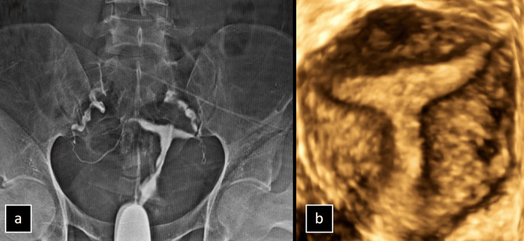
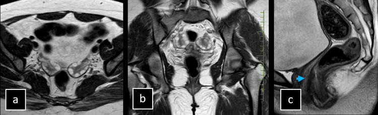
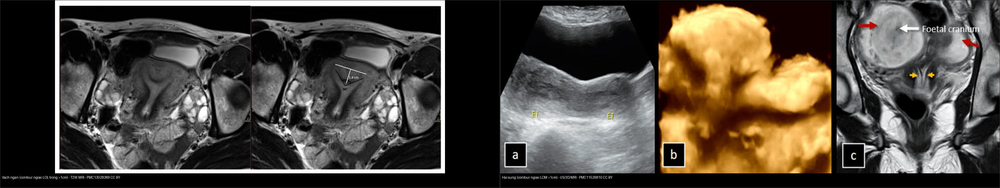
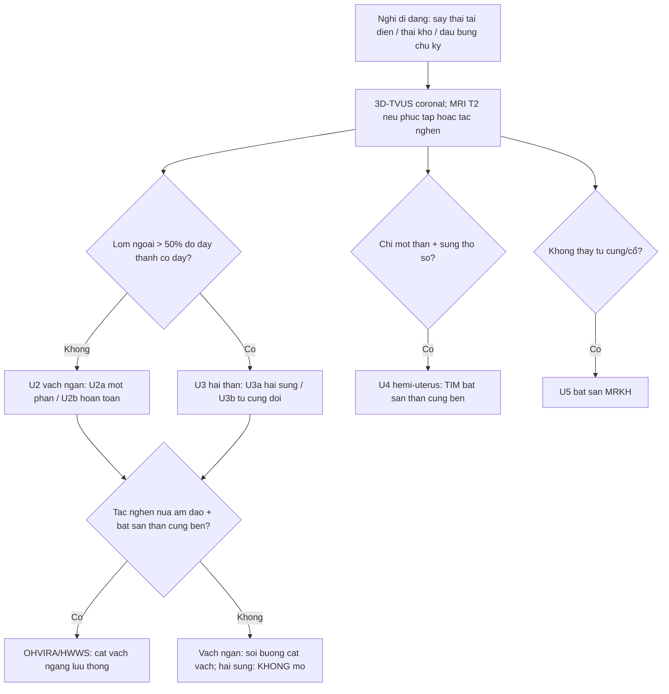
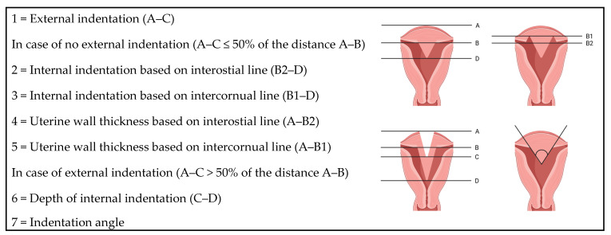
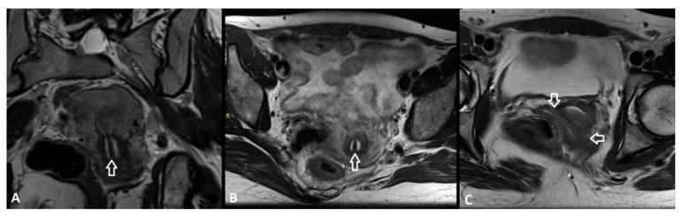
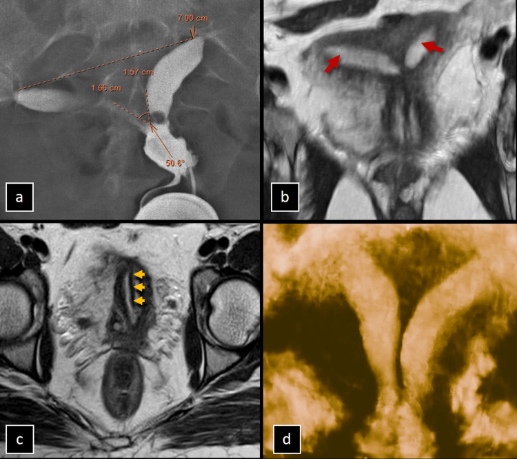
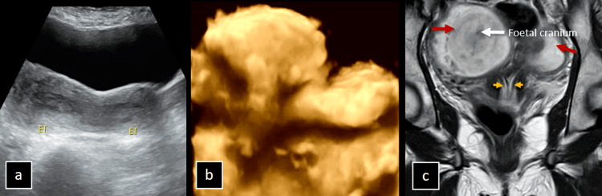
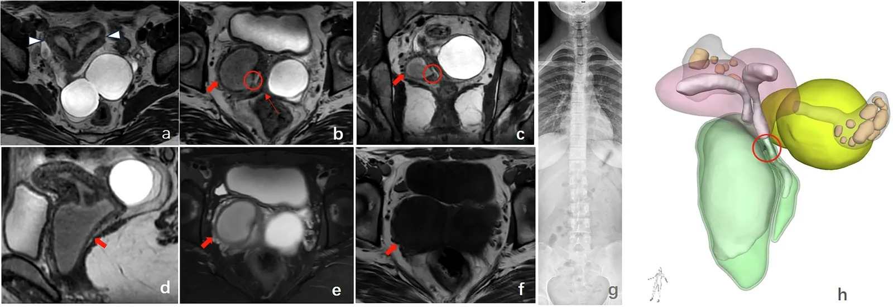
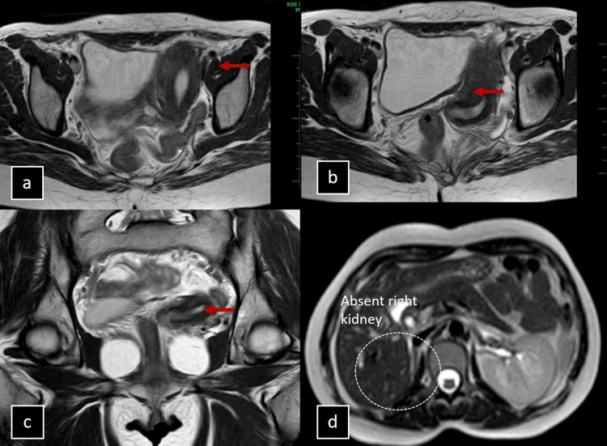

# 528 — Dị dạng tử cung bẩm sinh: vách ngăn vs hai sừng (ESHRE/ESGE & ASRM) / Müllerian duct anomalies

**Tags:** `pattern:di-dang-tu-cung` `vung:tu-cung` `score:ESHRE-ESGE` `score:ASRM` `protocol:MRI-tu-cung` `protocol:3D-TVUS`
**Mức chắc chắn (certainty):** tổng hợp y văn (literature synthesis) — nhóm tự biên từ y văn mở (Cureus 2024, Medicina 2026, Insights into Imaging 2026), số liệu định lượng lấy nguyên văn từ các bài gốc.

## 1. Tổng quan bệnh học – cơ chế hình ảnh: hai thì phôi thai (dung hợp vs tiêu hủy vách)

- **Phôi thai học (embryology):** hai ống Müller (Müllerian / paramesonephric ducts) đi xuống, **dung hợp (fusion)** ở đường giữa tạo thân–cổ tử cung và 2/3 trên âm đạo; sau đó **tiêu hủy (resorption)** vách trung gian để thành một buồng duy nhất. Dị dạng = lỗi ở **một trong hai thì**:
  - **Dung hợp thất bại** → tử cung **hai sừng (bicornuate)** hoặc **đôi (didelphys)**; nếu chỉ một bên phát triển → **hemi-uterus (unicornuate)**.
  - **Tiêu hủy thất bại** → tử cung **vách ngăn (septate)**.
  - **Bất sản (aplasia)** cả hai ống → **MRKH**.
- **TẠI SAO ảnh hưởng sinh sản khác nhau (chốt lâm sàng):** vách ngăn là **mô xơ–sợi ít mạch máu (fibrous, poorly vascularized)**, niêm mạc phủ trên vách teo → trứng làm tổ không đủ nuôi dưỡng → **sẩy thai tái diễn (recurrent pregnancy loss), thai lưu** (đây là lý do cắt vách qua ngả soi buồng *hysteroscopic metroplasty* có ích). Ngược lại tử cung hai sừng có **cơ bình thường ở hai buồng** → tiên lượng sinh sản gần như bình thường → **KHÔNG mổ**.
- **TẠI SAO MRI/3D-US phân biệt được:** trên **T2W**, vách xơ cho **tín hiệu thấp đều** nằm giữa hai buồng nội mạc sáng, phân cách bởi cơ cận nội mạc tín hiệu trung gian; nhưng yếu tố quyết định là **đường viền ngoài đáy tử cung (external contour)** — chỉ thấy được trên **mặt cắt vành (coronal)** hoặc **axial xiên vuông góc trục dọc thân tử cung**. Đây là điểm mà HSG (chỉ thấy buồng) và mặt cắt axial thuần không cung cấp được.
- **Ngưỡng định lượng (bắt buộc nhớ):**
  - **ASRM 2021** (Pfeifer et al., *Fertil Steril*): **vách ngăn (septate)** = lõm trong **≥ 1 cm** và **góc lõm < 90°**; **hình cung (arcuate)** = lõm trong **< 1 cm**, góc > 90°; **hai sừng (bicornuate)** = **lõm ngoài > 1 cm**. Vùng xám: lõm trong ≥ 1 cm **nhưng góc ≥ 90°** → ASRM coi là **"không xác định" (indeterminate)**.
  - **ESHRE/ESGE 2013** (Grimbizis et al., *Hum Reprod*): xếp loại theo **đường viền ngoài** — lõm ngoài **≤ 50% độ dày thành cơ đáy** (đo trên đường liên eo *interostial line*) → **U2 vách ngăn** (U2a một phần / U2b hoàn toàn); lõm ngoài **> 50%** → **U3 hai thân (bicorporeal**, gộp hai sừng + tử cung đôi). Kèm **cổ tử cung C0–C4** và **âm đạo V0–V4**.
  - **Đồng thuận giữa người đọc thấp cho MỌI hệ** (n = 71, Krippendorff α): AFS **0,63**; CUME **0,57**; ASRM **0,46**; ESHRE/ESGE **0,33**; ESHRE/ESGE cho **nhiều ca không xác định nhất (9,9%)** sau hội chẩn.
  - Ví dụ số nguyên văn (*Medicina* 2026, Fig. 4): vách **dài 1,4 cm**, góc **96°**, contour ngoài **lồi** → ESHRE/ESGE **U2a**, CUME = septate, nhưng **ASRM = không xác định** (vì góc > 90°). → Cho thấy cùng một tử cung, ba hệ ba tên.

## 2. Mẫu hình + chẩn đoán phân biệt theo cơ chế (Gamut)

- **Gợi nhớ 1 câu: FUSION loạn → hai sừng/đôi/một sừng; RESORPTION loạn → vách ngăn/hình cung; APLASIA → MRKH.**
- **Nhóm tiêu hủy vách:** tử cung **vách ngăn** (U2), **hình cung** (arcuate — biến thể bình thường), **dysmorphic/T-shaped** (U1; liên quan phơi nhiễm DES trong bào thai).
- **Nhóm dung hợp:** **hemi-uterus (unicornuate, U4)** — kèm bất sản thận cùng bên **30–40%**; **hai sừng (U3a)**, **tử cung đôi (U3b)** — hay có vách dọc âm đạo.
- **Nhóm bất sản:** **MRKH (U5)** — không thấy tử cung/cổ/2/3 trên âm đạo, buồng trứng bình thường, kiểu nhiễm sắc thể 46,XX.
- **Nhóm tắc nghẽn một bên (obstructed):** **HWWS / OHVIRA** (Herlyn-Werner-Wunderlich) = tử cung đôi/vách ngăn **+ tắc nửa âm đạo (khối dịch T2 sáng) + bất sản thận cùng bên**, khởi phát sau dậy thì (đau bụng chu kỳ + ứ máu kinh).
- **Nhóm không xếp loại (U6).**

*Tử cung hình chữ T: buồng hẹp, thành bên dày, ống dẫn trứng cụt. Nguồn: Ramakrishnan et al., Cureus 2024 Fig. 2 (PMC11526810), CC BY 4.0.*

*MRKH: bất sản tử cung–cổ–2/3 trên âm đạo, âm đạo dưới giảm sản, buồng trứng hai bên bình thường. Nguồn: Ramakrishnan et al., Cureus 2024 Fig. 7 (PMC11526810), CC BY 4.0.*

## 3. Bảng so sánh phân biệt (ma trận đối chiếu)

| Thực thể (entity) | Hình ảnh điển hình (3D-US / MRI T2) | Chốt vào (rule-in) | Chốt loại (rule-out) | Gợi ý xác nhận |
|---|---|---|---|---|
| Tử cung vách ngăn (septate, U2) | Hai buồng nội mạc, **vách T2 tối đều**, contour ngoài **lồi/flat** | **Lõm trong ≥ 1 cm + góc < 90° + contour ngoài lồi (< 1 cm)** | Lõm ngoài > 1 cm → hai sừng (không cắt vách sai) | Soi buồng cắt vách (metroplasty); nối sẩy thai tái diễn |
| Tử cung hai sừng (bicornuate, U3a) | Hai sừng phân kỳ, **lõm ngoài sâu**, cơ hai buồng bình thường | **Lõm ngoài > 1 cm (> 50% thành cơ đáy)** | Contour ngoài lồi + chỉ lõm trong → vách ngăn | **Không mổ**; tư vấn tiên lượng bình thường |
| Tử cung hình cung (arcuate) | Đáy hơi lõm vào lòng, contour ngoài bình thường | **Lõm trong < 1 cm + góc > 90°** | ≥ 1 cm + góc < 90° → vách ngăn | Không điều trị (biến thể) |
| Tử cung đôi (didelphys, U3b) | **Hai thân + hai cổ tách hoàn toàn**, thường vách dọc âm đạo | **Hai thân/hai cổ riêng biệt** | Một cổ + vách mỏng → vách ngăn | MRI vành; soi khi tắc |
| Hemi-uterus (unicornuate, U4) | Một sừng lệch bên, sừng thô sơ (rudimentary) cùng bên | **Một sừng + sừng thô sơ** | Hai sừng cân xứng → bicornuate | **Luôn tìm bất sản thận cùng bên (30–40%)** |
| MRKH (U5) | Không thấy tử cung/cổ/2/3 trên âm đạo, buồng trứng bình thường | **Bất sản tử cung + 46,XX + tuyến vú bình thường** | Tử cung còn nhưng tắc → HWWS | Siêu âm thận; karyotype; MRI |
| T-shaped / dysmorphic (U1) | Buồng hẹp **hình chữ T**, thành bên dày | **Buồng hình T + thành bên dày** | Buồng bình thường → không phải | HSG/3D-US; tiền sử DES |
| HWWS / OHVIRA | Tử cung đôi/vách ngăn **+ khối dịch T2 sáng nửa âm đạo + bất sản thận cùng bên** | **Tắc nửa âm đạo + bất sản thận cùng bên + ứ máu kinh** | Thận hai bên bình thường → loại HWWS | MRI 3D T2; cắt vách ngang lưu thông |

*Trái: contour ngoài **LỒI** + vách trong 1,4 cm → **vách ngăn** (ESHRE/ESGE U2a). Phải: hai sừng phân kỳ, contour ngoài **LÕM > 1 cm** → **hai sừng (bicornuate bicollis)**. Nguồn: PMC13028389 Fig. 4 (CC BY 4.0) + PMC11526810 Fig. 5 (CC BY 4.0), ghép bằng `tools/make_composite.py` (letterbox, giữ aspect).*

### Đọc contour ngoài cho đúng (định nghĩa đo)
- **Đường liên eo (interostial line, A–B):** nối hai lỗ ống dẫn trứng. **Lõm ngoài (A–C)** đo từ đáy contour ngoài tới đường này; **lõm trong (C–D)** đo tới đáy vách trong lòng.
- **Quy ước ESHRE/ESGE:** lõm ngoài **≤ 50% A–B** → coi như bình thường (U2); **> 50%** → U3 (hai thân). **góc lõm (indentation angle)** tính giữa hai bờ vách so với đường liên eo.

## 4. Protocol chụp + hệ phân độ/điểm chuẩn hóa

- **Đầu tay (first-line):** **siêu âm 3D qua ngả âm đạo (3D-TVUS)** với **tái tạo mặt cắt vành (coronal reconstruction)** — không xâm lấn, thấy được contour ngoài; dùng khi tầm soát dị dạng/đau vùng chậu.
- **Khi nào chuyển MRI:**
  - Siêu âm không kết luận, dị dạng **phức tạp**, có **tắc nghẽn (khối dịch nửa âm đạo)**, hoặc chuẩn bị phẫu thuật (cắt vách làm đường/mở vách âm đạo).
  - **Có thai:** ưu tiên siêu âm; nếu cần MRI thì **không cản quang**.
- **Protocol MRI tiểu khung:** **T2W axial + coronal + sagittal**, trong đó **mặt cắt vành/axial xiên đặt vuông góc trục dọc thân tử cung** để bộc lộ contour ngoài; thêm **T1W fat-sat** khi nghi ứ máu (endometrioma/hematometra). Không cần tiêm cản quang thường quy.
- **BẮT BUỘC:** tìm bất sản **thận cùng bên** (unicornuate 30–40%; HWWS gần 100%) bằng siêu âm thận ± MR niệu đồ.
- **Hệ phân độ ESHRE/ESGE 2013** (U0–U6) + **C0–C4** (cổ) + **V0–V4** (âm đạo):

*Các phép đo chuẩn hóa: (1) lõm ngoài A–C; (2–3) lõm trong theo đường liên eo/liên sừng; (4–5) độ dày thành cơ; (6) độ sâu lõm trong khi lõm ngoài > 50%; (7) góc lõm. Nguồn: D'hoore et al., Medicina 2026 Fig. 1 (PMC13028389), CC BY 4.0.*

*Axial T2 ngang thân tử cung (A), cổ (B), âm đạo (C): vách chạy liên tục xuống cổ và vách dọc âm đạo không tắc. ESHRE/ESGE = U2b C1 V1. Nguồn: D'hoore et al., Medicina 2026 Fig. 3 (PMC13028389), CC BY 4.0.*

## 5. Biến thể bình thường và cạm bẫy

- **Sóng co cơ tử cung (uterine contraction wave) trên T2:** dải cơ co thoáng qua cho **dải tín hiệu thấp giả "vách ngăn"** — chụp lại sau vài phút/đợi hết co, hoặc đọc trên 3D coronal; đừng vội gọi vách ngăn.
- **Tử cung hình cung (arcuate) là biến thể:** lõm trong **< 1 cm** → **không phải vách ngăn**, không mổ.
- **Bẫy ASRM "indeterminate":** lõm trong **≥ 1 cm nhưng góc ≥ 90°** → không được gọi bừa vách ngăn (đây là vùng ba hệ cho ba tên khác nhau — đọc kèm bảng so sánh).
- **Septate vs bicornuate quyết định MỔ hay KHÔNG MỔ** → chốt bằng **contour ngoài trên mặt cắt vành**, không đọc trên HSG/axial đơn thuần (HSG chỉ thấy buồng, nguy cơ mổ oan hai sừng).
- **Bỏ sót bất sản thận cùng bên** và **tắc nghẽn nửa âm đạo** (satisfaction of search): thấy dị dạng là dừng → sót HWWS → ứ máu, lạc nội mạc âm đạo. Luôn siêu âm thận.
- **MRKH vs tắc nghẽn:** MRKH **không có tử cung**; nếu còn tử cung mà ứ máu → nghĩ tắc cổ/âm đạo.

## 6. Tự lượng giá — Blind Quiz

**Ca 1 — Nữ 27 tuổi vô sinh, HSG hai buồng, chưa rõ vách ngăn hay hai sừng. Đọc ảnh trước.**

- Gợi ý lâm sàng (clinical context): vô sinh; HSG cho hai buồng với **khoảng cách liên sừng ~7 cm, góc liên sừng ~51°** (mập mờ giữa hai sừng một cổ và vách ngăn hoàn toàn).
- Câu hỏi: Nhìn MRI, contour ngoài đáy tử cung **lồi hay lõm**? Vách có xuống tới cổ không? Chẩn đoán?

<b>Bấm để hiện đáp án (findings + chẩn đoán)</b>

- Dấu hiệu (findings): MRI T2 (MIP vành + axial) cho **hai buồng ở đáy + vách chạy từ đáy xuống cổ/âm đạo**, contour ngoài **lồi** → **tử cung vách ngăn hoàn toàn (complete septate)**.
- Chẩn đoán (diagnosis): vách ngăn — vì vách là mô xơ ít mạch, đã tới cổ (ESHRE/ESGE **U2b**), liên quan sẩy thai tái diễn/vô sinh; xử trí soi buồng cắt vách.
- Nguồn ảnh: Ramakrishnan et al., Cureus 2024 Fig. 4 (PMC11526810), CC BY 4.0.

**Ca 2 — Nữ 19 tuổi đau bụng, tình cờ phát hiện trên siêu âm. Đọc ảnh trước.**

- Gợi ý lâm sàng: đau bụng, siêu âm bụng tình cờ; MRI chụp trong thai kỳ.
- Câu hỏi: Có mấy cổ tử cung? Contour ngoài ra sao? Vì sao KHÔNG cắt vách ở ca này?

<b>Bấm để hiện đáp án</b>

- Dấu hiệu: **hai sừng phân kỳ** (mũi tên đỏ) + **hai cổ riêng** (mũi tên vàng) trên một âm đạo, contour ngoài **lõm sâu > 1 cm**; một thai trong sừng phải (đầu thai nhi, mũi tên trắng).
- Chẩn đoán: **tử cung hai sừng hai cổ (bicornuate bicollis)** — vì lỗi **dung hợp** ở thì ngoài, lõm ngoài > 1 cm. Cơ hai buồng bình thường → **không mổ**, tiên lượng sinh sản gần bình thường (khác vách ngăn).
- Nguồn ảnh: Ramakrishnan et al., Cureus 2024 Fig. 5 (PMC11526810), CC BY 4.0.

**Ca 3 — Nữ 15 tuổi đau bụng + tiết dịch âm đạo mủ. Đọc ảnh trước.**

- Gợi ý lâm sàng: sau dậy thì, đau bụng chu kỳ + dịch mủ; nghi tắc nghẽn đường sinh dục.
- Câu hỏi: Ngoài tử cung vách ngăn, có dấu hiệu gì ở âm đạo? Và **cơ quan nào trong ổ bụng phải kiểm tra kèm**?

<b>Bấm để hiện đáp án</b>

- Dấu hiệu: 3D T2 cho **tử cung vách ngăn hoàn toàn** + **nửa âm đạo phải căng giãn dịch T2 sáng** (tắc) + **đường rò (fistula) trong vách xiên** thông sang âm đạo đối bên; mô hình 3D tái tạo xác nhận. Có **bất sản thận phải** + vẹo nhẹ cột sống.
- Chẩn đoán: **HWWS (OHVIRA) type II** — tắc nửa âm đạo + bất sản thận **cùng bên** + tử cung vách ngăn; xử trí **cắt vách ngang** để lưu thông.
- Nguồn ảnh: Qi et al., Insights into Imaging 2026 Fig. 4 (PMC13652788), CC BY 4.0.

**Ca 4 — Nữ 29 tuổi, MRI thấy một sừng và bất sản thận phải. Đọc ảnh trước.**

- Gợi ý lâm sàng: tình cờ trên MRI tiểu khung.
- Câu hỏi: Đây là loại dị dạng nào theo ESHRE/ESGE? Phải tìm gì kèm theo (đã thấy trước mắt trong ảnh)?

<b>Bấm để hiện đáp án</b>

- Dấu hiệu: tử cung **lệch sang trái, chỉ một sừng, không có sừng thô sơ**, buồng trứng phải không thấy; **thận phải bất sản** (ảnh d).
- Chẩn đoán: **hemi-uterus (unicornuate) type IId** — lỗi **dung hợp** một bên; bất sản thận cùng bên **30–40%** nên **luôn siêu âm thận**.
- Nguồn ảnh: Ramakrishnan et al., Cureus 2024 Fig. 6 (PMC11526810), CC BY 4.0.

**Ca 5 — Phân tích ảnh ghép dưới đây và quyết định mổ hay không. Đọc ảnh trước.**

<b>Bấm để hiện đáp án</b>

- Trái: contour ngoài **lồi** + vách trong **1,4 cm** → **vách ngăn** (ESHRE/ESGE U2a; ASRM **không xác định** vì góc 96° > 90°) → cân nhắc **cắt vách**.
- Phải: contour ngoài **lõm > 1 cm** → **hai sừng** → **không cắt vách**.
- Nguồn: PMC13028389 Fig. 4 + PMC11526810 Fig. 5, CC BY 4.0 (ảnh ghép letterbox).

## Bài liên quan chéo
- [500 – Tổng quan Vú & Sản Phụ khoa](../500-tong-quan-vu-san-phu-khoa/lesson.md)
- [520 – Tử cung: xơ FIGO, adenomyosis, dày nội mạc](../520-tu-cung-u-xo-FIGO-adenomyosis-noi-mac/lesson.md)
- [525 – Ung thư nội mạc & cổ tử cung FIGO trên MRI](../525-ung-thu-noi-mac-co-tu-cung-FIGO-MRI/lesson.md)
- [530 – Phần phụ O-RADS & xoắn buồng trứng](../530-buong-trung-ORADS-sieu-am-MRI/lesson.md)
- [550 – Thai sớm & thai ngoài tử cung](../550-thai-som-say-thai-thai-ngoai-tu-cung/lesson.md)
- [635 – Dị tật tiết niệu nhi (bất sản thận cùng bên)](../635-di-tat-tiet-nieu-nhi-SFU-VUR-PUV/lesson.md)

## Ảnh
- Tên file: `528_slug_Modality_SourceID.jpg`. Nguồn + giấy phép từng ảnh trong `images/CREDITS.md`.
- AuntMinnie (https://www.auntminnie.com): paywall — **chỉ dẫn link, không tải**.

> Không dùng để chẩn đoán độc lập khi chưa có người hướng dẫn.
