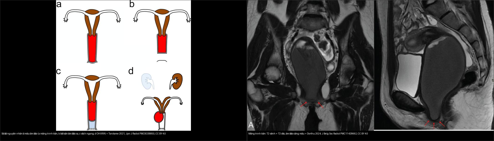
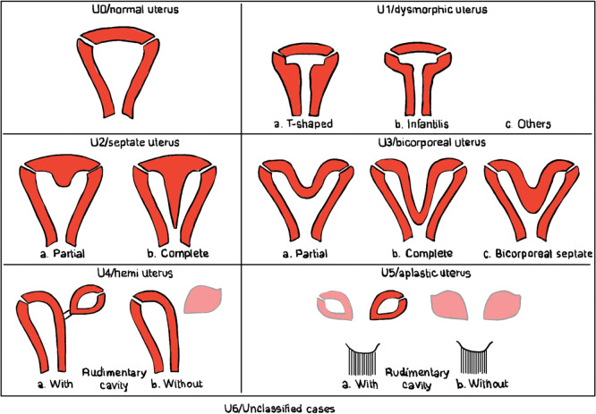
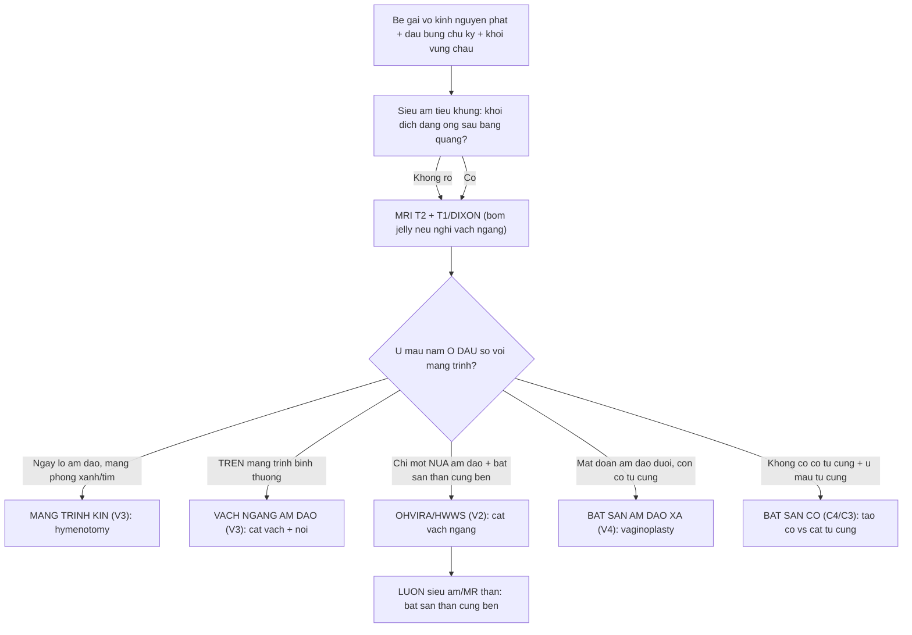
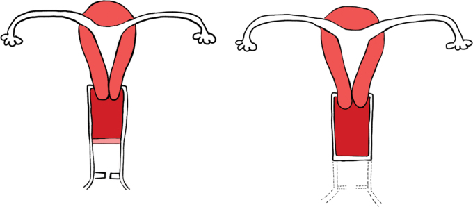
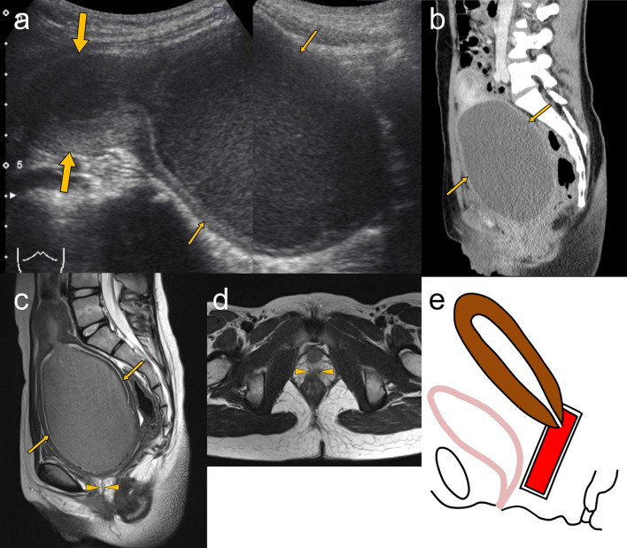
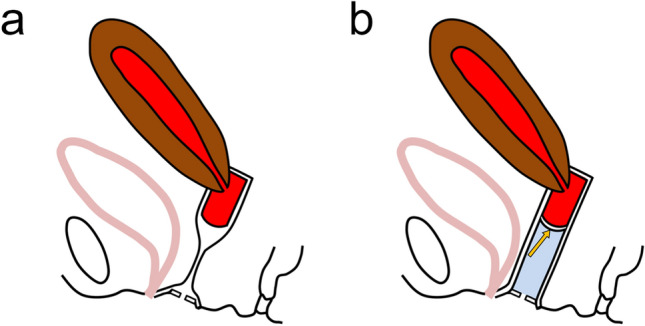
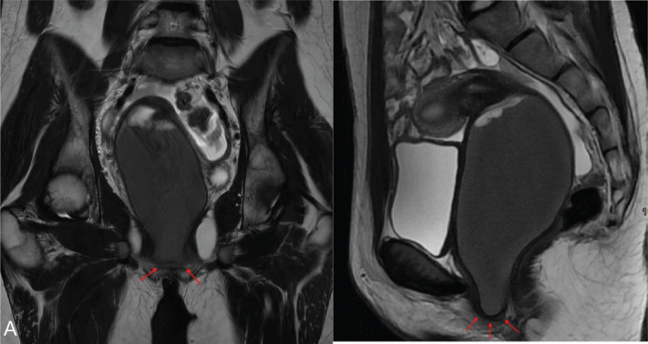
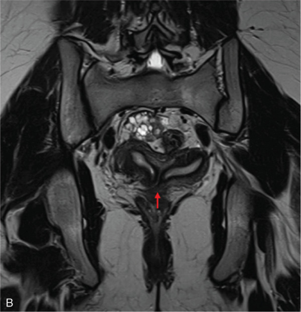

# 529 — Cổ tử cung & âm đạo bẩm sinh: dị dạng tắc nghẽn (ESHRE/ESGE C0–C4 / V0–V4) / Obstructive cervicovaginal anomalies

**Tags:** `pattern:di-dang-co-tu-cung-am-dao` `vung:am-dao` `score:ESHRE-ESGE` `protocol:MRI-tieu-khung` `protocol:sieu-am-tieu-khung`
**Mức chắc chắn (certainty):** tổng hợp y văn (literature synthesis) — nhóm tự biên từ y văn mở (J Belg Soc Radiol 2024, Jpn J Radiol 2021, Insights into Imaging 2025), số liệu định lượng lấy nguyên văn từ bài gốc.

> Bài này phủ **cổ tử cung & âm đạo** (phân nhóm C và V của ESHRE/ESGE) — trọng tâm là **ứ máu âm đạo (hematocolpos) do tắc nghẽn đường ra** ở trẻ vị thành niên. Hình thái **thân tử cung** (vách ngăn vs hai sừng) đã có ở [528](../528-di-dang-tu-cung-bam-sinh-ESHRE-ESGE/lesson.md).

## 1. Tổng quan — hai thì phôi thai, 4 kiểu tắc nghẽn + TẠI SAO ứ máu thấy được trên MRI

- **Phôi thai học (embryology):** thân tử cung, cổ tử cung và **2/3 trên âm đạo** tạo bởi **ống Müller (paramesonephric)**; **1/3 dưới âm đạo** tạo bởi **củ âm đạo (sinovaginal bulb)** mọc từ xoang niệu sinh dục. Lòng âm đạo được **canal hóa (canalization)** hoàn tất vào **khoảng tháng thứ 5 thai kỳ / tuần 20** (xác nhận trong Tanitame 2021; Dixit 2025). **Củ âm đạo thoái hóa tạo khoang ở tuần 17–18.**
- **TẮC NGHẼN xảy ra ở 4 thì/mô khác nhau — phân biệt bằng VỊ TRÍ, không bằng triệu chứng** (triệu chứng đều giống: vô kinh nguyên phát + đau bụng chu kỳ + khối vùng chậu):
  1. **Không thủng được màng trinh (imperforate hymen)** — màng trinh kín ở **ngay lỗ âm đạo (introitus)**; đây **KHÔNG phải dị dạng Müller** nhưng ESHRE/ESGE vẫn xếp vào **V3** cùng vách ngang.
  2. **Vách ngang âm đạo (transverse vaginal septum)** — lỗi **canal hóa đĩa âm đạo**, nằm **trên màng trinh**, hay ở **âm đạo trên 46% / giữa 35% / dưới 14%** (Tanitame 2021).
  3. **Bất sản âm đạo xa (distal vaginal agenesis, V4)** — âm đạo dưới **không phát triển**, còn phần âm đạo trên căng máu.
  4. **Tắc nghẽn một nửa âm đạo + bất sản thận cùng bên (OHVIRA/HWWS, V2)** — do bất thường một **ống Müller** kèm **ống Wolff (mesonephric)**: một bên tắc, một bên thông.
- **TẠI SAO ứ máu lại thấy rõ trên MRI (vật lý tín hiệu):** máu kinh ứ lại trong âm đạo/tử cung trải qua **phân giải hemoglobin theo thời gian** — máu **bán cấp** giàu **methemoglobin (Fe³⁺)** cho **T1 tăng tín hiệu** (và bài gốc dùng ảnh **T1 DIXON water** để lộ chất máu), trong khi **T2 của dịch ứ** phần lớn **rất sáng** vì giàu nước tự do ở thì mới. Vì vậy: **T2 = thấy ứ máu ở đâu; T1/DIXON = xác nhận đó là MÁU (sản phẩm phân hủy), không phải dịch trong như nang**.
- **Ngưỡng định lượng (bắt buộc nhớ):**
  - **Màng trinh kín:** tần suất **1/1000 – 1/2000 nữ** (Tanitame 2021; Dorthu 2024 ghi `< 1%`) — **nguyên nhân ứ máu âm đạo thường gặp nhất**.
  - **Vách ngang âm đạo:** **1/30.000 – 1/84.000 nữ** (Tanitame 2021).
  - **Dị dạng ống Müller (MDA) nói chung:** **5,5%** dân số; **~8%** người vô sinh; **13,3–24,5%** người sẩy thai tái diễn (Dixit 2025).
  - Ứ máu **kéo dài không điều trị** → dính vòi tử cung, **lạc nội mạc tử cung**, vô sinh (Dorthu 2024; Tanitame 2021).

## 2. Mẫu hình + chẩn đoán phân biệt theo VỊ TRÍ tắc nghẽn (Gamut)

- **Tắc ở mức lỗ âm đạo:** **màng trinh kín (V3)** — màng phồng màu xanh/tím, ứ máu **sát introitus**.
- **Tắc trong ống âm đạo:** **vách ngang âm đạo (V3)** — ứ máu **phía trên vách**, màng trinh bình thường; **vách dọc âm đạo (V1 không tắc / V2 tắc)**.
- **Tắc ở mức phát triển âm đạo:** **bất sản âm đạo xa (V4)** — còn âm đạo trên + cổ; **bất sản âm đạo hoàn toàn (V4 trong MRKH, U5)** — không có tử cung/cổ.
- **Tắc ở mức cổ tử cung:** **bất sản cổ (C4) / bất sản một bên (C3)**; **vách ngăn cổ (C1)**, **cổ đôi (C2)**.
- **Tắc một nửa (bên) kèm bất sản thận cùng bên:** **OHVIRA/HWWS (V2)**.
- **Gợi nhớ vị trí — trục từ ngoài vào trong:** **MÀNG TRINH (ngoài cùng) → VÁCH NGANG (trong ống) → BẤT SẢN ÂM ĐẠO XA → CỔ → BẤT SẢN/OHVIRA (trên cùng)**; tắc càng cao/tắc kín càng nặng thì càng dễ có **ứ máu tử cung (hematometra)** + **lạc nội mạc ngược dòng**.

## 3. Bảng so sánh phân biệt (ma trận đối chiếu)

| Thực thể (entity) | Hình ảnh điển hình | Chốt vào (rule-in) | Chốt loại (rule-out) | Gợi ý xác nhận |
|---|---|---|---|---|
| Màng trinh kín (V3) | **Màng phồng xanh/tím tại lỗ âm đạo**; US/MRI: âm đạo căng dịch **đến sát introitus** | **Màng phồng ở lỗ âm đạo + vô kinh + đau chu kỳ** | Màng trinh bình thường (có lỗ) → không phải màng trinh kín | Khám lỗ âm đạo; **hymenotomy/hymenectomy** |
| Vách ngang âm đạo (V3) | **Vách trên màng trinh**; ứ máu **phía trên vách**, đo được **độ dày vách + khoảng cách tới lỗ âm đạo** | **Vách nằm trên màng trinh bình thường + ứ máu trên vách** | Màng trinh kín (màng phồng ở lỗ) / OHVIRA (chỉ một nửa) | **MRI có bơm jelly âm đạo**; cắt vách + nối lưu thông |
| Bất sản âm đạo xa (V4) | **Phần âm đạo trên căng máu + khoảng mất/cụt âm đạo dưới**; tử cung bình thường hoặc ứ máu | **Có tử cung/cổ + mất đoạn âm đạo dưới** | Không có tử cung/cổ → MRKH (U5) | Vaginoplasty; MRI đo độ dài đoạn cụt |
| Bất sản cổ (C4/C3) | **Cổ không thấy / một bên cổ** + **ứ máu tử cung (hematometra)** | **Thân tử cung có + không thấy cổ + ứ máu tử cung** | Cổ bình thường → không phải | MRI; xử trí khó (tạo cổ vs cắt tử cung) |
| OHVIRA/HWWS (V2) | **Tử cung đôi/hai sừng + nửa âm đạo căng máu T1/T2 (tắc) + BẤT SẢN THẬN cùng bên** | **Bộ ba: tắc nửa âm đạo + bất sản thận cùng bên + tử cung đôi** | Thận hai bên bình thường → loại OHVIRA | MRI 3D T2; **cắt vách ngang** lưu thông |
| Vách dọc âm đạo (V1) | Dải dọc chia đôi lòng âm đạo, **hai nửa đều thông** | **Hai nửa âm đạo thông nhau (không ứ)** | Một nửa tắc + ứ → V2 (OHVIRA) | Khám/MRI; chỉ cắt khi có triệu chứng |

*Trái: sơ đồ 4 nguyên nhân ứ máu (a màng trinh kín, b bất sản âm đạo xa, c vách ngang, d OHVIRA). Phải: **màng trinh kín** — T2 vành + T2 dọc cho âm đạo căng máu, mũi tên đỏ chỉ màng trinh kín ở lỗ âm đạo. Nguồn: Tanitame et al., Jpn J Radiol 2021 Fig. 1 (PMC8338850) + Dorthu & Danthine, J Belg Soc Radiol 2024 Fig. 2 (PMC11428662), đều **CC BY 4.0**, ghép bằng `tools/make_composite.py` (letterbox, giữ aspect).*

### Đọc phân nhóm ESHRE/ESGE C0–C4 / V0–V4 (chốt phân loại)
Bảng phân nhóm cổ + âm đạo đi kèm mọi dị dạng thân tử cung (Dixit 2025):

| Cổ tử cung (C) | Âm đạo (V) |
|---|---|
| **C0** — cổ bình thường | **V0** — âm đạo bình thường |
| **C1** — cổ có vách ngăn | **V1** — vách dọc âm đạo **không tắc** |
| **C2** — cổ đôi | **V2** — vách dọc âm đạo **tắc nghẽn** |
| **C3** — bất sản cổ **một bên** | **V3** — **vách ngang âm đạo và/hoặc màng trinh kín** |
| **C4** — bất sản cổ (hai bên) | **V4** — bất sản âm đạo |

*Sơ đồ ESHRE/ESGE: U0 bình thường, U1 dysmorphic (T-shaped/trẻ sơ sinh), U2 vách ngăn, U3 hai thân, U4 một sừng, U5 bất sản, U6 không xếp loại — mỗi ca kèm phân nhóm C0–C4 và **V0–V4**. Nguồn: Dorthu & Danthine, J Belg Soc Radiol 2024 Fig. 1 (PMC11428662), CC BY 4.0.*

## 4. Protocol chụp + hệ phân độ/điểm chuẩn hóa

- **Đầu tay:** siêu âm tiểu khung (transabdominal ở bé gái còn màng trinh) — thấy **khối dịch âm vang dạng ống** sau bàng quang (âm đạo căng máu) ± ứ máu tử cung; **đo kích thước khối ứ**.
- **MRI tiểu khung (khi siêu âm không kết luận, tắc phức tạp, hoặc chuẩn bị mổ)** — protocol:
  - **T2W sagittal + axial + coronal** (đo **vị trí và độ dày vách**, **khoảng cách vách tới lỗ âm đạo**, chiều dài đoạn âm đạo còn lại).
  - **T1W ± fat-sat (hoặc DIXON)** để **xác nhận chất máu** (methemoglobin T1 sáng) phân biệt dịch trong.
  - **Kỹ thuật bơm jelly (gel siêu âm) vào âm đạo trước chụp** khi nghi **vách ngang**: làm căng đoạn âm đạo dưới giúp **định vị vách và màng trinh bình thường** — MRI thường khó phân biệt vách ngang với thành âm đạo xẹp (Tanitame 2021).
- **BẮT BUỘC với mọi ca OHVIRA/HWWS và một sừng:** **siêu âm thận ± MR niệu đồ** tìm **bất sản thận cùng bên** (nếu sót → bỏ lỡ bộ ba chẩn đoán).
- **Xử trí theo tắc nghẽn:** màng trinh kín → **hymenotomy** (được ưu tiên hơn hymenectomy vì ít biến chứng hơn — Lee et al. trong Tanitame 2021); vách ngang → **cắt vách + nối lưu thông**; bất sản âm đạo xa → **vaginoplasty** (biến chứng muộn hay gặp nhất là hẹp âm đạo sau mổ); OHVIRA → **cắt vách ngang** nửa tắc.

*Trái: **vách ngang âm đạo** — vách ngăn chia lòng âm đạo, ứ máu phía trên. Phải: **bất sản âm đạo** — đoạn âm đạo dưới không phát triển (đường đứt). Nguồn: Dorthu & Danthine, J Belg Soc Radiol 2024 Fig. 5 (PMC11428662), CC BY 4.0.*

*Bé gái 11 tuổi bất sản âm đạo xa: (a) siêu âm bụng — tử cung hình bình thường + phần âm đạo trên căng giãn dịch có echo di động; (b–d) hình dọc/ngang xác nhận ứ máu đoạn trên; (e) sơ đồ. Nguồn: Tanitame et al., Jpn J Radiol 2021 Fig. 4 (PMC8338850), CC BY 4.0.*

*Bơm jelly qua lỗ âm đạo để **định vị vách ngang**: (a) khó phân biệt vách với thành âm đạo xẹp; (b) sau bơm, cột jelly (mũi tên vàng) làm căng đoạn âm đạo dưới → lộ rõ vị trí/độ dày vách. Nguồn: Tanitame et al., Jpn J Radiol 2021 Fig. 6 (PMC8338850), CC BY 4.0.*

## 5. Biến thể bình thường và cạm bẫy

- **Màng trinh kín KHÔNG phải dị dạng ống Müller** — nhưng phân loại ESHRE/ESGE vẫn gộp chung nhóm **V3** với vách ngang; đừng vì thế mà suy ra có bất thường thân tử cung.
- **Màng trinh kín vs vách ngang** — cùng gây ứ máu, khác **vị trí**: màng trinh = **màng phồng ở lỗ âm đạo**; vách ngang = **vách trên màng trinh**. Luồn sonde/đầu nhỏ vào lỗ thấy màng trinh bình thường = vách ngang.
- **Ứ máu trên MRI ≠ luôn là máu:** nang Gartner (còn ống Wolff) cho dịch đơn thuần T1 tối; **chỉ khi T1/DIXON sáng mới khẳng định chất máu**.
- **Bỏ sót bất sản thận cùng bên (satisfaction of search):** thấy ứ máu là dừng → sót OHVIRA → ứ máu tái diễn + lạc nội mạc; **luôn siêu âm thận**.
- **Bỏ sót ở bé gái chưa dậy thì:** ứ máu có thể biểu hiện **bí tiểu, khối bụng, táo bón** bị chẩn đoán nhầm viêm ruột thừa/viêm đường tiết niệu (Tanitame 2021) → chậm chẩn đoán → lạc nội mạc muộn.
- **MRKH (U5) vs tắc nghẽn:** MRKH **không có tử cung**; nếu **còn tử cung + ứ máu** nghĩ tắc cổ/âm đạo, không phải MRKH.

## 6. Tự lượng giá — Blind Quiz

**Ca 1 — Bé gái 13 tuổi vô kinh nguyên phát + đau bụng chu kỳ; khám thấy màng phồng xanh ở lỗ âm đạo. Đọc ảnh trước.**

- Gợi ý lâm sàng (clinical context): 13 tuổi, chưa có kinh, đau bụng từng đợt; màng phồng màu xanh/tím ở lỗ âm đạo.
- Câu hỏi: Mô tả dấu hiệu (finding) chính? Vì sao khối dịch lại nằm **sát lỗ âm đạo**? 3 chẩn đoán phân biệt + cách xử trí?

<b>Bấm để hiện đáp án (findings + chẩn đoán)</b>

- Dấu hiệu (findings): **khối dịch T2 rất sáng dạng ống** chiếm toàn bộ âm đạo, kéo **xuống tận màng trinh kín** (mũi tên đỏ trên T2 vành + T2 dọc) — ứ máu âm đạo (hematocolpos) đẩy lồi màng trinh.
- Chẩn đoán (diagnosis): **màng trinh kín (imperforate hymen)** — vì ứ máu xuống **sát introitus**; xử trí **hymenotomy** (ưu tiên hơn cắt màng vì ít biến chứng).
- Nguồn ảnh: Dorthu & Danthine, J Belg Soc Radiol 2024 Fig. 2 (PMC11428662), CC BY 4.0.

**Ca 2 — Bé gái 11 tuổi khối bụng + bí tiểu; siêu âm nghi ứ máu. Đọc ảnh trước.**

- Gợi ý lâm sàng: khối bụng, bí tiểu/bí tiêu; màng trinh bình thường khi khám.
- Câu hỏi: Khối dịch nằm ở đoạn nào của âm đạo? Tử cung có ứ máu không? Vì sao **màng trinh bình thường** vẫn có ứ máu?

<b>Bấm để hiện đáp án (findings + chẩn đoán)</b>

- Dấu hiệu: (a) siêu âm — tử cung hình bình thường + **phần âm đạo TRÊN căng giãn máu** với echo di động; (b–d) khẳng định đoạn âm đạo **dưới không phát triển** (không có lòng xuống lỗ âm đạo).
- Chẩn đoán: **bất sản âm đạo xa (distal vaginal agenesis, V4)** — vì đoạn cụt âm đạo dưới; màng trinh bình thường nhưng **không có ống dẫn từ âm đạo trên ra ngoài**. Xử trí **vaginoplasty** (theo dõi hẹp âm đạo sau mổ).
- Nguồn ảnh: Tanitame et al., Jpn J Radiol 2021 Fig. 4 (PMC8338850), CC BY 4.0.

**Ca 3 — Bé gái 15 tuổi đau bụng chu kỳ, siêu âm thấy khối bên cạnh tử cung; thiếu một quả thận. Đọc ảnh trước.**

- Gợi ý lâm sàng: đau bụng chu kỳ, khối dịch một bên, **không thấy thận phải trên siêu âm**.
- Câu hỏi: Tử cung có mấy sừng? Vì sao **chỉ một nửa âm đạo** ứ máu? Bộ ba OHVIRA gồm gì?

<b>Bấm để hiện đáp án (findings + chẩn đoán)</b>

- Dấu hiệu: T2 vành cho **tử cung hai sừng (ESHRE/ESGE U3)** — hai lòng nội mạc tách biệt; ứ máu chỉ ở **một nửa âm đạo bị tắc**, kèm **bất sản thận cùng bên** (Fig. 3 panel A).
- Chẩn đoán: **OHVIRA/HWWS** = **tử cung đôi + tắc nửa âm đạo + bất sản thận cùng bên**. Xử trí **cắt vách ngang** để lưu thông; luôn kiểm tra thận hai bên.
- Nguồn ảnh: Dorthu & Danthine, J Belg Soc Radiol 2024 Fig. 3 (PMC11428662), CC BY 4.0.

**Ca 4 — Bé gái 14 tuổi vô kinh + đau bụng; MRI có bơm jelly thấy vách ngăn ngang trong âm đạo. Đọc ảnh trước.**

- Gợi ý lâm sàng: vô kinh, đau bụng chu kỳ; màng trinh bình thường.
- Câu hỏi: Nhờ đâu mà MRI phân biệt được **vách ngang** với **thành âm đạo xẹp**? Xử trí?

<b>Bấm để hiện đáp án (findings + chẩn đoán)</b>

- Dấu hiệu: (b) **cột jelly (mũi tên vàng)** qua lỗ âm đạo làm căng đoạn âm đạo dưới → lộ rõ **vách ngang + ứ máu trên vách**.
- Chẩn đoán: **vách ngang âm đạo (ESHRE/ESGE V3)** — màng trinh bình thường, tắc ở vách trên; xử trí **cắt vách + nối lưu thông**.
- Nguồn ảnh: Tanitame et al., Jpn J Radiol 2021 Fig. 6 (PMC8338850), CC BY 4.0.

**Ca 5 — Phân tích ảnh ghép dưới đây: hai ca đều ứ máu âm đạo, khác nhau ở đâu?**

<b>Bấm để hiện đáp án</b>

- Trái (sơ đồ): 4 nguyên nhân ứ máu — **a màng trinh kín / b bất sản âm đạo xa / c vách ngang / d OHVIRA**; vị trí ứ máu so với màng trinh là chốt phân biệt.
- Phải (MRI): ứ máu **xuống sát màng trinh kín** = màng trinh kín (V3). Xử trí hymenotomy.
- Nguồn: PMC8338850 Fig. 1 + PMC11428662 Fig. 2, CC BY 4.0 (ảnh ghép letterbox).

## Bài liên quan chéo
- [500 – Tổng quan Vú & Sản Phụ khoa](../500-tong-quan-vu-san-phu-khoa/lesson.md)
- [528 – Dị dạng tử cung bẩm sinh: vách ngăn vs hai sừng (ESHRE/ESGE & ASRM)](../528-di-dang-tu-cung-bam-sinh-ESHRE-ESGE/lesson.md)
- [520 – Tử cung: xơ FIGO, adenomyosis, dày nội mạc](../520-tu-cung-u-xo-FIGO-adenomyosis-noi-mac/lesson.md)
- [550 – Thai sớm & thai ngoài tử cung](../550-thai-som-say-thai-thai-ngoai-tu-cung/lesson.md)
- [571 – Sẩy thai tái diễn: tiếp cận hình ảnh tử cung](../571-say-thai-tai-dien-tiep-can-hinh-anh/lesson.md)
- [635 – Dị tật tiết niệu nhi (bất sản thận cùng bên)](../635-di-tat-tiet-nieu-nhi-SFU-VUR-PUV/lesson.md)

## Ảnh
- Tên file: `529_slug_Modality_SourceID.jpg`. Nguồn + giấy phép từng ảnh trong `images/CREDITS.md`.
- AuntMinnie (https://www.auntminnie.com): paywall — **chỉ dẫn link, không tải**.

> Không dùng để chẩn đoán độc lập khi chưa có người hướng dẫn.
