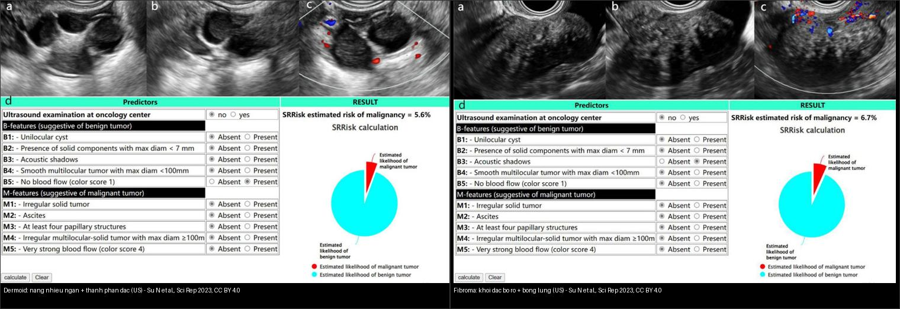
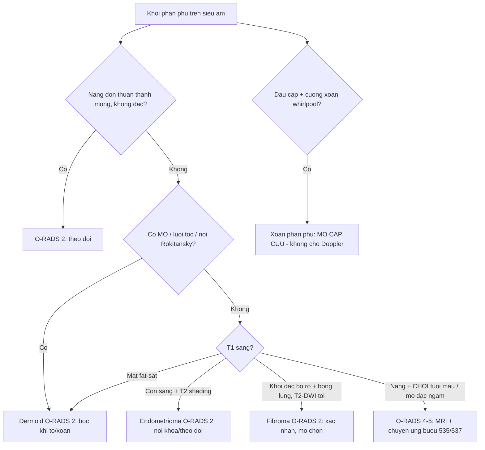
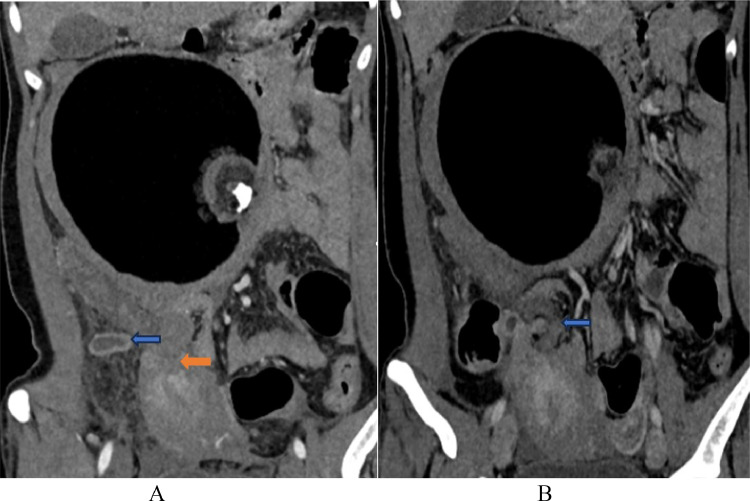
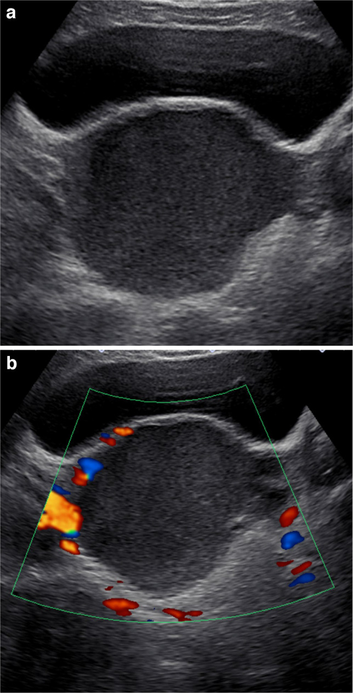
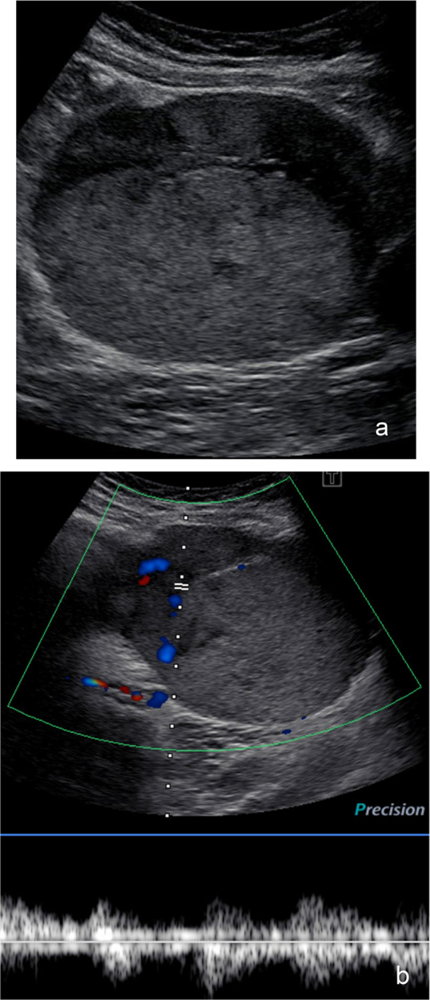
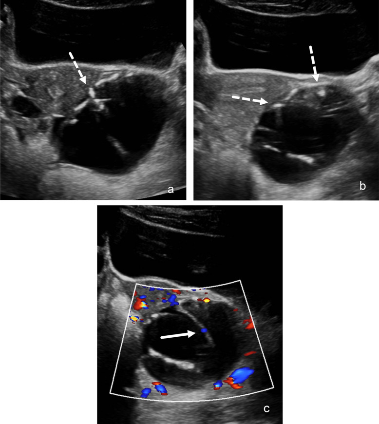
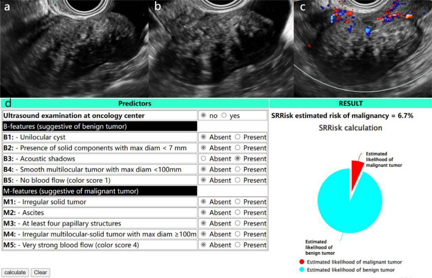
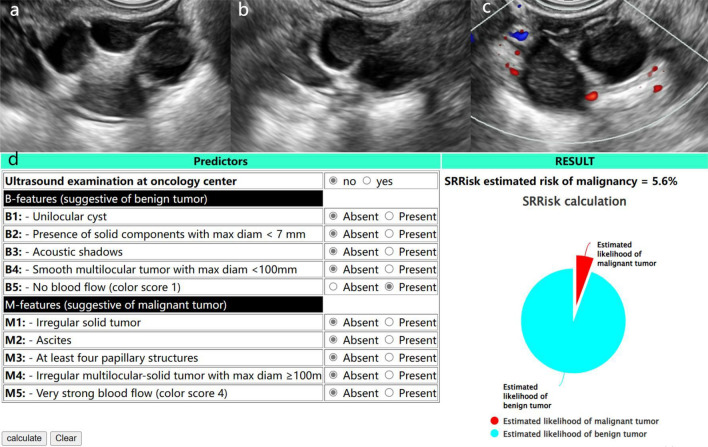
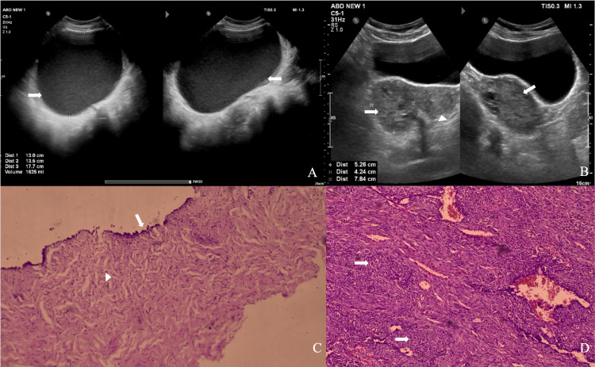

# 530 — Phần phụ: O-RADS US/MRI, dermoid, endometrioma, fibroma & xoắn / Adnexal O-RADS

**Tags:** `pattern:khoi-buong-trung` `pattern:u-quai` `pattern:u-vong-mac` `vung:buong-trung` `score:O-RADS` `protocol:MRI-chau` `protocol:sieu-am-dau-do`
**Mức chắc chắn (certainty):** tổng hợp y văn (literature synthesis) — nhóm tự biên từ y văn mở (Europe PMC/PMC: Sci Rep, Pediatr Radiol, Cureus, Radiol Case Rep) + các ca minh họa có giấy phép; không phải ca nguyên văn đơn lẻ.

## 1. Tổng quan — T1 fat-sat là công tắc mỡ–máu + T2/DWI đen là xơ lành + "O-RADS là xác suất, không phải chẩn đoán"

- **Câu hỏi đầu tiên với mọi khối phần phụ:** khối **nang hay đặc**? có **thành phần đặc** không? có **chồi (papillary projection)** không? có **tưới máu (color score)** không? — trả lời bằng siêu âm đầu dò (transvaginal) + Doppler trước, rồi xếp **O-RADS US v2022**.
- **TẠI SAO T1 fat-sat là "công tắc" đầu tiên (vật lý):** mỡ đại thể (dermoid) chứa proton trong chuỗi béo → **sáng trên T1W nhưng MẤT tín hiệu khi fat-sat**; máu cũ (methemoglobin — endometrioma) **vẫn sáng trên T1 fat-sat**; nhầy đặc cũng vẫn sáng. Vậy **T1 fat-sat quyết định "mỡ hay máu"** — đây là phân nhánh gốc của mọi gamut khối phần phụ.
- **TẠI SAO endometrioma có "T2 shading" (sáng→tối như bóng đổ):** máu cũ nhiều đợt chứa **hemosiderin + protein cô đặc** làm rút ngắn T2 (thời gian T2 rất ngắn) → phần dưới của nang tối dần. Đây là dấu hiệu gần như đặc trưng.
- **TẠI SAO fibroma "tối đen" cả T2 và DWI dù siêu âm giống ung thư:** mô xơ **nghèo proton tự do** (collagen đặc, ít nước) → **T2 tối + ADC thấp trên DWI** nhưng là **lành (O-RADS 2)**. Bẫy kinh điển: siêu âm thấy khối đặc bóng lưng tưởng ung thư → mổ rộng oan.
- **Ngưỡng định lượng (O-RADS US v2022):** O-RADS **1** = bình thường/sinh lý; **2** = gần chắc lành (**< 1%**); **3** = nguy cơ thấp (**1–< 10%**); **4** = trung bình (**10–< 50%**); **5** = cao (**≥ 50%**). Phân độ O-RADS MRI dùng DCE (Type I/II/III) + T2 + DWI.
- **Hiệu năng thực tế (định lượng):** O-RADS US **v2022 AUC 0,970** (KTC 95% 0,938–0,988); tỷ lệ ác tính theo nhóm trên 1 loạt 218 khối: **O-RADS 2 = 0%, O-RADS 3 = 0%, O-RADS 4 = 46,2% (v2022)/36% (v1), O-RADS 5 = 94,4%** → **O-RADS ≤ 3 gần như đồng nghĩa lành**, O-RADS 4–5 mới là nhóm cần can thiệp.
- **Xoắn phần phụ (adnexal torsion):** ngưỡng kinh điển > **4–5 cm** / > **20 mL**; dấu **cuống xoắn (whirlpool sign)** + **chuỗi ngọc (string of pearls)** trên siêu âm; **Doppler còn dòng máu KHÔNG loại trừ xoắn** (máu vẫn chảy qua tĩnh mạch kép/không tắc), càng không được chờ mất mạch — **xoắn là mổ cấp cứu**.
- **Vì sao quan trọng:** phân biệt **lành/ác** quyết định **theo dõi vs mổ**, mà phần lớn khối phần phụ là **lành** (dermoid, endometrioma, nang sinh lý, fibroma). Điểm mấu chốt là **tránh mổ oan** cho khối lành và **không bỏ sót** O-RADS 4–5.

## 2. Mẫu hình + chẩn đoán phân biệt theo O-RADS (Gamut)

- **O-RADS 2 (gần chắc lành, < 1%):** **nang đơn thuần (simple cyst)** — một ngăn, thành mỏng nhẵn, dịch trong, không thành phần đặc, không dòng máu; **dermoid điển hình**; **endometrioma điển hình**; **nang xuất huyết điển hình (lưới ren)**; **kén cạnh buồng trứng/paraovarian cyst**; **giãn vòi (hydrosalpinx)**.
- **O-RADS 3 (nguy cơ thấp, 1–< 10%):** **khối lớn (≥ 10 cm)** của các dạng điển hình trên; nang một ngăn thành dày nhẵn; nang **có thành phần đặc < 3 mm**; **nang nhiều ngăn không-có đặc** kích thước lớn.
- **O-RADS 4 (trung bình, 10–< 50%):** **khối đặc nhẵn có tưới máu** (color score 2–3); **nang nhiều ngăn + thành phần đặc**; **chồi (papillary projection) ≤ 3**; dịch kèm nhưng chưa có nốt phúc mạc.
- **O-RADS 5 (cao, ≥ 50%):** **khối đặc bờ không đều**; **≥ 4 chồi**; **mô đặc với dòng máu mạnh (color score 4)**; **báng + nốt/tổn thương phúc mạc** → chuyển ung bướu phụ khoa (`535`).
- **Khuôn hỗn hợp điển hình:** **nang + chồi** → u giáp biên/ung thư (`537`/`535`); **khối đặc + mỡ + vôi** → dermoid trưởng thành/u quái.
- **Gamut theo chất chứa trong nang (bộ lọc MRI):** **mỡ** (mất T1 fat-sat) → dermoid; **máu cũ** (T1 sáng + T2 shading) → endometrioma; **nhầy** (T2 rất sáng, T1 tối-hoặc-sáng, không mất fat-sat) → u nhầy (`537`/`539`); **dịch trong** (T2 sáng, T1 tối hoàn toàn) → nang sinh lý/đơn thuần.
- **Mimic cần loại:** **ung thư buồng trứng xâm lấn** (`535`), **u giáp biên** (`537`), **xoắn** (khối đau cấp), **áp-xe vòi–buồng trứng** (đau + sốt), **thai ngoài tử cung** (`550`), **u xơ dưới thanh mạc tử cung** (đặc, T2 tối, ít ngấm).

## 3. Bảng so sánh phân biệt (ma trận đối chiếu)

| Thực thể (entity) | Hình ảnh điển hình (US/CT/MRI theo thì) | Chốt vào (rule-in) | Chốt loại (rule-out) | Gợi ý xác nhận |
|---|---|---|---|---|
| **Dermoid (u quái trưởng thành)** | Nang **mỡ + vôi + nốt Rokitansky**; US có **dải tăng âm + bóng lưng lấm tấm**; CT **−40 đến −120 HU** (mỡ) + **> 100 HU** (vôi) | **Mỡ mất tín hiệu T1 fat-sat + lưới tóc/nốt Rokitansky** | T1 **còn sáng** sau fat-sat → máu (endometrioma) | US/CT/MRI đặc trưng; bóc khi ≥ 6–10 cm hoặc gây xoắn |
| **Endometrioma** | **T1 sáng + T2 shading + dịch kính mờ**, thường < 10 cm | **Shading + fat-sat vẫn sáng (máu cũ)** | Mất fat-sat → dermoid | MRI T1 fat-sat; bối cảnh đau/khó có con; phối hợp `540` |
| **Fibroma** | **Khối đặc bờ rõ + bóng lưng (acoustic shadowing)** trên US; **T2 tối + DWI/ADC tối** | **Đen cả T2 và DWI + bóng lưng = xơ lành (O-RADS 2)** | Ngấm mạnh Type III + không bóng lưng → ung thư | US + MRI (đừng gọi ung thư); **hội chứng Meigs**: u xơ + báng + tràn dịch màng phổi |
| **Nang xuất huyết (hemorrhagic cyst)** | US **lưới ren (lace-like/reticular)** + không dòng máu; **tự teo sau 6–8 tuần** | **Lưới ren + teo theo thời gian** | Kính mờ + shading + tồn tại → endometrioma | Siêu âm lại 6–8 tuần |
| **U giáp biên / ung thư (`537`/`535`)** | **Nang + NHÚ tưới máu**, nhiều ngăn "tổ ong", hoặc **mô đặc ưu thế + báng + cấy/hạch** | **Chồi mạch hóa ≥ 4 / mô đặc ngấm mạnh / báng + nốt phúc mạc** | Nang trơn không chồi, O-RADS ≤ 3 → theo dõi | O-RADS 4–5 → MRI + mô học; CA-125/HE4 |
| **Xoắn phần phụ** | Phần phụ **to, phù, đẩy trung tâm**, **whirlpool sign**, không/giảm dòng máu | **Cuống xoắn + đau cấp** (Doppler còn vẫn xoắn!) | Chuỗi ngọc + không dòng → nghi xoắn nặng | **Mổ nội soi tháo xoắn cấp cứu** |
| **Nang sinh lý/cạnh buồng trứng** | Nang trong, thành mỏng, một ngăn, ≤ 3 cm (follicle/corpus luteum), đơn độc | **Nang trong đơn độc + thay đổi theo chu kỳ** | Thành dày/đặc/chồi → không phải nang sinh lý | Siêu âm chu kỳ sau |

*Trái: **dermoid** — nang nhiều ngăn có thành phần đặc, kèm thang điểm SRRisk (ước ~5,6%). Phải: **fibroma** — khối đặc bờ rõ, **bóng lưng**, SRRisk ~6,7% (nhưng MRI tối cả T2/DWI mới chốt lành). Nguồn: Su N et al., Sci Rep 2023, Fig. 3–4, CC BY 4.0 (ảnh ghép letterbox).*

### Dấu hiệu "chốt" khi đọc khối phần phụ
- **Color score:** không dòng (1) → rất lành; **dòng mạnh (4)** → O-RADS 5. Đây là biến số đẩy phân độ.
- **Bóng lưng (acoustic shadowing):** nghĩ mô xơ (fibroma/Brenner) — **không mặc định ung thư**; nhưng vẫn phải MRI nếu là khối đặc.
- **Nốt Rokitansky (dermoid):** cục mỡ–tóc–răng nổi trong lòng nang → gần như chẩn đoán xác định.

## 4. Protocol chụp + O-RADS US/MRI + phân độ xoắn (flowchart)

- **Siêu âm đầu tay (transvaginal ± transabdominal), bắt buộc Doppler:** mô tả theo **từ vựng O-RADS US v2022** — số ngăn, vách, **thành phần đặc (mm)**, **chồi (đếm + đo mm)**, **color score 1–4**, bóng lưng, dịch kèm; xếp **O-RADS 1–5**.
- **MRI chậu (khối không kết luận được / O-RADS 4–5 / nghi ung thư):** **T2W 3 mặt phẳng + T1W + T1W fat-sat + DWI/ADC + DCE** → đối chiếu **O-RADS MRI**. Chốt: **T1 fat-sat (mỡ vs máu)**, **T2 tối + DWI tối (xơ lành)**, **DCE Type I/II/III (động học ngấm)**.
- **CT bụng–chậu có cản quang:** không phải đầu tay cho khối lành; dùng khi chấn thương/xoắn cấp (ca CT dưới), phân giai đoạn, tìm di căn/phúc mạc.
- **Dấu ấn:** **CA-125** (biểu mô/ung thư phúc mạc), **HE4**, **CA19-9** (nhầy); dùng **bổ trợ**, không tự mình chốt lành–ác (đặc biệt ở tiền mãn kinh có thể tăng theo chu kỳ/lạc nội mạc).
- **Xử trí theo O-RADS:** ≤ 3 → **theo dõi**; **4 → MRI/chuyển khám chuyên khoa**; **5 →** chuyển ung bướu phụ khoa (`535`). **Xoắn luôn mổ cấp cứu** bất kể phân độ.

## 5. Biến thể bình thường và cạm bẫy

- **Cạm bẫy "thỏa mãn tìm kiếm" (satisfaction of search):** ca dưới — thấy nang bì xoắn rồi **bỏ sót viêm ruột thừa cấp** cùng hố chậu phải. Đau hố chậu ở nữ: luôn xem **cả ruột thừa + phần phụ**.
- **Cạm bẫy "Doppler còn dòng = loại trừ xoắn":** SAI — dòng máu còn (đặc biệt tĩnh mạch) không loại trừ xoắn. **Whirlpool + đau cấp là chỉ định mổ**, đừng chờ tới khi mất mạch (đã hoại tử).
- **Cạm bẫy "fibroma = ung thư":** khối đặc bóng lưng dễ bị gọi ung thư → mổ rộng oan. **Tối cả T2 + DWI = xơ lành (O-RADS 2)**. Nhớ **hội chứng Meigs** (u xơ + báng + tràn dịch màng phổi) — vẫn lành.
- **Cạm bẫy nang xuất huyết vs endometrioma:** nang xuất huyết có **lưới ren**, **không shading**, và **teo sau 6–8 tuần**; endometrioma là **kính mờ + shading + tồn tại**. Đừng mổ nang xuất huyết (siêu âm lại sau 6–8 tuần).
- **Cạm bẫy O-RADS ở TRẺ EM:** malignancy rất hiếm → **PPV chỉ 5–7%**, **đồng thuận giữa bác sĩ mức trung bình (κ = 0,42)**; dù **Se/NPV 100%** nhưng **Sp 74–82%** → đừng dùng O-RADS ở trẻ để quyết mổ; **ưu tiên bảo tồn buồng trứng**.
- **Cạm bẫy "O-RADS = chẩn đoán":** O-RADS là **xác suất**; nhóm **4** nằm giữa (vùng xám) — cần MRI/mô học, không tự mình chốt.
- **Cạm bẫy "dermoid nhỏ không cần theo dõi":** dermoid có thể **xoắn/vỡ** → theo dõi hoặc bóc khi to; ghi kích thước từng lần.

## 6. Tự lượng giá — Blind Quiz

**Ca 1 — Nữ 39 tuổi đau hố chậu phải + sốt nhẹ. Đọc CT.**

- Gợi ý lâm sàng (clinical context): đau hố chậu phải, sốt nhẹ.
- Câu hỏi: mấy bệnh cùng lúc? Dấu xoắn ở đâu? Mổ gì?

<b>Bấm để hiện đáp án (findings + chẩn đoán)</b>

- Dấu hiệu (findings): nang bì (mỡ + vôi + nốt Rokitansky) + cuống xoắn **whirlpool** + ruột thừa to viêm + dịch.
- Chẩn đoán (diagnosis): **xoắn nang bì + viêm ruột thừa cấp cùng lúc** — cắt phần phụ + cắt ruột thừa một thì (đừng thỏa mãn 1 bệnh!).
- Nguồn ảnh: Khatiwada A et al., Radiol Case Rep 2024, Fig. 1, CC BY-NC-ND 4.0 (giữ nguyên bản).

**Ca 2 — Nữ 17 tuổi, siêu âm phần phụ. Đọc siêu âm.**

- Hỏi: đặc điểm nào xếp khối này **O-RADS 2**? Cần mổ không?

<b>Bấm để hiện đáp án (findings + chẩn đoán)</b>

- Dấu hiệu (findings): **(a)** nang **một ngăn, dịch trong, thành mỏng nhẵn, không thành phần đặc**; **(b)** Doppler chỉ có mạch ở **rìa/vỏ bình thường**, không mạch trong nang.
- Chẩn đoán (diagnosis): **nang đơn thuần/khối lành = O-RADS 2 (< 1%)** → **theo dõi**, không mổ. Ở trẻ em O-RADS có **Sp chỉ 74–82%, PPV 5–7%** nên càng phải thận trọng, ưu tiên bảo tồn.
- Nguồn ảnh: Epstein K et al., Pediatr Radiol 2026, Fig. 2, CC BY 4.0.

**Ca 3 — Nữ 10 tuổi, khối phần phụ phức tạp. Đọc siêu âm + Doppler.**

- Hỏi: khối có thành phần đặc/tưới máu không? Xếp O-RADS nào? Vì sao vẫn thận trọng ở trẻ?

<b>Bấm để hiện đáp án (findings + chẩn đoán)</b>

- Dấu hiệu (findings): khối **đặc–nang**, có **thành phần đặc** và **dòng máu trong tổn thương** trên Doppler (kèm phổ); bờ/vách không hoàn toàn nhẵn.
- Chẩn đoán (diagnosis): khối **đặc–nang có tưới máu = O-RADS 4–5** (nguy cơ 10–≥ 50%) — ở ca nhi này là **dương tính thật** theo 3 người đọc. Ở trẻ, **PPV thấp** nên cần hội chẩn + cân nhắc bảo tồn.
- Nguồn ảnh: Epstein K et al., Pediatr Radiol 2026, Fig. 3, CC BY 4.0.

**Ca 4 — Nữ 16 tuổi, khối nhỏ có ổ tăng âm. Đọc siêu âm.**

- Hỏi: dấu hiệu nào dễ bị đọc thành "u" (dương tính giả)? Bài học?

<b>Bấm để hiện đáp án (findings + chẩn đoán)</b>

- Dấu hiệu (findings): khối có **ổ/tổn thương tăng âm (dashed arrow)** gợi thành phần đặc; Doppler có mạch **quanh tổn thương (mũi tên trắng)** nhưng **không phải chồi mạch hóa thật**; 3 người đọc đều xếp **sai (dương tính giả)**.
- Chẩn đoán (diagnosis): **tổn thương lành bị đọc nhầm ác** — ở trẻ, O-RADS có **PPV 5–7%** → cẩn thận dương tính giả; **không mổ vì một dấu hiệu đơn độc**, theo dõi/MRI khi phân vân.
- Nguồn ảnh: Epstein K et al., Pediatr Radiol 2026, Fig. 4, CC BY 4.0.

**Ca 5 — Siêu âm khối phần phụ + tính điểm SRRisk. Đọc siêu âm.**

- Hỏi: khối đặc bờ rõ có **bóng lưng** gợi gì? O-RADS nào? Xác nhận bằng gì?

<b>Bấm để hiện đáp án (findings + chẩn đoán)</b>

- Dấu hiệu (findings): **(a, b)** khối **đặc, bờ rõ, có bóng lưng (acoustic shadowing)**; **(c)** Doppler ít mạch; thang điểm SRRisk ước **6,7%** (đưa vào nhóm B-features "khối đặc nhẵn").
- Chẩn đoán (diagnosis): **fibroma buồng trứng (O-RADS 2)** — bóng lưng + mô xơ; xác nhận bằng **MRI T2 tối/DWI tối**; **không gọi ung thư**, không mổ rộng. (Nhớ hội chứng Meigs.)
- Nguồn ảnh: Su N et al., Sci Rep 2023, Fig. 3, CC BY 4.0.

**Ca 6 — Siêu âm khối phần phụ có mỡ/tóc. Đọc siêu âm.**

- Hỏi: cấu trúc "nang nhiều ngăn + thành phần đặc" gợi gì? Cần phân biệt với gì ở người trẻ?

<b>Bấm để hiện đáp án (findings + chẩn đoán)</b>

- Dấu hiệu (findings): **(a, b)** **nang nhiều ngăn có thành phần đặc** kèm ổ tăng âm (mỡ/tóc); **(c)** Doppler; SRRisk ước **5,6%**.
- Chẩn đoán (diagnosis): **u quái trưởng thành (dermoid)** — xác nhận bằng CT/MRI thấy **mỡ + vôi + nốt Rokitansky**; phân biệt với **u giáp biên/ung thư** (`537`/`535`) nếu có chồi mạch hóa.
- Nguồn ảnh: Su N et al., Sci Rep 2023, Fig. 4, CC BY 4.0.

**Ca 7 — Ảnh ghép: bên nào dermoid, bên nào fibroma?**

- Hỏi: dấu hiệu nào tách hai bên? Bên nào cần MRI để "minh oan"?

<b>Bấm để hiện đáp án (findings + chẩn đoán)</b>

- **Trái = dermoid:** nang nhiều ngăn + thành phần đặc, ổ tăng âm (mỡ/tóc) → CT/MRI chốt **mỡ + vôi + nốt Rokitansky**.
- **Phải = fibroma:** khối **đặc bờ rõ + bóng lưng** → MRI **T2 tối + DWI tối** mới "minh oan" là xơ lành (O-RADS 2).
- Chốt: **bóng lưng + đặc = nghĩ fibroma (đừng gọi ung thư)**; **nang + mỡ/tóc = dermoid**.
- Nguồn: Su N et al., Sci Rep 2023, Fig. 4 & 3, CC BY 4.0 (ảnh ghép letterbox).

**Ca 8 — Siêu âm khối phần phụ + mô bệnh tương ứng. Đọc ảnh.**

- Hỏi: bên nào là nang đơn thuần, bên nào là tổn thương phức tạp? Mô bệnh (C, D) cho thấy gì?

<b>Bấm để hiện đáp án (findings + chẩn đoán)</b>

- Dấu hiệu (findings): **(A)** nang **một ngăn dịch trong** (bờ nhẵn); **(B)** khối **phức tạp có thành phần đặc/tổ chức** (đo 5,56 × 5,02 cm); **(C, D)** mô bệnh tương ứng.
- Chẩn đoán (diagnosis): đối chiếu **hình ảnh ↔ mô bệnh** để học phân độ O-RADS — khối đơn thuần ↔ lành (O-RADS 2), khối phức tạp ↔ cần phân độ cao hơn; nhấn mạnh **mô bệnh là tham chiếu vàng** cho phân độ.
- Nguồn ảnh: Shankar SJ et al., Cureus 2026, Fig. 2, CC BY 4.0.

## Bài liên quan chéo
- [500 – Tổng quan Vú & Sản phụ khoa](../500-tong-quan-vu-san-phu-khoa/lesson.md)
- [535 – Ung thư buồng trứng, phúc mạc & u Krukenberg](../535-ung-thu-buong-trung-phuc-mac-krukenberg/lesson.md)
- [536 – U mầm & u mô đệm–dây sinh dục buồng trứng](../536-u-mam-u-mo-dem-buong-trung/lesson.md)
- [537 – U buồng trứng giáp biên (borderline)](../537-u-buong-trung-giap-bien/lesson.md)
- [540 – Lạc nội mạc tử cung sâu (DIE) & viêm vùng chậu](../540-lac-noi-mac-tu-cung-sau-DIE-MRI/lesson.md)
- [160 – Bụng cấp tiêu hóa](../160-bung-cap-GI/lesson.md) (ruột thừa vs phần phụ)

## Ảnh
- `530_dermoid-xoan_CT_RCR-Khatiwada-CCBYNCND40.jpg`, `530_orads2-lanh_US_PMC13035678.jpg`, `530_orads3-4-dung_US_PMC13035678.jpg`, `530_duong-tinh-gia_US_PMC13035678.jpg`, `530_fibroma_US_PMC10514283.jpg`, `530_dermoid_US_PMC10514283.jpg`, `530_US-va-mo-ben_PMC13104537.jpg`, `composite_dermoid-vs-fibroma-US.jpg`. Nguồn + giấy phép từng ảnh trong `images/CREDITS.md`.

> Không dùng để chẩn đoán độc lập khi chưa có người hướng dẫn.
