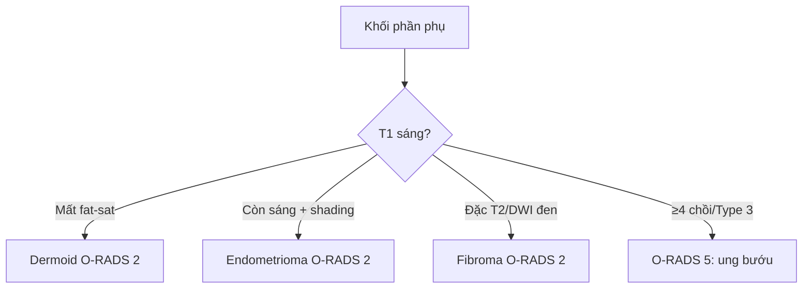

# 530 — Phần phụ: O-RADS, dermoid, xoắn & O-RADS 5 / Adnexal O-RADS

**Tags:** `pattern:khoi-buong-trung` `vung:buong-trung` `score:O-RADS` `protocol:MRI-chau`
**Mức chắc chắn (certainty):** tổng hợp y văn (literature synthesis) — nhóm tự biên từ y văn mở, chưa gắn ca nguyên văn đơn lẻ.

## 1. Tổng quan — T1 fat-sat là công tắc mỡ-máu + T2/DWI đen là xơ lành

- Khối T1 sáng: đối chiếu **T1 fat-sat** — TẠI SAO mất tín hiệu = mỡ đại thể (dermoid: mỡ + tóc + vôi + nốt Rokitansky), còn sáng = máu methemoglobin (endometrioma) / nhầy đặc.
- Endometrioma máu cũ nhiều đợt — TẠI SAO **T2 shading** (sáng→tối như bóng đổ): sắt/hemosiderin + protein cô đặc rút ngắn T2.
- Fibroma xơ đặc nghèo proton — TẠI SAO **tối đen T2 + tối DWI** dù siêu âm bóng lưng giống K: collagen không có nước tự do (chốt O-RADS MRI 2!).
- Ngưỡng: O-RADS 2 (< 1%), 3 (1–< 10%), 4 (10–< 50%, 1–3 chồi), 5 (≥ 50%, ≥ 4 chồi/dịch/nốt phúc mạc); xoắn: > 4–5 cm/> 20 mL + chuỗi ngọc + whirlpool; **Doppler còn không loại trừ xoắn** (máu kép + tắc tĩnh mạch trước!).

## 2. Gamut khối phần phụ (Gamut)

- **Mỡ + vôi + Rokitansky + mất T1 fat-sat:** dermoid (O-RADS 2) — bóc khi to/xoắn.
- **T1 sáng + shading + kính mờ:** endometrioma (O-RADS 2) — nội khoa/theo dõi K.
- **Đặc T2/DWI đen:** fibroma (O-RADS 2) — mổ (đừng gọi K!).
- **≥ 4 chồi + Type 3 + dịch:** O-RADS 5 — chuyển ung bướu phụ khoa.
- **Sưng + chuỗi ngọc + whirlpool:** xoắn — mổ tháo xoắn cấp cứu (Doppler còn vẫn mổ!).

## 3. Bảng so sánh phân biệt (ma trận đối chiếu)

| Thực thể (entity) | Hình ảnh điển hình | Chốt vào (rule-in) | Chốt loại (rule-out) | Gợi ý xác nhận |
|---|---|---|---|---|
| Dermoid | **Mỡ + vôi + Rokitansky + mất T1 fat-sat** | **Fat-sat mất + lưới tóc** | T1 còn sáng → máu | Bóc khi ≥ 6–10 cm/xoắn |
| Endometrioma | **T1 sáng + shading + kính mờ + < 10 cm** | **Shading + fat-sat còn sáng** | Mất fat-sat → dermoid | Theo dõi + CA-125 + ngừa K |
| Fibroma | **Đặc T2 đen + DWI đen + bóng lưng US** | **Đen cả T2/DWI = xơ lành** | Ngấm Type 3 → K | Mổ (Meigs: dịch + màng phổi!) |
| O-RADS 5/xoắn | **≥ 4 chồi/Type 3/dịch; xoắn: chuỗi ngọc + whirl** | **Chồi/dịch; xoắn không chờ Doppler** | Nang đơn ≤ 10 cm → 2 | Ung bướu/mổ cấp cứu |

*Nang bì mỡ + vôi + nốt Rokitansky + cuống xoắn whirlpool + ruột thừa viêm (mũi tên xanh). Nguồn: Khatiwada et al., Radiol Case Rep 2024 Fig. 1, CC BY-NC-ND 4.0 (giữ nguyên bản).*

## 4. Protocol phần phụ

- **TVUS (O-RADS) + Doppler + MRI T1 fat-sat/DWI/Type I-III + CA-125/HE4** khi khối; xoắn = mổ cấp cứu không chờ Doppler.

## 5. Cạm bẫy

- **Thỏa mãn tìm kiếm** (ca trên: thấy ruột thừa bỏ sót xoắn!) — đau hố chậu nữ là xem cả ruột thừa + phần phụ.
- **Doppler còn loại trừ xoắn** = hoại tử buồng trứng — chuỗi ngọc + whirlpool là mổ.
- **Fibroma gọi K** mổ rộng oan — đen T2/DWI là xơ lành (kể cả Meigs!).

## 6. Tự lượng giá — Blind Quiz

**Ca 1 — Nữ 39 tuổi đau hố chậu phải + sốt nhẹ. Đọc CT.**

- Hỏi: mấy bệnh cùng lúc? Dấu xoắn đâu? Mổ gì?

<b>Bấm để hiện đáp án</b>

- Dấu hiệu (findings): nang bì (mỡ + vôi + Rokitansky) + cuống xoắn whirlpool + ruột thừa to viêm + dịch.
- Chẩn đoán (diagnosis): **xoắn nang bì + viêm ruột thừa cấp cùng lúc** — cắt phần phụ + cắt ruột thừa một thì (đừng thỏa mãn 1 bệnh!).
- Nguồn: Khatiwada et al., Fig. 1, CC BY-NC-ND 4.0 (nguyên bản).

**Ca 2 — Đặc buồng trứng T2 đen + DWI đen + bóng lưng US:** K hay fibroma? *(Bảng mục 3.)*

<b>Bấm để hiện đáp án</b>

- **Fibroma (O-RADS 2):** đen cả T2/DWI = xơ lành (dù US giống K).

## Bài liên quan chéo
- [500 – Tổng quan Vú & SPK](../500-tong-quan-vu-san-phu-khoa/lesson.md)
- [540 – DIE](../540-lac-noi-mac-tu-cung-sau-DIE-MRI/lesson.md) (endometrioma + DIE)
- [160 – Bụng cấp GI](../160-bung-cap-GI/lesson.md) (ruột thừa vs phần phụ)

> Không dùng để chẩn đoán độc lập khi chưa có người hướng dẫn.
