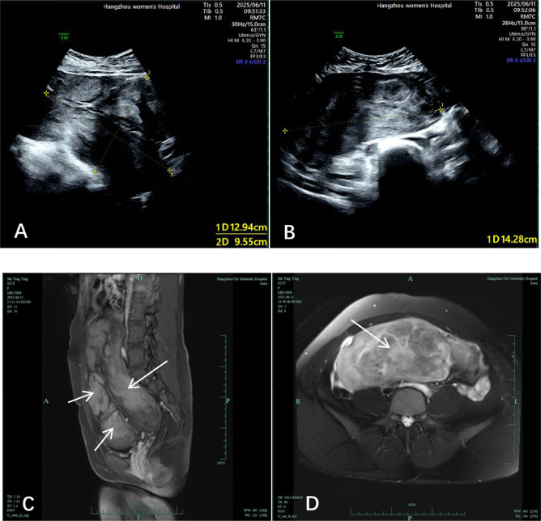
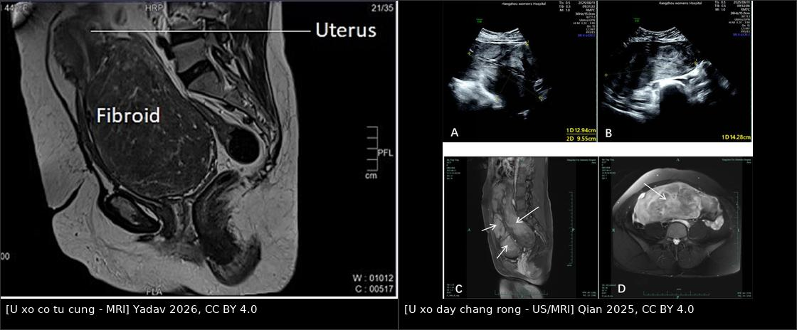
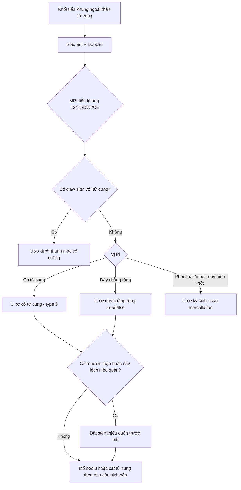
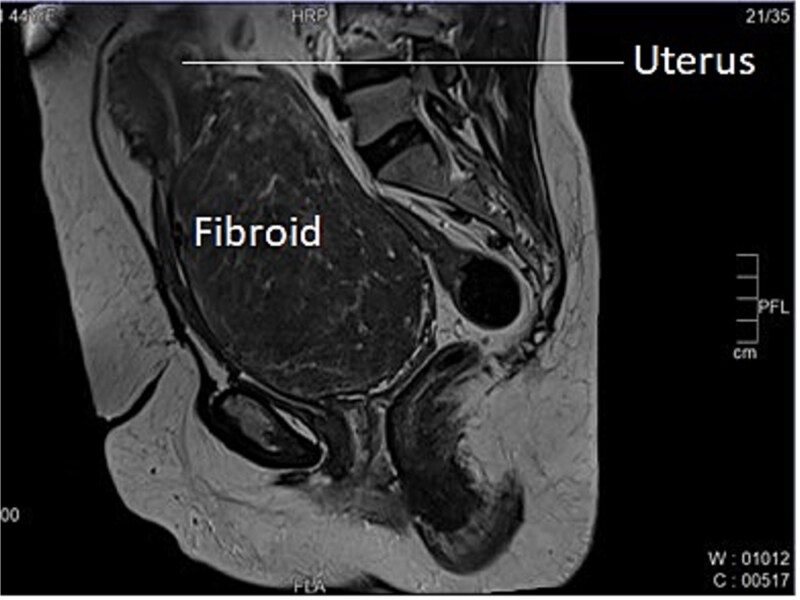
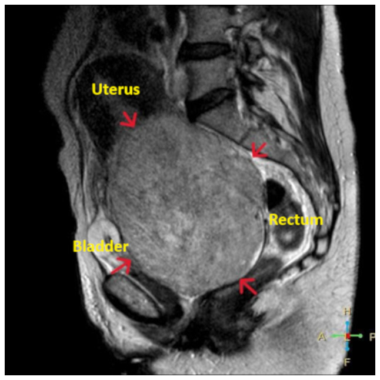
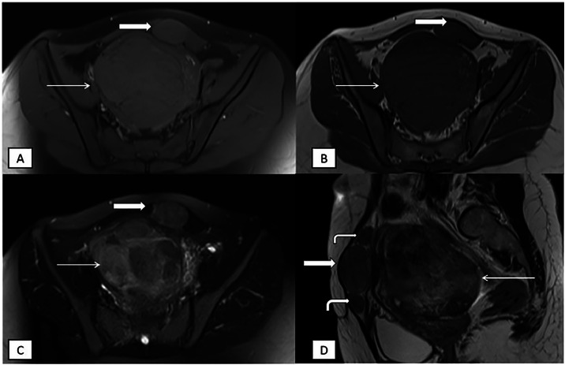

# 531 — U xơ cổ tử cung, u xơ ký sinh & u xơ dây chằng rộng: khối ngoài thân tử cung, chèn ép niệu quản & "lantern on St Paul's dome"

**Tags:** `pattern:khoi-tu-cung` `pattern:khoi-ngoai-than-tu-cung` `vung:co-tu-cung` `vung:tieu-khung` `vung:phuc-mac` `score:FIGO` `protocol:MRI-tieu-khung`
**Mức chắc chắn (certainty):** tổng hợp y văn (literature synthesis) — tổng hợp 5 ca nguyên văn có ảnh mở (cervical fibroid, giant endocervical fibroid, parasitic leiomyoma, broad ligament fibroid, cervical fibroid gây bí tiểu) + 1 bài review phân loại FIGO; số liệu đối chiếu trực tiếp PMCID.

## 1. Tổng quan bệnh học – cơ chế hình ảnh

- **Tần suất – vì sao nhóm này quan trọng:** u xơ tử cung (leiomyoma) là u lành phổ biến nhất, **20–40% phụ nữ sau 35 tuổi**, tới **5,4–77%** ở tuổi sinh sản tùy quần thể. Nhưng **u xơ cổ tử cung chỉ chiếm 0,6% toàn bộ u xơ**; **dây chằng rộng là vị trí ngoài tử cung hay gặp nhất, < 1%**; **u xơ ký sinh (parasitic leiomyoma) cực hiếm — dưới 200 ca trong y văn, trung vị xuất hiện khoảng 4 năm sau mổ** và đang tăng do **morcellation**.
- **Vì sao vị trí ngoài thân tử cung khó:** khối nằm trong **khoang chật hẹp** (cổ tử cung) hoặc **giữa các lá dây chằng** nên **đẩy lệch niệu quản, bàng quang, trực tràng**; mổ dễ chảy máu và **tổn thương niệu quản**. Đây là nhóm quyết định **ngả mổ, thời gian mổ và biến chứng**, khác hẳn u xơ thân tử cung.
- **TẠI SAO T2W rất tối:** u xơ gồm **sợi cơ trơn + bó collagen dày** → rất ít nước tự do → **thời gian T2 ngắn**, tín hiệu **tối hơn cơ tử cung**; bờ rõ nhờ **vỏ giả (pseudocapsule)** và **mạch nuôi bao quanh (bridging vessels)**. Trên T1W u **đồng tín hiệu cơ**, sau gadolinium **ngấm đồng nhất hoặc không đồng nhất**.
- **TẠI SAO tín hiệu thay đổi khi thoái hóa:**
  - **Thoái hóa hyaline (hay gặp nhất):** collagen tăng, nước giảm → **T2 rất tối**, gần như "đen".
  - **Thoái hóa nang/myxoid:** dịch hoặc mucin → **T2 rất sáng**, có thể nhầm sarcoma/nang.
  - **Thoái hóa đỏ (red degeneration):** máu bán cấp (methemoglobin) → **T1 sáng**, T2 tối–hỗn hợp; hay gặp trong thai kỳ (bài 532).
  - **Vôi hóa:** mất tín hiệu mọi chuỗi xung, **tăng đậm độ trên CT**.
- **TẠI SAO u xơ ký sinh sống được ngoài tử cung:** mảnh u xơ rơi vào ổ bụng (thường sau **morcellation**) **cấy lên phúc mạc**, tân mạch hóa từ **mạc nối/mạc treo** và lớn dần dưới ảnh hưởng hormone. Vì có **nguồn máu riêng**, khối **không nối với tử cung** hoặc chỉ còn **dải xơ/ mạch cầu nối** — đây là chìa khóa hình ảnh.
- **Phân loại FIGO (bổ sung cho 542):** **type 8 = vị trí khác**, gồm **cổ tử cung, ký sinh, dây chằng rộng**. Nhóm này **không xếp vào 0–7** và **không quyết định ngả soi buồng**.
- **Định lượng cốt lõi:**
  - **U xơ cổ tử cung "khổng lồ"** được mô tả khi **đường kính > 15 cm**; các ca lớn thường gây **bí tiểu, ứ nước thận**.
  - **Nguy cơ chuyển dạng ác tính của u xơ rất thấp: 0,4–0,8%** — nhưng **lớn nhanh, T2 không đồng nhất, hạn chế khuếch tán mạnh** là cờ đỏ cần MRI + theo dõi sát.
  - **U xơ ký sinh:** trung vị **4 năm** sau mổ; ca báo cáo có **7 năm**; tổn thương có thể **nhiều ổ** dọc **đường trocar cũ**.

## 2. Mẫu hình + chẩn đoán phân biệt theo vị trí (gamut)

- **Cổ tử cung (intracervical hoặc extracervical trước/sau/bên):** khối **T2 tối, bờ rõ**, làm **cổ tử cung phình to**, **không thấy cổ tử cung riêng** ở ca lớn; **tử cung nằm trên khối** → dấu **"lantern on St Paul's dome" (đèn lồng trên vòm thánh Paul)**. Triệu chứng: **bí tiểu, tiểu rắt, táo bón, ra máu sau giao hợp**. Gamut: u xơ cổ tử cung, **ung thư cổ tử cung**, polyp cổ tử cung sa, sa sinh dục, đảo ngược tử cung.
- **Dây chằng rộng (broad ligament):**
  - **U xơ dây chằng rộng thật (true):** phát sinh từ **mô liên kết dưới phúc mạc của dây chằng**, tách khỏi tử cung.
  - **U xơ dây chằng rộng giả (false):** mọc từ **tử cung lan vào dây chằng** — vẫn còn **dấu móc (claw sign)** với tử cung.
  - Hệ quả: khối **đẩy tử cung sang bên đối diện**, **niệu quản bị đẩy ra ngoài/ra trước**, dễ **ứ nước thận**.
- **Phúc mạc – mạc treo – thành bụng (u xơ ký sinh):** khối **T2 tối, T1 đồng tín hiệu**, **ngấm thuốc**, có thể **hạn chế khuếch tán nhẹ**; **nhiều nốt** dọc **vết mổ/trocar**. Gamut: **di căn phúc mạc (carcinomatosis)**, u mạc treo, **GIST**, hạch, endometrioma, u xơ ký sinh.
- **Sừng tử cung/đoạn dưới:** u xơ **có cuống** hoặc **u xơ ký sinh** dính sừng → dễ nhầm **chửa góc/chửa ngoài tử cung**; cần **hCG** và MRI.
- **Gợi nhớ:** khối **T2 tối + bờ rõ + vỏ giả + mạch bao quanh** = u xơ cho đến khi chứng minh ngược lại; **vị trí ngoài thân tử cung + mất liên tục với tử cung** = nghĩ **ký sinh** hoặc **dây chằng rộng thật**.

*U xơ dây chằng rộng phải khổng lồ: siêu âm (A, B) và MRI T1/T2 (C, D) — khối lấp đầy tiểu khung, đè đẩy tử cung và các tạng. Nguồn: Qian 2025, CC BY 4.0.*

## 3. Bảng so sánh phân biệt (ma trận đối chiếu)

| Thực thể (entity) | Hình ảnh điển hình (US/CT/MRI) | Chốt vào (rule-in) | Chốt loại (rule-out) | Gợi ý xác nhận |
|---|---|---|---|---|
| **U xơ cổ tử cung** | Khối T2 tối, bờ rõ, phình cổ tử cung; tử cung nằm trên khối ("lantern"); có thể ứ nước thận | **Tử cung tách rời, nằm trên khối cổ + T2 tối + vỏ giả** | Cổ tử cung còn nguyên, khối ở thân tử cung → không phải type 8 | MRI sagittal T2 + khám; siêu âm bàng quang/niệu quản |
| **U xơ ký sinh** | Khối T2 tối ngoài tử cung, T1 đồng tín hiệu, ngấm thuốc; nhiều nốt dọc trocar; có thể có mạch nối với mạc treo | **Tiền sử morcellation + nhiều khối T2 tối ngoài tử cung + không có claw sign** | Có claw sign rõ với tử cung → u xơ dưới thanh mạc | MRI bụng–chậu; so phim cũ; mô bệnh sau cắt |
| **U xơ dây chằng rộng** | Khối lớn một bên, đẩy tử cung đối diện, niệu quản ra ngoài; T2 tối, bờ rõ | **Khối một bên dây chằng + tử cung bị đẩy + T2 tối** | Khối trong buồng tử cung → không phải | MRI coronal/sagittal; CT niệu quản nếu ứ nước |
| **U xơ dưới thanh mạc có cuống** | Khối T2 tối nối với tử cung bằng **cuống** chứa mạch | **Thấy cuống + claw sign + mạch nuôi từ tử cung** | Mất hoàn toàn liên tục → nghĩ ký sinh | MRI đa bình diện; Doppler cuống |
| **U sợi buồng trứng/fibrothecoma** | Khối T2 **rất tối**, bờ rõ, **không có vỏ giả/mạch bao quanh**, buồng trứng lành tách biệt | **T2 tối + không liên quan tử cung + không ngấm mạnh** | Có bridging vessels + claw sign → u xơ | MRI; nội tiết (estradiol) nếu nghĩ fibrothecoma |
| **GIST/u mạc treo** | Khối mạc treo, ngấm mạnh, có thể hoại tử; **không có claw sign** | **Nguồn gốc mạc treo + ngấm mạnh + không liên quan tử cung** | T2 rất tối đồng nhất + vỏ giả → u xơ | CT/MRI + mô bệnh |
| **Ung thư cổ tử cung** | Khối cổ tử cung bờ không rõ, **T2 trung gian–cao**, **ADC thấp**, xâm lấn tham số; hạch | **Bờ không rõ + xâm lấn + hạn chế khuếch tán mạnh** | Bờ rõ, T2 tối, vỏ giả → u xơ | Sinh thiết cổ tử cung; MRI phân giai đoạn |
| **Sarcoma cơ tử cung** | Khối lớn nhanh, T2 **không đồng nhất**, hoại tử, **ADC thấp**, ngấm mạnh không đều | **Lớn nhanh + hoại tử + hạn chế khuếch tán mạnh** | T2 tối đồng nhất, không hoại tử → u xơ lành | MRI + mô bệnh; nguy cơ chuyển dạng 0,4–0,8% |

*Trái: u xơ cổ tử cung — tử cung nằm trên khối ("lantern on St Paul's dome"). Phải: u xơ dây chằng rộng — khối chiếm trọn tiểu khung, đè đẩy tạng. Ảnh ghép letterbox, không crop/kéo giãn; nguồn ở `images/CREDITS.md`.*

## 4. Protocol chụp + hệ phân loại & xử trí

- **Siêu âm (đầu tay):** transabdominal + transvaginal; đánh giá **kích thước, vị trí, số lượng, độ tối T2-tương ứng trên US (hypoechoic)**, **bàng quang**, **ứ nước thận hai bên**. Siêu âm **kém** khi khối lớn đẩy lệch tạng — đây là lý do các ca lớn đều cần MRI.
- **MRI tiểu khung (chốt):** **T2W sagittal + axial + coronal** (bắt buộc để thấy tương quan tử cung–cổ tử cung–khối), **T1W**, **DWI/ADC**, **T1 fat-sat sau gadolinium**. Đánh giá: **claw sign** (khối thuộc tử cung hay ngoài tử cung), **bridging vessels**, **bờ/vỏ giả**, **thành phần hoại tử**, **niệu quản có bị đẩy/ứ nước**.
- **CT bụng–chậu có cản quang:** khi cần đánh giá **niệu quản, ứ nước thận, urinoma** hoặc khi MRI không khả dụng; **không dùng để chẩn đoán bản chất u xơ**.
- **Đánh giá niệu quản trước mổ:** siêu âm/CT tìm **ứ nước thận**; với khối **cổ tử cung/dây chằng rộng lớn, đẩy lệch**, các ca đều **đặt stent niệu quản hai bên trước mổ** để giảm nguy cơ cắt/tổn thương niệu quản. **Không có ngưỡng kích thước tuyệt đối** — quyết định theo độ lệch giải phẫu trên MRI.
- **Phân loại:** FIGO 2011 (Munro) **type 8** cho cổ tử cung/ký sinh/dây chằng rộng; với u xơ dây chằng rộng ghi thêm **true vs false**.
- **Xử trí (khung):**
  - **Cổ tử cung:** **cắt u xơ cổ tử cung (myomectomy)** nếu mong con; **cắt tử cung toàn phần** nếu không còn nhu cầu sinh sản/khối quá lớn. **UAE** là lựa chọn ít xâm lấn; lưu ý **nhánh nuôi có thể từ động mạch buồng trứng** → cần **chụp động mạch chủ (aortogram)** và nút cả nhánh buồng trứng nếu cần.
  - **Dây chằng rộng:** mổ **bóc u bảo tồn** theo đúng **mặt phẳng vỏ u**, xác định **niệu quản** trước khi cắt; khối lớn có thể cần **mổ mở**.
  - **Ký sinh:** **cắt bỏ toàn bộ** (nội soi nếu được), **không làm tổn thương tạng dính**; gửi mô bệnh để loại sarcoma/GIST.
  - **U xơ có cuống sa qua cổ tử cung:** cắt polyp/u xơ qua âm đạo sau khi **xác định rõ cổ tử cung** (tránh cắt nhầm tử cung lộn ngược — bài 544).

- **Theo dõi sau mổ:** siêu âm **3–6 tháng** nếu bảo tồn; **tái phát** sau morcellation có thể nhiều năm — giáo dục bệnh nhân về triệu chứng và **tránh morcellation không kiểm soát** ở u nghi ngờ.

## 5. Biến thể bình thường và cạm bẫy

- **"Lantern on St Paul's dome":** hình ảnh **tử cung ngồi trên khối cổ tử cung khổng lồ** — nếu chỉ đọc là "u xơ thân tử cung" sẽ **mổ sai ngả** và **không chuẩn bị kiểm soát niệu quản**.
- **Khối cổ tử cung sa ra âm đạo** dễ nhầm **sa tử cung (procidentia)** hoặc **đảo ngược tử cung**; **không cắt "polyp" trước khi nhìn rõ cổ tử cung** — cắt nhầm có thể gây chảy máu ồ ạt.
- **U xơ ký sinh vs carcinomatosis:** nhiều nốt phúc mạc **T2 tối, đồng tín hiệu cơ, ngấm thuốc** ở người **có tiền sử morcellation** — đừng mặc định di căn; nhưng **vẫn phải loại sarcoma/di căn** bằng mô bệnh.
- **U xơ thoái hóa myxoid/nang:** T2 rất sáng, có thể **nhầm sarcoma/nang buồng trứng**; tìm **vỏ giả + mạch bao quanh + không hoại tử lan tỏa**.
- **Bỏ sót niệu quản:** niệu quản **đi sát bờ ngoài cổ tử cung**, bị **đẩy ra ngoài** bởi khối dây chằng rộng; **không thấy niệu quản trên MRI/CT = chưa an toàn để mổ**.
- **UAE không đủ:** u xơ cổ tử cung có thể được nuôi bởi **động mạch buồng trứng**; nút chỉ động mạch tử cung → **thất bại/thể tích giảm không đủ**. Cần aortogram khi nghi.
- **Chuyển dạng ác tính:** chỉ **0,4–0,8%**, nhưng **lớn nhanh sau mãn kinh, T2 không đồng nhất, ADC rất thấp, hoại tử** → **MRI + mổ lấy mô**, không theo dõi mù.

## 6. Tự lượng giá — Blind Quiz ngay trên trang tĩnh

**Ca 1 — Nữ 44 tuổi, bí tiểu, ra máu sau giao hợp; siêu âm thấy khối lớn vùng chậu.**

- Gợi ý: chú ý vị trí tử cung so với khối.
- Câu hỏi: Dấu hiệu đặc trưng là gì? Vì sao phải đánh giá niệu quản trước mổ? Chẩn đoán phân biệt chính?

<b>Bấm để hiện đáp án (findings + chẩn đoán)</b>

- Dấu hiệu: khối **T2 tối, bờ rõ**, chiếm toàn bộ cổ tử cung; **tử cung nằm ngay trên khối** — dấu **"lantern on St Paul's dome"**.
- Chẩn đoán: **u xơ cổ tử cung (cervical fibroid)** — khối lớn ~20 × 16 cm trong ca này.
- Vì sao đánh giá niệu quản: khối cổ tử cung đẩy lệch và chèn ép niệu quản → **ứ nước thận**; ca này được **đặt stent niệu quản hai bên trước mổ**.
- Nguồn: Yadav P et al., *J Surg Case Rep* 2026, PMC12998220, CC BY 4.0.

**Ca 2 — Nữ 52 tuổi, bụng to, đau lưng; siêu âm nghi khối phần phụ.**

- Gợi ý: khối lớn chiếm tiểu khung, các tạng bị đẩy.
- Câu hỏi: Khối xuất phát từ đâu? Tìm dấu hiệu biến chứng trên CT. Vì sao cần stent và theo dõi thận sau mổ?

<b>Bấm để hiện đáp án (findings + chẩn đoán)</b>

- Dấu hiệu: khối **T2 tối, bờ rõ**, xuất phát từ **cổ tử cung/đoạn dưới**, đè **bàng quang ra trước, trực tràng ra sau**; trên CT kèm **ứ nước bể thận hai bên** và **urinoma quanh thận trái**.
- Chẩn đoán: **u xơ cổ tử cung khổng lồ (> 15 cm)** gây **ứ nước thận hai bên**.
- Xử trí: **stent niệu quản**, cắt tử cung; stent rút sau **3 tháng**, chức năng thận hồi phục.
- Nguồn: Thanasa A et al., *Med Int (Lond)* 2025, PMC12329397, CC BY 4.0.

**Ca 3 — Nữ 38 tuổi, tiền sử mổ nội soi bóc u xơ có morcellation 7 năm trước; đau bụng tái diễn, nhiều khối trong ổ bụng.**

- Gợi ý: nhiều khối ngoài tử cung, dọc thành bụng; không có claw sign.
- Câu hỏi: Chẩn đoán? Dấu hiệu MRI nào giúp phân biệt với di căn phúc mạc? Yếu tố nguy cơ nào trong tiền sử?

<b>Bấm để hiện đáp án (findings + chẩn đoán)</b>

- Dấu hiệu: nhiều khối **T1 đồng tín hiệu, T2 tối không đồng nhất**, **ngấm thuốc mạnh**, **hạn chế khuếch tán nhẹ**, dọc **bờ sau cơ thẳng bụng trái** (đường trocar cũ); khối lớn ở đáy tử cung kèm u xơ.
- Chẩn đoán: **u xơ ký sinh (parasitic leiomyoma)** sau **laparoscopic myomectomy có power morcellation**.
- Phân biệt: di căn phúc mạc thường **T2 trung gian–cao, ADC rất thấp, có dịch ổ bụng, hạch**; u xơ ký sinh **T2 tối, đồng tín hiệu cơ, bờ rõ**.
- Nguồn: Varshney E et al., *Radiol Case Rep* 2026, PMC12743411, **CC BY-NC-ND 4.0** (giữ nguyên ảnh, không crop/ghép).

## Bài liên quan chéo
- [542 – U xơ dưới niêm mạc (FIGO 0–2) & can thiệp bảo tồn](../542-u-xo-duoi-niem-mac-can-thiep-bao-ton/lesson.md)
- [520 – U xơ tử cung FIGO, adenomyosis & nội mạc](../520-tu-cung-u-xo-FIGO-adenomyosis-noi-mac/lesson.md)
- [544 – Đảo ngược tử cung không do sinh](../544-dao-nguoc-tu-cung-khong-do-sinh/lesson.md)
- [518 – Morcellation & LPD (leiomyomatosis peritonealis disseminata)](../518-morcellation-LPD/lesson.md)

## Ảnh
- `images/531_u-xo-ngoai-than_CECTU_MRI_PMC12998220.jpg` — MRI u xơ cổ tử cung, Yadav 2026, CC BY 4.0.
- `images/531_u-xo-ngoai-than_CECTU_MRI-sag_PMC12329397.jpg` — MRI u xơ cổ tử cung khổng lồ, Thanasa 2025, CC BY 4.0.
- `images/531_u-xo-ngoai-than_CT-hydro_PMC12329397.jpg` — CT ứ nước thận hai bên, Thanasa 2025, CC BY 4.0.
- `images/531_u-xo-ky-sinh_MRI_PMC12743411.jpg` — MRI u xơ ký sinh, Varshney 2026, CC BY-NC-ND 4.0.
- `images/531_u-xo-day-chang-rong_US-MRI_PMC12819652.jpg` — siêu âm + MRI u xơ dây chằng rộng, Qian 2025, CC BY 4.0.
- `images/composite_co-tu-cung-vs-day-chang-rong.jpg` — ảnh ghép đối chiếu, letterbox không crop.

> Không dùng để chẩn đoán độc lập khi chưa có người hướng dẫn.
