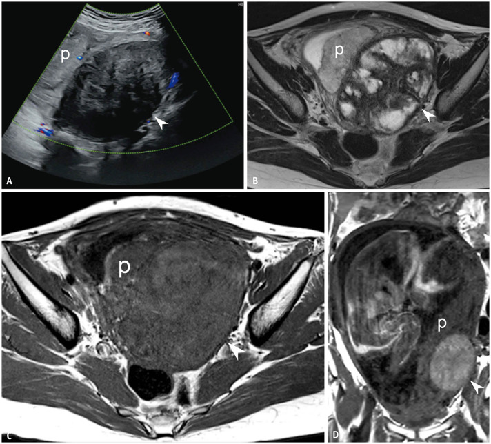
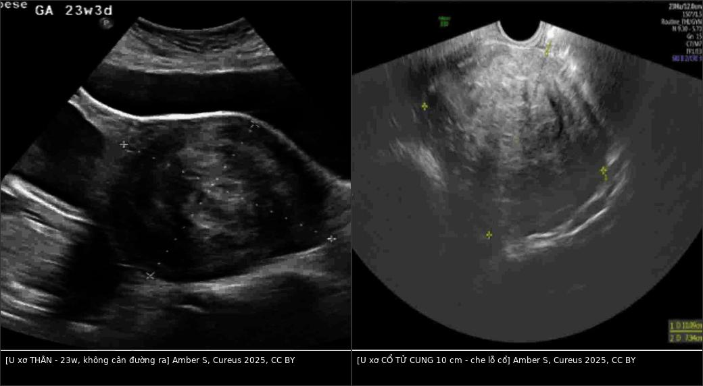
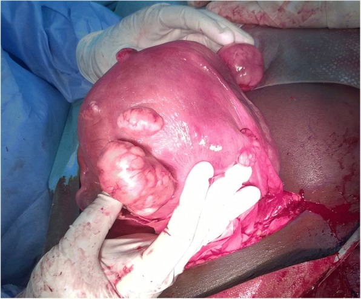
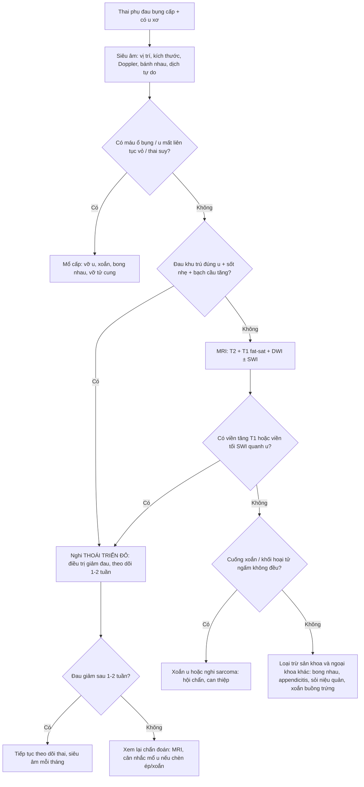
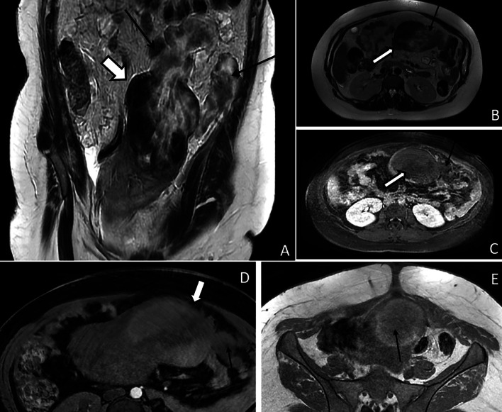
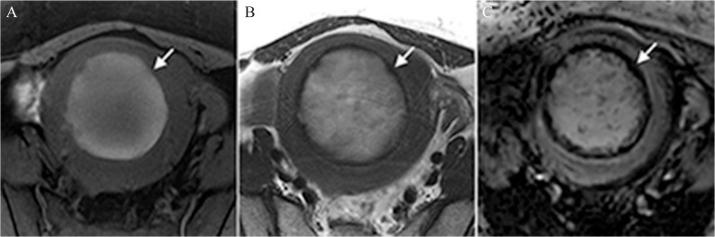
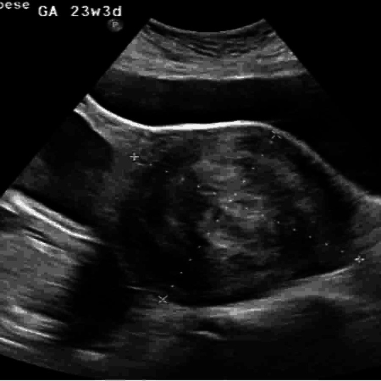
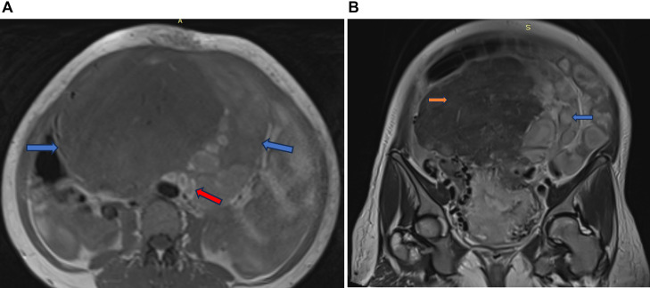
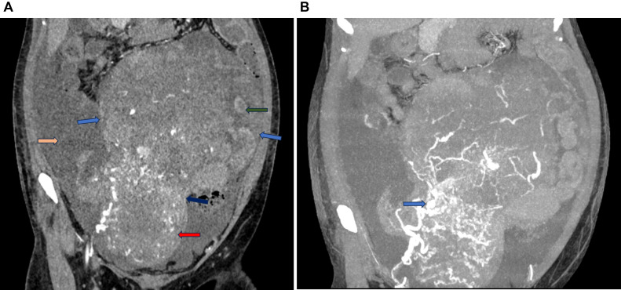

# 532 — U xơ tử cung trong THAI KỲ & thoái triển đỏ (red degeneration) / Uterine fibroids in pregnancy & red (carneous) degeneration

**Tags:** `pattern:khoi-co-tu-cung` `pattern:thoai-trien-do` `vung:tu-cung` `vung:tieu-khung` `protocol:MRI-thai-khong-gadolinium` `protocol:sieu-am-san-khoa`
**Mức chắc chắn (certainty):** tổng hợp y văn (literature synthesis) — nhóm tự biên từ tổng quan *Uterine fibroids and pregnancy* (Ramasauskaite 2026, PMC12724024, CC BY), bài tổng quan hình ảnh thai kỳ (Masselli 2023, PMC10528125, CC BY; Ahn 2025, PMC12235540, CC BY-NC), nghiên cứu MRI–mô bệnh thoái triển đỏ (Takeuchi 2019, PMC6460131; Nakai 2017, PMC5486831) và các ca nguyên văn có ảnh CC BY/CC BY-NC-ND. Số liệu đối chiếu từng bài gốc; chỗ chưa kiểm chứng ghi rõ "chưa rõ".

## 1. Tổng quan bệnh học – cơ chế hình ảnh

- **Dịch tễ:** u xơ gặp ở **1,6–10,7% thai kỳ** (Ramasauskaite 2026, PMC12724024); tỉ lệ tăng theo tuổi mẹ — **12% ở 19–25 tuổi → 32% ở 35–42 tuổi**; cao nhất ở nữ da đen không gốc Tây Ban Nha (**14%** so với 9% da trắng, 6% Hispanic, 10% châu Á/Thái Bình Dương). Trong dân số chung, u xơ gặp ở **20–40%** phụ nữ tuổi sinh sản (Ahn 2025, PMC12235540).
- **U xơ thay đổi thế nào trong thai:** **71,4%** u xơ **tăng kích thước từ tam cá nguyệt 1 sang tam cá nguyệt 2**; khoảng **30%** u tăng thể tích do hormone; sau sinh **> 50% giảm thể tích ở 70%** người sinh sống trong 3–6 tháng (Ramasauskaite 2026) — nghĩa là **kích thước đo được không phải tiêu chuẩn để mổ**.
- **Vì sao u xơ gây biến chứng sản khoa (cơ chế cơ học):** khối choán chỗ làm **biến dạng lòng tử cung** (tăng sảy thai, thai lệch), **cản đường ra** (u cổ tử cung/lower segment → mổ lấy thai), **ngăn cơ tử cung co đều** (băng huyết sau sinh), **chéo bánh nhau** (u sau bánh nhau/dưới niêm mạc → bong nhau, thai chậm tăng trưởng) — mỗi vị trí FIGO có một hệ quả riêng, không phải "u to = nguy hiểm".
- **Các kiểu thoái triển:** kính (hyaline) — phổ biến nhất, không triệu chứng; **nang (cystic)**; **niêm (myxoid)**; **vôi hóa (calcific)**; **mỡ (fatty)**; **đỏ/carneous (red degeneration)**; và rất hiếm **ác tính hóa (leiomyosarcoma)**. Chỉ **thoái triển đỏ** và **torsion/vỡ** mới gây **đau cấp** điển hình.
- **Thoái triển đỏ = nhồi máu xuất huyết (hemorrhagic infarction)** của u xơ do **huyết khối tĩnh mạch ngoại vi** (Takeuchi 2019, PMC6460131). Gặp ở **~8% u xơ** và là **biến chứng thường gặp nhất trong thai kỳ (8% thai phụ có u xơ)**, hay ở **tam cá nguyệt 2–3** khi u lớn nhanh (Ramasauskaite 2026; Mukherjee 2026, PMC12889335).
- **Triệu chứng:** đau **khu trú, đột ngột trên u**, sốt nhẹ, buồn nôn/nôn, **đau khi ấn điểm u**, **tăng bạch cầu**; đau thường **tự giới hạn 1–2 tuần** rồi giảm dần (Ramasauskaite 2026). Đây là **chẩn đoán loại trừ**: phải loại torsion, vỡ u, sỏi niệu quản, viêm ruột thừa, bong nhau.
- **TẠI SAO hình ảnh trông như vậy — vật lý sản phẩm máu (bắt buộc hiểu, không học vẹt):**
  - **Nhồi máu xuất huyết → hồng cầu vỡ, Hb thoát ra mô.** Trình tự biến đổi quyết định tín hiệu: **deoxyhemoglobin (rất sớm)** → **methemoglobin nội bào (bán cấp sớm)** → **methemoglobin ngoại bào (bán cấp muộn)** → **hemosiderin (mạn)**.
  - **T1W:** methemoglobin **thuận từ (paramagnetic)** làm **T1 rút ngắn** → **tăng tín hiệu**. Vì vậy **viền tăng tín hiệu T1** (hoặc toàn khối tăng) xuất hiện **khi đã có methemoglobin**; ở **giai đoạn rất cấp** (deoxyHb chưa chuyển) **T1 có thể chưa tăng** — đây là lý do **không thể loại trừ thoái triển đỏ khi T1 bình thường** (Takeuchi 2019).
  - **T2W:** deoxyhemoglobin, methemoglobin nội bào và hemosiderin đều gây **T2\* shortening** → **viền tối T2**; nếu còn phù/nhồi máu nhiều, phần giữa có thể **tăng T2**.
  - **SWI/T2\* (susceptibility-weighted):** nhạy nhất với sản phẩm máu → **viền tối rõ hơn T2**, và **đốm tối trong khối** (vi huyết khối/hemosiderin).
  - **Số liệu chốt (15 u xơ thoái triển đỏ, Takeuchi 2019, PMC6460131):** **viền tăng T1: 7/15 = 47%** (8 ca còn lại **tăng tín hiệu toàn khối 53%**); **viền tối T2: 7/15 = 47%**; **viền tối trên SWI/SWAN: 15/15 = 100%**; **đốm/mảng tối trong u: 13/15 = 87%**. Mô bệnh tương ứng: **hoại tử đông (coagulative necrosis) 15/15**, kính hóa 14/15, **hemosiderin 11/15**.
  - **Vì sao viền lại ở ngoại vi:** huyết khối nằm ở **tĩnh mạch ngoại vi** của u → sản phẩm máu tập trung ở **vành** trước, sau đó lan vào trong. Viền cũng giải thích **không ngấm thuốc toàn bộ** ở thì muộn (Masselli 2023).
- **Ngưỡng định lượng cần nhớ:** tỉ lệ có thai **1,6–10,7%**; thoái triển đỏ **8% u xơ**; tăng kích thước **71,4%** (T1→T2); giảm **> 50%** sau sinh ở **70%**; **T1 47% / T2 47% / SWI 100%**; **u > 5 cm** → sinh sớm hơn; **u > 10 cm** → ngôi bất thường; **thể tích u > 200 mL (≈ 7–8 cm)** hoặc u dưới niêm mạc/sau bánh nhau → **bong nhau**; **u cổ tử cung/lower segment → mổ lấy thai 86%** so với u thân 42% (Ramasauskaite 2026; Masselli 2023).

*Nữ 31 tuổi, thai 20 tuần, đau bụng. (A) Siêu âm: u dưới thanh mạc trái, không có mạch; (B) T2: khối hỗn hợp đặc–nang; (C) T1 20 tuần: u **còn đồng tín hiệu, chưa tăng**; (D) T1 30 tuần sau điều trị bảo tồn: u **đã tăng tín hiệu** — minh họa "T1 âm tính sớm" của thoái triển đỏ. Nguồn: Ahn H et al., Korean J Radiol 2025 (PMC12235540), CC BY-NC — giữ nguyên bản.*

## 2. Mẫu hình + chẩn đoán phân biệt theo vị trí (gamut)

- **Mẫu hình cần nhận ra trên siêu âm:** **khối giảm âm, bờ rõ, có bóng lưng (posterior acoustic shadowing)**, nằm trong cơ tử cung, **không có tín hiệu Doppler trung tâm** khi thoái triển; bên cạnh là **bánh nhau và thai** — luôn **đo 3 chiều + ghi vị trí theo FIGO**.
- **Gamut theo VỊ TRÍ (quyết định biến chứng, không chỉ kích thước):**
  - **Dưới niêm mạc (FIGO 0–2):** sảy thai, chảy máu, thai lệch, **cản đường ra**; dễ **sa ra/sinh qua đường âm đạo**.
  - **Trong cơ (FIGO 3–4):** thường dung nạp; nếu **lớn > 5 cm** → sinh non, ngôi bất thường; **sau bánh nhau** → bong nhau.
  - **Dưới thanh mạc/có cuống (FIGO 5–7):** **xoắn cuống (torsion)** → đau cấp + nôn, giống thoái triển đỏ; **vỡ** (hiếm) → máu ổ bụng.
  - **Cổ tử cung/lower segment (FIGO 8):** **che lỗ cổ, cản đường ra** → mổ lấy thai; dễ **sa polyp/u xơ ra âm đạo**; có thể gây **bí tiểu, ứ nước thận**.
- **Gamut theo BỐI CẢNH ĐAU CẤP:**
  - **Trong thai:** thoái triển đỏ (hay nhất), **xoắn u có cuống**, **vỡ u**, **xoắn tử cung (uterine torsion)** — cực hiếm nhưng **mô phỏng thoái triển đỏ**; **bong nhau**, **vỡ tử cung sau mổ lấy thai/mổ u**, **viêm ruột thừa**, **sỏi niệu quản**, **xoắn buồng trứng**.
  - **Sau sinh:** thoái triển đỏ, **sót nhau (RPOC)**, **viêm nội mạc tử cung**, **huyết khối tĩnh mạch buồng trứng (OVT)**, **đảo ngược tử cung** (bài 553), **vỡ tử cung**.
- **Gamut "khối tiểu khung sau sinh" nhìn giống u ác:** u xơ thoái triển **dạng nang/nhầy** + **dịch ổ bụng** + **CA-125/β-hCG tăng** → dễ bị gọi là **ung thư buồng trứng**; dấu hiệu gỡ: **cuống mạch nối với tử cung ("bridging vessels")**, T1 tăng do máu cũ, bờ rõ (Mukherjee 2026, PMC12889335).
- **Ba câu hỏi gỡ rối mọi "u xơ + đau":** (1) **đau có khu trú đúng u không?** (2) **u có cuống/xoắn không?** (3) **có dấu hiệu máu cấp trong u hay máu ổ bụng?** — trả lời bằng siêu âm Doppler + MRI.

## 3. Bảng so sánh phân biệt (ma trận đối chiếu)

| Thực thể (entity) | Hình ảnh điển hình (US/CT/MRI) | Chốt vào (rule-in) | Chốt loại (rule-out) | Gợi ý xác nhận |
|---|---|---|---|---|
| **Thoái triển đỏ (bài này)** | US: khối giảm âm, **không tín hiệu trung tâm**; MRI: **viền tăng T1** hoặc **tăng T1 toàn khối**, **viền tối T2**, **viền tối + đốm tối trên SWI**, **không ngấm thuốc** | **Đau khu trú + sốt nhẹ + bạch cầu tăng + viền tăng T1/tối SWI quanh u** | **Không có sản phẩm máu (T1 bình thường, SWI không tối) + có cuống xoắn** → nghĩ torsion; **máu ổ bụng** → nghĩ vỡ | MRI có **T1 fat-sat + SWI**; theo dõi 1–2 tuần thấy đỡ |
| **Xoắn u có cuống (torsion)** | US: khối **ngoài tử cung/trên cuống**, **Doppler cuống mất tín hiệu**, dấu "xoáy" (whirl); MRI: cuống xoắn, u **không ngấm** | **Đau + nôn dữ dội, u có cuống, mất mạch nuôi trên Doppler** | Có viền tăng T1 lan tỏa trong u + vị trí trong cơ → thoái triển đỏ | So sánh Doppler hai lần; **mổ nội soi** khi nghi xoắn |
| **Vỡ u / chảy máu trong u** | Máu ổ bụng, **dịch tự do**, u **mất liên tục vỏ**, MRI T2 thấy **lỗ thủng + mô hoại tử thoát ra** | **Máu ổ bụng + khuyết vỏ u + mô hoại tử ngoài u** | Không có dịch tự do, vỏ u liên tục → không vỡ | CT/MRI khẩn; **mổ cấp** |
| **U xơ không thoái triển** | Giảm âm đều, bóng lưng, **giảm tín hiệu T2 đồng nhất**, không phù, không viền | **T2 tối đều + không phù + không đau khu trú** | **Viền tăng T1 + phù quanh u** → có thoái triển | Siêu âm lặp sau 2–4 tuần |
| **Sarcoma tử cung** | Khối **tăng sinh mạch mạnh**, **hoại tử không đều**, **hạn chế khuếch tán**, **không phải T2 tối đều**; **tăng nhanh sau mãn kinh** | **T2 trung gian–tăng, DWI sáng, ngấm thuốc mạnh, hoại tử** | **T2 tối đen đồng nhất + vôi hóa + không ngấm** → nghĩ u xơ lành | MRI ± sinh thiết; **không dựa "tăng nhanh" đơn thuần** |
| **Ung thư buồng trứng (giả u xơ sau sinh)** | Khối **nang nhiều vách**, **dịch ổ bụng**, **CA-125/β-hCG tăng**, buồng trứng không tách được | **Cuống mạch nối tử cung + T1 tăng do máu cũ + bờ rõ** (hướng u xơ) | **Bờ mờ xâm lấn + nốt phúc mạc + không thấy cuống** → nghi ác thật | MRI; **tránh cắt buồng trứng khi chưa có mô bệnh** |
| **Bong nhau / vỡ tử cung** | Máu sau bánh nhau, **bánh nhau dày bất thường**, mất liên tục cơ tử cung, thai ngoài buồng | **Máu sau bánh nhau + cơn co + thai suy** | Bánh nhau bình thường, cơ liên tục → không bong/vỡ | Siêu âm cấp + CT khi huyết động không ổn |

*Trái: u xơ **thân tử cung** 11,8 × 10,6 cm ở 23 tuần 3 ngày — không cản đường ra, theo dõi được. Phải: u xơ **cổ tử cung** 10,09 × 7,94 cm — che lỗ cổ ngoài, làm mờ lỗ cổ, buộc **mổ lấy thai**. Cùng phương thức siêu âm. Nguồn: Amber S et al., Cureus 2025 (PMC12334970), CC BY 4.0. Ảnh ghép letterbox, giữ nguyên tỷ lệ.*

### Dấu hiệu đọc chuẩn xác (đừng nhầm "tăng tín hiệu" với "ác tính")
- **Viền tăng T1** là dấu hiệu **đặc hiệu nhất trên MRI thường quy**, nhưng **chỉ 47%** — **thiếu viền không loại trừ** thoái triển đỏ (Takeuchi 2019).
- **SWI/SWAN** phát hiện **viền tối ở 100%** ca trong nghiên cứu 15 u — nếu có chuỗi này, **hãy dùng**; nhưng **không phải cơ sở để chẩn đoán ác/lành** (hemosiderin cũng gặp sau chảy máu).
- **T1 tăng không đồng nghĩa thoái triển đỏ:** mỡ (u mỡ, u quái), **endometrioma**, **nang xuất huyết**, sắc tố mật — cần **T1 fat-sat** để loại mỡ.
- **Không ngấm thuốc** ở vùng nhồi máu giúp phân biệt với **sarcoma hoại tử** (sarcoma còn phần ngấm mạnh, không đều); nhưng **thai kỳ thường không tiêm gadolinium** → dựa vào T1/T2/SWI.

*Trong mổ: **u xơ dưới thanh mạc thành trước đang thoái triển đỏ (màu đỏ nâu, mềm, ranh giới mờ)** và u dưới thanh mạc thành sau. Đại thể "thịt đỏ" (carneous) là tương ứng của hình ảnh T1 tăng/T2 tối. Nguồn: Dohbit JS et al., BMC Pregnancy Childbirth 2019 (PMC6323858), CC BY 4.0.*

## 4. Protocol chụp + phân tầng xử trí

- **Siêu âm (đầu tay, mọi thai phụ):** đánh giá **số lượng, kích thước 3 chiều, vị trí FIGO, liên quan bánh nhau/lỗ cổ**, Doppler màu tìm **mất tín hiệu trung tâm** khi nghi thoái triển; **đo lại mỗi tháng** nếu u lớn (Ramasauskaite 2026) — vì **thay đổi kích thước làm đổi nguy cơ**.
- **MRI tiểu khung khi siêu âm không kết luận hoặc nghi xoắn/vỡ/ác:** **T2W sagittal + axial**, **T1W fat-sat** (bắt buộc — để thấy methemoglobin), **DWI/ADC**, **± SWI/T2\***; **không gadolinium** trừ khi thật cần (Masselli 2023 ghi rõ "contrast is generally not administered during pregnancy"). **Không dùng CT** trừ khi có chỉ định cấp cứu không thay thế được (ALARA).
- **Thuốc giảm đau:** **paracetamol** là nền; **NSAID tránh sau 30 tuần**, từ 20–30 tuần chỉ dùng **liều thấp nhất, thời gian ngắn nhất** (FDA — nguy cơ đóng sớm ống động mạch, thiểu ối, hoại tử ruột, tăng áp phổi) (Ramasauskaite 2026); opioid ngắn ngày khi đau nhiều.
- **Chỉ định can thiệp trong thai (myomectomy):** **hạn chế tối đa** — chỉ khi **xoắn cuống, vỡ, chèn ép/bí tiểu, đau không kiểm soát**; **78,4% ca mổ u trong thai là mở bụng**; nguy cơ sảy thai/sinh non tăng khi u **dưới niêm mạc, sau, nhiều u** (Ramasauskaite 2026).
- **Sau mổ u xơ — tư vấn sinh:** nguy cơ **vỡ tử cung sau mổ u xơ 0,93% (95% CI 0,45–1,92%)**, **không cao hơn nhiều so với sinh thường sau mổ lấy thai**; nhưng **mổ u xơ rộng/rách cơ nhiều → mổ lấy thai chủ động trước chuyển dạ**; các trường hợp mổ ít, không biến chứng → xử trí như **sẹo mổ lấy thai**.
- **Phân tầng nguy cơ (số liệu để tư vấn):** **sinh non OR 1,5**; **mổ lấy thai OR 2,09**; **băng huyết sau sinh OR 1,8**; **u > 5 cm** → sinh sớm hơn; **u cổ/lower segment** → mổ lấy thai **86%**; **u > 10 cm** → ngôi bất thường; **u sau bánh nhau/dưới niêm mạc/thể tích > 200 mL** → **bong nhau** (Ramasauskaite 2026).

## 5. Biến thể bình thường và cạm bẫy

- **Cạm bẫy 1 — "T1 bình thường nên không phải thoái triển đỏ":** ở **giai đoạn rất cấp**, deoxyhemoglobin **chưa chuyển thành methemoglobin** → **T1 chưa tăng**; nhưng **T2\* đã có thể tối**. Đau điển hình + u xơ + T2 tối viền vẫn đủ để theo dõi (Takeuchi 2019).
- **Cạm bẫy 2 — "Khối sau sinh + CA-125 tăng = ung thư buồng trứng":** ca nguyên văn cho thấy **u xơ thoái triển đỏ dạng nang** sau sinh bị chẩn đoán **dysgerminoma** vì **CA-125 và β-hCG tăng** + khối nhiều vách; chỉ **mô bệnh sau mổ** mới xác định (Mukherjee 2026, PMC12889335). **CA-125 tăng trong hậu sản do viêm phúc mạc nhẹ/tiêu nội mạc**, không đặc hiệu.
- **Cạm bẫy 3 — "U xơ + đau = thoái triển đỏ"** bỏ sót **xoắn tử cung**: ca **u xơ 16,9 cm + xoắn tử cung 180°** được chẩn đoán ban đầu là "u xơ thoái triển", chỉ **CRP 245 mg/L** và mổ mới phát hiện; siêu âm còn **định vị sai bên u** do biến dạng giải phẫu (Samanta 2025, PMC12315048).
- **Cạm bẫy 4 — bỏ sót vỡ u:** u **dưới thanh mạc thoái triển** có thể **vỡ vào ổ bụng**, gây **máu ổ bụng + mô hoại tử**; MRI T2 thấy **lỗ thủng 4 cm** và mô thoát ra (Azouz 2025, PMC11730542) — **đây là chỉ định mổ cấp**, không theo dõi.

*(A) T2 coronal: u dưới thanh mạc ở đáy tử cung (**mũi tên dày**) với **lỗ thủng 4 cm**, mô hoại tử không đồng nhất thoát ra (**mũi tên mảnh**); (B) T2 axial: u nhồi máu, mô hoại tử rời bờ trên–trái; (C) T1 sau tiêm: u **không ngấm**; (D, E) T1 fat-sat: u **tăng tín hiệu lan tỏa** — thoái triển đỏ. Nguồn: Azouz E et al., Radiol Case Rep 2025 (PMC11730542), CC BY-NC-ND — giữ nguyên bản.*
- **Cạm bẫy 5 — u cổ tử cung "nhỏ nhưng chết người":** u **10 cm ở cổ** che lỗ cổ, **không cản trở thai lớn** nhưng **cản đường ra**; nếu chỉ đo kích thước mà bỏ vị trí → **thử sinh thất bại, mổ cấp**.
- **Cạm bẫy 6 — thoái triển đỏ "tự khỏi" không cần mổ, nhưng đừng nhầm với sarcoma:** sarcoma cũng có thể **đau + lớn nhanh**; khác biệt là **T2 trung gian/tăng, DWI sáng, ngấm mạnh, hoại tử không đều** — **không có "viền tăng T1" đơn thuần**. Tăng trưởng nhanh **không đủ** để chẩn đoán sarcoma.
- **Biến thể bình thường dễ nhầm:** **u xơ vôi hóa** (T2 tối đều + bóng lưng mạnh) không phải thoái triển; **u xơ đỏ** ở người **không mang thai** vẫn gặp (thường do **uống thuốc tránh thai/giảm cân nhanh**); **tử cung co cứng (contraction ring)** trên MRI có thể giả "khối" — xem lại T2 và bờ.
- **Satisfaction of search:** thấy u xơ to rồi dừng → bỏ **bong nhau, vỡ tử cung, xoắn buồng trứng** đi kèm. Luôn **đọc bánh nhau + dịch ổ bụng + buồng trứng** trước khi kết luận.

*Nữ 45 tuổi, u xơ thoái triển đỏ. (A) T1 fat-sat: **viền tăng tín hiệu** quanh khối giảm/tăng nhẹ; (B) T2: khối tăng tín hiệu với **viền tối**; (C) SWI: **viền tối rõ hơn T2** + đốm tối trong khối (hemosiderin/vi huyết khối). Nguồn: Takeuchi M et al., Magn Reson Med Sci 2019 (PMC6460131), CC BY-NC-ND — giữ nguyên bản.*

## 6. Tự lượng giá — Blind Quiz ngay trên trang tĩnh

**Ca 1 — Thai 23 tuần 3 ngày, đau bụng âm ỉ, không sốt. Nhìn ảnh, mô tả trước.**

- Gợi ý lâm sàng: thai 23 tuần 3 ngày, khối lớn thành trước tử cung đã biết từ tam cá nguyệt 1; đau tăng khi thay đổi tư thế, không ra máu.
- Câu hỏi: (A) Khối nằm ở đâu, kích thước? (B) Có cần mổ ngay không? (C) Theo dõi gì ở các lần sau?

<b>Bấm để hiện đáp án (findings + chẩn đoán)</b>

- Dấu hiệu (findings): khối **giảm âm, bờ rõ, kích thước ~11,8 × 10,6 cm**, thành **trước** tử cung, **không cản đường ra**; thai và bánh nhau bình thường.
- Chẩn đoán (diagnosis): **u xơ thân tử cung (FIGO 3–4) trong thai kỳ** — không phải thoái triển đỏ cấp (không sốt, không tăng bạch cầu, Doppler không mất tín hiệu trung tâm). **Theo dõi + giảm đau**, không mổ; siêu âm mỗi tháng vì u có thể tăng (71,4% tăng T1→T2).
- Nguồn ảnh: Amber S et al., Cureus 2025, PMC12334970, Fig. 3, CC BY 4.0.

**Ca 2 — Nữ 45 tuổi, đau bụng dưới cấp, sốt nhẹ. Nhìn 3 chuỗi MRI, mô tả trước.**

- Gợi ý lâm sàng: nữ 45 tuổi, u xơ đã biết, đau khu trú, CRP/bạch cầu tăng nhẹ.
- Câu hỏi: (A) Dấu hiệu nào xuất hiện ở cả 3 chuỗi? (B) Vì sao T1 tăng mà T2 lại tối? (C) Chuỗi nào nhạy nhất và tại sao?

<b>Bấm để hiện đáp án (findings + chẩn đoán)</b>

- Dấu hiệu: **viền tăng tín hiệu trên T1 fat-sat** (A), **viền tối trên T2** (B), **viền tối rộng hơn + đốm tối trên SWI** (C) — tất cả quanh **cùng một khối cơ tử cung**.
- Chẩn đoán: **thoái triển đỏ (hemorrhagic infarction)** do huyết khối tĩnh mạch ngoại vi. **T1 tăng vì methemoglobin (thuận từ, rút ngắn T1)**; **T2 tối vì methemoglobin nội bào/deoxyhemoglobin/hemosiderin gây T2\* shortening**; **SWI nhạy nhất** với sản phẩm máu nên thấy **100%** (15/15 ca), trong khi T1 chỉ **47%**.
- Bài học: **thiếu viền T1 không loại trừ**; nếu có SWI, **viền tối là dấu hiệu mạnh nhất**.
- Nguồn ảnh: Takeuchi M et al., Magn Reson Med Sci 2019, PMC6460131, Fig. 1, CC BY-NC-ND.

**Ca 3 — Sản phụ 5 ngày sau sinh, khối bụng lớn, CA-125 và β-hCG tăng. Nhìn MRI T1, mô tả trước.**

- Gợi ý lâm sàng: 5 ngày sau sinh, khối bụng–chậu lớn, siêu âm/CT không tách được khối với tử cung; CA-125 và β-hCG tăng.
- Câu hỏi: (A) Dấu hiệu nào trên T1 gợi u xơ chứ không phải ung thư buồng trứng? (B) Có nên cắt buồng trứng ngay? (C) Điều gì giải thích CA-125 tăng?

<b>Bấm để hiện đáp án (findings + chẩn đoán)</b>

- Dấu hiệu: khối **T1 trung gian**, **cấu trúc ống tăng tín hiệu T1 ở ngoại vi** (tĩnh mạch huyết khối), **bờ rõ**, **không có nốt phúc mạc**; trên CT thấy **cuống mạch nối với tử cung** (dấu "bridging vessels").
- Chẩn đoán: **u xơ thoái triển đỏ sau sinh** (carneous degeneration) — **không phải ung thư buồng trứng**. **CA-125 tăng do viêm phúc mạc nhẹ/hậu sản**, β-hCG còn cao sau sinh; **không cắt buồng trứng khi chưa có mô bệnh**.
- Bài học: khối sau sinh + tumor marker tăng là **bẫy kinh điển**; **T1 tăng + mạch huyết khối ngoại vi + cuống tử cung** là chốt hướng lành.
- Đối chiếu CT cùng ca — vì sao dễ gọi là "khối buồng trứng":

*(A) CT thì động mạch: tử cung hậu sản to (**mũi tên đỏ**) và khối lớn áp sát đáy tử cung với **mặt phẳng liên tiếp không rõ** (**mũi tên xanh**) — đây chính là lý do khó tách khối khỏi tử cung; (B) thì tĩnh mạch: khối **dẫn lưu vào tĩnh mạch buồng trứng phải giãn** (**mũi tên xanh**) — bắt chước u buồng trứng. Nguồn: Rao S et al., Radiol Case Rep 2025 (PMC12320062), CC BY-NC-ND — giữ nguyên bản.*
- Nguồn ảnh: Rao S et al., Radiol Case Rep 2025, PMC12320062, Fig. 5 (và Fig. 3 cho CT), CC BY-NC-ND.

**Ca 4 — Ảnh ghép: hai u xơ, hai vị trí. Vì sao một ca theo dõi được, một ca phải mổ lấy thai?**

- Gợi ý: cùng là u xơ > 10 cm ở thai phụ; một ca đau âm ỉ, một ca bí tiểu và cổ tử cung khó xác định.
- Câu hỏi: Vị trí nào quyết định đường sinh? Dấu hiệu nào trên siêu âm cho biết lỗ cổ bị che?

<b>Bấm để hiện đáp án (findings + chẩn đoán)</b>

- Trái: u xơ **thân** 11,8 cm — không cản đường ra → theo dõi, sinh đường âm đạo nếu không có chống chỉ định khác.
- Phải: u xơ **cổ tử cung** 10,09 × 7,94 cm — **che lỗ cổ ngoài**, làm mờ lỗ cổ → **mổ lấy thai** (u lower segment: mổ lấy thai **86%** so với 42% u thân).
- Chốt: **vị trí (FIGO 8/lower segment) + quan hệ lỗ cổ** quan trọng hơn kích thước tuyệt đối.
- Nguồn: Amber S et al., Cureus 2025, PMC12334970, CC BY 4.0.

## Bài liên quan chéo
- [500 – Tổng quan Hệ Vú & Sản Phụ khoa](../500-tong-quan-vu-san-phu-khoa/lesson.md)
- [520 – U xơ cơ tử cung (FIGO 0–8) & adenomyosis](../520-tu-cung-u-xo-FIGO-adenomyosis-noi-mac/lesson.md)
- [526 – Sarcoma tử cung vs u xơ](../526-sarcoma-tu-cung-vs-u-xo/lesson.md)
- [531 – U xơ cổ tử cung, ký sinh & dây chằng rộng: giả khối phần phụ](../531-u-xo-co-tu-cung-ky-sinh-va-day-chang-rong/lesson.md)
- [542 – U xơ dưới niêm mạc (FIGO 0–2) & can thiệp bảo tồn](../542-u-xo-duoi-niem-mac-can-thiep-bao-ton/lesson.md)
- [544 – Đảo ngược tử cung không do sinh](../544-dao-nguoc-tu-cung-khong-do-sinh/lesson.md) (u xơ có cuống sa ra)
- [550 – Thai sớm, sảy thai & thai ngoài tử cung](../550-thai-som-say-thai-thai-ngoai-tu-cung/lesson.md)
- [553 – Đảo ngược tử cung do sinh](../553-dao-nguoc-tu-cung-do-sinh/lesson.md) (biến chứng cấp sau sinh)
- [560 – Nhau cài răng lược (PAS) & cấp cứu sản](../560-nhau-cai-rang-luoc-PAS-cap-cuu-san/lesson.md) (u xơ sau bánh nhau → bong nhau)
- [565 – Sàng lọc hình thái & Doppler sản khoa](../565-sang-loc-hinh-thai-va-doppler-san-khoa/lesson.md)

## Ảnh
- 8 ảnh gốc + 1 ảnh ghép. Nguồn, tác giả, giấy phép từng ảnh trong `images/CREDITS.md`.
- Ảnh **CC BY-NC-ND** (`PMC6460131`, `PMC11730542`, `PMC12320062`, `PMC12235540`) **giữ nguyên bản**, không crop/ghép.

> Không dùng để chẩn đoán độc lập khi chưa có người hướng dẫn.
