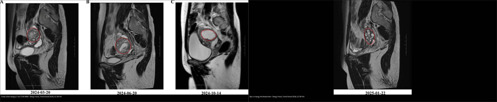
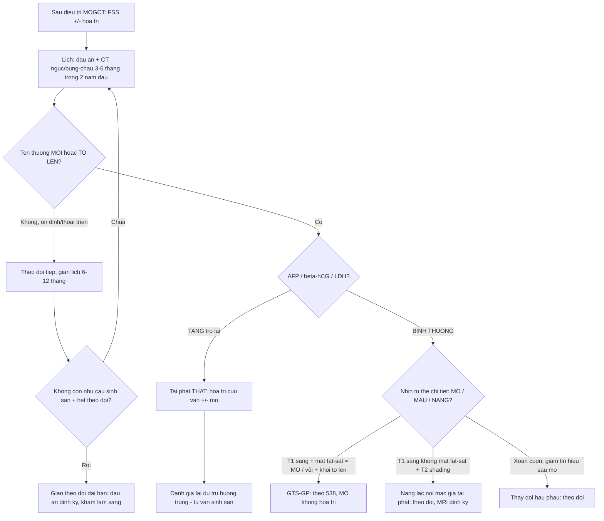
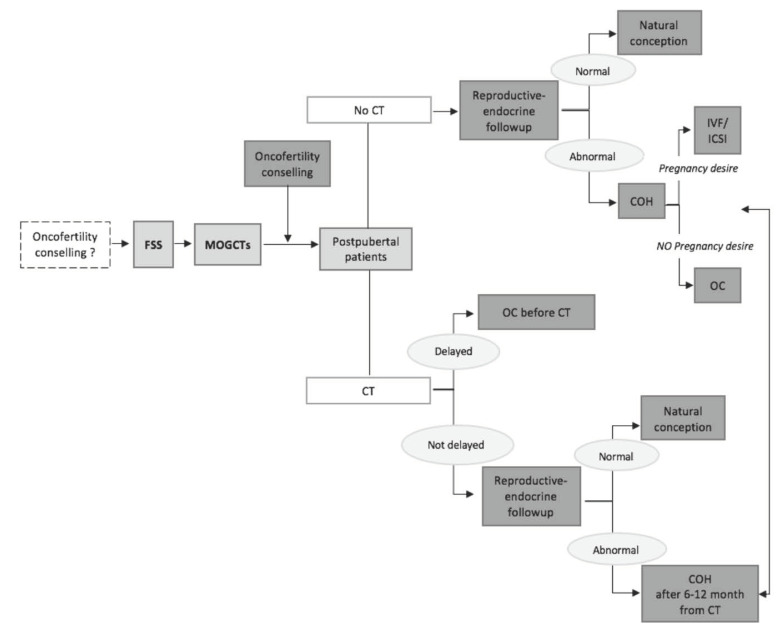
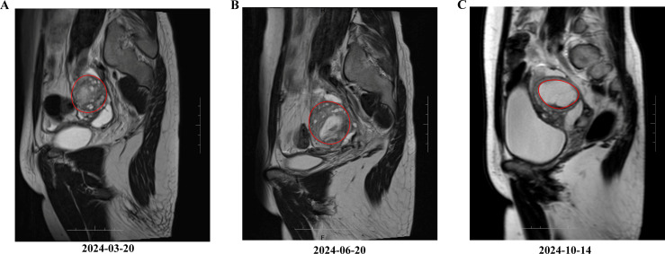
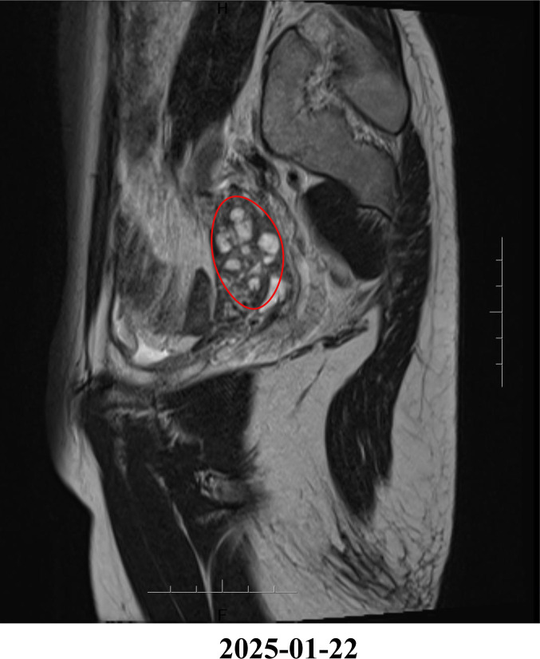
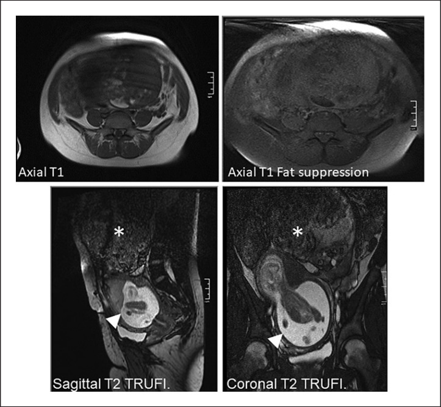
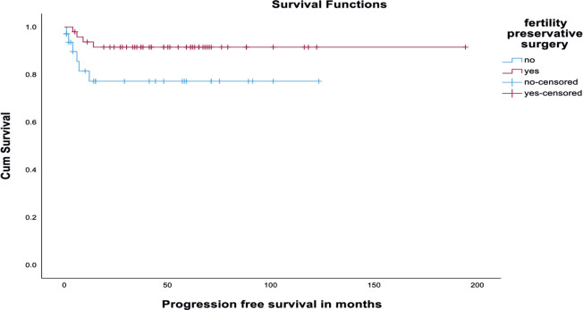
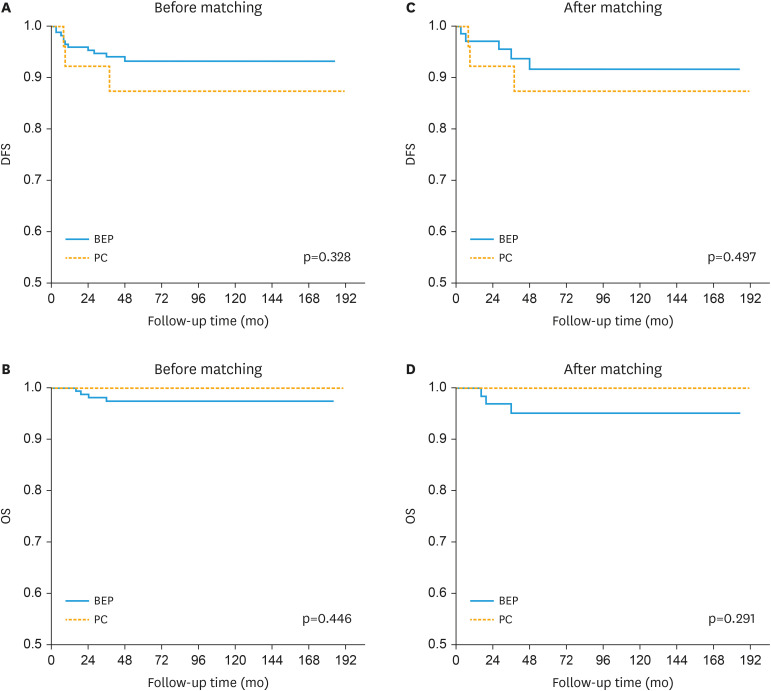

# 533 — Theo dõi dài hạn & bảo tồn sinh sản sau u tế bào mầm buồng trứng / Long-term surveillance & fertility preservation after malignant ovarian germ cell tumours

**Tags:** `pattern:u-buong-trung` `pattern:u-mam` `pattern:gieo-rac-phuc-mac` `vung:buong-trung` `vung:phuc-mac` `score:FIGO` `protocol:CT-bung-chau` `protocol:MRI-chau` `protocol:AFP-bHCG-LDH` `protocol:bao-ton-sinh-san`
**Mức chắc chắn (certainty):** tổng hợp y văn (literature synthesis) — nhóm tự biên từ y văn mở (Europe PMC/PMC: Biomedicines, Ecancermedicalscience, J Gynecol Oncol, Case Rep Oncol, World J Clin Oncol, BMC Womens Health) + các ca minh họa có giấy phép; không phải ca nguyên văn đơn lẻ.

## 1. Tổng quan — "tái phát gần như luôn < 2 năm": cửa sổ theo dõi + giá trị của bảo tồn sinh sản

- **Bối cảnh:** u tế bào mầm buồng trứng ác tính (malignant ovarian germ cell tumour — MOGCT) **hiếm**, nhưng chiếm **~70% u buồng trứng ác ở tuổi vị thành niên** → phần lớn bệnh nhân còn **mong muốn sinh sản**. Đây là lý do **bảo tồn sinh sản (fertility-sparing surgery — FSS)** là lựa chọn mặc định.
- **Tiên lượng (định lượng):** sống 5 năm **> 90%**; sống toàn bộ (OS) 10 năm **~91%**, sống không tiến triển (PFS) 10 năm **~82,4%**. Nhờ tiên lượng tốt, trọng tâm chăm sóc chuyển sang **theo dõi tái phát** và **chất lượng sống sinh sản**.
- **Vì sao theo dõi phải "dày" ở 2 năm đầu:** **96% tái phát xảy ra trong vòng 24 tháng** (Dey et al., n = 170; tái phát chung **15%**); Mangili (n = 123, 65,9% FSS) tái phát **17,8%**, **hơn nửa trong 24 tháng**. Đây là cơ sở để đặt **lịch chụp 3–6 tháng/lần trong 2 năm đầu** rồi giãn ra.
- **TẠI SAO phẫu thuật phân giai đoạn (staging) đầy đủ lại quyết định nguy cơ tái phát:** ở giai đoạn I, **phẫu thuật không đủ phân giai đoạn → tái phát 26%** so với **8,6%** khi phân giai đoạn trọn (MITO) — vì tổn thương vi thể ngoài buồng trứng bị bỏ sót. Với MOGCT, "bảo tồn" vẫn phải **lấy đủ mẫu/đánh giá ổ bụng**.
- **Dấu ấn huyết thanh là trục theo dõi (bán hủy):** **AFP ~5–7 ngày**, **β-hCG ~24–36 giờ**, **LDH ~2–3 ngày**. Quy tắc: dấu ấn phải **giảm theo đúng chu kỳ bán hủy** sau mổ/hóa trị; **chững lại hoặc tăng lại** = nghi **tái phát/u non còn sót** (đối chiếu `538` — GTS là ngoại lệ: khối to mà dấu ấn bình thường).
- **TẠI SAO ảnh theo dõi dễ "dương tính giả":** sau mổ/hóa trị, buồng trứng và phúc mạc có **thay đổi hậu phẫu – nội tiết – viêm**, tạo khối/nang giả tái phát. Ca điển hình: **nang lạc nội mạc (endometriotic cyst) xuất hiện sau điều trị u quái non** → MRI cho hình nang giả u, nhưng **không phải tái phát** (theo dõi thoái triển). Vì vậy phải **so phim nền + dấu ấn + mô học** trước khi kết luận.
- **Bảo tồn sinh sản — FSS an toàn ngay cả giai đoạn muộn:** FSS kèm hóa trị đúng cho **sống còn tương đương** mở rộng (Raji: 5 năm DFS 88,1%/OS 96,4%; SD đặc hiệu). **Phẫu thuật đúng = cắt phần phụ một bên ± cắt nang tinh thể bên đối diện + sinh thiết/phân giai đoạn**, giữ tử cung và buồng trứng đối diện.
- **TẠI SAO buồng trứng CÓ THỂ phục hồi dù đã hóa trị:** u tế bào mầm dùng **BEP (bleomycin/etoposide/cisplatin)** — nhóm **ít độc tuyến sinh dục hơn** alkyl hóa; đa số bệnh nhân **có kinh lại < 1 năm** (Raji: tất cả có kinh lại trong 1 năm; Dey: **87%** – 117/134 có kinh lại). Tỉ lệ có thai sau FSS: **95%** (Low 2000), **80%** (Mangili), **76,5%** thụ thai tự nhiên (Raji, 13/17), **73%** (Zamani, 19/26). Tuy vậy **một số vẫn suy buồng trứng sớm** (POI) → **dự trữ buồng trứng (AMH)** cần được tư vấn và theo dõi.
- **Khác biệt BEP vs paclitaxel/carboplatin (PC):** không khác biệt **DFS (p = 0,328) và OS (p = 0,446)**; PC **an toàn tương đương** về kết cục sinh sản (Chu et al., n = 213) → lựa chọn PC khi muốn giảm độc tính (ví dụ có bệnh nền phổi/thần kinh).
- **Vì sao quan trọng:** buông theo dõi sớm → bỏ lỡ tái phát (tử vong được nhắc nhiều ở u xoang nội bì); theo dõi quá mức/quyết định oan → **mổ/hóa trị lại vô ích** ở người trẻ còn sinh sản.

## 2. Mẫu hình trên ảnh theo dõi + chẩn đoán phân biệt (Gamut)

- **Khuôn 1 — Nang/khối ở phần phụ MỚI sau điều trị, không triệu chứng, dấu ấn bình thường:** đa số là **lành/thay đổi sinh lý** (nang xuất huyết, **nang lạc nội mạc**, nang corpus luteum, thay đổi xoắn cuộn sau mổ). Theo dõi + đối chiếu; **không mổ ngay**.
- **Khuôn 2 — Nốt/dep phúc mạc mới:** phân biệt **tái phát thật** (mô non, ngấm mạnh, dấu ấn tăng) với **gliomatosis peritonei** (mô glial trưởng thành, grade 0, lành — `538`) và **LPD lành sau morcellation** (`518`).
- **Khuôn 3 — Di căn xa:** phổi/trung thất, gan, não, xương — thường kèm **dấu ấn tăng**; CT ngực bắt buộc trong lịch theo dõi.
- **Khuôn 4 — Tái phát thể u xoang nội bì (yolk sac):** **báng + bệnh phúc mạc** là kiểu tái phát đặc trưng, **khó cứu vãn** (Dey) → theo dõi AFP sát.
- **Khuôn 5 — "Khối tăng lên" mà dấu ấn bình thường:** nghĩ **GTS/GP** (`538`) hoặc **khối lành** — không mặc định tái phát.
- **Khuôn 6 — Bệnh nhân đang/đã mang thai:** thay đổi thai kỳ (tử cung to, buồng trứng đẩy cao) → đọc MRI có thai, không nhầm tổn thương sinh lý với tái phát (FSS vẫn cho phép có thai).
- **Gamut theo dấu ấn (bộ lọc đầu tiên):** **dấu ấn bình thường** → nghiêng lành/GTS-GP; **dấu ấn tăng** → tái phát thật → hóa trị ± mổ.
- **Mimic cần loại:** **nang lạc nội mạc giả tái phát** (ảnh ca 2–3), nang xuất huyết, u xơ tử cung, dính/vết mổ, di căn ác thật.

## 3. Bảng so sánh phân biệt (ma trận đối chiếu)

| Thực thể (entity) | Hình ảnh điển hình (US/CT/MRI) | Chốt vào (rule-in) | Chốt loại (rule-out) | Gợi ý xác nhận |
|---|---|---|---|---|
| **Tái phát MOGCT thật** | Nốt/khối **đặc ngấm mạnh** ở chậu–phúc mạc/gan/phổi, có thể báng | **Dấu ấn AFP/β-hCG TĂNG trở lại + tổn thương ngấm mạnh mới** | Dấu ấn bình thường + tổn thương mỡ/nang → GTS/GP | Mô bệnh/mô học + dấu ấn theo mốc; CT ngực–bụng–chậu |
| **Nang lạc nội mạc giả tái phát** | **Nang, T1 sáng + T2 shading**, có thể nhiều vi nang sau điều trị | **T1 sáng + shading + dấu ấn BÌNH THƯỜNG + dao động theo chu kỳ/thuốc** | Đặc ngấm mạnh + dấu ấn tăng → tái phát | MRI T1 fat-sat (máu cũ không mất tín hiệu); **theo dõi thoái triển** |
| **Gliomatosis peritonei (`538`)** | Dep/nốt nhỏ mạc nối–mạc treo, xơ mỡ; hiếm khi thành khối | **Mô glial trưởng thành (grade 0) + dấu ấn bình thường** | Thành phần non trên mô học → u non | Mô bệnh (mature glia); theo dõi |
| **U quái "mọc" GTS (`538`)** | Khối **mỡ ± vôi** to lên sau hóa trị | **Khối giàu mỡ to lên + dấu ấn BÌNH THƯỜNG** | Dấu ấn tăng → tái phát thật | Mô học mature teratoma; **MỔ**, không hóa trị |
| **Thay đổi sau mổ/tia xạ** | Buồng trứng xoắn cuộn, giả đặc, dính; giảm tín hiệu xơ | **Ổn định so phim cũ + dấu ấn bình thường** | Tổn thương **mới/tăng dần + ngấm** → nghi tái phát | So phim nền; mô học khi cần |
| **U xơ tử cung lành** | Khối cơ–xơ ở tử cung, **T2 tối, ít ngấm** | **Bờ rõ + tín hiệu xơ + không dấu ấn** | Vị trí phần phụ + ngấm mạnh → tổn thương khác | US/MRI; theo dõi |

*Trái: khối nang 5,7 cm ở phần phụ trái (T2W, các mốc 3–10/2024) — sau điều trị **KHÔNG phải tái phát**. Phải: MRI 1/2025 — **vi nang nhỏ thoái triển** khi theo dõi. Nguồn: Dong Y et al., Front Oncol 2026, Fig. 1–2, CC BY 4.0 (ảnh ghép letterbox).*

### Ba dấu hiệu "chốt" khi đọc ảnh theo dõi
1. **So phim nền:** tổn thương **ổn định/thoái triển** = gần như lành; **mới/tăng dần + tổn thương khác mới** = nghi tái phát.
2. **Đối chiếu dấu ấn cùng ngày chụp:** chẩn đoán tái phát **phải** dựa trên AFP/β-hCG/LDH, không chỉ ảnh.
3. **Tín hiệu mỡ/máu:** mỡ (T1 sáng **mất** khi fat-sat) và máu cũ (T1 sáng **không mất**) định hướng u quái trưởng thành/nang nội mạc, khác mô non.

## 4. Protocol theo dõi + bảo tồn sinh sản + flowchart

- **Phẫu thuật (FSS):** cắt phần phụ một bên (unilateral salpingo-oophorectomy) ± **cắt nang** bên đối diện nếu tổn thương hai bên; **giữ tử cung** và buồng trứng đối diện; **lấy đủ mẫu/phân giai đoạn** (mạc nối, phúc mạc, hạch khi cần); tránh morcellation cắt vụn (nguy cơ gieo rắc — `518`).
- **Hóa trị bổ trợ:** **BEP** (bleomycin/etoposide/cisplatin) là chuẩn mực; giai đoạn IA độ 1 (−YST) có thể theo dõi đơn thuần. **PC** là lựa chọn thay thế khi muốn giảm độc tính, không khác DFS/OS.
- **Lịch theo dõi tái phát:**
  - **CT ngực + CT/MRI bụng–chậu mỗi 3–6 tháng trong 2 năm đầu**, sau đó **6–12 tháng/lần** (nhiều nơi theo mốc **6 tháng trong 2 năm đầu**).
  - **Dấu ấn AFP/β-hCG/LDH mỗi lần khám**: theo đường cong bán hủy; **tăng lại = tái phát**.
  - Sau 2–5 năm: khám lâm sàng + dấu ấn định kỳ, giảm dần chụp; tái phát muộn tuy hiếm nhưng có.
- **Bảo tồn sinh sản (fertility preservation):** tư vấn **trước hóa trị** nếu có thể — **trữ noãn/trữ phôi** (cần trưởng thành sinh sản), **trữ mô buồng trứng (OTC)** khi chưa dậy thì, **dịch chuyển buồng trứng (oophoropexy)** khi cần xạ. Sau FSS: theo dõi **dự trữ buồng trứng (AMH, FSH)**, hỗ trợ sinh sản khi cần; **hầu hết có kinh lại < 1 năm**.
- **Kết cục sinh sản (định lượng):** thụ thai sau FSS **73–95%** tùy nghiên cứu; nếu có hóa trị **80%**, FSS đơn thuần **100%** (nghiên cứu nhỏ); **BEP ít độc sinh sản hơn alkyl hóa**.
- **Chỉ định mổ khi theo dõi:** tổn thương **mới/tăng dần**, dấu ấn **tăng**, hoặc biến chứng (tắc ruột, khối to). **Không mổ** chỉ vì "có nang mới" khi dấu ấn bình thường và ổn định.

## 5. Biến thể bình thường và cạm bẫy

- **Cạm bẫy "nang mới = tái phát":** ca Dong et al. — nang lạc nội mạc sau điều trị u quái non trông như khối tái phát (5,7 cm) nhưng **thoái triển khi theo dõi**; dấu ấn bình thường. **Đừng mổ/hóa trị vội**.
- **Cạm bẫy dấu ấn "dương giả":** thai kỳ, dùng cần sa, bệnh gan, hạch lành có thể làm β-hCG/AFP tăng nhẹ — luôn diễn giải **cùng bối cảnh + chuỗi theo thời gian**.
- **Cạm bẫy "ổn định thì bỏ theo dõi":** **96% tái phát trong 24 tháng** → không xuống thang quá sớm; nhưng cũng **không chụp vô hạn** (nguy cơ bức xạ ở người trẻ) — dùng MRI khi có thể.
- **Cạm bẫy gieo rắc khi mổ:** **morcellation** cắt vụn u có thể gieo rắc phúc mạc/lành (`518`); nên lấy trọn khối.
- **Cạm bẫy bỏ sót phân giai đoạn:** FSS "không trọn" làm tái phát giai đoạn I lên **26%** (so với 8,6% khi đủ) — vẫn phải lấy mẫu phúc mạc/mạc nối/hạch.
- **Cạm bẫy tư vấn sinh sản:** hứa hẹn "chắc chắn có con" là sai — **một phần vẫn POI/suy buồng trứng**; cần tư vấn **trữ noãn/mô trước hóa trị** và theo dõi AMH, đặt kỳ vọng đúng.
- **Cạm bẫy thai kỳ:** đọc MRI ở bệnh nhân mang thai — tử cung to đẩy phần phụ; đừng nhầm thay đổi thai kỳ với tái phát (FSS vẫn cho phép có thai: ca Al-Hazaimeh, ảnh ca 4).

## 6. Tự lượng giá — Blind Quiz

**Ca 1 — Sơ đồ chiến lược bảo tồn sinh sản. Đọc sơ đồ.**

- Gợi ý lâm sàng (clinical context): bệnh nhân MOGCT trẻ, đang cân nhắc hóa trị.
- Câu hỏi: Hai nhánh chính của sơ đồ là gì? Khi nào "hoãn hóa trị để trữ sinh sản" và khi nào "trữ buồng trứng ngay"?

<b>Bấm để hiện đáp án (findings + chẩn đoán)</b>

- Dấu hiệu (findings): sơ đồ phân nhánh theo **bệnh nhân sau dậy thì**:
  - **Không cần hóa trị (No CT)**: theo dõi nội tiết sinh sản → bình thường → **thụ thai tự nhiên**; bất thường + muốn có con → **COH + IVF/ICSI**; không muốn có con → **trữ noãn (OC)**.
  - **Cần hóa trị (CT)**: nếu **hoãn được** → **trữ noãn trước CT**; nếu **không hoãn được** → theo dõi nội tiết, bình thường → thụ thai tự nhiên, bất thường → **COH sau 6–12 tháng kể từ CT**.
- Chẩn đoán (diagnosis): nguyên tắc **bảo tồn sinh sản** — ưu tiên **trữ noãn/phôi trước hóa trị** khi còn thời gian; khi bắt buộc hóa trị ngay thì **theo dõi và kích thích trứng sau 6–12 tháng**.
- Nguồn ảnh: Vasta FM et al., Biomedicines 2020, Fig. 1, CC BY 4.0.

**Ca 2 — Nữ trẻ sau điều trị u quái non, MRI thấy khối 5,7 cm ở phần phụ trái. Đọc MRI.**

- Hỏi: dấu hiệu chính? Đây có phải tái phát không? Bước tiếp theo?

<b>Bấm để hiện đáp án (findings + chẩn đoán)</b>

- Dấu hiệu (findings): khối **5,7 × 4,5 × 3,8 cm** nhiều nang ở phần phụ trái (T2W) theo dõi qua các mốc 3/2024 → 6/2024 → 10/2024.
- Chẩn đoán (diagnosis): khối **giả tái phát do nang lạc nội mạc (endometriotic cyst)** sau điều trị u quái non — **KHÔNG phải tái phát**; xử trí **theo dõi** + đối chiếu dấu ấn, không mổ/hóa trị ngay.
- Nguồn ảnh: Dong Y et al., Front Oncol 2026, Fig. 1, CC BY 4.0.

**Ca 3 — MRI theo dõi 1/2025 cùng bệnh nhân. Đọc MRI.**

- Hỏi: khối thay đổi thế nào so với ca 2? Điều này ủng hộ chẩn đoán gì?

<b>Bấm để hiện đáp án (findings + chẩn đoán)</b>

- Dấu hiệu (findings): nhiều **vi nang nhỏ** ở phần phụ trái (không còn khối lớn đặc/xâm lấn) — **thoái triển** so với ca 2.
- Chẩn đoán (diagnosis): ủng hộ **nang lành (nang lạc nội mạc)** chứ không phải tái phát — bài học: **so phim nền theo thời gian** là bắt buộc; tổn thương **thoái triển/ổn định** gần như lành.
- Nguồn ảnh: Dong Y et al., Front Oncol 2026, Fig. 2, CC BY 4.0.

**Ca 4 — Bệnh nhân đang mang thai, MRI bụng–chậu. Đọc MRI.**

- Hỏi: hai cấu trúc dấu * và arrowhead là gì? Tại sao FSS vẫn cho phép có thai?

<b>Bấm để hiện đáp án (findings + chẩn đoán)</b>

- Dấu hiệu (findings): (A) T1: khối lớn hỗn hợp tín hiệu — **u quái non buồng trứng (dấu \*)**; (B) T1 fat-sat: thành phần mỡ; (C, D) T2 TRUFI: u quái non (dấu \*) cạnh **tử cung mang thai (arrowhead)**.
- Chẩn đoán (diagnosis): **u quái non buồng trứng ở bệnh nhân mang thai** — FSS ± hóa trị vẫn cho phép **giữ thai và sinh sản sau đó** (nguyên tắc bảo tồn sinh sản); cần hội chẩn sản–ung thư.
- Nguồn ảnh: Al-Hazaimeh M et al., Case Rep Oncol 2021, Fig. 1, CC BY-NC 4.0 (giữ nguyên bản).

**Ca 5 — Đường cong sống còn theo loại phẫu thuật. Đọc biểu đồ.**

- Hỏi: đường "yes" (FSS) và "no" khác nhau ra sao? Điều này nói gì về an toàn của FSS?

<b>Bấm để hiện đáp án (findings + chẩn đoán)</b>

- Dấu hiệu (findings): đường **FSS ("yes", hồng)** ổn định ở mức cao (~0,9) trong khi đường **không FSS ("no", xanh)** thấp hơn (~0,78) trên trục **PFS theo tháng**.
- Chẩn đoán (diagnosis): **FSS không làm xấu sống còn không tiến triển** — trong nghiên cứu này nhóm FSS còn tốt hơn; kết luận: **bảo tồn sinh sản an toàn**, kể cả giai đoạn tiến xa (5 năm DFS 88,1%/OS 96,4% của toàn nhóm).
- Nguồn ảnh: Raji PS et al., Ecancermedicalscience 2025, Fig. 3, CC BY 4.0.

**Ca 6 — Biểu đồ so sánh BEP vs paclitaxel/carboplatin. Đọc biểu đồ.**

- Hỏi: BEP và PC khác nhau về DFS/OS không (p)? Ảnh hưởng tới lựa chọn phác đồ ở người muốn sinh sản?

<b>Bấm để hiện đáp án (findings + chẩn đoán)</b>

- Dấu hiệu (findings): (A, C) DFS trước/sau ghép điểm xu hướng: **p = 0,328 / 0,497**; (B, D) OS: **p = 0,446 / 0,291** — **không khác biệt**.
- Chẩn đoán (diagnosis): **PC an toàn tương đương BEP** về DFS/OS và kết cục sinh sản (n = 213, 86,9% BEP vs 13,1% PC) → có thể chọn **PC để giảm độc tính** (phổi/thần kinh) ở người muốn sinh sản, không chỉ BEP.
- Nguồn ảnh: Chu R et al., J Gynecol Oncol 2023, Fig. 2, CC BY-NC 4.0 (giữ nguyên bản).

**Ca 7 — Ảnh ghép: khối "giả tái phát" và theo dõi. Nhìn ghép.**

- Hỏi: bên trái và bên phải khác nhau thế nào? Đâu là bằng chứng đây KHÔNG phải tái phát?

<b>Bấm để hiện đáp án (findings + chẩn đoán)</b>

- **Trái:** khối nang 5,7 cm phần phụ trái (T2W, 3–10/2024) — trông như **khối tái phát**.
- **Phải:** MRI 1/2025 — **vi nang nhỏ thoái triển** → **KHÔNG phải tái phát**.
- Chốt: bằng chứng "không tái phát" đến từ **so phim theo thời gian (thoái triển/ổn định) + dấu ấn bình thường**, không phải từ một phim đơn độc.
- Nguồn: Dong Y et al., Front Oncol 2026, Fig. 1–2, CC BY 4.0 (ảnh ghép letterbox).

## Bài liên quan chéo
- [500 – Tổng quan Vú & Sản phụ khoa](../500-tong-quan-vu-san-phu-khoa/lesson.md)
- [530 – Khối phần phụ O-RADS, dermoid & xoắn](../530-buong-trung-ORADS-sieu-am-MRI/lesson.md)
- [535 – Ung thư buồng trứng, phúc mạc & u Krukenberg](../535-ung-thu-buong-trung-phuc-mac-krukenberg/lesson.md)
- [536 – U mầm & u mô đệm–dây sinh dục buồng trứng](../536-u-mam-u-mo-dem-buong-trung/lesson.md)
- [537 – U buồng trứng giáp biên (borderline)](../537-u-buong-trung-giap-bien/lesson.md)
- [538 – Hội chứng u quái "mọc" & gliomatosis peritonei](../538-hoi-chung-u-quai-moc-gliomatosis-peritonei/lesson.md)

## Ảnh
- `533_bao-ton-sinh-san-flowchart_PMC7761340.jpg`, `533_nang-gia-tai-phat-MRI_PMC13287004.jpg`, `533_theo-doi-MRI_PMC13287004.jpg`, `533_song-con-FSS_PMC12812814.jpg`, `533_thai-ky-MRI_PMC8787521.jpg`, `533_BEP-vs-PC_PMC9995871.jpg`, `composite_nang-gia-tai-phat-vs-theo-doi.jpg`. Nguồn + giấy phép từng ảnh trong `images/CREDITS.md`.

> Không dùng để chẩn đoán độc lập khi chưa có người hướng dẫn.
