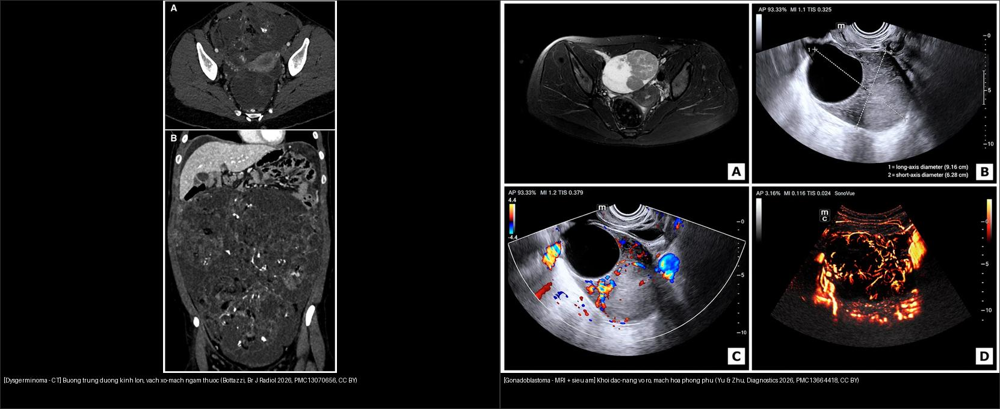
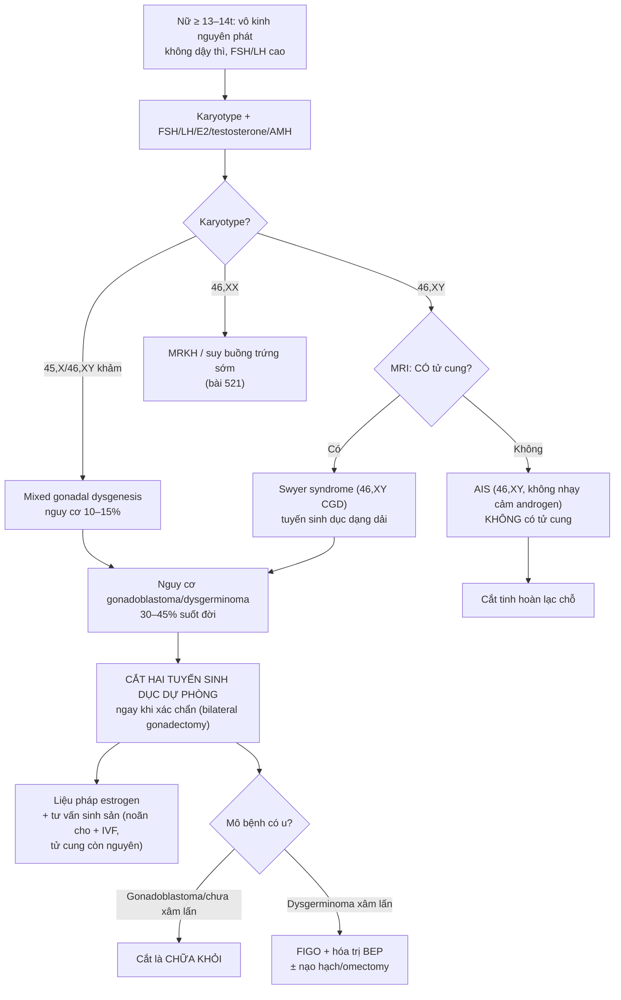
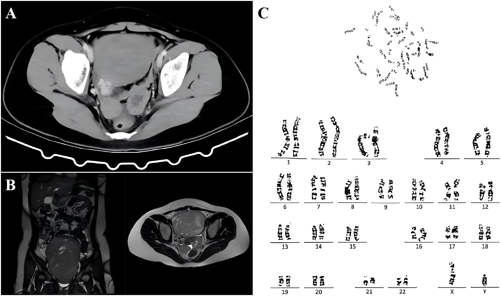
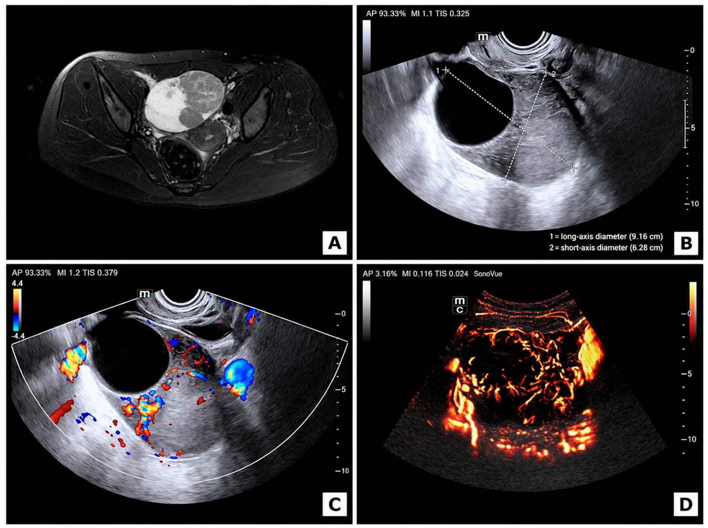
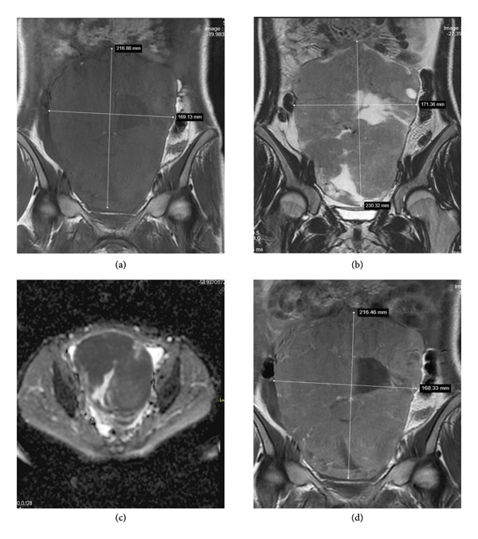
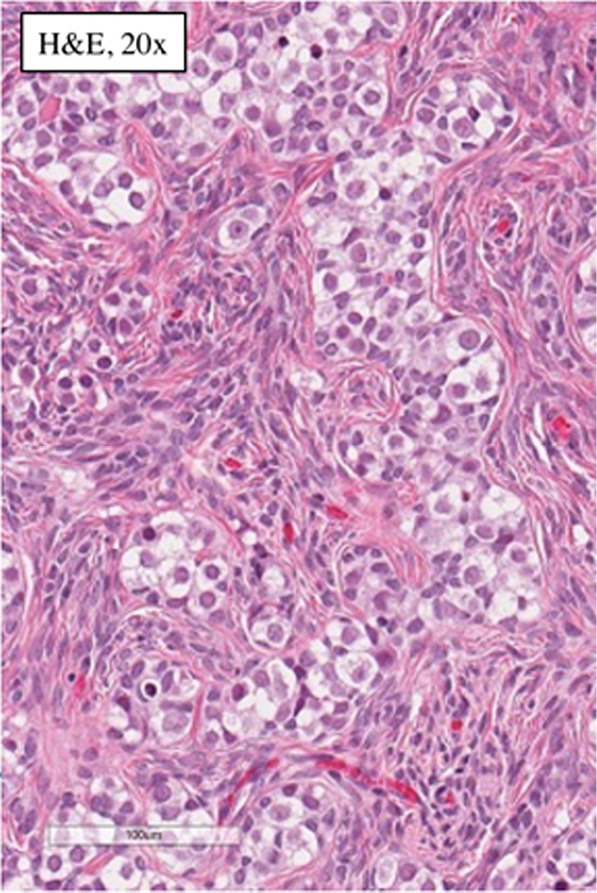

# 534 — Rối loạn phát triển giới 46,XY (Swyer) & u tế bào mầm/gonadoblastoma trên tuyến sinh dục dạng dải / 46,XY DSD (Swyer) & gonadoblastoma–dysgerminoma in streak gonads

**Tags:** `pattern:u-buong-trung` `vung:buong-trung` `score:FIGO` `protocol:MRI-chau` `anatomy:gonad`
**Mức chắc chắn (certainty):** tổng hợp y văn (literature synthesis) — nhóm tự biên từ y văn mở (Europe PMC/PMC) + các ca minh họa có giấy phép CC BY, không phải ca nguyên văn đơn lẻ.

> **Bài này trả lời một câu hỏi hay bị bỏ sót:** một người lớn lên với hình thể nữ, **vô kinh nguyên phát (primary amenorrhea)** và **không dậy thì**, siêu âm/MRI thấy **khối phần phụ** — làm sao không bỏ lỡ chẩn đoán **rối loạn phát triển giới 46,XY (DSD)** kèm **u tế bào mầm** và kịp **cắt tuyến sinh dục dự phòng** trước khi di căn.

## 1. Tổng quan — vì sao tuyến sinh dục "dạng dải" sinh u, và vì sao ảnh khác nhau

- **Bệnh học (pathology):** **loạn phát triển tuyến sinh dục không hoàn toàn/hoàn toàn (gonadal dysgenesis)** là nhóm **rối loạn phát triển giới 46,XY (46,XY differences/disorders of sex development — DSD)**. Tuyến sinh dục không biệt hóa thành tinh hoàn hoàn chỉnh → trở thành **dải xơ mô đệm (streak gonad)**: chủ yếu **mô đệm xơ, không có nang noãn trưởng thành**, chỉ còn vài dây tế bào đệm hạt/vỏ. Dạng hoàn toàn mang tên **hội chứng Swyer** (46,XY complete gonadal dysgenesis — CGD).
- **TẠI SAO bộ phận sinh dục là NỮ nhưng karyotype là 46,XY:** tuyến sinh dục dạng dải **không tiết được AMH (anti-Müllerian hormone)** → **ống Müller tồn tại** (tử cung, vòi trứng); cũng **không tiết testosterone** → **sinh dục ngoài nữ**. Vì vậy bộ ba kinh điển: **hình thể nữ + karyotype 46,XY + có tử cung** (khác hẳn hội chứng không nhạy cảm androgen — AIS, **KHÔNG có tử cung** vì tinh hoàn còn tiết AMH).
- **TẠI SAO sinh u ác:** vùng **GBY (gonadoblastoma Y region)** cận tâm động NST Y; gen ứng viên **TSPY1 (testis-specific protein Y-encoded 1)** bị biểu hiện lạc chỗ trong mô tuyến sinh dục chưa biệt hóa → **tế bào mầm (germ cell)** tồn tại ở trạng thái "chín muộn" (OCT3/4 dương) → hình thành **gonadoblastoma** — một **tổn thương TIỀN ÁC (premalignant)** gồm **tế bào mầm + tế bào đệm giống tế bào hạt/Sertoli + cặn vôi hóa**. Một tỉ lệ gonoblastoma **chuyển dạng thành dysgerminoma/seminoma xâm lấn**.
- **Ngưỡng định lượng then chốt (bắt buộc nhớ):**
  - **Tuyến sinh dục loạn phát triển CÓ vật liệu NST Y (46,XY DSD) → nguy cơ tích lũy suốt đời gonadoblastoma + dysgerminoma 30–45%** (tăng dần theo tuổi) (PMC13357980).
  - **Thể khảm 45,X/46,XY (mixed gonadal dysgenesis) → nguy cơ ~10–15%** (PMC12593270).
  - **Gonadoblastoma xuất hiện HAI BÊN ở ~40% ca** → luôn **cắt cả hai tuyến sinh dục**.
  - **Đột biến SRY ~15–20%** ca loạn phát triển tuyến sinh dục 46,XY; **MAP3K1 ~13–18%**; các gen khác: **DHH, NR5A1, DAX-1, STARD8, FTHL17**; nói chung chỉ **~20–30%** tìm được nguyên nhân phân tử.
- **TẠI SAO ảnh khác nhau — vật lý tín hiệu (theo Argon):**
  - **Dải xơ (streak gonad):** **mô sợi collagen giàu nước liên kết, nghèo tế bào** → **T2W tối**, **không cấu trúc nang**, **không ngấm thuốc** — thường mảnh đến mức **không định vị được trên siêu âm**, MRI chỉ thấy dải mô mềm mảnh cạnh tử cung.
  - **Gonadoblastoma:** thành phần **cặn vôi hóa (calcareous concretions)** trong ổ tế bào mầm → **CT thấy vôi hóa là dấu chỉ điểm kinh điển**; T1/T2 hỗn hợp do xen kẽ tế bào mầm lớn và mô đệm, **ngấm thuốc**.
  - **Dysgerminoma:** tế bào lớn bào tương sáng xếp ổ + **vách xơ–mạch (fibrovascular septa)**; vi tế bào dày đặc → **DWI sáng + ADC thấp** (điển hình **~0,8–1,0 ×10⁻³ mm²/s**); vách **xơ → T2 tối** nhưng **giàu mạch → ngấm mạnh sau tiêm**. Khối **đặc–hỗn hợp rất lớn**, có thể **vôi hóa ~10–15%**.
  - **Cơ chế khối to nhanh:** u tế bào mầm tăng sinh nhanh vượt cấp máu → **hoại tử + xuất huyết trung tâm** → phần nang/hỗn hợp trên ảnh; ca minh họa dưới đây khối tới **18–21 cm**.
- **Vì sao quan trọng:** đây là **ung thư đường sinh dục nhạy hóa trị (BEP) và có thể chữa khỏi** nếu phát hiện sớm; nhưng nếu chỉ theo dõi "dậy thì muộn" mà không chụp/karyotype, u có thể **di căn giai đoạn IIIC** trước khi mổ (ca PMC13357980). **Tử cung còn nguyên → vẫn có thể mang thai bằng noãn cho (oocyte donation) + IVF** sau khi cắt tuyến sinh dục dự phòng.

## 2. Mẫu hình + chẩn đoán phân biệt theo bối cảnh & nội dung khối (Gamut)

- **Bối cảnh cửa vào (lọc đầu tiên):** **nữ, vô kinh nguyên phát + không dậy thì + FSH/LH cao, estradiol thấp (suy sinh dục tăng gonadotropin — hypergonadotropic hypogonadism)** → **bắt buộc karyotype**. Đây là dấu hiệu quyết định, không phải hình ảnh.
- **Theo karyotype → 3 nhánh lớn:**
  - **46,XY + CÓ tử cung + tuyến sinh dục dạng dải = Swyer (CGD)** → nguy cơ u cao nhất (30–45%).
  - **46,XY + KHÔNG tử cung + phát triển vú + thiếu lông mu + tinh hoàn lạc chỗ = AIS** → nguy cơ u thấp hơn nhưng vẫn cắt tuyến sinh dục.
  - **45,X/46,XY bất đối xứng (một bên dải, một bên tinh hoàn loạn phát triển) = mixed gonadal dysgenesis** → ~10–15%; có thể sinh dục ngoài mơ hồ.
  - **46,XX + không tử cung = MRKH** (bài `521`); **46,XX + tuyến sinh dục dạng dải = suy buồng trứng sớm/Turner**.
- **Theo nội dung khối phần phụ (4 khuôn hình ảnh):**
  - **Đặc, rất lớn, vách ngấm, DWI hạn chế:** **dysgerminoma** (kèm LDH ± β-hCG nhẹ).
  - **Đặc–hỗn hợp có VÔI HÓA trong tuyến sinh dục dạng dải:** **gonadoblastoma** (± chuyển dạng).
  - **Hỗn hợp còn mỡ/vôi răng:** u quái (chưa trưởng thành — AFP tăng ~50%).
  - **Đặc–nang xuất huyết + nam hóa (testosterone cao):** u tế bào Sertoli–Leydig hoặc gonadoblastoma tiết androgen.
- **Mimic cần loại:** **xoắn buồng trứng/tuyến sinh dục** (`530` — đau cấp), **u mầm buồng trứng ở người 46,XX bình thường** (`536` — tuổi/ karyotype khác), **u Krukenberg/di căn** (`535`), **khối phần phụ lành**.
- **Câu gợi nhớ:** **"Vô kinh + nữ hình thể + FSH cao" → nghĩ KARYOTYPE trước khi nghĩ khối.** Karyotype định số phận tuyến sinh dục; hình ảnh định thời điểm mổ.

## 3. Bảng so sánh phân biệt (ma trận đối chiếu)

| Thực thể (entity) | Hình ảnh điển hình (US/CT/MRI) | Chốt vào (rule-in) | Chốt loại (rule-out) | Gợi ý xác nhận |
|---|---|---|---|---|
| **Swyer / 46,XY CGD — chưa có u** | Tử cung nhỏ, âm đạo ngắn; **dải xơ mảnh** cạnh tử cung, T2W tối, không ngấm; tuyến sinh dục thường **không thấy rõ trên siêu âm** | **Karyotype 46,XY + CÓ tử cung + FSH/LH cao + lông mu/vú kém** | Karyotype 46,XX (→ MRKH/Turner) hoặc **KHÔNG có tử cung** (→ AIS); **siêu âm/MRI bình thường KHÔNG loại trừ u** | Karyotype (± SRY/FISH Y), FSH/LH/estradiol/testosterone |
| **Gonadoblastoma (trên dải xơ)** | Khối phần phụ **đặc ± nang**, có thể **vôi hóa** (điển hình trên CT); T1/T2 hỗn hợp, ngấm; có thể **hai bên** | **Vôi hóa trong tuyến sinh dục loạn phát triển + 46,XY/Y material** | Không có vật liệu Y + 46,XX bình thường → rất khó xảy ra | Mô bệnh (tế bào mầm + mô đệm + cặn vôi); **cắt dự phòng là điều trị** |
| **Dysgerminoma (chuyển dạng từ gonadoblastoma)** | Khối **rất lớn, đặc–hỗn hợp, thùy**, **vách xơ–mạch T2 tối ngấm mạnh**; **DWI sáng/ADC thấp**; vôi hóa ít hơn (10–15%) | **Khối lớn đặc + vách ngấm + DWI hạn chế + LDH ± β-hCG tăng nhẹ** | **AFP tăng rõ → có thành phần túi noãn hoàng**, không phải dysgerminoma thuần | Mổ + mô bệnh + hóa trị BEP; FIGO giai đoạn |
| **AIS (46,XY, không nhạy cảm androgen)** | **KHÔNG có tử cung** (âm đạo cùng cụt), **tinh hoàn** trong ổ bụng/bẹn, có thể nang; **vú phát triển, KHÔNG lông mu** | **46,XY + không tử cung + vú phát triển + lông mu thưa/không** | Có tử cung → nghĩ Swyer (không phải AIS) | Testosterone cao, LH cao, karyotype; cắt tinh hoàn lạc chỗ |
| **Mixed gonadal dysgenesis (45,X/46,XY)** | **Bất đối xứng**: một bên dải xơ, một bên tinh hoàn loạn phát triển; sinh dục ngoài mơ hồ; có thể sa ống Müller một bên | **Karyotype khảm 45,X/46,XY + bất đối xứng tuyến sinh dục** | Karyotype đơn 46,XY hoàn toàn → CGD | Karyotype khảm, **nguy cơ 10–15%**, cắt tuyến sinh dục dự phòng |

*Trái — dysgerminoma trên CT (bé gái 19 tuổi): khối lớn, cấu trúc nhiều vách với **vách xơ–mạch ngấm thuốc** dày mỏng khác nhau. Phải — **gonadoblastoma**: khối đặc–nang vỏ rõ, **mạch hóa phong phú** trên Doppler/CEUS. Nguồn: Bottazzi S et al., Br J Radiol 2026, PMC13070656 (CC BY 4.0) + Yu J & Zhu J, Diagnostics 2026, PMC13664418 (CC BY 4.0). Ảnh ghép letterbox, giữ nguyên tỷ lệ.*

### Dấu hiệu chốt đọc ảnh (theo từng chuỗi xung)
- **Siêu âm (US):** tuyến sinh dục dạng dải **thường không định vị được**; khối lớn đặc–nang ± mạch hóa → nghĩ u tế bào mầm. **US/CEUS** giúp đánh giá mạch hóa (gonadoblastoma/u mầm tăng sinh mạch).
- **CT:** giá trị nhất để **phát hiện VÔI HÓA** (gonadoblastoma) và đánh giá di căn phúc mạc/hạch/tràn dịch.
- **MRI (chốt):** (1) **Giải phẫu Müller** — CÓ hay KHÔNG có tử cung quyết định Swyer vs AIS; (2) **vách xơ–mạch T2 tối ngấm mạnh** = dysgerminoma; (3) **DWI/ADC** — khối tế bào dày đặc → hạn chế khuếch tán; (4) tìm khối **hai bên**.
- **Tumor marker:** **dysgerminoma** → **LDH** tăng, **β-hCG** có thể tăng nhẹ; **AFP bình thường** (nếu AFP tăng rõ → nghĩ thành phần túi noãn hoàng). Ca minh họa: β-hCG 66,76 mIU/mL, CA125 545,6 U/mL (PMC13574655).

## 4. Protocol chụp + hệ phân độ/điểm chuẩn hóa

- **Chỉ định chụp (khi nào nghĩ tới bài này):** nữ **≥ 13–14 tuổi chưa dậy thì/chưa hành kinh** kèm **FSH/LH cao** → **karyotype NGAY**; nếu karyotype 46,XY (hoặc khảm có Y) → **siêu âm bụng–chậu + MRI chậu có/không cản quang** để lập bản đồ Müller + tìm tuyến sinh dục/u; CT khi nghi di căn/đánh giá phổi.
- **Protocol MRI chậu:** **T2W 3 mặt phẳng** (giải phẫu Müller + tử cung), **T1W** (máu/mỡ), **T1 fat-sat sau tiêm** (vách ngấm), **DWI b = 800–1000 + ADC** (độ dày tế bào). Vú/tử cung ở Swyer: **tử cung nhỏ, nội mạc mỏng** do thiếu estrogen.
- **Nguyên tắc vàng:** **siêu âm/MRI bình thường KHÔNG loại trừ u** ở người loạn phát triển tuyến sinh dục có vật liệu Y → **cắt tuyến sinh dục dự phòng dựa trên karyotype, không dựa trên ảnh**.
- **Sinh hóa – nội tiết:** FSH, LH, estradiol, testosterone, **AMH** (giúp phân biệt: AMH thấp/none ở dải xơ vs còn tinh hoàn), **karyotype (± SRY, FISH Y, TSPY, microarray)**.
- **Hệ phân độ:** u tế bào mầm dùng **FIGO (I–IV)** cho buồng trứng; **đa số dysgerminoma FIGO I–II sống > 95%**, chữa khỏi bằng **phẫu thuật ± hóa trị BEP**.

## 5. Biến thể bình thường và cạm bẫy

- **Cạm bẫy 1 — "siêu âm bình thường thì yên tâm":** **sai**. Tuyến sinh dục dạng dải thường **không thấy trên siêu âm**; u nhỏ cũng có thể ẩn. Quyết định cắt dự phòng theo **karyotype**, không theo ảnh.
- **Cạm bẫy 2 — "dậy thì muộn sinh lý" che u:** thiếu máu cục bộ do chậm trễ; nếu không đo FSH/LH + karyotype, u có thể tiến tới **giai đoạn IIIC di căn** (ca PMC13357980).
- **Cạm bẫy 3 — phân biệt Swyer vs AIS bằng ảnh:** **sự hiện diện của TỬ CUNG** là chốt hình ảnh — **Swyer CÓ tử cung**, **AIS KHÔNG có tử cung** (âm đạo cùng cụt). Nhầm hướng này đổi hoàn toàn tư vấn.
- **Cạm bẫy 4 — u tiết hormon che dấu:** gonadoblastoma có thành phần đệm có thể **tiết estrogen/androgen** → gây dậy thì/nam hóa → **che mất chẩn đoán loạn phát triển** (ca thứ hai trong gia hệ PMC10856735). Nam hóa (testosterone/β-hCG cao) không loại trừ gonadoblastoma.
- **Cạm bẫy 5 — nghĩ 46,XX thì loại gonadoblastoma:** vẫn có ca gonadoblastoma **46,XX ngoại vi** (hiếm) — cần **tìm vật liệu Y ẩn (SRY FISH/STR/TSPY)**; không nên bỏ qua dù karyotype 46,XX.
- **Biến thể/bài học:** **tử cung nhỏ + nội mạc mỏng** là **bình thường** trong Swyer (thiếu estrogen), không đọc nhầm teo bệnh lý; sau estrogen thay thế tử cung sẽ phát triển.
- **Cạm bẫy mặt cắt:** khối lớn đẩy lệch tử cung/bàng quang — luôn **dựng lại giải phẫu Müller trên đa mặt phẳng** trước khi kết luận "khối buồng trứng" đơn thuần.

## 6. Tự lượng giá — Blind Quiz ngay trên trang tĩnh

**Ca 1 — Bé gái 16 tuổi, chưa hành kinh, khối bụng–chậu lớn.**

- Gợi ý lâm sàng: nữ 16 tuổi, **vô kinh nguyên phát**, khối bụng–chậu phát hiện 1 năm trước (siêu âm lần đầu: khối đặc–nang **6,5 × 4,2 cm** + tử cung nhỏ), nay khối **18 × 13 × 10 cm**. β-hCG 66,76 mIU/mL, CA125 545,6 U/mL.
- Câu hỏi: **Panel A (CT) và C (karyotype) nói gì?** Tử cung có hay không? 3 chẩn đoán phân biệt và dấu hiệu chốt hành động?

<b>Bấm để hiện đáp án (findings + chẩn đoán)</b>

- **Findings:** (A) CT bụng–chậu cản quang: **khối hai bên buồng trứng lớn**, gợi ý dysgerminoma, kèm **tràn dịch màng phổi phải lượng ít**, dịch ổ bụng–chậu ít, **giãn nhẹ thận phải**; (B) MRI chậu coronal/axial: khối hai bên buồng trứng – bụng–chậu chưa rõ bản chất; (C) **karyotype 46,XY**.
- **Chẩn đoán:** **Hội chứng Swyer (46,XY complete gonadal dysgenesis) biến chứng dysgerminoma hai bên xâm lấn bàng quang và trực tràng**. Cơ chế: tuyến sinh dục dạng dải mang vật liệu Y → **gonadoblastoma chuyển dạng dysgerminoma**; β-hCG tăng nhẹ là gợi ý u tế bào mầm.
- **Hành động chốt:** **cắt hai tuyến sinh dục dự phòng** ngay khi xác chẩn + hóa trị BEP theo giai đoạn; tử cung còn → tư vấn mang thai bằng noãn cho.
- **Phản biện (fidelity):** khối **hai bên rất lớn + tràn dịch + β-hCG tăng nhẹ** điển hình cho dysgerminoma, nhưng **AFP phải bình thường** mới loại thành phần túi noãn hoàng; nếu AFP tăng → đổi phác đồ.
- **Nguồn ảnh:** Feng Y et al., Front Oncol 2026 (PMC13574655) — CC BY 4.0.

**Ca 2 — Bé gái 18 tuổi, khối phần phụ trái lớn nhanh, mạch hóa mạnh.**

- Gợi ý lâm sàng: nữ 18 tuổi, khối phần phụ trái **tăng nhanh** (testosterone 18,7 → > 52 nmol/L trong ~3,5 tháng), karyotype ngoại vi **46,XX**.
- Câu hỏi: hình thái khối (đặc hay nang)? Dấu hiệu nào gợi **gonadoblastoma chuyển dạng**? Vì sao vẫn phải tìm vật liệu Y?

<b>Bấm để hiện đáp án (findings + chẩn đoán)</b>

- **Findings:** (A) MRI chậu axial: **khối đặc–nang buồng trứng trái bờ rõ**; (B) siêu âm qua trực tràng: khối **đặc–nang vỏ rõ** (đường kính dài 9,16 cm × ngắn 6,28 cm); (C) **Doppler màu: tín hiệu mạch trong khối**; (D) **CEUS: tăng tưới máu không đồng nhất, vi mạch trong u phong phú**.
- **Chẩn đoán:** **Gonadoblastoma buồng trứng "dissecting" kèm chuyển dạng dysgerminoma**; nam hóa do thành phần u tiết androgen.
- **Chốt/loại:** khối **đặc–nang bờ rõ + mạch hóa mạnh + tăng nhanh + nam hóa** gợi gonadoblastoma; **T2 rất tối đều, không ngấm** sẽ hướng fibroma (lành) — ở đây ngấm mạnh nên loại.
- **Cảnh báo trung thực nguồn:** ca này **karyotype ngoại vi 46,XX** — gonadoblastoma 46,XX **hiếm**; tác giả **không** làm xét nghiệm tìm vật liệu Y ẩn (SRY FISH/STR/TSPY). Vì vậy phải **tìm Y ẩn** trước khi kết luận, và không được vì "46,XX" mà loại gonadoblastoma.
- **Nguồn ảnh:** Yu J & Zhu J, Diagnostics 2026 (PMC13664418) — CC BY 4.0.

**Ca 3 — Khối bụng–chậu lớn ở thiếu nữ, MRI có vách ngấm + DWI hạn chế.**

- Gợi ý lâm sàng: thiếu nữ, tiền sử **gia hệ hội chứng Swyer**, khối bụng–chậu lan tới rốn.
- Câu hỏi: kích thước khối? Chuỗi xung nào chốt **độ dày tế bào** và **vách ngấm**? Chẩn đoán?

<b>Bấm để hiện đáp án (findings + chẩn đoán)</b>

- **Findings:** (a) T1W coronal không tiêm: khối **giảm tín hiệu không đồng nhất**, từ chậu tới ngang rốn, **~21 × 19 cm**; (b) T2W: hỗn hợp nang–đặc tín hiệu thay đổi; (c) **DWI + ADC: hạn chế khuếch tán ở phần đặc** (gợi ý độ dày tế bào cao); (d) T1W sau tiêm: **ngấm mạnh phần đặc**.
- **Chẩn đoán:** **Dysgerminoma xâm lấn trên hội chứng Swyer gia hệ** — khối lớn đặc, DWI hạn chế, ngấm mạnh; phù hợp u tế bào mầm.
- **Chốt:** **khối > 20 cm + phần đặc DWI sáng/ADC thấp + ngấm mạnh** = u mầm tế bào dày đặc (dysgerminoma); cần mổ + mô bệnh.
- **Nguồn ảnh:** Oğlak SC et al., Case Reports in Medicine 2026 (PMC12811826) — CC BY 4.0.

**Ca 4 — Đối chiếu mô bệnh: "dải xơ" chứa gì?**

- Gợi ý lâm sàng: trẻ loạn phát triển tuyến sinh dục hỗn hợp (karyotype 45,X/46,XY), cắt tuyến sinh dục dự phòng.
- Câu hỏi: mô bệnh cho thấy **hiện tượng tiền ác nào** trong dải xơ? Vì sao phải cắt cả hai bên?

<b>Bấm để hiện đáp án (findings + chẩn đoán)</b>

- **Findings:** H&E ×20 — **dải xơ tuyến sinh dục chứa gonadoblastoma**: các ổ **tế bào mầm lớn (bào tương sáng, nhân rõ)** xen **tế bào đệm nhỏ giống tế bào hạt/Sertoli** trong mô đệm xơ — tổn thương **tiền ác** điển hình.
- **Chẩn đoán:** **Gonadoblastoma trên tuyến sinh dục dạng dải** (mixed gonadal dysgenesis, 45,X/46,XY) — **cắt trước khi xâm lấn là chữa khỏi**.
- **Vì sao hai bên:** gonadoblastoma **hai bên ~40%** → luôn cắt **cả hai** tuyến sinh dục.
- **Nguồn ảnh:** Trainavičius I et al., Acta Medica Lituanica 2022 (PMC9799003) — CC BY 4.0.

## Bài liên quan chéo
- [500 – Tổng quan Hệ Vú & Sản Phụ khoa](../500-tong-quan-vu-san-phu-khoa/lesson.md)
- [536 – U mầm & u mô đệm–dây sinh dục buồng trứng](../536-u-mam-u-mo-dem-buong-trung/lesson.md) (u mầm ở người 46,XX bình thường)
- [521 – Hội chứng Mayer–Rokitansky (MRKH)](../521-mayer-rokitansky-MRKH-tao-hinh-am-dao/lesson.md) (46,XX, không tử cung)
- [528 – Dị dạng tử cung bẩm sinh](../528-di-dang-tu-cung-bam-sinh-ESHRE-ESGE/lesson.md)
- [530 – O-RADS: nang & khối phần phụ](../530-buong-trung-ORADS-sieu-am-MRI/lesson.md)
- [535 – Ung thư buồng trứng, phúc mạc & u Krukenberg](../535-ung-thu-buong-trung-phuc-mac-krukenberg/lesson.md)
- [638 – Khối bìu–tinh hoàn ở trẻ](../638-khoi-biu-tinh-hoan-nhi/lesson.md)

## Ảnh
- Tên file `NNN_slug_Modality_SourceID.jpg`; nguồn + giấy phép từng ảnh ở `images/CREDITS.md`.
- Ảnh ghép đối chiếu: `images/composite_dysgerminoma-vs-gonadoblastoma.jpg` (letterbox, giữ nguyên tỷ lệ).
- Nguồn tham khảo đầy đủ (link gốc) ở `sources.md`.

> Không dùng để chẩn đoán độc lập khi chưa có người hướng dẫn.
