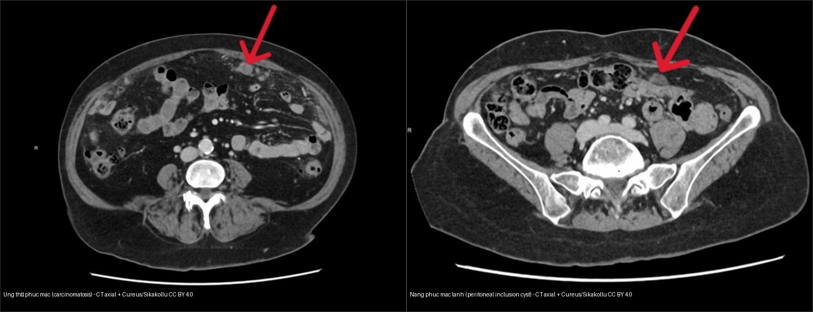
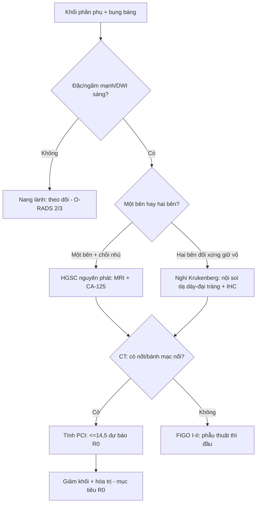
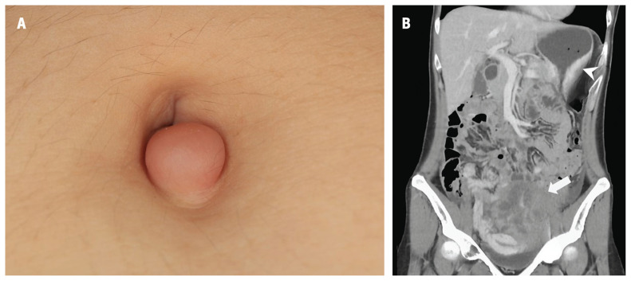
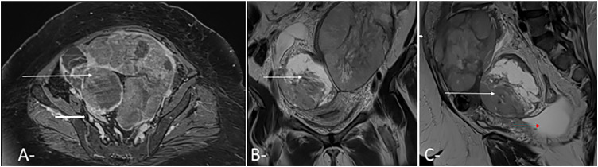
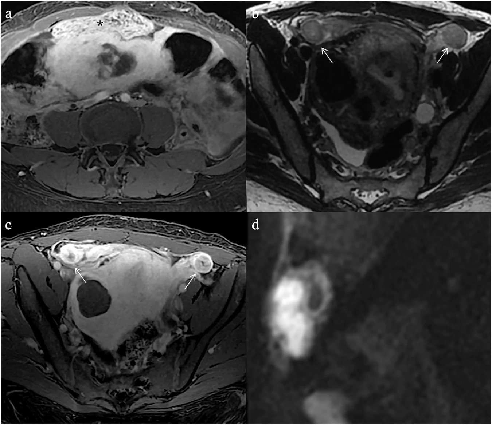

# 535 — Ung thư buồng trứng, gieo rắc phúc mạc & u Krukenberg / Ovarian cancer, peritoneal carcinomatosis & Krukenberg tumour

**Tags:** `pattern:k-u-buong-trung` `vung:buong-trung` `vung:phuc-mac` `score:FIGO` `score:PCI` `protocol:MRI-chau` `protocol:CT-chau`
**Mức chắc chắn (certainty):** tổng hợp y văn (literature synthesis) — nhóm tự biên từ y văn mở + các ca minh họa có giấy phép (Krukenberg, carcinomatosis, lao phúc mạc), không phải ca nguyên văn đơn lẻ.

## 1. Tổng quan — Ung thư buồng trứng lan theo dịch phúc mạc, không theo dòng máu

- **Dịch tễ:** ung thư biểu mô buồng trứng (epithelial ovarian cancer) chiếm ~90% ung thư buồng trứng; thể mô học hay gặp nhất là **ung thư biểu mô huyết thanh độ cao (high-grade serous carcinoma — HGSC) ~70%** các ca biểu mô, tuổi trung bình ~60. Giai đoạn I sống 5 năm ~90% nhưng khi đã gieo rắc phúc mạc (IIIC–IV) tụt còn ~30–40%.
- **Cơ chế lan (TẠI SAO hình ảnh như vậy):** tế bào u bong khỏi bề mặt buồng trứng/vòi vào **dịch phúc mạc** → chảy theo trọng lực và dòng chảy phúc mạc → lắng ở vùng trũng: **túi cùng Douglas, đại tràng sigma, mạc nối (omentum), mặt ngoài gan/lách, vòm hoành**. Vì thế hình ảnh đặc trưng là **gieo rắc (transcoelomic spread)**: nốt phúc mạc + **bánh mạc nối (omental cake)** + cổ trướng dịch tế bào học dương tính, chứ không phải các ổ di căn nhu mô rời rạc như sarcoma.
- **TẠI SAO ngấm mạnh + hạn chế khuếch tán (DWI/ADC):** khối u đặc nghèo mô đệm nhưng tỷ lệ nhân/bào tương cao → nước nội–ngoại bào bị chèn ép → **DWI b = 800–1000 sáng, ADC hạ (thường < 1,0 × 10⁻³ mm²/s)**; mạng mao mạch tân tạo rò rỉ ngấm nhanh → đường cong **Type III (washout)** trên DCE (liên hệ `530`). Tế bào nhẫn trong u Krukenberg nhầy đặc + đệm xơ cũng cho DWI sáng nhưng tín hiệu T2 trung tính–không đồng nhất hơn.
- **TẠI SAO bánh mạc nối:** mạc nối là "miếng đệm" giàu mô lympho trải khắp ổ bụng; dịch mang tế bào u đổ vào đây → tế bào lắng đọng rồi xơ hóa → mạc nối dày thấm đặc. **Ngưỡng: mạc nối dày > 1 cm hoặc có nốt/gồ cục = bánh mạc nối.** Trên CT, bánh mạc nối nằm trước đại tràng ngang, đôi khi tạo **dấu bánh kẹp (sandwich sign)**.
- **TẠI SAO cổ trướng:** tế bào u bít mạch lympho màng bụng + tăng tính thấm mao mạch → dịch; phân biệt dịch ác tính (kèm nốt/bánh) với cổ trướng cơ năng (xơ gan, suy tim — không nốt).
- **U Krukenberg (Krukenberg tumour):** di căn buồng trứng của **adenocarcinoma tế bào nhẫn (signet-ring cell carcinoma)** — nguyên phát **dạ dày ~70%**, tiếp theo đại tràng, ruột thừa, vú. Đặc điểm hình ảnh gợi ý: **hai bên (bilateral), khối đặc – hỗn hợp, giữ nguyên hình dạng buồng trứng (không phá vỏ), DWI sáng**. TẠI SAO hai bên: tế bào u theo dòng phúc mạc/đường bạch huyết lắng đối xứng hai buồng trứng. Chẩn đoán trước mổ **rất hay sót** (series 15 BN 2008–2024: 0/15 được chẩn đoán trước mổ).
- **Tiên lượng & định lượng:** u Krukenberg rất xấu — tổng quan 1.815 BN, trung vị sống sót (mOS) **9–50 tháng**; series 15 BN mOS **12 tháng**. Cắt u chỉ lợi khi **R0** (không còn u đại thể): mOS R1/R2 (~10–11 tháng) ngang nhóm không mổ.

## 2. Mẫu hình + chẩn đoán phân biệt theo vị trí (Gamut)

- **Khối phần phụ đặc một bên** → nghĩ ung thư biểu mô buồng trứng nguyên phát (một bên), u mầm (germ cell), u mô đệm–dây sinh dục, hoặc di căn đơn độc.
- **Khối phần phụ đặc hai bên** → **di căn (Krukenberg)** là nghi ngờ hàng đầu, cạnh tranh với lymphoma, di căn vú (thể tiểu thùy), HGSC nguyên phát hai bên (thường không đối xứng).
- **Gieo rắc phúc mạc theo vị trí:** mạc nối (bánh) → mạc treo/ruột → túi cùng Douglas → mặt ngoài gan/lách (**lõm nhu mô do nốt/chén — scalloping**, đừng nhầm nang/nhồi máu) → vòm hoành → khoang cạnh đại tràng. Nốt nhỏ **< 5 mm** trên CT rất dễ sót, nhất là **mặt ruột non** (CT và siêu âm đều kém ở vùng này).
- **Gan:** di căn nhu mô rời rạc = giai đoạn **IVB**; mặt gan bị ép lõm bởi khối nhầy ngoài gan = **pseudomyxoma peritonei** (thường từ u ruột thừa) → gọi là "ascites" là sai bản chất.
- **Dịch:** cổ trướng lượng nhiều + không nốt → nguyên nhân hệ thống; cổ trướng + nốt + bánh mạc nối → carcinomatosis.
- Mnemonic gieo rắc phúc mạc "**SISTER**" không cần — thay bằng 5 tầng vị trí: **mạc nối → mạc treo/túi cùng → gan-lách → vòm hoành → khoang cạnh đại tràng**.

## 3. Bảng so sánh phân biệt (ma trận đối chiếu)

| Thực thể (entity) | Hình ảnh điển hình | Chốt vào (rule-in) | Chốt loại (rule-out) | Gợi ý xác nhận |
|---|---|---|---|---|
| HGSC buồng trứng nguyên phát | Khối đặc–hỗn hợp 1 bên hoặc 2 bên không đối xứng, chồi nhú, ngấm mạnh + washout, DWI sáng | **Chồi nhú ≥ 4 + DWI sáng + dịch + nốt phúc mạc** | Hai khối đối xứng giữ hình buồng trứng → nghĩ di căn | CA-125, giải phẫu bệnh, O-RADS MRI |
| U Krukenberg (di căn dạ dày) | **Hai khối đặc 2 bên, giữ hình buồng trứng, T2 không đồng nhất, DWI sáng**, ± bánh mạc nối | **2 bên + giữ vỏ + tiền sử/đồng thời K tiêu hóa** | Chồi nhú đơn độc 1 bên → nguyên phát | **Nội soi dạ dày–đại tràng + hóa mô miễn dịch (CK7/CK20, CDX2, SATB2)** |
| Di căn vú thể tiểu thùy | Thâm nhiễm dày đặc, có thể 2 bên, tế bào nhẫn cũng gặp | **Tiền sử K vú + dấu hiệu phúc mạc** | Nguyên phát dạ dày nếu không có tiền sử vú | IHC (GATA3, ER), nội soi vú |
| Pseudomyxoma peritonei | **Dịch nhầy dạng keo + scalloping mặt gan/lách + nốt** | **Lõm mặt gan + dịch keo** | Cổ trướng nước tự do → carcinomatosis | Sinh thiết, nội soi ruột thừa |
| **Lao phúc mạc (mimic)** | Dịch + nốt + **hạch vôi hóa + dày phúc mạc đều**, lao phổi cũ | **Hạch vôi + ADA dịch > 35–40 U/L + lao cũ** | Bánh mạc nối thô + K nguyên phát → carcinomatosis | ADA, PCR lao, **không mổ bụng** |
| **Nang bao phúc mạc lành (mimic)** | Nang dịch nhiều thùy **bao quanh buồng trứng**, dấu "mạng nhện", không nốt | **Buồng trứng lành nằm trong nang + không nốt đặc** | Nốt đặc/omental cake → carcinomatosis | Theo dõi, tránh mổ/hóa trị oan |

*Trái: **carcinomatosis** — nốt đặc + mạc nối dày thấm đặc dọc thành bụng trước (mũi tên). Phải: **nang bao phúc mạc lành tính** — dịch nhiều thùy, thành mảnh, không nốt đặc xâm nhiễm. Nguồn: Sikakollu et al., Cureus 2025 Fig. 4 & 5, CC BY 4.0 (ảnh ghép letterbox).*

## 4. Protocol + phân giai đoạn FIGO & chỉ số PCI

- **CT bụng–chậu có cản quang** (thì tĩnh mạch cửa 60–70 giây) là nền tảng phân giai đoạn: tìm nốt phúc mạc, bánh mạc nối, cổ trướng, hạch chậu/cạnh ĐMC, và **quét ngực** (tràn dịch màng phổi = IVA).
- **MRI chậu:** T2W đa mặt phẳng + T1W fat-sat + **DWI/ADC (b = 800–1000)** + DCE (Type I–III) khi khối phần phụ chưa rõ; phối hợp **O-RADS MRI** (bài `530`). Đặc điểm đặc–ngấm–DWI sáng gợi ác tính.
- **FIGO 2014 (làm rõ 2021):**
  - **I**: khu trú buồng trứng/vòi; **II**: lan trong khung chậu (tử cung/vòi/đoạn cuối ruột);
  - **III**: gieo rắc phúc mạc ngoài khung chậu và/hoặc **hạch sau phúc mạc**;
    - **IIIA1(i)** chỉ hạch sau phúc mạc **≤ 10 mm**; **IIIA1(ii)** hạch **> 10 mm**;
    - **IIIA2** gieo rắc phúc mạc *vi thể*; **IIIB** gieo rắc đại thể **≤ 2 cm**; **IIIC** gieo rắc **> 2 cm** và/hoặc hạch dương;
  - **IV**: di căn xa — **IVA** tràn dịch màng phổi có tế bào ác; **IVB** di căn nhu mô gan/lách, hạch ngoài ổ bụng (kể cả bẹn), xuyên thành ruột.
- **Chỉ số ung thư phúc mạc PCI (Peritoneal Cancer Index — Sugarbaker):** chia ổ bụng **13 vùng**, mỗi vùng điểm 0–3 (lớn nhất > 5 cm = 3) → tổng **0–39**. Đo bằng CT tương quan tốt với PCI phẫu thuật (**ρ = 0,867** với CT, cao hơn siêu âm ρ = 0,750). **Ngưỡng PCI phẫu thuật 14,5** dự báo **giảm khối hoàn toàn** (Se 84,7%, Sp 100%); kinh điển **PCI > 20** thường không giảm khối triệt để.
- **Phẫu thuật giảm khối (cytoreduction):** mục tiêu **R0**; tồn dư đại thể **> 1 cm** = giảm khối dưới mức tối ưu (định nghĩa truyền thống). Cân nhắc HIPEC ở bệnh nhân chọn lọc.
- **U Krukenberg 2 bên:** bắt buộc **nội soi dạ dày–đại tràng** tìm nguyên phát + hóa mô miễn dịch; **không mổ buồng trứng đơn thuần** khi chưa rõ nguồn.

## 5. Biến thể bình thường và cạm bẫy

- **Lao phúc mạc** dễ bị gọi nhầm carcinomatosis → **mổ bụng vô ích**: đòi hỏi **ADA dịch > 35–40 U/L**, hạch vôi hóa, lao phổi cũ (xem ảnh quiz Ca 4). Dấu hiệu "bánh mạc nối" thô + K nguyên phát mới nghiêng về ung thư.
- **Nang bao phúc mạc lành tính (peritoneal inclusion cyst):** nang dịch bao quanh buồng trứng lành, vách mảnh, dấu "mạng nhện" — **không nốt đặc xâm nhiễm** → đừng hóa trị/mổ oan (ảnh composite trên).
- **Bỏ sót nốt < 5 mm ở mặt ruột non** — CT và siêu âm đều kém; khi mục tiêu R0 phải soi ổ bụng (laparoscopy) đánh giá.
- **Tràn dịch màng phổi** = IVA: trên CT bụng **nhớ đọc cả đáy phổi**, đừng bỏ sót.
- **Nang chức năng/nang xuất huyết buồng trứng** tưởng ung thư → theo dõi 6–8 tuần (xem `530`).
- **Sister Mary Joseph nodule (di căn rốn):** nốt cứng vùng rốn có thể là dấu hiệu **chỉ điểm đầu tiên** của K tiêu hóa di căn phúc mạc/buồng trứng — đừng bỏ qua khi thấy nốt rốn (ảnh quiz Ca 1).
- **"Thỏa mãn tìm kiếm" (satisfaction of search):** thấy khối buồng trứng lớn rồi dừng → quên tìm **nguyên phát dạ dày/đại tràng** trong u Krukenberg.
- **Pseudomyxoma** đừng gọi là "cổ trướng đơn thuần" — dịch keo + scalloping mặt gan/lách là chìa khóa.

## 6. Tự lượng giá — Blind Quiz

**Ca 1 — Nữ 27 tuổi, nốt vùng rốn mới xuất hiện + bụng to dần. Đọc phim.**

- Gợi ý: nốt rốn cứng, đỏ, ~1,5 cm; bụng to, khối chậu.
- Hỏi: nốt rốn gợi ý gì? Trên CT, khối đâu là nguyên phát, đâu là di căn?

<b>Bấm để hiện đáp án (findings + chẩn đoán)</b>

- Dấu hiệu (findings): (A) **Sister Mary Joseph nodule** — nốt di căn ở rốn. (B) CT: khối dạ dày đồng nhất **6,35 cm** (đầu mũi tên) + khối chậu hỗn hợp **7,98 cm** (mũi tên cong) xâm lấn cơ.
- Chẩn đoán (diagnosis): **u Krukenberg** (di căn buồng trứng của adenocarcinoma dạ dày tế bào nhẫn) có nốt rốn chỉ điểm — vì tế bào nhẫn di theo đường phúc mạc/lympho tới buồng trứng và rốn.
- Nguồn ảnh: CMAJ 2025 Fig. 1, CC BY-NC-ND 4.0 (giữ nguyên bản).

**Ca 2 — Nữ trung niên, hai khối phần phụ. Đọc MRI chậu.**

- Hỏi: vì sao nghĩ di căn hơn nguyên phát? Dấu hiệu nào gợi ý Krukenberg?

<b>Bấm để hiện đáp án (findings + chẩn đoán)</b>

- Dấu hiệu (findings): **khối buồng trứng hai bên**, đặc–hỗn hợp, tín hiệu T2 trung tính–không đồng nhất, **giữ dạng buồng trứng** (mũi tên trắng). CT kèm khối chậu trái hỗn hợp ~17 cm.
- Chẩn đoán (diagnosis): **u Krukenberg (di căn buồng trứng)** — hai bên + giữ vỏ + đặc gợi ý di căn; bước tiếp theo là nội soi dạ dày–đại tràng tìm nguyên phát + hóa mô miễn dịch.
- Nguồn ảnh: Radiol Case Rep 2026 Fig. 2–3, CC BY-NC-ND 4.0 (giữ nguyên bản).

**Ca 3 — Hai bệnh nhân, cùng có dịch + tổn thương phúc mạc. Ảnh nào là ung thư, ảnh nào lành tính?**

- Hỏi: gọi tên tổn thương mỗi bên; dấu hiệu nào phân biệt carcinomatosis với nang lành?

<b>Bấm để hiện đáp án (findings + chẩn đoán)</b>

- **Trái = carcinomatosis (ung thư phúc mạc):** nốt đặc + mạc nối dày thấm đặc bám thành bụng trước (mũi tên đỏ) — tổn thương đặc xâm nhiễm.
- **Phải = nang bao phúc mạc lành tính:** dịch nhiều thùy, vách mảnh, **không nốt đặc** — dấu "mạng nhện" bao quanh buồng trứng lành.
- Chốt: **có nốt/mạc nối đặc xâm nhiễm = ác tính**; nang dịch thuần không nốt = lành (tránh mổ/hóa trị oan).
- Nguồn: Sikakollu et al., Cureus 2025, CC BY 4.0 (ảnh ghép letterbox).

**Ca 4 — Nữ 40 tuổi, đau bụng, dịch + dày phúc mạc. Ung thư hay lao?**

- Hỏi: đâu là 2 dấu hiệu giúp nghiêng về **lao phúc mạc** thay vì carcinomatosis?

<b>Bấm để hiện đáp án (findings + chẩn đoán)</b>

- Dấu hiệu (findings): dày phúc mạc ngấm đều (a, c) + nhân DWI ở vòi trứng/hạch (b, d).
- Chẩn đoán (diagnosis): **lao phúc mạc** — dạng "mimic" của carcinomatosis; nghiêng về lao khi **hạch vôi hóa + ADA dịch > 35–40 U/L + lao phổi cũ** → điều trị lao, **không mổ bụng**.
- Nguồn ảnh: Insights into Imaging 2026 Fig. 12, CC BY 4.0.

## Bài liên quan chéo
- [500 – Tổng quan Vú & Sản phụ khoa](../500-tong-quan-vu-san-phu-khoa/lesson.md)
- [530 – Khối phần phụ O-RADS, dermoid & xoắn](../530-buong-trung-ORADS-sieu-am-MRI/lesson.md)
- [525 – Ung thư nội mạc & cổ tử cung FIGO trên MRI](../525-ung-thu-noi-mac-co-tu-cung-FIGO-MRI/lesson.md)
- [540 – Lạc nội mạc sâu (DIE) & PID](../540-lac-noi-mac-tu-cung-sau-DIE-MRI/lesson.md)
- [141 – Phúc mạc: carcinomatosis vs lao](../141-phuc-mac/lesson.md)
- [120 – Khối gan nền (di căn gan)](../120-khoi-gan-nen/lesson.md)
- [160 – Bụng cấp cứu GI](../160-bung-cap-GI/lesson.md)

## Ảnh
- `535_krukenberg-SMJ_CT_PMC12503699.jpg`, `535_k-buong-trung_MRI_PMC13330600.jpg`, `535_k-buong-trung_CT_PMC13330600.jpg`, `535_carcinomatosis_CT_PMC12717455.jpg`, `535_nang-phuc-mac_CT_PMC12717455.jpg`, `535_lao-phuc-mac_MRI_PMC13586104.jpg`, `composite_carcinomatosis-vs-nang-phuc-mac.jpg`. Nguồn + giấy phép từng ảnh trong `images/CREDITS.md`.

> Không dùng để chẩn đoán độc lập khi chưa có người hướng dẫn.
