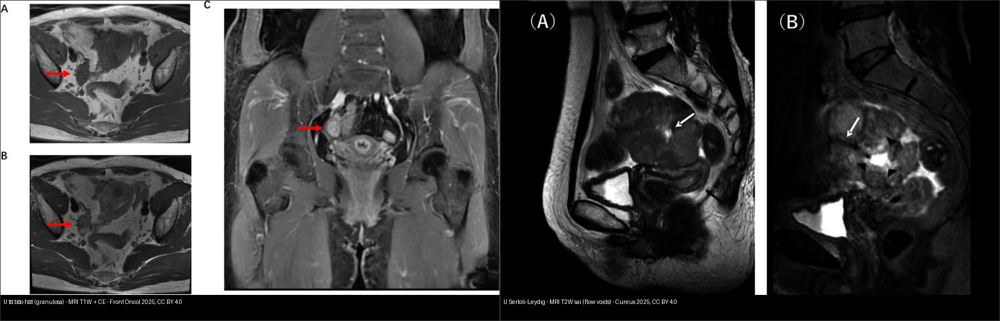
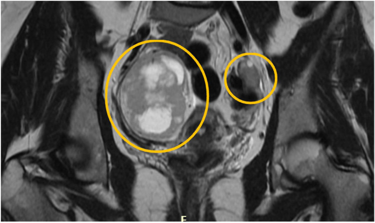
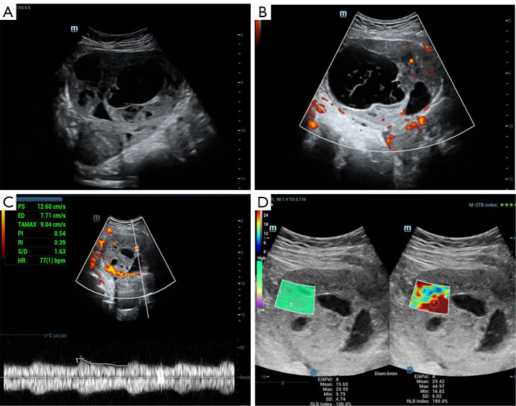
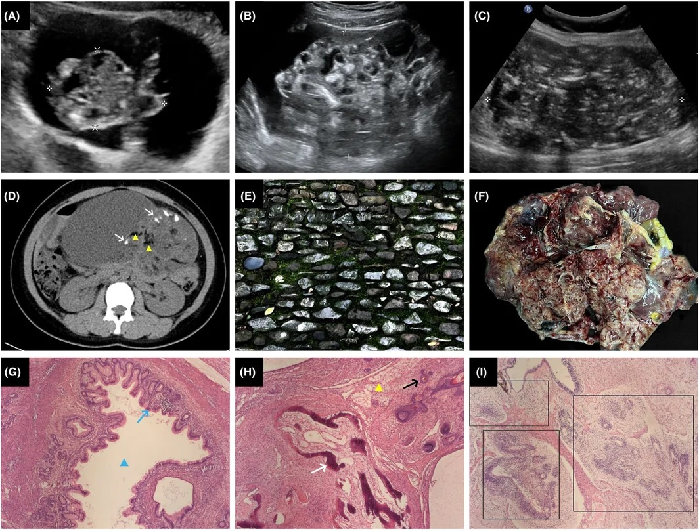
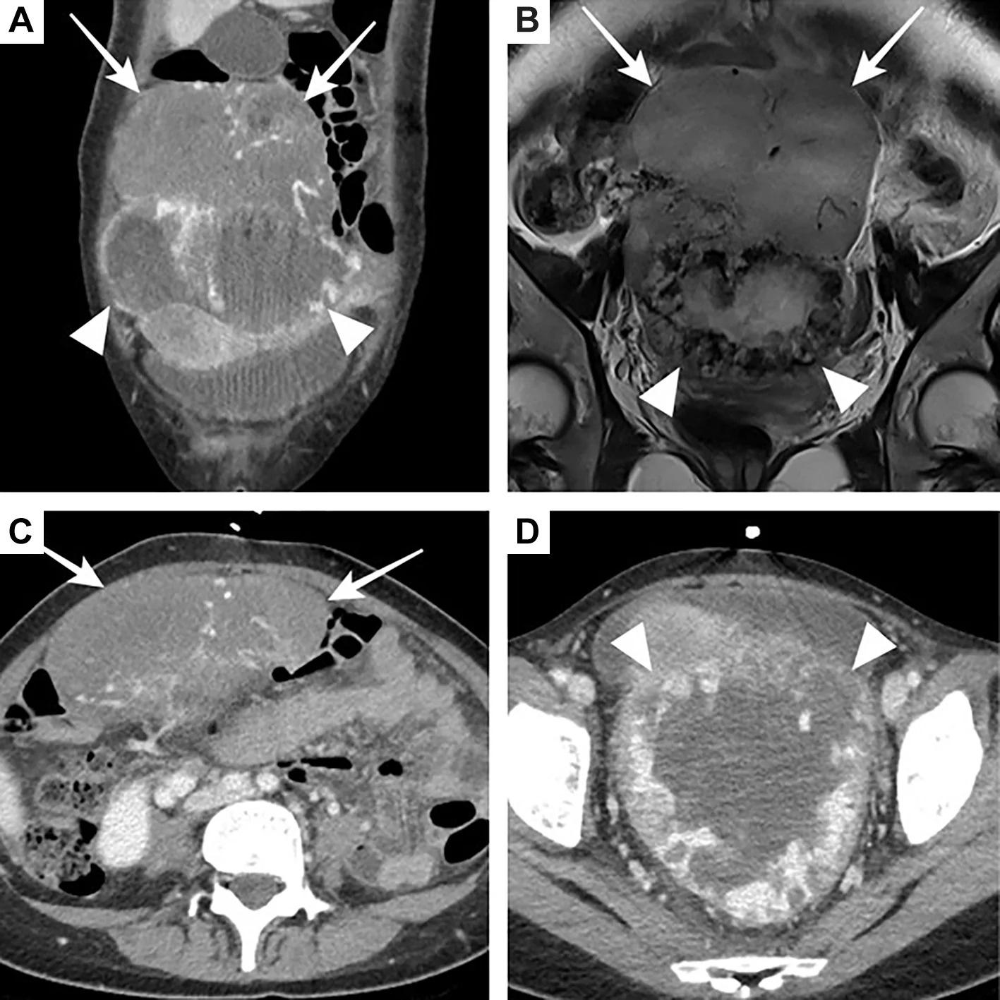
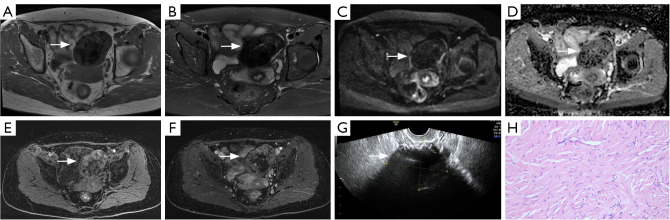

# 536 — U mầm & u mô đệm–dây sinh dục buồng trứng / Ovarian germ cell & sex cord–stromal tumours

**Tags:** `pattern:u-buong-trung` `vung:buong-trung` `score:FIGO` `protocol:MRI-chau` `protocol:CT-chau`
**Mức chắc chắn (certainty):** tổng hợp y văn (literature synthesis) — nhóm tự biên từ y văn mở (Europe PMC/PMC, Cancers, Insights) + các ca minh họa có giấy phép; không phải ca nguyên văn đơn lẻ.

## 1. Tổng quan — hai họ u "KHÔNG biểu mô" của người trẻ + cơ chế hình ảnh

- **Bối cảnh:** ung thư buồng trứng biểu mô (epithelial) chiếm ~90% và gặp ở tuổi quanh mãn kinh (bài `535`). Ở **người trẻ**, khối phần phụ đặc–hỗn hợp thường thuộc 2 họ khác hẳn: **u mầm (germ cell tumour — GCT)** và **u mô đệm–dây sinh dục (sex cord–stromal tumour — SCST)**. Chúng khác nguồn gốc tế bào, khác **dấu ấn huyết thanh (tumour marker)** và khác đường điều trị (bảo tồn sinh sản) — nên chẩn đoán hình ảnh đúng đổi cả phác đồ.
- **Dịch tễ (định lượng):** u mầm ác tính (malignant ovarian germ cell tumour — MOGCT) chỉ chiếm **2–3%** toàn bộ u ác buồng trứng, nhưng **58% xảy ra < 20 tuổi** và **82% chẩn đoán từ 14–54 tuổi** (tuổi sinh sản); tỉ lệ ~**0,4/100.000/năm** ở châu Âu. U quái trưởng thành (mature teratoma) chiếm **~69%** u mầm buồng trứng (phần lớn lành); nhóm ác: **u sinh dục bào (dysgerminoma) hay gặp nhất (~30–40% MOGCT)**, **u túi noãn hoàng (yolk sac tumour) ~15%**, **u quái chưa trưởng thành (immature teratoma — IT) ~1/3** các MOGCT không phải dysgerminoma (tuổi 15–30, tỉ lệ ~**1,5/100.000** nữ). **SCST chiếm 5–8%** u buồng trứng, phần lớn lành; ác điển hình là **u tế bào hạt (granulosa cell tumour — OGCT)** và **u Sertoli–Leydig (SLCT)**.
- **TẠI SAO hình ảnh khác nhau — giải thích theo mô học/vật lý:**
  - **Dysgerminoma:** khối **đặc, lớn, đồng nhất như "bánh mì"**, tế bào lớn bào tương sáng xếp ổ + **vách xơ–mạch (fibrovascular septa)**. Vách này giàu mạch → **T2W vách tối** (xơ) nhưng **T1 sau tiêm vách ngấm mạnh**; u đặc tế bào → **DWI sáng + ADC thấp**. Vôi hóa thô ~**10–15%**. Hai bên ~**10–15%**. Vì sao vách tối T2 mà ngấm: sợi collagen ít nước (T2 tối) nhưng chứa mạch nuôi (ngấm).
  - **U túi noãn hoàng (yolk sac tumour):** tiết **AFP**; mô đặc–nang, **xuất huyết + hoại tử + vách mảnh** → khối hỗn hợp thùy, dịch trong nang. Vì sao hỗn hợp: u tăng sinh nhanh vượt cấp máu → hoại tử trung tâm + xuất huyết.
  - **U quái chưa trưởng thành (immature teratoma):** chứa cả 3 lá phôi → trong CÙNG một khối có **mỡ (−40 đến −120 HU)** + **vôi hóa (răng/xương — cản quang cao)** + **mô đặc (thần kinh non)**; phân độ **1–3** theo lượng mô thần kinh non (Scully/Thurlbeck). TẠI SAO có mỡ: biệt hóa mô mỡ; TẠI SAO có vôi: mô răng/xương biệt hóa.
  - **OGCT (u tế bào hạt):** tiết **estrogen + inhibin** → khối **đặc–nang xuất huyết, "pho mát Thụy Sĩ" (nhiều nang nhỏ)**, T1 có ổ sáng do máu; tử cung to + JZ rõ (tác dụng estrogen). TẠI SAO xuất huyết: mạng mạch giãn, dễ vỡ.
  - **SLCT:** tiết **androgen** (nam hóa) → khối **T2 trung tính, nhiều khe mạch (flow voids)**, **DWI sáng + ADC thấp**, KHÔNG mỡ/xuất huyết.
  - **U sợi–vỏ (fibroma/thecoma):** mô xơ đặc, nghèo tế bào → **T1/T2 tối đen, rất ít ngấm, ADC thấp**; là nút "đặc tối T2" của gamut (O-RADS MRI 2).
- **Ngưỡng định lượng cho điểm (QIMS 2025, n=71):** ADC trung bình **OGCT ~0,86 ×10⁻³ mm²/s**; **fibroma ~1,20 ×10⁻³ mm²/s** (ví dụ ổ xuất huyết OGCT 0,365; fibroma 0,757). **AFP:** trong IT có thể **tăng tới ~50%** ca; **ổ yolk sac > 3 mm** trong IT làm **tăng nguy cơ tái phát**. **Tiên lượng IT theo FIGO:** I/II **> 95%** sống; III **81%**; IV **71%**.
- **Vì sao quan trọng:** nhóm này gặp ở người trẻ → mục tiêu là **bảo tồn sinh sản** (unilateral salpingo-oophorectomy + staging) và **đa số chữa khỏi bằng BEP** nếu đúng phác đồ — ngược hẳn thái độ "ung thư buồng trứng tuổi già".

## 2. Mẫu hình + chẩn đoán phân biệt theo tuổi, bên tổn thương & nội dung khối (Gamut)

- **Theo tuổi:** **< 20 tuổi** → GCT/SCST gần như luôn là chẩn đoán hàng đầu; **> 40 tuổi** → chuyển dần sang u biểu mô (`535`). Tuổi là bộ lọc đầu tiên.
- **Theo bên tổn thương:** **một bên** → GCT (dysgerminoma, IT, yolk sac) hoặc SCST; **hai bên** → **dysgerminoma (~10–15%)**, di căn Krukenberg (`535`), lymphoma, hoặc u ở buồng trứng lạc chỗ/hội chứng tăng sinh dây sinh dục.
- **Theo nội dung khối (4 khuôn):**
  - **Đặc–đồng nhất, vách ngấm:** dysgerminoma.
  - **Mỡ ± vôi hóa trong khối:** u quái (phân biệt trưởng thành vs chưa trưởng thành bằng mô học + AFP).
  - **Đặc–nang xuất huyết nhiều:** yolk sac, OGCT, embryonal carcinoma.
  - **Đặc tối T2, ít ngấm:** fibroma/thecoma (nút lành).
- **Theo hormone:** cường estrogen (OGCT, thecoma — dậy thì sớm, xuất huyết tử cung) vs **nam hóa (virilization — SLCT)**.
- **Mimic cần loại:** **xoắn buồng trứng** (`530` — đau cấp, dấu xoáy), **u quái trưởng thành lành** (mỡ + tóc, không mô thần kinh non), **di căn (Krukenberg)**, **lao phần phụ**.

## 3. Bảng so sánh phân biệt (ma trận đối chiếu)

| Thực thể (entity) | Hình ảnh điển hình (US/CT/MRI) | Chốt vào (rule-in) | Chốt loại (rule-out) | Gợi ý xác nhận |
|---|---|---|---|---|
| U sinh dục bào (dysgerminoma) | Khối **đặc–đồng nhất, lớn**; **vách xơ T2 tối nhưng ngấm mạnh**; vôi hóa thô ~10–15%; DWI sáng/ADC thấp | **Đặc đồng nhất + vách ngấm + người trẻ** (± hai bên) | Mỡ trong khối → không phải dysgerminoma (nghĩ u quái) | **LDH ↑**, β-hCG ↑ nhẹ (~5–10%); mô học tế bào mầm |
| U túi noãn hoàng (yolk sac) | Khối **đặc–nang, xuất huyết–hoại tử, vách mảnh nhiều thùy**; US: mạch vỏ/vách, **RI < 0,5** | **AFP rất cao + khối hỗn hợp xuất huyết, tuổi trẻ** | AFP bình thường → ít nghĩ yolk sac | **AFP**, glypican-3, SALL4 |
| U quái chưa trưởng thành (immature teratoma) | **Mỡ + vôi hóa + mô đặc** trong một khối; **pattern "khảm sỏi" (pebbled mosaic)** trên US; biến thiên mạnh | **Mỡ + vôi hóa + mô đặc, người 15–30 tuổi** | Khối mỡ thuần + không mô thần kinh non → u quái trưởng thành | **AFP** (↑ tới ~50%), mô học mô thần kinh non (độ 1–3) |
| U tế bào hạt (granulosa/OGCT) | Khối **đặc–nang xuất huyết**, "pho mát Thụy Sĩ"; T1 có ổ sáng máu; ngấm mạnh; **ADC ~0,86** | **Xuất huyết + nang nhỏ + tử cung to/JZ rõ (estrogen)** | Đặc tối T2, ít ngấm → nghĩ fibroma | **Inhibin B ↑**, estradiol ↑; Call-Exner (mô học) |
| U Sertoli–Leydig (SLCT) | Khối **T2 trung tính + nhiều flow voids (mạch)**, DWI sáng/ADC thấp; KHÔNG mỡ/xuất huyết | **Nam hóa/androgen + mạch máu mạnh ở người trẻ** | Có mỡ → nghĩ u quái | **Testosterone ↑**, **DICER1** (di truyền) |
| U sợi–vỏ (fibroma/thecoma) | Đặc **T1/T2 tối đen, rất ít ngấm**, ADC thấp (~1,20); US giảm âm, **không mạch** | **T2 tối đều + không ngấm** (nút lành) | DWI sáng/ngấm mạnh/hoại tử → nghĩ ác | Theo dõi; **Meigs** (fibroma + báng + tràn dịch màng phổi) |
| **Mimic: Krukenberg / di căn** | Hai khối đặc, **giữ hình buồng trứng**, T2 không đồng nhất | **Hai bên đối xứng + tiền sử/đồng thời K tiêu hóa** | Đơn độc một bên có mỡ/vôi → u mầm | Nội soi tiêu hóa + IHC (`535`) |


*Trái: **u tế bào hạt** — khối đặc–nang ở phần phụ phải, T1 có ổ tăng tín hiệu do xuất huyết, ngấm rõ. Phải: **u Sertoli–Leydig** — khối đặc thùy T2 trung tính, phần trung tâm tăng tín hiệu mạnh (dịch), **flow voids** gợi tăng mạch. Nguồn: Cao & Wang, Front Oncol 2025 & Yamamoto et al., Cureus 2025, CC BY 4.0 (ảnh ghép letterbox).*

## 4. Protocol chụp + phân giai đoạn FIGO + bảo tồn sinh sản

- **Siêu âm đầu tay (transvaginal + transabdominal, có Doppler):** khối đặc–hỗn hợp + tưới máu vỏ/vách → gợi ác; **RI < 0,5** là bất thường (ví dụ yolk sac RI 0,39).
- **MRI chậu (chuẩn đọc khối phần phụ):** T2W 3 mặt phẳng + T1W (tìm mỡ/xuất huyết) + **T1W fat-sat** + **DWI/ADC (b=800–1000)** + **DCE**; phối hợp **O-RADS MRI** (`530`). Đặc điểm "chốt" giữa các họ nằm ở mỡ/vôi (u quái), độ đồng nhất + vách (dysgerminoma), và độ ngấm/ADC (fibroma vs u tế bào).
- **CT ngực–bụng–chậu có cản quang:** phân giai đoạn, tìm di căn phổi/gan/phúc mạc; CT là kênh tốt để bắt **mỡ + vôi hóa trong u quái** và tổn thương phổi.
- **Dấu ấn huyết thanh (bắt buộc trước mổ/hóa trị):** **AFP, β-hCG, LDH, inhibin B** (± CA-125). Cách nhớ: **AFP** → yolk sac/embryonal/IT; **β-hCG** → choriocarcinoma/embryonal (dysgerminoma tăng nhẹ); **LDH** → dysgerminoma; **inhibin B/estradiol** → OGCT; **testosterone** → SLCT.
- **FIGO:** dùng chung hệ với u biểu mô (`535`). **Phẫu thuật giảm giai đoạn bảo tồn sinh sản** (fertility-sparing): cắt tử cung-buồng trứng một bên + phần còn lại giữ, lấy dịch rửa + mạc nối + sinh thiết hạch (bỏ sót nạo hạch hệ thống nếu không cần).
- **Điều trị:** MOGCT → **BEP** (bleomycin–etoposide–cisplatin) 3–4 chu kỳ; OGCT giai đoạn I → phẫu thuật, giai đoạn cao/nguy cơ → platinum; SLCT → phẫu thuật ± hóa trị; theo dõi tái phát **muộn** (OGCT có thể tái phát sau nhiều năm → theo dõi lâu dài + inhibin B).

```mermaid
flowchart TD
  A[Khối phần phụ ở người trẻ < 40 tuổi] --> B{US: đặc hay hỗn hợp + tưới máu?}
  B -->|Đặc tối T2, không mạch| Z[Fibroma/thecoma: O-RADS MRI 2, theo dõi]
  B -->|Đặc-hỗn hợp có mạch| C{MRI: có MỠ hoặc VÔI HÓA?}
  C -->|Có| D[U quái: AFP + mô học phân độ 1-3]
  C -->|Không| E{Một bên hay hai bên + hormone?}
  E -->|Đặc đồng nhất, vách ngấm| F[Dysgerminoma: LDH, theo dõi hai bên]
  E -->|Xuất huyết-nang + estrogen| G[U tế bào hạt: inhibin B, estradiol]
  E -->|Nam hóa + flow voids| H[Sertoli-Leydig: testosterone, DICER1]
  E -->|AFP rất cao| I[Yolk sac: AFP, glypican-3]
  F --> J[Phẫu thuật bảo tồn sinh sản + phần giai đoạn]
  D --> J
  G --> J
  H --> J
  I --> J
  J --> K{Ác tính / giai đoạn cao?}
  K -->|Có| L[BEP (u mầm) hoặc platinum (SCST ác)]
  K -->|Không| M[Theo dõi: AFP/LDH/inhibin B định kỳ, tái phát muộn]
```

## 5. Biến thể bình thường và cạm bẫy

- **U quái trưởng thành lành (mature teratoma) vs u quái chưa trưởng thành:** cả hai đều có **mỡ ± vôi hóa**; khác biệt **chỉ ở mô học** (mô thần kinh non = độ 1–3) và **AFP**. Mỡ đơn thuần + không mô thần kinh non → lành; đừng hóa trị oan.
- **Gliomatosis peritonei:** ~**25%** IT có **mảnh ghép phúc mạc mô trưởng thành (độ 0)**, KHÔNG phải di căn — đừng nâng giai đoạn/mổ rộng oan.
- **Fibroma có ADC thấp + T2 tối:** đừng nhầm ác (đây là **nút lành**, O-RADS MRI 2); phân biệt với u tế bào hạt bằng **độ ngấm** (fibroma rất ít ngấm) và tín hiệu xuất huyết.
- **Hội chứng Meigs (fibroma + báng + tràn dịch màng phổi):** bộ ba lành tính, dịch **tiêu sau khi cắt u**; đừng nhầm carcinomatosis (`535`).
- **T2 shine-through:** ổ **xuất huyết/nang** có thể DWI sáng giả do T2 dài — luôn đọc **ADC map** để xác nhận khuếch tán hạn chế thật.
- **Dysgerminoma hai bên:** phải **soi cả buồng trứng đối diện** khi mổ bảo tồn (10–15% hai bên).
- **Xoắn buồng trứng** (`530`) là cấp cứu giả "khối u" — đau cấp + dấu xoáy (whirlpool); đừng chỉ vì thấy khối mà bỏ dấu xoáy.

## 6. Tự lượng giá — Blind Quiz

**Ca 1 — Nữ 16 tuổi, bụng to, khối chậu hai bên trên MRI. Đọc phim.**



- Gợi ý: khối lớn hai bên, không rối loạn nội tiết.
- Hỏi: hai vòng vàng khoanh gì? Vì sao hai bên quan trọng? Dấu ấn nào nên xét?

<details><summary><b>Bấm để hiện đáp án (findings + chẩn đoán)</b></summary>

- Dấu hiệu (findings): **hai khối buồng trứng (vòng vàng)** trên MRI coronal — khối lớn, đặc–hỗn hợp, tín hiệu không đồng nhất.
- Chẩn đoán (diagnosis): **u sinh dục bào (dysgerminoma) hai bên** — vì dysgerminoma là u mầm ác hay gặp nhất ở người trẻ và **hai bên ~10–15%**; cần xét **LDH** (và β-hCG) trước mổ.
- Nguồn ảnh: Babkova et al., AJOG Glob Rep 2026 Fig. 3, CC BY-NC-ND 4.0 (giữ nguyên bản).
</details>

**Ca 2 — Bé gái tuổi vị thành niên, khối chậu đặc–nang nhiều vách, AFP tăng. Đọc siêu âm.**



- Hỏi: hình "tổ ong" + vách mảnh gợi ý gì? Chỉ số RI 0,39 nói lên điều gì?

<details><summary><b>Bấm để hiện đáp án (findings + chẩn đoán)</b></summary>

- Dấu hiệu (findings): khối **đặc–nang nhiều vách kiểu "tổ ong"** (A); **mạch tập trung ở vỏ và vách**, không có trong phần nang (B); **RI 0,39 (< 0,5)** và đàn hồi trung bình 29,42 kPa (C, D).
- Chẩn đoán (diagnosis): **u túi noãn hoàng (yolk sac tumour)** — vì AFP rất cao + khối hỗn hợp xuất huyết–hoại tử nhiều vách ở người trẻ; **RI thấp (giảm sức cản) là đặc trưng tưới máu u ác**.
- Nguồn ảnh: Ma et al., Quant Imaging Med Surg 2026 Fig. 1, CC BY-NC-ND 4.0 (giữ nguyên bản).
</details>

**Ca 3 — Bé gái tuổi 15–30, khối buồng trứng có mỡ lẫn vôi hóa. Đọc CT + siêu âm.**



- Hỏi: dấu hiệu "khảm sỏi" (pebbled mosaic) là gì? Vì sao khối có cả mỡ lẫn vôi hóa?

<details><summary><b>Bấm để hiện đáp án (findings + chẩn đoán)</b></summary>

- Dấu hiệu (findings): (A–C) **"khảm sỏi"** — mô đặc xen nang tạo vân lấm tấm như đường sỏi; (D) CT: **vôi hóa tăng đậm (mũi tên trắng)** + **mỡ giảm đậm (tam giác vàng)**; (F) đại thể u độ 3 nhiều mỡ–vôi–nang.
- Chẩn đoán (diagnosis): **u quái chưa trưởng thành (immature teratoma)** — vì chứa **cả 3 lá phôi** (mô mỡ + răng/xương vôi hóa + mô thần kinh non); **AFP có thể tăng tới ~50%**; phân độ mô học 1–3 theo lượng mô thần kinh non.
- Nguồn ảnh: Zhang et al., Acta Obstet Gynecol Scand 2026 Fig. 4, CC BY-NC (giữ nguyên bản).
</details>

**Ca 4 — Nữ 21 tuổi, khối buồng trứng phải đặc–hỗn hợp 2 thành phần. Đọc CT + MRI.**



- Hỏi: hai "thành phần" trong khối là gì? Vì sao đọc cả CT lẫn MRI?

<details><summary><b>Bấm để hiện đáp án (findings + chẩn đoán)</b></summary>

- Dấu hiệu (findings): CT/MRI cho thấy **hai thành phần đặc khác tín hiệu** trong cùng khối: phần **đồng nhất** (mũi tên) và phần **không đồng nhất** (đầu mũi tên); MRI T2 phân biệt rõ mềm hơn.
- Chẩn đoán (diagnosis): **u mầm hỗn hợp (mixed germ cell tumour)** — phần đồng nhất = **dysgerminoma**, phần không đồng nhất = **choriocarcinoma**; nên **AFP + β-hCG + LDH** định hướng; BEP toàn thân.
- Nguồn ảnh: Lee et al., In Vivo 2026 Fig. 2, CC BY-NC-ND 4.0 (giữ nguyên bản).
</details>

**Ca 5 — Hai bệnh nhân nữ trẻ, cùng khối phần phụ một bên. Bên nào u tế bào hạt, bên nào Sertoli–Leydig?**


- Hỏi: dấu hiệu nào giúp phân biệt hai bên? Bệnh nào gây nam hóa?

<details><summary><b>Bấm để hiện đáp án (findings + chẩn đoán)</b></summary>

- **Trái = u tế bào hạt (granulosa):** khối **đặc–nang xuất huyết** (ổ sáng T1), ngấm rõ, gợi **inhibin B/estradiol ↑** (cường estrogen).
- **Phải = u Sertoli–Leydig:** khối T2 trung tính với **flow voids (tăng mạch)** và phần trung tâm dịch tăng tín hiệu mạnh, gợi **testosterone ↑ (nam hóa/androgen)**.
- Chốt: **thành phần xuất huyết** nghiêng về u tế bào hạt; **mạch máu mạnh + nam hóa** nghiêng về SLCT.
- Nguồn: Cao & Wang, Front Oncol 2025 & Yamamoto et al., Cureus 2025, CC BY 4.0 (ảnh ghép letterbox).
</details>

**Ca 6 — Nữ 57 tuổi, khối buồng trứng trái đặc, T2 tối đen, rất ít ngấm. Đọc MRI + siêu âm.**



- Hỏi: tín hiệu T2 tối đều + DWI tối + không mạch gợi ý gì? Đây là nút lành hay ác trong gamut?

<details><summary><b>Bấm để hiện đáp án (findings + chẩn đoán)</b></summary>

- Dấu hiệu (findings): khối **giảm tín hiệu đều trên T1 và T2** (A, B), **DWI giảm tín hiệu** (C), ADC trung bình **0,757 ×10⁻³ mm²/s** (D), **rất ít ngấm** (E, F), siêu âm **giảm âm và không mạch** (G).
- Chẩn đoán (diagnosis): **u sợi buồng trứng (fibroma)** — nút LÀNH của gamut (O-RADS MRI 2): mô xơ đặc, nghèo tế bào → T2 tối + ít ngấm; nhớ **hội chứng Meigs** (fibroma + báng + tràn dịch màng phổi).
- Nguồn ảnh: Cheng et al., Quant Imaging Med Surg 2025 Fig. 3, CC BY-NC-ND 4.0 (giữ nguyên bản).
</details>

## Bài liên quan chéo
- [500 – Tổng quan Vú & Sản phụ khoa](../500-tong-quan-vu-san-phu-khoa/lesson.md)
- [530 – Khối phần phụ O-RADS, dermoid & xoắn](../530-buong-trung-ORADS-sieu-am-MRI/lesson.md)
- [535 – Ung thư buồng trứng, phúc mạc & u Krukenberg](../535-ung-thu-buong-trung-phuc-mac-krukenberg/lesson.md)
- [520 – Tử cung: xơ/FIGO/adenomyosis](../520-tu-cung-u-xo-FIGO-adenomyosis-noi-mac/lesson.md)
- [525 – Ung thư nội mạc & cổ tử cung FIGO trên MRI](../525-ung-thu-noi-mac-co-tu-cung-FIGO-MRI/lesson.md)

## Ảnh
- `536_dysgerminoma_MRI_PMC13319679.jpg`, `536_yolk-sac_US_PMC12971339.jpg`, `536_immature-teratoma_US_PMC13613180.jpg`, `536_mixed-GCT_MRI_PMC13531172.jpg`, `536_granulosa_MRI_PMC12832474.jpg`, `536_sertoli-leydig_MRI_PMC12256710.jpg`, `536_granulosa-xh_MRI_PMC12682522.jpg`, `536_fibroma_MRI_PMC12682522.jpg`, `536_sertoli-cell_GROSS_PMC13356590.jpg`, `composite_granulosa-vs-Sertoli-Leydig.jpg`. Nguồn + giấy phép từng ảnh trong `images/CREDITS.md`.

> Không dùng để chẩn đoán độc lập khi chưa có người hướng dẫn.
