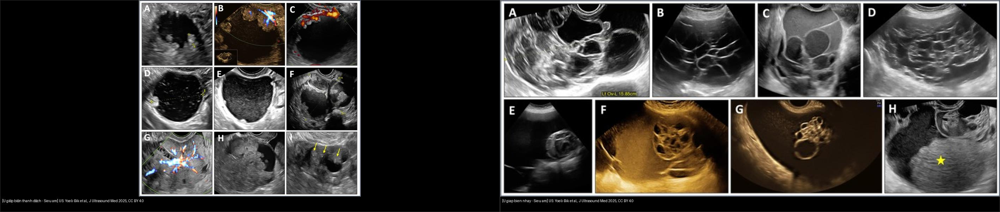
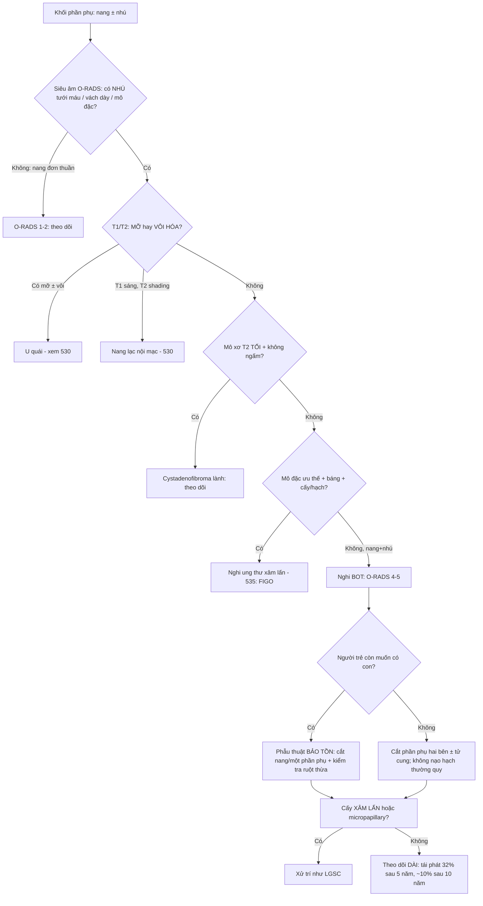
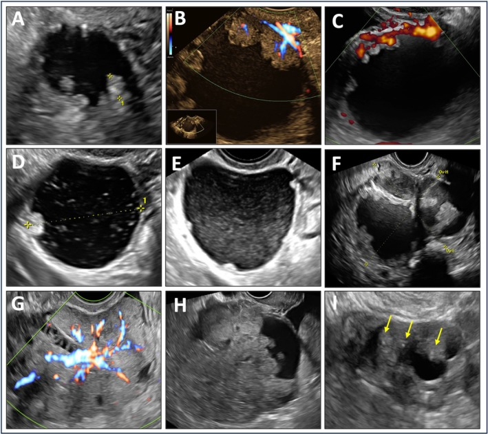
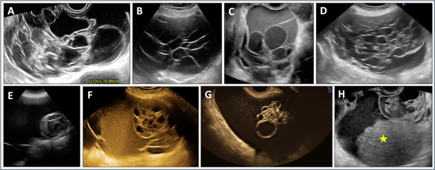
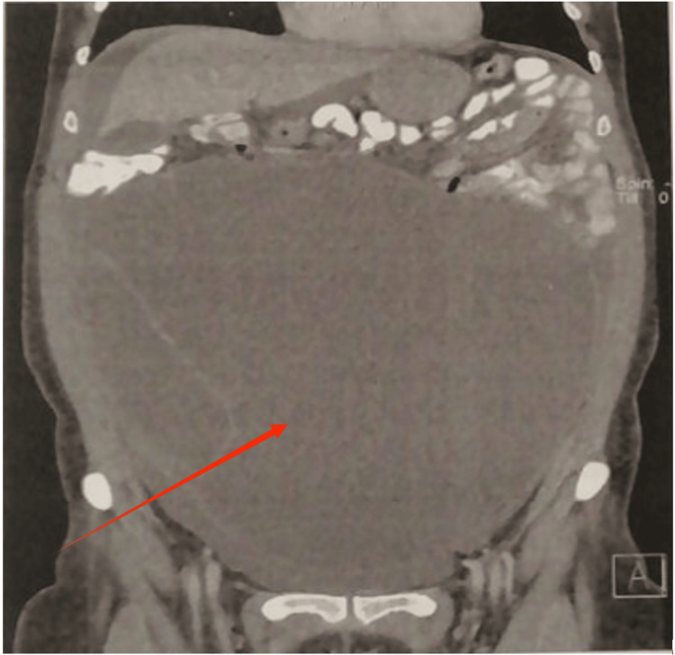
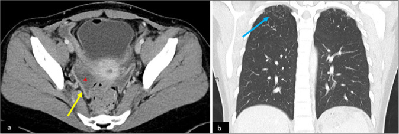
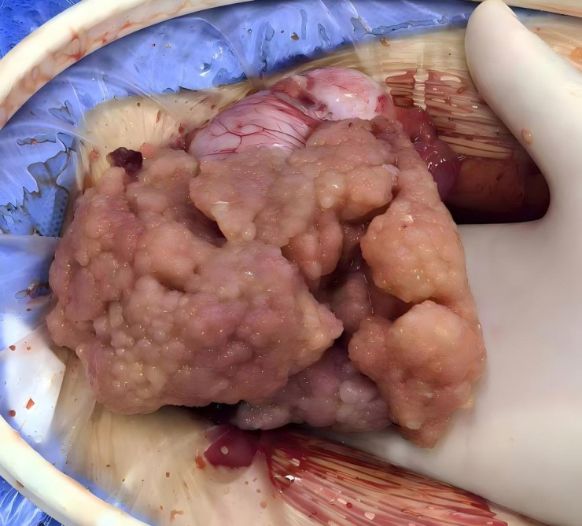

# 537 — U buồng trứng giáp biên (borderline): nhú trong nang, không xâm lấn / Borderline ovarian tumours

**Tags:** `pattern:u-buong-trung` `pattern:u-giap-bien` `vung:buong-trung` `score:O-RADS` `protocol:MRI-chau` `protocol:sieu-am-tu-cung-phan-phu`
**Mức chắc chắn (certainty):** tổng hợp y văn (literature synthesis) — nhóm tự biên từ y văn mở (Europe PMC/PMC: J Ultrasound Med, J Clin Imaging Sci, Front Oncol, Cancers, Cureus) + các ca minh họa có giấy phép; không phải ca nguyên văn đơn lẻ.

## 1. Tổng quan — "nửa lành nửa ác": có tăng sinh nhưng KHÔNG xâm lấn mô đệm + cơ chế hình ảnh

- **Định nghĩa mấu chốt (điều quyết định tên gọi):** u giáp biên (borderline ovarian tumour — BOT) là u biểu mô buồng trứng có **tăng sinh tế bào + dị dạng nhân rõ** (nhiều hơn u lành) **nhưng KHÔNG có xâm lấn mô đệm phá hủy (destructive stromal invasion)** — đúng tiêu chuẩn của ung thư xâm lấn. Chính chữ "không xâm lấn" này đổi tiên lượng và phẫu thuật: **không cần nạo hạch hệ thống, có thể bảo tồn sinh sản**.
- **Dịch tễ (định lượng):** BOT chiếm **~10–15%** u biểu mô buồng trứng, gặp ở **tuổi trung bình ~40** (sớm hơn ung thư xâm lấn ~60), **~1/3 ca < 40 tuổi** → nằm đúng nhóm tuổi sinh sản (so sánh `536`). Thể hay gặp: **thanh dịch (serous — ~50–55%)**, **nhầy (mucinous — ~15–20%)**, **seromucinous**, **endometrioid**, **tế bào sáng (clear cell)**, **Brenner**.
- **Sinh học — vì sao "giáp biên" không phải "lành":** nhóm thanh dịch mang đột biến **BRAF/KRAS** và là tổ tiên của **ung thư thanh dịch độ thấp (low-grade serous carcinoma — LGSC)**; nhóm nhầy gắn với **u nhầy ruột thừa/buồng trứng** (liên quan `539`). Có **mảng cấy (implants)** ở phúc mạc: **không xâm lấn (non-invasive)** — tiên lượng tốt; **xâm lấn (invasive implant)** = thực chất là **LGSC ngoài buồng trứng**, tiên lượng xấu hơn.
- **TẠI SAO hình ảnh là "nang + nhú" (giải thích vật lý/mô học):**
  - **Nhú (papillary projection):** chồi biểu mô ác–giáp biên có **lõi xơ–mạch (fibrovascular core)** → trên siêu âm Doppler/MVI là **cấu trúc đặc có TƯỚI MÁU** (khác cục máu đông/cặn không mạch); trên MRI **T2 trung gian, ngấm mạnh sau tiêm**. Vì sao "nhú mạch hóa" là dấu hiệu quan trọng: nó phân biệt chồi u thật với nhú xơ lành (không mạch).
  - **Nội dung nang:** nhầy (mucin) là glycoprotein giàu nước → **T2 rất sáng, T1 tối, KHÔNG mất tín hiệu khi fat-sat**; đặc hơn nước nên trên CT có thể **~10–20 HU** (nhỉnh hơn dịch đơn thuần 0–10 HU).
  - **Mô học quyết định "đồng nhất":** dysgerminoma/`536` đồng nhất; còn BOT **không đồng nhất** vì vừa nang vừa nhú + vách; u xơ tuyến nang (cystadenofibroma) lành lại **T2 TỐI** do mô xơ đặc nghèo nước.
- **Ngưỡng định lượng về theo dõi/tái phát (Barts 2026):** tái phát chung **3–10%**; **cắt nang (cystectomy) ~31%** so với cắt phần phụ/buồng trứng (BSO) ~5%; phẫu thuật bảo tồn **10–20%** vs triệt căn ~5%; **bệnh ngoài buồng trứng (extra-ovarian) tái phát tới 25%**. Về thời điểm: **37% tái phát < 2 năm, 31% từ 2–5 năm, 32% > 5 năm**, ~**10% sau 10 năm** → phải theo dõi **rất dài**. Yếu tố tăng tái phát: **u > 10 cm**, **tuổi ≥ 40**, **hai buồng trứng**, **kiến trúc micropapillary/cribriform**. Vi xâm lấn (**microinvasion, ổ < 5 mm**) **không đổi tiên lượng ở giai đoạn I**.
- **Vì sao quan trọng:** gọi nhầm BOT = "ung thư xâm lấn" → mổ quá rộng (cắt tử cung + nạo hạch + mạc nối) ở người trẻ còn muốn có con, là oan; ngược lại gọi nhầm BOT = "u lành" → bỏ theo dõi, mất ca LGSC tái phát muộn.

## 2. Mẫu hình + chẩn đoán phân biệt theo khuôn nang & mô đặc (Gamut)

- **Khuôn 1 — Nang có NHÚ mạch hóa (nang ± vách + ≥ 1 nhú ngấm/tưới máu):** **BOT thanh dịch** là điển hình nhất (O-RADS 4–5). Nhú càng nhiều, càng lớn → càng nghi BOT/ung thư xâm lấn.
- **Khuôn 2 — Nang NHIỀU NGĂN "tổ ong" (multilocular, > 10 ngăn nhỏ, dịch đục lấm tấm):** **BOT nhầy** — đặc trưng **một bên, rất lớn (nhiều ca > 20 cm)**, dịch nhầy có cặn lơ lửng; có thể có **hạt tổ ong (honeycomb nodules)**.
- **Khuôn 3 — VI NANG (microcystic pattern):** tập hợp dày các vi nang nhỏ tạo "bọt biển" — gặp ở cả **BOT thanh dịch/seromucinous/nhầy** lẫn **u xơ tuyến nang lành (cystadenofibroma)** → **chồng lấp nặng**, đây là cạm bẫy lớn (mục 5).
- **Khuôn 4 — Nang + MÔ ĐẶC ƯU THẾ:** thể hiếm **clear cell/endometrioid BOT** — khối đặc chiếm ưu thế, dễ gọi nhầm ung thư xâm lấn.
- **Khuôn 5 — Nhú MẶT NGOÀI buồng trứng (serous surface papillary BOT):** tổn thương dạng **"súp lơ" bám mặt vỏ buồng trứng**, buồng trứng có thể gần như bình thường → dễ **"trông lành tính"**, O-RADS có thể chỉ ra 3.
- **Gamut theo tuổi (bộ lọc đầu tiên):** **< 40 tuổi** → BOT/u mầm–mô đệm (`536`)/u quái; **> 50 tuổi** → nghiêng ung thư biểu mô xâm lấn (`535`).
- **Mimic cần loại:** **u xơ tuyến nang (cystadenofibroma)** lành (T2 tối, không nhú mạch); **ung thư biểu mô xâm lấn** (mô đặc nhiều, báng, hạch, cấy xâm lấn — `535`); **u quái trưởng thành** (mỡ ± vôi — `530`); **nang lạc nội mạc (endometrioma)** (T1 sáng, T2 shading); **áp-xe vòi–buồng trứng/xoắn** (`530`, `540`).

## 3. Bảng so sánh phân biệt (ma trận đối chiếu)

| Thực thể (entity) | Hình ảnh điển hình (US/CT/MRI) | Chốt vào (rule-in) | Chốt loại (rule-out) | Gợi ý xác nhận |
|---|---|---|---|---|
| **BOT thanh dịch (serous BOT)** | Nang ± vách có **NHÚ mạch hóa** nhiều; đôi khi nhú mặt ngoài; dịch trong | **Nhiều nhú có tưới máu trong nang ở người < 50 tuổi** | Khối mỡ ± vôi → không phải BOT (u quái) | MRI T1 sau tiêm (nhú ngấm) + mô học (không xâm lấn mô đệm) |
| **BOT nhầy (mucinous BOT)** | **Nang nhiều ngăn > 10 ngăn ("tổ ong"), lớn > 20 cm, một bên**, dịch đục có cặn | **Nang vi ngăn lớn một bên + hạt tổ ong + CA19-9 ±** | Nang vi ngăn **không nhú, T2 tối đều** → nghĩ cystadenofibroma | Phẫu thuật + **kiểm tra ruột thừa** (bỏ sót u nhầy ruột thừa) |
| **BOT seromucinous** | Nang nhiều nhú + dịch **"kính mờ"**; gắn **lạc nội mạc (endometriosis)** | **Nhú + dịch kính mờ + bối cảnh lạc nội mạc** | Dịch sáng hoàn toàn + không nhú → thể khác | Mô học; liên hệ endometriosis |
| **Serous surface papillary BOT** | **Nhú "súp lơ" mặt ngoài**, buồng trứng gần bình thường | **Chồi mặt vỏ có tưới máu + CA-125 ± + đôi khi hai bên** | Kén/khối nội buồng trứng đơn thuần → BOT nang thông thường | Soi ổ bụng, mô học; cẩn thận "trông lành" |
| **U xơ tuyến nang lành (cystadenofibroma)** | Nang ± vi nang với **thành/mô xơ T2 TỐI**, rất ít ngấm, không nhú mạch | **T2 tối đều + không DWI sáng + không nhú mạch** (nút lành) | Nhú mạch hóa/ngấm mạnh → nghĩ BOT | Theo dõi; tránh sinh thiết oan |
| **Ung thư xâm lấn (`535`)** | **Mô đặc chiếm ưu thế** + vách dày bất quy tắc + **báng + cấy xâm lấn + hạch** | **Mô đặc lớn + báng + cấy/hạch xâm lấn** | Khối nang trội, không báng/cấy → nghĩ BOT | FIGO phẫu thuật; CA-125 |
| **Nang lạc nội mạc (endometrioma)** | **T1 sáng + T2 shading (tối dần)**, nhiều ổ | **T1 sáng không đổi khi fat-sat** (máu cũ) | T1 tối + dịch sáng T2 → không phải endometrioma | MRI T1 fat-sat; bối cảnh đau/khó có con |

*Trái: **u giáp biên thanh dịch** — nang có nhiều NHÚ mạch hóa (Doppler), ổ nhú/đặc trong nang. Phải: **u giáp biên nhầy** — nang NHIỀU NGĂN kiểu "tổ ong", dịch đục lấm tấm. Nguồn: Yoeli-Bik R et al., J Ultrasound Med 2025, Fig. 1 & 2, CC BY 4.0 (ảnh ghép letterbox).*

## 4. Protocol chụp + O-RADS + phân giai đoạn FIGO + bảo tồn sinh sản

- **Siêu âm đầu tay (transvaginal + transabdominal, bắt buộc Doppler/vi mạch MVI):** mô tả theo **từ vựng O-RADS** — vách, **nhú (đếm + đo mm, dấu hiệu tưới máu)**, mô đặc, dịch đục/cặn. **MVI** thấy được mạch nhỏ cỡ tiểu động mạch trong nhú mà Doppler thường bỏ sót.
- **MRI chậu (đọc khối không kết luận được / nghi lan rộng):** T2W 3 mặt phẳng + T1W + **T1W fat-sat** + **DWI/ADC** + **DCE**; đối chiếu **O-RADS MRI**. Chốt định hướng: **nhú ngấm mạnh thì động mạch** (BOT/ác) vs **mô xơ T2 tối ít ngấm** (cystadenofibroma).
- **CT ngực–bụng–chậu có cản quang:** phân giai đoạn, tìm **cấy phúc mạc/mạc nối to**, báng, hạch, tổn thương phổi; cũng để thấy **ruột thừa bất thường** (nhầy ruột thừa → nghĩ `539`).
- **Dấu ấn:** **CA-125** (thanh dịch/ngoài buồng trứng) ± **CA19-9** (nhầy); dùng theo dõi, không dùng một mình để chốt lành/ác.
- **O-RADS (US v2022/MRI):** nhú ≥ 1 + tưới máu thường đẩy lên **O-RADS 4 (nguy cơ trung bình ~10–50%)**; đặc điểm nguy cơ cao → **O-RADS 5 (≥ 50%)**. **BOT là "vùng xám"**: nằm rải rác O-RADS 3→5, không có dấu hiệu nào một mình chốt BOT.
- **Phân giai đoạn & điều trị:** dùng **FIGO** chung u biểu mô (`535`). **Phẫu thuật bảo tồn sinh sản** (cắt nang/cắt một phần phụ một bên + phần giai đoạn) là lựa chọn ở người trẻ; **không nạo hạch hệ thống thường quy**; thể **micropapillary + cấy xâm lấn** cần xử trí như LGSC.
- **Frozen section:** độ chính xác phân biệt giáp biên với lành/ác **thấp hơn** u thường → kết quả mô bệnh sau cùng mới chốt phạm vi mổ.

## 5. Biến thể bình thường và cạm bẫy

- **Cạm bẫy "buồng trứng sau cắt nang" (post-cystectomy)** — *điểm chính của Kuo et al. 2026*: sau cắt nang, buồng trứng có thể có **cấu trúc xoắn cuộn, giả đặc (pseudosolid)**, dễ đọc nhầm là **thành phần đặc của BOT tái phát/tiến triển**. Đây là **vùng xám đã biết**, O-RADS chưa được kiểm định cho buồng trứng hậu phẫu → cần đọc cùng mô bệnh + so phim cũ.
- **Cạm bẫy mô phúc mạc sau mổ:** **dày/ngấm phúc mạc lan tỏa** sau cắt nang BOT có thể trông giống **lan tràn phúc mạc** và làm **CA-125 tăng** — nhưng mô học có thể là **viêm/dính lành**, không phải tiến triển xâm lấn (Kuo Fig. 7; ảnh ca 4 dưới). Đừng hóa trị oan vì hình ảnh.
- **Cạm bẫy "vi nang" (microcystic):** u xơ tuyến nang lành **cũng** tạo hình vi nang/bọt biển như BOT (JUM Fig. 7) → đừng chỉ vì "vi nang" mà chốt BOT; tìm **nhú mạch hóa** và **độ ngấm/T2**.
- **Nhú lành vs nhú u:** mọi "nhú" phải xem **tưới máu/ngấm**; nhú xơ lành không mạch. Đừng đếm nhú mà bỏ Doppler/MVI.
- **Serous surface papillary BOT "trông lành":** tổn thương ở mặt ngoài nên có thể **O-RADS 3**; nếu bệnh cảnh gợi ý (bụng to, CA-125) thì đánh giá kỹ vỏ buồng trứng hai bên.
- **Frozen section:** đừng chốt phạm vi mổ triệt căn chỉ dựa frozen; **BOT nhầy cần soi ruột thừa** (nguy cơ u nhầy ruột thừa — `539`).
- **Ngộ nhận "BOT = lành":** tái phát muộn nhiều năm → **theo dõi dài hạn**, không xuống thang sau 2–3 năm.

## 6. Tự lượng giá — Blind Quiz

**Ca 1 — Nữ ~20–40 tuổi, nang buồng trứng có nhú. Đọc siêu âm + Doppler.**

- Gợi ý: nang ± vách, có thành phần nhú trong nang.
- Hỏi: dấu hiệu nào phân biệt "nhú u" với "cục cặn/cục máu"? Chẩn đoán hàng đầu?

<b>Bấm để hiện đáp án (findings + chẩn đoán)</b>

- Dấu hiệu (findings): nang có **nhiều nhú (papillary projections)**; Doppler/MVI cho thấy **mạch máu trong nhú** — nhú có lõi xơ–mạch.
- Chẩn đoán (diagnosis): **u giáp biên thanh dịch (serous BOT)** — nhú mạch hóa là chồi biểu mô có lõi mạch, không phải cặn; cần MRI/định hướng theo O-RADS.
- Nguồn ảnh: Yoeli-Bik R et al., J Ultrasound Med 2025 Fig. 1, CC BY 4.0.

**Ca 2 — Nữ lớn tuổi, bụng to, khối nang NHIỀU NGĂN một bên rất lớn. Đọc siêu âm.**

- Hỏi: hình "tổ ong" (honeycomb) gợi ý gì? Vì sao phải kiểm tra ruột thừa?

<b>Bấm để hiện đáp án (findings + chẩn đoán)</b>

- Dấu hiệu (findings): nang **nhiều ngăn (> 10 ngăn nhỏ) kiểu "tổ ong"**, dịch đục lấm tấm (cặn nhầy); kích thước rất lớn, một bên.
- Chẩn đoán (diagnosis): **u giáp biên nhầy (mucinous BOT)** — thể nhầy thường một bên, khổng lồ, vi ngăn; **bắt buộc kiểm tra ruột thừa** (loại u nhầy ruột thừa, liên quan `539`).
- Nguồn ảnh: Yoeli-Bik R et al., J Ultrasound Med 2025 Fig. 2, CC BY 4.0.

**Ca 3 — Nữ 61 tuổi không triệu chứng, khối nang rất lớn chiếm bụng. Đọc MRI coronal.**

- Hỏi: khối "gần bằng nước" với vách dày + vôi hóa thành gợi ý gì? Vì sao khối lớn mà bệnh nhân lại không triệu chứng?

<b>Bấm để hiện đáp án (findings + chẩn đoán)</b>

- Dấu hiệu (findings): MRI cho thấy **khối nang tín hiệu gần bằng nước, vách trong dày, có vôi hóa thành (mũi tên đỏ)**, đường kính tối đa **24 cm** từ buồng trứng phải, chiếm trọn ổ bụng.
- Chẩn đoán (diagnosis): **u giáp biên nhầy buồng trứng (mucinous BOT)** — phát triển âm thầm, thường tình cờ; cần dấu ấn (CA19-9/CA-125) + mô học.
- Nguồn ảnh: Troupi M et al., Cureus 2025 Fig. 1, CC BY 4.0.

**Ca 4 — Nữ trẻ sau cắt nang BOT, CA-125 tăng, dày phúc mạc. Đọc CT/MRI chậu.**

- Hỏi: dày/ngấm phúc mạc lan tỏa + CA-125 tăng có đồng nghĩa "tiến triển xâm lấn"? Cạm bẫy ở đây là gì?
- **Dòng phản biện (Argon):** nguồn gốc là **case series giáo dục** — kết luận dựa trên diễn tiến và mô học, không phải thử nghiệm; đừng khái quát hóa thành quy tắc.

<b>Bấm để hiện đáp án (findings + chẩn đoán)</b>

- Dấu hiệu (findings): (a) CT/MRI chậu: **dày và ngấm phúc mạc lan tỏa ở chậu hông (dấu sao/mũi tên vàng)**; (b) tổn thương màng phổi/phổi kèm theo (mũi tên xanh).
- Chẩn đoán (diagnosis): hình ảnh **giống lan tràn phúc mạc** sau cắt nang BOT, nhưng đây là **cạm bẫy**: buồng trứng hậu phẫu và **dày phúc mạc lành/viêm** có thể **trông giống tiến triển** và kèm CA-125 tăng → cần tương quan mô bệnh, đừng mặc định là bệnh ác.
- Nguồn ảnh: Kuo BJ et al., J Clin Imaging Sci 2026 Fig. 7, CC BY-NC-SA 4.0 (giữ nguyên bản).

**Ca 5 — Ảnh đại thể: khối "súp lơ" bám mặt buồng trứng. Đọc ảnh đại thể.**

- Hỏi: khối dạng "súp lơ" ở MẶT NGOÀI buồng trứng gợi ý thể nào của BOT? Vì sao dễ "trông lành" trên siêu âm?

<b>Bấm để hiện đáp án (findings + chẩn đoán)</b>

- Dấu hiệu (findings): khối **dạng "súp lơ" (cauliflower-like) gồm nhiều nhú** bám **mặt ngoài (vỏ)** buồng trứng, hai bên.
- Chẩn đoán (diagnosis): **BOT thanh dịch nhú mặt ngoài (serous surface papillary BOT)** — vì tổn thương ở bề mặt nên phần nang bên trong gần bình thường → trên siêu âm dễ chỉ xếp O-RADS 3 ("trông lành").
- Nguồn ảnh: Wang Z et al., Front Oncol 2026 Fig. 3, CC BY 4.0.

**Ca 6 — Ảnh ghép: bên nào giáp biên nhầy, bên nào giáp biên thanh dịch?**

- Hỏi: dấu hiệu nào tách hai bên? Thể nào hay gặp hơn và ở tuổi nào?

<b>Bấm để hiện đáp án (findings + chẩn đoán)</b>

- **Trái = BOT thanh dịch:** nang có **NHÚ mạch hóa** (Doppler) — chồi u có lõi xơ–mạch.
- **Phải = BOT nhầy:** nang **NHIỀU NGĂN "tổ ong"** (> 10 ngăn) dịch đục lấm tấm, kích thước lớn một bên.
- Chốt: **nhú tưới máu → thanh dịch**; **vi ngăn/honeycomb một bên → nhầy**. Thanh dịch hay gặp hơn (~50–55%) và BOT nói chung ở tuổi ~40.
- Nguồn: Yoeli-Bik R et al., J Ultrasound Med 2025 Fig. 1 & 2, CC BY 4.0 (ảnh ghép letterbox).

## Bài liên quan chéo
- [500 – Tổng quan Vú & Sản phụ khoa](../500-tong-quan-vu-san-phu-khoa/lesson.md)
- [530 – Khối phần phụ O-RADS, dermoid & xoắn](../530-buong-trung-ORADS-sieu-am-MRI/lesson.md)
- [535 – Ung thư buồng trứng, phúc mạc & u Krukenberg](../535-ung-thu-buong-trung-phuc-mac-krukenberg/lesson.md)
- [536 – U mầm & u mô đệm–dây sinh dục buồng trứng](../536-u-mam-u-mo-dem-buong-trung/lesson.md)
- [539 – Pseudomyxoma peritonei & u nhầy ruột thừa](../539-pseudomyxoma-peritonei/lesson.md)
- [540 – Lạc nội mạc tử cung sâu (DIE) & viêm vùng chậu](../540-lac-noi-mac-tu-cung-sau-DIE-MRI/lesson.md)

## Ảnh
- `537_serous-BOT_US_PMC12240477.jpg`, `537_mucinous-BOT_US_PMC12240477.jpg`, `537_microcystic-DDx_US_PMC12240477.jpg`, `537_mucinous-BOT_MRI_PMC12504785.jpg`, `537_serous-surface-papillary_GROSS_PMC12902836.jpg`, `537_postop-peritoneal_MRI_PMC13157898.jpg`, `composite_serous-vs-mucinous-BOT.jpg`. Nguồn + giấy phép từng ảnh trong `images/CREDITS.md`.

> Không dùng để chẩn đoán độc lập khi chưa có người hướng dẫn.
