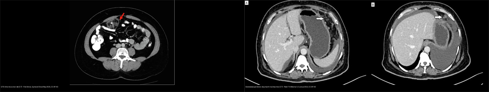
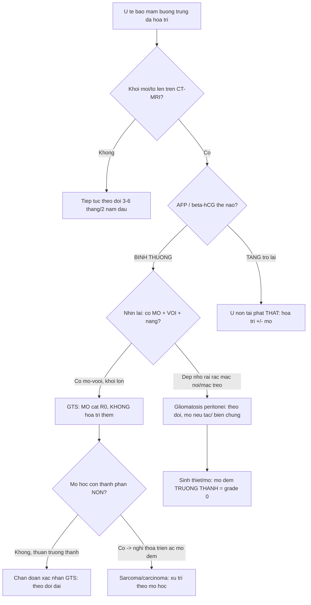
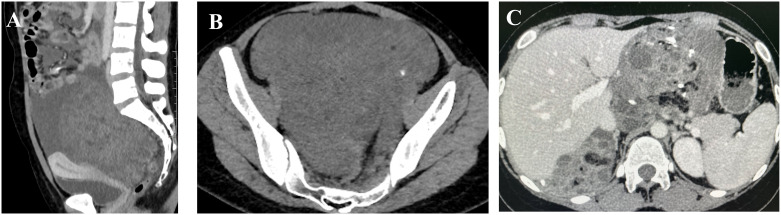
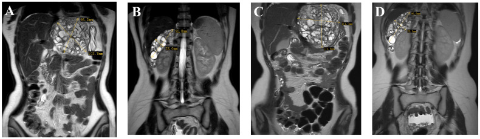
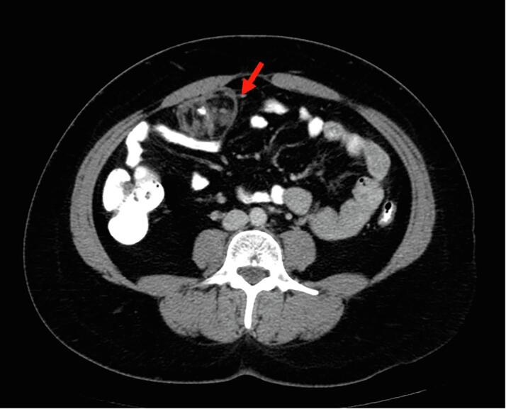
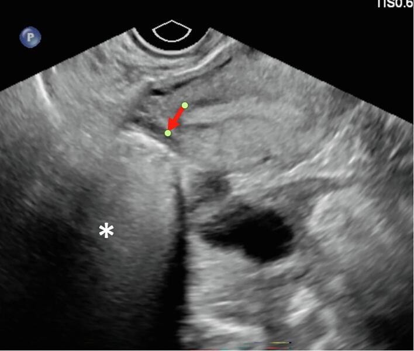
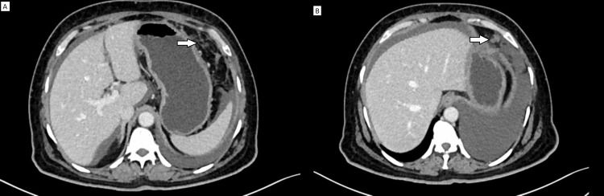
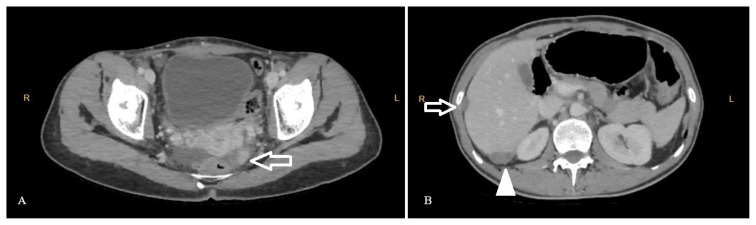
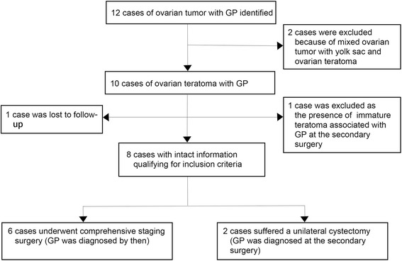

# 538 — Hội chứng u quái "mọc" (growing teratoma syndrome) & gliomatosis peritonei / Growing teratoma syndrome & gliomatosis peritonei

**Tags:** `pattern:u-buong-trung` `pattern:u-quai` `pattern:gieo-rac-phuc-mac` `vung:buong-trung` `vung:phuc-mac` `score:FIGO` `protocol:CT-bung-chau` `protocol:MRI-chau` `protocol:AFP-bHCG-LDH`
**Mức chắc chắn (certainty):** tổng hợp y văn (literature synthesis) — nhóm tự biên từ y văn mở (Europe PMC/PMC: Front Oncol, Gynecol Oncol Rep, Turk J Med Sci, J Ovarian Res, Cureus, Curr Oncol) + các ca minh họa có giấy phép; không phải ca nguyên văn đơn lẻ.

## 1. Tổng quan — "khối to lên MÀ chỉ có mô trưởng thành": nghịch lý của u quái sau hóa trị + cơ chế hình ảnh

- **Hội chứng u quái "mọc" (growing teratoma syndrome — GTS):** định nghĩa Logothetis 1982 gồm **3 tiêu chuẩn bắt buộc** (thiếu 1 tiêu chuẩn là không phải GTS):
  1. **Khối phúc mạc/ổ bụng TO LÊN trong hoặc sau hóa trị** u tế bào mầm (germ cell tumor);
  2. **Dấu ấn huyết thanh trước đây tăng nay về bình thường** (AFP, β-hCG, LDH); nếu còn tăng → nghĩ **u non tái phát thật**, không phải GTS;
  3. **Mô bệnh của khối cắt ra CHỈ có u quái trưởng thành (mature teratoma)**, không có thành phần mầm non ác.
- **Dịch tễ (định lượng):** ở u tế bào mầm không tinh hoàn (non-seminomatous germ cell tumor — NSGCT) tinh hoàn, GTS gặp **1,9–7,6%**; ở buồng trứng hiếm hơn, một số báo cáo ~**12%**; con số dao động mạnh vì tiêu chuẩn chẩn đoán khác nhau. Thường xuất hiện **< 2 năm sau hóa trị**.
- **Sinh lý bệnh — vì sao KHÔNG phải "tái phát":** hóa trị (BEP) diệt **thành phần mầm NON** (rất nhạy), nhưng **thành phần u quái trưởng thành kháng trị** tiếp tục lớn dần (bơm nhầy/nang, mô thần kinh–sụn–xương) → khối to lên **dù dấu ấn bình thường**. Nói cách khác đây là **"thất bại về mặt mô học" của hóa trị**: tế bào ác bị giết nhưng xác mô trưởng thành còn lại và phát triển.
- **TẠI SAO hình ảnh trông "đặc như u ác" mà vẫn lành:** mô quái trưởng thành chứa **mỡ** (CT **−40 đến −120 HU**, T1 sáng mất tín hiệu khi fat-sat), **vôi hóa** (CT **> 100 HU**, có thể thô/lấm tấm), nang dịch và **mô thần kinh–sụn** (T2 trung gian). Chính các thành phần "quái" (mỡ + vôi + nang + xơ) chồng lên nhau tạo hình "hỗn hợp đặc–nang" dễ nhầm khối u hoạt động.
- **Nguy cơ tiềm tàng:** **thoái triển ác phần mô đệm (somatic malignant transformation)** — u quái trưởng thành chuyển thành sarcoma/xuất vảy/adeno — gặp **3–5,4%**, tiên lượng xấu → vẫn phải mổ lấy toàn bộ, không "để yên" vì nghĩ lành.
- **Kết quả sau mổ (định lượng):** cắt **R0 → sống 5 năm 89–90%**, tái phát sau cắt trọn **0–4%**; cắt **không hoàn toàn → tái phát 72–83%** — chính vì thế GTS là **bài toán phẫu thuật**, không phải hóa trị.
- **Gliomatosis peritonei (GP):** mảnh ghép **mô đệm thần kinh TRƯỞNG THÀNH (mature glial tissue)** rải trên **phúc mạc, mạc nối, hạch bạch huyết**; WHO xếp **độ 0 (grade 0)** trong thang u quái buồng trứng non (Norris). Cơ chế: **gieo rác** qua vết rách vỏ u/vỡ khối vào ổ bụng hoặc **lan theo bạch mạch** (đã chứng minh tổ chức glial trong hạch chậu–cạnh ĐMC). GP **hiếm khi** đơn độc, **thường đi kèm** u quái non (và có thể đồng thời với GTS).
- **Vì sao GP lành dù "gieo rác khắp phúc mạc":** tổ chức đệm trưởng thành **không xâm lấn phá hủy** và không di căn tiếp → **KHÔNG cần hóa trị**, theo dõi dài (nhiều ca ổn định/không tiến triển nhiều năm). Ngược lại, mô đệm NON (immature glia) trong ổ gieo rắc **mới** là u non thật, phải hóa trị.
- **Vì sao cực quan trọng trên lâm sàng:** GTS/GP **hay bị đọc nhầm là "tiến triển – tái phát"** → bệnh nhân bị cho thêm hóa trị (vô ích, độc) trong khi điều trị đúng là **MỔ**. Ghi nhớ câu chốt: **khối to lên + dấu ấn BÌNH THƯỜNG = nghĩ GTS/GP, đừng hóa trị thêm.**

## 2. Mẫu hình + chẩn đoán phân biệt theo vị trí (Gamut)

- **Khuôn 1 — Khối phúc mạc/ổ bụng tăng kích thước sau hóa trị, dấu ấn bình thường:** **GTS** (u quái trưởng thành). Tổn thương **giàu mỡ ± vôi ± nang**, có thể **nhiều ổ** (lan tới hạch sau phúc mạc, gan rốn, mạc nối, thậm chí ngoài ổ bụng).
- **Khuôn 2 — Nốt/dep nhỏ rải rác mạc nối–mạc treo–mặt gan–hạch, dấu ấn bình thường:** **GP** (mô đệm trưởng thành). Hình ảnh nhẹ nhàng: **dep nhỏ, mảnh xơ hóa mỡ mạc treo (fat stranding), nốt lấm tấm** — **không** tạo khối lớn đặc xâm lấn.
- **Khuôn 3 — GP "thành khối" hoặc gây hiệu ứng:** ổ gieo rắc dày đặc có thể giả **bánh mạc nối/carcinomatosis**; thỉnh thoảng **nang/dep tạo khối đẩy tắc ruột** (dù lành) → vẫn phải mổ giải ép.
- **Khuôn 4 — GTS + GP đồng thời:** khối mỡ–vôi lớn (GTS) **cộng** dep glial rải rác (GP) — ca hiếm, ghi nhận ~20 trường hợp trong y văn.
- **Khuôn 5 — Khối to lên + dấu ấn TĂNG:** KHÔNG phải GTS — nghĩ **u non tái phát thật / u quái non** → hóa trị ± mổ.
- **Gamut theo dấu ấn (bộ lọc đầu tiên):** **dấu ấn bình thường + khối to** → GTS/GP; **dấu ấn tăng** → tái phát u non; **dấu ấn tăng nhưng khối chỉ mỡ/vôi** → cẩn thận u quái non còn sót/thoái triển ác.
- **Mimic cần loại:** **u quái non tái phát** (kích thước, dấu ấn, mô học immature), **thoái triển ác mô đệm (sarcoma/carcinoma)** (thành phần đặc ngấm mạnh, ác tính trên mô học), **carcinomatosis phúc mạc** (báng lớn + bánh mạc nối + `535`/`539`), **LPD – bệnh sinh bạch mạc lành sau morcellation** (`518`), **u quái trưởng thành nguyên phát mới**.

## 3. Bảng so sánh phân biệt (ma trận đối chiếu)

| Thực thể (entity) | Hình ảnh điển hình (US/CT/MRI) | Chốt vào (rule-in) | Chốt loại (rule-out) | Gợi ý xác nhận |
|---|---|---|---|---|
| **GTS (u quái "mọc")** | Khối **mỡ ± vôi ± nang** ở ổ bụng/hạch, **TO LÊN** so với phim trước, có thể đặc–nang hỗn hợp | **Khối giàu mỡ to lên sau hóa trị + AFP/β-hCG BÌNH THƯỜNG** | **Dấu ấn TĂNG** → u non tái phát, không phải GTS | CT/MRI bụng–chậu + dấu ấn theo mốc; **khẳng định bằng mô bệnh trưởng thành** |
| **Gliomatosis peritonei** | **Dep/nốt nhỏ** mạc nối–mạc treo–mặt gan, **mảnh xơ mỡ**; hiếm khi thành khối | **Dep glial nhỏ + tiền sử u quái + dấu ấn bình thường** | Dep **đặc lớn ngấm mạnh + báng nhiều** → carcinomatosis/`535` | Sinh thiết/sinh thiết cắt trọn: **mô đệm trưởng thành (grade 0)** |
| **U quái non tái phát (thật)** | Khối đặc–nang hỗn hợp, thành phần **non ngấm**, có thể di căn | **Dấu ấn AFP/β-hCG TĂNG trở lại + thành phần non trên mô học** | Mô học **thuần trưởng thành + dấu ấn bình thường** → GTS/GP | Mô bệnh (immature neuroepithelium); AFP/hCG |
| **Thoái triển ác mô đệm (sarcoma/carcinoma)** | Thành phần **đặc ngấm mạnh**, xâm lấn, có thể ác tính thứ phát | **Phần mô đệm đặc ngấm, mô học ác tính (sarcoma/SCC/adeno)** | Khối thuần trưởng thành không ngấm → GTS lành | Mô bệnh + hóa mô miễn dịch; tiên lượng xấu |
| **Carcinomatosis phúc mạc (`535`/`539`)** | **Báng lớn + bánh mạc nối + "khía" gan–lách**, nốt đặc | **Báng nhiều + bánh mạc nối + ngấm mạnh** | Dep nhỏ rải rác, dấu ấn bình thường → GP | Mô bệnh/tế bào học; CA-125 |
| **U quái trưởng thành buồng trứng (`530`)** | Nang mỡ + vôi + nốt Rokitansky, **một khối**, từ đầu đã có | **Mỡ + vôi + tóc/nốt Rokitansky từ đầu** | Có tiền sử u mầm + khối to lên sau hóa trị → GTS/GP | US/CT đặc trưng; bóc khi to/xoắn |

*Trái: **GTS** — khối giàu mỡ + vôi (mũi tên đỏ) ở ổ bụng sau hóa trị, dấu ấn bình thường. Phải: **gliomatosis peritonei** — dep/dải xơ mỡ ở mạc nối – mạc treo (mũi tên trắng), không tạo khối đặc xâm lấn. Nguồn: File B et al., Gynecol Oncol Rep 2025 & Patel T & Meena V, Cureus 2022, CC BY 4.0 (ảnh ghép letterbox).*

### Dấu hiệu "chốt" hay bị bỏ sót
- **So phim cũ là bắt buộc:** GTS chỉ lộ ra khi đặt cạnh phim trước hóa trị — nhìn 1 phim đơn độc rất dễ gọi "tái phát".
- **Đối chiếu dấu ấn theo mốc thời gian:** đường cong AFP/β-hCG **giảm dần về bình thường rồi ĐI NGANG** trong khi khối to lên = GTS; đường cong **tăng trở lại** = tái phát u non.
- **Tìm mỡ + vôi trong "khối tái phát":** thành phần quái (mỡ CT âm, vôi > 100 HU) gợi GTS hơn là u non.

## 4. Protocol chụp + phân giai đoạn FIGO + quyết định mổ (flowchart)

- **Đánh giá ban đầu u tế bào mầm buồng trứng:** siêu âm đầu tay (mô tả mỡ/vôi/nang) → **CT ngực–bụng–chậu có cản quang** để phân giai đoạn (**FIGO 2014** cho ung thư buồng trứng, dùng chung `536`) + **dấu ấn AFP, β-hCG, LDH** trước và sau mỗi đợt.
- **Theo dõi sau hóa trị (điểm mấu chốt):** **CT bụng–chậu (± ngực) mỗi 3–6 tháng trong 2 năm đầu**, sau đó thưa dần; đo kích thước tổn thương và **so với phim nền**. Bất kỳ **khối mới/to lên** đều phải **đối chiếu dấu ấn trước khi quyết định "tiến triển"**.
- **Dấu ấn huyết thanh hỗ trợ:**
  - **AFP** (u xoang nội bì/yolk sac, u quái non) — thời gian bán hủy ~**5–7 ngày**;
  - **β-hCG** (u nguyên bào nuôi/choriocarcinoma, dysgerminoma) — bán hủy ~**24–36 giờ**;
  - **LDH** (dysgerminoma) — bán hủy ~**2–3 ngày**.
  - Đường cong **giảm đúng chu kỳ bán hủy rồi đi ngang** + khối to = GTS. Đường cong **chững lại rồi tăng** = tái phát thật.
- **Chẩn đoán hình ảnh + mô học:** nghi GTS/GP → **mổ bóc/đánh giá mô học** (đây là "chẩn đoán mổ"): lấy tối đa tổn thương để (a) loại thành phần NON, (b) tìm **thoái triển ác mô đệm**; lấy **mẫu rộng + nhiều điểm** vì tổn thương hỗn hợp dễ bỏ sót phần non.
- **Nguyên tắc xử trí:** GTS → **cắt trọn R0** (bảo tồn sinh sản khi có thể), **KHÔNG hóa trị thêm**; **cắt sớm khi khối còn nhỏ** để tránh biến chứng cơ học/tắc ruột; theo dõi dài vì có thể xuất hiện khối mới. GP → phần lớn **theo dõi** (grade 0, lành), mổ khi gây biến chứng/tắc; **hạch có mô glial** cũng lành, **không cần hóa trị**.

## 5. Biến thể bình thường và cạm bẫy

- **Cạm bẫy số 1 — gọi "tiến triển/tái phát" rồi cho hóa trị thêm:** đây là lỗi điển hình của GTS. Ghi nhớ: **khối to + dấu ấn bình thường = GTS/GP → MỔ**, không hóa trị.
- **Cạm bẫy "dấu ấn bình thường mà vẫn loại trừ ác":** GTS có thể kèm **thoái triển ác mô đệm (3–5,4%)**; phần mô đệm đặc ngấm mạnh/xâm lấn cần mô học, không loại trừ chỉ vì dấu ấn bình thường.
- **Cạm bẫy gieo rắc glial trong hạch:** hạch chậu–cạnh ĐMC chứa mô glial trưởng thành **không** phải di căn ác và **không cần hóa trị** — đừng nâng giai đoạn rồi điều trị quá mức.
- **Cạm bẫy mô học "một chỗ trưởng thành":** GP/GTS là tổn thương **nhiều ổ**; lấy 1 mẫu thấy mô trưởng thành **không đủ loại** thành phần non ở chỗ khác → **lấy nhiều mẫu/đa điểm**.
- **Cạm bẫy "thỏa mãn tìm kiếm":** thấy khối GTS lớn rồi bỏ sót **GP rải rác** (hoặc ngược lại) — luôn quét đủ mạc nối/mạc treo/mặt gan/hạch.
- **Cạm bẫy phẫu thuật:** cắt **không trọn** (R2) làm tái phát vọt lên **72–83%** → luôn nhắm **R0**, mổ sớm khi khối còn nhỏ, tránh biến chứng tắc ruột/chèn ép.
- **Follow-up ngắn hạn:** GTS/GP có thể xuất hiện **muộn** và GP có thể **ổn định nhiều năm** — đừng xuống thang theo dõi quá sớm.

## 6. Tự lượng giá — Blind Quiz

**Ca 1 — Nữ trẻ đã điều trị u quái buồng trứng non bằng hóa trị BEP, dấu ấn về bình thường, nay CT thấy khối ổ bụng lớn hơn. Đọc CT so sánh.**

- Gợi ý lâm sàng (clinical context): đã hết hóa trị, AFP/β-hCG bình thường, khối ổ bụng to lên.
- Câu hỏi: Dấu hiệu chính? Đây là tái phát hay hội chứng khác? Xử trí?

<b>Bấm để hiện đáp án (findings + chẩn đoán)</b>

- Dấu hiệu (findings): (A, B) khối đặc–nang lớn chiếm ổ bụng–chậu với **vôi hóa lấm tấm**; (C) sau hóa trị **khối vẫn lớn** nhưng nay chứa **mỡ đại thể** + vôi (mature teratoma) → **TO LÊN** so với phim trước.
- Chẩn đoán (diagnosis): **hội chứng u quái "mọc" (GTS)** — khối to lên sau hóa trị mà **dấu ấn bình thường** và mô học chỉ có thành phần **trưởng thành**; điều trị là **MỔ cắt trọn R0**, không hóa trị thêm (cắt trọn → tái phát 0–4%, không trọn → 72–83%).
- Nguồn ảnh: Tao J et al., Front Oncol 2024, Fig. 1, CC BY 4.0.

**Ca 2 — Cùng bệnh cảnh, MRI bụng coronal. Đọc MRI.**

- Hỏi: các khối ở đâu? Thành phần nào gợi bản chất lành? Có nên hóa trị thêm?

<b>Bấm để hiện đáp án (findings + chẩn đoán)</b>

- Dấu hiệu (findings): **nhiều khối** ở khoang quanh gan–dạ dày và chậu hông, kích thước lớn dần theo thời gian (2023-07-19 → 2023-09-24), **tín hiệu MỠ** (sáng T1, mất khi fat-sat) + nang; tổn thương **lan nhiều khoang**.
- Chẩn đoán (diagnosis): **GTS lan rộng (nhiều ổ)** — thành phần mỡ trưởng thành + to lên sau hóa trị = lành về mô học; **KHÔNG hóa trị thêm**, cần **mổ bóc trọn** và theo dõi dài.
- Nguồn ảnh: Tao J et al., Front Oncol 2024, Fig. 3, CC BY 4.0.

**Ca 3 — Khối mỡ nhỏ ở mạc treo sau 7 tháng hết hóa trị. Đọc CT.**

- Hỏi: thành phần nào trong khối? Vì sao cần mổ dù "chỉ mỡ"?

<b>Bấm để hiện đáp án (findings + chẩn đoán)</b>

- Dấu hiệu (findings): khối **~5 cm chủ yếu mỡ + một vôi hóa** (mũi tên đỏ), xuất hiện **10 tháng sau mổ** u quái non và **7 tháng sau hết hóa trị**, trong khi **AFP 2,7 ng/mL, LDH 160 U/L, CA-125 bình thường**.
- Chẩn đoán (diagnosis): **GTS** (mature teratoma) — mổ bóc khối (kích thước bệnh phẩm 5 × 4 × 3,5 cm); mô học **chỉ mô trưởng thành**. Mổ cần thiết để (a) loại thành phần non, (b) phòng biến chứng cơ học, (c) loại **thoái triển ác**.
- Nguồn ảnh: File B et al., Gynecol Oncol Rep 2025, Fig. 2A-B, CC BY 4.0.

**Ca 4 — Siêu âm cùng ca 3. Đọc siêu âm.**

- Hỏi: khối tăng hồi âm + suy giảm sau gợi chất gì bên trong? Có phải "khối đặc ác"?

<b>Bấm để hiện đáp án (findings + chẩn đoán)</b>

- Dấu hiệu (findings): khối **tăng hồi âm (hyperechoic)** với **suy giảm âm phía sau (posterior attenuation)** — gợi **mỡ + mô quái**; không phải tổ chức đặc ác đồng nhất.
- Chẩn đoán (diagnosis): **GTS** (mature teratoma) — siêu âm chỉ gợi bản chất quái (mỡ/vôi), **không chốt lành–ác**; cần CT/MRI + dấu ấn + mô học. Kẻo gọi nhầm "khối đặc ác" rồi hóa trị.
- Nguồn ảnh: File B et al., Gynecol Oncol Rep 2025, Fig. 2C, CC BY 4.0.

**Ca 5 — Dep nhỏ mạc nối–mạc treo ở bệnh nhân từng có u quái. Đọc CT.**

- Hỏi: hình ảnh "dep nhỏ + mảnh xơ mỡ" gợi gì? Có cần hóa trị không?

<b>Bấm để hiện đáp án (findings + chẩn đoán)</b>

- Dấu hiệu (findings): (A) **mảnh xơ hóa mỡ (fat stranding)** tinh tế ở mạc nối/mạc treo; (B) **dep mô mềm** mạc nối — tổn thương nhỏ, rải rác, không tạo khối đặc xâm lấn.
- Chẩn đoán (diagnosis): **gliomatosis peritonei** — mô đệm thần kinh **trưởng thành** gieo rắc; **grade 0**, tiên lượng lành, **KHÔNG hóa trị**; theo dõi dài.
- Nguồn ảnh: Patel T & Meena V, Cureus 2022, Fig. 2, CC BY 4.0.

**Ca 6 — Implant dưới vỏ gan–gan rốn. Đọc CT.**

- Hỏi: ổ implant ở đâu? Tại sao khối "ngấm thuốc" vẫn có thể là GP?

<b>Bấm để hiện đáp án (findings + chẩn đoán)</b>

- Dấu hiệu (findings): (A) **implant dạng nốt ngấm thuốc ở phúc mạc chậu trái**; (B) **implant giảm đậm độ 13 mm có vôi hóa lấm tấm** giữa hạ phân thùy V–VI gan và tổn thương 25 mm ngay dưới vỏ gan.
- Chẩn đoán (diagnosis): **đồng tồn tại GTS + gliomatosis peritonei** sau u quái non buồng trứng — mô học lần 2: **mature teratoma + GP (mô glial trưởng thành, grade 0)**; khối ngấm thuốc vẫn lành vì là **mô glial trưởng thành** (không phải u non). Xử trí: **mổ + bảo tồn sinh sản**, không hóa trị thêm.
- Nguồn ảnh: Türkmen O et al., Turk J Med Sci 2024, Fig. 1, CC BY 4.0.

**Ca 7 — Sơ đồ chuỗi ca trong y văn. Đọc sơ đồ.**

- Hỏi: sơ đồ nói gì về quan hệ giữa GP và thái độ điều trị? Tại sao "GP tại thì mổ thứ hai" lại quan trọng?

<b>Bấm để hiện đáp án (findings + chẩn đoán)</b>

- Dấu hiệu (findings): từ 12 ca u quái buồng trứng có GP → loại trừ còn **8 ca đủ tiêu chuẩn**; **6 ca mổ phân giai đoạn trọn** (chẩn đoán GP ngay), **2 ca chỉ cắt nang một bên** (GP chỉ phát hiện **ở thì mổ thứ hai**).
- Chẩn đoán (diagnosis): **gliomatosis peritonei** — thường đi kèm u quái buồng trứng; **GP grade 0, không cần hóa trị**; bài học: phẫu thuật **phân giai đoạn không trọn** dễ **bỏ sót GP**, cần **lấy mẫu/đánh giá phúc mạc đầy đủ**; theo dõi dài vì GP có thể xuất hiện muộn.
- Nguồn ảnh: Wang D et al., J Ovarian Res 2016, Fig. 1, CC BY 4.0.

**Ca 8 — Ảnh ghép: bên nào GTS, bên nào gliomatosis peritonei?**

- Hỏi: dấu hiệu nào tách hai bên? Bên nào cần mổ trọn, bên nào phần lớn chỉ theo dõi?

<b>Bấm để hiện đáp án (findings + chẩn đoán)</b>

- **Trái = GTS:** **khối lớn giàu mỡ + vôi** (mũi tên đỏ) → **MỔ cắt trọn R0**, không hóa trị thêm.
- **Phải = gliomatosis peritonei:** **dep nhỏ + mảnh xơ mỡ** ở mạc nối/mạc treo (mũi tên trắng) → **theo dõi**, mổ khi gây biến chứng; **grade 0, lành**.
- Chốt: **khối lớn giống u nhưng lành (mỡ/vôi) = GTS**; **gieo rắc nhỏ nhẹ = GP**; cả hai đều **dấu ấn bình thường** và **KHÔNG hóa trị thêm**.
- Nguồn: File B et al., Gynecol Oncol Rep 2025 & Patel T & Meena V, Cureus 2022, CC BY 4.0 (ảnh ghép letterbox).

## Bài liên quan chéo
- [500 – Tổng quan Vú & Sản phụ khoa](../500-tong-quan-vu-san-phu-khoa/lesson.md)
- [530 – Khối phần phụ O-RADS, dermoid & xoắn](../530-buong-trung-ORADS-sieu-am-MRI/lesson.md)
- [535 – Ung thư buồng trứng, phúc mạc & u Krukenberg](../535-ung-thu-buong-trung-phuc-mac-krukenberg/lesson.md)
- [536 – U mầm & u mô đệm–dây sinh dục buồng trứng](../536-u-mam-u-mo-dem-buong-trung/lesson.md)
- [537 – U buồng trứng giáp biên (borderline)](../537-u-buong-trung-giap-bien/lesson.md)
- [539 – Pseudomyxoma peritonei & u nhầy ruột thừa](../539-pseudomyxoma-peritonei/lesson.md)
- [533 – Theo dõi dài hạn & bảo tồn sinh sản sau u buồng trứng](../533-theo-doi-va-bao-ton-sinh-san-sau-u-buong-trung/lesson.md)

## Ảnh
- `538_gts-CT-truoc-sau_PMC11284059.jpg`, `538_gts-tien-trien-MRI_PMC11284059.jpg`, `538_gts-khoi-mo-CT_PMC11993180.jpg`, `538_gts-sieu-am_PMC11993180.jpg`, `538_gp-implant-CT_PMC11673672.jpg`, `538_gp-dep-CT_PMC9536809.jpg`, `538_gp-flowchart_PMC4966768.jpg`, `composite_GTS-vs-GP.jpg`. Nguồn + giấy phép từng ảnh trong `images/CREDITS.md`.

> Không dùng để chẩn đoán độc lập khi chưa có người hướng dẫn.
