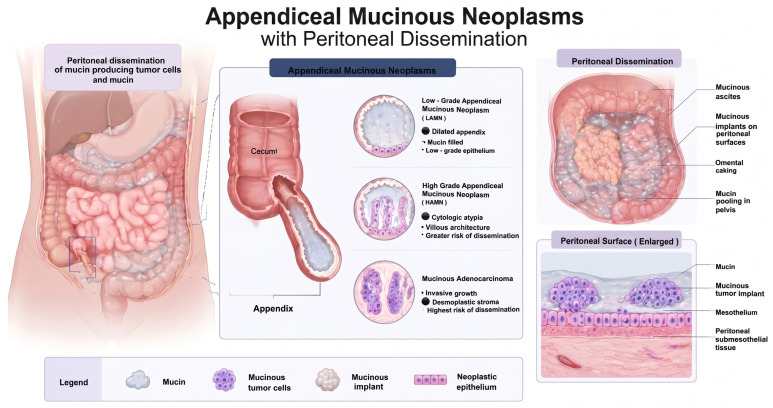
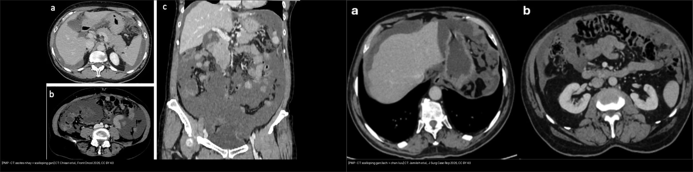
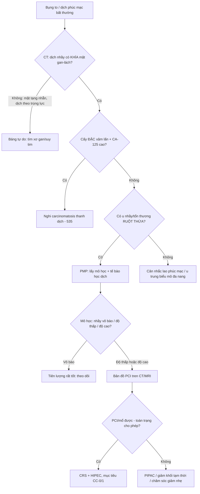
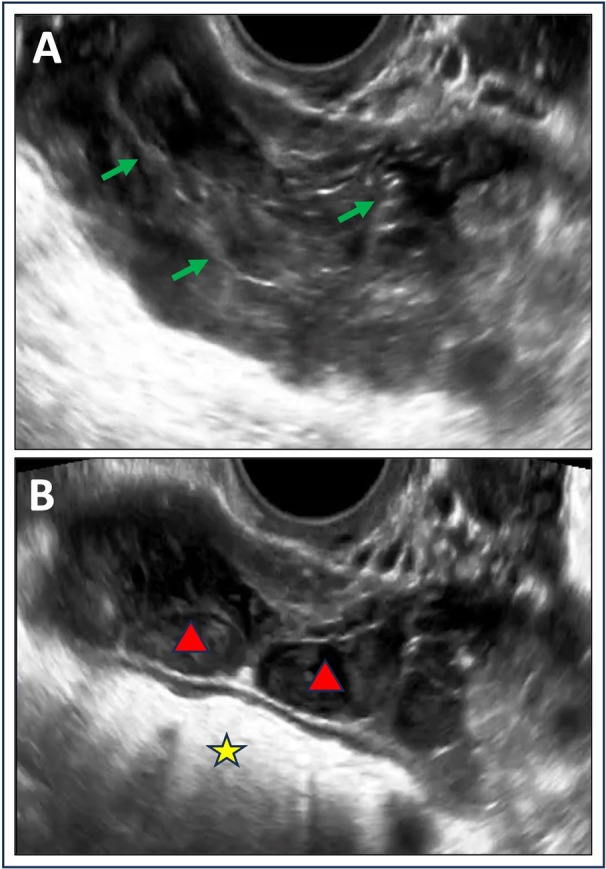
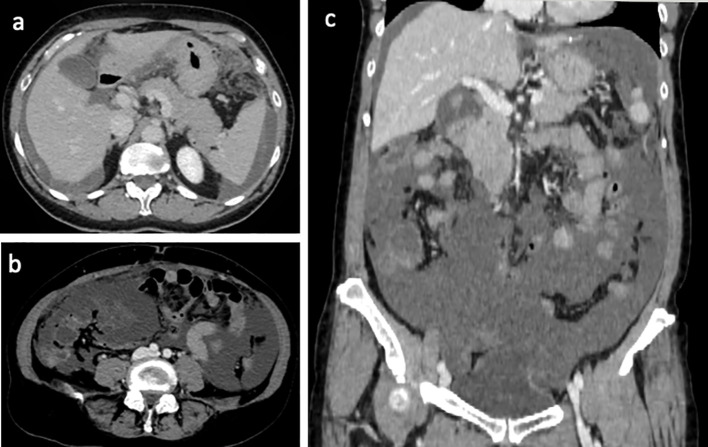
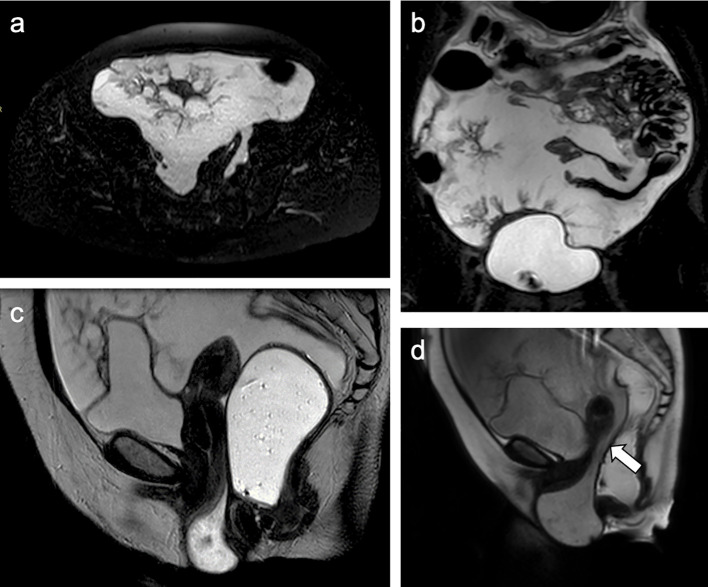
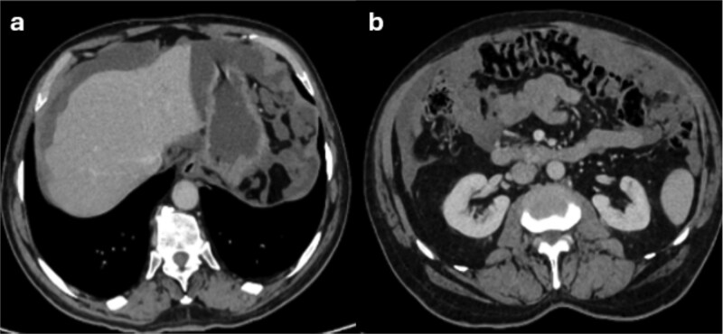
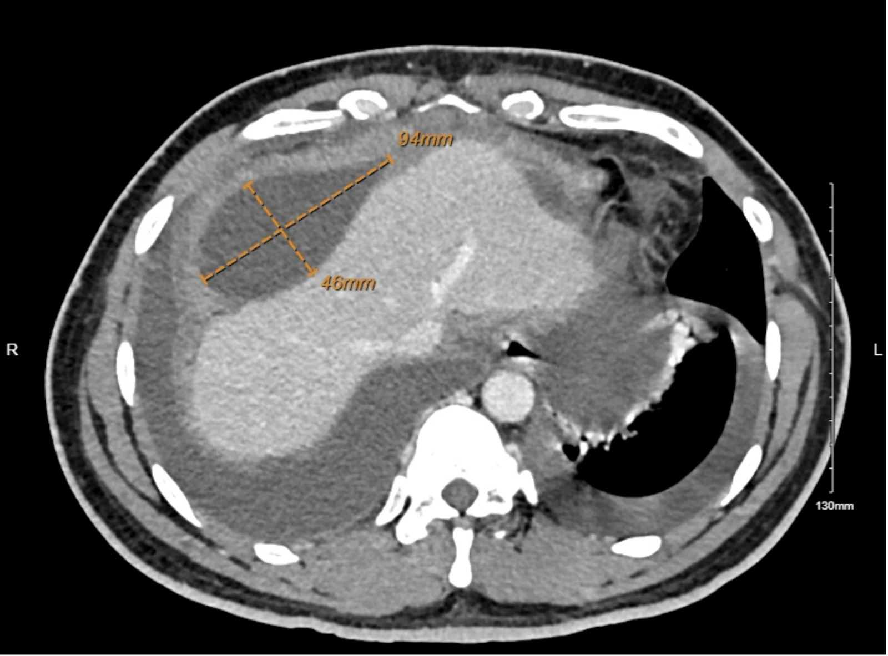

# 539 — Pseudomyxoma peritonei: dịch nhầy phúc mạc & dấu "khía" gan–lách / Pseudomyxoma peritonei

**Tags:** `pattern:phuc-mac` `pattern:tien-ung-thu-nhay` `pattern:scalloping` `vung:phuc-mac` `score:PCI` `protocol:CT-bung-co-can-quang` `protocol:MRI-bung-chau`
**Mức chắc chắn (certainty):** tổng hợp y văn (literature synthesis) — nhóm tự biên từ y văn mở (Europe PMC/PMC: Cancers, Front Oncol, J Surg Case Rep, Cureus, World J Surg Oncol) + các ca minh họa có giấy phép; không phải ca nguyên văn đơn lẻ.

## 1. Tổng quan — "keo dán ổ bụng": u nhầy ruột thừa vỡ, nhầy lan theo dòng dịch phúc mạc + cơ chế hình ảnh

- **Định nghĩa:** **pseudomyxoma peritonei (PMP)** là **hội chứng lâm sàng–bệnh học** gồm **cụm cấy (implants) biểu mô nhầy + tích tụ dịch nhầy (mucin) tiến triển trong ổ bụng** — KHÔNG phải một "khối u" đơn độc. Nguồn gốc áp đảo: **u nhầy ruột thừa (appendiceal mucinous neoplasm)**; hiếm khi từ buồng trứng, đại tràng, túi mật, niệu quản, teratoma.
- **Nguồn gốc & phân loại hiện hành (WHO/PSOGI 2016):** tiền thân chính là **LAMN (low-grade appendiceal mucinous neoplasm)** → **HAMN (high-grade)** → **ung thư biểu mô nhầy**; buồng trứng nhầy-hợp chảy (goblet cell) xếp riêng. Phân độ dịch phúc mạc: **mucin vô bào (acellular mucin)**, **độ thấp (low-grade)**, **độ cao (high-grade)** — (khái niệm cũ Ronnett: DPAM vs PMCA). **LAMN vỡ gây 2 hệ quả:** nhầy **vô bào** tiên lượng rất tốt (không có biểu mô sống); nhầy **có tế bào** mới tạo PMP tái phát.
- **Dịch tễ & tiên lượng (định lượng):** tỉ lệ **~1/1.000.000/năm** (đang tăng do nhận biết + tần suất u nhầy ruột thừa); ung thư ruột thừa **tăng ~54% giai đoạn 2000–2009**. Không điều trị: **sống 5 năm ~15,3–67%**, 10 năm **~8,3–31%** (phẫu thuật giảm khối cũ). **CRS + HIPEC (Chua, n = 2298):** sống 10 năm **63%**, 15 năm **59%**; **DFS 8,2 năm, OS 16,3 năm**.
- **Cơ chế lan (TẠI SAO hình ảnh như vậy):**
  - **Lan theo "dòng dịch phúc mạc" chứ không theo máu/bạch huyết:** nhầy chảy theo trọng lực → **ưu thế vùng thấp**: chậu hông, rãnh cạnh đại tràng (paracolic gutters), dưới hoành, **mạc nối (omentum)** → đúng vị trí ta thấy cấy/implant trên CT.
  - **Dấu "khía" (scalloping):** nhầy ép mặt ngoài cơ quan (đặc biệt **gan và lách**) tạo **khía lõm vào bề mặt** — vì **KHÔNG xâm lấn phá hủy** (khác cấy carcinomatosis thanh dịch vốn xâm lấn). Đây là **dấu hiệu "chốt vào" kinh điển**.
  - **Đậm độ dịch nhầy:** mucin là **glycoprotein (MUC2) giàu nước** → trên **MRI T2 rất sáng, T1 tối**; trên **CT thường ~10–20 HU** (protein làm nhỉnh hơn dịch đơn thuần ~0–10 HU, nhưng vẫn "gần nước" nên có thể bỏ sót). Vì giàu nước nên **thường không khuếch tán hạn chế** khi nhầy vô bào (ADC cao; coi chừng **T2 shine-through**), nhưng nhầy **giàu tế bào** có thể DWI sáng/ADC thấp.
  - **Bụng đầy "keo" đẩy ruột ra sau/giữa :** ruột bị **dồn trung tâm và cố định** bởi nhầy thay vì nổi lên trên như báng nước tự do → dấu **"centrally displaced fixed bowel"** trên siêu âm.
- **Vì sao quan trọng:** gọi "báng tự do" ở bệnh nhân bụng to → bỏ sót PMP (và bỏ lỡ **CRS + HIPEC** — can thiệp duy nhất cải thiện sống còn). Ngược lại gọi nhầm **lao phúc mạc/cấy dày phúc mạc lành** là PMP → phẫu thuật/điều trị quá mức.

*Sơ đồ: ruột thừa bị u nhầy thay niêm mạc (LAMN/HAMN/ung thư biểu mô nhầy) → vỡ → **lan phúc mạc**: dịch nhầy, cấy trên bề mặt phúc mạc, **đóng bánh mạc nối (omental caking)**, nhầy giữa các quai ruột ở chậu. Nguồn: Giordano W et al., Cancers 2026 Fig. 2, CC BY 4.0.*

## 2. Mẫu hình + chẩn đoán phân biệt theo khu trú (Gamut)

- **Khuôn 1 — "Khía" mặt gan–lách (scalloping):** các khối dịch nhầy **tựa vào và hằn lõm bề mặt gan/lách**, tạo rìa đa cung — **dấu gợi ý nhất của PMP**.
- **Khuôn 2 — Đóng bánh mạc nối (omental caking):** mạc nối dày, thâm nhiễm nhầy thành **"bánh"** ở vùng thượng vị/dưới thành bụng trước.
- **Khuôn 3 — Dịch nhiều ngăn/tạo vách "curvilinear":** nhầy thường **khu trú, có vách mảnh, không theo trọng lực đơn thuần** (khác báng tự do một khối).
- **Khuôn 4 — Ruột dồn trung tâm & cố định (siêu âm):** dịch **tăng echo lấm tấm**, có vách; **ruột bị đẩy vào giữa và dính cứng**, không trôi tự do.
- **Khuôn 5 — Cấy dạng nốt/đám trên phúc mạc & dưới hoành:** có thể **vôi hóa** (nhất là sau điều trị / nhầy cũ).
- **Vị trí ưu thế (theo dòng dịch):** **chậu hông > rãnh cạnh đại tràng > dưới hoành > mạc nối**; **KHÔNG ưu thế nhu mô gan/lách** (phân biệt di căn tạng đặc).
- **Mimic cần loại:** **ung thư biểu mô thanh dịch phúc mạc (serous carcinomatosis)** — cấy **xâm lấn + nốt đặc**, không "khía" mặt tạng (`535`); **lao phúc mạc** — dịch + dày mạc nối + hạch hoại tử, bối cảnh sốt/gầy; **u trung biểu mô phúc mạc đa nang (multicystic peritoneal mesothelioma)**; **báng tự do** (xơ gan, suy tim); **u nhầy buồng trứng vỡ** (thực ra phần lớn "PMP từ buồng trứng" là do ruột thừa — phải soi ruột thừa).

## 3. Bảng so sánh phân biệt (ma trận đối chiếu)

| Thực thể (entity) | Hình ảnh điển hình (CT/MRI/US) | Chốt vào (rule-in) | Chốt loại (rule-out) | Gợi ý xác nhận |
|---|---|---|---|---|
| **PMP độ thấp (LAMN/low-grade)** | **Dịch nhầy "khía" mặt gan–lách** + đóng bánh mạc nối + nhầy ít vách; **không nốt xâm lấn tạng** | **Scalloping gan–lách + cấy không xâm lấn + tiền sử u nhầy ruột thừa** | Nốt đặc xâm lấn nhu mô gan → nghĩ carcinomatosis | Mô học (nhầy vô bào/độ thấp), CDX2+/CK20+, **PCI**, xét ruột thừa |
| **PMP độ cao (HAMN/high-grade)** | Tương tự nhưng **cấy đặc hơn, nhiều nốt, tăng lan, đôi khi hoại tử**; tiến triển nhanh | **Cấy đặc + tăng nhanh + mô học độ cao** | Thành phần chủ yếu dịch nhầy "trơ" → nghĩ độ thấp | Mô học (Ki-67 cao); **tế bào học dịch**; tiên lượng xấu hơn |
| **Carcinomatosis thanh dịch (`535`)** | **Nốt/đám đặc xâm lấn** mặt gan–lách–phúc mạc, **dày mạc nối dạng nốt**, dịch thường không nhầy | **Nốt xâm lấn + CA-125 rất cao + tổn thương buồng trứng** | Rìa "khía" nhẵn, không nốt xâm lấn → nghĩ PMP | Mô học/IHC (PAX8, WT1, CA-125) |
| **Lao phúc mạc** | Dày phúc mạc + dịch + **hạch hoại tử trung tâm**, tăng ngấm; **không "khía"** | **Bối cảnh sốt/gầy/suy giảm MD + hạch hoại tử + ADA dịch** | Nhầy keo đặc trưng + tiền sử ruột thừa → nghĩ PMP | PCR/SO (Mycobacterium), tế bào học dịch |
| **Báng tự do (xơ gan/suy tim)** | Dịch **theo trọng lực**, mặt gan/lách **nhẵn**, ruột trôi tự do; dấu hiệu bệnh nền | **Bệnh nền xơ gan/suy tim + mặt tạng nhẵn** | Có "khía" rìa tạng + vách + ruột dính → nghĩ PMP | SA tim/đánh giá gan; phân tích dịch |
| **U trung biểu mô phúc mạc đa nang** | Nhiều **nang dịch vách mỏng** trong phúc mạc, thường ở phụ nữ | **Nhiều nang con, không "khía"/không nhầy keo** | Nhầy keo nhiều + u nhầy ruột thừa → PMP | Mô học/IHC (calretinin, WT1); calcitriol |

*Trái: **CT** ("khía" mặt gan + dịch nhầy khu trú, dồn ruột). Phải: **CT** cấy nhầy gây "khía" gan–lách và chèn ép (PMP độ cao, tắc môn vị). Nguồn: Chisari LM et al., Front Oncol 2026 & Jamileh E et al., J Surg Case Rep 2026, CC BY 4.0 (ảnh ghép letterbox).*

## 4. Protocol chụp + CRS/HIPEC + điểm PCI/CC

- **CT bụng–chậu có cản quang (3 thì: chưa tiêm + ĐM + tĩnh mạch cửa):** là **kênh chuẩn** để (1) xác nhận nhầy, (2) **bản đồ hóa cấy theo 13 vùng PCI**, (3) tìm tổn thương ruột thừa nguyên phát. Đo **đậm độ dịch** (nhầy thường ~10–20 HU; có thể gần nước).
- **MRI bụng–chậu (khi cần đánh giá phúc mạc nhỏ/chậu hông, phụ nữ):** **T2 rất sáng (nhầy giàu nước)** + **T1 tối** + **DWI/ADC**; nhầy vô bào thường ADC cao (cẩn thận T2 shine-through), nhầy giàu tế bào có thể hạn chế.
- **Siêu âm:** dịch **tăng echo lấm tấm + vách**, ruột **dồn trung tâm và cố định** → gợi ý mạnh nhầy keo (khác báng trong).
- **Điểm:**
  - **PCI (Peritoneal Cancer Index):** chia ổ bụng **13 vùng**, mỗi vùng **0–3** (tổng **0–39**); dùng để chọn bệnh nhân mổ và tiên lượng (`535`).
  - **CC score (Completeness of Cytoreduction):** **CC-0** (không còn tổn thương thấy được) → **CC-1 (< 2,5 mm)** → **CC-2 (2,5 mm–2,5 cm)** → **CC-3 (> 2,5 cm)** — **CC-0/1** mới đạt lợi ích sống còn tối đa.
- **Điều trị:** **CRS (phẫu thuật giảm khối) + HIPEC (hóa trị trong ổ bụng có gia nhiệt)** là chuẩn; **mổ giảm khối đơn thuần lợi ích kém**. Pipac là kỹ thuật bổ trợ ở bệnh cảnh không mổ triệt để.
- **Bắt buộc tìm nguồn:** **kiểm tra/ cắt ruột thừa** và mô bệnh học — đừng "chốt" PMP do buồng trứng khi chưa loại ruột thừa.

## 5. Biến thể bình thường và cạm bẫy

- **Cạm bẫy "báng tự do vs dịch nhầy":** cùng "gần nước" trên CT → dễ đọc là báng. Chốt bằng **"khía" mặt gan–lách + vách/khu trú + ruột dồn trung tâm** và **tiền sử u nhầy ruột thừa**.
- **Cạm bẫy MRI "unremarkable":** PMP có thể **âm tính giả trên MRI ban đầu** (ca Awada: MRI bụng "không đặc hiệu", sau CT mới lộ dịch khu trú + khối lớn) → không loại trừ PMP chỉ bằng một lần MRI.
- **Cạm bẫy "dịch đục do nhiễm khuẩn":** ca PMP ruột thừa có thể bị **che lấp bởi dịch mủ cấy dương tính (culture-positive neutrocytic ascites)** → đừng dừng ở "viêm phúc mạc nhiễm khuẩn"; nếu dịch đặc/keo + bệnh cảnh kéo dài, nghĩ PMP.
- **Cạm bẫy nguồn gốc buồng trứng:** nhiều ca "PMP do u nhầy buồng trứng" thực ra **nguồn là ruột thừa** → luôn **kiểm tra ruột thừa + IHC (CDX2, CK20, SATB2)** để xác định gốc.
- **Cạm bẫy DWI:** nhầy vô bào (nhiều nước) → **T2 shine-through** giả "khuếch tán hạn chế"; đọc **ADC map** trước khi kết luận độ ác.
- **Cạm bẫy biến chứng cơ học:** PMP có thể biểu hiện **tắc môn vị do chèn ép (không u nội tại)**, **thoát vị rốn**, **tắc niệu quản/ứ nước thận** — đừng chỉ tìm trong phúc mạc mà bỏ biến chứng.
- **Cạm bẫy khối to ↔ bệnh nhân "khỏe":** PMP tiến triển âm thầm nhiều tháng → khối lượng bệnh lớn trên hình ảnh **không tương xứng** triệu chứng; đọc hình ảnh là chìa khóa.

## 6. Tự lượng giá — Blind Quiz

**Ca 1 — Nữ, bụng to, dịch ổ bụng "lấm tấm". Đọc siêu âm.**

- Hỏi: dịch "tăng echo + vách + ruột dồn giữa" khác gì báng tự do đơn thuần? Nghĩ đến gì?

<b>Bấm để hiện đáp án (findings + chẩn đoán)</b>

- Dấu hiệu (findings): **dịch tăng echo (echogenic ascites)** lấm tấm, có **vách mảnh (mũi tên xanh/tam giác đỏ)**; **ruột bị dồn ra trung tâm và cố định (dấu sao vàng)**.
- Chẩn đoán (diagnosis): **pseudomyxoma peritonei** — nhầy keo giàu protein tạo echo/vách và dồn ruột, khác báng nước trong (trong, không vách, ruột trôi tự do).
- Nguồn ảnh: Yoeli-Bik R et al., J Ultrasound Med 2025 Fig. 3, CC BY 4.0.

**Ca 2 — CT bụng: dịch và rìa gan. Đọc CT.**

- Hỏi: mô tả rìa gan/lách. Vì sao gọi là "scalloping"?

<b>Bấm để hiện đáp án (findings + chẩn đoán)</b>

- Dấu hiệu (findings): **lượng lớn dịch nhầy tăng đậm nhẹ**, **"khía" (scalloping) mặt gan–lách**, **nốt/đám cấy trên phúc mạc**; khối lớn trong ổ bụng chèn ép, ruột bị đẩy ra sau.
- Chẩn đoán (diagnosis): **pseudomyxoma peritonei (PMP)** — nhầy ép mặt tạng tạo khía (không xâm lấn), khác cấy thanh dịch xâm lấn.
- Nguồn ảnh: Chisari LM et al., Front Oncol 2026 Fig. 2, CC BY 4.0.

**Ca 3 — MRI T2 chậu: dịch rất sáng + nốt phúc mạc. Đọc MRI.**

- Hỏi: vì sao dịch nhầy rất sáng trên T2? Điều gì giải thích các "nốt" bám phúc mạc?

<b>Bấm để hiện đáp án (findings + chẩn đoán)</b>

- Dấu hiệu (findings): T2W axial/coronal: **dịch nhầy cường tín hiệu rất mạnh (hyperintense) lan rộng**, có **nốt phúc mạc (peritoneal nodules)**; nhầy cũng tụ ở túi cùng trực tràng–tử cung, đẩy cấu trúc.
- Chẩn đoán (diagnosis): **PMP** — mucin giàu nước (glycoprotein) nên T2 rất sáng/T1 tối; các nốt = **cấy biểu mô nhầy trên phúc mạc**.
- Nguồn ảnh: Chisari LM et al., Front Oncol 2026 Fig. 1, CC BY 4.0.

**Ca 4 — Ưu thế: CT cho thấy cấy nhầy gây chèn ép môn vị. Đọc CT.**

- Hỏi: vì sao bệnh nhân nôn nhiều dù không có "u trong dạ dày"? Dấu hiệu nào trên CT?

<b>Bấm để hiện đáp án (findings + chẩn đoán)</b>

- Dấu hiệu (findings): **dịch nhầy giảm đậm** gây **"khía" gan và lách**, **dày mạc nối/cấy**, và **chèn ép ngoài môn vị–tá tràng** (không có u lòng ống).
- Chẩn đoán (diagnosis): **PMP độ cao gây tắc môn vị do chèn ép ngoài** — biến chứng cơ học của nhầy; xử trí gồm CRS/HIPEC hoặc giải pháp tạm thời (stent/nối vị tràng).
- Nguồn ảnh: Jamileh E et al., J Surg Case Rep 2026 Fig. 1–2, CC BY 4.0.

**Ca 5 — CT: dịch khu trú cạnh gan. Đọc CT.**

- Hỏi: "loculated" (khu trú, nhiều vỏ) khác "free" (tự do) thế nào? Gợi ý chẩn đoán?

<b>Bấm để hiện đáp án (findings + chẩn đoán)</b>

- Dấu hiệu (findings): **khối dịch khu trú cạnh gan ~94 × 46 mm** (đo trên CT), **có vỏ/vách**, không theo trọng lực đơn thuần; kèm dịch khu trú nhiều nơi.
- Chẩn đoán (diagnosis): **pseudomyxoma peritonei** — nhầy thường **khu trú, nhiều vỏ/vách** (khác báng tự do); ca này MRI ban đầu "không đặc hiệu" nên đừng loại trừ sớm.
- Nguồn ảnh: Awada H et al., Cureus 2026 Fig. 1, CC BY 4.0.

**Ca 6 — Sơ đồ: cơ chế hình thành PMP từ ruột thừa.**
*(Xem sơ đồ ở mục 1 — dùng để tự kiểm tra: LAMN → vỡ → dịch nhầy + cấy + đóng bánh mạc nối.)*
- Nguồn: Giordano W et al., Cancers 2026 Fig. 2, CC BY 4.0.

**Ca 7 — Ảnh ghép: bên trái vs bên phải, điểm chung là gì? Đọc ảnh ghép CT.**

- Hỏi: hai ca khác biệt (PMP "kinh điển" vs PMP gây tắc môn vị) nhưng cùng một dấu hiệu quyết định — dấu hiệu nào?

<b>Bấm để hiện đáp án (findings + chẩn đoán)</b>

- **Cả hai đều có "khía" (scalloping) mặt gan/lách** do dịch nhầy ép — dấu hiệu "chốt vào" của PMP, cùng cơ chế: nhầy lan theo dòng dịch phúc mạc, **không xâm lấn**.
- **Trái:** PMP kinh điển (dịch nhầy + cấy). **Phải:** PMP độ cao gây chèn ép môn vị (tắc môn vị do chèn ép ngoài).
- Nguồn: Chisari LM et al., Front Oncol 2026 & Jamileh E et al., J Surg Case Rep 2026, CC BY 4.0 (ảnh ghép letterbox).

## Bài liên quan chéo
- [500 – Tổng quan Vú & Sản phụ khoa](../500-tong-quan-vu-san-phu-khoa/lesson.md)
- [535 – Ung thư buồng trứng, phúc mạc & u Krukenberg](../535-ung-thu-buong-trung-phuc-mac-krukenberg/lesson.md)
- [537 – U buồng trứng giáp biên (borderline)](../537-u-buong-trung-giap-bien/lesson.md)
- [141 – Phúc mạc](../141-phuc-mac/lesson.md)
- [165 – Dày thành ruột: Crohn vs K đại-trực tràng](../165-day-thanh-ruot/lesson.md)
- [162 – Tắc ruột](../162-tac-ruot/lesson.md)

## Ảnh
- `539_pseudomyxoma_US_PMC12240477.jpg`, `539_scalloping_CT_PMC13193853.jpg`, `539_mucin_MRI_PMC13193853.jpg`, `539_scalloping-obstruction_CT_PMC13308960.jpg`, `539_LAMN-pathogenesis_DIAGRAM_PMC13297372.jpg`, `539_loculated-ascites_CT_PMC13500083.jpg`, `composite_scalloping-CT.jpg`. Nguồn + giấy phép từng ảnh trong `images/CREDITS.md`.

> Không dùng để chẩn đoán độc lập khi chưa có người hướng dẫn.
