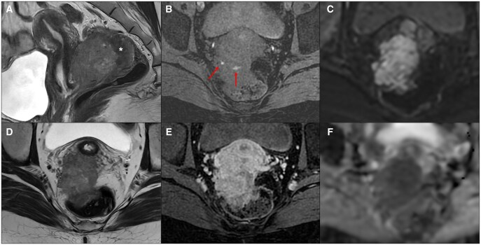
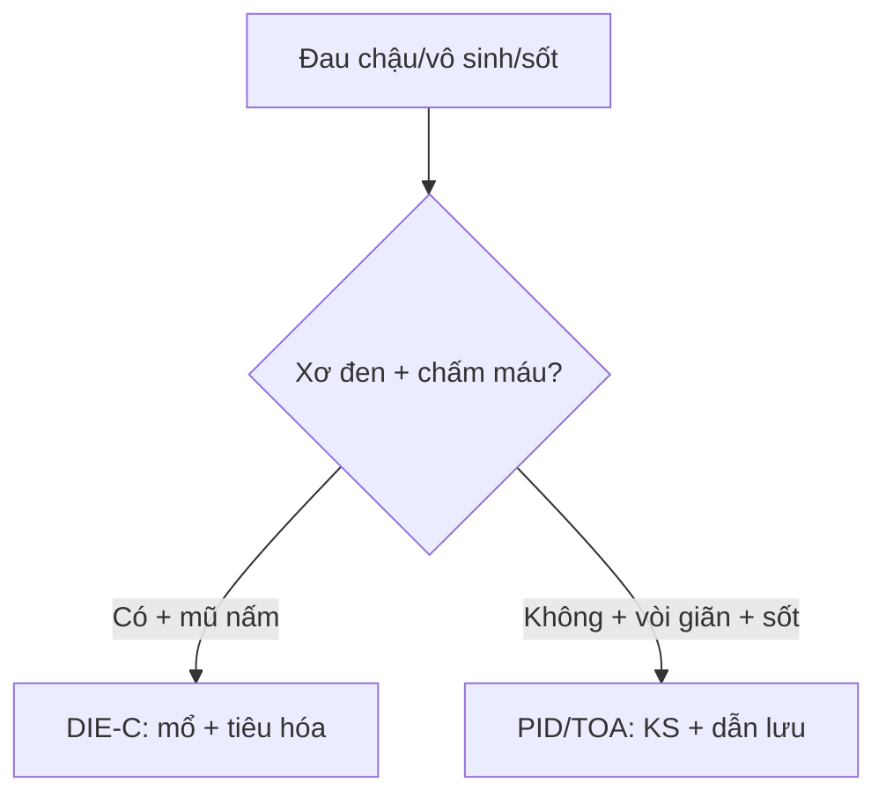

# 540 — DIE & PID: mũ nấm, hôn nhau & vòi giãn / Endometriosis & PID

**Tags:** `pattern:lac-noi-mac-sau` `vung:tieu-khung` `score:Enzian` `protocol:MRI-DIE`
**Mức chắc chắn (certainty):** tổng hợp y văn (literature synthesis) — nhóm tự biên từ y văn mở, chưa gắn ca nguyên văn đơn lẻ.

## 1. Tổng quan — xơ đen + chấm máu là 2 mặt DIE + vòi giãn không hoàn toàn là PID

- DIE (> 5 mm dưới phúc mạc): xơ cơ phản ứng (**đen T2**) + ổ tuyến xuất huyết (**sáng T1 fat-sat**) — TẠI SAO cặp đôi này là vàng: xơ không chảy máu, tuyến chảy máu theo chu kỳ.
- **Mũ nấm (mushroom cap):** cơ trực tràng phì đại (đen T2) đội niêm mạc phù (sáng T2) — TẠI SAO = xâm lấn cơ (Enzian C): u ăn vào cơ chứ không chỉ dính ngoài.
- PID/TOA: vòi ứ mủ giãn + vách không hoàn toàn + cogwheel — TẠI SAO: nếp vòi phù không dính hẳn; sốt + CRP + lậu/Chlamydia là bối cảnh.
- **Kissing ovaries:** 2 buồng trứng dính sau tử cung = dính nặng.

## 2. Gamut đau chậu mạn + sốt (Gamut)

- **Xơ đen + chấm máu + mũ nấm:** DIE Enzian C — mổ phối hợp tiêu hóa (cắt đoạn/gọt trực tràng).
- **Dây chằng cùng-ụt dày > 3 mm + nốt:** Enzian B — bóc + bảo tồn thần kinh.
- **Vòi giãn + cogwheel + sốt:** PID/TOA — kháng sinh + dẫn lưu (đừng mổ cắt vội ở trẻ).
- **Rụng dâu + hôn nhau + vô sinh:** dính nặng — gỡ dính + IVF.

## 3. Bảng so sánh phân biệt (ma trận đối chiếu)

| Thực thể (entity) | Hình ảnh điển hình | Chốt vào (rule-in) | Chốt loại (rule-out) | Gợi ý xác nhận |
|---|---|---|---|---|
| DIE trực tràng | **Xơ đen + chấm máu T1 + mũ nấm (Enzian C)** | **Mũ nấm = xâm lấn cơ** | Vòi giãn + sốt → PID | Mổ + tiêu hóa phối hợp |
| DIE USL/vách | **Dây chằng dày > 3 mm + nốt + mất đối xứng** | **USL + chấm máu** | Đối xứng + không máu → thường | Bóc + giữ thần kinh |
| PID/TOA | **Vòi giãn + vách không hoàn toàn + cogwheel + sốt** | **Sốt + CRP + lậu/Chlamydia** | Xơ đen + máu → DIE | Kháng sinh + dẫn lưu |
| Dính nặng | **Kissing ovaries + nang lạc + vô sinh** | **Hôn nhau sau tử cung** | Không dính → đơn ổ | Gỡ dính + IVF |

*Khối sau cổ tử cung + mũ nấm thành trực tràng (sao) + chấm máu T1 + hạn chế DWI. Nguồn: Iacono et al., BJR Case Rep 2026 Fig. 1, CC BY 4.0.*

## 4. Protocol MRI DIE

- **MRI chậu T2 3 mặt + T1 fat-sat + DWI + Enzian A/B/C** khi đau chậu mạn/vô sinh; TVUS + cấy khi sốt (PID).

## 5. Cạm bẫy

- **DIE rụng dâu sau IVF giả K** (ca trên!) — chấm máu + Enzian + sinh thiết, đừng mổ K oan.
- **TOA vỡ + sốc** tưởng DIE mạn — sốt + vỡ là mổ cấp cứu, không phải nội khoa.
- **Mổ DIE không báo tiêu hóa** khi mũ nấm — Enzian C là gọi phẫu thuật viên đại trực tràng trước.

## 6. Tự lượng giá — Blind Quiz

**Ca 1 — Nữ 33 tuổi đau chậu mạn + ra máu sau kích trứng IVF. Đọc MRI.**

- Hỏi: mũ nấm ở đâu? DIE hay K? Sinh thiết không?

<b>Bấm để hiện đáp án</b>

- Dấu hiệu (findings): khối sau cổ tử cung + **mũ nấm trực tràng** (sao) + chấm máu T1 + DWI hạn chế + ngấm mạnh.
- Chẩn đoán (diagnosis): **DIE rụng dâu sau kích thích tố (giả K)** — sinh thiết (lành!) + theo dõi/mổ bảo tồn sinh sản (đừng mổ K oan).
- Nguồn: Iacono et al., Fig. 1, CC BY 4.0.

**Ca 2 — Sốt + đau hố chậu + vòi giãn cogwheel:** DIE hay PID? *(Bảng mục 3.)*

<b>Bấm để hiện đáp án</b>

- **PID/TOA:** kháng sinh + dẫn lưu (DIE là xơ đen + máu, không sốt).

## Bài liên quan chéo
- [500 – Tổng quan Vú & SPK](../500-tong-quan-vu-san-phu-khoa/lesson.md)
- [520 – Tử cung](../520-tu-cung-u-xo-FIGO-adenomyosis-noi-mac/lesson.md) (adeno)
- [530 – Phần phụ](../530-buong-trung-ORADS-sieu-am-MRI/lesson.md) (endometrioma)

> Không dùng để chẩn đoán độc lập khi chưa có người hướng dẫn.
