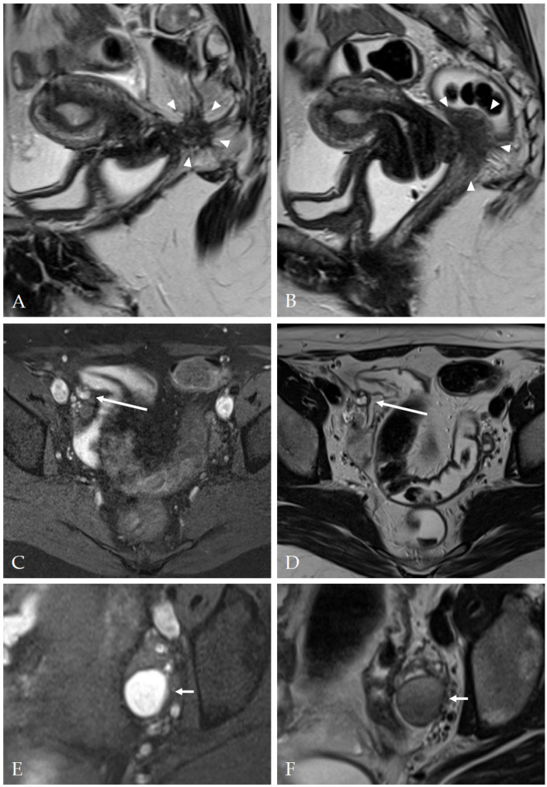
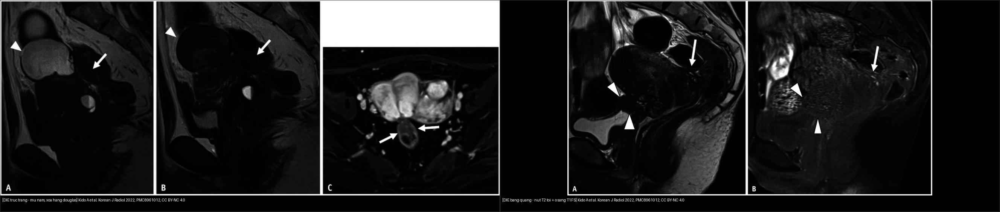
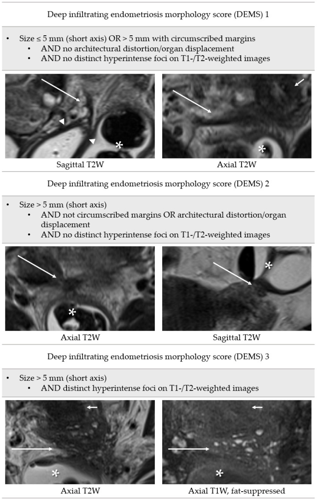
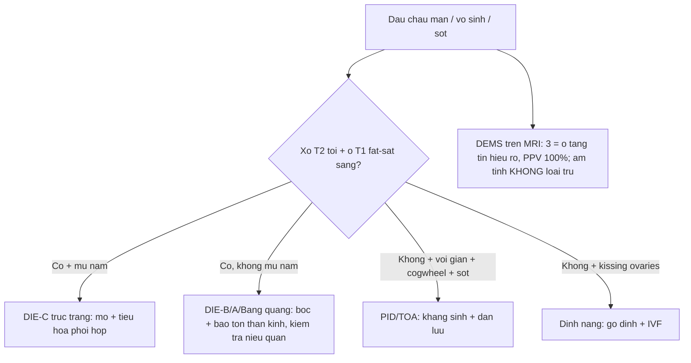
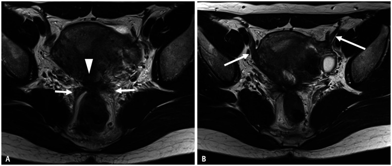
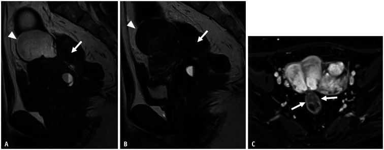
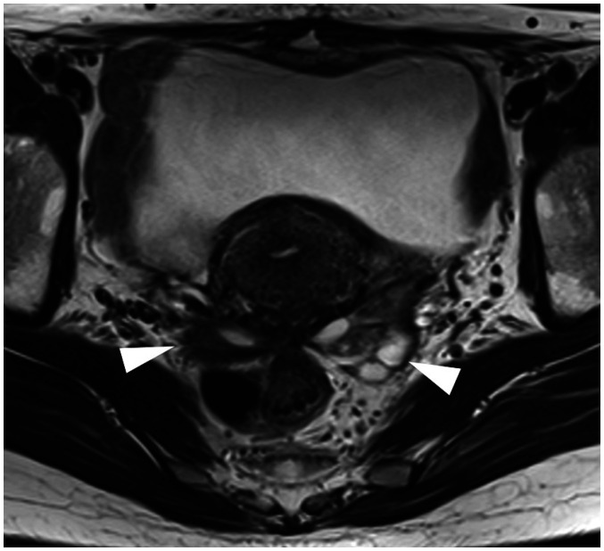

# 540 — DIE & PID: mũ nấm, hôn nhau & vòi giãn / Deep infiltrating endometriosis & PID

**Tags:** `pattern:lac-noi-mac-sau` `vung:tieu-khung` `score:Enzian` `protocol:MRI-DIE`
**Mức chắc chắn (certainty):** tổng hợp y văn (literature synthesis) — nhóm tự biên từ các bài tổng quan/nghiên cứu chẩn đoán mở (Korean J Radiol 2022 CC BY-NC; Diagnostics 2023 CC BY; BJR Case Rep 2026 CC BY 4.0); gồm ca nguyên văn có hình.

## 1. Tổng quan bệnh học – cơ chế hình ảnh

- **DIE (deep infiltrating endometriosis):** mô lạc nội mạc **xâm nhập sâu > 5 mm dưới phúc mạc**, gây **viêm–xơ** mạn. Hai mặt của cùng một tổn thương trên MRI: **xơ cơ phản ứng (T2 tối)** + **ổ tuyến xuất huyết (T1 fat-sat sáng)**.
- **TẠI SAO cặp đôi này là "vàng" (vật lý MRI + mô bệnh):** sợi **collagen xơ** hút nước rất ít → **T2 tối**; các **tuyến nội mạc còn sống** chảy máu theo chu kỳ → **T1 sáng (không mất tín hiệu khi fat-sat)** vì chứa **methemoglobin** (sản phẩm máu cũ). Do đó tổn thương DIE điển hình = **khối/đám T2 tối + ổ/bờ T1 sáng**.
- **Mũ nấm (mushroom cap sign):** cơ trực tràng phì đại (**T2 tối**) đội niêm mạc phù (**T2 sáng**) — TẠI SAO = u ăn vào **lớp cơ** chứ không chỉ dính ngoài (Enzian C). Kido 2022 ghi nhận mũ nấm ở **độ cao 16 mm** tính từ bờ hậu môn.
- **PID/TOA:** vòi ứ mủ giãn + **vách không hoàn toàn (incomplete septa)** + dấu **"bánh răng cưa" (cogwheel)** — TẠI SAO: các nếp vòi phù nhưng chưa dính hẳn; sốt + CRP + lậu/Chlamydia là bối cảnh.
- **"Hôn nhau" (kissing ovaries):** hai buồng trứng dính vào nhau/sau tử cung = dính nặng (Kido 2022: hai buồng trứng + trực tràng tập trung tại **torus uterinus**) → vô sinh, gỡ dính + IVF.
- **Ngưỡng định lượng bắt buộc:**
  - DIE = tổn thương **sâu > 5 mm** dưới phúc mạc.
  - **Dây chằng cùng-ụt (USL)** dày/nốt thành **dải T2 tối liên tục** từ torus uterinus ra sau.
  - **Xơ hóa thành Douglas (Douglas obliteration):** nâng **cùng đồ sau âm đạo** + **trực tràng bị "kéo" dính vào tử cung** + mảng xơ phủ mặt thanh mạc tử cung.
  - **Hệ #Enzian(m) trên MRI** (khoang/tạng): **O** buồng trứng · **A** khoang trực tràng–âm đạo · **B** dây chằng cùng-ụt/parametrium · **C** trực tràng · **FA** adenomyosis khu trú · **FB** bàng quang · **FU** niệu quản · **FI** ruột khác · **FO** nơi khác.
  - **Điểm hình thái DIE/DEMS (Harth 2023, n=160, đối chiếu laparoscopy):** **DEMS 1** ≤ 5 mm hoặc > 5 mm bờ khu trú, không biến dạng cấu trúc, không ổ tăng tín hiệu; **DEMS 2** > 5 mm, bờ không khu trú/biến dạng; **DEMS 3** > 5 mm + **ổ tăng tín hiệu rõ trên T1/T2**. Hiệu năng chung: **Se 67,0%, Sp 84,7%, PPV 84,3%, NPV 67,8%, LR+ 4,39, LR− 0,39**; khi áp tiêu chuẩn chặt **DEMS 3 → PPV 100%, NPV 59,0%** (dương tính là chắc, âm tính KHÔNG loại trừ).

## 2. Mẫu hình + chẩn đoán phân biệt theo vị trí (gamut)

- **Ba câu hỏi gỡ rối:** **(1) có xơ T2 tối không? (2) có ổ/bờ T1 fat-sat sáng không? (3) có biến dạng cấu trúc/kéo dính tạng không?**
- **Theo vị trí (giải phẫu #Enzian):**
  - **Torus uterinus + dây chằng cùng-ụt (B):** dải T2 tối dày, mất đối xứng → DIE (hay gặp nhất).
  - **Khoang trực tràng–âm đạo (A) & thành trực tràng (C):** **mũ nấm** + xơ hóa Douglas → cần **phẫu thuật viên đại–trực tràng**.
  - **Bàng quang (FB)/niệu quản (FU):** khối T2 tối mặt sau bàng quang + ổ T1 sáng → **giả u bàng quang** (mô tả Kido 2022), nguy cơ chèn niệu quản → **ứ nước thận**.
  - **Buồng trứng (O):** **endometrioma** (T1 rất sáng + T2 "shading") — xem bài 537/530.
- **Gamut "đau chậu mạn + khối/xơ":** DIE · adenomyosis · **PID/TOA** · u xơ · u buồng trứng ác · u quái · nang tailgut · lymphangioleiomyomatosis (hiếm).

*DIE xâm lấn vòm âm đạo và trực tràng (A/B: khối T2 tối bờ không rõ + ổ tăng tín hiệu), nốt thành bên chậu phải (C/D), và endometrioma điển hình T1 sáng/T2 "shading" (E/F). Nguồn: Harth S et al., Diagnostics 2023 (PMC10217213), CC BY 4.0.*

## 3. Bảng so sánh phân biệt (ma trận đối chiếu)

| Thực thể (entity) | Hình ảnh điển hình | Chốt vào (rule-in) | Chốt loại (rule-out) | Gợi ý xác nhận |
|---|---|---|---|---|
| DIE trực tràng (Enzian C) | **Xơ T2 tối + ổ T1 sáng + mũ nấm** | **Mũ nấm = xâm lấn lớp cơ** | Vòi giãn + cogwheel + sốt → PID | Mổ phối hợp tiêu hóa; MRI lát mỏng |
| DIE dây chằng cùng-ụt (Enzian B) | **Dải T2 tối > 3 mm, mất đối xứng + nốt** | **Torus uterinus + USL dày + ổ T1 sáng** | Đối xứng, không ổ máu → thường | Bóc + **bảo tồn thần kinh** |
| DIE bàng quang (Enzian FB) | Khối T2 tối mặt sau bàng quang + ổ T1 sáng | **Ổ T1 sáng + tăng đậm cơ detrusor** | Khối bờ gai, ngấm mạnh kiểu K → sinh thiết | Soi bàng quang + MRI; kiểm tra niệu quản |
| Endometrioma (Enzian O) | **T1 rất sáng + T2 "shading"**, vỏ mỏng | **T1 sáng không mất khi fat-sat** | T1 sáng **MẤT** khi fat-sat → u quái (mỡ) | MRI T2/T1FS; theo dõi nguy cơ EAOC |
| PID / TOA | **Vòi giãn + vách không hoàn toàn + cogwheel**, thâm nhiễm mỡ | **Sốt + CRP + lậu/Chlamydia** | Xơ T2 tối + ổ máu → DIE | Kháng sinh ± dẫn lưu (đừng mổ cắt vội ở người trẻ) |
| Dính nặng | **Kissing ovaries + nang lạc + vô sinh** | **Hai buồng trứng hôn nhau sau tử cung** | Không dính, đơn ổ → tổn thương khu trú | Gỡ dính + IVF |

*Trái: DIE trực tràng — xơ hóa Douglas + mũ nấm thành trước trực tràng (mũi tên), ở độ cao 16 mm. Phải: DIE bàng quang — nốt T2 tối quanh torus uterinus + ổ T1 fat-sat sáng lan tới thành bàng quang (giả u bàng quang). Nguồn: Kido A et al., Korean J Radiol 2022 (PMC8961012), CC BY-NC 4.0. Ảnh ghép letterbox, giữ nguyên tỷ lệ.*

### Dấu hiệu chốt then chốt
- **Xơ T2 tối + ổ T1 fat-sat sáng** = chữ ký DIE (xơ không chảy máu, tuyến chảy máu theo chu kỳ).
- **Mũ nấm** = DIE đã ăn vào **lớp cơ trực tràng** → gọi phẫu thuật đại–trực tràng **trước** mổ.
- **DEMS 3** (ổ tăng tín hiệu rõ) có **PPV 100%** nhưng **NPV chỉ 59%** → MRI dương là chắc, MRI âm **không loại trừ** DIE.

## 4. Protocol chụp + hệ phân độ/điểm chuẩn hóa

- **MRI chậu DIE:** **T2W 3 mặt phẳng** (axial + sagittal + coronal) + **T1W fat-sat** (ổ xuất huyết) + **DWI** (tổn thương tế bào) + **DCE**; cân nhắc **gel âm đạo/trực tràng** và **thuốc chống nhu động** để đánh giá thành trực tràng và vách âm đạo.
- Chỉ định: **đau chậu mạn/khó giao hợp/vô sinh**; US đầu tay; MRI để lập bản đồ tổn thương trước mổ.
- Khi **sốt + đau hố chậu**: siêu âm + cấy (lậu/Chlamydia) → hướng **PID/TOA** (kháng sinh ± dẫn lưu).
- **Phân độ:** #Enzian(m) A/B/C/O/FA/FB/FU/FI/FO; **DEMS 1–3** (Se 67,0%/Sp 84,7%; DEMS 3 → PPV 100%).

*Định nghĩa DEMS 1–3: kích thước, bờ/biến dạng cấu trúc và ổ tăng tín hiệu T1/T2. Mũi tên dài = DIE; mũi tên đầu = vòm âm đạo; hoa thị = trực tràng–đại tràng sigma. Nguồn: Harth S et al., Diagnostics 2023 (PMC10217213), CC BY 4.0.*

## 5. Biến thể bình thường và cạm bẫy

- **DIE "rụng dâu" sau kích thích tố/IVF giả K** (ca nguyên văn trong bài) — ổ T1 sáng + xơ + ngấm mạnh; **sinh thiết** xác nhận lành, đừng mổ K oan.
- **TOA vỡ + sốc** tưởng DIE mạn — **sốt + vỡ là mổ cấp cứu**, không điều trị nội khoa đơn thuần.
- **MRI âm KHÔNG loại trừ DIE:** NPV chung chỉ **67,8%** (và **59%** nếu chỉ tính DEMS 3) → đau nhiều mà MRI âm vẫn phải soi ổ bụng.
- **Ổ T1 sáng "giả":** nang xuất huyết cơ năng, endometrioma, u quái (T1 sáng **mất** khi fat-sat = mỡ), máu tụ; đối chiếu T2 + fat-sat để tránh nhầm.
- **Cạm bẫy mặt cắt:** dây chằng cùng-ụt và trực tràng dễ bị "bỏ qua" nếu chỉ đọc axial — **luôn đọc sagittal T2** để thấy mũ nấm và xơ hóa Douglas.

## 6. Tự lượng giá — Blind Quiz ngay trên trang tĩnh

**Ca 1 — Nữ 45 tuổi, đau chậu mạn + rong kinh. Nhìn axial T2, mô tả trước.**

- Gợi ý lâm sàng (clinical context): 45 tuổi, đau chậu mạn, rong kinh, khó giao hợp.
- Câu hỏi: Dấu hiệu nào gợi DIE? Phân bố tổn thương theo #Enzian?

<b>Bấm để hiện đáp án (findings + chẩn đoán)</b>

- Dấu hiệu (findings): **torus uterinus xơ dày** (mũi tên đầu) + **dây chằng cùng-ụt hai bên dày không đều liên tục** (mũi tên); trực tràng bị **kéo căng dính vào torus uterinus** — dấu dính nặng; dây chằng tròn cũng dày.
- Chẩn đoán (diagnosis): **DIE vùng B (torus/USL)** + xơ hóa Douglas — cần **mổ bóc tổn thương và bảo tồn thần kinh**; đánh giá thêm A/C.
- Nguồn ảnh: Kido A et al., Korean J Radiol 2022, PMC8961012, Fig. 9, **CC BY-NC 4.0 (nguyên bản, không crop/ghép)**.

**Ca 2 — Nữ 33 tuổi, đau chậu + ra máu sau kích trứng IVF. Sagittal T1/T2 + DCE.**

- Gợi ý lâm sàng: 33 tuổi, đau chậu, ra máu sau kích trứng.
- Câu hỏi: Mũ nấm ở đâu? DIE hay ung thư? Có cần gọi phẫu thuật viên tiêu hóa?

<b>Bấm để hiện đáp án (findings + chẩn đoán)</b>

- Dấu hiệu (findings): **nang lạc nội mạc buồng trứng** (mũi tên đầu: T1 sáng, T2 shading) + **mũ nấm thành trước trực tràng** (mũi tên) ở **độ cao 16 mm** + dính trực tràng–tử cung, xơ phủ thanh mạc tử cung; trên DCE tổn thương **ngấm thuốc, chiếm > 1/2 chu vi trực tràng**.
- Chẩn đoán (diagnosis): **DIE trực tràng (Enzian C)** — xâm lấn cơ trực tràng > 1/2 chu vi → cần **phẫu thuật đại–trực tràng phối hợp**. Ổ T1 sáng + xơ giả "khối K"; **sinh thiết xác nhận lành** trước khi mổ lớn.
- Nguồn ảnh: Kido A et al., Korean J Radiol 2022, PMC8961012, Fig. 6, **CC BY-NC 4.0 (nguyên bản, không crop/ghép)**.

**Ca 3 — Nữ 43 tuổi, đau bụng dưới. Hai buồng trứng dính sau tử cung. Dấu hiệu gì?**

- Gợi ý: 43 tuổi, đau bụng dưới, khám thấy khối dính.
- Câu hỏi: Hình ảnh "hôn nhau" nghĩa là gì? Hệ quả sinh sản?

<b>Bấm để hiện đáp án (findings + chẩn đoán)</b>

- Dấu hiệu (findings): **hai buồng trứng + trực tràng tập trung về phía torus uterinus** (mũi tên đầu) — dấu **"kissing ovaries"**, chỉ điểm **dính nặng** trong chậu.
- Chẩn đoán (diagnosis): **lạc nội mạc sâu/ dính nặng** — liên quan **vô sinh** → gỡ dính (bảo tồn buồng trứng) ± IVF.
- Nguồn ảnh: Kido A et al., Korean J Radiol 2022, PMC8961012, Fig. 10, **CC BY-NC 4.0 (nguyên bản, không crop/ghép)**.

**Ca 4 — Ảnh ghép: hai vị trí DIE. Bên nào là trực tràng (mũ nấm), bên nào là bàng quang (giả u)?**

- Gợi ý: một ca đau hậu môn–trực tràng khi hành kinh; một ca tiểu buốt/tiểu máu chu kỳ.
- Câu hỏi: Dấu hiệu phân biệt? Cần kiểm tra thêm gì?

<b>Bấm để hiện đáp án (findings + chẩn đoán)</b>

- Trái: **DIE trực tràng (mũ nấm)** — cơ trực tràng phì đại T2 tối đội niêm mạc → xâm lấn cơ, gọi phẫu thuật tiêu hóa.
- Phải: **DIE bàng quang (giả u)** — nốt T2 tối + **ổ T1 fat-sat sáng** lan tới thành bàng quang; cần **kiểm tra niệu quản (ứ nước thận)** và soi bàng quang.
- Nguồn: Kido A et al., Korean J Radiol 2022, PMC8961012 (CC BY-NC 4.0).

**Ca 5 — Nữ 30 tuổi, sốt + đau hố chậu trái. Vòi giãn + cogwheel.** DIE hay PID?

<b>Bấm để hiện đáp án (findings + chẩn đoán)</b>

- **PID/TOA** — vòi giãn + **vách không hoàn toàn** + **cogwheel** + sốt/CRP; xử trí **kháng sinh ± dẫn lưu**, tránh mổ cắt vội ở người trẻ. Khác DIE (xơ T2 tối + ổ T1 sáng, thường không sốt).
- Nguồn số: nguyên tắc chung; xem bảng mục 3.

## Bài liên quan chéo
- [500 – Tổng quan Vú & SPK](../500-tong-quan-vu-san-phu-khoa/lesson.md)
- [520 – Tử cung: u xơ/FIGO/adenomyosis](../520-tu-cung-u-xo-FIGO-adenomyosis-noi-mac/lesson.md) (adenomyosis, JZ)
- [530 – Phần phụ O-RADS](../530-buong-trung-ORADS-sieu-am-MRI/lesson.md) (endometrioma, xoắn)
- [537 – U buồng trứng giáp biên](../537-u-buong-trung-giap-bien/lesson.md) (nang dịch kính mờ)
- [545 – MR động học sàn chậu](../545-sa-san-chau-MR-defecography/lesson.md) (anismus, tổng phân)

## Ảnh
- 7 ảnh gốc (Korean J Radiol 2022 CC BY-NC ×5; Diagnostics 2023 CC BY 4.0 ×2; BJR Case Rep 2026 CC BY 4.0 ×1) + 1 ảnh ghép CC BY-NC 4.0 kế thừa. Nguồn + giấy phép từng ảnh trong `images/CREDITS.md`.

> Không dùng để chẩn đoán độc lập khi chưa có người hướng dẫn.
