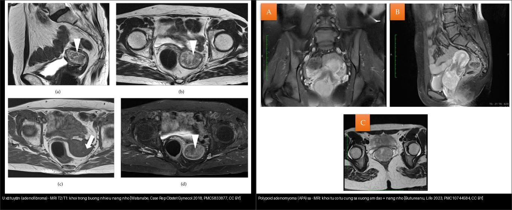
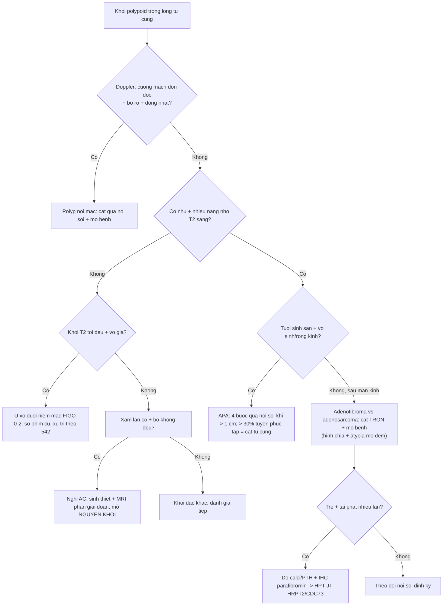
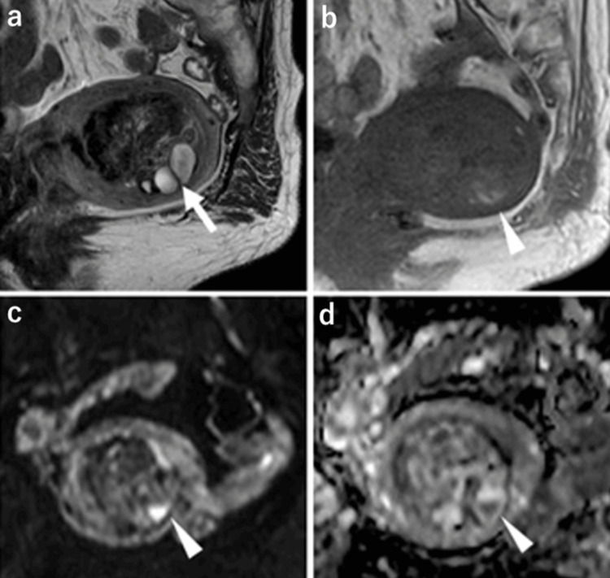
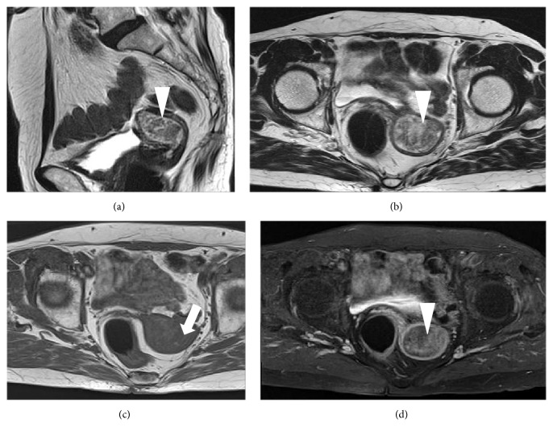
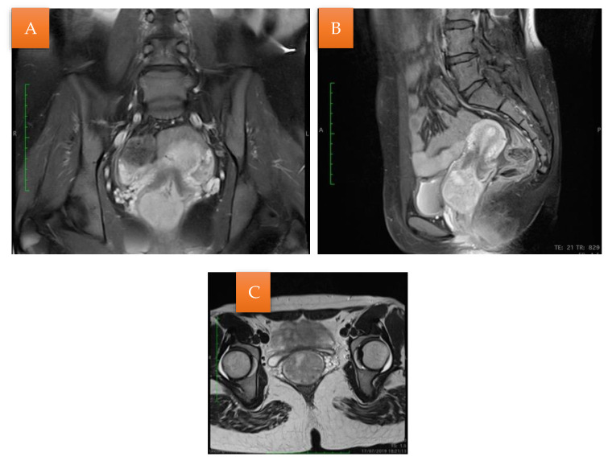
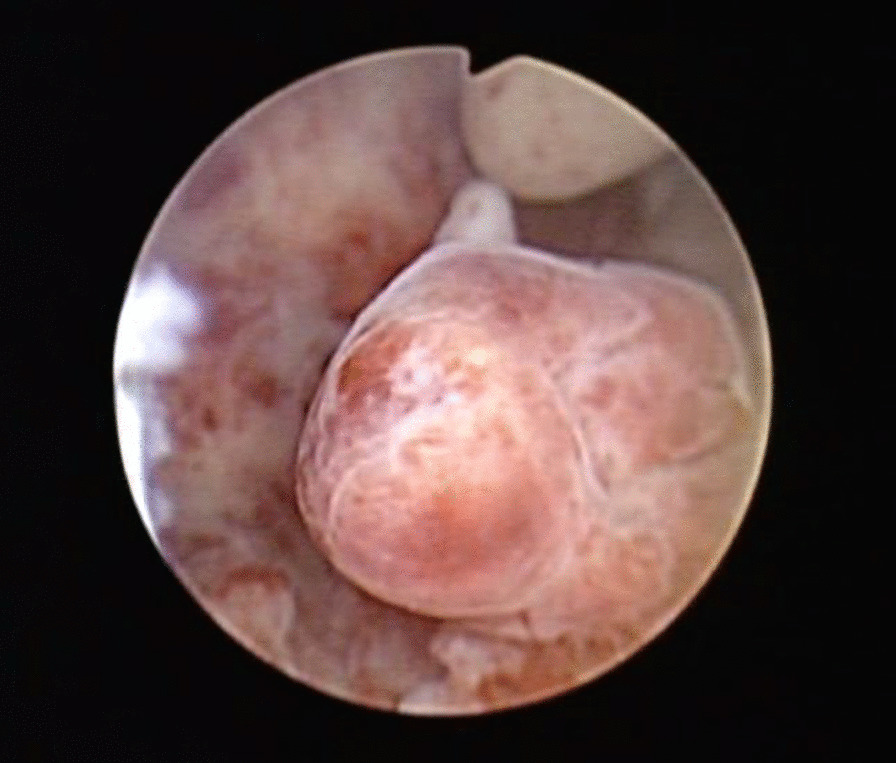
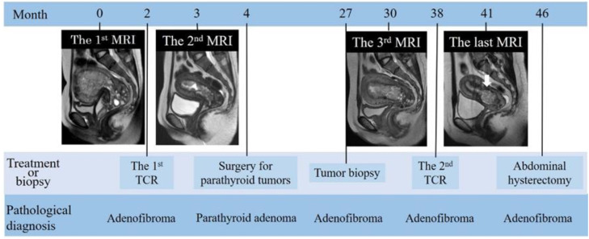
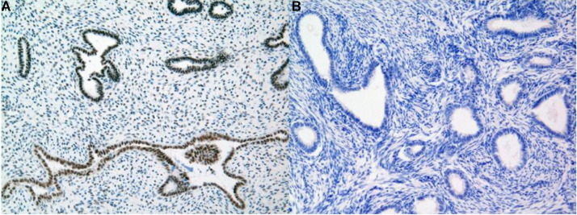

# 541 — U xơ tuyến tử cung (adenofibroma) & polypoid adenomyoma: "kẻ giả danh lành" phía dưới adenosarcoma / Uterine adenofibroma & atypical polypoid adenomyoma

**Tags:** `pattern:khoi-long-tu-cung` `pattern:u-gia-lanh` `vung:tu-cung` `score:ADC` `protocol:MRI-tieu-khung` `protocol:soi-buong-tu-cung`
**Mức chắc chắn (certainty):** tổng hợp y văn (literature synthesis) — nhóm tự biên từ nhiều ca nguyên văn có ảnh mở CC BY / CC BY-NC-ND (Cureus 2026; Case Rep Obstet Gynecol 2018; BMC Womens Health 2022; Life 2023; Radiol Case Rep 2026; J Midlife Health 2025) + meta-analysis APA (Medicine 2020); số liệu đối chiếu từng bài gốc, không gắn một ca đơn lẻ duy nhất.

## 1. Tổng quan bệnh học – cơ chế hình ảnh

- **Vấn đề lâm sàng:** đây là **đầu LÀNH của phổ hỗn hợp biểu mô–trung mô** của tử cung: **adenofibroma** (biểu mô lành + mô đệm lành) → **adenosarcoma** (biểu mô lành + mô đệm ÁC) → **carcinosarcoma** (cả hai ác). Bệnh nhân thường **ra máu sau mãn kinh** hoặc có **polyp tái phát nhiều lần**, hình ảnh chỉ thấy "một khối polypoid trong lòng tử cung" nên **rất dễ bị chốt là polyp lành** rồi cắt qua nội soi mà bỏ sót adenosarcoma. Ngược lại, u lành cũng bị **gọi nhầm là ác** → cắt tử cung oan ở người còn muốn sinh con.
- **Bệnh học adenofibroma:** u **hỗn hợp biểu mô–trung mô LÀNH**, **cực kỳ hiếm**; biểu mô = **tuyến kiểu nội mạc lành**, mô đệm = **nguyên bào sợi lành, mật độ thấp, KHÔNG atypia và KHÔNG thấy hình chia (mitotic figures)** (Kaur 2025); có thể có **dị sản vảy (squamous metaplasia)** lan rộng (Kaizu 2026). Ca 75 tuổi (Watanabe 2018): u có **nhú (papillae) với lõi mô đệm**, đại thể u thoái hóa/hoại tử xám trắng ~4 × 2,5 cm.
  - **Cảnh báo phân loại:** **WHO ấn bản 5 đã BỎ adenofibroma như một thực thể riêng** vì chồng lấp chẩn đoán với **adenosarcoma độ thấp** và polyp lành (Nakai 2026; Kaur 2025). Vì vậy "adenofibroma" trên giải trình tự chỉ nên xem là **chẩn đoán mô bệnh loại trừ**, phải cắt trọn tổn thương + xem kỹ **số hình chia và atypia mô đệm**.
  - **Không "lành tuyệt đối":** adenofibroma đã được ghi nhận **xâm lấn cơ tử cung – tĩnh mạch chậu, tái phát và di căn** (hiếm) → không dùng chữ "lành" để ngừng theo dõi (Kaur 2025).
- **Bệnh học atypical polypoid adenomyoma (APA):** u **hai pha** gồm **tuyến nội mạc điển hình/biến đổi kiến trúc + mô đệm cơ–sợi (fibromyomatous stroma)**, có thể có **dị sản vảy dạng ngọc (squamous morular metaplasia)**; gặp chủ yếu ở **nữ tuổi sinh sản, vô sinh** (Wang 2022; Butureanu 2023).
  - **Nguy cơ thật (định lượng — Biasioli 2020, gộp 46 nghiên cứu/296 ca):** **tái phát 44% (KTC 95% 33–57%)**, thấp hơn khi cắt qua **nội soi buồng tử cung 22% (11–39%)** so với **nạo/cắt polyp mù 38% (15–67%)**; **ung thư nội mạc kèm theo/trong theo dõi 16% (9–29%)**; **tích lũy 5 năm chẩn đoán ung thư mới 10,56% (nội soi) vs 35,5% (nạo mù)**.
  - **Ngưỡng xử trí (Wang 2022, 44 ca):** tổn thương trong buồng **> 1 cm** → **phương pháp "4 bước" qua nội soi + chẩn đoán mô bệnh**; **> 30% tuyến bề mặt có cấu trúc phức tạp (phân nhánh/nảy chồi) hoặc kèm tăng sinh nội mạc = chỉ định cắt tử cung**. Phân độ **APA-L (36) / APA-H (8)** theo mức bất thường tuyến bề mặt.
- **TẠI SAO hình ảnh trông như vậy (vật lý + mô bệnh):**
  - **Khe tuyến giãn nang nằm trong mô đệm đặc** → trên T2W khối có **"đốm/đảo tăng tín hiệu không đồng nhất"** (punctate heterogeneous hyperintensity, islands of iso-to-hypointensity) — nang nhỏ T2 rất sáng; ca Nakai 2026 thấy **nhiều nang trong u (95 × 54 × 78 mm)**.
  - **Xuất huyết/hoại tử nhỏ trong u** → **ổ T1 sáng (methemoglobin)** — gặp ở cả hai ca kinh điển (Watanabe 2018; Kaizu 2026).
  - **Mô đệm sợi LÀNH, thưa tế bào, giàu collagen** → **ngấm thuốc ít/không đặc hiệu** (Watanabe 2018: "a little enhancement") nhưng ca có **dị sản vảy lan rộng** lại **ngấm bề mặt mạnh + ngấm tăng dần ở thì muộn dạng nhú** (Kaizu 2026) → ngấm không giúp loại ác.
  - **DWI/ADC KHÔNG phải ranh giới tuyệt đối giữa lành và ác:** ca 84 tuổi có **ADC CAO** ở thành phần đặc (Kaizu 2026) nhưng ca HPT-JT lại có **ADC thấp 1,26 ×10⁻³ mm²/s** (Nakai 2026) — **trùng khít giá trị 1,26 của adenosarcoma** trong bài 519. **Bài học: ADC một mình không loại trừ adenosarcoma; chốt cuối là mô bệnh (hình chia + atypia mô đệm).**

## 2. Mẫu hình + chẩn đoán phân biệt (gamut)

- **Ba câu hỏi gỡ rối một "khối polypoid trong lòng tử cung":**
  1. **Bối cảnh:** nữ **tuổi sinh sản vô sinh/rong kinh** (nghiêng APA) hay **ra máu sau mãn kinh** (nghiêng adenofibroma/adenosarcoma/ung thư)?
  2. **Có "nhú" và "nang nhỏ" không?** (adenofibroma/adenosarcoma có nhú + nang; polyp thường đồng nhất).
  3. **Có tái phát nhiều lần / kèm bệnh nội tiết không?** (APA tái phát 44%; adenofibroma tái phát ở người trẻ → nghĩ **hội chứng HPT-JT**).
- **Gamut theo bản chất (từ lành → ác) cùng vị trí lòng tử cung:**
  - **Lành:** **adenofibroma**, **APA**, polyp nội mạc (kể cả **polyp khổng lồ 4–12 cm**, phần lớn lành), u xơ dưới niêm mạc (FIGO 0–2), polypoid adenomyoma.
  - **Ác / tiền ác:** **adenosarcoma** (biểu mô lành + mô đệm ác), **carcinosarcoma**, **ung thư nội mạc thể polypoid**, tăng sinh nội mạc có atypia.
- **Đặc trưng hình ảnh từng thực thể (định lượng):**
  - *Adenofibroma:* khối trong buồng **có nhú + nhiều nang nhỏ**, T2 không đồng nhất, T1 có ổ sáng (xuất huyết), ngấm ít→có thể ngấm nhú tăng dần; **DWI/ADC không định hướng (có thể ADC cao HOẶC thấp)**; hay **lan xuống ống cổ/âm đạo** khi lớn (Nakai 2026).
  - *APA:* khối **trong buồng hoặc sa xuống cổ/âm đạo**, **có nang nhỏ**, siêu âm **khối tăng âm trong buồng ~1,7 × 1,2 cm** (Wang 2022); soi buồng: khối **bờ không đều, mặt sần** (Wang 2022); MRI ca sa: **khối từ ngang cổ tử cung 4,7 cm, có ổ nang nhỏ** (Butureanu 2023).
  - *Polyp nội mạc:* bờ rõ, **đồng nhất**, **cuống mạch đơn độc (pedicle artery)**, ADC **không** thấp.
  - *U xơ dưới niêm mạc:* T2 **tối**, vỏ giả, **không nang/nhú**, điển hình bởi **bờ rõ + mạch bao**.
  - *Adenosarcoma/ung thư nội mạc:* khối **lớn (~6,5 cm), không đồng nhất, xâm lấn cơ**, DWI hạn chế thật, ngấm không đồng nhất; tái phát sau cắt "polyp" (bài 519).

## 3. Bảng so sánh phân biệt (ma trận đối chiếu)

| Thực thể (entity) | Hình ảnh điển hình | Chốt vào (rule-in) | Chốt loại (rule-out) | Gợi ý xác nhận |
|---|---|---|---|---|
| **Adenofibroma** | Khối polypoid trong buồng **có nhú + nhiều nang nhỏ**, T2 không đồng nhất, ổ T1 sáng; có thể lan ống cổ/âm đạo | **Nhú + nang nhỏ + mô bệnh KHÔNG hình chia/không atypia** | Không loại được bằng hình ảnh (ADC có thể cao hoặc thấp) → **không thể "chốt loại" adenosarcoma bằng DWI** | Cắt trọn qua nội soi + mô bệnh (số hình chia/atypia); IHC **parafibromin** nếu trẻ/tái phát |
| **APA (atypical polypoid adenomyoma)** | Khối trong buồng/sa cổ–âm đạo, **nang nhỏ**, mặt sần; nữ tuổi sinh sản vô sinh | **Tuổi sinh sản + vô sinh/rong kinh + nang nhỏ + mô bệnh hai pha (tuyến + đệm cơ–sợi)** | Xâm lấn cơ sâu + DWI hạn chế mạnh → nghi ác | **"4 bước" qua nội soi khi tổn thương > 1 cm**; theo dõi nội soi định kỳ |
| **Polyp nội mạc lành** | Bầu dục bờ rõ, **đồng nhất**, **cuống mạch đơn độc** | **Cuống mạch đơn độc + bờ rõ + đồng nhất + ADC không thấp** | Có nhú/nang nhỏ + DWI hạn chế → nghi adenofibroma/adenosarcoma | Soi buồng + cắt polyp; mô bệnh |
| **Adenosarcoma (loại trừ chính)** | Khối **lớn (~6,5 cm)** không đồng nhất, **nang nhỏ T2 sáng**, DWI hạn chế thật, có thể xâm lấn cơ, lan ống cổ | **Khối lớn không đồng nhất + nang nhỏ + DWI hạn chế thật (ADC thấp)** ở nữ ra máu sau mãn kinh | Bờ đẩy rõ + không xâm lấn + mô đệm không atypia → nghiêng lành | **Mô bệnh bắt buộc** (biểu mô lành + mô đệm ÁC; SO > 25%) — bài 519 |
| **U xơ dưới niêm mạc (FIGO 0–2)** | Khối đặc **T2 tối** đồng nhất, vỏ giả, **không nang/nhú** | **T2 tối đều + vỏ giả + không hạn chế khuếch tán** | T2 sáng không đồng nhất + nhú/nang → nghi adenofibroma/adenosarcoma | MRI; soi buồng; so phim cũ (bài 520/542) |
| **Ung thư nội mạc thể polypoid** | Khối nội mạc bờ không đều, **xâm lấn cơ**, DWI hạn chế | **Xâm lấn cơ + bờ không đều + DWI hạn chế** | Bờ đẩy rõ không xâm lấn → nghiêng lành | Sinh thiết nội mạc + MRI phân giai đoạn (bài 525) |
| **HPT-JT (bối cảnh, không phải u)** | **U tử cung tái phát nhiều lần ở người TRẺ** + tăng calci máu/tăng PTH + u xương hàm + nang thận | **U tử cung tái phát ở tuổi trẻ + tăng PTH nguyên phát + mất bộc lộ parafibromin** | Parafibromin còn bộc lộ → không phải HPT-JT | IHC parafibromin; gen **HRPT2/CDC73**; tầm soát tuyến cận giáp–hàm–thận |

*Trái: **adenofibroma** — MRI (a) T2 dọc và (b) T2 ngang: khối trong buồng tử cung **có nhú, nhiều nang nhỏ** (mũi tên), T1 giảm tín hiệu kèm ổ sáng nghi xuất huyết (mũi tên), ngấm thuốc **ít** (d). Phải: **polypoid adenomyoma (APA) sa** — MRI khối xuất phát từ ngang cổ tử cung sa xuống âm đạo, **có ổ nang nhỏ**. Cả hai đều lành nhưng mô bệnh mới phân định được. Nguồn: Watanabe H et al., Case Rep Obstet Gynecol 2018 (PMC5833877, CC BY) + Butureanu T et al., Life 2023 (PMC10744584, CC BY). Ảnh ghép letterbox, giữ nguyên tỷ lệ.*

### Dấu hiệu chốt then chốt
- **"Nhú + nang nhỏ trong khối polypoid"** là dấu hình ảnh gợi ý **adenofibroma/adenosarcoma** — khác polyp thường (đồng nhất) và u xơ (T2 tối đều).
- **Mô bệnh là chốt duy nhất:** **adenofibroma = KHÔNG hình chia + KHÔNG atypia tế bào** (Kaur 2025); **adenosarcoma = mô đệm tăng sinh + atypia ± hình chia**, phân biệt bằng hình thái tế bào và chỉ số hình chia — **adenosarcoma biệt hóa cao vẫn bị đọc nhầm thành adenofibroma** (Kaur 2025).
- **Tái phát nhiều lần ở người trẻ = tín hiệu hệ thống:** ca 21 tuổi tái phát u tử cung nhiều lần + cận giáp nguyên phát → **HPT-JT**; mất bộc lộ **parafibromin** khẳng định đột biến **HRPT2/CDC73** (Nakai 2026).

## 4. Protocol chụp + xử trí

- **Siêu âm đầu tay (TVUS ± Doppler):** khối trong buồng; **cuống mạch đơn độc** gợi ý polyp; **nhiều nang nhỏ trong khối** gợi ý adenofibroma/APA (Watanabe 2018; Wang 2022).
- **MRI tiểu khung (đánh giá bản chất + xâm lấn + lan):**
  - **T2W ≥ 2 bình diện:** nhú, nang nhỏ, vùng chuyển tiếp, xâm lấn cơ, lan ống cổ.
  - **T1W (± fat-sat):** ổ T1 sáng = xuất huyết.
  - **DWI b = 800–1.000 + ADC:** hạn chế **không** loại được adenosarcoma một mình — đo tại **mô đặc còn sống**, cảnh giác nang/hoại tử gây ADC thấp giả.
  - **T1W + Gd động học (DCE) + tái tạo 3D T1 mỏng:** đánh giá **ngấm bề mặt dạng nhú** và **ngấm tăng dần thì muộn** (dấu của ca 84 tuổi có dị sản vảy).
- **Soi buồng tử cung + cắt TRỌN tổn thương (tiêu chuẩn vàng):** **không** sinh thiết nhỏ rồi dừng; APA **> 1 cm** dùng **phương pháp "4 bước"** (Wang 2022); cắt qua nội soi giảm tái phát 44% → 22% và phát hiện ung thư kèm theo tốt hơn nạo mù (Biasioli 2020).
- **Xử trí theo mô bệnh:** adenofibroma/APA → **bảo tồn sinh sản bằng cắt qua nội soi + theo dõi nội soi định kỳ**; **> 30% tuyến phức tạp/kèm tăng sinh nội mạc = cắt tử cung** (Wang 2022). Nghi adenosarcoma → **mô nguyên khối** (bài 519).
- **Tầm soát hệ thống:** người **trẻ + u tái phát nhiều lần** → định lượng **calci/PTH**, khám **xương hàm**, siêu âm **thận** để tìm **HPT-JT (HRPT2/CDC73)** (Nakai 2026).

## 5. Biến thể bình thường và cạm bẫy

- **ADC không phân định lành–ác:** ca adenofibroma (HPT-JT) có **ADC 1,26 ×10⁻³ mm²/s** — **trùng giá trị của adenosarcoma** trong bài 519; ca khác lại **ADC cao**. → **Đừng chốt "ADC cao = lành"** hay "ADC thấp = ác" cho nhóm polypoid trong buồng.
- **"Adenofibroma" có thể là chẩn đoán sai:** **WHO 5 đã bỏ thực thể này**; adenosarcoma độ thấp có thể **bị đọc thành adenofibroma** → luôn xem mô bệnh kỹ + hội chẩn giải phẫu bệnh.
- **Kích thước lớn không đồng nghĩa ác:** polyp nội mạc **khổng lồ 4–12 cm** phần lớn vẫn lành — phải dựa vào bờ/mô bệnh (bài 519).
- **APA "lành" nhưng hay tái phát & kèm ung thư:** **tái phát 44%**, **ung thư nội mạc kèm theo 16%** → **theo dõi nội soi + sinh thiết nội mạc định kỳ**, không dừng sau một lần cắt.
- **Satisfaction of search:** khi thấy khối trong buồng, **quét toàn bộ cơ tử cung + ống cổ** (ca Nakai 2026 u lan tới âm đạo; ca Kaizu 2026 có khối kèm trong cơ ở bài 519).
- **Đừng bỏ qua đầu mối hệ thống:** u tử cung tái phát ở người trẻ + tăng calci/tăng PTH + u xương hàm = **phải nghĩ HPT-JT**, vì tầm soát cận giáp–thận–hàm thay đổi tiên lượng.
- **Ưu tiên đường tiếp cận:** u dưới niêm mạc/trong buồng nghi lành → **cắt qua nội soi** (bảo tồn sinh sản, ít dính buồng); nghi ác → **không cắt nhỏ/mổ nội soi nguyên khối** để tránh gieo rắc (bài 518).

## 6. Tự lượng giá — Blind Quiz ngay trên trang tĩnh

**Ca 1 — Nữ 84 tuổi, ra máu sinh dục; siêu âm + MRI có khối trong buồng tử cung. Nhìn phim, mô tả trước.**

- Gợi ý lâm sàng (clinical context): nữ 84 tuổi, chảy máu sinh dục, u buồng tử cung trên hình ảnh.
- Câu hỏi: (a) T2 có gì trong khối? (b) T1 (b) có dấu hiệu nào? (c) DWI (c) và ADC (d) nói gì — vì sao **không được kết luận ác/lành chỉ bằng DWI**?

<b>Bấm để hiện đáp án (findings + chẩn đoán)</b>

- Dấu hiệu (findings): (a) T2 dọc — khối chiếm buồng tử cung, **không đồng nhất, giảm tín hiệu so với cơ, có nhiều ổ tăng tín hiệu = nang** (mũi tên); (b) T1 — khối **đồng tín hiệu với cơ + ổ sáng nhỏ nghi xuất huyết** (mũi tên đầu); (c) DWI b = 1000 — thành phần đặc **tín hiệu thấp**; (d) **ADC CAO** ở thành phần đặc (trừ ổ xuất huyết) = không hạn chế khuếch tán thật.
- Chẩn đoán (diagnosis): **adenofibroma tử cung có dị sản vảy (squamous metaplasia)** — mô bệnh: nhú bề mặt + nang, tuyến kiểu nội mạc + **mô đệm nguyên bào sợi KHÔNG atypia**. Điểm đáng nhớ: ca này **ADC cao** → hình ảnh KHÔNG loại trừ adenosarcoma, phải có mô bệnh.
- Nguồn ảnh: Kaizu A et al., Cureus 2026, PMC13129567, Fig 2, CC BY 4.0.

**Ca 2 — Nữ 75 tuổi, không triệu chứng, có "polyp" tử cung; MRI + soi buồng tử cung mềm. Nhìn phim, mô tả trước.**

- Gợi ý lâm sàng: nữ 75 tuổi, polyp tử cung, không triệu chứng.
- Câu hỏi: (a,b) T2 có dạng tín hiệu gì đặc trưng? (c) T1 có gì bất thường? (d) Ngấm thuốc ra sao? Chẩn đoán phân biệt?

<b>Bấm để hiện đáp án (findings + chẩn đoán)</b>

- Dấu hiệu (findings): (a) T2 dọc và (b) T2 ngang — khối trong buồng tử cung **"đốm/đảo" tăng tín hiệu không đồng nhất** (nang nhỏ lẫn đảo đồng–giảm tín hiệu); (c) T1 ngang — tổn thương **giảm tín hiệu kèm ổ tăng tín hiệu khu trú** (nghi xuất huyết); (d) T1 sau tiêm — **ngấm thuốc RẤT ÍT**.
- Chẩn đoán (diagnosis): **adenofibroma tử cung** — mô bệnh: tăng sinh hai pha LÀNH (tuyến nội mạc lành + mô đệm nguyên bào sợi, rất ít hình chia). Soi buồng: **polyp đỏ–vàng–trắng, mặt "đá cuội" xếp lớp, dễ biến dạng theo dịch bơm** — gợi ý nhưng không chốt được.
- Nguồn ảnh: Watanabe H et al., Case Rep Obstet Gynecol 2018, PMC5833877, Fig 2, CC BY.

**Ca 3 — Nữ 21 tuổi, khối sa xuống âm đạo gây chảy máu. Nhìn phim, mô tả trước.**

- Gợi ý lâm sàng: nữ 21 tuổi, khối chảy máu chiếm âm đạo 4,7 × 4,5 cm.
- Câu hỏi: khối xuất phát từ đâu? Có dấu hiệu hình ảnh nào lặp lại với adenofibroma? Vì sao **không cắt tử cung vội**?

<b>Bấm để hiện đáp án (findings + chẩn đoán)</b>

- Dấu hiệu (findings): MRI — khối **xuất phát từ ngang cổ tử cung**, sa xuống âm đạo, trong khối **có nhiều ổ nang nhỏ**.
- Chẩn đoán (diagnosis): **atypical polypoid adenomyoma (APA) sa** — mô bệnh: tuyến nội mạc + **mô đệm cơ–sợi dày**, có ổ tăng sinh/dị sản. Bệnh lành nhưng **tái phát 44%** và **ung thư nội mạc kèm theo 16%** → **cắt qua nội soi bảo tồn + theo dõi nội soi/sinh thiết nội mạc định kỳ** (không cắt tử cung ngay ở người trẻ).
- Nguồn ảnh: Butureanu T et al., Life 2023, PMC10744584, Fig 2 (A–C), CC BY.

**Ca 4 — Nữ tuổi sinh sản, rong kinh; soi buồng tử cung thấy khối trong buồng. Nhìn ảnh, mô tả trước.**

- Gợi ý lâm sàng: rong kinh, khối trong buồng tử cung; siêu âm khối tăng âm 1,7 × 1,2 cm, nội mạc 1,0 cm.
- Câu hỏi: hình dạng khối gợi ý gì? Bước xử trí tiếp theo khi tổn thương **> 1 cm** là gì?

<b>Bấm để hiện đáp án (findings + chẩn đoán)</b>

- Dấu hiệu (findings): nội soi — khối **bờ không đều, mặt sần dạng múi** nằm thành sau buồng tử cung (đường kính 2,0 cm trong loạt ca).
- Chẩn đoán (diagnosis): **atypical polypoid adenomyoma (APA)**. Xử trí: với tổn thương **> 1 cm** dùng **phương pháp "4 bước" chẩn đoán–điều trị qua nội soi + mô bệnh**; nếu **> 30% tuyến bề mặt phức tạp/kèm tăng sinh nội mạc → chỉ định cắt tử cung**.
- Nguồn ảnh: Wang X & Guo Y, BMC Womens Health 2022, PMC8895791, Fig 1, CC BY 4.0.

**Ca 5 — Nữ 21 tuổi, u tử cung tái phát nhiều lần, tiền sử cận giáp nguyên phát. Nhìn MRI tái phát + hóa mô miễn dịch.**

- Gợi ý lâm sàng: nữ 21 tuổi, u tử cung tái phát nhiều lần (cắt qua nội soi 2 lần), có tăng PTH nguyên phát do u tuyến cận giáp; khối ban đầu 95 × 54 × 78 mm lan vào âm đạo, **ADC 1,26 ×10⁻³ mm²/s**, FDG nhẹ (SUVmax 2,3).
- Câu hỏi: Vì sao phải nghĩ đến **hội chứng di truyền**? Xét nghiệm nào khẳng định? Có nên tin "adenofibroma là lành"?

<b>Bấm để hiện đáp án (findings + chẩn đoán)</b>

- Dấu hiệu (findings): MRI chuỗi theo thời gian sau các lần cắt qua nội soi — **khối trong buồng giảm thể tích rồi TÁI PHÁT**, lần cuối khối 45 mm từ lỗ trong cổ tử cung lan ra ống cổ. **Hóa mô miễn dịch: u MẤT bộc lộ parafibromin ở nhân** (khác polyp lành của bệnh nhân khác có bộc lộ rõ).

- Chẩn đoán (diagnosis): **u tử cung tái phát trong bệnh cảnh HPT-JT (hyperparathyroidism–jaw tumor syndrome)** do đột biến dòng mầm **HRPT2/CDC73** (mất parafibromin). **Bài học: u "adenofibroma" tái phát nhiều lần ở người trẻ không phải chuyện cục bộ → tầm soát cận giáp, xương hàm, thận và xét nghiệm gen.** Lưu ý ADC **1,26** ở đây trùng giá trị adenosarcoma (bài 519) → DWI không phân định.
- Nguồn ảnh: Nakai G et al., Radiol Case Rep 2026, PMC12809490, Fig 4 & Fig 6, CC BY-NC-ND (nguyên bản, không chỉnh sửa).

**Ca 6 — Ảnh ghép: hai khối trong lòng tử cung. Bên nào là adenofibroma, bên nào là polypoid adenomyoma? Vì sao đều lành mà vẫn nguy hiểm?**

- Gợi ý lâm sàng: một ca ra máu sau mãn kinh có polyp lòng tử cung; một ca nữ 21 tuổi có khối sa âm đạo.
- Câu hỏi: Dấu hiệu chung và dấu hiệu phân biệt? Vì sao vẫn bắt buộc mô bệnh?

<b>Bấm để hiện đáp án (findings + chẩn đoán)</b>

- Trái: **adenofibroma** — khối trong buồng có **nhú + nhiều nang nhỏ**, T1 có ổ sáng, ngấm ít; mô đệm KHÔNG hình chia/atypia.
- Phải: **polypoid adenomyoma (APA)** — khối **từ cổ tử cung sa xuống âm đạo** có **ổ nang nhỏ**; mô đệm cơ–sợi; tái phát 44% và kèm ung thư nội mạc 16%.
- Chốt: **cả hai đều lành nhưng mô bệnh là ranh giới duy nhất** với adenosarcoma (biểu mô lành + mô đệm ÁC). Nguồn: Watanabe H et al. (PMC5833877, CC BY) + Butureanu T et al. (PMC10744584, CC BY).

## Bài liên quan chéo
- [500 – Tổng quan Hệ Vú & Sản Phụ khoa](../500-tong-quan-vu-san-phu-khoa/lesson.md)
- [519 – Adenosarcoma tử cung & polyp nội mạc: khối trong lòng tử cung giả polyp](../519-adenosarcoma-tu-cung-va-polyp-noi-mac/lesson.md)
- [520 – U xơ cơ tử cung (FIGO 0–8), adenomyosis & nội mạc](../520-tu-cung-u-xo-FIGO-adenomyosis-noi-mac/lesson.md)
- [525 – Ung thư nội mạc & cổ tử cung: FIGO trên MRI](../525-ung-thu-noi-mac-co-tu-cung-FIGO-MRI/lesson.md)
- [526 – Sarcoma tử cung & carcinosarcoma vs u xơ](../526-sarcoma-tu-cung-vs-u-xo/lesson.md)
- [527 – U mô đệm nội mạc tử cung: ESN/LG-ESS/HG-ESS/UUS](../527-u-mo-dem-noi-mac-tu-cung/lesson.md)
- [542 – U xơ dưới niêm mạc (FIGO 0–2) & can thiệp bảo tồn](../542-u-xo-duoi-niem-mac-can-thiep-bao-ton/lesson.md)
- [571 – Sẩy thai tái diễn: tiếp cận hình ảnh tử cung](../571-say-thai-tai-dien-tiep-can-hinh-anh/lesson.md)

## Ảnh
- 10 ảnh (CC BY 4.0 ×4 + CC BY ×3 + CC BY-NC-ND ×3) + 1 ảnh ghép (CC BY). Nguồn + giấy phép từng ảnh trong `images/CREDITS.md`.

> Không dùng để chẩn đoán độc lập khi chưa có người hướng dẫn.
