# 542 — U xơ dưới niêm mạc (FIGO 0–2) & can thiệp bảo tồn: soi buồng, nút mạch (UAE), MR-HIFU / Submucosal fibroids & fertility-sparing interventions

**Tags:** `pattern:khoi-tu-cung` `pattern:khoi-long-tu-cung` `vung:tu-cung` `score:FIGO` `score:STEPW` `protocol:MRI-tieu-khung` `protocol:soi-buong-tu-cung`
**Mức chắc chắn (certainty):** tổng hợp y văn (literature synthesis) — nhóm tự biên từ hướng dẫn ESGE (Clark 2024), tổng quan phân loại FIGO (Lakabi 2025), ca nguyên văn có ảnh mở (AlAshqar 2026; Kyaw 2026; Almasri 2026) + đoàn hệ/đoàn hệ lớn (Peker 2026; Liu 2026; Seyferth 2026; Otonkoski 2026; Briones 2026; Połukord 2026); số liệu đối chiếu từng bài gốc.

## 1. Tổng quan bệnh học – cơ chế hình ảnh

- **Vấn đề lâm sàng:** u xơ dưới niêm mạc (submucosal fibroid) là **loại hiếm nhất** của u xơ (Clark 2024) nhưng gây **rong kinh nặng, vô sinh, sảy thai** — vì khối đội nội mạc và **biến dạng lòng tử cung**. Đây là nhóm **duy nhất mổ được qua đường TỰ NHIÊN (soi buồng)** → **bảo tồn tử cung**, nhưng cũng là nhóm **dễ vỡ kế hoạch nhất** (cắt không hết, dính buồng, quá tải dịch).
- **Phân loại FIGO (Munro 2011) — quyết định ngả đường:**
  - **0** = có cuống, hoàn toàn trong buồng (pedunculated intracavitary).
  - **1** = **< 50%** trong cơ — **góc NHỌN < 90°** giữa u và nội mạc, đường kính lớn nhất u nằm trong buồng.
  - **2** = **≥ 50%** trong cơ — **góc TÙ > 90°** hai bên (Clark 2024, Fig 1).
  - **3** = tiếp giáp nội mạc nhưng **100% trong cơ**; **4** trong cơ hoàn toàn; **5–7** dưới thanh mạc; **8** vị trí khác (cổ tử cung, ký sinh…). **Ký hiệu ghép 2-5** khi u vừa dưới niêm mạc vừa dưới thanh mạc.
  - **Ý nghĩa xử trí:** **0–2 = soi buồng** (bài này); **3 = cân nhắc "hạ độ" – nhiều thì**; **4–7 = nội soi ổ bụng/mổ mở** (bài 520).
- **TẠI SAO hình ảnh trông như vậy (vật lý + mô bệnh):**
  - U xơ giàu **sợi cơ trơn + collagen** → **T2W rất tối**, bờ rõ, có **vỏ giả (pseudocapsule)** + **mạch nuôi bao quanh (bridging vessels)**; khác biệt độ tương phản với nội mạc T2 sáng giúp **xác định tỷ lệ trong buồng/trong cơ** (chốt FIGO).
  - U **đè và làm phẳng/căng nội mạc** → **biến dạng bề mặt lòng tử cung (cavity deformation)**; ca Kyaw 2026: khối **116,5 × 92,5 × 100,7 mm** làm biến dạng lòng tử cung nặng.
  - **Vôi hóa/hoại tử** trong u lớn → ổ tăng đậm độ trên CT, tín hiệu hỗn hợp trên MRI.
- **Ngưỡng định lượng bắt buộc:**
  - **Nguy cơ cắt KHÔNG hết tăng khi:** đường kính lớn nhất **> 2 cm**, diện tích bề mặt u chiếm nhiều, **xuyên cơ > 50%** (Clark 2024) → phải tiên lượng **nhiều thì**.
  - **Giới hạn dịch bơm (an toàn — Clark 2024):** **ngưỡng tối đa khi phải DỪNG ngay = 2,5 L với dịch đẳng trương (NaCl 0,9%)** và **1 L với dịch nhược trương (glycine/sorbitol — nguy cơ hạ natri máu)**; bắt buộc **hệ thống đo dịch tự động theo thời gian thực**.
  - **Nhóm FIGO 3 ≥ 5 cm (Liu 2026, 18 ca, kỹ thuật "hạ độ"):** mổ **1 thì** ở **16/18 = 88,9%**; thời gian mổ trung bình **41,7 phút**; **thiếu dịch 300–2.500 mL**; **kali thấp nhất 2,11–3,82 mmol/L** (cảnh báo quá tải dịch) → chỉ nên làm ở **trung tâm soi buồng thành thạo**.
  - **Kết cục sinh sản sau soi buồng (Peker 2026, 50 ca vô sinh FIGO 0–II):** **78% có thai**, **42% sinh sống**; **dính buồng tử cung (IUA) 12%**; không có biến chứng nặng. Tổng quan: cắt u xơ **gấp đôi tỷ lệ có thai lâm sàng** (Casini 2006 RCT; Pritts 2009), nhưng **tác động lên tỷ lệ sinh sống/sảy thai còn chưa chắc** (Clark 2024, trích dẫn và phản biện).
  - **Nút mạch (UAE) — theo dõi rất dài ở nữ < 40 tuổi (Seyferth 2026, trung vị 16 năm):** cải thiện triệu chứng **70% "nhiều" + 18,8% "ít"** trong 6 tháng đầu, **11,2% không đổi**; trong nhóm cải thiện, **tái phát triệu chứng 57,7% (trung vị 11 năm)**; **không tái phát 95,8% (1 năm) / 67,6% (5 năm) / 50,7% (10 năm)**; **thoát cắt tử cung 98,6% / 84,5% / 71,8%** tại 1/5/10 năm. Hài lòng trung vị **5/5**.
  - **MR-HIFU (Otonkoski 2026, 163 nữ):** **NPV trung bình 62%**; SSS trung vị **56 → 28 (3 tháng) → 25 (12 tháng)** ở nhóm chảy máu, **46 → 19 → 19** ở nhóm khối; cải thiện có ý nghĩa. **HIFU & thai (Briones 2026, 748 ca):** **40,4% mang thai**, **88,1% tự nhiên**, **273/310 sinh thành công**, **không có vỡ tử cung**; **tuổi lớn, đa u, u dưới niêm mạc, NPV thấp = yếu tố bất lợi**.
  - **RFA/HIFU nói chung (Połukord 2026):** giảm chảy máu **80–90%** bệnh nhân, **thể tích u giảm ~40–60%**, **can thiệp lại 8–10% trong 3–5 năm**.

## 2. Mẫu hình + chẩn đoán phân biệt (gamut)

- **Ba câu hỏi trước khi quyết định đường vào:** (1) **FIGO mấy** (0–2 vs 3 vs ≥ 4)? (2) **Kích thước + xuyên cơ bao nhiêu %** (nguy cơ nhiều thì)? (3) **Còn muốn có con không** (quyết định soi buồng vs UAE/HIFU vs cắt tử cung)?
- **Gamut "khối trong buồng gây rong kinh":**
  - **U xơ dưới niêm mạc FIGO 0–2** (bài này): T2 tối, vỏ giả, biến dạng lòng tử cung.
  - **Polyp nội mạc**: đồng nhất, cuống mạch đơn độc, ADC không thấp (bài 519/541).
  - **Adenomyosis/polypoid adenomyoma**: JZ dày ≥ 12 mm, nang nhỏ, tín hiệu giống JZ (bài 520/541).
  - **Ung thư nội mạc thể polypoid / adenosarcoma / sarcoma**: bờ không đều, xâm lấn, DWI hạn chế thật, ADC ≤ 0,9 (bài 519/526).
  - **Nang/huyết khối nội mạc, dính buồng (Asherman)**: dải T2 nội mạc mất, co kéo (bài 571).
- **Gamut "can thiệp bảo tồn" (khác nhau ở chỉ định & sinh sản):** soi buồng cắt u (FIGO 0–2), UAE, MR-HIFU/RFA, GnRH agonist pre-treatment.

## 3. Bảng so sánh phân biệt (ma trận đối chiếu)

### 3a. Phân biệt theo FIGO trên MRI/siêu âm (chốt ngả đường mổ)

| Thực thể (entity) | Hình ảnh điển hình | Chốt vào (rule-in) | Chốt loại (rule-out) | Gợi ý xác nhận |
|---|---|---|---|---|
| **FIGO 0** | Khối **trong buồng hoàn toàn, có cuống**; T2 tối, vỏ giả | **Cuống + u hoàn toàn trong lòng tử cung** | Có phần trong cơ → không phải type 0 | Soi buồng; cắt cuống qua nội soi |
| **FIGO 1** | **< 50% trong cơ**; **góc NHỌN < 90°** với nội mạc; đường kính lớn nhất trong buồng | **Góc nhọn < 90° + > 50% u trong buồng** | **Góc tù > 90°** → type 2 | MRI T2 hai bình diện + soi buồng |
| **FIGO 2** | **≥ 50% trong cơ**; **góc TÙ > 90°** hai bên | **Góc tù > 90° + u nằm phần lớn trong cơ** | U 100% trong cơ, không chạm nội mạc → type 3/4 | MRI; soi buồng xác nhận khi cắt |
| **FIGO 3 (≥ 5 cm)** | Tiếp giáp nội mạc nhưng **100% trong cơ** | **Tiếp giáp nội mạc + toàn bộ trong cơ** | Có phần đội vào buồng → type 1/2 | MRI; kỹ thuật "hạ độ" nhiều thì (Liu 2026) |
| **Polyp nội mạc** | Bờ rõ, **đồng nhất**, cuống mạch đơn độc | **Đồng nhất + cuống mạch đơn độc + ADC không thấp** | T2 tối + vỏ giả + biến dạng buồng → u xơ | Soi buồng + mô bệnh |
| **Adenomyosis/APA** | JZ dày, **nang nhỏ**, tín hiệu giống JZ, không vỏ | **JZ ≥ 12 mm + nang nhỏ + không vỏ** | Vỏ giả + mạch bao + bờ rõ → u xơ | MRI; mô bệnh (bài 520/541) |
| **Ác (adenosarcoma/sarcoma/ung thư nội mạc)** | Bờ không đều, **xâm lấn cơ**, DWI hạn chế thật | **Xâm lấn + bờ không đều + ADC thấp (≤ 0,9)** | Bờ đẩy rõ + T2 tối đều → lành | Sinh thiết/mô bệnh; **không cắt nhỏ** (bài 519/526) |

### 3b. Chọn can thiệp BẢO TỒN (rule-in / rule-out theo mục tiêu sinh sản)

| Can thiệp | Cơ chế / hiệu quả định lượng | Chốt vào (rule-in) | Chốt loại (rule-out) | Ghi chú |
|---|---|---|---|---|
| **Soi buồng cắt u (hysteroscopic myomectomy)** | Cắt trực tiếp qua đường tự nhiên; **có thai 78% / sinh sống 42%** (Peker 2026) | **FIGO 0–2**, muốn bảo tồn sinh sản, rong kinh do u trong buồng | **U > 50% xuyên cơ (type 2 nặng/type 3)** một thì; **nghi ác** | Giới hạn dịch **2,5 L (đẳng trương) / 1 L (nhược trương)**; **IUA 12%** |
| **Nút mạch tử cung (UAE)** | Giảm tưới máu u; **không tái phát 95,8%/67,6%/50,7%** (1/5/10 năm), thoát cắt tử cung 71,8% ở 10 năm (Seyferth 2026) | **U to/nhiều u** không muốn/không hợp soi buồng; rong kinh nặng | **FIGO 0–1; đang mong có thai; nghi ác; nhiễm trùng chậu hoạt động** (Połukord 2026) | Hội chứng sau nút mạch (đau/sốt); tái phát triệu chứng 57,7%, trung vị 11 năm; **có ca sinh đủ tháng sau UAE u trong buồng lớn** (Almasri 2026) |
| **MR-HIFU / RFA** | Đốt u không xâm lấn; **NPV 62%**, SSS 56→25 (12 tháng) (Otonkoski 2026) | U đặc, **không phải type 0 có cuống**, muốn tránh mổ | **U dưới niêm mạc = yếu tố bất lợi cho có thai**; u quá lớn/nhiều u | **Giảm chảy máu 80–90%, thể tích −40–60%, can thiệp lại 8–10%/3–5 năm** (Połukord 2026); không vỡ tử cung khi sinh (Briones 2026) |
| **GnRH agonist / progestin** | Giảm thể tích u tạm thời, cầm máu | **Chuẩn bị trước mổ**, thiếu máu cần cải thiện | Điều trị triệt để lâu dài | Ca Kyaw 2026: **leuprorelin** rồi **tự thải u qua âm đạo** (biến cố hiếm) |
| **Cắt tử cung** | Triệt căn | Không còn nhu cầu sinh sản + triệu chứng nặng | Muốn bảo tồn sinh sản | Chỉ khi các biện pháp bảo tồn thất bại |

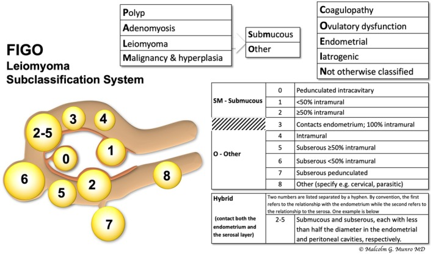
*Sơ đồ phân loại FIGO u xơ: **SM 0/1/2** (dưới niêm mạc), **O 3–7** (khác) và **8**; có nhánh tích hợp hình thái khác (polyp/adenomyosis/u ác) — cơ sở quyết định "soi buồng hay mổ bụng". Nguồn: Lakabi R et al., Int J Gynaecol Obstet 2025 (PMC12553092), Fig 1 (Malcolm G. Munro), CC BY-NC.*

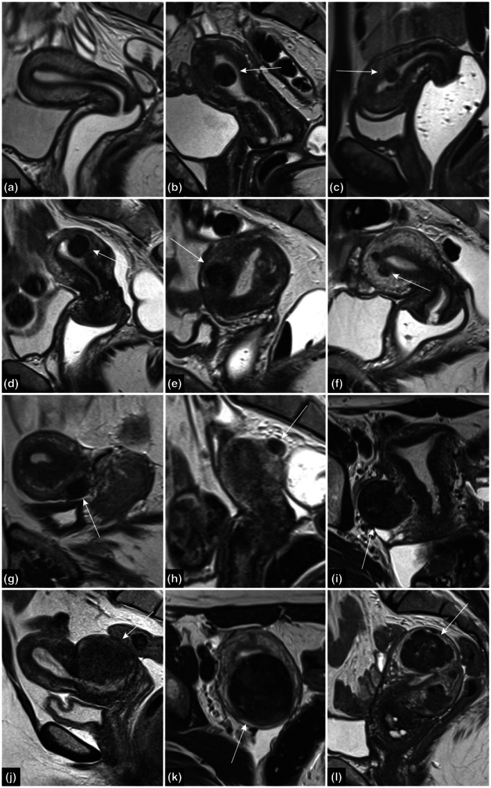
*Chuỗi 12 ô: (a) giải phẫu phân vùng bình thường (nội mạc sáng – vùng chuyển tiếp tối – cơ trung gian); (b–l) các kiểu u xơ từ **dưới niêm mạc có cuống/trong cơ** tới dưới thanh mạc. Cách đọc **góc nhọn < 90° (type 1) vs góc tù > 90° (type 2)** là chốt. Nguồn: Lakabi R et al., Int J Gynaecol Obstet 2025 (PMC12553092), Fig 2, CC BY-NC.*

### Chốt then chốt
- **Góc u–nội mạc quyết định type 1 vs type 2**, không phải chỉ "tỷ lệ ước lượng mắt".
- **Với mục tiêu sinh sản, ưu tiên soi buồng cho FIGO 0–2**; **UAE/HIFU không phải lựa chọn "trung tính" với sinh sản** — UAE **chống chỉ định tương đối khi đang mong có thai** và **kém hiệu quả với u dưới niêm mạc FIGO 0–1** (Połukord 2026).
- **Đừng quên biến chứng "quá tải dịch"** của soi buồng — ngưỡng **2,5 L/1 L** là giới hạn sống còn.

## 4. Protocol chụp + hệ phân độ/điểm chuẩn hóa

- **Siêu âm đầu tay (TVUS 2D/3D, ± SIS):** khối trong buồng/trong cơ, độ xuyên cơ, biến dạng lòng tử cung; **siêu âm bơm nước (SIS)** giúp đo tỷ lệ trong buồng.
- **MRI tiểu khung — tiêu chuẩn xác định FIGO & lập kế hoạch mổ:**
  - **T2W 2–3 bình diện (sagittal + axial ± coronal):** đo **% trong cơ**, **góc u–nội mạc (nhọn < 90° vs tù > 90°)**, vị trí so với JZ; ca phức tạp mới cần MRI (Lakabi 2025).
  - **T1W (± fat-sat):** xuất huyết/hoại tử; **T1 + Gd động học** khi nghi ác.
  - **DWI + ADC** khi nghi biến thể ác (bài 526).
- **Nội soi buồng tử cung (hysteroscopy) — tiêu chuẩn vàng:** xác nhận type, cắt u; **nhóm FIGO 3 to dùng kỹ thuật "hạ độ"** (cắt dần nhiều thì/1 thì ở trung tâm lành nghề — Liu 2026); ca AlAshqar 2026 bơm **vasopressin pha loãng** vào u rồi cắt bằng **MyoSure** ở trẻ 18 tuổi.
- **Hệ điểm STEPW (Lasmar 2012, ESGE khuyến nghị — Clark 2024):** chấm điểm theo 5 mục — **Size (S)**, **Topography (T)**, **Extension of base (E)**, **Penetration (P)**, **Lateral wall (L)**, cộng tổng để tiên lượng **độ phức tạp và số thì**. Ví dụ ngưỡng từ bảng ESGE: **size < 2 cm = 0; 2–5 cm = 1; > 5 cm = 2**; **xuyên cơ 0 = 0, < 50% = 1, ≥ 50% = 2**; nhóm **type 3 ≥ 5 cm** trong loạt Liu 2026 có **77,8% điểm STEPW > 6**.

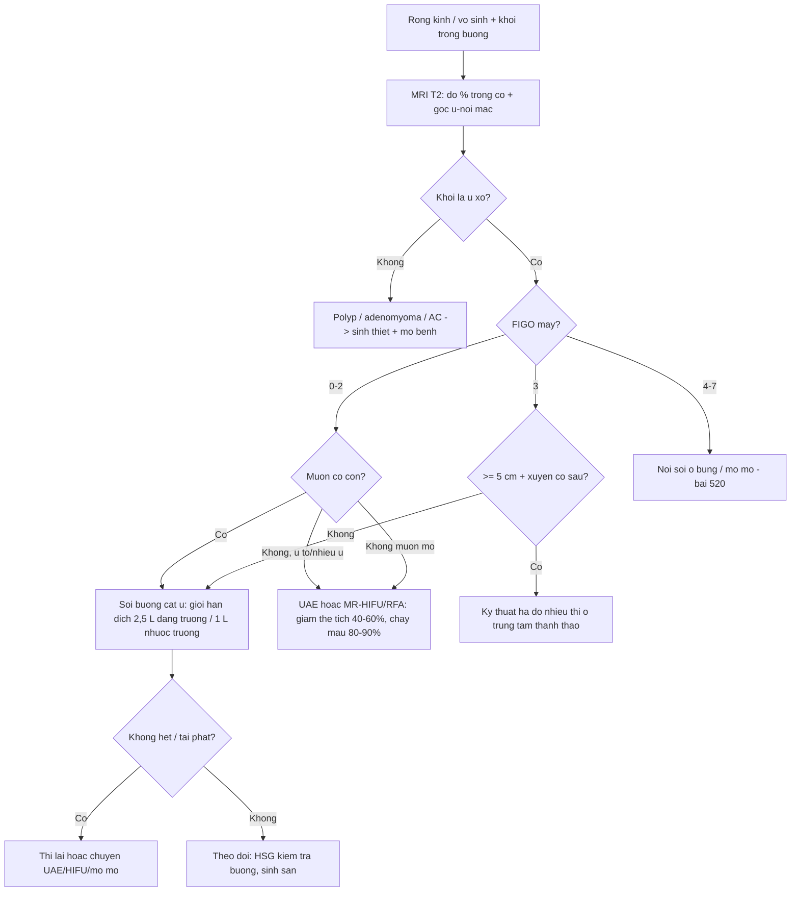

## 5. Biến thể bình thường và cạm bẫy

- **"Nhỏ" không đồng nghĩa "dễ":** u **> 2 cm** hoặc **xuyên cơ > 50%** đã làm tăng nguy cơ **cắt không hết** → phải tiên lượng nhiều thì và siêu âm bơm nước **sau mổ** (Clark 2024).
- **Quá tải dịch — cạm bẫy chết người:** dừng khi **dịch thiếu 2,5 L (đẳng trương) / 1 L (nhược trương)**; loạt FIGO 3 của Liu 2026 có **thiếu dịch tới 2.500 mL** và **kali 2,11 mmol/L** → **không soi buồng u lớn ở nơi thiếu hệ thống đo dịch tự động**.
- **Đừng nhầm u xơ dưới niêm mạc với adenosarcoma/sarcoma:** nếu bờ không đều, DWI hạn chế thật, tăng trưởng nhanh → **sinh thiết trước khi cắt nhỏ** (bài 519/526) — cắt nhỏ u ác gây gieo rắc (bài 518).
- **UAE "bảo tồn" nhưng không bảo đảm có thai:** tái phát triệu chứng **57,7%** (trung vị 11 năm), thoát cắt tử cung chỉ **71,8% ở 10 năm** (Seyferth 2026); **FIGO 0–1 và đang mong có thai là chống chỉ định tương đối** (Połukord 2026). Ca Almasri 2026 (u trong buồng lớn → UAE → sinh đủ tháng) là **ngoại lệ may mắn**, không phải mặc định.
- **MR-HIFU không hợp u có cuống/dưới niêm mạc:** u dưới niêm mạc là **yếu tố bất lợi cho có thai** sau HIFU (Briones 2026); cần MRI tiền can thiệp để loại u cuống và đánh giá NPV dự kiến.
- **Tự thải u là biến cố hiếm chỉ trong 2 bối cảnh:** **hậu sản** hoặc **sau nút mạch** — ca Kyaw 2026 (u 116,5 × 92,5 × 100,7 mm tự ra sau leuprorelin ở hậu sản) thuộc dạng rất hiếm; **không chọn "chờ tự ra" làm kế hoạch điều trị**.
- **Nguy cơ ác của "u xơ" nói chung vẫn rất thấp** nhưng u **mọc nhanh sau mãn kinh, không dùng HRT** là dấu hiệu cảnh báo → không hoãn đánh giá mô bệnh.

## 6. Tự lượng giá — Blind Quiz ngay trên trang tĩnh

**Ca 1 — Nữ 18 tuổi, rong kinh nặng không đáp ứng thuốc. Nhìn siêu âm + MRI, mô tả trước.**

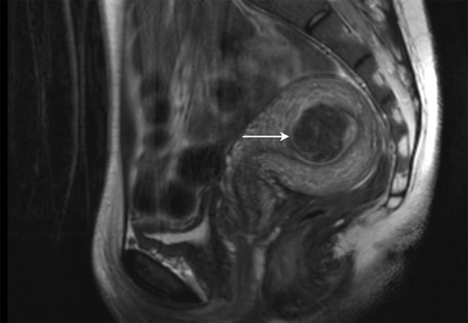

- Gợi ý lâm sàng (clinical context): 18 tuổi, chưa sinh, rong kinh nặng; TVUS u **3,8 × 4,1 × 3,6 cm**.
- Câu hỏi: MRI cho thấy u xuất phát từ đâu và **FIGO mấy**? Đường vào hợp lý để bảo tồn sinh sản là gì?

<b>Bấm để hiện đáp án (findings + chẩn đoán)</b>

- Dấu hiệu (findings): MRI — u xơ dưới niêm mạc **FIGO type 2** xuất phát từ **đoạn trên thành trước bên trái tử cung**, đội vào lòng tử cung (mũi tên).
- Chẩn đoán (diagnosis): **u xơ dưới niêm mạc FIGO 2** ở trẻ vị thành niên (hiếm). Xử trí: **soi buồng cắt u** (bơm vasopressin pha loãng vào u + cắt bằng MyoSure) — **bảo tồn tử cung, hết rong kinh, hậu phẫu thuận lợi**.
- Nguồn ảnh: AlAshqar A et al., Int J Surg Case Rep 2026, PMC13340680, Fig 2, CC BY-ND (nguyên bản).

**Ca 2 — Nữ 39 tuổi hậu sản, rong kinh nặng dai dẳng. Nhìn siêu âm, mô tả trước.**

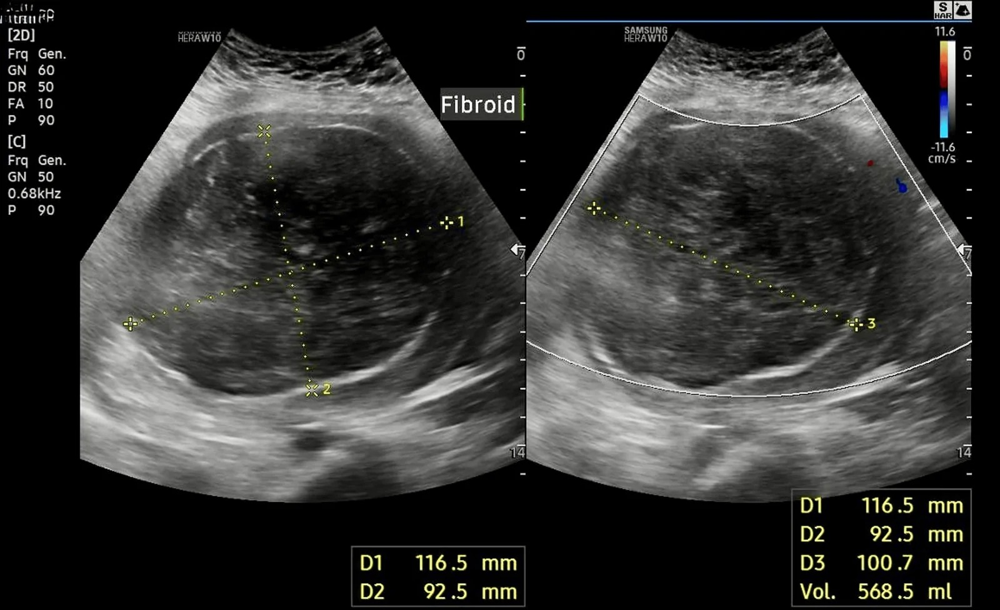

- Gợi ý lâm sàng: 39 tuổi, nhiều lần sinh, sau sinh 3 tháng rong kinh nặng không đáp ứng thuốc.
- Câu hỏi: siêu âm cho thấy khối kích thước bao nhiêu và hệ quả gì với lòng tử cung? Vì sao "tự thải u" là biến cố cần biết nhưng **không nên là kế hoạch điều trị**?

<b>Bấm để hiện đáp án (findings + chẩn đoán)</b>

- Dấu hiệu (findings): siêu âm 3 tháng hậu sản — **u xơ dưới niêm mạc 116,5 × 92,5 × 100,7 mm**, **biến dạng nặng lòng tử cung**; sau leuprorelin bệnh nhân **tự thải u qua âm đạo**, mô bệnh = **u xơ nhồi máu** (không ác), siêu âm lại giảm nhiều, soi buồng lòng tử cung bình thường, **không dính buồng**.
- Chẩn đoán (diagnosis): **tự thải u xơ dưới niêm mạc lớn** — biến cố **rất hiếm**, thường gặp **hậu sản** hoặc **sau nút mạch**; co hồi tử cung hậu sản + GnRH agonist là yếu tố góp phần. **Không chọn chờ tự thải làm kế hoạch** — cần theo dõi sát để loại u tồn dư/biến chứng.
- Nguồn ảnh: Kyaw EMM et al., Cureus 2026, PMC13555747, Fig 3, CC BY 4.0.

**Ca 3 — Nữ 31 tuổi, rong kinh nặng cần truyền máu, u trong buồng tử cung. Nhìn MRI + DSA, mô tả trước.**

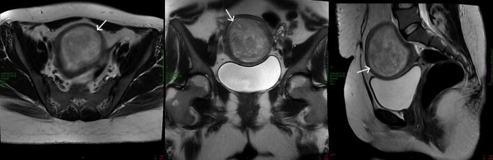

- Gợi ý lâm sàng: 31 tuổi, rong kinh nặng, thiếu máu cần truyền; MRI u **chiếm toàn bộ lòng tử cung**.
- Câu hỏi: u có xâm lấn cơ không? Kết cục sinh sản sau UAE ra sao (nhìn DSA trước–sau)?

<b>Bấm để hiện đáp án (findings + chẩn đoán)</b>

- Dấu hiệu (findings): MRI T2 (axial/coronal/sagittal) — khối bờ rõ **chiếm toàn bộ lòng tử cung**, tín hiệu trung gian–cao, **cơ xung quanh còn nguyên, không xâm lấn**; DSA thì **trước** nút mạch: u mạch hóa mạnh với nhiều nhánh nuôi phì đại;

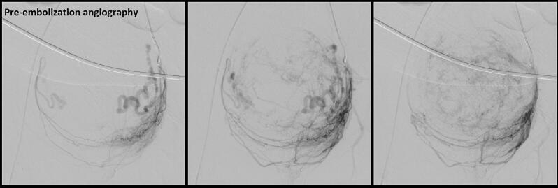

  DSA thì **sau** nút mạch: **gần hết "blush" u, thuốc ứ trong nhánh đã nút** = đích nút mạch đạt.

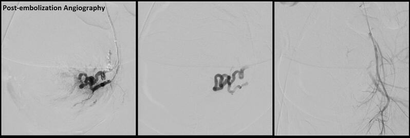

- Chẩn đoán (diagnosis): **u xơ dưới niêm mạc trong buồng lớn**, **nút mạch hai bên bằng hạt PVA** → **có thai tự nhiên sau 16 tháng, sinh đủ tháng, không biến chứng**. Đây là **ngoại lệ thuận lợi**: UAE nói chung **không khuyến cáo cho u dưới niêm mạc FIGO 0–1 và người đang mong có thai**.
- Nguồn ảnh: Almasri MS et al., Case Rep Womens Health 2026, PMC13085015, Fig 1–3, CC BY-NC-ND (nguyên bản).

**Ca 4 — Ảnh ghép: cắt u qua nội soi trước–sau. Chỉ ra type 0 và type 2, giải thích vì sao type 2 khó hơn.**

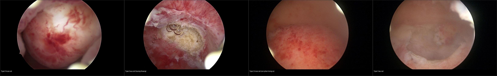

- Gợi ý lâm sàng: hai bệnh nhân rong kinh do u dưới niêm mạc, được cắt qua nội soi buồng.
- Câu hỏi: Bên nào type 0, bên nào type 2? Vì sao type 2 cần nhiều thì hơn và cần theo dõi buồng sau mổ?

<b>Bấm để hiện đáp án (findings + chẩn đoán)</b>

- Trái (2 ô đầu): **type 0** — u **hoàn toàn trong buồng**, cắt trọn dễ, sau cắt **lòng tử cung thoáng**.
- Phải (2 ô cuối): **type 2** — u **≥ 50% nằm trong cơ**, cần bóc/phân tách, **dễ còn sót và dễ gây dính buồng** hơn; phải **kiểm tra buồng sau mổ** (siêu âm bơm nước/HSG) và theo dõi sinh sản (IUA 12% — Peker 2026).
- Nguồn: Clark TJ et al., Facts Views Vis Obgyn 2024, PMC11819789, Fig 2–3, CC BY 4.0. Ảnh ghép letterbox, giữ aspect.

**Ca 5 — Soi buồng tử cung: khối u đội vào buồng, góc cạnh với nội mạc. Nhìn ảnh, mô tả trước.**

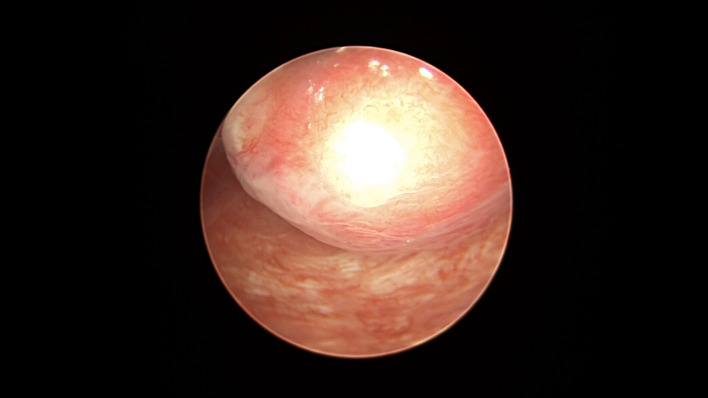

- Gợi ý lâm sàng: rong kinh; soi buồng thấy khối trong buồng tử cung.
- Câu hỏi: Dấu hiệu "góc nhọn vs góc tù" nghĩa là gì? Nếu **type 1** thì điều trị đầu tay?

<b>Bấm để hiện đáp án (findings + chẩn đoán)</b>

- Dấu hiệu (findings): nội soi — u dưới niêm mạc với **góc nhọn < 90°** giữa u và nội mạc và **đường kính lớn nhất nằm trong buồng** → **type 1** (> 50% trong buồng).
- Chẩn đoán (diagnosis): **u xơ dưới niêm mạc FIGO 1** — **soi buồng cắt u** là đầu tay; nếu **> 50% xuyên cơ/góc tù > 90° (type 2 nặng)** → nguy cơ cắt không hết, cân nhắc nhiều thì hoặc phương án khác.
- Nguồn ảnh: Clark TJ et al., Facts Views Vis Obgyn 2024, PMC11819789, Fig 1B, CC BY 4.0.

**Ca 6 — Biểu đồ kết cục MR-HIFU: nhìn hình, mô tả trước.**

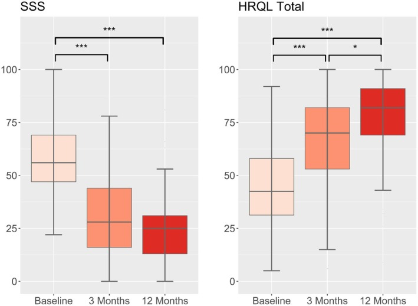

- Gợi ý lâm sàng: bệnh nhân u xơ có triệu chứng chảy máu, được MR-HIFU.
- Câu hỏi: Chỉ số nào giảm, giảm bao nhiêu? NPV trung bình là bao nhiêu và nó dự báo gì?

<b>Bấm để hiện đáp án (findings + chẩn đoán)</b>

- Dấu hiệu (findings): boxplot — **SSS trung vị 56 → 28 (3 tháng) → 25 (12 tháng)**; **HRQL tăng tương ứng** (khác biệt có ý nghĩa, p < 0,001). **NPV trung bình 62%**.
- Chẩn đoán (diagnosis): **MR-HIFU giảm triệu chứng chảy máu và cải thiện chất lượng sống có ý nghĩa**; **NPV (tỷ lệ thể tích không tưới máu) thấp** là yếu tố bất lợi cho cả kết cục triệu chứng và khả năng có thai (Briones 2026). Lưu ý **u dưới niêm mạc là yếu tố bất lợi cho sinh sản sau HIFU**.
- Nguồn ảnh: Otonkoski S et al., Acta Obstet Gynecol Scand 2026, PMC13394642, Fig 2, CC BY-NC-ND (nguyên bản).

## Bài liên quan chéo
- [500 – Tổng quan Hệ Vú & Sản Phụ khoa](../500-tong-quan-vu-san-phu-khoa/lesson.md)
- [520 – U xơ cơ tử cung (FIGO 0–8), adenomyosis & nội mạc](../520-tu-cung-u-xo-FIGO-adenomyosis-noi-mac/lesson.md)
- [519 – Adenosarcoma tử cung & polyp nội mạc: khối trong lòng tử cung giả polyp](../519-adenosarcoma-tu-cung-va-polyp-noi-mac/lesson.md)
- [541 – U xơ tuyến (adenofibroma) & polypoid adenomyoma](../541-adenofibroma-tu-cung-polipoid-adenomyoma/lesson.md)
- [526 – Sarcoma tử cung & carcinosarcoma vs u xơ](../526-sarcoma-tu-cung-vs-u-xo/lesson.md)
- [518 – Morcellation & leiomyomatosis peritonealis disseminata (LPD)](../518-morcellation-LPD/lesson.md)
- [571 – Sẩy thai tái diễn: tiếp cận hình ảnh tử cung](../571-say-thai-tai-dien-tiep-can-hinh-anh/lesson.md)

## Ảnh
- 13 ảnh (CC BY 4.0 ×1 + CC BY ×5 + CC BY-NC ×2 + CC BY-NC-ND ×4 + CC BY-ND ×1) + 1 ảnh ghép (CC BY 4.0). Nguồn + giấy phép từng ảnh trong `images/CREDITS.md`.

> Không dùng để chẩn đoán độc lập khi chưa có người hướng dẫn.
