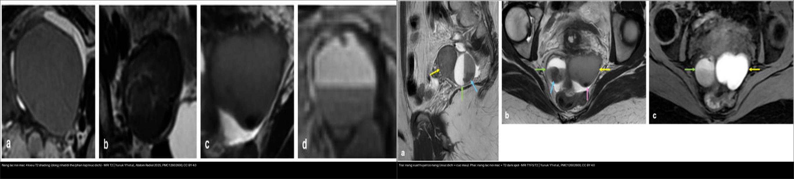
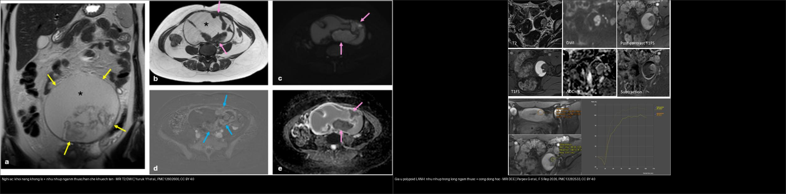
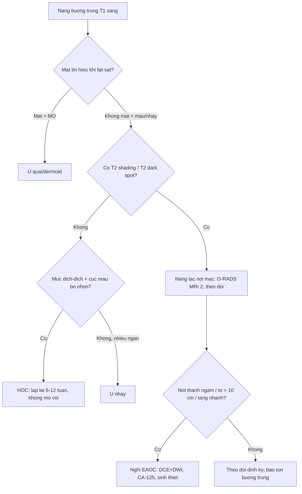
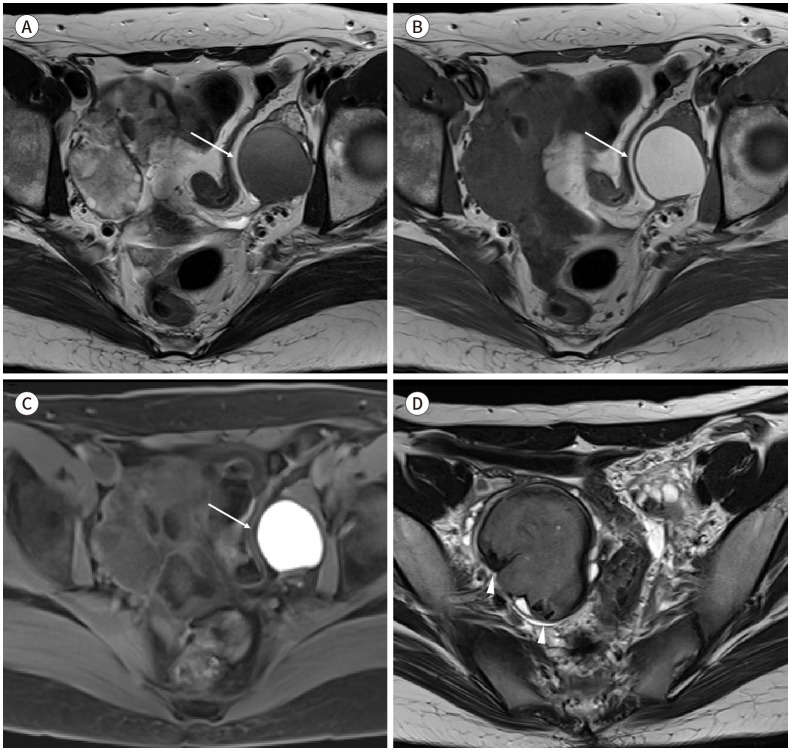
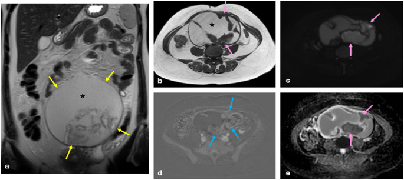
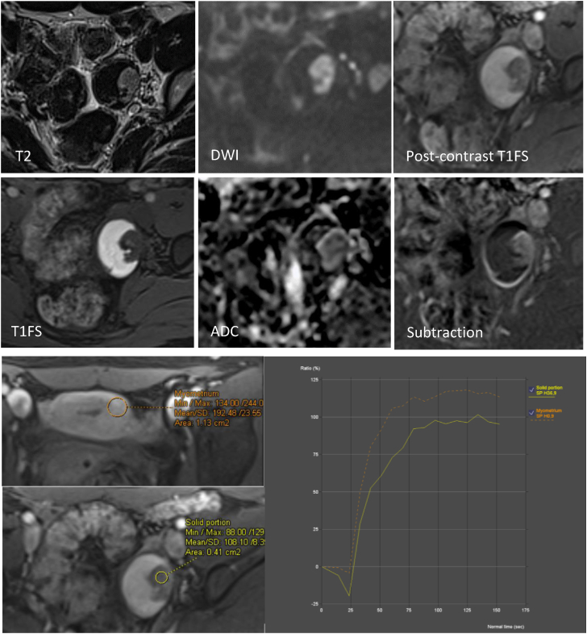
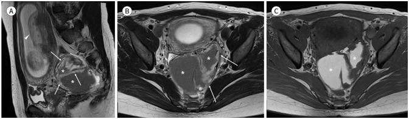

# 543 — Nang lạc nội mạc buồng trứng: T1 sáng + T2 shading & nguy cơ chuyển dạng / Ovarian endometrioma

**Tags:** `pattern:nang-t1-sang` `pattern:lac-noi-mac` `vung:buong-trung` `score:O-RADS` `protocol:MRI-chau` `incidentaloma:nang-buong-trung`
**Mức chắc chắn (certainty):** tổng hợp y văn (literature synthesis) — tổng hợp từ các bài tổng quan/nghiên cứu chẩn đoán mở (Abdom Radiol 2025 CC BY 4.0; J Korean Soc Radiol 2025 CC BY-NC 4.0; F S Rep 2026 CC BY 4.0; Eur J Radiol Open 2026 CC BY 4.0) + ca nguyên văn có hình.

## 1. Tổng quan bệnh học – cơ chế hình ảnh

- **Lạc nội mạc tử cung (endometriosis)** = mô tuyến–đệm nội mạc nằm **ngoài buồng tử cung**, chiếm **~6–10%** phụ nữ tuổi sinh sản; **20–50%** người vô sinh và **~90%** người đau chậu mạn. **Nang lạc nội mạc buồng trứng (endometrioma, "chocolate cyst")** chiếm gần **một nửa** số ca, **50% hai bên**.
- **Ba tầng bệnh học (theo độ sâu):** lạc nội mạc **nông (superficial)** < 5 mm dưới phúc mạc; **nang lạc nội mạc (endometrioma)** = nang vỏ dày chứa máu thoái hóa; **lạc nội mạc sâu (DIE, deep infiltrating endometriosis)** > 5 mm (xem [540](../540-lac-noi-mac-tu-cung-sau-DIE-MRI/lesson.md)).
- **TẠI SAO nang T1 rất sáng + T2 tối (vật lý MRI + mô bệnh):**
  - Nang tái chảy máu **theo chu kỳ** → tích tụ **sản phẩm thoái hóa máu cô đặc** giàu **sắt (hemosiderin) + protein**. Hàm lượng sắt/protein cao **rút ngắn cả T1 và T2** → **T1W rất sáng (methemoglobin)** + **T2W tối dần (shading)**. Đây là lý do endometrioma **T1 sáng mà KHÔNG mất tín hiệu khi fat-sat** (khác mỡ của u quái).
  - **T2 shading (dấu lu mờ T2):** giảm tín hiệu T2 **lan tỏa trong lòng nang** do nồng độ sắt/protein cao — **độ nhạy 93%** (Se) cho endometrioma. Bốn kiểu: **đồng nhất (hay gặp nhất), dị thể (đặc hiệu nhất), phân lớp (layering), mức dịch–dịch (fluid-fluid, ít gặp nhất)**.
  - **T2 dark spot sign (điểm tối T2):** **ổ tối khu trú, bờ rõ** trong lòng nang do **cục máu co rút cô đặc**, **đặc hiệu 93%** (Sp) — chốt phân biệt với **nang xuất huyết cơ năng (HOC, hemorrhagic ovarian cyst)**. Điểm khác biệt: **cục máu co rút (clot) có bờ nhọn/lõm**, còn dark spot bờ đều, rõ.
- **T1 "nhiều ổ" (multiplicity):** nhiều nang T1 sáng cạnh nhau = dấu hiệu hay gặp của tái chảy máu (đa ổ lạc nội mạc).
- **Ngưỡng định lượng bắt buộc:**
  - Nang **điển hình**: vỏ nhẵn, **≤ 3 vách/vách trong (locule)**, **không mạch trong** → **O-RADS US v2022 = 2 (< 1% ác)**.
  - Nang **không điển hình hoặc > 10 cm** → **O-RADS US 3 (1 – < 10%)**.
  - **Đường kính trung bình nang chuyển dạng ác = 11,2 cm** (lớn hơn rõ nang lành) — nghi ác khi **> 10 cm** + nốt thành ngấm.
  - **Nguy cơ ung thư buồng trứng ở người lạc nội mạc: RR 1,2–1,8** so với dân số chung.
  - **Nốt thành ngấm thuốc (enhancing mural nodule)** = dấu **nhạy nhất** của EAOC, **gặp ở 97% ca EAOC**.
  - **Mất T2 shading** gợi ý ác: shading **có ở 81,3% ca lành** nhưng chỉ **33,3% ca EAOC**.
  - **Kém chính xác của MRI định tính cổ điển:** Se/Sp chỉ khoảng **86,7%/81,9%** — vì vậy cần **radiomics/AI** hỗ trợ.

## 2. Mẫu hình + chẩn đoán phân biệt theo cơ chế (Gamut)

- **Ba câu hỏi gỡ rối một nang T1 sáng:**
  1. **T1 sáng có MẤT tín hiệu khi fat-sat không?** **Mất = mỡ (u quái/dermoid)**; **không mất = máu/nhầy (endometrioma, HOC, u nhầy)**.
  2. **Trên T2 có shading/dark spot không?** **Có = endometrioma**; **không + mức dịch–dịch + cục máu bờ nhọn = HOC**; **dịch "dịch kính mờ" + nhiều ngăn = u nhầy**.
  3. **Có nốt thành ngấm/dấu hiệu tăng kích thước không?** **Có = nghi EAOC / giả u polypoid / decidualization**.
- **Gamut theo bản chất chất lỏng (theo vật lý tín hiệu):**
  - **Máu cũ cô đặc (sắt + protein):** endometrioma (T1 sáng + T2 shading/dark spot).
  - **Máu mới/xuất huyết cơ năng:** HOC (mức dịch–dịch, cục máu co rút, **tự tan 6–12 tuần**).
  - **Mỡ:** u quái trưởng thành (T1 sáng **mất** khi fat-sat, mức mỡ–dịch, nốt Rokitansky, vôi hóa).
  - **Nhầy/dịch keo:** u nhầy (nhiều ngăn, **"cửa kính màu" stained glass**, T1 thay đổi tùy ngăn, T2 rất sáng).
  - **Dịch trong (trong nang):** nang đơn thuần/thanh dịch (T1 tối, T2 sáng, O-RADS 2).
  - **Tổn thương đặc ngấm:** EAOC, BOT (u giáp biên) nhú mạch hóa — xem [537](../537-u-buong-trung-giap-bien/lesson.md).

## 3. Bảng so sánh phân biệt (ma trận đối chiếu)

| Thực thể (entity) | Hình ảnh điển hình | Chốt vào (rule-in) | Chốt loại (rule-out) | Gợi ý xác nhận |
|---|---|---|---|---|
| **Nang lạc nội mạc (endometrioma)** | Nang vỏ mỏng, **T1 rất sáng, T2 shading**, có thể nhiều ổ | **T1 sáng KHÔNG mất khi fat-sat + T2 shading/T2 dark spot** | T1 sáng **MẤT** khi fat-sat → u quái; **cục máu bờ nhọn + tự tan** → HOC | MRI T1FS + T2; **theo dõi; chỉ mổ khi đau/vô sinh/kích thước lớn** |
| **Nang xuất huyết cơ năng (HOC)** | **Mức dịch–dịch**, cục máu co rút **bờ nhọn/lõm**, vỏ mỏng, **không có dark spot thật** | **Tự tan sau 6–12 tuần** trên phim lại | **Không tan + T2 shading/dark spot** → endometrioma | **Siêu âm/MRI lặp 6–12 tuần** (không mổ vội) |
| **U quái trưởng thành (dermoid)** | Khối **mỡ + vôi hóa + nốt Rokitansky**, mức mỡ–dịch | **T1 sáng MẤT tín hiệu khi fat-sat (mỡ)** | T1 vẫn sáng khi fat-sat → máu/nhầy | CT thấy **mỡ −10 đến −100 HU** + răng/vôi |
| **U nhầy (mucinous)** | **Nhiều ngăn lớn**, dịch **"cửa kính màu"**, T2 rất sáng | **Nhiều ngăn + tín hiệu khác nhau giữa các ngăn** | Một ổ + shading đều → endometrioma | MRI; theo dõi kích thước, mổ nếu > 10 cm |
| **EAOC (K tế bào sáng/endometrioid)** | Nang lớn (**trung bình 11,2 cm**), **nốt thành ngấm**, DWI hạn chế, **mất T2 shading** | **Nốt ngấm (97%) + tăng kích thước nhanh + lớn > 10 cm + ở hậu mãn kinh** | Nốt **không mạch, không ngấm** → giả u polypoid | DCE + DWI; **CA-125**; sinh thiết |
| **Giả u polypoid (polypoid endometriosis)** | Nang lạc nội mạc + **nhú/nốt trong lòng ngấm thuốc** | **Nhú tín hiệu giống nội mạc + ngấm**, **không xâm lấn vỏ** | Nhú bờ gai + hạn chế khuếch tán + mất shading → EAOC | Sinh thiết; **cảnh giác, dễ đọc nhầm ác** |
| **Decidualization (nang lạc nội mạc khi có thai)** | Nốt thành dày, ngấm, **tín hiệu giống bánh nhau** | **Có thai + nốt thành ngấm** | **Thoái triển khi theo dõi sau sinh** → quyết định chờ | Theo dõi; **nếu không thoái triển → sinh thiết** |

*Trái: nang lạc nội mạc — 4 kiểu **T2 shading** (đồng nhất/dị thể/phân lớp/mức dịch–dịch) trên MRI T2. Phải: **trên** nang xuất huyết cơ năng (mức dịch–dịch + cục máu bờ nhọn); **dưới** nang lạc nội mạc + **T2 dark spot**. Nguồn: Yuruk YY et al., Abdom Radiol (NY) 2025 (PMC12602600), CC BY 4.0. Ảnh ghép letterbox, giữ nguyên tỷ lệ.*

*Trái: nang lạc nội mạc **nghi chuyển dạng ác** — khối nang không lồ (~20 cm) + nhú trong lòng ngấm thuốc và hạn chế khuếch tán (bệnh phẩm: u giáp biên endometrioid). Phải: **giả u polypoid lành** — nhú trong lòng ngấm thuốc nhưng chẩn đoán mô bệnh lành. Nguồn: Yuruk YY et al., Abdom Radiol (NY) 2025 (PMC12602600) và Parpex G et al., F S Rep 2026 (PMC13282533), CC BY 4.0. Ảnh ghép letterbox.*

### Dấu hiệu chốt then chốt
- **T1 sáng KHÔNG mất khi fat-sat** = máu/nhầy (loại mỡ). Đây là **bước đầu tiên bắt buộc** với mọi nang T1 sáng.
- **T2 shading (Se 93%) + T2 dark spot (Sp 93%)** là cặp dấu hiệu xác chốt endometrioma **so với HOC**.
- **Nốt thành ngấm (97% ca EAOC) là dấu nhạy nhất của ác**, nhưng **giả u polypoid và decidualization cũng có nốt ngấm** → phân biệt bằng **bối cảnh (có thai? không thoái triển? bờ nhú/không mạch?)** + sinh thiết.

## 4. Protocol chụp + hệ phân độ/điểm chuẩn hóa

- **Siêu âm đầu tay** (đầu dò qua âm đạo): nang đồng nhất echo mờ ("ground-glass"); **điển hình = O-RADS 2**; không điển hình/> 10 cm = **O-RADS 3**.
- **MRI chậu chuẩn (1,5T hoặc 3T, coil mảng pha):**
  - **T1W fat-sat (axial + sagittal)** — ổ xuất huyết/nang T1 sáng.
  - **T2W (axial + sagittal + coronal)** — shading, dark spot, nốt thành.
  - **DWI/ADC + DCE** khi nghi ác/nhiễm trùng (nốt ngấm/hạn chế khuếch tán).
  - Chuẩn bị: **thuốc chống nhu động**, bàng quang căng vừa, **nhịn ăn 3–6 giờ**; **không phụ thuộc pha chu kỳ kinh**.
- **O-RADS MRI 2023 (ACR):** nang **T1 tăng tín hiệu + T2 shading/dark spot** = **điểm 2 (gần như chắc chắn lành)**; chỉ tăng điểm khi có **nốt thành ngấm (score 4–5)**.
- **Xử trí (bảo tồn buồng trứng là trọng tâm):** theo dõi/điều trị nội (tránh mổ vội vì mổ lặp làm **giảm dự trữ buồng trứng – AMH**); **bóc nang nội soi (cystectomy)** khi đau/vô sinh/kích thước lớn; **tái phát 19–30%** (đau hành kinh tới 50%) — theo một đoàn hệ **n = 1598, theo dõi trung vị 58 tháng: tái phát nang 21,8%, đau 22,1%**.

## 5. Biến thể bình thường và cạm bẫy

- **Cục máu co rút trong HOC giả "T2 dark spot":** khác biệt là **cục máu bờ nhọn/lõm**, còn dark spot thật **bờ đều rõ** — cộng thêm **HOC tự tan trên phim lại**.
- **U quái giả endometrioma:** lần đầu T1 sáng dễ nhầm; **bắt buộc chuỗi fat-sat** — mỡ **mất tín hiệu**, máu/nhầy **giữ sáng**.
- **Giả u polypoid lành** và **decidualization khi có thai** có **nốt thành ngấm** giả ác — **đừng mổ ung thư vội**: đối chiếu bối cảnh (thai kỳ) và **theo dõi thoái triển**.
- **Mất T2 shading:** gợi ý ác nhưng **không đủ một mình** — cần nốt ngấm/DWI/tăng kích thước.
- **Cạm bẫy mặt cắt:** nang lạc nội mạc **dính/kéo** có thể bị đọc nhầm là tổn thương đặc; luôn so **T2 với T1FS** và đánh giá **cả hai buồng trứng + dính (kissing ovaries)**.

## 6. Tự lượng giá — Blind Quiz ngay trên trang tĩnh

**Ca 1 — Nữ tuổi sinh sản, đau chậu mạn. Nang buồng trứng T1 rất sáng. Nhìn chuỗi ảnh, mô tả trước.**

- Gợi ý lâm sàng (clinical context): đau chậu mạn, thống kinh; nang buồng trứng một bên.
- Câu hỏi: Tín hiệu trên T2 (A) và T1 (B) là gì? Tại sao T1 (C) vẫn sáng? D (mũi tên đầu) là dấu gì?

<b>Bấm để hiện đáp án (findings + chẩn đoán)</b>

- Dấu hiệu (findings): nang **T2 tối (shading)** (A) + **T1 rất sáng** (B) + **vẫn sáng khi fat-sat** (C) → máu cũ cô đặc; (D) **ổ tối bờ rõ trong lòng nang = T2 dark spot sign**.
- Chẩn đoán (diagnosis): **nang lạc nội mạc buồng trứng điển hình** — TẠI SAO: sắt/protein cao rút ngắn T1 và T2 → T1 sáng + T2 shading; **O-RADS MRI 2**, theo dõi bảo tồn (không mổ vội).
- Nguồn ảnh: Kim HJ et al., J Korean Soc Radiol 2025, PMC12531657, Fig. 6, **CC BY-NC 4.0 (nguyên bản, không crop/ghép)**.

**Ca 2 — Hai nang T1 sáng. Bên nào là nang lạc nội mạc, bên nào là nang xuất huyết cơ năng?**

- Gợi ý: một ca đau chu kỳ lặp lại; một ca đau cấp một lần.
- Câu hỏi: Dấu hiệu phân biệt? Xử trí khác nhau thế nào?

<b>Bấm để hiện đáp án (findings + chẩn đoán)</b>

- Trái (ảnh trên): **nang lạc nội mạc** — 4 kiểu **T2 shading** = tín hiệu tối lan tỏa trong lòng.
- Phải (ảnh dưới): **nang xuất huyết cơ năng** — **mức dịch–dịch + cục máu bờ nhọn** (không phải dark spot thật); đối chiếu bên cạnh là nang lạc nội mạc có **T2 dark spot**.
- Xử trí: **HOC → lặp siêu âm/MRI sau 6–12 tuần (thường tự tan, không mổ)**; **endometrioma → theo dõi, chỉ mổ khi đau/vô sinh/kích thước lớn**.
- Nguồn: Yuruk YY et al., Abdom Radiol (NY) 2025 (PMC12602600), CC BY 4.0.

**Ca 3 — Nang lạc nội mạc theo dõi nhiều năm, nay to ra và có nhú trong lòng. Ác hay lành?**

- Gợi ý: tiền sử nang lạc nội mạc buồng trứng trái nhiều năm; siêu âm mới thấy nhú trong lòng nang.
- Câu hỏi: Dấu hiệu nghi ác nào? Bệnh phẩm là gì?

<b>Bấm để hiện đáp án (findings + chẩn đoán)</b>

- Dấu hiệu (findings): **khối nang không lồ (~20 cm)** lan từ giữa chậu lên bụng trên + **nhú trong thành nang ngấm thuốc (dấu trừ)** và **hạn chế khuếch tán (DWI sáng/ADC thấp)**; dịch **T1 sáng**, T2 tín hiệu trung gian.
- Chẩn đoán (diagnosis): **nang lạc nội mạc nghi chuyển dạng ác** — bệnh phẩm xác nhận **u giáp biên endometrioid (endometrioid borderline tumor)**. Chốt: **nốt thành ngấm (97% EAOC) + tăng kích thước + mất/giảm T2 shading**.
- Nguồn ảnh: Yuruk YY et al., Abdom Radiol (NY) 2025 (PMC12602600), Fig. 3, CC BY 4.0.

**Ca 4 — Nang lạc nội mạc + nhú trong lòng ngấm thuốc nhưng bệnh phẩm LÀNH. Vì sao dễ nhầm ác?**

- Gợi ý: nang lạc nội mạc có thành phần đặc dạng nhú.
- Câu hỏi: Đặc điểm hình ảnh nào khiến dễ nhầm ung thư? Điểm khác EAOC?

<b>Bấm để hiện đáp án (findings + chẩn đoán)</b>

- Dấu hiệu (findings): **nhú/nốt thành ngấm thuốc** (T1FS sau tiêm + trừ), T2 tín hiệu trung gian, DWI tăng — **giống EAOC**; nhưng **nhú tín hiệu giống nội mạc, không xâm lấn vỏ**, bệnh phẩm là **giả u polypoid (polypoid endometriosis) lành**.
- Chẩn đoán (diagnosis): **giả u polypoid lành mô phỏng chuyển dạng ác** → **cần tương quan mô bệnh, tránh mổ quá rộng**; theo dõi.
- Nguồn ảnh: Parpex G et al., F S Rep 2026 (PMC13282533), Fig. 1, CC BY 4.0.

**Ca 5 — Thai phụ có nang lạc nội mạc, MRI thấy nốt thành dày ngấm thuốc.**

- Gợi ý: mang thai, nang buồng trứng phải với thành dày không đều.
- Câu hỏi: Đây là ác hay biến đổi sinh lý? Xử trí?

<b>Bấm để hiện đáp án (findings + chẩn đoán)</b>

- Dấu hiệu (findings): nang **T2 hỗn hợp**, nội dung **T1 sáng** (máu cũ) + **thành/vách dày, nốt đặc không đều có tín hiệu giống bánh nhau**.
- Chẩn đoán (diagnosis): **decidualization của nang lạc nội mạc trong thai kỳ** — biến đổi **sinh lý, tạm thời**; **theo dõi, thường thoái triển sau sinh**; chỉ sinh thiết nếu **không thoái triển**.
- Nguồn ảnh: Kim HJ et al., J Korean Soc Radiol 2025 (PMC12531657), Fig. 24, **CC BY-NC 4.0 (nguyên bản)**.

**Ca 6 — Ảnh ghép: hai tổn thương đều có nhú trong nang. Bên nào là ác, bên nào lành?**

- Gợi ý: một ca nang to nhanh; một ca nang lạc nội mạc từ lâu, nhú trong lòng.
- Câu hỏi: Dấu hiệu phân biệt mạnh nhất? Khi nào phải can thiệp?

<b>Bấm để hiện đáp án (findings + chẩn đoán)</b>

- Trái: **nang lạc nội mạc nghi chuyển dạng ác** — khối nang **không lồ ~20 cm**, nhú **ngấm + hạn chế khuếch tán**, bệnh phẩm u giáp biên endometrioid → **can thiệp (mổ)**.
- Phải: **giả u polypoid lành** — nhú ngấm nhưng **không xâm lấn, giống tín hiệu nội mạc** → **theo dõi/sinh thiết**, tránh mổ quá rộng.
- Chốt: **kích thước > 10 cm + tăng nhanh + mất T2 shading + bờ nhú gai hạn chế khuếch tán** nghiêng về ác; **nhưng chỉ mô bệnh mới chốt**.
- Nguồn: PMC12602600 + PMC13282533, CC BY 4.0.

## Bài liên quan chéo
- [500 – Tổng quan Vú & SPK](../500-tong-quan-vu-san-phu-khoa/lesson.md)
- [530 – Phần phụ O-RADS siêu âm/MRI](../530-buong-trung-ORADS-sieu-am-MRI/lesson.md) (O-RADS, u quái/xoắn)
- [537 – U buồng trứng giáp biên (borderline)](../537-u-buong-trung-giap-bien/lesson.md) (nhú, dịch kính mờ)
- [540 – DIE & PID: mũ nấm, hôn nhau, vòi giãn](../540-lac-noi-mac-tu-cung-sau-DIE-MRI/lesson.md) (lạc nội mạc sâu)
- [533 – Theo dõi & bảo tồn sinh sản sau u buồng trứng](../533-theo-doi-va-bao-ton-sinh-san-sau-u-buong-trung/lesson.md) (nang lạc nội mạc giả tái phát, bảo tồn)

## Ảnh
- Tên file: `543_slug_Modality_SourceID.jpg`. Nguồn + giấy phép từng ảnh trong `images/CREDITS.md`.
- 3 ảnh CC BY 4.0 (Abdom Radiol 2025 ×3) + 1 ảnh CC BY 4.0 (F S Rep 2026) + 2 ảnh CC BY-NC 4.0 (J Korean Soc Radiol 2025 ×2, giữ nguyên bản) + 2 ảnh ghép CC BY 4.0 kế thừa.

> Không dùng để chẩn đoán độc lập khi chưa có người hướng dẫn (Disclaimer y tế).
