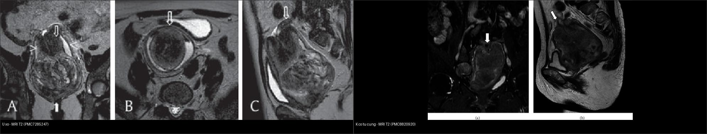
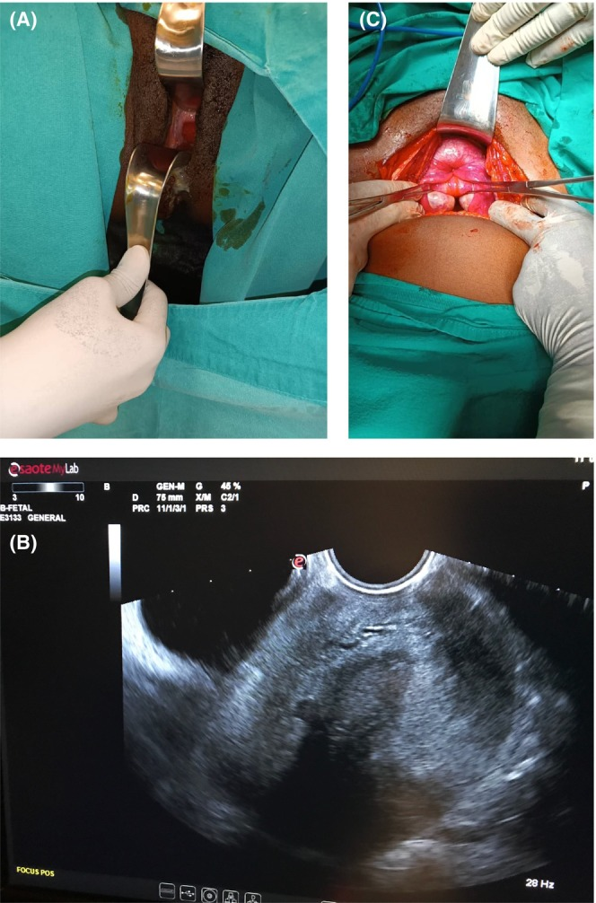
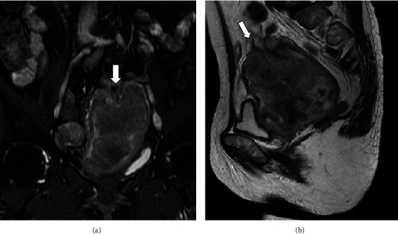
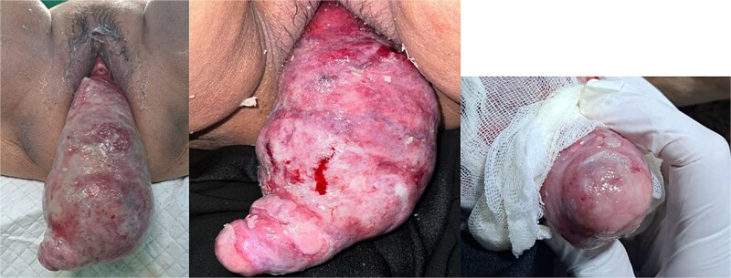

# 544 — Đảo ngược tử cung KHÔNG do sinh (nonpuerperal uterine inversion, NPUI) & khối sa qua cổ tử cung / Nonpuerperal uterine inversion — the inside-out uterus

**Tags:** `pattern:dao-nguoc-tu-cung` `pattern:khoi-sa-qua-co-tu-cung` `vung:tu-cung` `vung:am-dao` `protocol:MRI-tieu-khung` `protocol:sieu-am-dau-do`
**Mức chắc chắn (certainty):** tổng hợp y văn (literature synthesis) — nhóm tự biên từ tổng quan 153 ca của Herath 2020 (PMC7285247, CC BY) + các ca nguyên văn có ảnh CC BY (PMC8820920, PMC11305835, PMC12527823, PMC12433716); số liệu đối chiếu từng bài gốc.

## 1. Tổng quan bệnh học – cơ chế hình ảnh

- **Định nghĩa:** đảo ngược tử cung (uterine inversion) là tình trạng **đáy tử cung lộn ngược vào trong** rồi **sa qua vòng cổ tử cung**, có thể lộ ra ngoài âm hộ. Jones (1951) chia hai loại: **do sinh (puerperal/obstetric)** và **không do sinh (nonpuerperal/gynaecological)** (Herath 2020). **NPUI chiếm ~16% toàn bộ ca đảo ngược tử cung** (Kurniawan 2025) — hiếm nhưng **không được bỏ sót** vì ca mãn tính dễ bị cắt nhầm "khối âm đạo" gây thủng phúc mạc.
- **Dịch tễ (tổng quan 153 ca, Herath 2020, PMC7285247):** tuổi trung bình **46,3 tuổi** (SD 18; khoảng 14–88). Nguyên nhân: **u xơ cơ tử cung (leiomyoma) 56,2%**, **ung thư biểu mô 8,5%**, **sarcoma 8,5%**, **u Müllerian hỗn hợp 6,5%**, nguyên nhân hiếm khác 11,1%, **vô căn 9,2%**. Tính chung **32,0% là ác tính** — con số quyết định việc **luôn lấy mô bệnh trước khi can thiệp triệt để**. Trong 303 ca tích lũy từ 1911, u xơ chiếm **69,5%**.
- **Vì sao đảo ngược (cơ chế):** khối trong lòng tử cung làm **cơ tử cung bị giãn căng → kích thích co bóp tống xuất → giãn cổ tử cung → khối bị đẩy ra, kéo theo đáy tử cung** (Herath 2020). Yếu tố góp phần: **trọng lượng khối, lực kéo thủ công, tăng áp lực trong ổ bụng (ho, rặn)**. Với sarcoma, **vùng thành tử cung bị u làm yếu → lồi vào lòng → chịu ảnh hưởng cơ co bóp** rồi lộn ra ngoài. Yếu tố nguy cơ: **khối trong lòng tử cung (u xơ dưới niêm mạc, sarcoma), u ở đáy, thành tử cung mỏng, cổ tử cung giãn** (Kurniawan 2025).
- **TẠI SAO hình ảnh trông như vậy (vật lý + mô bệnh):**
  - **Hình thể lộn ngược:** buồng tử cung (nội mạc) trở thành bề mặt ngoài của khối. Vì vậy khi mô bệnh/soi thấy **nội mạc trên bề mặt khối** là **bằng chứng chốt** của đảo ngược (Herath 2020).
  - **Siêu âm đường dọc:** buồng tử cung **hình chữ Y** ở đảo ngược **không hoàn toàn** (đáy chữ Y = nội mạc chưa lộn) và **hình chữ U** ở đảo ngược **hoàn toàn** (hai nhánh chữ U = nội mạc đã lộn, chạy ra trước và sau). Trên mặt cắt ngang thấy **dấu bia bắn (target sign)**: đáy tử cung tăng âm được viền bởi lớp dịch giữa đáy lộn ngược và thành âm đạo.
  - **3D power Doppler:** hai **động mạch tử cung chạy DỌC TRUNG TÂM dọc thân tử cung** với **dấu "U-turn"**, thay vì vị trí ngoại vi hai bên như bình thường (Herath 2020) — dấu hiệu giải phẫu mạch máu rất đặc hiệu.
  - **MRI:** nhạy nhất. **Buồng tử cung chữ U**, **đáy tử cung dày lộn ngược trên mặt cắt dọc**, **cấu hình "mắt bò" (bull's eye)** trên mặt cắt ngang; trong đảo ngược hoàn toàn thấy **dây chằng tròn và vòi trứng chạy vào trung tâm từ đỉnh tử cung**. Nếu do ác tính, MRI giúp đánh giá xâm lấn và hạch.
  - **CT:** ít giá trị; ở bệnh nhân mãn kinh dễ bị **chẩn đoán nhầm thành ung thư cổ tử cung**; dấu gợi ý là **không thấy tử cung ở vị trí bình thường + khối tỷ trọng thấp giữa tiểu khung** (nội mạc/cơ phù nề).
- **Phân độ (Table 2, Herath 2020):**
  - **Độ 1:** đảo ngược trong còn trong buồng tử cung/không hoàn toàn (đáy vẫn trong buồng).
  - **Độ 2:** đáy lộn hoàn toàn **qua vòng cơ cổ tử cung**.
  - **Độ 3:** đảo ngược toàn bộ — **đáy lộ ra ngoài âm hộ**.
  - **Độ 4:** **cả âm đạo** cùng tham gia lộn ra ngoài âm hộ.
- **Định lượng cần nhớ:** tuổi trung bình **46,3**; u xơ **56,2%**; ác tính **32,0%**; Haultain thành công **18,0%** (cao nhất); **51,9% không thay thế được/không thử**.

## 2. Mẫu hình + chẩn đoán phân biệt theo vị trí (gamut)

- **Ba câu hỏi gỡ rối mọi "khối sa qua cổ tử cung":**
  1. **Có thấy CỔ TỬ CUNG không?** (sa tử cung: thấy cổ ở đỉnh; đảo ngược: **KHÔNG thấy cổ, không tìm được lỗ cổ và không luồn được que vào buồng tử cung**).
  2. **Bề mặt khối là nội mạc hay niêm mạc âm đạo?** (nội mạc trên bề mặt = đảo ngược; đôi khi thấy **lỗ vòi trứng ở đỉnh khối** = chốt).
  3. **Nguyên nhân bên trong là gì?** (u xơ trong lòng vs sarcoma/ung thư/carcinosarcoma — vì **32% ác tính**).
- **Gamut theo bản chất khối gây đảo ngược:**
  - **Lành:** u xơ cơ tử cung dưới niêm mạc (56,2%) — kể cả u xơ mạch máu (angiomatous leiomyoma) có thoái hóa nang; **u xơ tuyến (adenofibroma)**; **polyp nội mạc**.
  - **Ác:** **sarcoma tử cung (8,5%)**, **ung thư biểu mô (8,5% — trong đó đã có ca do ung thư cổ tử cung xâm lấn thân)**, **u Müllerian hỗn hợp/carcinosarcoma (6,5%)**, rhabdomyosarcoma, di căn.
  - **Khác:** u quái non, **vô căn 9,2%**.
- **Gamut "khối sa qua cổ tử cung" (chẩn đoán phân biệt trên lâm sàng/hình ảnh):**
  - **Đảo ngược tử cung không do sinh (bài này).**
  - **Sa tử cung/âm đạo (uterine/ vaginal prolapse)** — có cổ tử cung ở đỉnh.
  - **Polyp cổ tử cung/âm đạo, u xơ có cuống sa ra** — có cuống nối vào cổ, còn thấy cổ.
  - **Khối ác tính hoại tử sa lộ** (ung thư cổ tử cung/âm đạo hoại tử, sarcoma) — bề mặt loét mủn, mùi hôi.
  - **Nang Nabothian khổng lồ, sa niệu đạo (urethral prolapse)** — vị trí và bề mặt khác.
  - **Đảo ngược DO SINH (puerperal)** — sau đẻ/sẩy, cấp tính, chảy máu ồ ạt; đây là **cấp cứu sản khoa**, khác hẳn về bối cảnh và xử trí.
- **Dấu hiệu chốt then chốt:**
  - **Thấy lỗ vòi trứng ở đỉnh khối** = chẩn đoán xác định đảo ngược.
  - **"Flower vase appearance" (dấu lọ hoa):** buồng trứng và vòi trứng **chạy vào trung tâm** từ đáy tử cung đã lõm — thấy trên nội soi/CT/MRI.
  - **Không luồn được thăm dò vào buồng tử cung** + **thăm trực tràng thấy tử cung không ở vị trí bình thường, đáy lõm** (Lascarides 1968).

## 3. Bảng so sánh phân biệt (ma trận đối chiếu)

| Thực thể (entity) | Hình ảnh điển hình | Chốt vào (rule-in) | Chốt loại (rule-out) | Gợi ý xác nhận |
|---|---|---|---|---|
| **NPUI (bài này)** | Siêu âm: buồng **chữ U** (hoàn toàn)/**chữ Y** (không hoàn toàn); MRI: **đáy lộn ngược dày + "mắt bò"**, vòi/dây chằng tròn chạy vào trung tâm | **Không thấy cổ tử cung + buồng chữ U + vòi–dây chằng tròn hướng tâm (+ lỗ vòi trứng ở đỉnh)** | Thấy cổ tử cung ở đỉnh khối, có cuống nối cổ → sa/polyp | MRI tiểu khung T2 ± nội soi/laparoscopy; **mô bệnh** để loại ác tính |
| **Sa tử cung – âm đạo** | Khối sa nhưng **thấy cổ tử cung ở đỉnh**, niêm mạc âm đạo bề mặt; POP‑Q dương | **Cổ tử cung hiện diện ở đỉnh + luồn được que vào buồng** | Không có cổ tử cung, buồng chữ U → đảo ngược | Khám, POP‑Q; MRI nếu cần |
| **Polyp/u xơ có cuống sa ra** | Khối có **cuống nối vào cổ/đáy tử cung**, cổ tử cung vẫn nhận diện được | **Cuống + cổ tử cung bình thường + cổ thấy được** | Buồng chữ U, không cổ → đảo ngược | Soi/ cắt polyp + mô bệnh |
| **Khối ác tính hoại tử sa lộ** | Bề mặt loét mủn, hoại tử, chảy dịch hôi; CT/MRI có xâm lấn | **Xâm lấn mô lân cận + mô bệnh ác tính** | Bờ khối là nội mạc nguyên vẹn → nghĩ đảo ngược lành | Sinh thiết; MRI phân giai đoạn |
| **Đảo ngược DO SINH (puerperal)** | Sau đẻ/sẩy; khối lộn ngược cấp; chảy máu ồ ạt | **Bối cảnh ngay sau sinh + sốc mất máu** | Không liên quan thai kỳ → không do sinh | Cấp cứu sản khoa: xử trí thủ thuật/thuốc ngay |
| **Vô căn/adenofibroma/polyp** | Giống đảo ngược nhưng không thấy khối u trong buồng | **Không khối trong buồng + bệnh sử** | Có khối đặc lớn trong buồng → nghĩ u xơ/sarcoma | Khám dưới gây mê + mô bệnh |


*Trái: đảo ngược do **u xơ** — đáy tử cung lộn ngược, buồng chữ U, vòi/dây chằng tròn hướng tâm. Phải: đảo ngược do **ung thư cổ tử cung xâm lấn thân** — cùng dạng buồng chữ U nhưng khối chủ yếu là mô u. Cùng chuỗi xung MRI T2. Nguồn: Herath RP et al., Obstet Gynecol Int 2020 (PMC7285247) + Hiratsuka D et al., Case Rep Obstet Gynecol 2022 (PMC8820920), CC BY. Ảnh ghép letterbox, giữ nguyên tỷ lệ.*

### Dấu hiệu chốt then chốt (đọc chuẩn xác)
- **Siêu âm là đầu tay** nhưng **phụ thuộc người làm** và **kém giá trị khi khối lớn lộ ra ngoài** — nhiều ca trong y văn bỏ sót trên siêu âm (Herath 2020).
- **MRI là chốt chẩn đoán** khi lâm sàng/siêu âm mơ hồ: buồng chữ U + đáy dày lộn ngược + "mắt bò"; thấy vòi/dây chằng tròn hướng tâm càng vững chắc.
- **Luôn lấy mô bệnh** trước khi can thiệp triệt để: **32% là ác tính**, và **mở thành tử cung có u ác sẽ làm phúc mạc nhiễm bệnh**.

## 4. Protocol chụp + phân độ/điểm chuẩn hóa

- **Siêu âm đầu tay (transvaginal/transabdominal) + Doppler màu/3D power Doppler:**
  - Tìm **buồng chữ Y (không hoàn toàn) vs chữ U (hoàn toàn)**, **dấu bia bắn** ở tiểu khung dưới.
  - **3D power Doppler: hai động mạch tử cung chạy dọc trung tâm + dấu U-turn** — khác vị trí ngoại vi bình thường.
  - Đánh giá **tính chất khối gây đảo ngược:** u xơ (giảm âm, bờ rõ, bóng lưng) vs **nghi ác (khối lớn không đồng nhất, tăng sinh mạch trung tâm, có ổ nang, không bóng lưng)**.
- **MRI tiểu khung (khi siêu âm/khám không chắc hoặc nghi ác):** T2W ≥ 2 bình diện (dọc + ngang, ± coronal), T1W (± fat-sat), DWI/ADC, T1W + Gd fat-sat. **Đích cần mô tả:** buồng chữ U/Y, đáy lộn ngược dày, **"mắt bò"**, **vòi–dây chằng tròn hướng tâm**, khối trong buồng, xâm lấn cơ/chu cung, hạch.
- **CT khi không có MRI:** dấu gợi ý **mất tử cung ở vị trí thường + khối tỷ trọng thấp giữa tiểu khung**; cảnh giác chẩn đoán nhầm "ung thư cổ tử cung" ở người mãn kinh.
- **Khám dưới gây mê + soi/laparoscopy + sinh thiết:** xác nhận (nội mạc trên bề mặt; **lỗ vòi trứng ở đỉnh**; **"flower vase"**) và **lấy mô bệnh loại ác tính** trước mổ triệt để.
- **Kỹ thuật thay thế tử cung (dùng lại từ đảo ngược do sinh) & tỷ lệ thành công (Herath 2020, n = 133):**
  - **Haultain** (rạch vòng thắt **mặt sau** rồi kéo): thành công **18,0%** — **cao nhất**.
  - **Huntington** (mở bụng, nong vòng cổ bằng tay, kéo nhẹ dây chằng tròn/đáy lên): **0,8%** — **kém thành công ở NPUI**.
  - **Spinelli** (rạch **mặt trước** sau khi đẩy bàng quang lên): **0,8%**. **Kustner** (mở túi Douglas qua rạch âm đạo sau + rạch thành sau tử cung): **6%**.
  - **Không thay thế được/không thử: 51,9%** → thường phải cắt tử cung.
- **Đường mổ & kết cục (n = 133):** mở bụng **48,8%**, âm đạo **18,0%**, phối hợp **27,1%**, nội soi **6%**. Kết cục: cắt tử cung toàn phần/bán phần **39,8%**; giảm khối qua âm đạo + cắt tử cung đường bụng **15,8%**; cắt tử cung đường âm đạo **19,6%**; cắt tử cung triệt căn + nạo hạch **6,8%**; **sửa chữa sau khi thay thế được tử cung 15,0%**.
- **Lưu ý thực hành:** **GnRH analogue trước can thiệp có thể làm việc thay thế tử cung KHÓ hơn** (cổ tử cung khó giãn), dù làm u nhỏ đi — cần cân nhắc.

```mermaid
flowchart TD
  A[Khoi sa qua co tu cung\nkhong lien quan thai ky] --> B{Thay co tu cung o dinh khoi?\nLuon duoc que vao buong?}
  B -->|Co| C[Sa tu cung/am dao, polyp, u xo cuong: danh gia rieng]
  B -->|Khong| D[Nghi DAO NGUOC TU CUNG: sieu am cheo U/Y + MRI T2]
  D --> E{Loai tru ac tinh: mo benh/soi + MRI phan giai doan}
  E -->|Ac tinh| F[Phau thuat triet de theo da mo\n+ da chuyen khoa]
  E -->|Lanh| G{Giu tu cung?}
  G -->|Co, mong con| H[Thu thay the: Haultain uu tien\n(Huntington/Spinelli/Kustner tuy the)]
  G -->|Khong| I[Cat tu cung: duong bung/am dao/phoi hop]
  H --> J{Thay the duoc?}
  J -->|Co| K[Cat khoi nguyen nhan + sua chua tu cung]
  J -->|Khong| I
  I --> L[Theo doi hau phau, kiem tra mo benh]
```

## 5. Biến thể bình thường và cạm bẫy

- **Cạm bẫy chết người — "cắt khối âm đạo":** ca mãn tính bị bỏ sót, thầy thuốc **cắt "khối âm đạo" → đứt đáy tử cung khỏi thân và vào nhầm ổ phúc mạc** (Herath 2020). **Bất kỳ khối sa qua cổ tử cung "không rõ cổ tử cung" nào đều phải loại trừ đảo ngược trước khi can thiệp.**
- **Bỏ qua 32% ác tính:** **thay thế tử cung khi có u ác → phúc mạc nhiễm bệnh qua vết rạch thành tử cung**; vì vậy **loại trừ ác tính (mô bệnh) trước khi thay thế/sửa chữa**.
- **Chẩn đoán nhầm ở người mãn kinh trên CT:** khối giữa tiểu khung dễ bị gọi là **ung thư cổ tử cung/âm đạo** — nhìn kỹ **buồng chữ U/mắt bò** và tìm **vòi–dây chằng tròn hướng tâm**.
- **Bề mặt khối:** khi khối **nhiễm trùng/hoại tử lộ**, **khó thấy lỗ vòi trứng** → đừng dùng "không thấy lỗ vòi trứng" để loại trừ.
- **Phân biệt "không thấy cổ tử cung":** chỉ **đảo ngược hoàn toàn/toàn bộ** mới mất vòng cổ nhận diện được; đảo ngược **không hoàn toàn** vẫn có thể nhầm polyp/u xơ.
- **Satisfaction of search:** thấy khối u xơ trong buồng/âm đạo rồi dừng lại — phải **kiểm tra toàn bộ trục tử cung–cổ** xem có lộn ngược và tìm nguyên nhân ác ẩn.
- **Biến thể bình thường dễ nhầm:** cổ tử cung dài/mở, nang Nabothian, polyp cổ chảy máu, sa niệu đạo ở nữ — đều có thể trông giống "khối sa" nhưng **cổ tử cung vẫn hiện diện**.
- **Nhiễm trùng/hoại tử:** NPUI mạn bề mặt nội mạc chuyển sản vảy, phù nề, dễ chảy máu — **hay nhầm khối ác**; mô bệnh là chốt.

## 6. Tự lượng giá — Blind Quiz ngay trên trang tĩnh

**Ca 1 — Nữ 22 tuổi, tiền sử u xơ–polyp, mới đây rụng tóc/hydrorrhea nhiều và khối sa ra âm đạo. Nhìn ảnh, mô tả trước.**



- Gợi ý lâm sàng (clinical context): nữ 22 tuổi, từng chẩn đoán "u xơ + polyp", ra dịch nhiều (hydrorrhea) và khối sa.
- Câu hỏi: (A) Trên khám âm đạo khối thế nào? (B) Siêu âm nói gì về tử cung? (C) Hình ảnh trong mổ (C) là dấu gì?

<details><summary><b>Bấm để hiện đáp án (findings + chẩn đoán)</b></summary>

- Dấu hiệu (findings): (A) khối đỏ chảy máu ở âm đạo khi khám; (B) **siêu âm đường âm đạo cho thấy tử cung lộn ngược**; (C) trong mổ — **"kissing ovaries"/"flower vase"**: hai buồng trứng và vòi trứng chạy vào trung tâm (không thấy tử cung ở vị trí thường).
- Chẩn đoán (diagnosis): **đảo ngược tử cung mạn** — xử trí **phối hợp đường bụng + âm đạo, sửa chữa và thay thế tử cung theo thủ thuật Haultain** (thì phù hợp ở người trẻ còn mong con). Hậu phẫu giảm hydrorrhea rõ.
- Nguồn ảnh: Birge O et al., Clin Case Rep 2024, PMC11305835, Fig. 1, CC BY.
</details>

**Ca 2 — Nữ 67 tuổi, khối tiểu khung 10 cm. Nhìn MRI T2, mô tả trước.**



- Gợi ý lâm sàng: nữ 67 tuổi, khối tiểu khung 10 cm, được chẩn đoán trước mổ là "ung thư nội mạc".
- Câu hỏi: (a) coronal và (b) sagittal có gì bất thường về hình thể tử cung? Nguyên nhân thực sự là gì?

<details><summary><b>Bấm để hiện đáp án (findings + chẩn đoán)</b></summary>

- Dấu hiệu (findings): MRI T2 (a) coronal và (b) sagittal — **đáy tử cung lộn ngược (mũi tên), tử cung có hình chữ U**; khối chủ yếu là mô u lan từ cổ tử cung vào thân.
- Chẩn đoán (diagnosis): **đảo ngược tử cung không do sinh DO UNG THƯ CỔ TỬ CUNG xâm lấn thân** — ca đầu tiên báo cáo. Mô bệnh sau mổ: **ung thư biểu mô vảy cổ tử cung (p16 dương lan tỏa) + thành phần ung thư thần kinh nội tiết tế bào nhỏ (20%)**. **Bài học: cùng hình chữ U nhưng nguyên nhân có thể là u ác — phải có mô bệnh.**
- Nguồn ảnh: Hiratsuka D et al., Case Rep Obstet Gynecol 2022, PMC8820920, Fig. 1, CC BY.
</details>

**Ca 3 — Nữ 50 tuổi, khối sa ra âm đạo từ 2 ngày. Nhìn ảnh đại thể, mô tả trước.**



- Gợi ý lâm sàng: nữ 50 tuổi (P1A0), đái khó, khối sa "không đẩy lên được", không chảy máu nhiều.
- Câu hỏi: Trên đại thể thấy gì gợi ý chẩn đoán? Có thấy cổ tử cung không? Bước xử trí?

<details><summary><b>Bấm để hiện đáp án (findings + chẩn đoán)</b></summary>

- Dấu hiệu (findings): khối hồng lớn **xước trợt, phủ giả mạc trắng**, **KHÔNG nhận diện được cổ tử cung hay lỗ cổ ngoài**, nhưng có **một cấu trúc dạng điểm ở đỉnh khối — nghi lỗ vòi trứng**; khối đặc–nang.
- Chẩn đoán (diagnosis): **đảo ngược tử cung không do sinh do u xơ dưới niêm mạc (angiomatous leiomyoma), u thoái hóa nang**. Xử trí: ổn định đường huyết → **đẩy khối lên tái lập vị trí + cắt tử cung**, chảy máu 300 mL; biến chứng nhiễm trùng vết mổ nông hậu phẫu. **Lỗ vòi trứng ở đỉnh = dấu hiệu chốt.**
- Nguồn ảnh: Kurniawan AP & Allorante DM, J Surg Case Rep 2025, PMC12527823, Fig. 1, CC BY.
</details>

**Ca 4 — Ảnh ghép: hai MRI T2 đều có đáy tử cung lộn ngược. Bên nào do u xơ, bên nào do ung thư? Vì sao luôn cần mô bệnh?**


- Gợi ý lâm sàng: một ca nữ mãn kinh có khối tiểu khung lớn; một ca do u xơ trong lòng.
- Câu hỏi: Dấu hiệu chung của đảo ngược là gì? Vì sao hình ảnh KHÔNG đủ để quyết định thay thế hay cắt tử cung?

<details><summary><b>Bấm để hiện đáp án (findings + chẩn đoán)</b></summary>

- Trái: đảo ngược do **u xơ** (buồng chữ U, đáy lộn ngược dày, vòi/dây chằng tròn hướng tâm). Phải: đảo ngược do **ung thư cổ tử cung xâm lấn thân** (cùng dạng buồng chữ U).
- Chốt: **hình thái chữ U là chung cho cả nguyên nhân lành và ác; 32% đảo ngược không do sinh là ác tính** → **luôn lấy mô bệnh (sinh thiết/soi)** trước khi quyết định thay thế tử cung hay cắt tử cung, tránh làm phúc mạc nhiễm bệnh qua vết rạch thành tử cung.
- Nguồn: Herath RP et al., Obstet Gynecol Int 2020 (PMC7285247) + Hiratsuka D et al., Case Rep Obstet Gynecol 2022 (PMC8820920), CC BY.
</details>

## Bài liên quan chéo
- [500 – Tổng quan Hệ Vú & Sản Phụ khoa](../500-tong-quan-vu-san-phu-khoa/lesson.md)
- [519 – Adenosarcoma tử cung & polyp nội mạc (adenosarcoma có thể gây sa qua cổ tử cung)](../519-adenosarcoma-tu-cung-va-polyp-noi-mac/lesson.md)
- [520 – U xơ cơ tử cung (FIGO 0–8) & adenomyosis: u xơ dưới niêm mạc](../520-tu-cung-u-xo-FIGO-adenomyosis-noi-mac/lesson.md)
- [525 – Ung thư nội mạc & cổ tử cung: FIGO trên MRI](../525-ung-thu-noi-mac-co-tu-cung-FIGO-MRI/lesson.md)
- [526 – Sarcoma tử cung & carcinosarcoma vs u xơ](../526-sarcoma-tu-cung-vs-u-xo/lesson.md)
- [541 – Adenofibroma tử cung & polypoid adenomyoma ("kẻ giả danh lành")](../541-adenofibroma-tu-cung-polipoid-adenomyoma/lesson.md)
- [542 – U xơ dưới niêm mạc (FIGO 0–2) & can thiệp bảo tồn](../542-u-xo-duoi-niem-mac-can-thiep-bao-ton/lesson.md)
- [547 – Sa tạng chậu nữ: phân độ POP‑Q & lưới nâng](../547-sa-tang-chau-nu-POP-Q-luoi-nang/lesson.md)
- [548 – Nang/khối lành vùng âm hộ – âm đạo: Bartholin, Gartner & ống Nuck](../548-nang-lanh-am-ho-am-dao/lesson.md)

## Ảnh
- 4 ảnh gốc (CC BY ×4) + 1 ảnh ghép (CC BY kế thừa). Nguồn + giấy phép từng ảnh trong `images/CREDITS.md`.

> Không dùng để chẩn đoán độc lập khi chưa có người hướng dẫn.
