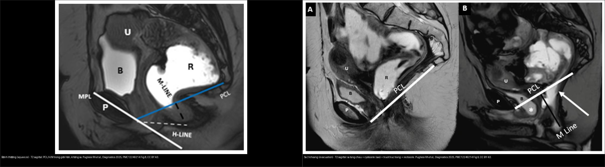
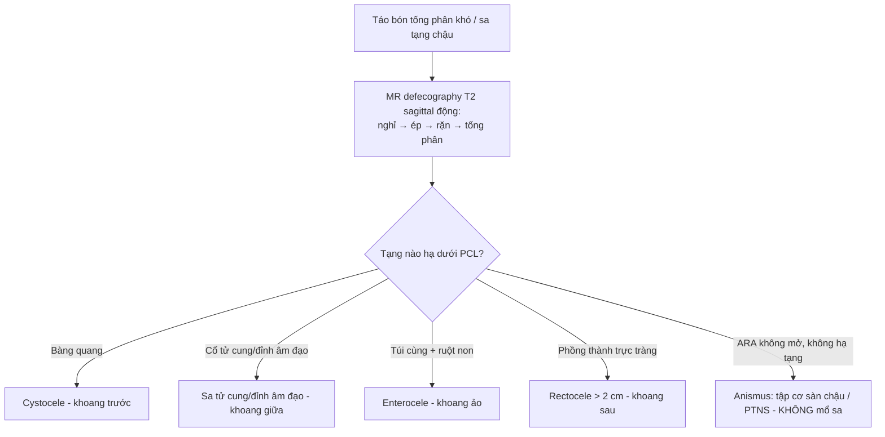
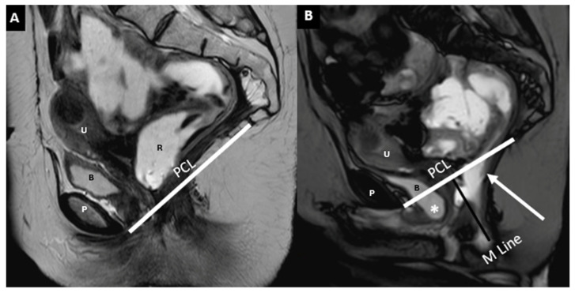
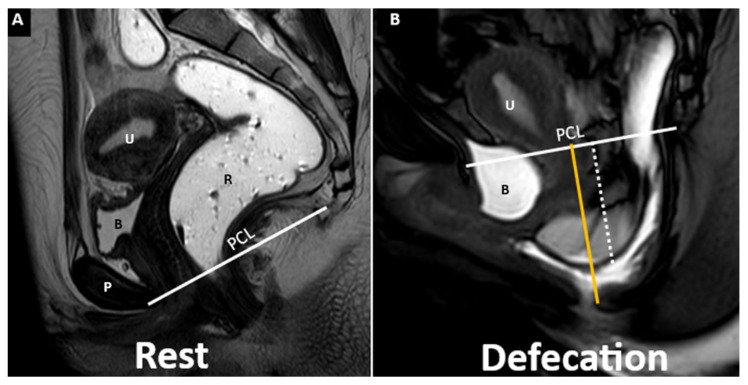
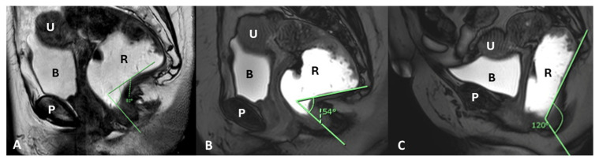
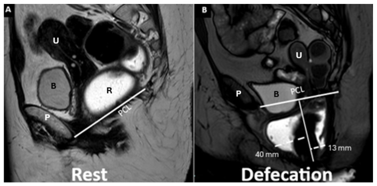

# 545 — MR động học sàn chậu: sa theo khoang & đường PCL/H/M / MR Defecography

**Tags:** `pattern:sa-san-chau` `vung:tieu-khung` `score:PCL` `protocol:MR-defecography`
**Mức chắc chắn (certainty):** tổng hợp y văn (literature synthesis) — nhóm tự biên từ y văn mở + ca nguyên văn trong bài gốc (ghi rõ Fig), chưa gắn bệnh án riêng.

## 1. Tổng quan — sa sàn chậu là bệnh "động", đo bằng 3 đường tham chiếu

- **Sa sàn chậu (pelvic organ prolapse):** các tạng chậu (bàng quang, tử cung/đỉnh âm đạo, trực tràng) tụt xuống dưới sàn chậu vì **yếu cân-mạc nâng (levator ani) + cân chậu (endopelvic fascia)** sau sinh nở/mãn kinh/phẫu thuật. Chỉ số **PCL (pubococcygeal line — đường mu-cụt)** là mốc cứng: nối bờ dưới khớp mu → khớp cụt cuối cùng.
- **Bệnh chỉ lộ khi TỐNG PHÂN (evacuation):** thì nghỉ (rest) có thể hoàn toàn bình thường — bài gốc nói thẳng *"thì tống phân cần thiết để lộ hết mức rối loạn sàn chậu"* (PMC12249214). Vì vậy LLCN chuẩn là **4 thì động: nghỉ → ép (squeeze) → rặn/đẩy (straining) → tống phân**.
- TẠI SAO phải **T2 sagittal nhanh (single-shot / BTFE / SSFSE)**: sàn chậu là mô mềm (cơ, cân, niêm mạc) → T2 giải phẫu cơ tốt nhất + chuỗi nhanh cho phép chụp **thời gian thực 1–2 hình/giây** suốt động tác tống phân; MR **không dùng tia X** và xem được cả 3 khoang + cơ trong một lần, khác X-quang động học (fluoroscopic defecography) chỉ thấy cột thuốc tương phản trong trực tràng.
- **3 đường tham chiếu (đo trên lát T2 cắt dọc giữa):**
  - **PCL:** bờ dưới khớp mu → khớp cụt cuối — tạng tụt **xuống dưới PCL** = sa, đo bằng **cm dưới PCL**.
  - **H line (đường lỗ hoành):** khớp mu → mặt sau chỗ nối hậu môn-trực tràng (anorectal junction, ARJ) — phản ánh **bề ngang lỗ cơ hoành (levator hiatus)**, bình thường **< 6 cm**.
  - **M line (đường sàn cơ):** ARJ (mặt sau) → khớp cụt cuối — phản ánh **mức hạ của sàn cơ**, bình thường **< 2 cm**; H/M tăng khi sàn chậu giãn-hạ.
- **Phân độ hạ tạng so với PCL (áp dụng cho cả 3 khoang):** độ 0 = trên PCL; **độ 1 = hạ < 3 cm**; **độ 2 = 3–6 cm**; **độ 3 = > 6 cm** dưới PCL (theo Wadhwani, Cureus 2023 — ca Fig. 2: sa tử cung độ 3, trực tràng vừa-nặng).
- **Góc hậu môn-trực tràng (anorectal angle, ARA):** góc giữa trục sau trực tràng và trục ống hậu môn, **nghỉ 90–130°** (ca bài gốc **81°**) → **ép thu hẹp** (ca: **54°**) → **tống phân mở rộng** (ca: **120°**, ARJ tụt **6 cm**). TẠI SAO: cơ mu-trực tràng (puborectalis) giãn ra khi tống phân làm góc mở; cơ co nghịch lý → góc **không mở/hẹp lại** = **anismus** (nên gọi là "loạn vận động tống phân", không phải sa để mổ).

## 2. Mẫu hình + chẩn đoán phân biệt theo khoang (Gamut)

**Gamut theo 3 khoang + 1 khoang "ảo" (cul-de-sac/ổ túi cùng):**
- **Khoang trước (anterior — bàng quang/niệu đạo):** cystocele (sa bàng quang), urethrocele, cystourethrocele.
- **Khoang giữa (middle — tử cung/cổ tử cung/âm đạo):** sa tử cung (hysterocele), sa đỉnh âm đạo (elitrocele/vault prolapse **sau cắt tử cung**).
- **Khoang sau (posterior — trực tràng/hậu môn):** **rectocele** (phồng thành trước trực tràng), **lồng trực tràng (intussusception) / sa trực tràng ra ngoài**, phân bố túi cùng muộn.
- **Khoang ảo / ổ túi cùng (cul-de-sac):** **enterocele** (túi phúc mạc chứa quấn ruột non/sigma sa xuống giữa trực tràng–âm đạo), **sa sàn lan tỏa thoát vị toàn sàn**.
- **Nhóm KHÔNG có sa (rối loạn chức năng):** **anismus / loạn vận động tống phân** (táo bón tống phân khó mà không sa tạng) — đừng mổ; **hội chứng loét trực tràng đơn độc (SRUS)** thường đi kèm lồng trực tràng.
- Gợi nhớ theo trình tự đọc: **(1) cân chỉnh PCL → (2) H, M line → (3) hạ tạng nào dưới PCL → (4) ARA đóng/mở → (5) có ruột non trong túi cùng không.**

## 3. Bảng so sánh phân biệt (ma trận đối chiếu)

| Thực thể (entity) | Hình ảnh điển hình (T2 sagittal động) | Chốt vào (rule-in) | Chốt loại (rule-out) | Gợi ý xác nhận |
|---|---|---|---|---|
| Cystocele (khoang trước) | Bàng quang tụt xuống dưới đường PCL thì rặn/tống phân | **Đáy bàng quang hạ > 3 cm dưới PCL (độ 2)** | Bàng quang còn trên PCL mọi thì → không sa khoang trước | Đo cm dưới PCL; ± niệu quyển/urethrocele |
| Sa tử cung / đỉnh âm đạo (khoang giữa) | Cổ tử cung hoặc đỉnh âm đạo hạ dưới PCL | **Hạ > 3 cm dưới PCL; sau cắt tử cung = sa đỉnh âm đạo** | Cổ tử cung dài nhưng đỉnh trên PCL → không sa thật | Hysterocele/elitrocele; phân độ 1–3 |
| Rectocele (khoang sau) | Phồng thành trước trực tràng khi tống phân (ca Fig. 11: **trước 40 mm**, sau 13 mm) | **Lồi > 2 cm (đo từ vị trí thành dự kiến)** | Lồi < 2 cm thường không triệu chứng | Đo mm; tống phân bắt buộc để lộ |
| Enterocele (khoang ảo) | Túi phúc mạc **chứa quấn ruột non** tụt giữa trực tràng–âm đạo | **Thấy vòng ruột non xuống dưới PCL** | Không thấy ruột non → chỉ là sa trực tràng/rectocele | Cần thì tống phân; cần cản quang ruột non |
| Lồng trực tràng / sa trực tràng | Niêm mạc/trực tràng lồng vào lòng hoặc thò ra ngoài hậu môn | **Đầu lồng vào ống hậu môn (độ 2) hoặc ra ngoài (độ 3)** | Chỉ phồng thành khu trú → rectocele, không phải lồng | Phân độ Oxford I–III |
| Anismus (rối loạn chức năng) | ARA **không mở / hẹp lại nghịch lý** khi tống phân; sàn chậu không hạ | **ARA nghịch lý + không hạ tạng dù rặn hết sức** | ARA mở + hạ tạng theo khoang → sa thật | Đo áp lực hậu môn (manometry), EMG |

*Trái: thì ép — ARJ ngang PCL, H/M line trong giới hạn, không sa. Phải: thì tống phân — sa cả 3 khoang, cystocele (sao) + sa trực tràng + rectocele. Nguồn: Pugliesi RA et al., Diagnostics 2025, PMC12249214 Fig. 8 + Fig. 9, CC BY 4.0.*

### Dấu hiệu cần đọc đúng trên chuỗi động
- **PCL/H/M line** (ca Fig. 1, PMC10825726): PCL đỏ = mốc sa tạng; **H line ≤ 6 cm** (lỗ cơ hoành), **M line ≤ 2 cm** (hạ sàn cơ) — H/M giãn rộng = sàn chậu mất nâng đỡ.
- **Góc hậu môn-trực tràng** (Fig. 7, PMC12249214): **81° nghỉ → 54° khi ép → 120° khi tống phân**, ARJ tụt **6 cm** — góc phải MỞ khi tống phân.
- **Rectocele** (Fig. 11): đo từ vị trí thành dự kiến, **trước 40 mm / sau 13 mm** — dạng anterior + posterior cùng lúc.

## 4. Protocol + hệ phân độ/điểm chuẩn hóa

- **Chỉ định:** táo bón tống phân khó/đau hậu môn, cảm giác "tắc nghẽn đường ra" (obstructed defecation), sa tạng chậu, đánh giá trước-sau mổ sa/treo (sacropexy, rectopexy).
- **Chuẩn bị:** nhịn ăn ngắn, làm trống bàng quang; **bơm gel siêu âm/cản quang vào trực tràng ~120–300 mL** để kích thích phản xạ tống phân + làm trực tràng căng (bài gốc dùng gel trực tràng); ± cản quang uống đánh dấu ruột non nếu nghi enterocele.
- **Chuỗi xung (bài gốc PMC12249214):** định vị lát cắt dọc giữa **T2 TSE** (nghỉ — đo PCL/H/M) → **T2 nhanh single-shot/BTFE thời gian thực** liên tục suốt **ép (squeeze)** → **rặn/đẩy** → **tống phân (evacuation)**; lát **5–6 mm**, trường nhìn từ khớp mu đến xương cụt + gồm cả tầng sinh môn (không che mất ARJ).
- **Tư thế:** nằm ngửa (máy kín) hoặc **ngồi trên máy hở** — tư thế ngồi lộ sa nhiều hơn (tương đương fluoroscopy) nhưng ít máy; nằm ngửa có thể **âm tính giả**.
- **Hệ phân độ:** hạ tạng so với PCL **độ 0 (< PCL) / 1 (< 3 cm) / 2 (3–6 cm) / 3 (> 6 cm)**; H line **≤ 6 cm** và M line **≤ 2 cm** là ngưỡng bình thường; ARA nghỉ **90–130°**.

## 5. Biến thể bình thường và cạm bẫy

- **Sa chỉ lộ khi tống phân** — đọc thì nghỉ kết luận "bình thường" là bỏ sót (occult prolapse). Luôn có thì tống phân trước khi kết luận.
- **Anismus giả sa:** rặn nghịch lý làm sàn chậu không hạ, có thể tạo hình ảnh "giả" hoặc che mất sa thật — không mổ sa khi chưa loại anismus (manometry/EMG).
- **Nằm ngửa vs ngồi:** tư thế nằm ngửa + nỗ lực không hết sức → **âm tính giả** ở ca sa nhẹ; giảm bằng máy hở/ngồi hoặc bảo BN rặn tối đa.
- **ARJ "chuẩn" khó vẽ khi gel/không gel:** thiếu gel làm trực tràng xẹp → khó thấy lồng trực tràng và rectocele; thiếu cản quang ruột non → bỏ sót enterocele.
- **Cạm bẫy mặt cắt (Argon mục 4):** trên lát dọc giữa dễ lẫn **enterocele (ruột non) vs rectocele (chỉ trực tràng)** và **sa đỉnh âm đạo sau cắt tử cung** — cần lần theo khoang và sự hiện diện vòng ruột; đồng thời phân biệt **sa sàn lan tỏa (descending perineal syndrome)** với sa một tầng đơn lẻ.
- **Cân chỉnh PCL:** vẽ sai đầu cụt cuối (thoái hóa hoặc không thấy) làm sai toàn bộ phân độ — dùng cùng mốc ở cả 4 thì.

## 6. Tự lượng giá — Blind Quiz

**Ca 1 — Sa 3 khoang khi tống phân (T2 sagittal). Đọc trước, mô tả từng khoang.**

- Gợi ý lâm sàng: nữ rối loạn tống phân, đọc thì nghỉ bình thường.
- Hỏi: tạng nào hạ dưới PCL? Có ruột non không? Đây là sa hay rối loạn chức năng?

<b>Bấm để hiện đáp án (findings + chẩn đoán)</b>

- Dấu hiệu (findings): thì tống phân — **sa cả 3 khoang** (cystocele (sao), sa tử cung, sa trực tràng) + **rectocele thành trước** + lồng niêm mạc trực tràng (mũi tên), so với PCL (đường trắng) và M line (đường tối).
- Chẩn đoán (diagnosis): **hội chứng hạ sàn lan tỏa (descending perineal syndrome) + sa 3 khoang** — vì thì nghỉ bình thường, sa chỉ lộ khi tống phân (cơ chế: yếu cân nâng, tạng tụt dưới PCL khi tăng áp lực ổ bụng).
- Nguồn: Pugliesi RA et al., Diagnostics 2025, PMC12249214 Fig. 9, CC BY 4.0.

**Ca 2 — Thì tống phân, có quấn ruột non xuống dưới PCL:**

<b>Bấm để hiện đáp án (findings + chẩn đoán)</b>

- Dấu hiệu (findings): **túi phúc mạc chứa quấn ruột non (chấm trắng đứt) tụt xuống dưới PCL** khi tống phân, kèm sa trực tràng + cystocele + sa tử cung; H/M line giãn rộng.
- Chẩn đoán (diagnosis): **enterocele (khoang ảo/túi cùng)** — vì sự hiện diện vòng ruột non trong túi phúc mạc giữa trực tràng–âm đạo; phân biệt rectocele (chỉ trực tràng, không ruột non).
- Nguồn: Pugliesi RA et al., Diagnostics 2025, PMC12249214 Fig. 10, CC BY 4.0.

**Ca 3 — Góc hậu môn-trực tràng qua các thì (nhìn A→B→C):**

<b>Bấm để hiện đáp án (findings + chẩn đoán)</b>

- Dấu hiệu (findings): **A nghỉ 81°** (ARJ ngang PCL) → **B ép 54°** (góc thu hẹp) → **C tống phân 120°** + ARJ tụt **6 cm** + sa trực tràng.
- Chẩn đoán (diagnosis): **động học góc bình thường→mở rộng khi tống phân kèm sa trực tràng** — nếu tống phân mà góc **không mở/nghịch lý hẹp lại** thì là **anismus** (không mổ).
- Nguồn: Pugliesi RA et al., Diagnostics 2025, PMC12249214 Fig. 7, CC BY 4.0.

**Ca 4 — Phồng thành trực tràng khi tống phân:**

<b>Bấm để hiện đáp án (findings + chẩn đoán)</b>

- Dấu hiệu (findings): thành trực tràng **bình thường ở thì nghỉ (A)**, khi tống phân (B) **phồng ra trước 40 mm và ra sau 13 mm** (đường chấm trắng).
- Chẩn đoán (diagnosis): **rectocele trước (> 3 cm) + rectocele sau** — lồi > 2 cm là ngưỡng thường được coi có ý nghĩa; thì tống phân bắt buộc để lộ.
- Phản biện (fidelity): rectocele sau nhỏ (13 mm) thường ít triệu chứng — không phải mọi lồi đều cần mổ; quyết định dựa triệu chứng + độ sâu + còn tồn lưu phân.
- Nguồn: Pugliesi RA et al., Diagnostics 2025, PMC12249214 Fig. 11, CC BY 4.0.

**Ca 5 — Bình thường hay sa? (đối chiếu hai hình, đọc trước khi mở đáp án):**

<b>Bấm để hiện đáp án (findings + chẩn đoán)</b>

- Dấu hiệu (findings): **trái** thì ép — ARJ ngang PCL, H/M line trong giới hạn (bình thường); **phải** thì tống phân — sa cả 3 khoang + cystocele + rectocele.
- Chẩn đoán (diagnosis): **so sánh cùng một bệnh nhân qua các thì là chìa khóa** — sa chỉ hiện khi tống phân, nên kết luận dựa chuỗi động chứ không dựa một thì.
- Nguồn: Pugliesi RA et al., Diagnostics 2025, PMC12249214 Fig. 8 + 9, CC BY 4.0.

## Bài liên quan chéo
- [500 – Tổng quan Vú & Sản Phụ khoa](../500-tong-quan-vu-san-phu-khoa/lesson.md)
- [540 – DIE & PID: đau chậu mạn](../540-lac-noi-mac-tu-cung-sau-DIE-MRI/lesson.md) (cùng vùng tiểu khung, tiếp cận MRI)
- [140 – Lách & chấn thương tạng đặc](../140-lach-tang-dac/lesson.md) (Argon mục 4 — cạm bẫy mặt cắt ngang/nội tạng chậu)

## Ảnh
- Ảnh tải về theo giấy phép từng file — xem `images/CREDITS.md`.
- Nguồn chính: Pugliesi RA et al., *Diagnostics* (Basel) 2025, PMC12249214, **CC BY 4.0**; Wadhwani S et al., *Cureus* 2023, PMC10825726, **CC BY 4.0**.
- Nhóm **không** tải ảnh paywall/cấm (AuntMinnie) — chỉ dẫn link trong `sources.md`.

> Không dùng để chẩn đoán độc lập khi chưa có người hướng dẫn.
