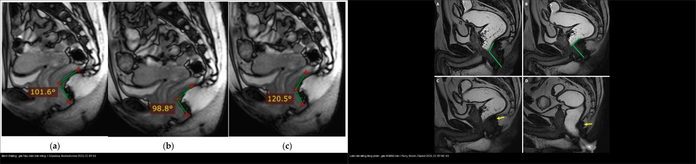
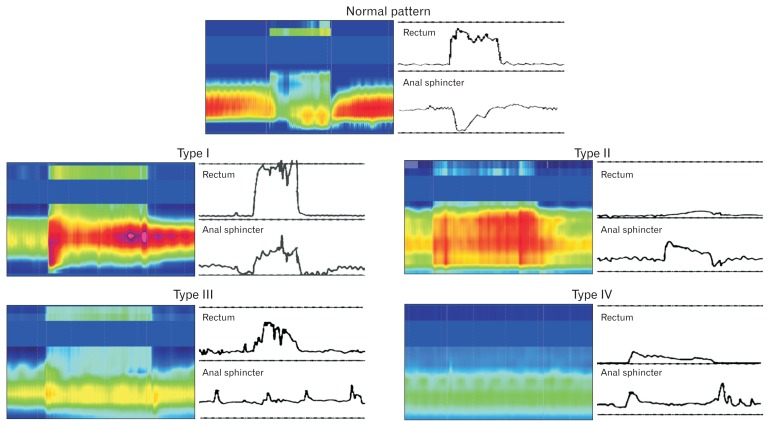
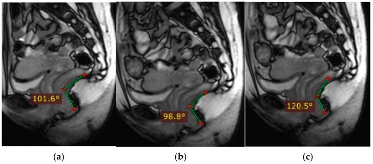
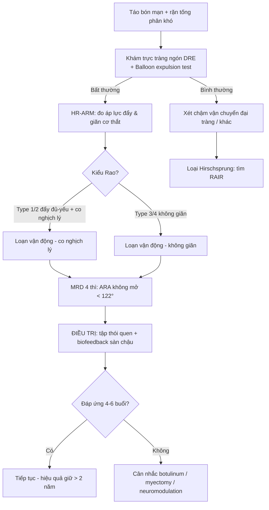
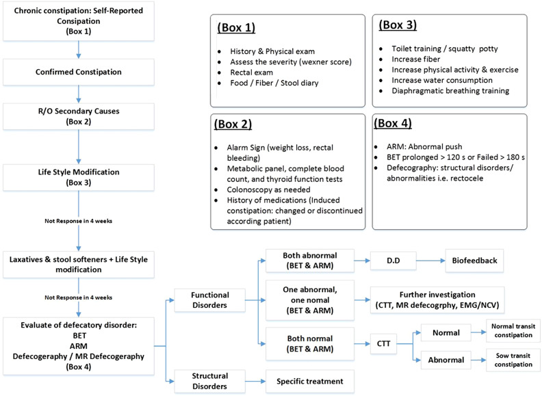
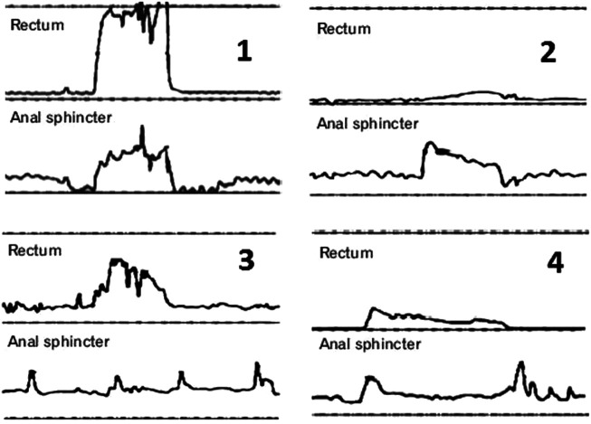
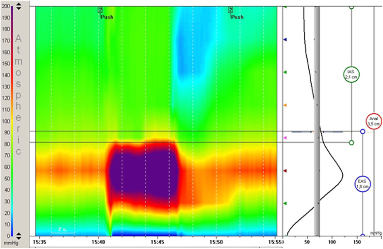
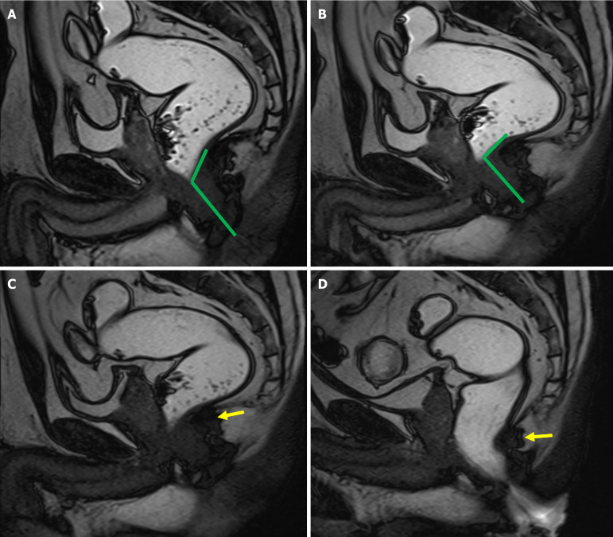
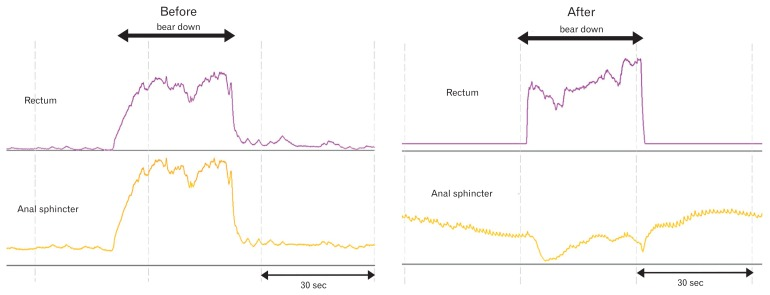

# 546 — Loạn vận động tống phân (anismus / dyssynergic defecation): manometry & MR defecography

**Tags:** `pattern:loan-van-dong-tong-phan` `vung:tieu-khung` `vung:truc-trang-hau-mon` `score:Rao-type` `protocol:MR-defecography` `protocol:manometry`
**Mức chắc chắn (certainty):** tổng hợp y văn (literature synthesis) — nhóm tự biên từ y văn mở (bài gốc có Fig. ID ghi rõ), chưa gắn một bệnh án riêng.

## 1. Tổng quan — tống phân là một "điệu nhảy" phối hợp, hỏng nhịp thì phân không ra

- **Loạn vận động tống phân (dyssynergic defecation, DD)** — còn gọi là **anismus**, hội chứng sàn chậu co cứng (spastic pelvic floor syndrome) hay co cơ mu‑trực tràng nghịch lý (paradoxical puborectalis contraction): bệnh nhân **rặn hết sức mà phân không ra** vì cơ thắt hậu môn ngoài và cơ mu‑trực tràng (puborectalis) **KHÔNG giãn ra mà còn co lại** trong lúc tống phân. Đây là **rối loạn hành vi–thần kinh cơ**, KHÔNG phải bệnh thực thể và **KHÔNG nên mổ**.
- **TẠI SAO tống phân cần hai điều kiện đồng thời:** (1) áp lực **đẩy** của trực tràng đủ mạnh, và (2) **cửa ra mở** do cơ mu‑trực tràng + cơ thắt hậu môn ngoài giãn. Trong DD có sự **mất phối hợp (incoordination)** giữa hai vế:
  - Áp lực đẩy không đủ: áp lực trực tràng **≤ 40–45 mmHg** (ngưỡng của Rao và bài gốc; bình thường phải **> 40–45 mmHg**).
  - Cửa ra không mở: **giảm < 20%** áp lực cơ thắt hậu môn so với lúc nghỉ (thay vì phải giảm nhiều), hoặc **áp lực hậu môn tăng nghịch lý** khi rặn.
- **TẠI SAO đọc trên hai phương thức khác nhau:**
  - **Manometry hậu môn–trực tràng độ phân giải cao (high-resolution anorectal manometry, HR‑ARM)** đo **áp lực** theo thời gian → phân biệt được **áp lực đẩy đủ hay thiếu** và **cơ thắt có giãn hay không** ⇒ đây là chìa khóa phân **4 kiểu Rao**.
  - **MR defecography (MRD)** đo **hình học mô mềm**: góc hậu môn–trực tràng (anorectal angle, ARA) và vị trí ngã ba hậu môn–trực tràng (anorectal junction, ARJ) qua các thì nghỉ → ép → rặn → tống phân. Trong DD, **ARA không mở ra (thậm chí hẹp lại) dù rặn hết sức** — cơ chế: cơ mu‑trực tràng co nghịch lý kéo góc hẹp thay vì giãn.
- **Ngưỡng định lượng trên MRD cho DD** (Parry, *World J Radiol* 2025): **ARA lúc tống phân < 122°**, **mức thay đổi ARA (ΔARA) < 1,5°**, **ARJ tụt > 3,25 cm dưới đường PCL**. Co cơ mu‑trực tràng nghịch lý (đối chiếu manometry) có **độ nhạy 83%**; **ARA không mở** có **độ nhạy 50% nhưng độ đặc hiệu 97%**; gộp cả hai dấu hiệu → **độ nhạy 94%**.
- **Dịch tễ:** DD là nguyên nhân **thường gặp nhất** của rối loạn tống phân, chiếm **27–59%**; khoảng **1/3** bệnh nhân táo bón mạn có rối loạn tống phân; táo bón chức năng gặp ở **16%** người lớn và **33,5%** người 60–100 tuổi (Parry 2025). **Cạm bẫy dịch tễ:** **20–30% người khỏe mạnh** cũng có co cơ hậu môn nghịch lý thoáng qua (Sadeghi, *Turk J Gastroenterol* 2023) ⇒ không thể chẩn đoán chỉ bằng một dấu hiệu đơn độc.

## 2. Mẫu hình + chẩn đoán phân biệt theo cơ chế (Gamut)

- **Gamut "tống phân khó" (obstructed defecation) theo cơ chế:**
  - **Rối loạn chức năng (không mổ):** **loạn vận động tống phân (DD)** — co nghịch lý hoặc không giãn; **táo bón chậm vận chuyển (slow transit constipation)** — nhu động đại tràng kém; **loạn cảm trực tràng (rectal hyposensitivity/ hypersensitivity)**.
  - **Tắc nghẽn giải phẫu (có thể mổ):** **rectocele** (túi phình thành trước trực tràng), **lồng trực tràng (rectal intussusception) / sa trực tràng**, **enterocele/peritoneocele**, **u/khối trong lòng**.
  - **Bệnh đoạn cuối ruột (organic):** **bệnh Hirschsprung** (thiếu tế bào hạch → mất phản xạ giãn cơ thắt hậu môn–trực tràng, RAIR), **viêm/loét hậu môn (fissure)** gây đau–nín rặn, **tổn thương tủy/đa xơ cứng**, **sau phẫu thuật/mãn kinh** yếu sàn chậu.
- **Gợi nhớ "DD vs phần còn lại":** (1) có **mất phối hợp** không? (2) có **phản xạ giãn** khi bơm bóng (RAIR) không? (3) **thời gian vận chuyển** đại tràng có chậm không? (4) có **sa/tắc nghẽn giải phẫu** kèm theo không?
- **Điểm dễ nhầm:** DD và **chậm vận chuyển** **cùng tồn tại ở tới 2/3** bệnh nhân (Sadeghi 2023) — không loại trừ nhau; DD có thể gây chậm vận chuyển thứ phát.

## 3. Bảng so sánh phân biệt (ma trận đối chiếu)

| Thực thể (entity) | Hình ảnh / nghiệm pháp điển hình | Chốt vào (rule-in) | Chốt loại (rule-out) | Gợi ý xác nhận |
|---|---|---|---|---|
| **Loạn vận động tống phân (DD/anismus)** | Manometry: áp lực đẩy yếu và/hoặc cơ thắt không giãn–co nghịch lý; MRD: **ARA không mở** khi rặn | **Đẩy ≤ 40–45 mmHg và/hoặc giảm < 20% áp lực hậu môn khi rặn; ΔARA < 1,5°; balloon 50 mL không ra trong 1–2 phút** | Áp lực đẩy đủ + cơ thắt giãn bình thường + ARA mở > 122° → không phải DD | HR‑ARM + balloon expulsion; MRD 4 thì |
| **Táo bón chậm vận chuyển (slow transit)** | Manometry bình thường; **thời gian vận chuyển đại tràng kéo dài** trên phim marker | **> 5/24 marker (≥ 20%) còn lại sau 5 ngày** | Manometry/phối hợp tống phân bình thường → không phải DD | Colon transit time (marker) |
| **Bệnh Hirschsprung (người lớn, hiếm)** | Áp lực hậu môn nghỉ cao; **mất phản xạ giãn cơ thắt** khi bơm bóng | **Mất RAIR (không giảm áp lực hậu môn khi bơm bóng)** + sinh thiết thiếu hạch | Có RAIR + sinh thiết đủ hạch → loại Hirschsprung | Manometry + **sinh thiết hút trực tràng** |
| **Rectocele / lồng trực tràng** | MRD: phồng thành trước trực tràng hoặc niêm mạc lồng vào lòng khi tống phân | **Rectocele > 2 cm** hoặc **lồng trực tràng vào ống hậu môn** | Không lồi, không lồng khi tống phân → loại | MRD thì tống phân |
| **Loạn cảm trực tràng** | Bơm bóng: ngưỡng cảm nhận/đau tăng hoặc giảm | **Ngưỡng cảm giác bất thường** đơn độc | Phối hợp tống phân bình thường → không phải rối loạn vận động | Manometry cảm giác (barostat) |

*Trái: bình thường — ARA **101,6° (nghỉ) → 98,8° (ép) → 120,5° (rặn)**, góc **MỞ RA** khi rặn (Gilyadova, *Biomedicines* 2023, CC BY 4.0). Phải: loạn vận động — góc **KHÔNG mở** khi rặn do cơ mu‑trực tràng co nghịch lý (Parry, *World J Radiol* 2025, CC BY‑NC 4.0). Ảnh ghép letterbox.*

### Ba dấu hiệu chốt cần đọc đúng trên manometry và MRD
- **Áp lực đẩy (propulsive force):** bình thường **> 40–45 mmHg**; thiếu ⇒ kiểu Rao 2/4.
- **Giãn cơ thắt:** bình thường giảm **≥ 20%** áp lực hậu môn khi rặn; không giãn hoặc tăng nghịch lý ⇒ DD.
- **MRD:** ARA phải **mở** khi rặn; ngưỡng DD **ARA < 122° / ΔARA < 1,5° / ARJ tụt > 3,25 cm dưới PCL**.

*Panô trên: tống phân bình thường — áp lực đẩy trực tràng tăng, áp lực hậu môn GIẢM (giãn). Panô dưới: loạn vận động — áp lực đẩy yếu/không tăng trong khi áp lực hậu môn TĂNG nghịch lý. Nguồn: Rao SS & Patcharatrakul T, *J Neurogastroenterol Motil* 2016, PMC4930297 Fig. 1, CC BY‑NC.*

## 4. Protocol + hệ phân độ/điểm chuẩn hóa

- **Bước 1 — Nghi vấn lâm sàng:** táo bón tống phân khó, rặn lâu, cảm giác "tắc nghẽn đường ra", phải dùng tay hỗ trợ (digital maneuvering).
- **Khám trực tràng bằng ngón (digital rectal examination, DRE):** sàng lọc tại giường rẻ và tin cậy — **độ nhạy 75%, độ đặc hiệu 87%, giá trị tiên đoán dương 97%** (Sadeghi 2023).
- **Bước 2 — Balloon expulsion test (BET):** **nghiệm pháp sàng lọc đầu tay**; không đẩy được bóng nước **50 mL trong 1–2 phút** = bất thường.
- **Bước 3 — HR‑ARM** theo IAPWG/London: phân **4 kiểu Rao**; **Bước 4 — MRD 4 thì** (nghỉ → ép → rặn → tống phân) khi cần đánh giá giải phẫu + động học.

*Chỉ số bình thường: góc hậu môn–trực tràng thay đổi theo thì (nghỉ → ép → rặn/mở). Nguồn: Gilyadova A et al., *Biomedicines* 2023, PMC10604435 Fig. 2, CC BY 4.0.*
- **Nội soi đại tràng:** khoảng **80%** bệnh nhân DD có nội soi bình thường; chỉ soi khi có chỉ định sàng lọc.

### Phân loại 4 kiểu loạn vận động (Rao) trên manometry

| Kiểu (Rao) | Áp lực đẩy | Cơ thắt hậu môn | Ý nghĩa |
|---|---|---|---|
| **Type 1** | ≥ 40 mmHg (đủ) | **Tăng nghịch lý** | Rặn mạnh nhưng cửa co lại |
| **Type 2** | < 40 mmHg (yếu) | **Tăng nghịch lý** | Yếu lực + cửa co lại (hay gặp) |
| **Type 3** | ≥ 40 mmHg (đủ) | **Không giãn (giảm ≤ 20 mmHg)** | Cửa không mở, không tăng nghịch lý |
| **Type 4** | < 40 mmHg (yếu) | **Không giãn (giảm ≤ 20 mmHg)** | Yếu lực + cửa không mở |

> Tiêu chuẩn **Rome IV** cho rối loạn tống phân chức năng: thỏa tiêu chuẩn táo bón chức năng/IBS‑C, cộng bằng chứng **tống phân không hiệu quả** (không đẩy được bóng 50 mL trong 1–2 phút; hoặc giữ **≥ 50%** barium khi defecography; hoặc cơ thắt co nghịch lý/không giãn; hoặc lực đẩy không đủ).

*Lưu đồ gợi ý của bài gốc: loại trừ (R/O) nguyên nhân thực thể → balloon expulsion (BET) → anorectal manometry (ARM) → MR defecography → phân loại DD → manometry/EMG/NCV. Nguồn: Sadeghi A et al., *Turk J Gastroenterol* 2023, PMC10152153 Fig. 3, CC BY 4.0.*

- **Điều trị (TẠI SAO không mổ):** **biofeedback sàn chậu** là điều trị đầu tay, hiệu quả **70–80%** trong các thử nghiệm đối chứng ngẫu nhiên và **tốt hơn** giả dược, polyethylene glycol hay diazepam; hiệu quả **duy trì > 2 năm** (Rao, *J Neurogastroenterol Motil* 2016). Phác đồ: giáo dục thói quen đại tiện + **4–6 buổi**, mỗi buổi **30–60 phút**, cách nhau **1–2 tuần**; đánh giá thành công khi bệnh nhân đạt kiểu tống phân bình thường ở **≥ 50% số lần** trong **2 buổi liên tiếp**. **Myectomy/botulinum chỉ giúp 10–30%** (Sadeghi 2023) ⇒ không phải lựa chọn đầu.

## 5. Biến thể bình thường và cạm bẫy

- **Co nghịch lý "giả" ở người khỏe:** **20–30%** người khỏe mạnh có thể thoáng co cơ hậu môn nghịch lý — không chốt DD bằng dấu hiệu đơn độc (Sadeghi 2023).
- **BET dương tính đơn độc chưa đủ:** phải phối hợp manometry ± MRD.
- **DD và chậm vận chuyển chồng lấp (tới 2/3):** đừng dừng chẩn đoán ở "chậm vận chuyển" mà bỏ qua DD.
- **MRD nằm ngửa có thể âm tính giả** ở ca nhẹ; nhớ đọc **thì tống phân** (cạm bẫy y như bài 545) — thì nghỉ bình thường không loại trừ DD.
- **Đừng mổ sa khi chưa loại DD:** phẫu thuật cắt niêm mạc/STARR ở người DD không giúp và có thể làm nặng hơn.
- **Cạm bẫy mặt cắt:** phân biệt **rối loạn chức năng (không tắc nghẽn thật)** với **tắc nghẽn giải phẫu (rectocele/lồng trực tràng)** — cùng "tống phân khó" nhưng hướng xử trí ngược nhau; luôn tìm dấu hiệu giải phẫu trên MRD trước khi quy kết "chỉ do DD".
- **RAIR:** mất RAIR gợi ý **Hirschsprung** (bệnh thực thể) — không được nhầm với DD.

## 6. Tự lượng giá — Blind Quiz

**Ca 1 — Bốn kiểu loạn vận động trên manometry: mô tả từng kiểu trước khi mở đáp án.**

- Gợi ý lâm sàng: người lớn táo bón mạn, rặn tống phân khó.
- Hỏi: các kiểu khác nhau ở **áp lực đẩy** hay **kiểu co cơ thắt**? Kiểu nào có co nghịch lý?

<b>Bấm để hiện đáp án (findings + chẩn đoán)</b>

- Dấu hiệu (findings): **Type 1** đẩy đủ (**≥ 40 mmHg**) + **tăng nghịch lý** áp lực hậu môn; **Type 2** đẩy yếu (**< 40 mmHg**) + tăng nghịch lý; **Type 3** đẩy đủ + **không giãn** (giảm ≤ 20 mmHg); **Type 4** đẩy yếu + không giãn.
- Chẩn đoán (diagnosis): **loạn vận động tống phân** — cơ chế: mất phối hợp giữa lực đẩy trực tràng và sự giãn cơ thắt hậu môn–mu‑trực tràng.
- Nguồn ảnh: Sadeghi A et al., *Turk J Gastroenterol* 2023, PMC10152153 Fig. 1, **CC BY 4.0**.

**Ca 2 — Manometry trong thì rặn: đây là kiểu nào?**

- Gợi ý lâm sàng: bệnh nhân rặn mạnh nhưng phân không ra.

<b>Bấm để hiện đáp án (findings + chẩn đoán)</b>

- Dấu hiệu (findings): khi rặn, **áp lực trong trực tràng KHÔNG tăng** trong khi **áp lực hậu môn tăng rõ** ⇒ lực đẩy yếu kèm co nghịch lý.
- Chẩn đoán (diagnosis): **loạn vận động tống phân Type 2** — vì thiếu lực đẩy **và** cơ thắt tăng nghịch lý; hướng xử trí = **biofeedback**, không mổ.
- Nguồn ảnh: Sadeghi A et al., *Turk J Gastroenterol* 2023, PMC10152153 Fig. 2, **CC BY 4.0**.

**Ca 3 — MRD thì rặn: góc hậu môn–trực tràng mở hay không?**

- Gợi ý lâm sàng: táo bón tống phân khó, đã loại nguyên nhân thực thể.
- Hỏi: góc hậu môn–trực tràng thay đổi thế nào khi ép và khi rặn? Có tắc nghẽn giải phẫu không?

<b>Bấm để hiện đáp án (findings + chẩn đoán)</b>

- Dấu hiệu (findings): ARA **tù (> 90°) lúc nghỉ**, **hẹp lại khi ép**, và khi **rặn thì càng hẹp lại / KHÔNG mở** — do co nghịch lý cơ mu‑trực tràng, không có khối tắc nghẽn giải phẫu.
- Chẩn đoán (diagnosis): **loạn vận động tống phân (dyssynergic defecation)** — ngưỡng MRD: **ARA lúc tống phân < 122°** và **ΔARA < 1,5°**; "ARA không mở" có **độ đặc hiệu 97%**, gộp với co nghịch lý mu‑trực tràng cho **độ nhạy 94%**.
- Nguồn ảnh: Parry AH et al., *World J Radiol* 2025, PMC12210197 Fig. 11, **CC BY‑NC 4.0**.

**Ca 4 — Bình thường hay loạn vận động? So sánh hai bên rồi mở đáp án.**

<b>Bấm để hiện đáp án (findings + chẩn đoán)</b>

- Dấu hiệu (findings): **trái** — ARA **mở ra** khi rặn (101,6° → 120,5°) = bình thường; **phải** — ARA **không mở** khi rặn = loạn vận động.
- Chẩn đoán (diagnosis): **đối chiếu động học qua các thì là chìa khóa** — ARA phải mở khi tống phân; nếu hẹp lại hoặc đứng yên (ΔARA < 1,5°) thì nghĩ **DD**.
- Nguồn ảnh: Gilyadova A et al., *Biomedicines* 2023 (PMC10604435, CC BY 4.0) + Parry AH et al., *World J Radiol* 2025 (PMC12210197, CC BY‑NC 4.0).

**Ca 5 — Manometry trước và sau điều trị: có cải thiện không?**

<b>Bấm để hiện đáp án (findings + chẩn đoán)</b>

- Dấu hiệu (findings): trước điều trị — áp lực đẩy yếu kèm co nghịch lý; **sau biofeedback** — mẫu hình tống phân **trở về bình thường** (đẩy đủ + cơ thắt giãn).
- Chẩn đoán (diagnosis): **loạn vận động tống phân đáp ứng biofeedback** — điều trị đầu tay hiệu quả **70–80%**, duy trì **> 2 năm**; minh chứng DD là **rối loạn hành vi có thể học lại**, không phải bệnh mô học.
- Nguồn ảnh: Rao SS, Patcharatrakul T, *J Neurogastroenterol Motil* 2016, PMC4930297 Fig. 2, **CC BY‑NC**.

## Bài liên quan chéo
- [500 – Tổng quan Vú & Sản Phụ khoa](../500-tong-quan-vu-san-phu-khoa/lesson.md)
- [545 – MR động học sàn chậu (sa theo khoang, PCL/H/M)](../545-sa-san-chau-MR-defecography/lesson.md) (cùng kỹ thuật MRD; phân biệt **sa** với **rối loạn chức năng**)
- [547 – Sa tạng chậu nữ: phân độ POP-Q & lưới nâng](../547-sa-tang-chau-nu-POP-Q-luoi-nang/lesson.md) (nhánh "tắc nghẽn giải phẫu" của cùng gamut)
- [162 – Tắc ruột](../162-tac-ruot/lesson.md) (tắc nghẽn đường tiêu hóa — nhưng ở DD KHÔNG có tắc thật)

## Ảnh
- Ảnh tải về theo giấy phép từng file — xem `images/CREDITS.md`.
- Nguồn chính: Sadeghi A et al., *Turk J Gastroenterol* 2023, **PMC10152153 (CC BY 4.0)**; Parry AH et al., *World J Radiol* 2025, **PMC12210197 (CC BY‑NC 4.0)**; Rao SS & Patcharatrakul T, *J Neurogastroenterol Motil* 2016, **PMC4930297 (CC BY‑NC)**; Gilyadova A et al., *Biomedicines* 2023, **PMC10604435 (CC BY 4.0)**.
- Nhóm **không** tải ảnh paywall/cấm (AuntMinnie) — chỉ dẫn link trong `sources.md`.

> Không dùng để chẩn đoán độc lập khi chưa có người hướng dẫn.
