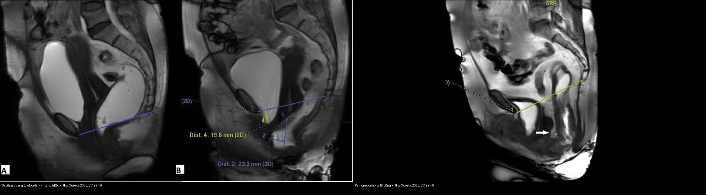
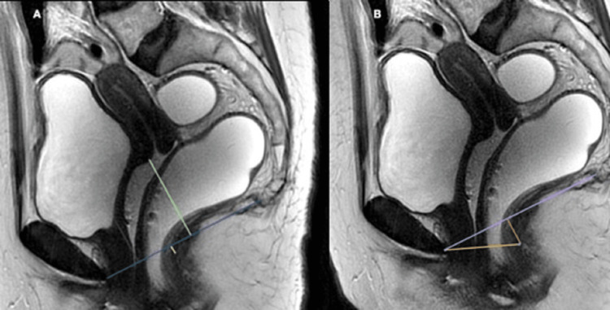
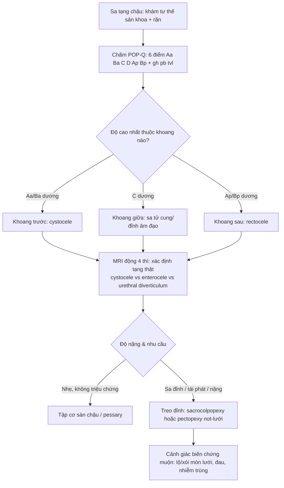
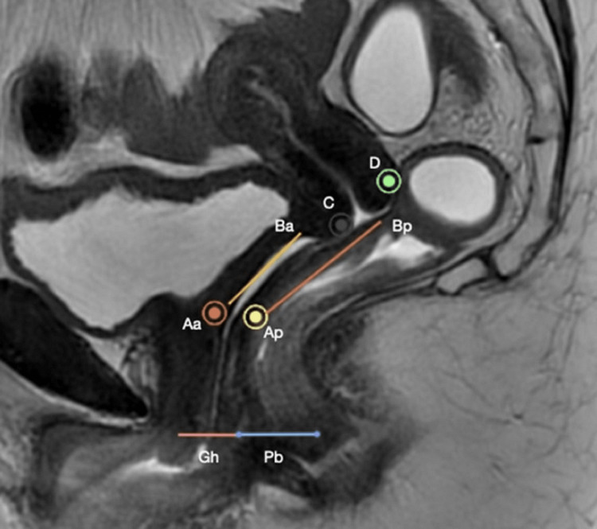
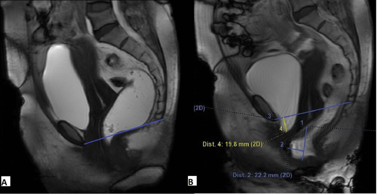
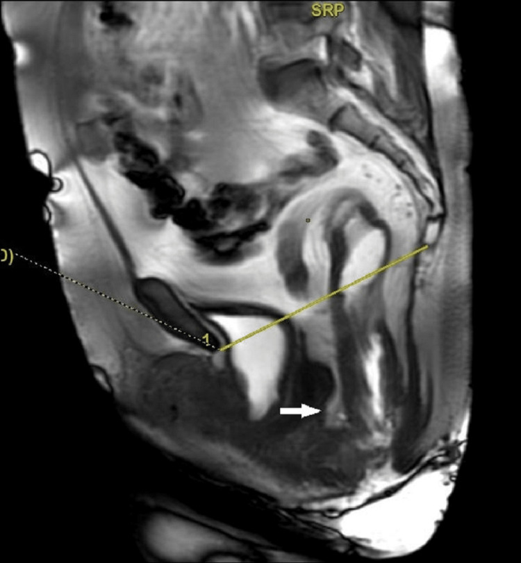
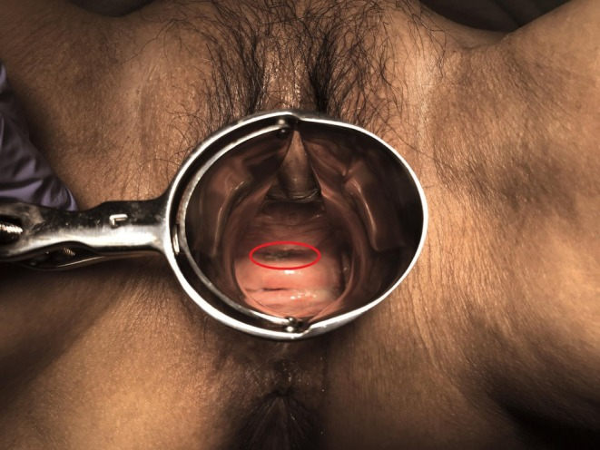
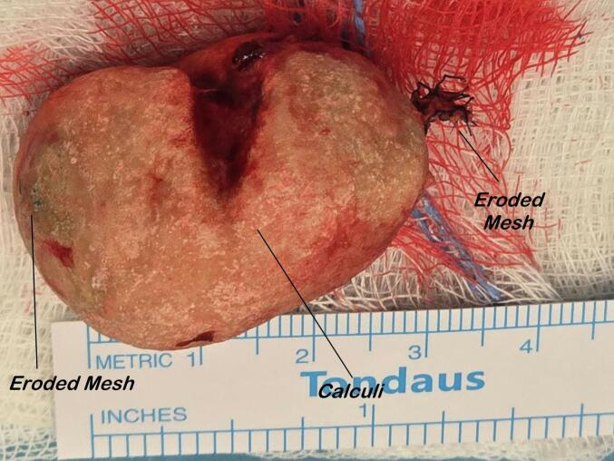
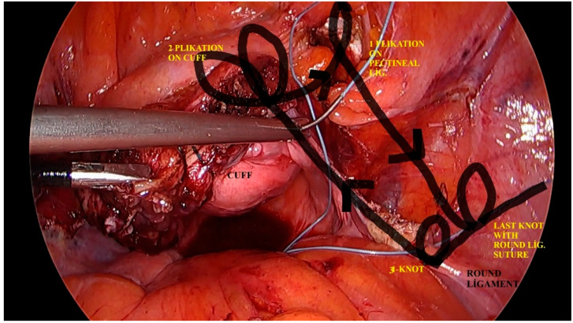

# 547 — Sa tạng chậu nữ: phân độ POP‑Q & lựa chọn lưới nâng (mesh)

**Tags:** `pattern:sa-tang-chau` `vung:tieu-khung` `score:POP-Q` `protocol:MRI-san-chau` `protocol:luoi-nang`
**Mức chắc chắn (certainty):** tổng hợp y văn (literature synthesis) — nhóm tự biên từ y văn mở (bài gốc có Fig. ID ghi rõ, gồm ca nguyên văn), chưa gắn một bệnh án riêng.

## 1. Tổng quan — sa tạng chậu là bệnh của "hệ treo", đo bằng mặt phẳng màng trinh

- **Sa tạng chậu (pelvic organ prolapse, POP):** bàng quang, tử cung/đỉnh âm đạo, trực tràng tụt xuống dưới sàn chậu do **yếu cân–mạc nâng (levator ani) + cân chậu (endopelvic fascia)** sau sinh nở, mãn kinh, béo phì, tăng áp lực ổ bụng mạn. Bệnh **tăng theo tuổi/post‑menopause**.
- **TẠI SAO chuẩn hóa bằng POP‑Q (Pelvic Organ Prolapse Quantification) thay vì mô tả "sa độ…":** lấy **mặt phẳng màng trinh (hymen) làm mốc** thay cho ngã ba, nên đo được **6 điểm** ở vị trí cố định và **so sánh được giữa các lần khám/phẫu thuật viên**: 3 điểm khoang trước–giữa (**Aa, Ba** ở thành trước; **C** = cổ tử cung/đỉnh âm đạo), 2 điểm khoang sau (**Ap, Bp**) và **D** (túi cùng Douglas/flexura sau âm đạo; **bỏ D nếu đã cắt tử cung**), cộng **3 số đo**: lỗ sinh dục (genital hiatus, gh), thân đáy chậu (perineal body, pb), tổng độ dài âm đạo (total vaginal length, tvl).
- **TẠI SAO có quy ước dấu:** điểm **trên màng trinh = âm (–)**, **ngay màng trinh = 0**, **dưới màng trinh = dương (+)** — nên **số càng dương thì sa càng nặng**, ngược trực giác.
- **Phân độ POP‑Q:** **độ 0** = không sa; **độ I** = điểm thấp nhất **> 1 cm trên** màng trinh; **độ II** = **trong khoảng 1 cm quanh** màng trinh; **độ III** = sa **> 1 cm dưới** màng trinh nhưng chưa thoát hoàn toàn; **độ IV** = **lộn toàn bộ (procidentia)** — độ chung = **độ CAO NHẤT của 3 khoang**.
- **Dịch tễ (định lượng):** khoảng **20%** phụ nữ được mổ vì POP/rối loạn tiểu không tự chủ trong đời; tỷ lệ hiện mắc **41–50%** ở nữ cao tuổi, **30–50%** sau mãn kinh; **~42%** nữ 50–79 tuổi ở Mỹ (Kayondo, *Cureus* 2026). Trong một loạt chụp MRI (Jha, *Cureus* 2023), **70%** bệnh nhân sa **nhiều khoang**, **khoang trước hay gặp nhất** (cystocele **90%**, tăng di động niệu đạo **76%**, sa tử cung **76%**, tụt ngã ba hậu môn–trực tràng **86%**, rectocele trước **84%**).
- **TẠI SAO MRI động học (dynamic pelvic MRI) hỗ trợ POP‑Q:** POP‑Q là **khám lâm sàng**, không cho biết **tạng nào** đang sa sau niêm mạc âm đạo (cystocele thật hay enterocele, lồng trực tràng). MRI T2 sagittal 4 thì (nghỉ → ép → rặn → tống phân) **định vị tạng + khoang**, không tia X; đo **H line/M line** (giãn lỗ cơ hoành/sa sàn cơ) và hạ tạng so với **PCL** — lấp đúng "điểm mù" của thăm khám.

## 2. Mẫu hình + chẩn đoán phân biệt theo khoang (Gamut)

- **Gamut theo 3 khoang (ánh xạ POP‑Q ↔ MRI):**
  - **Khoang trước (Aa, Ba ↔ cystocele):** sa bàng quang (cystocele), tăng di động niệu đạo (urethral hypermobility), urethrocele.
  - **Khoang giữa (C, D ↔ sa tử cung/đỉnh âm đạo):** sa tử cung (hysterocele), sa đỉnh âm đạo (vault prolapse, **sau cắt tử cung**), peritoneocele/enterocele (túi cùng chứa phúc mạc/quấn ruột non).
  - **Khoang sau (Ap, Bp ↔ rectocele):** rectocele (phồng thành trước trực tràng), **lồng trực tràng (intussusception)**, sa trực tràng ra ngoài.
- **Nhóm "kẻ giả danh" (không phải POP nhưng hay bị gọi là cystocele):** **túi thừa niệu đạo (urethral diverticulum)** — khối dịch quanh niệu đạo; **nang Gartner/đơn thuần âm đạo**; **khối niệu đạo**.
- **Gợi nhớ đọc theo trình tự:** **(1) chấm điểm POP‑Q → (2) độ cao nhất thuộc khoang nào → (3) MRI xác định tạng nào đang sa → (4) có sa sàn lan tỏa (H/M line giãn) không → (5) lựa chọn treo đỉnh (native tissue hay lưới).**

## 3. Bảng so sánh phân biệt (ma trận đối chiếu)

| Thực thể (entity) | Hình ảnh điển hình | Chốt vào (rule-in) | Chốt loại (rule-out) | Gợi ý xác nhận |
|---|---|---|---|---|
| **Cystocele (khoang trước)** | MRI: đáy bàng quang tụt dưới PCL/màng trinh khi rặn; POP‑Q: **Aa/Ba dương** | **Đáy bàng quang hạ > 3 cm dưới PCL (độ 2–3); Ba/Aa dương** | Bàng quang còn trên màng trinh/PCL mọi thì → không sa | POP‑Q điểm Aa/Ba + MRI thì rặn |
| **Sa tử cung / đỉnh âm đạo (khoang giữa)** | MRI: cổ tử cung/đỉnh âm đạo tụt xuống; POP‑Q: **điểm C dương** | **C hạ > 1 cm dưới màng trinh; sau cắt tử cung = sa đỉnh âm đạo** | Điểm C còn âm (trên màng trinh) → không sa đỉnh | POP‑Q điểm C (và D) |
| **Enterocele / peritoneocele (khoang ảo)** | MRI: túi phúc mạc (có/không quấn ruột non) tụt xuống dưới màng trinh/PCL | **Túi phúc mạc/quấn ruột non hạ dưới PCL khi rặn** | Chỉ phồng thành trực tràng, không túi phúc mạc → rectocele | MRI thì tống phân (± cản quang ruột non) |
| **Rectocele (khoang sau)** | MRI: phồng thành trước trực tràng khi tống phân; POP‑Q: **điểm Ap/Bp dương** | **Lồi > 2 cm (lớn 2–4 cm, > 4 cm = nặng)** | Lồi < 2 cm thường không triệu chứng | MRI thì tống phân; POP‑Q Ap/Bp |
| **Tăng di động niệu đạo (urethral hypermobility)** | MRI/thăm khám: trục niệu đạo xoay ra sau khi rặn; góc niệu đạo–xương mu giảm | **Xoay niệu đạo > 30° khi rặn; điểm Q‑tip dương** | Niệu đạo cố định, không xoay → nghĩ nguyên nhân nội tại | Thăm khám Q‑tip + MRI động |
| **Túi thừa niệu đạo (mimic cystocele)** | MRI T2: **khối dịch hình yên ngựa (saddle‑shaped) ôm quanh niệu đạo** | **Khối dịch ôm quanh niệu đạo, không phải bàng quang** | Đáy bàng quang tụt xuống thật → cystocele | MRI T2 axial/sagittal |

*Trái: sa khoang trước — đáy bàng quang tụt xuống (đo Dist. 4: 19,8 mm; Dist. 2: 22,2 mm). Phải: **peritoneocele** — túi phúc mạc sa xuống túi cùng, kèm lồng niêm mạc trực tràng trong lòng (mũi tên). Cùng bệnh nhân/thì **tống phân**; Nguồn: Jha P et al., *Cureus* 2023, PMC10560544 Fig. 3 + Fig. 4, CC BY 4.0. Ảnh ghép letterbox.*

### Ba mốc cần đọc đúng
- **Vị trí niêm mạc tụt so với màng trinh** → pop‑Q độ I–IV (và là mốc so sánh mọi lần khám).
- **H line/M line**: **H ≤ 6–8 cm** bình thường (8–10 cm vừa, > 10 cm lớn), **M ≤ 2–4 cm** (4–6 cm vừa, > 6 cm lớn) — H/M giãn = sa sàn lan tỏa.
- **Một cấu trúc bất thường = tạng nào**: bàng quang (cystocele) vs túi phúc mạc/quấn ruột (enterocele/peritoneocele) vs chỉ trực tràng (rectocele).

## 4. Protocol + hệ phân độ/điểm chuẩn hóa

- **Chỉ định:** khám sa tạng chậu, tiên lượng trước-sau treo đỉnh (sacrocolpopexy/pectopexy), phân biệt sa khoang trước vs enterocele, đánh giá rối loạn tống phân kèm (nối bài 546).
- **POP‑Q (khám lâm sàng, tư thế sản khoa, rặn tối đa):** đo 6 điểm (Aa, Ba, C, D, Ap, Bp) + gh, pb, tvl, quy chiếu **màng trinh**. **Độ chung = độ cao nhất trong 3 khoang.**
- **MRI động học sàn chậu:** T2 sagittal (+ axial T2), 4 thì; bơm **gel trực tràng ~120–300 mL**; có thể cản quang ruột non nếu nghi enterocele. Đo **PCL, H line, M line, ARJ**.

*PCL vẽ từ bờ dưới khớp mu → khớp cụt cuối; đo vị trí **đáy bàng quang, môi trước cổ tử cung, ngã ba hậu môn–trực tràng** so với PCL. Nguồn: Jha P et al., *Cureus* 2023, PMC10560544 Fig. 2, CC BY 4.0.*
- **Tương hợp MRI ↔ POP‑Q (Jha, *Cureus* 2023):** H line **6–8 / 8–10 / > 10 cm**, M line **2–4 / 4–6 / > 6 cm**, cystocele–tụt tử cung **1–3 / 3–6 / > 6 cm**, rectocele **< 2 / 2–4 / > 4 cm** = **nhẹ / vừa / nặng**. Tương quan MRI–lâm sàng **mạnh** ở khoang trước và giữa, **yếu ở khoang sau**.

### Lựa chọn điều trị & "câu chuyện lưới nâng" (định lượng)

- **Không mổ:** tập cơ sàn chậu (pelvic floor muscle training), **vòng nâng âm đạo (pessary)** — nhưng biến chứng của pessary dao động **11–73%** (Tsunoda, *IJU Case Rep* 2026).
- **Native tissue repair (NTR) vs lưới qua âm đạo (transvaginal mesh, TVM):** trong một RCT/thử nghiệm lâm sàng, **biến chứng TVM 30,61% vs NTR 10,81%** (P = 0,028); TVM: **lộ/xói mòn lưới 6,12%**, đau mạn 6,12%, nhiễm trùng 6,12% (He, *Front Surg* 2026). **Lộ lưới qua âm đạo ở phương Tây thường > 10%** (0,7–3,2% theo y văn Nhật).
- **Lịch sử FDA (mốc quyết định):** lưới đầu tiên được FDA chấp thuận cho POP **2002**; **cảnh báo 2008 và 2011**; xếp **nguy cơ cao (class III) 2016**; **cấm bán lưới qua âm đạo 2019** (Degirmenci, *J Clin Med* 2024). → hiện **không dùng TVM thường quy**.
- **Sacrocolpopexy (treo đỉnh qua bụng/nội soi, "tiêu chuẩn vàng" cho sa đỉnh/vault):** neo mảnh ghép vào **mỏm nhô xương cùng**. Lộ lưới sau LSC: **16,0%** (27/169) khi kèm **cắt tử cung toàn bộ** vs **3,4%** (1/29) khi **giữ tử cung** (Yin, *Int Urogynecol J* 2026).
- **Pectopexy không lưới (native tissue, treo vào dây chằng lược/Cooper):** cải thiện điểm C từ **0,8 cm trên màng trinh → 7,2 cm trên màng trinh sau 12 tháng**, **0% xói mòn lưới** (Yaman, *J Clin Med* 2026).

## 5. Biến thể bình thường và cạm bẫy

- **Màng trinh là mốc DI ĐỘNG:** sai lệch khi khám → đừng dựa một lần; **POP‑Q là phân độ tổng hợp**, chỉ lấy độ cao nhất. Điểm âm = trên màng trinh (dễ đọc nhầm nếu quên quy ước dấu).
- **Túi thừa niệu đạo giả cystocele:** khối dịch **hình yên ngựa ôm quanh niệu đạo** — đừng quy kết cystocele rồi mổ sa.
- **Lộ/xói mòn lưới MUỘN (rất muộn):** đã ghi nhận lộ lưới **13 năm sau TVM**, xuất hiện sau **3 năm dùng pessary** — biến chứng lưới không có "thời hạn an toàn".
- **Xói mòn lưới vào niệu đạo** có thể tạo **túi thừa niệu đạo + sỏi** (đau, tiểu máu) — phải nghĩ đến biến chứng lưới khi tìm nguyên nhân.
- **TVM không dùng thường quy (FDA 2019)** — không đánh đồng mọi "lưới" với nhau: **sacrocolpopexy/pectopexy** là bối cảnh khác.
- **Cạm bẫy "chỉ khoang sau":** tương quan MRI–lâm sàng khoang sau **yếu** → một mình POP‑Q không loại trừ lồng trực tràng/enterocele; cần động học MRD.
- **Sa sàn lan tỏa (descending perineal syndrome):** H/M line giãn + sa nhiều khoang → sửa một khoang dễ tái phát; phải treo đỉnh.

## 6. Tự lượng giá — Blind Quiz

**Ca 1 — Đọc bản đồ POP‑Q trên MRI: các điểm nằm ở đâu so với màng trinh?**

- Gợi ý lâm sàng: nữ khám sa tạng chậu.
- Hỏi: kể tên 6 điểm? Điểm nào thuộc khoang trước/giữa/sau? 3 số đo phụ là gì?

<b>Bấm để hiện đáp án (findings + chẩn đoán)</b>

- Dấu hiệu (findings): **Aa, Ba** (thành trước), **C** (cổ tử cung/đỉnh âm đạo), **D** (túi cùng; bỏ nếu cắt tử cung), **Ap, Bp** (thành sau); cộng **Gh** (lỗ sinh dục), **Pb** (thân đáy chậu), **tvl** (độ dài âm đạo).
- Chẩn đoán (diagnosis): **bản đồ 6 điểm POP‑Q quy chiếu màng trinh** — âm = trên màng trinh, dương = dưới; độ chung lấy độ cao nhất 3 khoang.
- Nguồn ảnh: Jha P et al., *Cureus* 2023, PMC10560544 Fig. 1, **CC BY 4.0**.

**Ca 2 — Thì rặn: đáy bàng quang ở đâu so với PCL?**

- Gợi ý lâm sàng: nữ 48 tuổi, tiểu không tự chủ + đại tiện không hết phân.

<b>Bấm để hiện đáp án (findings + chẩn đoán)</b>

- Dấu hiệu (findings): lúc nghỉ bàng quang và môi trước cổ tử cung ở trên PCL; khi rặn đáy bàng quang **tụt xuống dưới PCL** (đo **19,8 mm / 22,2 mm**) = **cystocele**.
- Chẩn đoán (diagnosis): **sa khoang trước (cystocele)** — vì đáy bàng quang hạ dưới PCL khi rặn; tương ứng POP‑Q **Aa/Ba dương**.
- Nguồn ảnh: Jha P et al., *Cureus* 2023, PMC10560544 Fig. 3, **CC BY 4.0**.

**Ca 3 — Sa sau cắt tử cung: túi dịch giữa trực tràng–âm đạo là gì?**

- Gợi ý lâm sàng: nữ 53 tuổi, đau khi đại tiện, đã cắt tử cung.

<b>Bấm để hiện đáp án (findings + chẩn đoán)</b>

- Dấu hiệu (findings): **túi phúc mạc sa xuống khoang giữa (peritoneocele)** ở cuối thì tống phân + **lồng niêm mạc trực tràng trong lòng** (mũi tên).
- Chẩn đoán (diagnosis): **peritoneocele/enterocele + lồng trực tràng** — phân biệt với rectocele (chỉ trực tràng, không túi phúc mạc); nguy cơ **tái phát** nếu chỉ sửa khoang sau mà không treo đỉnh.
- Nguồn ảnh: Jha P et al., *Cureus* 2023, PMC10560544 Fig. 4, **CC BY 4.0**.

**Ca 4 — Đối chiếu hai khoang: đây là sa gì?**

<b>Bấm để hiện đáp án (findings + chẩn đoán)</b>

- Dấu hiệu (findings): **trái** đáy bàng quang tụt xuống = **cystocele (khoang trước)**; **phải** túi phúc mạc + lồng trực tràng = **peritoneocele/enterocele (khoang giữa/ảo) + lồng trực tràng**.
- Chẩn đoán (diagnosis): **phân định khoang bằng MRI động học** — cùng "sa" nhưng khác khoang, khác cách treo; khoang sau tương quan lâm sàng yếu nên MRI quyết định.
- Nguồn ảnh: Jha P et al., *Cureus* 2023, PMC10560544 Fig. 3 + Fig. 4, **CC BY 4.0**.

**Ca 5 — Khám thấy khối đỏ ở thành trước âm đạo nhiều năm sau mổ sa: chẩn đoán?**

- Gợi ý lâm sàng: sau mổ sa bằng **lưới qua âm đạo (TVM)** nhiều năm, đặt pessary; ra khí hư, chảy máu, mùi.

<b>Bấm để hiện đáp án (findings + chẩn đoán)</b>

- Dấu hiệu (findings): **lộ lưới 8 × 10 mm** ở thành trước âm đạo, **lưới có cặn/sỏi** bám; đây là **biến chứng lưới** (mesh exposure/erosion).
- Chẩn đoán (diagnosis): **lộ/xói mòn lưới qua âm đạo** — có thể xuất hiện **rất muộn (13 năm sau TVM)**; xử trí: cắt lưới lộ, estrogen tại chỗ; dự phòng: **không dùng TVM thường quy (FDA 2019)**.
- Nguồn ảnh: Tsunoda Y et al., *IJU Case Rep* 2026, PMC12778300 Fig. 1, **CC BY 4.0**.

**Ca 6 — Sỏi hình thành quanh lưới niệu đạo: mô tả?**

- Gợi ý lâm sàng: nữ 65 tuổi, tiểu máu/tiểu buốt tái diễn sau đặt lưới qua âm đạo.

<b>Bấm để hiện đáp án (findings + chẩn đoán)</b>

- Dấu hiệu (findings): **sỏi lớn hình thành quanh lưới** — **hai cánh lưới** nhô ra ở hai cực viên sỏi; kèm **túi thừa niệu đạo** do lưới xuyên vào niệu đạo.
- Chẩn đoán (diagnosis): **sỏi trong túi thừa niệu đạo thứ phát do xói mòn lưới niệu đạo** — biến chứng muộn hiếm gặp của lưới qua âm đạo; phải nghĩ đến khi có triệu chứng tiểu học kéo dài sau mổ.
- Nguồn ảnh: Papastamatiou M et al., *Case Rep Womens Health* 2026, PMC12996193 Fig. 2, **CC BY‑NC‑ND 4.0** (ảnh nguyên bản, không ghép).

**Ca 7 — Sa đỉnh không dùng lưới: kỹ thuật này treo vào đâu?**

- Gợi ý lâm sàng: sa tử cung độ II kèm cắt tử cung toàn bộ, muốn tránh lưới.

<b>Bấm để hiện đáp án (findings + chẩn đoán)</b>

- Dấu hiệu (findings): hình mổ nội soi cho thấy đường treo đỉnh âm đạo vào **dây chằng lược (Cooper)/pectopexy** — khâu treo mô tự thân, **không lưới**.
- Chẩn đoán (diagnosis): **treo đỉnh mô tự thân (pectopexy)** — cải thiện điểm C từ **0,8 → 7,2 cm trên màng trinh sau 12 tháng**, **0% xói mòn lưới**; lựa chọn khi muốn tránh biến chứng lưới.
- Nguồn ảnh: Yaman M & Arkan K, *J Clin Med* 2026, PMC13360618 Fig. 1, **CC BY 4.0**.

## Bài liên quan chéo
- [500 – Tổng quan Vú & Sản Phụ khoa](../500-tong-quan-vu-san-phu-khoa/lesson.md)
- [545 – MR động học sàn chậu (sa theo khoang, PCL/H/M)](../545-sa-san-chau-MR-defecography/lesson.md) (cùng kỹ thuật MRD — nền tảng đọc sa theo khoang)
- [546 – Loạn vận động tống phân (anismus)](../546-loan-van-dong-tong-phan-anismus/lesson.md) (nhánh "rối loạn chức năng" của cùng gamut "tống phân khó")
- [159 – Bàng quang: VI‑RADS & u đường niệu trên](../159-bang-quang-virads-u-duong-nieu-tren/lesson.md) (túi thừa/bệnh niệu đạo liên quan)

## Ảnh
- Ảnh tải về theo giấy phép từng file — xem `images/CREDITS.md`.
- Nguồn chính: Jha P et al., *Cureus* 2023, **PMC10560544 (CC BY 4.0)**; Tsunoda Y et al., *IJU Case Rep* 2026, **PMC12778300 (CC BY 4.0)**; Yaman M & Arkan K, *J Clin Med* 2026, **PMC13360618 (CC BY 4.0)**; Papastamatiou M et al., *Case Rep Womens Health* 2026, **PMC12996193 (CC BY‑NC‑ND 4.0)**.
- Nhóm **không** tải ảnh paywall/cấm (AuntMinnie) — chỉ dẫn link trong `sources.md`.

> Không dùng để chẩn đoán độc lập khi chưa có người hướng dẫn.
