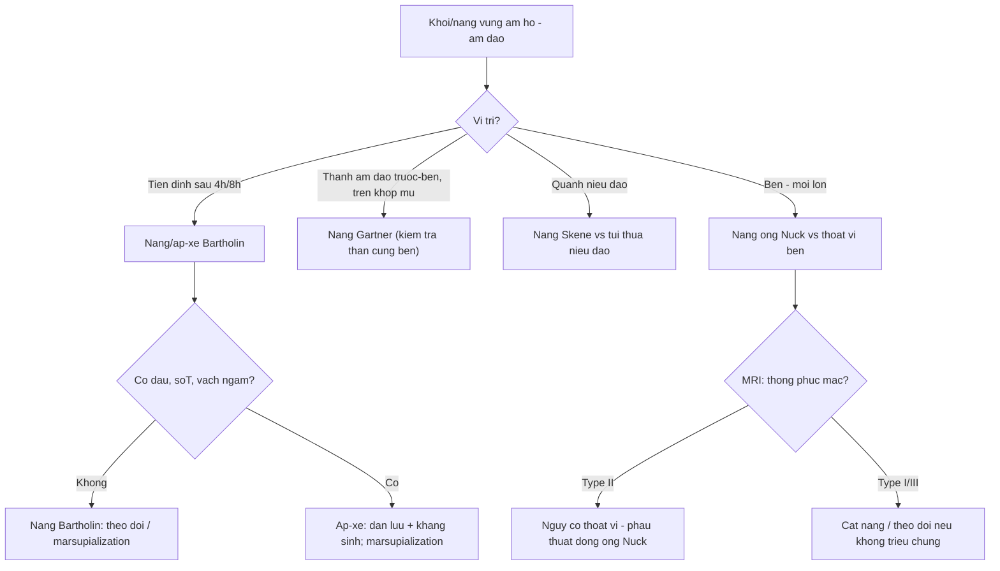
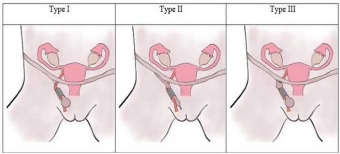
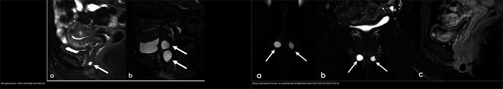
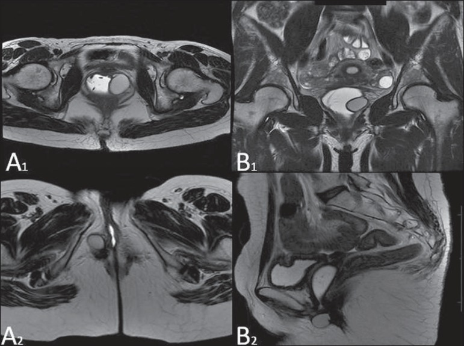
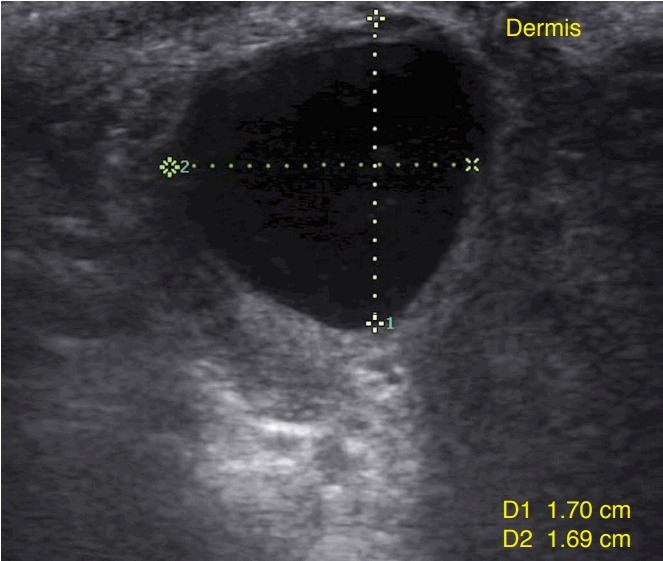
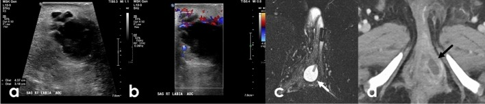
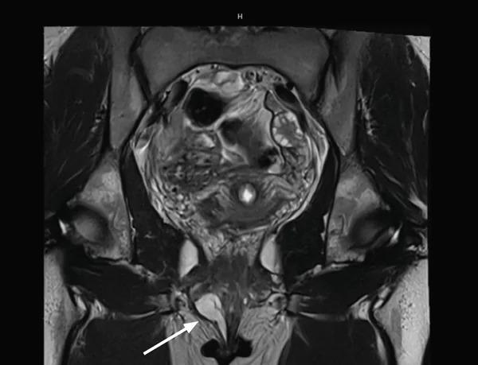
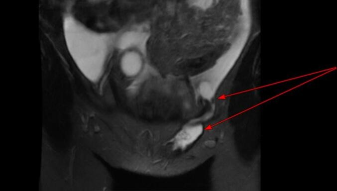

# 548 — Nang/khối lành vùng âm hộ – âm đạo: Bartholin, Gartner & ống Nuck / Benign vulvovaginal cysts: Bartholin, Gartner duct & canal of Nuck

**Tags:** `pattern:nang-am-ho` `pattern:nang-am-dao` `pattern:nang-ben` `vung:am-ho` `vung:am-dao` `vung:ben` `protocol:US-am-ho` `protocol:MRI-chau`
**Mức chắc chắn (certainty):** tổng hợp y văn (literature synthesis) — nhóm tự biên từ tổng quan MRI âm hộ *Abdom Radiol* 2026 (PMC13013239), tổng quan MRI âm đạo *Radiol Bras* 2015 (PMC4567364), tiểu luận siêu âm âm hộ *Ultrasonography* 2018 (PMC6177693) và các ca CC BY về ống Nuck; số liệu định lượng lấy nguyên văn từ bài gốc.

## 1. Tổng quan — giải phẫu, phôi thai học & vì sao mỗi "nang" nằm một chỗ

- **Tuyến Bartholin (Bartholin/greater vestibular gland):** nằm ở **1/3 sau môi lớn**, đổ vào **rãnh tiền đình (vestibule) ở vị trí 4 giờ và 8 giờ**; ống tuyến dài **2–2,5 cm**. Ống bị tắc → **nang Bartholin**, bội nhiễm → **áp-xe Bartholin**. Đây là **nang âm hộ hay gặp nhất**, gặp ở khoảng **2% phụ nữ**, chủ yếu tuổi sinh sản (Karabük E & Ganime Aygün E, *J Turk Ger Gynecol Assoc* 2022, PMC9161003).
- **Nang ống Gartner (Gartner duct cyst):** tồn dư **ống trung thận (mesonephric/Wolffian duct)** — ở nữ ống này **thoái triển**, đoạn còn sót ở **thành âm đạo TRƯỚC–BÊN, phía trên khớp mu** → nang **thành bên trên âm đạo**, thường nhỏ, không triệu chứng; có thể kèm **bất thường đường niệu–sinh dục** (Ferreira DM và cộng sự, *Radiol Bras* 2015, PMC4567364).
- **Nang ống Nuck (canal of Nuck cyst/hydrocele):** ở nữ, màng bụng (peritoneum) chạy theo **dây chằng tròn** xuống **ống bẹn**; bình thường **bít kín**. Không bít hết → nang/hydrocele **vùng bẹn – môi lớn**, phân 3 type theo Counseller–Black (1941): **type I** = nang kín từng ổ (**thường gặp nhất**), **type II** = còn **thông với khoang phúc mạc** (nguy cơ thoát vị!), **type III** = **hai thùy hình đồng hồ cát** do thắt ở lỗ bẹn sâu (Bahall V và cộng sự, *Case Rep Womens Health* 2026, PMC13325312).
- **Ảnh hưởng lên hình ảnh (TẠI SAO):**
  - Nang **đơn thuần chứa dịch**: **T2 rất sáng (giống nước)**, **T1 tối**, **thành mỏng, KHÔNG ngấm thuốc ở vách trong**.
  - Nếu dịch giàu **protein/mucin/máu** → **T1 sáng lên**: phải **T1 fat-sat** để phân biệt với mỡ (nang bã/dermoid).
  - **Áp-xe**: **vách dày, ngấm thuốc mạnh, phù mô xung quanh, hạn chế khuếch tán (DWI sáng/ADC tối)** — đây là dấu hiệu chuyển "nang" → "áp-xe" (Golden E và cộng sự, *Abdom Radiol* 2026, PMC13013239).
  - **Nang ống Nuck type II**: thấy **đường thông trực tiếp khoang phúc mạc ↔ nang** — dấu hiệu chốt (PMC13325312).
- **Ngưỡng định lượng bắt buộc nhớ:**
  - **Nang/áp-xe Bartholin ≈ 2% phụ nữ** (PMC9161003).
  - **Tái phát sau điều trị:** **mở thông túi (marsupialization) 8,3% (11 ca)** vs **ống thông Word (Word catheter) 18,8% (12 ca)**, **p = 0,034**; điểm hài lòng VAS **4 vs 3** — marsupialization tốt hơn (n = 196) (PMC9161003).
  - **Số liệu giải phẫu bệnh 57 ca u/giả u âm hộ–âm đạo** (Efared B và cộng sự, *BMC Res Notes* 2026, PMC12903300): **52,6% ở âm hộ**; tuổi trung bình **38,55 ± 16,65**; **56,7% dạng nang**, kích thước trung bình **3,9 ± 2,07 cm (0,8–9 cm)**; **lành tính 59,6%**, trong đó **nang Bartholin 19,3%**; tổn thương âm đạo ác tính nhiều hơn hẳn (70,4% vs 13,4%, p < 0,001).
  - **Ung thư tuyến Bartholin (BGC):** hiếm, chiếm **3–7% ung thư âm hộ** (Kostov S và cộng sự, *Cancers* 2025, PMC12691067) — **cờ đỏ** khi khối **cứng, cố định, > 40 tuổi, không xẹp sau chọc/dẫn lưu, tái phát nhanh**.
  - **Canal of Nuck:** hiếm; thường gặp ở trẻ em nhưng **cũng gặp ở phụ nữ tuổi sinh sản**; chẩn đoán hay nhầm với **thoát vị bẹn/thoát vị đùi** (PMC13325312).

## 2. Mẫu hình + chẩn đoán phân biệt theo vị trí (Gamut)

- **Theo vị trí — quy tắc "vị trí là chốt":**
  - **Tiền đình sau – môi lớn (4h/8h):** nang/áp-xe **Bartholin**; nang **biểu bì (epidermoid)**; u/mụn mồ hôi; **u tuyến Bartholin** (ác).
  - **Thành âm đạo trước–bên, TRÊN khớp mu:** nang **Gartner**; nang **Müllerian** (thành trước, đường giữa hơn).
  - **Quanh niệu đạo (paraurethral), đoạn xa:** nang **Skene**; **túi thừa niệu đạo (urethral diverticulum)**.
  - **Vùng bẹn – môi lớn (inguino-labial):** nang/ hydrocele **ống Nuck**; **thoát vị bẹn/đùi**; hạch; **lạc nội mạc ống Nuck**; nang bọc phúc mạc.
- **Theo mẫu hình trên ảnh:** (1) nang đơn thuần **tròn, bờ mỏng, không ngấm**; (2) nang **có váy/ngấm + phù quanh** = **áp-xe**; (3) khối **đặc** – ngấm mạnh – DWI hạn chế = **nghi ác**; (4) nang **thông với phúc mạc** = **ống Nuck type II**; (5) nang ở **thành bên trên âm đạo + bất thường thận cùng bên** = **Gartner** (gợi ý hội chứng OHVIRA).
- **Gợi nhớ theo chữ cái vị trí:** **B**artholin = **Below/behind** (sau, tiền đình, dưới khớp mu); **G**artner = **Above** (trên khớp mu, thành bên); **N**uck = **groiN** (bẹn–môi lớn).

*Sơ đồ 3 type: **type I** nang kín từng ổ (thường gặp nhất), **type II** còn thông phúc mạc (nguy cơ thoát vị), **type III** hai thùy hình đồng hồ cát do thắt ở lỗ bẹn sâu. Nguồn: G Meskel T và cộng sự, *Clin Med Insights Case Rep* 2025 (PMC12441254), CC BY-NC 4.0 (nguyên bản, không ghép).*

## 3. Bảng so sánh phân biệt (ma trận đối chiếu)

| Thực thể (entity) | Hình ảnh điển hình (US / MRI) | Chốt vào (rule-in) | Chốt loại (rule-out) | Gợi ý xác nhận |
|---|---|---|---|---|
| Nang Bartholin | US: nang **trống âm/hồi âm kém**, bờ rõ, **tăng âm sau**; MRI: **T2 rất sáng**, thành mỏng, không ngấm | **Vị trí 4h/8h tiền đình sau, môi lớn; không đau; thành mỏng** | Khối **đặc/ngấm mạnh** hoặc **đau + vách dày** → áp-xe/u ác | Lâm sàng + US; MRI nếu không điển hình |
| Áp-xe Bartholin | US: dịch **hỗn hợp echo + vách/váng + lắng cặn**, bờ kém rõ; Doppler: **tăng tưới máu quanh**; MRI: **vách ngấm, phù quanh, DWI hạn chế** | **Đau, sưng, sốt + vách dày/ngấm + phù quanh** | Nang đơn thuần thành mỏng, không phù → không áp-xe | Dẫn lưu + cấy; marsupialization |
| Nang ống Gartner | MRI: nang **T2 sáng** ở **thành âm đạo trước–bên, trên khớp mu**; có thể đa nang nhỏ | **Vị trí trên khớp mu + thành bên âm đạo** | Nang ở **tiền đình sau/dưới khớp mu** → Bartholin | MRI tiểu khung; soát **thận cùng bên** |
| Nang ống Nuck | US: nang/hydrocele hình thoi ở **ống bẹn–môi lớn**, đôi khi thay đổi khi Valsalva; MRI: **T2 sáng**, **type II thấy đường thông phúc mạc** | **Vị trí bẹn–môi lớn + đường thông phúc mạc (type II)** | Nang ở tiền đình sau → Bartholin; có quai ruột/mỡ → thoát vị | MRI chọn lọc; **phẫu thuật đóng ống Nuck** |
| Nang Skene | US/MRI: nang **quanh niệu đạo đoạn xa**, đường giữa–bên | **Vị trí cạnh niệu đạo xa** | Nang **thành bên trên âm đạo** → Gartner | MRI + soi niệu đạo |
| Túi thừa niệu đạo | MRI: túi **quanh niệu đạo**, có thể **ngấm viền**, đôi khi có sỏi/cặn | **Nằm quanh niệu đạo + triệu chứng tiểu** | Nang đơn thuần **không liên quan niệu đạo** | Soi niệu đạo/VCUG, MRI |
| Nang biểu bì (epidermoid) | US: nang **trống âm** trong **trung bì**, da–bì nguyên vẹn | **Nang trong trung bì + không liên quan tuyến/niệu đạo** | Vị trí tuyến Bartholin/Gartner → nghĩ nang tuyến | Lâm sàng; cắt nếu triệu chứng |
| Ung thư tuyến Bartholin | Khối **đặc**, ngấm mạnh, DWI hạn chế, có thể xâm lấn/xuất huyết | **Tuổi > 40 + khối cứng/cố định + không xẹp sau dẫn lưu** | Nang/áp-xe đơn thuần đáp ứng dẫn lưu → không ác | **Sinh thiết**; BGC = 3–7% ung thư âm hộ |

*Trái: **nang ống Gartner** — thành bên âm đạo, **phía trên khớp mu**. Phải: **nang Bartholin** — sau/ngoài tiền đình âm đạo, **dưới khớp mu**. Nguồn: Golden E và cộng sự, *Abdom Radiol* 2026 (PMC13013239), CC BY 4.0; ghép letterbox bằng `tools/make_composite.py`.*

*Hình gốc so sánh trực tiếp: **(A1,B1)** nang ống Gartner ở **thành bên âm đạo, trên khớp mu**; **(A2,B2)** nang Bartholin ở **thành sau âm đạo đoạn xa, ngoài lòng âm đạo**. Nguồn: Ferreira DM và cộng sự, *Radiol Bras* 2015 (PMC4567364), CC BY 4.0.*

## 4. Protocol chụp + xử trí

- **Siêu âm — đầu tay cho khối nông/âm hộ:** đầu dò **linear cao tần 7–15 MHz**, đặt trực tiếp lên khối; ghi **kích thước, hồi âm trong lòng, vách, cặn/lắng, thành phần đặc, tưới máu Doppler**; với nang Gartner/Skene dùng **đầu dò âm đạo**. US phân biệt tốt **nang đơn thuần vs áp-xe** (tăng tưới máu quanh, dịch hỗn hợp echo) — Cheung VYT, *Ultrasonography* 2018, PMC6177693.
- **MRI tiểu khung — khi khối sâu/lớn/tái phát/không điển hình:** **T2W axial–coronal–sagittal**, **T1W ± fat-sat** (tách mỡ vs máu/protein), **DWI/ADC** (áp-xe/khối đặc), **DCE** (vách ngấm). Đo **kích thước** và ghi **tương quan với khớp mu/niệu đạo/lỗ bẹn sâu** — đây là chìa khóa định danh nang (Golden E và cộng sự, PMC13013239; Ferreira DM và cộng sự, PMC4567364).
- **Xử trí (tóm lược thực hành):**
  - **Nang Bartholin có triệu chứng:** **marsupialization** (tái phát thấp hơn) hoặc **ống thông Word**; **áp-xe**: rạch dẫn lưu ± đặt ống ± kháng sinh (PMC9161003).
  - **Nang Bartholin > 40 tuổi / nghi ác** → **sinh thiết/mô bệnh**, không chỉ dẫn lưu (BGC 3–7% ung thư âm hộ) (PMC12691067).
  - **Nang Gartner:** theo dõi nếu nhỏ, không triệu chứng; **cắt nội soi âm đạo** nếu to/gây khó chịu/đau khi giao hợp; **luôn kiểm tra thận cùng bên**.
  - **Nang ống Nuck:** **phẫu thuật đóng/cắt ống Nuck** (đặc biệt **type II** vì nguy cơ thoát vị); tránh nhầm với thoát vị bẹn.
  - **Skene/túi thừa niệu đạo:** MRI + soi niệu đạo để chọn đường mổ.

## 5. Biến thể bình thường và cạm bẫy

- **Nhầm vị trí = nhầm chẩn đoán:** ca **nang ống Nuck hai bên** bị chẩn đoán là **nang Bartholin** trên lâm sàng, đến khi MRI mới phân định (Chamseddine R et al., *Case Rep Obstet Gynecol* 2026, PMC13580851) — luôn đối chiếu **tiền đình sau** (Bartholin) vs **bẹn–môi lớn** (Nuck).
- **Ống Nuck type II:** **thông phúc mạc** → nguy cơ **thoát vị/sa quai ruột**; đừng chỉ "theo dõi nang" (PMC13325312).
- **"Nang" ở phụ nữ lớn tuổi:** khối **đặc/cứng/cố định**, không xẹp sau dẫn lưu, tái phát nhanh → **sinh thiết loại trừ ung thư tuyến Bartholin** (3–7% ung thư âm hộ) — đừng mặc định "nang lành" (PMC12691067).
- **Nang Gartner dễ nhầm với nang Müllerian/ nang Skene/túi thừa niệu đạo:** chốt bằng **tương quan giải phẫu với khớp mu và niệu đạo** trên MRI, không dựa vào tín hiệu (mọi nang dịch đều T2 sáng) (PMC4567364, PMC13013239).
- **T1 sáng không đồng nghĩa mỡ:** dịch **giàu protein/mucin/máu** cũng T1 sáng → cần **T1 fat-sat** để tránh gọi sai "nang bã/dermoid" (PMC13013239).
- **Áp-xe vs nang:** vách dày/ngấm + phù quanh + DWI hạn chế = **áp-xe**; nếu chỉ dẫn lưu mà **không điều trị viêm** → tái phát (PMC6177693).
- **Đừng quên lạc nội mạc:** nang ống Nuck/khối bẹn có thể là **endometriosis**, hình ảnh nang có thành phần xuất huyết; cần bối cảnh (PMC13325312 nhắc trong chẩn đoán phân biệt).

## 6. Tự lượng giá — Blind Quiz

**Ca 1 — Nữ 44 tuổi, khối không đau ở môi lớn phải. Đọc ảnh trước.**

- Gợi ý lâm sàng (clinical context): khối mềm, không sốt, không đau, ở 1/3 sau môi lớn.
- Câu hỏi: Mô tả thành phần trong lòng nang? Dấu hiệu nào cho thấy đó là **dịch** (không phải mô đặc)? Chẩn đoán?

<b>Bấm để hiện đáp án (findings + chẩn đoán)</b>

- Dấu hiệu (findings): nang **trống âm/hồi âm kém**, **bờ rõ**, nằm trong **trung bì với da–bì nguyên vẹn**, **tăng âm phía sau** do truyền âm qua dịch; kích thước **1,70 × 1,69 cm**.
- Chẩn đoán (diagnosis): **nang Bartholin** — vị trí 1/3 sau môi lớn + nang dịch đơn thuần. Xử trí: theo dõi nếu không triệu chứng; nếu có triệu chứng → **marsupialization** (tái phát 8,3%).
- Nguồn ảnh: Cheung VYT, *Ultrasonography* 2018 (PMC6177693), CC BY-NC 3.0 (nguyên bản, không ghép).

**Ca 2 — Nữ 26 tuổi, khối đau, sưng, sốt. Đọc ảnh trước.**

- Gợi ý lâm sàng (context): đau tăng, da đỏ, có thể sốt.
- Câu hỏi: Vì sao không còn gọi là "nang" mà là "áp-xe"? Dấu hiệu nào trên US và MRI?

<b>Bấm để hiện đáp án (findings + chẩn đoán)</b>

- Dấu hiệu (findings): (a) siêu âm: **khối dịch hỗn hợp echo, có vách/lắng cặn**; (b) **Doppler màu tăng tưới máu quanh**; (c) T2FS: khối **vách dày**; (d) sau tiêm: **vách ngấm thuốc**.
- Chẩn đoán (diagnosis): **áp-xe tuyến Bartholin** (26 tuổi) — xử trí **rạch dẫn lưu ± ống thông ± kháng sinh**, cân nhắc marsupialization. **Cảnh báo:** nếu **không xẹp** sau dẫn lưu hoặc tái phát nhanh ở tuổi lớn hơn → **sinh thiết loại trừ ung thư**.
- Nguồn ảnh: Golden E và cộng sự, *Abdom Radiol* 2026 (PMC13013239), CC BY 4.0.

**Ca 3 — Phân tích ảnh ghép: hai "nang" khác nhau ở đâu?** *(Bảng mục 3.)*

<b>Bấm để hiện đáp án</b>

- Trái: **nang ống Gartner** — **thành bên âm đạo, TRÊN khớp mu**; phải: **nang Bartholin** — **sau/ngoài tiền đình, DƯỚI khớp mu**.
- **Vị trí tương quan với khớp mu là chốt**, không dựa vào tín hiệu (cả hai đều T2 sáng). Nang Gartner → kiểm tra **thận cùng bên**.
- Nguồn: PMC13013239 (Fig. 5 + Fig. 16), CC BY 4.0 (ảnh ghép letterbox).

**Ca 4 — Nữ trẻ, khối vùng bẹn/môi lớn tái phát sau mổ. Đọc ảnh trước.** *(ca nguyên văn: MRI ban đầu đọc là nang Bartholin)*

- Gợi ý lâm sàng (nguyên văn): khối **vùng bẹn/môi lớn**, tái phát một bên 3 tháng sau mổ; MRI được chỉ định.
- Câu hỏi: Vị trí khối? Vì sao "nang Bartholin" là chẩn đoán sai? Cần tìm gì tiếp?

<b>Bấm để hiện đáp án (findings + chẩn đoán)</b>

- Dấu hiệu (findings): tổn thương nang ở **vùng bẹn–môi lớn**, có **thành phần mô học là tế bào trung biểu mô (mesothelial)** — không phải mô tuyến Bartholin.
- Chẩn đoán (diagnosis): **nang ống Nuck (đọc nhầm thành "nang Bartholin")** — ca gốc: bệnh nhân có **nang ống Nuck hai bên biểu hiện như nang Bartholin**. Chốt: **vị trí bẹn–môi lớn + tế bào trung biểu mô + tiền sử tái phát**; xử trí **đóng/cắt ống Nuck**, không chỉ dẫn lưu.
- Nguồn ảnh: Chamseddine R và cộng sự, *Case Rep Obstet Gynecol* 2026 (PMC13580851), CC BY 4.0.

**Ca 5 — Ca 33 tuổi, hẹn MRI vì khối bẹn trái. Đọc ảnh trước.**

- Gợi ý lâm sàng: khối bẹn trái tăng dần 6 tháng; MRI đánh giá kèm bệnh lý tiểu khung.
- Câu hỏi: Tìm đường thông? Đây là type nào? Vì sao quan trọng?

<b>Bấm để hiện đáp án (findings + chẩn đoán)</b>

- Dấu hiệu (findings): ảnh **T2 fat-sat vành** cho thấy **đường thông trực tiếp giữa khoang phúc mạc và nang ống Nuck** (mũi tên đỏ).
- Chẩn đoán (diagnosis): **nang ống Nuck type II (hydrocele thông)** — còn thông phúc mạc → **nguy cơ thoát vị**, cần **phẫu thuật đóng/cắt ống Nuck**. Phân biệt type I (kín, thường gặp nhất) và type III (hình đồng hồ cát).
- Nguồn ảnh: Bahall V và cộng sự, *Case Rep Womens Health* 2026 (PMC13325312), CC BY-NC-ND 4.0 — **nguyên bản, không ghép**.

**Ca 6 — MRI hai nang khác vị trí. Đọc ảnh trước.**

- Gợi ý lâm sàng: hai bệnh nhân khác nhau, đều tình cờ phát hiện nang.
- Câu hỏi: Ảnh trên (A1,B1) và dưới (A2,B2) là nang gì? Dựa vào mốc giải phẫu nào?

<b>Bấm để hiện đáp án (findings + chẩn đoán)</b>

- Dấu hiệu (findings): **(A1,B1) nang ống Gartner** ở **thành bên âm đạo, phía trên khớp mu**; **(A2,B2) nang Bartholin** ở **thành sau âm đạo đoạn xa, ngoài lòng âm đạo**.
- Chẩn đoán (diagnosis): **vị trí so với khớp mu và âm đạo** là chốt; nang Gartner cần soát **bất thường đường niệu cùng bên**.
- Nguồn ảnh: Ferreira DM và cộng sự, *Radiol Bras* 2015 (PMC4567364), CC BY 4.0.

## Bài liên quan chéo
- [500 – Tổng quan Vú & Sản Phụ khoa](../500-tong-quan-vu-san-phu-khoa/lesson.md)
- [529 – Cổ tử cung & âm đạo bẩm sinh: dị dạng tắc nghẽn](../529-co-tu-cung-am-dao-bam-sinh-tac-nghen/lesson.md)
- [547 – Sa tạng chậu nữ: POP-Q & lưới nâng](../547-sa-tang-chau-nu-POP-Q-luoi-nang/lesson.md)
- [574 – Ung thư âm hộ & âm đạo: FIGO 2021 + hạch bẹn–đùi](../574-ung-thu-am-ho-am-dao-FIGO-hach-ben/lesson.md)
- [536 – U mầm & u mô đệm–dây sinh dục buồng trứng](../536-u-mam-u-mo-dem-buong-trung/lesson.md)

## Ảnh
- Tên file: `548_nang-lanh_Modality_SourceID.jpg`. Nguồn + giấy phép từng ảnh trong `images/CREDITS.md`.
- Ảnh **CC BY 4.0** cho phép tải/ghép (ghi nguồn); ảnh **CC BY-NC / CC BY-NC-ND** dùng **nguyên bản, không ghép**.
- AuntMinnie (https://www.auntminnie.com): paywall — **chỉ dẫn link, không tải**.

> Không dùng để chẩn đoán độc lập khi chưa có người hướng dẫn (Disclaimer y tế).
